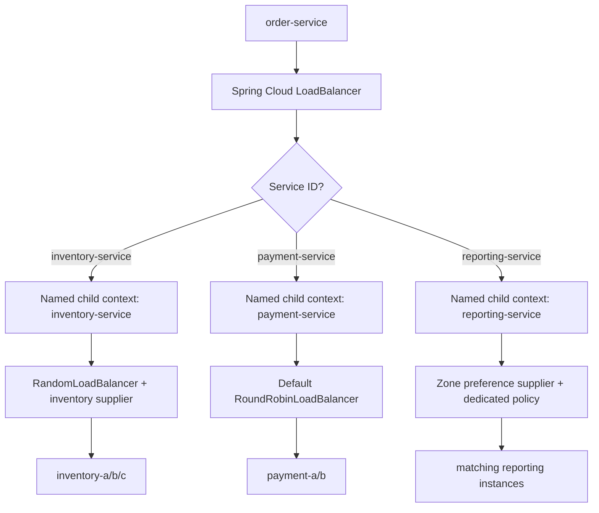

# Registering Per-Service-ID Customizations Without Affecting the Whole System

In a microservices architecture, not every dependency needs the same load-balancing policy. `inventory-service` might require random distribution across replicas, `payment-service` should keep the default round-robin behavior, and `reporting-service` may need zone- or metadata-based filtering prior to instance selection.

**Spring Cloud LoadBalancer allows per-service-ID customization via `@LoadBalancerClient` and `@LoadBalancerClients`.** The key is registering the `ReactorLoadBalancer<ServiceInstance>` or `ServiceInstanceListSupplier` bean inside **the configuration context of the specific service**, rather than accidentally creating a bean in the main application context that forces all clients onto the same policy.

This lesson belongs to the **Customizing LoadBalancer** chapter of the `SPRING_CLOUD_SERVICE_COMMUNICATION_LOAD_BALANCING` module. Its goals are to understand how each service ID gets its own LoadBalancer client context, write properly scoped customization examples, avoid component-scan traps, integrate with RestClient/WebClient/OpenFeign, test across multiple service IDs, and establish safe operational practices.

## 1. The Problem: One Algorithm Does Not Fit Every Dependency

Suppose `order-service` calls three services:

| Service ID | Replicas | Desired policy |
|---|---:|---|
| `inventory-service` | 3 | Random selection among eligible candidates |
| `payment-service` | 2 | Keep default round-robin |
| `reporting-service` | 4 | Prefer same-zone instances, then pick from the matching subset |

If you define a `RandomLoadBalancer` bean in the main application context without controlling scope, that bean can interfere with the default configuration of multiple service IDs. As a result, a small change meant solely for inventory unintentionally changes payment's algorithm.

A sound design must prove:

1. Requests to `inventory-service` use the custom configuration registered for inventory.
2. Requests to `payment-service` keep using the default configuration.
3. The `ServiceInstance` set for each service is retrieved using the **right service ID**.
4. Custom configurations do not leak unintended global beans.
5. The application still handles empty instance lists, retries, health checks, and transport errors accurately.



**Customization scope lives in the per-service-ID configuration**, not in creating a new HTTP client Java interface or slapping an arbitrary `@Qualifier` onto a bean.

## 2. LoadBalancer's Named Child Context Mechanism

Spring Cloud LoadBalancer uses `LoadBalancerClientFactory` to manage configuration per client name/service ID. Each name can have its own **child `ApplicationContext`** containing the appropriate algorithm and supplier. These contexts are created **lazily** on first use of a service ID unless eager loading is configured.

```text
Main ApplicationContext of order-service
│
├── @LoadBalanced RestClient.Builder / WebClient.Builder
├── LoadBalancerClientFactory
│   │
│   ├── Child context: inventory-service
│   │     ├── ReactorLoadBalancer<ServiceInstance> = RandomLoadBalancer
│   │     └── ServiceInstanceListSupplier = inventory source
│   │
│   ├── Child context: payment-service
│   │     ├── ReactorLoadBalancer<ServiceInstance> = RoundRobinLoadBalancer
│   │     └── ServiceInstanceListSupplier = payment source
│   │
│   └── Child context: reporting-service
│         ├── ReactorLoadBalancer<ServiceInstance> = ...
│         └── ServiceInstanceListSupplier = zone-aware source
│
└── Other business beans
```

Child contexts can see certain beans from the parent via Spring's context hierarchy. That very mechanism creates the **scope trap**: if a custom LoadBalancer bean is accidentally registered in the parent, it becomes visible to other child contexts, preventing default configurations from being created as expected.

### 2.1. Distinguishing Names Used Across the System

| Concept | Example | Role |
|---|---|---|
| Service ID in URI | `http://inventory-service/items` | Logical name LoadBalancer uses to look up instance lists |
| `@LoadBalancerClient(name=...)` | `inventory-service` | Picks which child context receives the custom configuration |
| `LoadBalancerClientFactory.PROPERTY_NAME` | Service ID of the current child context | Tells bean factory methods which service they are configuring |
| `ServiceInstance.getServiceId()` | `inventory-service` | Property on instances supplied by discovery |
| Feign `contextId` | `inventoryReadClient` | Identifier for Feign client context/bean; not automatically the LB service ID |
| Physical host | `10.0.1.11:8081` | Address HTTP transport connects to after instance selection |

**The service ID value must match** across the logical URL, discovery, and `@LoadBalancerClient`. If you register a policy for `inventory` while the client calls `inventory-service`, the policy will not apply to that different name.

## 3. Minimal Dependencies and Prerequisites Before Customizing

Assuming the Spring Boot/Spring Cloud project uses a compatible BOM, Maven dependencies for RestClient:

```xml
<dependencies>
    <dependency>
        <groupId>org.springframework.boot</groupId>
        <artifactId>spring-boot-starter-web</artifactId>
    </dependency>

    <dependency>
        <groupId>org.springframework.cloud</groupId>
        <artifactId>spring-cloud-starter-loadbalancer</artifactId>
    </dependency>

    <dependency>
        <groupId>org.springframework.boot</groupId>
        <artifactId>spring-boot-starter-test</artifactId>
        <scope>test</scope>
    </dependency>
</dependencies>
```

You need a `ServiceInstance` source: Eureka, Consul, Kubernetes discovery, `SimpleDiscoveryClient`, or a custom supplier. **Declaring `@LoadBalancerClient` alone does not produce an instance list.**

For WebClient, add `spring-boot-starter-webflux`. For OpenFeign, add `spring-cloud-starter-openfeign`. Some APIs and properties vary across release trains, so use compatible Spring Boot/Spring Cloud versions.

### 3.1. Default Policy

Per Spring Cloud Commons documentation, the standard default algorithm is `RoundRobinLoadBalancer`. Customization can replace it with `RandomLoadBalancer` or another `ReactorLoadBalancer<ServiceInstance>` implementation.

`RandomLoadBalancer` chooses randomly from the **candidates supplied by the supplier**. It does not health-check instances, verify zones, fix discovery, or guarantee the next request goes to a different replica.

## 4. Registering for One Service with @LoadBalancerClient

Example of an application wanting **only inventory to use RandomLoadBalancer**, while payment keeps the default.

### 4.1. Application Configuration

```java
package com.example.order;

import org.springframework.boot.SpringApplication;
import org.springframework.boot.autoconfigure.SpringBootApplication;
import org.springframework.cloud.loadbalancer.annotation.LoadBalancerClient;

@SpringBootApplication
@LoadBalancerClient(
        name = "inventory-service",
        configuration = InventoryLoadBalancerConfiguration.class)
public class OrderServiceApplication {

    public static void main(String[] args) {
        SpringApplication.run(OrderServiceApplication.class, args);
    }
}
```

`name="inventory-service"` is the key identifying which **child LoadBalancer context** receives the configuration. Only inventory's child context explicitly loads `InventoryLoadBalancerConfiguration` via this annotation.

### 4.2. Configuring the Custom Algorithm for Inventory

Code following the official Spring Cloud Commons example:

```java
package com.example.order;

import org.springframework.cloud.client.ServiceInstance;
import org.springframework.cloud.loadbalancer.core.RandomLoadBalancer;
import org.springframework.cloud.loadbalancer.core.ReactorLoadBalancer;
import org.springframework.cloud.loadbalancer.core.ServiceInstanceListSupplier;
import org.springframework.cloud.loadbalancer.support.LoadBalancerClientFactory;
import org.springframework.context.annotation.Bean;
import org.springframework.core.env.Environment;

// INTENTIONALLY omit @Configuration and @Component on this class.
// Spring Cloud loads this class into the inventory-service child context.
public class InventoryLoadBalancerConfiguration {

    @Bean
    ReactorLoadBalancer<ServiceInstance> inventoryLoadBalancer(
            Environment environment,
            LoadBalancerClientFactory factory) {

        String serviceId = environment.getProperty(
                LoadBalancerClientFactory.PROPERTY_NAME);

        return new RandomLoadBalancer(
                factory.getLazyProvider(
                        serviceId,
                        ServiceInstanceListSupplier.class),
                serviceId);
    }
}
```

Explaining each piece:

- `ReactorLoadBalancer<ServiceInstance>` is the algorithm contract Spring Cloud LoadBalancer looks up to pick instances.
- `LoadBalancerClientFactory.PROPERTY_NAME` reads the client name in the current child context, **rather than hardcoding service IDs everywhere**.
- `getLazyProvider(serviceId, ServiceInstanceListSupplier.class)` supplies the supplier bound to that child context, avoiding instantiating the algorithm before the supplier is ready.
- `RandomLoadBalancer` picks from the supplier's list. If the list is empty, no valid instance can be chosen.
- The class **omits `@Configuration` and `@Component`** so the main application context's component scan does not auto-discover it.

### 4.3. Why Omit @Configuration?

Spring Cloud documentation recommends that classes passed to `@LoadBalancerClient(configuration=...)` either:

- **Omit `@Configuration`**, or
- Place the `@Configuration` class **outside the component scan scope** of the main application.

This ensures the custom bean is registered exclusively in the designated child context. A class without `@Configuration` that defines `@Bean` methods can still be processed by Spring Cloud when supplied directly as a load-balancer client configuration.

Keep in mind: `@Configuration` is not inherently "bad"; the risk is the **config class getting scanned into the parent**, causing the custom bean to be shared across other services. Placing the class outside component scan is also valid, though easy to break during package refactoring. For hands-on work, the clearest pattern is **keeping per-service LoadBalancer configuration classes free of stereotypes**.

## 5. Why Can a Shared @LoadBalanced RestClient.Builder Serve Multiple Policies?

In an application, a single `@LoadBalanced RestClient.Builder` bean can construct clients for multiple service IDs:

```java
package com.example.order;

import org.springframework.cloud.client.loadbalancer.LoadBalanced;
import org.springframework.context.annotation.Bean;
import org.springframework.context.annotation.Configuration;
import org.springframework.web.client.RestClient;

@Configuration(proxyBeanMethods = false)
public class OutboundHttpConfiguration {

    @Bean("loadBalancedRestClientBuilder")
    @LoadBalanced
    RestClient.Builder loadBalancedRestClientBuilder() {
        return RestClient.builder();
    }
}
```

The caller creates two distinct clients:

```java
import org.springframework.beans.factory.annotation.Qualifier;
import org.springframework.stereotype.Service;
import org.springframework.web.client.RestClient;

@Service
public class DownstreamGateway {

    private final RestClient inventory;
    private final RestClient payment;

    public DownstreamGateway(
            @Qualifier("loadBalancedRestClientBuilder")
            RestClient.Builder builder) {

        this.inventory = builder.clone()
                .baseUrl("http://inventory-service")
                .build();

        this.payment = builder.clone()
                .baseUrl("http://payment-service")
                .build();
    }

    public String inventoryInstance() {
        return inventory.get()
                .uri("/whoami")
                .retrieve()
                .body(String.class);
    }

    public String paymentInstance() {
        return payment.get()
                .uri("/whoami")
                .retrieve()
                .body(String.class);
    }
}
```

`clone()` isolates each client's base URL configuration rather than mutating a shared builder. What determines the policy is the **logical hostname in the final URL**:

- `inventory-service` → child context containing `RandomLoadBalancer`.
- `payment-service` → default child context with `RoundRobinLoadBalancer`, unless customized elsewhere.

A single `@LoadBalanced` builder can serve many service IDs; **it does not force all services onto the same algorithm**. Conversely, calling `RestClient.create("http://inventory-service")` without going through a Spring Cloud-configured builder bypasses service-ID load balancing.

### 5.1. Distinguish Direct URLs

```java
RestClient direct = RestClient.create(
        "http://10.0.1.11:8081");
```

This client connects directly to an IP/port. It does not use the logical hostname `inventory-service` for Spring Cloud discovery selection; therefore `@LoadBalancerClient(name="inventory-service", ...)` has no effect on instance selection for those calls.

## 6. Registering Multiple Service IDs with @LoadBalancerClients

When each dependency needs a different policy, use `@LoadBalancerClients` to register a group of configurations:

```java
import org.springframework.cloud.loadbalancer.annotation.LoadBalancerClient;
import org.springframework.cloud.loadbalancer.annotation.LoadBalancerClients;
import org.springframework.context.annotation.Configuration;

@Configuration(proxyBeanMethods = false)
@LoadBalancerClients({
    @LoadBalancerClient(
            name = "inventory-service",
            configuration = InventoryLoadBalancerConfiguration.class),
    @LoadBalancerClient(
            name = "reporting-service",
            configuration = ReportingLoadBalancerConfiguration.class)
})
public class LoadBalancerRegistrations {
}
```

Here:

- Inventory gets inventory's dedicated configuration.
- Reporting gets reporting's dedicated configuration.
- Payment does not appear in the annotation, so it keeps the default configuration **unless affected by other global beans/properties**.

`ReportingLoadBalancerConfiguration` is an application-defined configuration class. You do not need to list every service in `@LoadBalancerClients`; declare only those services that genuinely need to replace default policies or require custom beans.

### 6.1. Do Not Arbitrarily Register Duplicate Entries for the Same Service ID

If one service ID appears in multiple `@LoadBalancerClient` declarations, check how merging and precedence work in your Spring Cloud version. Having multiple `ReactorLoadBalancer` or `ServiceInstanceListSupplier` beans in one child context can cause ambiguous injection or unexpected policy selection.

Recommendations:

1. Each service ID has **one clear owner** for its algorithm configuration.
2. Each policy class should be named after its target service or business role.
3. To share common code, reuse **factory/helper classes** rather than accidentally sharing bean scope.
4. Test each service ID in a live context rather than guessing override order.

## 7. Customizing a Dedicated Supplier for One Service

Beyond the algorithm, a service may need its own `ServiceInstanceListSupplier` chain. The supplier determines the **candidate list** before the algorithm selects.

For example, reporting wants to prefer same-zone replicas. A class can register a dedicated supplier:

```java
import org.springframework.cloud.loadbalancer.core.ServiceInstanceListSupplier;
import org.springframework.context.ConfigurableApplicationContext;
import org.springframework.context.annotation.Bean;

// No @Configuration if this class lies within the application's component scan.
public class ReportingLoadBalancerConfiguration {

    @Bean
    ServiceInstanceListSupplier reportingSupplier(
            ConfigurableApplicationContext context) {

        return ServiceInstanceListSupplier.builder()
                .withBlockingDiscoveryClient()
                .withCaching()
                .withZonePreference()
                .build(context);
    }
}
```

To apply it, register:

```java
@LoadBalancerClient(
        name = "reporting-service",
        configuration = ReportingLoadBalancerConfiguration.class)
```

Key notes:

- `withBlockingDiscoveryClient()` uses a blocking `DiscoveryClient`. If your project uses `ReactiveDiscoveryClient`, pick the reactive builder method and chain instead of copying the blocking example.
- `withCaching()` should sit **right after the instance-fetching source**, before per-request/zone filters so per-call context stays fresh.
- `withZonePreference()` alters candidate filtering/priority; it does not turn the algorithm into weighted random or least-connections.
- Do not assume health checks and caching should both wrap each other. With `HealthCheckServiceInstanceListSupplier`, documentation advises against adding an outer cache wrapper because the health checker maintains its own cache/replay mechanism.
- Zone preference falls back to the delegate set when no same-zone instance exists; do not treat every filter as a hard constraint.
- Other services will not use `ReportingLoadBalancerConfiguration` as long as the class is not registered into the parent.

### 7.1. When to Customize the Algorithm vs. the Supplier?

| Need | Suitable customization point |
|---|---|
| Random selection from candidates | `RandomLoadBalancer` |
| Sequential, simple fair distribution | `RoundRobinLoadBalancer` |
| Healthy instances only | Health-aware `ServiceInstanceListSupplier` |
| Prefer same zone | Zone-aware supplier |
| Based on metadata/hints | Hint-based or custom supplier |
| Weight-based distribution | Weighted supplier or matching custom algorithm |
| Request-based sticky routing | Request-aware supplier or appropriate policy |
| Record pre/post-selection metrics | `LoadBalancerLifecycle` instrumentation |
| HTTP timeouts/retries | HTTP transport and retry policy, not just selector |

**Do not build a custom instance-selection algorithm** if the requirement is simply filtering candidates by metadata. Keeping a clear supplier chain is usually easier to test and maintain.

## 8. Configuration Scope: Parent Context vs. Child Context

This is the most critical concept for avoiding system-wide side effects.

### 8.1. Properly Scoped Configuration

```java
public class InventoryLoadBalancerConfiguration {

    @Bean
    ReactorLoadBalancer<ServiceInstance> randomInventory(
            Environment environment,
            LoadBalancerClientFactory factory) {
        String id = environment.getProperty(
                LoadBalancerClientFactory.PROPERTY_NAME);

        return new RandomLoadBalancer(
                factory.getLazyProvider(
                        id, ServiceInstanceListSupplier.class),
                id);
    }
}
```

This class is loaded by Spring Cloud solely through:

```java
@LoadBalancerClient(
        name = "inventory-service",
        configuration = InventoryLoadBalancerConfiguration.class)
```

### 8.2. Configuration Prone to Scope Leaks

```java
// WARNING: If this package falls inside the main application's component scan,
// the RandomLoadBalancer bean may be registered in the parent context.
@Configuration
public class AccidentallyGlobalLoadBalancerConfiguration {

    @Bean
    ReactorLoadBalancer<ServiceInstance> randomForEverything(
            Environment environment,
            LoadBalancerClientFactory factory) {

        String id = environment.getProperty(
                LoadBalancerClientFactory.PROPERTY_NAME);

        return new RandomLoadBalancer(
                factory.getLazyProvider(
                        id, ServiceInstanceListSupplier.class),
                id);
    }
}
```

In the parent context, `LoadBalancerClientFactory.PROPERTY_NAME` may have no service ID value. That bean can fail initialization or affect child contexts via inheritance. A custom bean in the parent can also cause the default algorithm's `@ConditionalOnMissingBean` condition to evaluate false inside child contexts.

**Fix:** Omit `@Configuration` on per-client config classes located inside component scan, or move them outside scan scope. Defining a `@LoadBalancerClient` registration class in the parent while keeping dedicated config classes stereotype-free is clean and readable.

### 8.3. Why Doesn't @Primary Solve the Root Issue?

Putting `@Primary` on `RandomLoadBalancer` in the parent only increases its injection priority everywhere. It **does not restrict** the bean to inventory. Proper scoping must be established via `@LoadBalancerClient`/child contexts, not injection priority hacks.

### 8.4. @Qualifier Addresses a Different Concern

`@Qualifier("loadBalancedRestClientBuilder")` selects the **LoadBalancer-enabled builder**. It does not control whether `inventory-service` uses Random or RoundRobin. Policy selection is driven by the service ID extracted from the logical URI by the interceptor/filter.

## 9. Per-Client Property Configuration

Spring Cloud Commons also supports per-client properties under the prefix:

```text
spring.cloud.loadbalancer.clients.<clientId>.*
```

Global defaults under `spring.cloud.loadbalancer.*` can merge with client-specific settings, with per-client values taking precedence for properties supported by the config mechanism.

For example, running inventory's health check at a different interval:

```yaml
spring:
  cloud:
    loadbalancer:
      health-check:
        initial-delay: 1s
      clients:
        inventory-service:
          health-check:
            interval: 10s
        reporting-service:
          health-check:
            interval: 30s
```

This illustrates **per-service configuration properties**, not Java policy bean registration. Health-check properties take effect only when a compatible supplier/health-check mechanism is enabled.

### 9.1. Distinguish Global vs. Per-Service Properties

| Configuration | Intended scope |
|---|---|
| `spring.cloud.loadbalancer.configurations=zone-preference` | Broader default predefined supplier configuration, affecting multiple clients |
| `@LoadBalancerClient(name="inventory-service", configuration=...)` | Custom beans strictly for inventory's child context |
| `spring.cloud.loadbalancer.clients.inventory-service.health-check.interval` | Property scoped to inventory if supported by version/consumer |
| `spring.cloud.loadbalancer.cache.enabled=false` | Global setting when no per-client override applies |
| `spring.cloud.loadbalancer.eager-load.clients` | List of client contexts initialized eagerly at startup |

**Never assume every Spring Cloud property supports per-client overrides identically.** Check property classes and effective behavior in your project's Spring Cloud release train.

### 9.2. When to Use Annotations vs. Properties?

- Use **`@LoadBalancerClient`** when replacing algorithm beans, suppliers, or lifecycles for a specific service ID.
- Use **client-specific properties** when tuning parameters already exposed by the framework.
- Combine both when replacing a supplier/algorithm and customizing supported per-client TTLs, timeouts, or intervals.
- Avoid changing a global property just to tune one dependency when a clearer per-client mechanism exists.

## 10. Integration with RestClient, WebClient, and OpenFeign

Per-service-ID customization belongs to **Spring Cloud LoadBalancer**, so it applies across multiple HTTP clients as long as calls route through Spring Cloud LoadBalancer.

### 10.1. RestClient

```java
@RestController
class InventoryController {

    private final RestClient client;

    InventoryController(
            @Qualifier("loadBalancedRestClientBuilder")
            RestClient.Builder builder) {
        this.client = builder.build();
    }

    @GetMapping("/probe-inventory")
    String probe() {
        return client.get()
                .uri("http://inventory-service/whoami")
                .retrieve()
                .body(String.class);
    }
}
```

Because the URL uses `inventory-service` and the builder has `@LoadBalanced`, the policy in inventory's child context is applied.

### 10.2. WebClient

```java
@Configuration(proxyBeanMethods = false)
class ReactiveHttpClientConfiguration {

    @Bean("loadBalancedWebClientBuilder")
    @LoadBalanced
    WebClient.Builder loadBalancedWebClientBuilder() {
        return WebClient.builder();
    }
}
```

Example:

```java
Mono<String> value = loadBalancedWebClientBuilder
        .build()
        .get()
        .uri("http://inventory-service/whoami")
        .retrieve()
        .bodyToMono(String.class);
```

`loadBalancedWebClientBuilder` here is injected from the `@LoadBalanced` bean. The reactive client uses the matching child-context policy without redeclaring the algorithm on WebClient. Subscribe/compose the publisher for the HTTP request to actually execute.

### 10.3. OpenFeign

```java
@FeignClient(name = "inventory-service")
public interface InventoryFeignClient {

    @GetMapping("/whoami")
    String whoami();
}
```

When Feign uses a service ID with Spring Cloud LoadBalancer integration, inventory's policy applies.

Conversely:

```java
@FeignClient(
        name = "inventory-service",
        url = "http://inventory-a.internal:8081")
public interface DirectInventoryFeignClient {

    @GetMapping("/whoami")
    String whoami();
}
```

A Feign client with a fixed `url` calls that target directly and **does not select instances for inventory's service ID via Spring Cloud LoadBalancer** on those calls. Adding `@LoadBalancerClient` does not convert a direct URL into a logical name.

### 10.4. HTTP Interfaces

With HTTP Interfaces built on `HttpServiceProxyFactory`, the adapter is created from a load-balanced `RestClient` or `WebClient`. The `@HttpExchange` annotation defines only the HTTP contract and does not activate per-service policies on its own. Ensure the base URL uses the logical hostname `inventory-service`.

## 11. Testing Two Service IDs: Proving No System-Wide Side Effects

Seeing a successful response from inventory alone does not prove customization scope is right. A thorough test must **verify both inventory's and payment's policies simultaneously**.

Design:

- `inventory-service` has two HTTP servers A/B.
- `payment-service` has two HTTP servers A/B.
- Inventory's child context provides `RandomLoadBalancer`.
- Payment's child context provides `RoundRobinLoadBalancer`.
- The client shares one `@LoadBalanced RestClient.Builder` while calling two distinct logical hostnames.
- Each HTTP stub returns its own instance ID as the response body.
- Tests verify both the live bean type in each child context and real HTTP requests.

**Note:** With `RandomLoadBalancer`, never assert that 4–8 calls must hit both A and B; random selection can repeat an instance. With payment's RoundRobin, when two instances are valid and retries/caches/filters/background calls are controlled, two consecutive selections normally hit different instances. Adjust expectations if tests run concurrently or apply other custom policies.

## 12. Complete Integration Test Example with Two Service IDs

The example below uses JDK `HttpServer` so neither Eureka nor Consul is needed. `SimpleDiscoveryClient` is populated via `@DynamicPropertySource`, supplying dynamic port URIs for four HTTP servers. The test verifies both **bean scope** and **request routing**.

### 12.1. Test Application

Assume `InventoryLoadBalancerConfiguration` from section 4 is in the same test package or imported appropriately. That class **must not be annotated with `@Configuration`**.

```java
package com.example.order;

import org.springframework.boot.SpringBootConfiguration;
import org.springframework.boot.autoconfigure.EnableAutoConfiguration;
import org.springframework.cloud.client.loadbalancer.LoadBalanced;
import org.springframework.cloud.loadbalancer.annotation.LoadBalancerClient;
import org.springframework.context.annotation.Bean;
import org.springframework.web.client.RestClient;

@SpringBootConfiguration
@EnableAutoConfiguration
@LoadBalancerClient(
        name = "inventory-service",
        configuration = InventoryLoadBalancerConfiguration.class)
class TestApplication {

    @Bean("loadBalancedBuilder")
    @LoadBalanced
    RestClient.Builder loadBalancedBuilder() {
        return RestClient.builder();
    }
}
```

### 12.2. HTTP Stub for Each Instance

```java
package com.example.order;

import java.io.IOException;
import java.io.OutputStream;
import java.io.UncheckedIOException;
import java.net.InetSocketAddress;
import java.nio.charset.StandardCharsets;

import com.sun.net.httpserver.HttpServer;

final class InstanceStub implements AutoCloseable {

    private final HttpServer server;

    private InstanceStub(String instanceId) throws IOException {
        this.server = HttpServer.create(
                new InetSocketAddress("127.0.0.1", 0), 0);

        server.createContext("/whoami", exchange -> {
            byte[] payload = instanceId.getBytes(
                    StandardCharsets.UTF_8);

            exchange.getResponseHeaders().set(
                    "Content-Type", "text/plain; charset=UTF-8");
            exchange.getResponseHeaders().set(
                    "X-Instance-Id", instanceId);

            exchange.sendResponseHeaders(200, payload.length);

            try (OutputStream out =
                         exchange.getResponseBody()) {
                out.write(payload);
            }
        });

        server.start();
    }

    static InstanceStub start(String id) {
        try {
            return new InstanceStub(id);
        } catch (IOException error) {
            throw new UncheckedIOException(error);
        }
    }

    String uri() {
        return "http://127.0.0.1:"
                + server.getAddress().getPort();
    }

    @Override
    public void close() {
        server.stop(0);
    }
}
```

### 12.3. Integration Test for Both Services

```java
package com.example.order;

import java.util.HashSet;
import java.util.Set;

import org.junit.jupiter.api.AfterAll;
import org.junit.jupiter.api.Test;
import org.springframework.beans.factory.annotation.Autowired;
import org.springframework.beans.factory.annotation.Qualifier;
import org.springframework.boot.test.context.SpringBootTest;
import org.springframework.cloud.loadbalancer.core.RandomLoadBalancer;
import org.springframework.cloud.loadbalancer.core.ReactorLoadBalancer;
import org.springframework.cloud.loadbalancer.core.RoundRobinLoadBalancer;
import org.springframework.cloud.loadbalancer.support.LoadBalancerClientFactory;
import org.springframework.test.context.DynamicPropertyRegistry;
import org.springframework.test.context.DynamicPropertySource;
import org.springframework.web.client.RestClient;

import static org.junit.jupiter.api.Assertions.*;

@SpringBootTest(
        classes = TestApplication.class,
        webEnvironment = SpringBootTest.WebEnvironment.NONE,
        properties = {
                "spring.cloud.loadbalancer.cache.enabled=false",
                "spring.cloud.loadbalancer.retry.enabled=false"
        }
)
class ScopedLoadBalancerTest {

    private static final InstanceStub INVENTORY_A =
            InstanceStub.start("inventory-a");
    private static final InstanceStub INVENTORY_B =
            InstanceStub.start("inventory-b");

    private static final InstanceStub PAYMENT_A =
            InstanceStub.start("payment-a");
    private static final InstanceStub PAYMENT_B =
            InstanceStub.start("payment-b");

    @DynamicPropertySource
    static void registerInstances(DynamicPropertyRegistry registry) {
        registry.add(
                "spring.cloud.discovery.client.simple.instances."
                        + "inventory-service[0].uri",
                INVENTORY_A::uri);
        registry.add(
                "spring.cloud.discovery.client.simple.instances."
                        + "inventory-service[1].uri",
                INVENTORY_B::uri);

        registry.add(
                "spring.cloud.discovery.client.simple.instances."
                        + "payment-service[0].uri",
                PAYMENT_A::uri);
        registry.add(
                "spring.cloud.discovery.client.simple.instances."
                        + "payment-service[1].uri",
                PAYMENT_B::uri);
    }

    @Autowired
    LoadBalancerClientFactory factory;

    @Autowired
    @Qualifier("loadBalancedBuilder")
    RestClient.Builder builder;

    @Test
    void inventoryUsesRandomButPaymentKeepsRoundRobin() {
        ReactorLoadBalancer<?> inventoryPolicy =
                factory.getInstance(
                        "inventory-service",
                        ReactorLoadBalancer.class);

        ReactorLoadBalancer<?> paymentPolicy =
                factory.getInstance(
                        "payment-service",
                        ReactorLoadBalancer.class);

        assertInstanceOf(
                RandomLoadBalancer.class, inventoryPolicy);
        assertInstanceOf(
                RoundRobinLoadBalancer.class, paymentPolicy);

        assertNotSame(inventoryPolicy, paymentPolicy);
    }

    @Test
    void inventoryCallAlwaysUsesAnInventoryInstance() {
        RestClient client = builder.clone().build();

        for (int n = 0; n < 12; n++) {
            String body = client.get()
                    .uri("http://inventory-service/whoami")
                    .retrieve()
                    .body(String.class);

            assertTrue(Set.of(
                    "inventory-a", "inventory-b")
                    .contains(body));
        }
    }

    @Test
    void paymentStillReachesBothInstances() {
        RestClient client = builder.clone().build();
        Set<String> observed = new HashSet<>();

        for (int n = 0; n < 4; n++) {
            String body = client.get()
                    .uri("http://payment-service/whoami")
                    .retrieve()
                    .body(String.class);

            observed.add(body);
        }

        assertEquals(
                Set.of("payment-a", "payment-b"),
                observed);
    }

    @AfterAll
    static void stopServers() {
        INVENTORY_A.close();
        INVENTORY_B.close();
        PAYMENT_A.close();
        PAYMENT_B.close();
    }
}
```

### 12.4. What Does the Test Prove?

| Check | Evidence |
|---|---|
| `factory.getInstance("inventory-service", ...)` is `RandomLoadBalancer` | Inventory uses custom policy |
| `factory.getInstance("payment-service", ...)` is `RoundRobinLoadBalancer` | Payment keeps default |
| Every inventory response belongs to inventory's A/B set | No traffic sent to payment |
| Payment hits both A and B over sequential calls | Default policy actively used on transport |
| No hardcoded instance addresses on client | Logical URL routed through LoadBalancer |
| Two services have distinct policy beans | No single global custom bean shared by both |

**Limitation:** This test does not itself prove the statistical quality of RandomLoadBalancer's randomness or fairness under real load; it proves **the right implementation is registered** and requests reach the intended instance sets.

### 12.5. Notes on Versions and Variables

- Uses Spring Boot Test, Spring Cloud LoadBalancer starter, Spring Web, and Java with the `jdk.httpserver` module.
- Verify `getInstance` and `ReactorLoadBalancer` signatures match your Spring Cloud BOM.
- If a real project has global configuration, isolate test contexts so they do not interfere.
- Some integrations create child contexts lazily; `factory.getInstance(...)` in tests triggers creation of the matching context.
- `SimpleDiscoveryClient` publishes a static list and does not deregister a stopped server automatically.
- Retries are disabled so one logical request does not trigger multiple HTTP attempts; caching is disabled to simplify measurement.
- If you must verify Random distribution probabilistically, use a statistical test or separate test double rather than requiring an A,B,A,B sequence.

## 13. Verifying No Custom LoadBalancer Bean Exists in the Parent

To confirm configuration has not leaked system-wide, add to your test:

```java
@Autowired
org.springframework.context.ApplicationContext parent;

@Test
void noLoadBalancerPolicyBeanInParentContext() {
    assertTrue(
            parent.getBeansOfType(
                    ReactorLoadBalancer.class).isEmpty());
}
```

This assertion fits the **controlled test application in the example**, where the parent defines no algorithm directly. If a real application intentionally defines a global LoadBalancer bean for another reason, replace this broad check with a specific assertion confirming the **inventory bean** is absent from the parent.

Distinguish:

- Policy bean inside **inventory child context**: normal.
- Policy bean inside **payment child context** created by framework defaults: normal.
- Inventory policy bean appearing in **parent** due to accidental `@Configuration` scan: bug to fix.

Do not check via `ApplicationContext.getBean(...)` without scoping, because Spring allows child contexts to see parent beans.

## 14. Eager Loading and Initialization Timing

Spring Cloud LoadBalancer usually creates named child contexts on demand when a service ID is first used. If you want early initialization (e.g., to catch bean configuration errors before live traffic arrives), configure:

```yaml
spring:
  cloud:
    loadbalancer:
      eager-load:
        clients:
          - inventory-service
          - payment-service
```

Pros:

- Catches some policy/supplier configuration errors early.
- Reduces first-request latency spikes from lazy context creation.

Cons:

- Increases startup work and number of child contexts created.
- Does not prove discovery already has healthy instances at startup.
- Does not verify live HTTP endpoints or TLS certificates.

**Eager loading does not change configuration scope:** inventory still uses inventory configuration, and payment still uses default configuration. For native image/AOT builds, Spring Cloud docs recommend explicitly declaring service IDs via `@LoadBalancerClient` or the eager-load list for ahead-of-time processing.

## 15. Interactions with Discovery, Caching, Health, and Zones

Changing an algorithm per service ID does not eliminate infrastructure concerns.

### 15.1. Service-Specific Supplier Chain

If inventory's policy must pick from a filtered subset:

```text
DiscoveryClient
    → Caching (if appropriate)
    → Health / Zone / Hint / Metadata filtering
    → RandomLoadBalancer
    → selected ServiceInstance
```

When a supplier returns empty, `RandomLoadBalancer` cannot pick a valid instance. Never let an algorithm invent fallback IPs outside discovery unless that policy is explicitly designed, protected, and tested.

### 15.2. Caching and Stale Data

`spring.cloud.loadbalancer.cache.*` affects when instance list changes become visible. LoadBalancer's cache is not the same as Eureka/Consul SDK caches; stacking two cache layers can prolong convergence after scale-up/down.

When testing a new algorithm, disable caching or use a fixed list to isolate selection from freshness. When testing production behavior, re-enable caching/health per real configuration and measure update propagation time.

### 15.3. Health Checks and Weighted/Zone Policies

If inventory should use Random only among healthy replicas, register a health-aware supplier **inside inventory's child context**. If reporting needs zones, reporting's supplier must receive accurate zone data in `ServiceInstance.getMetadata()` or matching configuration.

Registering a Random policy **does not automatically supply these filtering steps**. Conversely, an overly strict filter can shrink the list to a single instance, making behavior appear as if load balancing stopped working.

### 15.4. Retries Can Reselect an Instance

When retrying on another instance, `RetryAwareServiceInstanceListSupplier` can avoid the previous instance if other candidates exist. With a Random policy, reselection still depends on:

- Retries properly enabled on the HTTP client.
- Error matching retryable conditions.
- Candidate list containing enough valid instances.
- Retry-aware supplier active, or selection policy handling exclusions otherwise.
- Remaining deadline and attempt budget.

Never conclude "Random always picks a different instance after failure." Random can pick the exact same replica again if candidates are unfiltered or only one candidate remains.

## 16. Combining Multiple Policies Without Overlapping Registrations

Suppose:

- Inventory: `RandomLoadBalancer`.
- Reporting: zone preference supplier + default round-robin.
- Payment: uncustomized default.

A clean layout:

```text
OrderServiceApplication
    @LoadBalancerClients({
        inventory-service -> InventoryLoadBalancerConfiguration,
        reporting-service -> ReportingLoadBalancerConfiguration
    })

InventoryLoadBalancerConfiguration
    @Bean ReactorLoadBalancer<ServiceInstance> -> RandomLoadBalancer

ReportingLoadBalancerConfiguration
    @Bean ServiceInstanceListSupplier -> withZonePreference()

Payment
    no custom class -> default RoundRobinLoadBalancer
```

There is no need to manually declare a `RoundRobinLoadBalancer` bean for payment just to preserve the default. Fewer unnecessary custom beans make scoping easier to verify and reduce upgrade churn across Spring Cloud versions.

If reporting needs **both** a custom supplier and a custom algorithm, put both beans inside **the same `ReportingLoadBalancerConfiguration`**, ensuring only one matching policy bean exists per type and testing them in isolation.

## 17. Observability: Verifying Policies Run on the Right Service

Useful signals when monitoring changes:

| Signal | Source |
|---|---|
| `serviceId` | Logical URI / LoadBalancer client context |
| `policyClass` | Child context's `ReactorLoadBalancer` bean |
| `candidateCount` | Supplier output after filtering |
| `selectedInstanceId` | Result of `choose(...)` or lifecycle |
| `httpTarget` | Transport (chosen host/port/scheme) |
| `responseStatus` | HTTP client/server |
| `selectionFailure` | No candidate, exception |
| `latency` | HTTP client and end-to-end logical request |
| `retryAttempts` | Retry instrumentation |
| `configVersion` | System-managed rollout/config version |

Illustrative internal log:

```text
event=loadbalancer.selection
serviceId=inventory-service
policyClass=RandomLoadBalancer
candidateCount=3
selectedInstanceId=inventory-b
attempt=1
outcome=SUCCESS
```

**This is application-added instrumentation**, not fields Spring Cloud automatically logs in full by default. With Micrometer, avoid attaching dynamic instance IDs, raw URIs, or request IDs as high-cardinality metric tags. Use sampled logs/traces to inspect individual selections.

### 17.1. Do Not Use Random Frequencies as Sole Proof of Policy

A short window can produce:

```text
inventory-a, inventory-a, inventory-a, inventory-b
```

That sequence does not prove the policy is misconfigured. To confirm the right bean is active, inspect `LoadBalancerClientFactory.getInstance(...)` as in section 12. To evaluate distribution, gather sufficient samples, track candidate counts, control concurrency/filters, and use proper statistical analysis—never turn a strict 50/50 split over 10 requests into a pass/fail gate.

## 18. Symptom-Based Troubleshooting

| Symptom | Common cause | Where to check |
|---|---|---|
| Payment also uses Random | Custom config scanned into parent | Remove `@Configuration` from per-service config or move outside scan |
| Inventory still uses RoundRobin | `@LoadBalancerClient` name mismatches service ID or config not registered | Check `name`, child context factory, bean type |
| Code defines `RandomLoadBalancer` yet calls always hit one IP | Client uses direct URL or supplier has only one candidate | Check `@LoadBalanced` builder, URL, and candidate list |
| `LoadBalancerClientFactory.PROPERTY_NAME` is null | Bean method ran in parent context with wrong scope | Check scanned classes; keep it in child context |
| `NoUniqueBeanDefinitionException` for load balancer | Multiple policy beans of same type in child context | Register only one policy or disambiguate |
| Reporting config affects inventory | Supplier bean scanned by parent or global property changed | Separate scope/beans; check global vs. per-service prefixes |
| Random test occasionally misses B | Natural randomness or filter excluded B | Do not assert small samples contain both |
| RoundRobin does not alternate cleanly | Initial index, retries, background calls, or concurrency | Assert eligible set and controlled request counts |
| Inventory has no instances | Discovery returned empty or wrong service ID | Check `SimpleDiscoveryClient`/registry and supplier |
| Dead instance still picked | Stale cache or unrefreshed health | Measure discovery/health/cache freshness |
| HTTP 503 despite instance selected | Server/proxy error, not automatic no-instance | Separate LB selection from HTTP status |
| OpenFeign ignores policy | Direct `url` configured or missing LB integration | Check Feign target config and starters |
| Parent test context contains unexpected custom bean | Application scan too broad | Isolate test context and fix package/stereotype |
| Policy behavior changes after upgrade | API or auto-config version change | Review Spring Cloud BOM and policy-scope tests |

## 19. Safe Production Rollout Workflow

1. Identify **which service ID** needs a policy change and the measurable goal of that change.
2. Write the per-service config class **without `@Configuration`** if it lies within the application's component scan.
3. Register via `@LoadBalancerClient(name=..., configuration=...)` or `@LoadBalancerClients`.
4. Keep `@LoadBalanced` on HTTP client builders and use logical hostnames matching the service ID.
5. Verify factory child contexts for at least **one customized service and one uncustomized service**.
6. Verify the `ServiceInstanceListSupplier` source, cache, health, zone, and hints accordingly.
7. Write HTTP tests with multiple instances and instance markers; avoid assertions tied to fixed Random sequences.
8. Use metrics/tracing to separate selection, HTTP response, transport errors, and retry attempts.
9. Roll out with limited blast radius, such as canary or application-version rollback.
10. Compare before/after p95/p99 latency, error rates, retry amplification, and per-instance/zone distribution.
11. If a policy affects unintended services, roll back configuration scope before tuning the algorithm.
12. After dependency or Spring Cloud release train upgrades, rerun per-service isolation tests.

## 20. Self-Assessment Checklist

- [ ] I distinguish instance-selection algorithms from candidate-list suppliers.
- [ ] `@LoadBalancerClient(name=...)` matches the exact service ID in the logical URI.
- [ ] Per-service configuration classes are not accidentally loaded into the parent by component scan.
- [ ] The `ReactorLoadBalancer<ServiceInstance>` bean resolves service ID from the child context via `LoadBalancerClientFactory.PROPERTY_NAME`.
- [ ] Suppliers are fetched lazily for the exact service ID.
- [ ] Services without custom config registrations still use the default policy.
- [ ] No service ID accidentally has multiple overlapping beans of the same type.
- [ ] `@LoadBalanced RestClient.Builder` or `WebClient.Builder` is injected properly.
- [ ] OpenFeign clients omit direct `url` when routing through Spring Cloud LoadBalancer.
- [ ] I verified global and per-client properties do not affect unintended services.
- [ ] Tests verify policy types via `LoadBalancerClientFactory.getInstance(...)`.
- [ ] HTTP tests hit real stub instances and inspect instance markers.
- [ ] Tests do not force Random to split 50/50 over small request counts.
- [ ] Empty/no-instance and health/cache/routing are tested if used by the app.
- [ ] Retries and timeouts are configured and measured independently of the selector.
- [ ] Logs/traces/metrics confirm `policyClass`, `serviceId`, and `selectedInstance`.
- [ ] A rollback plan exists if configuration affects unintended scope.

## 21. Conclusion

**Customizing LoadBalancer per service ID** is a safe way to change one dependency's policy without forcing the entire application onto a new algorithm. With `@LoadBalancerClient(name="inventory-service", configuration=InventoryLoadBalancerConfiguration.class)`, Spring Cloud registers the custom setup into inventory's named child context while other service IDs continue using defaults or their own dedicated configs.

The decisive rule is **proper bean scoping**: a per-client configuration class must never accidentally become a `@Configuration` inside the main application's component scan. Verify active policies through `LoadBalancerClientFactory`, test at least two service IDs concurrently, confirm HTTP clients use logical service IDs, and remember that algorithms choose solely from lists provided by suppliers.

Combining per-service policies properly with discovery, caching, health checks, retries, timeouts, and observability lets you fine-tune routing for inventory or reporting while keeping payment and other dependencies completely stable.

### References

- [Spring Cloud Commons — Spring Cloud LoadBalancer](https://docs.spring.io/spring-cloud-commons/reference/spring-cloud-commons/loadbalancer.html) — `@LoadBalancerClient`, `@LoadBalancerClients`, default `RoundRobinLoadBalancer`, `RandomLoadBalancer`, and component scan warnings.
- [Spring Cloud Commons — Common Abstractions](https://docs.spring.io/spring-cloud-commons/reference/spring-cloud-commons/common-abstractions.html) — `@LoadBalanced RestClient.Builder`, `@LoadBalanced WebClient.Builder`, and service-ID URIs.
- [Spring Cloud Commons — Configuration Properties](https://docs.spring.io/spring-cloud-commons/reference/configprops.html) — `spring.cloud.loadbalancer.*` properties, caching, retries, eager loading, and per-client settings.
- [Spring Cloud Commons — LoadBalancerClientConfiguration source](https://github.com/spring-cloud/spring-cloud-commons/blob/main/spring-cloud-loadbalancer/src/main/java/org/springframework/cloud/loadbalancer/annotation/LoadBalancerClientConfiguration.java) — default `RoundRobinLoadBalancer` and supplier configurations (refer to your matching branch/version).
