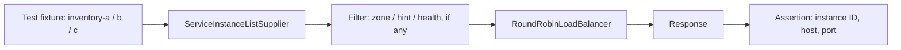

# Mocking ServiceInstance and Deterministic Replica Lists

## Objectives

In Spring Cloud LoadBalancer, a call like `http://inventory-service/api/items/SKU-42` does not point directly to a single server. LoadBalancer uses the **service ID** `inventory-service` to retrieve a list of `ServiceInstance`s, selects one replica, and only then sends the HTTP request via `RestClient`, `WebClient`, `RestTemplate`, or OpenFeign.

When writing **automated tests**, you should not depend on live instance lists from Eureka, Consul, Kubernetes, or a changing registry. If a test expects `inventory-a` but discovery unexpectedly returns an extra `inventory-b`, the test becomes flaky. The solution is to **mock instance lists intentionally**, controlling both the data and its order, and then verify supplier and selection algorithm behavior.

After this lesson, you will be able to:

- Create `DefaultServiceInstance` objects with explicit instance ID, service ID, host, port, TLS, and metadata.
- Provide fixed lists via `ServiceInstanceListSupplier` without running a real registry.
- Use `ServiceInstanceListSuppliers.from(...)` and `toProvider(...)` for unit tests.
- Use JUnit 5, AssertJ, and Reactor `StepVerifier` to verify that a supplier emits the expected list.
- Test `RoundRobinLoadBalancer` with a deterministic seed, including **0, 1, and multiple instances**.
- Write a fake supplier with replaceable snapshots to simulate scale-out, scale-in, and complete instance loss.
- Understand how Mockito mocking of `get(Request)` differs from `get()`.
- Separate **instance-selection unit tests** from **real-HTTP integration tests**.
- Avoid flaky tests caused by unstable ordering, caching, retries, multithreading, and random selection.

> The API scope references Spring Cloud Commons/LoadBalancer 5.0.x. Class and constructor examples are based on the current API; for projects on a different release, check your Spring Cloud BOM and matching Javadoc. This lesson provides instructional documentation only; no build or academic QA cycle is executed here.

## 1. What does testing LoadBalancer actually verify?

Suppose `order-service` sees three replicas:

| Instance ID | Service ID | Host | Port | Metadata |
|---|---|---|---:|---|
| `inventory-a` | `inventory-service` | `127.0.0.1` | 18081 | `zone=zone-a` |
| `inventory-b` | `inventory-service` | `127.0.0.1` | 18082 | `zone=zone-b` |
| `inventory-c` | `inventory-service` | `127.0.0.1` | 18083 | `zone=zone-a` |

To test a load-balancing mechanism, separate three decisions:

1. **Discovery:** Which raw instance list does it return?
2. **Supplier chain:** How does it filter, sort, or transform that list?
3. **LoadBalancer:** Which instance does it pick from the final list?



In a **unit test** of the selection algorithm, the test stops at `Response<ServiceInstance>`; **no TCP connection needs to be opened**. In an **integration test**, the test spins up fake HTTP servers or real servers on random ports to confirm the logical URL is rewritten to the right physical address.

### 1.1. What does deterministic mean?

A test is deterministic when the same inputs, initial state, and invocation order yield the same verifiable outcome.

For LoadBalancer, the factors you must control include:

- The instance list and **element order**.
- Matching the supplier's service ID with the service ID being selected.
- The state/seed of the round-robin algorithm.
- The number of `choose()` calls and ensuring no other test shares the same load balancer.
- Metadata such as `zone`, `weight`, or `hint`.
- Additional components: cache, health check, request-aware filter, retry.
- Timing and concurrency when simulating topology changes.

**A fixed list does not make `RandomLoadBalancer` deterministic.** For random algorithms, verify that the result belongs to the allowed set or inject a controllable random source; do not assert that the first call always picks instance A.

## 2. Key components to know

| Component | Runtime role | Usage in tests |
|---|---|---|
| `ServiceInstance` | Represents one service replica | Create test fixtures with complete fields |
| `DefaultServiceInstance` | Built-in `ServiceInstance` implementation | Use as a fixture instead of mocking every getter |
| `ServiceInstanceListSupplier` | Returns instance lists as `Flux<List<ServiceInstance>>` | Use fixed supplier, mutable fake, or Mockito |
| `ServiceInstanceListSuppliers` | Utility to create fixed suppliers/providers | Write concise unit tests without a Spring context |
| `RoundRobinLoadBalancer` | Cycles through instances with positional state | Instantiate fresh per test and set a seed |
| `Request` / `Response<ServiceInstance>` | Selection context and outcome | Check `hasServer()` before reading the server |
| `LoadBalancerClientFactory` | Manages isolated contexts per service ID | Mainly needed in Spring integration tests |
| `SimpleDiscoveryClient` | Simple property-based discovery | Useful for tests exercising the full HTTP flow |

**Do not confuse** `ServiceInstanceListSupplier` with an HTTP connection pool. The supplier returns **the list of candidate backend addresses**; the connection pool manages sockets/connections to those addresses.

## 3. Preparing test dependencies

The sample application uses Spring Boot and a compatible Spring Cloud Release Train. With Maven, import the corresponding **Spring Cloud BOM** in `dependencyManagement`; do not mix unaligned framework versions manually.

Minimum dependencies for the examples:

```xml
<dependencies>
    <dependency>
        <groupId>org.springframework.cloud</groupId>
        <artifactId>spring-cloud-starter-loadbalancer</artifactId>
    </dependency>

    <dependency>
        <groupId>org.springframework.boot</groupId>
        <artifactId>spring-boot-starter-test</artifactId>
        <scope>test</scope>
    </dependency>

    <dependency>
        <groupId>io.projectreactor</groupId>
        <artifactId>reactor-test</artifactId>
        <scope>test</scope>
    </dependency>
</dependencies>
```

`spring-boot-starter-test` provides managed versions of JUnit Jupiter, AssertJ, and Mockito; `reactor-test` provides `StepVerifier` for testing reactive streams from suppliers. The instance-selection examples **do not require** Eureka, Consul, an HTTP server, or a Spring Boot application context.

If using Spring Boot 4.x and later writing integration tests through an MVC controller, add the appropriate MVC starter. For this lesson, start with **small unit tests**, expanding to HTTP only when you actually need to prove network communication.

## 4. Creating real ServiceInstance fixtures instead of mocking getters

`DefaultServiceInstance` takes at minimum:

```java
new DefaultServiceInstance(
        "inventory-a",        // instanceId
        "inventory-service",  // serviceId
        "127.0.0.1",          // host
        18081,                // port
        false                 // secure: HTTP instead of HTTPS
);
```

When metadata is needed, use the constructor taking `Map<String, String>`:

```java
import java.util.Map;
import org.springframework.cloud.client.DefaultServiceInstance;

DefaultServiceInstance a = new DefaultServiceInstance(
        "inventory-a",
        "inventory-service",
        "127.0.0.1",
        18081,
        false,
        Map.of(
                "zone", "zone-a",
                "hint", "stable",
                "weight", "3"
        )
);
```

Important fields:

| Field | Tested for |
|---|---|
| `instanceId` | Identifying the chosen replica; distinct from `serviceId` |
| `serviceId` | Ensuring the fixture belongs to the right logical service |
| `host` and `port` | Verifying the physical URL / HTTP destination |
| `secure` | Testing `http` vs `https` selection per instance |
| `metadata.zone` | Zone-preference scenarios |
| `metadata.hint` | Hint-based routing scenarios |
| `metadata.weight` | Weighted routing scenarios |

`DefaultServiceInstance` has setters and a mutable metadata map. In deterministic tests, **do not share mutable objects across multiple tests**. Create fresh fixtures before each test to avoid mutating metadata on an instance still referenced by a supplier or cache.

### 4.1. Reusable fixture helpers within tests

```java
import org.springframework.cloud.client.DefaultServiceInstance;

final class InventoryInstances {

    static final String SERVICE_ID = "inventory-service";

    static DefaultServiceInstance a() {
        return new DefaultServiceInstance(
                "inventory-a", SERVICE_ID, "127.0.0.1", 18081, false);
    }

    static DefaultServiceInstance b() {
        return new DefaultServiceInstance(
                "inventory-b", SERVICE_ID, "127.0.0.1", 18082, false);
    }

    static DefaultServiceInstance c() {
        return new DefaultServiceInstance(
                "inventory-c", SERVICE_ID, "127.0.0.1", 18083, false);
    }

    private InventoryInstances() {
    }
}
```

Place this helper in `src/test/java`. Every call to `a()` or `b()` creates a new object, preventing one test from accidentally altering another test's data.

Ports 18081–18083 are merely **fixture values** when testing instance selection; no actual HTTP server needs to listen on them.

## 5. Fixed supplier: ServiceInstanceListSuppliers.from(...)

Spring Cloud LoadBalancer provides a convenience utility:

```java
import org.springframework.cloud.loadbalancer.core.ServiceInstanceListSupplier;
import org.springframework.cloud.loadbalancer.support.ServiceInstanceListSuppliers;

ServiceInstanceListSupplier supplier = ServiceInstanceListSuppliers.from(
        "inventory-service",
        InventoryInstances.a(),
        InventoryInstances.b()
);
```

`ServiceInstanceListSuppliers.from(serviceId, instances...)` builds a supplier backed by the provided instances. It is a simple API for writing tests without connecting to discovery.

The supplier returns a publisher:

```java
Flux<List<ServiceInstance>> snapshots = supplier.get();
```

**Note the data structure:** each element emitted by the `Flux` is **a list of instances**, not a single instance. Therefore tests should check:

- The supplier emits a snapshot containing exactly two instances.
- The list order matches the fixture.
- Every instance has `serviceId = inventory-service`.
- No network activity or registry waiting occurs.

### 5.1. Unit test verifying list contents and order

```java
import static org.assertj.core.api.Assertions.assertThat;

import java.util.List;
import org.junit.jupiter.api.Test;
import org.springframework.cloud.client.ServiceInstance;
import org.springframework.cloud.loadbalancer.core.ServiceInstanceListSupplier;
import org.springframework.cloud.loadbalancer.support.ServiceInstanceListSuppliers;
import reactor.test.StepVerifier;

class FixedSupplierTest {

    private static final String SERVICE_ID = "inventory-service";

    @Test
    void returnsExactlyTwoInstancesInKnownOrder() {
        ServiceInstanceListSupplier supplier = ServiceInstanceListSuppliers.from(
                SERVICE_ID,
                InventoryInstances.a(),
                InventoryInstances.b()
        );

        assertThat(supplier.getServiceId()).isEqualTo(SERVICE_ID);

        StepVerifier.create(supplier.get())
                .assertNext(instances -> {
                    assertThat(instances)
                            .extracting(ServiceInstance::getInstanceId)
                            .containsExactly("inventory-a", "inventory-b");

                    assertThat(instances)
                            .allSatisfy(instance ->
                                    assertThat(instance.getServiceId())
                                            .isEqualTo(SERVICE_ID));

                    assertThat(instances.get(0).getPort()).isEqualTo(18081);
                    assertThat(instances.get(1).getPort()).isEqualTo(18082);
                })
                .verifyComplete();
    }

    @Test
    void canRepresentNoAvailableInstances() {
        ServiceInstanceListSupplier supplier =
                ServiceInstanceListSuppliers.from(SERVICE_ID);

        StepVerifier.create(supplier.get())
                .assertNext(instances -> assertThat(instances).isEmpty())
                .verifyComplete();
    }
}
```

Key distinction: `Flux.just(List.of())` (or a fixed supplier publisher emitting an **empty list**) differs from `Flux.empty()` (emitting no snapshots at all).

When `RoundRobinLoadBalancer` receives an empty list, it returns `EmptyResponse`. If a custom supplier **emits nothing at all**, `choose()` may complete empty; caller behavior then differs from receiving `EmptyResponse`. Define the contract explicitly in tests: **one snapshot, possibly empty**, and verify the no-instance branch.

### 5.2. Fixed fixtures do not guarantee absolute immutability

`ServiceInstanceListSuppliers.from(...)` uses the instance objects you pass in. It does not deep-clone the objects or their metadata. If subsequent code modifies `DefaultServiceInstance` or a mutable metadata map, test data may no longer remain fixed as expected.

Therefore:

- Create fresh instances in each test.
- Do not mutate lists or objects after passing them into a supplier.
- When you need to simulate topology changes, use a dedicated **dynamic fake supplier** (Section 8) instead of mutating a fixed fixture's array or metadata.

## 6. Testing RoundRobinLoadBalancer with a deterministic seed

A fixed supplier alone is not enough to test **instance selection order** if the algorithm has uncontrolled initial state.

`RoundRobinLoadBalancer` has a constructor accepting `seedPosition`. For a two-instance test, use `seedPosition = -1` so the first selection increments the position to 0, then 1, and repeats:

```text
Instances: [inventory-a, inventory-b]
Seed position: -1

choose #1 → inventory-a
choose #2 → inventory-b
choose #3 → inventory-a
choose #4 → inventory-b
```

This describes the behavior of the referenced implementation, not a guarantee that every LoadBalancer or every release always uses this exact order.

### 6.1. Complete test class without starting Spring

`ServiceInstanceListSuppliers.toProvider(...)` creates an `ObjectProvider<ServiceInstanceListSupplier>` matching the constructor of `RoundRobinLoadBalancer`:

```java
import static org.assertj.core.api.Assertions.assertThat;

import java.util.ArrayList;
import java.util.List;
import org.junit.jupiter.api.Test;
import org.springframework.cloud.client.ServiceInstance;
import org.springframework.cloud.client.loadbalancer.Response;
import org.springframework.cloud.loadbalancer.core.RoundRobinLoadBalancer;
import org.springframework.cloud.loadbalancer.support.ServiceInstanceListSuppliers;

class RoundRobinSelectionTest {

    private static final String SERVICE_ID = "inventory-service";

    @Test
    void choosesInstancesInDeterministicOrder() {
        RoundRobinLoadBalancer loadBalancer = new RoundRobinLoadBalancer(
                ServiceInstanceListSuppliers.toProvider(
                        SERVICE_ID,
                        InventoryInstances.a(),
                        InventoryInstances.b()
                ),
                SERVICE_ID,
                -1
        );

        List<String> selected = new ArrayList<>();
        for (int i = 0; i < 4; i++) {
            Response<ServiceInstance> response = loadBalancer.choose().block();
            assertThat(response).isNotNull();
            assertThat(response.hasServer()).isTrue();
            selected.add(response.getServer().getInstanceId());
        }

        assertThat(selected).containsExactly(
                "inventory-a",
                "inventory-b",
                "inventory-a",
                "inventory-b"
        );
    }

    @Test
    void returnsNoServerWhenListIsEmpty() {
        RoundRobinLoadBalancer loadBalancer = new RoundRobinLoadBalancer(
                ServiceInstanceListSuppliers.toProvider(SERVICE_ID),
                SERVICE_ID,
                -1
        );

        Response<ServiceInstance> response = loadBalancer.choose().block();

        assertThat(response).isNotNull();
        assertThat(response.hasServer()).isFalse();
    }

    @Test
    void alwaysChoosesTheOnlyAvailableInstance() {
        RoundRobinLoadBalancer loadBalancer = new RoundRobinLoadBalancer(
                ServiceInstanceListSuppliers.toProvider(
                        SERVICE_ID,
                        InventoryInstances.c()
                ),
                SERVICE_ID,
                -1
        );

        for (int i = 0; i < 3; i++) {
            Response<ServiceInstance> response = loadBalancer.choose().block();
            assertThat(response).isNotNull();
            assertThat(response.hasServer()).isTrue();
            assertThat(response.getServer().getInstanceId())
                    .isEqualTo("inventory-c");
        }
    }
}
```

When `hasServer() == false`, **do not dereference `response.getServer()`** and read `getHost()`; an empty response has no valid instance.

### 6.2. Why not use default RoundRobinLoadBalancer and expect A first?

The constructor without a seed uses a randomized initial position. A `RoundRobinLoadBalancer` instance shared across tests or threads also carries mutated `position` state.

To test ordering reliably:

1. Create a **fresh LoadBalancer per test**.
2. Pass an **explicit seed**, such as `-1`.
3. Use an explicitly ordered list.
4. Do not invoke calls concurrently against **the same LoadBalancer** when asserting sequential order.
5. Do not allow retries or another HTTP client to invoke `choose()` behind the scenes during the test.

In production, backend request order is also affected by concurrency, caches, filters, retries, and discovery results. This test only proves **algorithmic behavior against a deterministic snapshot**.

## 7. Using StepVerifier to test reactive output

`ServiceInstanceListSupplier#get()` returns `Flux<List<ServiceInstance>>`. `RoundRobinLoadBalancer#choose()` returns `Mono<Response<ServiceInstance>>`. `StepVerifier` helps verify:

- Whether the publisher emits the expected number of items.
- Which instances the snapshot contains.
- Whether the publisher completes normally or emits an error.
- Whether the result has `hasServer()` and the expected ID.

Reactive test example for a single selection:

```java
import static org.assertj.core.api.Assertions.assertThat;

import org.junit.jupiter.api.Test;
import org.springframework.cloud.loadbalancer.core.RoundRobinLoadBalancer;
import org.springframework.cloud.loadbalancer.support.ServiceInstanceListSuppliers;
import reactor.test.StepVerifier;

class ReactiveSelectionTest {

    @Test
    void firstSelectionIsInventoryA() {
        String id = "inventory-service";
        var loadBalancer = new RoundRobinLoadBalancer(
                ServiceInstanceListSuppliers.toProvider(
                        id,
                        InventoryInstances.a(),
                        InventoryInstances.b()
                ),
                id,
                -1
        );

        StepVerifier.create(loadBalancer.choose())
                .assertNext(response -> {
                    assertThat(response.hasServer()).isTrue();
                    assertThat(response.getServer().getInstanceId())
                            .isEqualTo("inventory-a");
                })
                .verifyComplete();
    }
}
```

You do not need `StepVerifier.withVirtualTime()` for a fixed supplier with no timers. **Virtual time** is useful when testing retry backoff, timeouts, schedulers, or health-check polling; it does not turn a random algorithm deterministic.

## 8. Swappable-snapshot fake supplier to simulate topology changes

Fixed suppliers work well for static data. When you need to test scaling from two instances down to one, or all instances disappearing, build a fake that updates the list **step by step during the test**.

### 8.1. Writing MutableServiceInstanceListSupplier

```java
import java.util.List;
import java.util.concurrent.atomic.AtomicReference;
import org.springframework.cloud.client.ServiceInstance;
import org.springframework.cloud.loadbalancer.core.ServiceInstanceListSupplier;
import reactor.core.publisher.Flux;

final class MutableServiceInstanceListSupplier
        implements ServiceInstanceListSupplier {

    private final String serviceId;
    private final AtomicReference<List<ServiceInstance>> snapshot =
            new AtomicReference<>(List.of());

    MutableServiceInstanceListSupplier(String serviceId) {
        this.serviceId = serviceId;
    }

    void replace(List<ServiceInstance> next) {
        for (ServiceInstance instance : next) {
            if (!serviceId.equals(instance.getServiceId())) {
                throw new IllegalArgumentException(
                        "Wrong service ID: " + instance.getServiceId());
            }
        }
        snapshot.set(List.copyOf(next));
    }

    @Override
    public String getServiceId() {
        return serviceId;
    }

    @Override
    public Flux<List<ServiceInstance>> get() {
        return Flux.defer(() -> Flux.just(snapshot.get()));
    }
}
```

Two key points:

- `AtomicReference` swaps the whole snapshot as a single value; the test never mutates a list while another thread reads it.
- `Flux.defer(...)` reads the snapshot **upon each new subscription**, rather than capturing the list once when the publisher is constructed.

`List.copyOf(...)` protects the list structure from external mutation, though it does not deep-clone each `ServiceInstance`. Continue avoiding mutating instance objects once placed into the supplier.

### 8.2. Testing scale-in followed by total instance loss

Use a tiny Spring `DefaultListableBeanFactory` to supply an `ObjectProvider` to LoadBalancer without booting an entire Spring Boot application:

```java
import static org.assertj.core.api.Assertions.assertThat;

import java.util.List;
import org.junit.jupiter.api.Test;
import org.springframework.beans.factory.support.DefaultListableBeanFactory;
import org.springframework.cloud.client.ServiceInstance;
import org.springframework.cloud.loadbalancer.core.RoundRobinLoadBalancer;
import org.springframework.cloud.loadbalancer.core.ServiceInstanceListSupplier;

class DynamicTopologyTest {

    @Test
    void seesNewSnapshotOnNextSelection() {
        String serviceId = "inventory-service";

        MutableServiceInstanceListSupplier supplier =
                new MutableServiceInstanceListSupplier(serviceId);

        supplier.replace(List.<ServiceInstance>of(InventoryInstances.a()));

        DefaultListableBeanFactory beanFactory =
                new DefaultListableBeanFactory();
        beanFactory.registerSingleton("supplier", supplier);

        RoundRobinLoadBalancer loadBalancer = new RoundRobinLoadBalancer(
                beanFactory.getBeanProvider(ServiceInstanceListSupplier.class),
                serviceId,
                -1
        );

        var first = loadBalancer.choose().block();
        assertThat(first).isNotNull();
        assertThat(first.hasServer()).isTrue();
        assertThat(first.getServer().getInstanceId())
                .isEqualTo("inventory-a");

        // Simulate A being removed and B being the only remaining replica.
        supplier.replace(List.<ServiceInstance>of(InventoryInstances.b()));

        var second = loadBalancer.choose().block();
        assertThat(second).isNotNull();
        assertThat(second.hasServer()).isTrue();
        assertThat(second.getServer().getInstanceId())
                .isEqualTo("inventory-b");

        // Simulate discovery having zero instances left.
        supplier.replace(List.of());

        var third = loadBalancer.choose().block();
        assertThat(third).isNotNull();
        assertThat(third.hasServer()).isFalse();
    }
}
```

This tests a **fake supplier wired directly into RoundRobin**, without `CachingServiceInstanceListSupplier`. Therefore, the new snapshot takes effect on the very next `choose()` call. In a system with caching or health checks, discovery source changes **do not necessarily appear immediately**: test TTL, refresh, and the supplier chain separately.

### 8.3. States worth simulating

| Step | Snapshot list | Key assertion |
|---|---|---|
| Startup | `[A, B]` | Can pick A or B |
| Scale-out | `[A, B, C]` | C appears in the candidate set |
| Scale-in | `[B, C]` | A is no longer selected once the new snapshot takes effect |
| Single replica left | `[C]` | Always selects C |
| All instances lost | `[]` | `hasServer() == false` |
| Recovery | `[B]` | Subsequent selection can return B |
| Wrong service ID | e.g., an instance of `payment-service` | Fixture fails fast to avoid testing the wrong target |

**Do not use `Thread.sleep(...)` to wait for topology changes in this test.** You control the snapshot directly, so update it and assert immediately. For tests involving schedulers/health checks, use condition-based waiting or virtual time where appropriate.

## 9. Mockito: mock the supplier instead of mocking ServiceInstance

When verifying how a class interacts with `ServiceInstanceListSupplier`, you can use Mockito. However, distinguish between its two methods:

```java
Flux<List<ServiceInstance>> get();
Flux<List<ServiceInstance>> get(Request request);
```

`RoundRobinLoadBalancer#choose(...)` may invoke **`supplier.get(request)`** rather than `supplier.get()`. A Mockito mock returns `null` for unstubbed methods. Stubbing only `get()` and passing the mock into LoadBalancer can fail because `get(request)` was not configured.

### 9.1. Stubbing get(Request) when testing selection algorithms

```java
import static org.assertj.core.api.Assertions.assertThat;
import static org.mockito.ArgumentMatchers.any;
import static org.mockito.Mockito.mock;
import static org.mockito.Mockito.when;

import java.util.List;
import org.junit.jupiter.api.Test;
import org.springframework.beans.factory.support.DefaultListableBeanFactory;
import org.springframework.cloud.client.ServiceInstance;
import org.springframework.cloud.client.loadbalancer.Request;
import org.springframework.cloud.loadbalancer.core.RoundRobinLoadBalancer;
import org.springframework.cloud.loadbalancer.core.ServiceInstanceListSupplier;
import reactor.core.publisher.Flux;

class MockSupplierTest {

    @Test
    void loadBalancerUsesRequestAwareSupplierMethod() {
        String id = "inventory-service";
        ServiceInstanceListSupplier supplier =
                mock(ServiceInstanceListSupplier.class);

        when(supplier.getServiceId()).thenReturn(id);
        when(supplier.get(any(Request.class)))
                .thenReturn(Flux.just(List.<ServiceInstance>of(
                        InventoryInstances.a(),
                        InventoryInstances.b()
                )));

        var factory = new DefaultListableBeanFactory();
        factory.registerSingleton("supplier", supplier);

        var lb = new RoundRobinLoadBalancer(
                factory.getBeanProvider(ServiceInstanceListSupplier.class),
                id,
                -1
        );

        var response = lb.choose().block();
        assertThat(response).isNotNull();
        assertThat(response.hasServer()).isTrue();
        assertThat(response.getServer().getInstanceId())
                .isEqualTo("inventory-a");
    }
}
```

In this test, Mockito does not mock `DefaultServiceInstance`: real instance objects are used so `getHost()`, `getPort()`, `getUri()`, and `getMetadata()` behave naturally.

**Avoid over-mocking:** if your goal is to test a `ServiceInstanceListSupplier` or its filter itself, do not mock the very behavior under test. Use a fake/fixed supplier as the delegate source so the class under test actually executes its logic.

## 10. Testing metadata-filtering suppliers

When testing zone, hint, or weighted suppliers, you need both **deterministic source data** and a **deterministic filtering context**. For example:

```java
import java.util.Map;
import org.springframework.cloud.client.DefaultServiceInstance;

DefaultServiceInstance stableA = new DefaultServiceInstance(
        "stable-a", "inventory-service", "127.0.0.1", 18081, false,
        Map.of("zone", "zone-a", "hint", "stable", "weight", "5")
);

DefaultServiceInstance canaryB = new DefaultServiceInstance(
        "canary-b", "inventory-service", "127.0.0.1", 18082, false,
        Map.of("zone", "zone-b", "hint", "canary", "weight", "1")
);
```

### 10.1. Testing a custom filter's contract

If you write a strict zone-filtering supplier, you can test it with a fixed supplier:

```java
import java.util.List;
import org.springframework.cloud.client.ServiceInstance;
import org.springframework.cloud.loadbalancer.core.ServiceInstanceListSupplier;
import reactor.core.publisher.Flux;

final class StrictZoneSupplier implements ServiceInstanceListSupplier {

    private final ServiceInstanceListSupplier delegate;
    private final String zone;

    StrictZoneSupplier(ServiceInstanceListSupplier delegate, String zone) {
        this.delegate = delegate;
        this.zone = zone;
    }

    @Override
    public String getServiceId() {
        return delegate.getServiceId();
    }

    @Override
    public Flux<List<ServiceInstance>> get() {
        return delegate.get().map(instances ->
                instances.stream()
                        .filter(instance -> instance.getMetadata() != null)
                        .filter(instance -> zone.equals(
                                instance.getMetadata().get("zone")))
                        .toList());
    }
}
```

Test:

```java
import static org.assertj.core.api.Assertions.assertThat;

import java.util.Map;
import org.junit.jupiter.api.Test;
import org.springframework.cloud.client.DefaultServiceInstance;
import org.springframework.cloud.client.ServiceInstance;
import org.springframework.cloud.loadbalancer.support.ServiceInstanceListSuppliers;
import reactor.test.StepVerifier;

class StrictZoneSupplierTest {

    @Test
    void keepsOnlyZoneAAndReturnsEmptyOnNoMatch() {
        var zoneA = new DefaultServiceInstance(
                "zone-a-instance", "inventory-service",
                "127.0.0.1", 18081, false, Map.of("zone", "zone-a"));
        var zoneB = new DefaultServiceInstance(
                "zone-b-instance", "inventory-service",
                "127.0.0.1", 18082, false, Map.of("zone", "zone-b"));

        var base = ServiceInstanceListSuppliers.from(
                "inventory-service", zoneA, zoneB
        );

        var matched = new StrictZoneSupplier(base, "zone-a");
        StepVerifier.create(matched.get())
                .assertNext(instances -> assertThat(instances)
                        .extracting(ServiceInstance::getInstanceId)
                        .containsExactly("zone-a-instance"))
                .verifyComplete();

        // Strict policy: without zone-x, the list must be empty.
        var noMatch = new StrictZoneSupplier(base, "zone-x");
        StepVerifier.create(noMatch.get())
                .assertNext(instances -> assertThat(instances).isEmpty())
                .verifyComplete();
    }
}
```

This is a **custom strict filter** illustrating fail-closed behavior. It is **not** Spring Cloud's built-in `ZonePreferenceServiceInstanceListSupplier`.

If testing the built-in `ZonePreferenceServiceInstanceListSupplier` itself, remember it **prefers** the zone, and when no instance matches that zone, it can **fall back to the full delegate list**. Thus expecting "no zone A means empty list" is **wrong for built-in zone preference**, even though it is right for a custom strict filter.

Similarly, `HintBasedServiceInstanceListSupplier` defaults to returning the full list when no instance matches the hint. **Always read the contract of the supplier under test** before writing fallback assertions.

### 10.2. How to test a weighted supplier stably

`WeightedServiceInstanceListSupplier` uses `weight` metadata or a weight function to influence selection probabilities. Avoid writing:

```java
// Fragile: does not guarantee the first call picks canary.
assertThat(loadBalancer.choose().block().getServer().getInstanceId())
        .isEqualTo("canary-b");
```

For weighted/random routing, better testing approaches include:

1. Verify weight configuration and input data.
2. When testing the list-preparation layer, verify valid candidate sets and metadata.
3. If testing probability distribution, use a dedicated statistical test with enough samples and a tolerance band — **never as an exact-order unit test**.
4. For custom algorithms with an injectable random source, pass a deterministic seed or test double for randomness.

Distribution tests can flake under CI load or implementation changes; use them only when you truly need to prove distribution quality, rather than turning every build into a strict 50/50 ratio check.

## 11. Providing a fixed supplier in a service ID's context

The direct unit tests in Section 6 need no Spring context. However, if you need to verify `@LoadBalancerClient` configuration, you can register a fixed supplier **inside the child context of that exact service ID**:

```java
import org.springframework.cloud.client.DefaultServiceInstance;
import org.springframework.cloud.loadbalancer.annotation.LoadBalancerClient;
import org.springframework.cloud.loadbalancer.core.ServiceInstanceListSupplier;
import org.springframework.cloud.loadbalancer.support.ServiceInstanceListSuppliers;
import org.springframework.context.annotation.Bean;
import org.springframework.context.annotation.Configuration;

@Configuration(proxyBeanMethods = false)
@LoadBalancerClient(
        name = "inventory-service",
        configuration = FixedInventoryLoadBalancerConfiguration.class
)
class TestLoadBalancerRegistration {
}

// Do not add @Configuration if this class is inside the main component scan.
class FixedInventoryLoadBalancerConfiguration {

    @Bean
    ServiceInstanceListSupplier fixedInventorySupplier() {
        return ServiceInstanceListSuppliers.from(
                "inventory-service",
                new DefaultServiceInstance(
                        "inventory-a", "inventory-service",
                        "127.0.0.1", 18081, false),
                new DefaultServiceInstance(
                        "inventory-b", "inventory-service",
                        "127.0.0.1", 18082, false)
        );
    }
}
```

**Test scope:** import `TestLoadBalancerRegistration` only in an appropriate test context or put the annotation on a test configuration/application class. Do not make it production configuration. Spring Cloud LoadBalancer creates a child context per service ID; this registration ensures `inventory-service` gets its own supplier.

Avoid bean-scanning bugs: the configuration class passed to `@LoadBalancerClient(configuration=...)` should not carry `@Configuration` if located within the main component scan, or it must be placed outside the component scan scope. If scanned into the parent context, a supplier intended for `inventory-service` can leak to other service IDs.

### 11.1. When to use @Primary or @MockBean/@MockitoBean?

For unit testing a Spring class, overriding a bean in the application context can be convenient. However, **`LoadBalancerClientFactory` uses child contexts**, so replacing a bean in the parent context does not always replace the supplier inside the child context properly.

In newer Spring Boot/Spring Framework versions, test bean overrides can use `@MockitoBean` depending on the version. Still, when testing the LoadBalancer algorithm itself, registering a fixed supplier **per service ID** is usually cleaner than broad bean mocking or enabling `allow-bean-definition-overriding`.

## 12. Integration tests: a fixed list does not prove HTTP was sent

A unit test returning `Response<ServiceInstance>` verifies the **selected target**, but does not prove:

- `@LoadBalanced RestClient.Builder` actually resolves the service ID in the URL.
- The HTTP request reaches the right server/port.
- URI templates, headers, and body survive after LoadBalancer rewrites the URL.
- When no instance exists, the caller distinguishes selection errors from backend HTTP statuses.

To verify end-to-end, you can use `SimpleDiscoveryClient` in tests:

```yaml
spring:
  cloud:
    discovery:
      client:
        simple:
          instances:
            inventory-service:
              - uri: http://localhost:18081
              - uri: http://localhost:18082
```

This is a **fixed list at the discovery layer**. You still have to start two test backends on those ports if actually sending HTTP requests. YAML configuration alone **does not start a server** on `localhost:18081`.

### 12.1. Prefer dynamic-port HTTP test servers

To avoid conflicts on CI machines, use WireMock, MockWebServer, or another test HTTP server, assigning port `0` so the OS allocates a free port. Once the server starts, supply the actual URI via test properties or `@DynamicPropertySource`:

```java
import org.springframework.test.context.DynamicPropertyRegistry;
import org.springframework.test.context.DynamicPropertySource;

@DynamicPropertySource
static void inventoryInstances(DynamicPropertyRegistry registry) {
    registry.add(
            "spring.cloud.discovery.client.simple.instances.inventory-service[0].uri",
            () -> serverA.baseUrl()
    );
    registry.add(
            "spring.cloud.discovery.client.simple.instances.inventory-service[1].uri",
            () -> serverB.baseUrl()
    );
}
```

`serverA` and `serverB` are **HTTP test servers started before the Spring context binds properties**, each exposing `baseUrl()`. The snippet only illustrates property registration and does not assume a specific library provides `baseUrl()`. For WireMock or MockWebServer, substitute the library's actual URL accessor method.

Avoid fixed ports in parallel integration tests whenever possible; dynamic ports keep CI stable and avoid colliding with local developer services.

### 12.2. Verifying via backend-distinguishing payloads

Configure two HTTP servers to return different payloads for the same request:

```http
GET /whoami
```

Server A returns:

```json
{"instanceId":"inventory-a"}
```

Server B returns:

```json
{"instanceId":"inventory-b"}
```

Then invoke the logical service ID:

```java
String body = loadBalancedRestClient.get()
        .uri("http://inventory-service/whoami")
        .retrieve()
        .body(String.class);
```

Here `loadBalancedRestClient` must be built from a `@LoadBalanced RestClient.Builder` bean. If you use `RestClient.create()` or a non-load-balanced client, the hostname `inventory-service` may be handled by DNS as a real host and the test no longer tests Spring Cloud LoadBalancer.

Assertions can check that the body is either `{"instanceId":"inventory-a"}` or `{"instanceId":"inventory-b"}`. When testing **round-robin order**, fix the seed/algorithm and exclude secondary components like retries, concurrency, and filters; otherwise, simply assert that the request hits a valid backend and at least one test backend recorded the request.

### 12.3. Why separate HTTP tests from selection tests?

| Unit test | HTTP integration test |
|---|---|
| No network | Real test HTTP server |
| Fast, low resource usage | Starts app/servers, slower |
| Fixed seed and snapshot | Involves schedulers, sockets, timeouts |
| Asserts `hasServer()` and instance ID | Asserts HTTP request/response, host/port, headers |
| Debugs algorithm/supplier bugs | Debugs wiring, URI, transport, interceptor bugs |
| Suitable for every commit | Run in CI, especially pre-release |

Do not use a heavy integration test to replace a simple unit test for an instance-filtering method. Conversely, testing only the supplier cannot guarantee all HTTP clients are properly configured with `@LoadBalanced`.

## 13. Edge cases that must be tested

| ID | Data / condition | Outcome to verify |
|---|---|---|
| T01 | Supplier returns `[A, B]` in fixed order | Snapshot has exact 2 items with expected IDs/hosts/ports |
| T02 | Supplier returns `[]` | LoadBalancer returns a no-server response |
| T03 | Supplier returns `[A]` | Every selection returns A |
| T04 | Round-robin with seed `-1`, list `[A, B]` | Sequential order A → B → A → B |
| T05 | Simulated `[A] → [B]` | Selection after snapshot update returns B |
| T06 | `[A, B] → [] → [B]` | Total instance loss followed by recovery |
| T07 | Instance with `secure=true` | `getUri()` uses `https`, not `http` |
| T08 | Instance with wrong service ID | Test fixture catches mismatch instead of silently picking wrong target |
| T09 | Complete zone/hint metadata | Request-aware/filter supplier enforces policy |
| T10 | No instance matches zone/hint | Distinguish built-in fallback from custom fail-closed |
| T11 | Duplicate host with different `instanceId` | Assertions inspect identity, not just host |
| T12 | Cache/health check enabled | Snapshot updates take effect with expected timing |
| T13 | Concurrent calls | Do not assert arbitrary completion order |
| T14 | HTTP integration test with two test servers | Real request reaches a declared backend |
| T15 | One HTTP server stopped while kept in list | Distinguish connection error from empty supplier |

### 13.1. Checking HTTPS in fixtures

```java
import static org.assertj.core.api.Assertions.assertThat;

import org.junit.jupiter.api.Test;
import org.springframework.cloud.client.DefaultServiceInstance;

class SecureInstanceFixtureTest {

    @Test
    void usesHttpsForSecureInstance() {
        var instance = new DefaultServiceInstance(
                "inventory-secure",
                "inventory-service",
                "127.0.0.1",
                18443,
                true
        );

        assertThat(instance.isSecure()).isTrue();
        assertThat(instance.getUri().toString())
                .isEqualTo("https://127.0.0.1:18443");
    }
}
```

This test verifies the **URI property** of the fixture; it does **not** perform a TLS handshake or validate certificates. To test real HTTPS, write an integration test with a TLS server and a valid truststore.

### 13.2. Verifying metadata does not leak across instances

```java
import static org.assertj.core.api.Assertions.assertThat;

import java.util.Map;
import org.junit.jupiter.api.Test;
import org.springframework.cloud.client.DefaultServiceInstance;

class InstanceMetadataTest {

    @Test
    void keepsMetadataOnTheCorrectInstance() {
        var canary = new DefaultServiceInstance(
                "inventory-canary",
                "inventory-service",
                "127.0.0.1",
                18084,
                false,
                Map.of("hint", "canary", "zone", "zone-b")
        );

        assertThat(canary.getInstanceId()).isEqualTo("inventory-canary");
        assertThat(canary.getMetadata())
                .containsEntry("hint", "canary")
                .containsEntry("zone", "zone-b");
    }
}
```

Do not share a mutable `Map` across fixtures, because one test mutating metadata can break another test. With instances from a real registry, metadata also depends on how the registry converts/normalizes fields; fixture unit tests do not prove the real registry always provides that exact metadata.

## 14. How to avoid flaky tests

### 14.1. Do not assert completion order under concurrency

`RoundRobinLoadBalancer` updates its position during selection, but subsequent HTTP requests can finish in any order:

```text
Selection: A, B, A, B
Completion: B, A, B, A
```

If a test only needs to verify that requests go to valid instances, assert the result set or per-backend hit counts within an expected bound. Only assert **selection order** when invoking `choose()` sequentially inside the same unit test.

### 14.2. Do not use Thread.sleep to wait for caches

A supplier with caching or health checks operates on a scheduler. `Thread.sleep(100)` might pass locally but fail on a slow CI runner. Instead:

- Mock/inject a `Clock` or scheduler where the API allows.
- Use `StepVerifier.withVirtualTime(...)` for publishers controllable with a virtual scheduler.
- Use condition-based waiting with explicit timeouts and state assertions.
- Separate pure algorithm tests from time-dependent cache/health-check tests.

If only testing a fixed list, **do not enable health checks and caching**: they add complexity without adding verification value.

### 14.3. Testing empty instances is not testing network errors

Two easily confused cases:

- `ServiceInstanceListSupplier` returns an empty list → LoadBalancer has no server; the HTTP request may **never be sent**.
- Supplier returns `inventory-a:18081` while no server runs on that port → LoadBalancer can still **select A successfully**, and then the HTTP client fails to connect.

Do not assert "HTTP 503 from backend" for the no-instance case. An integration adapter may map a selection failure to a specific caller response/status; that does not prove the backend returned 503.

### 14.4. Keep both service ID and instance ID accurate in fixtures

Two replicas of the same service share a `serviceId` while having **different `instanceId`s**. If a test creates:

```java
new DefaultServiceInstance(
        "payment-a", "payment-service", "127.0.0.1", 19001, false)
```

and passes it into an `inventory-service` supplier, the fixed-supplier helper does not automatically validate business correctness. Add assertions/validation like `MutableServiceInstanceListSupplier.replace(...)` to catch invalid fixtures as early as possible.

### 14.5. Reset test state between test methods

- Do not use a shared mutable static `RoundRobinLoadBalancer` across a test suite.
- Create fresh fixtures per test, especially when metadata is mutable.
- Do not make a mutable fake supplier a singleton shared across parallel tests.
- Do not let `@SpringBootTest` cache an application context whose instance list was altered by earlier tests without resetting it.
- Do not rely on JUnit method execution order.
- For random/weighted selection, avoid asserting an exact sequence unless you explicitly inject a seed/random source.

## 15. Common pitfalls and fixes

| Symptom | Cause | Fix |
|---|---|---|
| Round-robin test passes sometimes and fails others | No seed set; shared LoadBalancer | Instantiate a new LoadBalancer, seed `-1`, call sequentially |
| Mockito test throws `NullPointerException` | Only mocked `supplier.get()` while LoadBalancer calls `get(Request)` | Stub `get(any(Request.class))` properly |
| Snapshot test receives zero items | Supplier returned `Flux.empty()` instead of `Flux.just(emptyList())` | Specify contract of one possibly empty snapshot |
| `getServer()` throws/fails | Response has no server | Assert `hasServer()` first |
| Snapshot updated but old instance still chosen | Cache/health check enabled or fake captured list early | Isolate unit test, inspect TTL, use `Flux.defer` |
| Test with 1 instance expects alternation | Round-robin cannot pick a second instance | Assert it always chooses the single instance |
| Fixed fixture routes to wrong backend | Instance `serviceId` mismatches supplier | Validate service ID and metadata in tests |
| Zone assertion fails unexpectedly | Built-in zone preference falls back to full list on no match | Read contract first; use strict supplier for fail-closed |
| Weighted test expects canary on call #1 | Weighted/random selection has no fixed sequence | Assert set membership or use a separate statistical test |
| Integration test gets `Connection refused` | Declared instance URI without starting an HTTP server | Start the HTTP test server first |
| Test passes locally but fails port binding in CI | Hardcoded occupied port | Use an HTTP server on a random port |
| LoadBalancer unused in RestClient test | Used `RestClient.create()` instead of `@LoadBalanced` builder | Inject the Spring-configured bean properly |
| Spring test supplier override has no effect | Overridden in parent while real supplier lives in child context per service ID | Register fixture via `@LoadBalancerClient` for that exact ID |
| Time-dependent tests are flaky | `Thread.sleep` and real schedulers | Test with virtual time or condition-based waiting |

## 16. Suggested hands-on exercise

Write a test class `InventoryLoadBalancerPracticeTest` **without booting a Spring Boot context**:

1. Create fixtures `inventory-a`, `inventory-b`, and `inventory-c` with host `127.0.0.1` and three distinct ports.
2. Use `ServiceInstanceListSuppliers.from(...)` to return `[A, B]`.
3. Use `StepVerifier` to verify a single snapshot containing two instances in order.
4. Create `RoundRobinLoadBalancer` with seed `-1` and assert four selections yield A, B, A, B in order.
5. Create an empty supplier and verify `hasServer() == false`.
6. Create a single-element supplier `[C]` and verify three selections all yield C.
7. Use `MutableServiceInstanceListSupplier` to simulate `[A] → [B] → [] → [C]` and assert the outcome at each step.
8. Add `zone` and `hint` metadata and try a custom strict filter; compare it with the fallback behavior of built-in suppliers.
9. Add an HTTP integration test using two dynamic-port mock servers and `SimpleDiscoveryClient`, **without** letting HTTP tests replace the unit tests above.

Completion criteria:

- Tests do not depend on Eureka, Consul, or an external registry.
- No hardcoded network ports in unit tests; fixture ports are data only.
- No `Thread.sleep` in pure instance-selection tests.
- No randomized tests asserting a fixed order.
- Failure messages report **service ID, instance ID, snapshot, and chosen result**.
- Includes empty, single-instance, multi-instance, and changing-topology cases.
- Clearly distinguishes **no server selected** from **server selected but connection failed**.

## 17. Pre-CI checklist

- [ ] `DefaultServiceInstance` fixtures have consistent service ID, instance ID, host/port, secure flag, and metadata.
- [ ] Test suppliers return `Flux<List<ServiceInstance>>` per contract, not `Flux<ServiceInstance>`.
- [ ] Snapshots have explicit ordering and are not mutated by other tests.
- [ ] RoundRobin tests instantiate their own load balancer with an explicit seed.
- [ ] `hasServer()` is checked before accessing `getServer()`.
- [ ] Unit tests exist for 0, 1, and n instances.
- [ ] If mocking with Mockito, `get(Request)` is properly stubbed.
- [ ] Topology fakes copy snapshots and reset between tests.
- [ ] Cache/health check are not accidentally enabled in pure algorithm unit tests.
- [ ] Fallback behavior of built-in zone/hint suppliers on no match is tested accurately.
- [ ] Weighted/random tests do not assert exact order without a seed.
- [ ] Per-service-ID test configs are not component-scanned into global beans.
- [ ] HTTP integration tests have running real backends or mock servers.
- [ ] HTTP tests use dynamic ports and do not rely on external CI services.
- [ ] Tests verify the `@LoadBalanced` path rather than calling an HTTP client directly.
- [ ] No-instance errors, connect timeouts, and backend HTTP errors are separated.
- [ ] Test suite does not depend on method execution order or shared static state.
- [ ] APIs and dependencies are verified compatible with the project's Spring Boot/Cloud BOM.

## Conclusion

To test Spring Cloud LoadBalancer reliably, **control the `ServiceInstance` list before controlling the selection algorithm**. `DefaultServiceInstance` lets you construct replicas with deterministic IDs, hosts/ports, and metadata; `ServiceInstanceListSuppliers.from(...)` and `toProvider(...)` supply data for unit tests without a service registry. With `RoundRobinLoadBalancer`, an explicit seed and clear list order enable exact verification of selection turns. A dynamic fake supplier lets you test scale-out, scale-in, total instance loss, and recovery independent of wall-clock time.

Most importantly, **separate test layers**: supplier/selection unit tests verify lists and `Response<ServiceInstance>`; integration tests verify that HTTP requests reach the intended destination. Keeping test state isolated, handling `get(Request)` properly, distinguishing built-in fallback from strict policies, and never forcing random outcomes into fixed sequences produces a fast, diagnosable, and CI-reliable test suite.

## References

- [Spring Cloud Commons 5.0.x — Spring Cloud LoadBalancer, supplier chain, and custom configuration](https://docs.spring.io/spring-cloud-commons/reference/spring-cloud-commons/loadbalancer.html)
- [Spring Cloud Commons — Spring RestClient/RestTemplate/WebClient as LoadBalancer Client](https://docs.spring.io/spring-cloud-commons/reference/spring-cloud-commons/common-abstractions.html)
- [Spring Cloud Commons source — DefaultServiceInstance](https://github.com/spring-cloud/spring-cloud-commons/blob/main/spring-cloud-commons/src/main/java/org/springframework/cloud/client/DefaultServiceInstance.java)
- [Spring Cloud LoadBalancer source — ServiceInstanceListSuppliers.from/toProvider](https://github.com/spring-cloud/spring-cloud-commons/blob/main/spring-cloud-loadbalancer/src/main/java/org/springframework/cloud/loadbalancer/support/ServiceInstanceListSuppliers.java)
- [Spring Cloud LoadBalancer source — RoundRobinLoadBalancer](https://github.com/spring-cloud/spring-cloud-commons/blob/main/spring-cloud-loadbalancer/src/main/java/org/springframework/cloud/loadbalancer/core/RoundRobinLoadBalancer.java)
- [Spring Cloud LoadBalancer tests — LoadBalancerTests](https://github.com/spring-cloud/spring-cloud-commons/blob/main/spring-cloud-loadbalancer/src/test/java/org/springframework/cloud/loadbalancer/core/LoadBalancerTests.java)
- [Project Reactor — StepVerifier](https://projectreactor.io/docs/test/release/api/reactor/test/StepVerifier.html)
- [Spring Framework — DynamicPropertySource](https://docs.spring.io/spring-framework/reference/testing/testcontext-framework/ctx-management/dynamic-property-sources.html)
