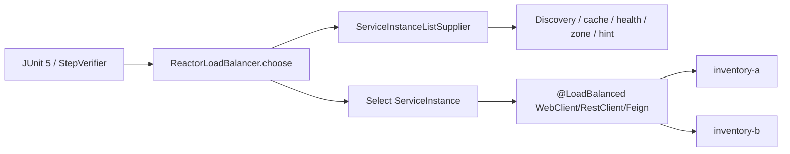
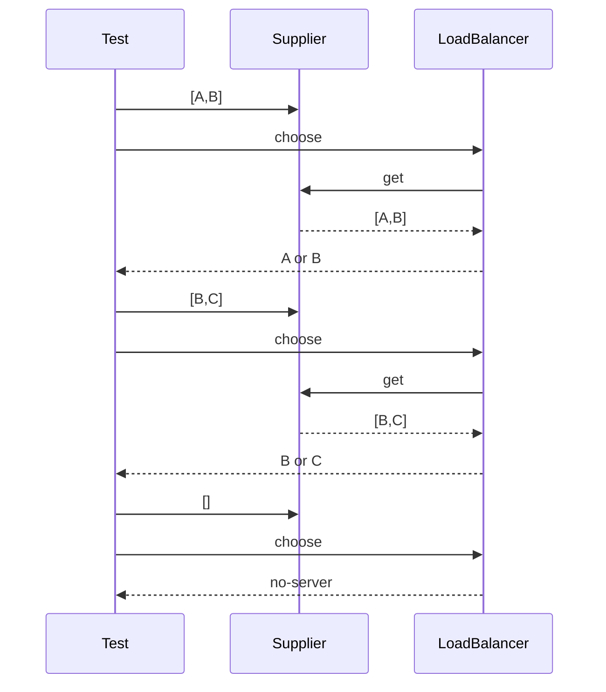

# Testing Algorithms Without Relying on Accidental Random Order

## 1. Context and goals

In the **Automated Testing** chapter of the `SPRING_CLOUD_SERVICE_COMMUNICATION_LOAD_BALANCING` module, the goal is not merely calling `inventory-service` via `RestClient`, `WebClient`, or OpenFeign. We must ensure that client-side load-balancing algorithms choose the right `ServiceInstance` according to service ID, discovery, health checks, zones, weights, hints, and retry/timeout policies, even when replicas change continuously.

Suppose `order-service` calls `http://inventory-service/api/inventory/ABC-1`. Initial list:

| ID | Endpoint | Zone | Status |
|---|---|---|---|
| `inventory-a` | `127.0.0.1:8081` | `zone-a` | Candidate |
| `inventory-b` | `127.0.0.1:8082` | `zone-a` | Candidate |
| `inventory-c` | `127.0.0.1:8083` | `zone-b` | Candidate |

A naive test will assert that the first request must hit A, the second B, and the third C. That test is **unreliable** for `RandomLoadBalancer`, and can fail even for `RoundRobinLoadBalancer` when initial seeds, instance lists, subscription timing, or background requests are uncontrolled.

**Our problem statement:** test algorithms **without depending on accidental random order**. To do so, separate:

- **Invariant properties:** always pick from the valid instance set; an empty list must never pick a server; a single candidate must always be picked.
- **Conditional sequential properties:** Round Robin cycles deterministically if the seed, snapshot, and subscription order are fixed.
- **Probabilistic properties:** Random/weighted selection distributes probabilistically over the long run, without guaranteeing exact ratios in small samples.
- **Integration properties:** the HTTP client actually resolves the service ID and sends requests to the chosen instance, with bounded timeouts/retries.
- **Operational properties:** caching, health checks, discovery, and concurrency do not leak stale state or choose outside the promised policy.

After this lesson, you will be able to write repeatable JUnit/Reactor tests, know when to use seeds, fake suppliers, stubbed random sources, property-based tests, StepVerifier, and mock HTTP servers, and diagnose flaky tests in CI.

## 2. Testing boundaries in Spring Cloud LoadBalancer



| Test level | Inputs to control | Assertions to write | What not to infer |
|---|---|---|---|
| Unit chooser | Snapshot, service ID, seed if available | Membership, singleton, empty, Round Robin cycle | That registry/TLS/HTTP works |
| Unit supplier | Metadata, `Request` context, health state | Eligible list after filtering | That Random picks the first candidate |
| Custom algorithm test | Scorer, weight, random index | Boundaries, validity, and rules | Real network distribution |
| HTTP integration | Two mock servers, static discovery | Logical URL reaches right instance; body/status/attempt count | That first call always hits A |
| Statistical/load | Many samples, fixed policy/traffic | Distribution within statistical bounds | That 10 requests match exact ratio |

Both `RoundRobinLoadBalancer` and `RandomLoadBalancer` rely on `ServiceInstanceListSupplier`. If a test aims to verify **only the algorithm**, do not stand up Eureka/Consul/Kubernetes or wait for live health probes. HTTP integration tests are where mock servers and a Spring application context belong.

### 2.1. Which selection corresponds to one HTTP attempt?

`WebClient.get().retrieve().bodyToFlux(Item.class)` can emit ten items from a **single** JSON array; LoadBalancer still typically picks **one** instance for that HTTP exchange. Conversely, `Flux.fromIterable(skus).flatMap(gateway::findOne)` issues multiple outbound GETs, each capable of selecting a different instance.

Accordingly, distribution tests must count **HTTP requests/attempts**, not `onNext` signals on a body Flux.

## 3. Invariants that must be verified

Let `L` be the candidate snapshot actually passed to the algorithm after filtering:

| Case | Property to guarantee |
|---|---|
| `L = []` | No server selected; reactive response has `hasServer() == false` per API |
| `L = [A]` | Selects A every time unless another policy excludes A |
| `L = [A,B,C]` | Selected instance belongs to `L` |
| Service ID `inventory-service` | Selected instance belongs to the expected service ID |
| Hard filter allowing only A/B | Must never select C |
| Zone/hint policy with fallback | When nothing matches, verify **fallback contract**, do not assume empty |
| Scale-in/scale-out | Reads current snapshot at subscription boundaries |
| Retry | Does not exceed policy max attempts and deadline |
| Concurrent choices | Does not corrupt state or return instances outside snapshot |
| Configured metadata | ID/host/port/secure are not fabricated or altered outside contract |

**Non-invariants:** the first random selection is A; three random calls hit all of A/B/C; two concurrent requests finish in invocation order; retries always switch instances; weights 1:3:6 produce an exact 1:3:6 split in ten requests.

### 3.1. Why asserting one specific choice is too weak or too strong?

`assertNotNull(result)` is too weak: the algorithm could return an instance from a different service. `assertEquals("A", chosen)` is too strong if the algorithm is allowed to pick A or B. What you should write instead:

```java
Response<ServiceInstance> response = loadBalancer.choose()
        .block(Duration.ofSeconds(1));

assertThat(response).isNotNull();
assertThat(response.hasServer()).isTrue();
assertThat(response.getServer().getServiceId())
        .isEqualTo("inventory-service");
assertThat(response.getServer().getInstanceId())
        .isIn("inventory-a", "inventory-b");
```

This asserts membership in the candidate set `[A,B]`, without making promises about distribution.

## 4. JUnit fixtures without a Service Registry

Use JUnit Jupiter, AssertJ, and `reactor-test`. Manage versions via a compatible Spring Boot/Spring Cloud BOM; the illustrated APIs target Spring Cloud Commons **4.3.x** as a baseline.

```xml
<dependencies>
  <dependency>
    <groupId>org.springframework.cloud</groupId>
    <artifactId>spring-cloud-starter-loadbalancer</artifactId>
  </dependency>
  <dependency>
    <groupId>org.springframework.boot</groupId>
    <artifactId>spring-boot-starter-test</artifactId>
    <scope>test</scope>
  </dependency>
  <dependency>
    <groupId>io.projectreactor</groupId>
    <artifactId>reactor-test</artifactId>
    <scope>test</scope>
  </dependency>
</dependencies>
```

Define an immutable data source:

```java
import org.springframework.cloud.client.ServiceInstance;
import org.springframework.cloud.client.DefaultServiceInstance;

final class InventoryFixture {
    static final String ID = "inventory-service";

    static ServiceInstance instance(String id, int port) {
        return new DefaultServiceInstance(
                id, ID, "127.0.0.1", port, false);
    }

    static final ServiceInstance A = instance("inventory-a", 8081);
    static final ServiceInstance B = instance("inventory-b", 8082);
    static final ServiceInstance C = instance("inventory-c", 8083);

    private InventoryFixture() {}
}
```

Spring Cloud Commons provides the `ServiceInstanceListSuppliers` utility for registry-independent tests:

```java
import org.springframework.cloud.loadbalancer.support.ServiceInstanceListSuppliers;
import org.springframework.cloud.loadbalancer.core.ServiceInstanceListSupplier;
import org.springframework.beans.factory.ObjectProvider;

ObjectProvider<ServiceInstanceListSupplier> provider =
        ServiceInstanceListSuppliers.toProvider(
                InventoryFixture.ID,
                InventoryFixture.A,
                InventoryFixture.B,
                InventoryFixture.C);
```

This supplier emits the provided list. There is no network, cache TTL, health scheduler, or live instance data causing test drift between runs. The `from(serviceId, instances...)` helper is also handy when a supplier is needed rather than a provider.

### 4.1. Never share counters across tests

Each test must create a fresh `RoundRobinLoadBalancer`; do not share a static bean across parallel tests. `RoundRobinLoadBalancer` maintains an internal counter, so selections from an earlier test alter the starting position in a later test. With Spring context caching, bean state can persist across test classes: either test seed-independent invariants or use isolated fixtures/contexts.

## 5. RoundRobinLoadBalancer: testing order **only when conditions hold**

Spring Cloud Commons 4.3 provides the constructor `RoundRobinLoadBalancer(provider, serviceId, seedPosition)`. When the third parameter is omitted, a default seed is chosen at instantiation time; tests asserting "the first call is always A" will be unstable.

### 5.1. Exact-order test with seed -1

```java
@Test
void fixedSeedCyclesInListOrder() {
    var lb = new RoundRobinLoadBalancer(
            ServiceInstanceListSuppliers.toProvider(
                    "inventory-service",
                    InventoryFixture.A,
                    InventoryFixture.B,
                    InventoryFixture.C),
            "inventory-service",
            -1);

    List<String> selected = new ArrayList<>();
    for (int i = 0; i < 6; i++) {
        var response = lb.choose().block(Duration.ofSeconds(1));
        assertThat(response.hasServer()).isTrue();
        selected.add(response.getServer().getInstanceId());
    }

    assertThat(selected).containsExactly(
            "inventory-a", "inventory-b", "inventory-c",
            "inventory-a", "inventory-b", "inventory-c");
}
```

**Why is this test deterministic?** It locks all four variables: seed `-1`, list `[A,B,C]`, a fresh LoadBalancer with no shared counter, and six `choose()` calls subscribed **and completed sequentially**. In the tested implementation, the counter increments from `-1` so the first call uses index 0. This is a version-sensitive white-box test: when upgrading a major Release Train, verify algorithm changes before keeping exact-order assertions.

### 5.2. Testing full cycles without knowing the initial offset

```java
@Test
void defaultSeedStillBalancesCompleteCycles() {
    var lb = new RoundRobinLoadBalancer(
            ServiceInstanceListSuppliers.toProvider(
                    "inventory-service",
                    InventoryFixture.A,
                    InventoryFixture.B,
                    InventoryFixture.C),
            "inventory-service");

    Map<String, Long> counts = IntStream.range(0, 12)
            .mapToObj(i -> lb.choose().block(Duration.ofSeconds(1)))
            .map(result -> result.getServer().getInstanceId())
            .collect(Collectors.groupingBy(
                    Function.identity(), Collectors.counting()));

    assertThat(counts)
            .containsEntry("inventory-a", 4L)
            .containsEntry("inventory-b", 4L)
            .containsEntry("inventory-c", 4L);
}
```

Here you do not need to know whether A, B, or C comes first, because 12 turns form four complete cycles over three candidates **as long as the snapshot stays constant**. Do not apply this test to dynamic lists, request-filtered suppliers, or concurrent calls from multiple consumers.

### 5.3. Empty and singleton lists

```java
@Test
void noCandidatesReturnsNoServer() {
    var lb = new RoundRobinLoadBalancer(
            ServiceInstanceListSuppliers.toProvider("inventory-service"),
            "inventory-service", -1);

    StepVerifier.create(lb.choose())
            .assertNext(response ->
                    assertThat(response.hasServer()).isFalse())
            .verifyComplete();
}

@Test
void oneCandidateAlwaysWins() {
    var lb = new RoundRobinLoadBalancer(
            ServiceInstanceListSuppliers.toProvider(
                    "inventory-service", InventoryFixture.B),
            "inventory-service", -1);

    for (int i = 0; i < 20; i++) {
        var response = lb.choose().block(Duration.ofSeconds(1));
        assertThat(response.getServer().getInstanceId())
                .isEqualTo("inventory-b");
    }
}
```

`choose()` returns `Mono<Response<ServiceInstance>>`. For an empty list, Spring Cloud normally returns a response with no server rather than throwing an exception during selection. The HTTP client may turn this into a 503/404 response or a specific exception; keep tests for those two layers separate.

## 6. RandomLoadBalancer: membership, empty, and singleton

For a random chooser, any sequence such as `A,A,A` or `B,C,B` is valid. Never assert a specific order or that "every instance appears once in three attempts."

```java
@Test
void randomPicksOnlyCurrentCandidates() {
    var lb = new RandomLoadBalancer(
            ServiceInstanceListSuppliers.toProvider(
                    "inventory-service",
                    InventoryFixture.A,
                    InventoryFixture.B,
                    InventoryFixture.C),
            "inventory-service");

    Set<String> allowed = Set.of(
            "inventory-a", "inventory-b", "inventory-c");

    for (int i = 0; i < 500; i++) {
        var result = lb.choose().block(Duration.ofSeconds(1));
        assertThat(result).isNotNull();
        assertThat(result.hasServer()).isTrue();
        assertThat(result.getServer().getServiceId())
                .isEqualTo("inventory-service");
        assertThat(allowed).contains(
                result.getServer().getInstanceId());
    }
}
```

This test has **stable assertions** regardless of what sequence the RNG produces. It proves results never escape the candidate set, though it does **not** prove uniform distribution; check distribution logic and statistics separately.

```java
@Test
void randomWithSingletonAlwaysChoosesIt() {
    var lb = new RandomLoadBalancer(
            ServiceInstanceListSuppliers.toProvider(
                    "inventory-service", InventoryFixture.C),
            "inventory-service");

    for (int i = 0; i < 30; i++) {
        assertThat(lb.choose().block(Duration.ofSeconds(1))
                .getServer().getInstanceId())
                .isEqualTo("inventory-c");
    }
}

@Test
void randomWithEmptyListHasNoServer() {
    var lb = new RandomLoadBalancer(
            ServiceInstanceListSuppliers.toProvider("inventory-service"),
            "inventory-service");

    StepVerifier.create(lb.choose())
            .assertNext(r -> assertThat(r.hasServer()).isFalse())
            .verifyComplete();
}
```

**Avoid doing this:**

```java
// FLAKY: Random does not mean A then B then C.
assertThat(lb.choose().block().getServer().getInstanceId())
        .isEqualTo("inventory-a");

// FLAKY: A small sample is not forced to include every instance.
assertThat(firstThree).containsExactlyInAnyOrder(
        "inventory-a", "inventory-b", "inventory-c");
```

## 7. Custom algorithms: inject the random source instead of guessing hidden seeds

When writing a custom random/weighted/canary strategy, separate index-selection logic from generating random numbers:

```java
import java.util.List;
import java.util.function.IntUnaryOperator;
import org.springframework.cloud.client.ServiceInstance;

final class IndexSelector {
    private final IntUnaryOperator nextIndex;

    IndexSelector(IntUnaryOperator nextIndex) {
        this.nextIndex = nextIndex;
    }

    ServiceInstance select(List<ServiceInstance> candidates) {
        if (candidates.isEmpty()) {
            throw new IllegalArgumentException("No candidates");
        }
        int index = nextIndex.applyAsInt(candidates.size());
        if (index < 0 || index >= candidates.size()) {
            throw new IllegalStateException("Index outside candidates");
        }
        return candidates.get(index);
    }
}
```

In production:

```java
IndexSelector selector = new IndexSelector(
        bound -> ThreadLocalRandom.current().nextInt(bound));
```

In unit tests, inject a **fully deterministic** sequence:

```java
@Test
void customSelectorCanReplayIndices() {
    int[] indexes = {2, 0, 1, 2};
    AtomicInteger cursor = new AtomicInteger();

    IndexSelector selector = new IndexSelector(
            bound -> indexes[cursor.getAndIncrement()]);

    List<ServiceInstance> list = List.of(
            InventoryFixture.A,
            InventoryFixture.B,
            InventoryFixture.C);

    List<String> actual = IntStream.range(0, indexes.length)
            .mapToObj(i -> selector.select(list).getInstanceId())
            .toList();

    assertThat(actual).containsExactly(
            "inventory-c", "inventory-a",
            "inventory-b", "inventory-c");
}
```

This is a design pattern for **custom algorithms**, not a constructor API on Spring Cloud's built-in `RandomLoadBalancer`. You do not need reflection to mutate the library's internal random field just to test a fixed sequence.

### 7.1. A reproducible seed does not mean a test is always valid

You can construct `Random(12345L)` and inject `seeded::nextInt`. A seed helps given the same PRNG implementation, version, and call sequence, but changing the implementation or number of RNG calls changes the sequence. For membership checks, test membership; only compare exact sequences when **the sequence itself is the custom component's contract**.

Do not assume `ThreadLocalRandom.current()` supports `setSeed` like a `Random` instance; it is designed for thread-local randomness.

## 8. Property-based and metamorphic tests

A property-based test does not predict which specific instance is picked, yet asserts that the output **always** lies within the valid candidate set across diverse inputs.

```java
@Test
void membershipHoldsAcrossListSizes() {
    for (int size = 1; size <= 12; size++) {
        List<ServiceInstance> snapshot =
                IntStream.range(0, size)
                        .mapToObj(i -> (ServiceInstance)
                                new DefaultServiceInstance(
                                        "instance-" + i,
                                        "inventory-service",
                                        "127.0.0.1",
                                        9000 + i,
                                        false))
                        .toList();

        var lb = new RandomLoadBalancer(
                ServiceInstanceListSuppliers.toProvider(
                        "inventory-service",
                        snapshot.toArray(ServiceInstance[]::new)),
                "inventory-service");

        Set<String> allowed = snapshot.stream()
                .map(ServiceInstance::getInstanceId)
                .collect(Collectors.toSet());

        for (int attempt = 0; attempt < 100; attempt++) {
            var response = lb.choose().block(Duration.ofSeconds(1));
            assertThat(response.hasServer()).isTrue();
            assertThat(allowed).contains(
                    response.getServer().getInstanceId());
        }
    }
}
```

This test sweeps across multiple list sizes with many selections per size. With jqwik, you can generate lists and metadata, **shrink** failing cases automatically, and log seeds/inputs for replay.

### 8.1. Metamorphic properties

| Input transformation | What can be asserted |
|---|---|
| `[A,B]` plus C | Result belongs to `[A,B,C]` |
| `[A,B]` keeping only B | Every valid choice is B |
| Reordering `[A,B,C]` to `[C,B,A]` | Membership is unchanged; **Round Robin order may change** |
| List becomes empty | `hasServer()==false` |
| Hard filter removes C | C is never picked when the filter emits `[A,B]` |
| Client changes zone in preference policy | Verify filtered list per fallback contract |
| Snapshot changes on scale-in | Selection uses the snapshot emitted by the supplier at that point |

Never invent metamorphic assertions not guaranteed by the policy. For instance, "reversing the input list leaves the first Round Robin choice unchanged" is not a Round Robin invariant.

## 9. Weighted routing: test boundaries and distribution separately

Spring Cloud's `WeightedServiceInstanceListSupplier` uses the `weight` metadata key or a custom `WeightFunction`. In the 4.3 branch, missing metadata defaults to a weight of 1 according to the documentation. However, **long-run probability ratios are not exact-count constraints for small samples**.

Example:

| Instance | Weight | Illustrative target share |
|---|---:|---:|
| A | 1 | 10% |
| B | 3 | 30% |
| C | 6 | 60% |

### 9.1. Verifying pure weighted mapping

For a custom algorithm picking tickets in `[0,totalWeight)` with cumulative weights `[1,4,10]`:

```java
@Test
void weightedTicketBoundariesAreExact() {
    var weights = List.of(1, 3, 6);

    // pickByTicket is a custom function, not a Spring Cloud API.
    assertThat(pickByTicket(weights, 0)).isEqualTo(0);
    assertThat(pickByTicket(weights, 1)).isEqualTo(1);
    assertThat(pickByTicket(weights, 3)).isEqualTo(1);
    assertThat(pickByTicket(weights, 4)).isEqualTo(2);
    assertThat(pickByTicket(weights, 9)).isEqualTo(2);
}
```

This boundary test is deterministic and catches off-by-one bugs. You should also test negative weights, zero, overflow, missing metadata, and unparseable values **according to the active policy**; do not assume the library and a custom scorer share identical invalid-input semantics.

### 9.2. Statistical distribution should not be a naive CI gate

An **incorrect** assertion for ten draws from a real RNG:

```java
assertThat(countA).isEqualTo(1);
assertThat(countB).isEqualTo(3);
assertThat(countC).isEqualTo(6);
```

Even a completely correct algorithm can yield a different outcome. A statistical test needs a sufficiently large sample size `N`, defined tolerance/false-positive rate, draw-independence assumptions, seed replayability, and reporting of actual frequencies. Chi-square/goodness-of-fit tests can help, though a p-value or confidence threshold is not "absolute proof of right/wrong." Place heavy distribution tests in a separate pipeline; daily CI should prioritize pure logic and invariants.

### 9.3. Two independent random sources

If `WeightFunction` generates random weights while the chooser also picks randomly, fixing only the chooser's seed is not enough for reproducibility. You must control **both the weight/metadata source and the index-selection random source**. Use fixed weights when testing the supplier, and fixed snapshots/weights when testing randomness.

## 10. Zone/hint/health tests must start at the supplier

Many policies in Spring Cloud LoadBalancer **filter the list** before `RoundRobinLoadBalancer` or `RandomLoadBalancer` chooses. Observing a single choice of A does not prove the list was filtered correctly: A might have been picked by chance from `[A,B,C]`.

### 10.1. ZonePreference can fall back to the full list

Given `A(zone-a), B(zone-a), C(zone-b)` and client `zone-a`, `ZonePreferenceServiceInstanceListSupplier` in Commons 4.3 prefers A/B. If client `zone-x` has no match, the supplier can return the full `[A,B,C]` list.

| Case | Input | Expected behavior under preference |
|---|---|---|
| Zone match exists | zone-a, [A,B,C] | [A,B] |
| No zone match | zone-x, [A,B,C] | [A,B,C] |
| No zone configured | [A,B,C] | [A,B,C] |
| Empty delegate | [] | [] |

**Do not assert that `zone-x` must produce no-instance** when the active policy is preference with fallback. If business rules require strict region/tenant isolation, write a **hard filter** that fails closed and assert an empty result on no match.

### 10.2. Hint-Based Supplier

`HintBasedServiceInstanceListSupplier` uses `hint` metadata, which can be read from the `X-SC-LB-Hint` header or configuration. In Commons 4.3, when there is no match, it can fall back to the full list. Test at minimum: hint match, no hint, unmatched hint, missing metadata, and a request-specific hint differing from the default hint.

In particular, suppliers may use `get(Request)` instead of `get()`. Tests must pass the real `Request` context; mocking a method unused in production creates false-green tests.

### 10.3. Health-check supplier

`HealthCheckServiceInstanceListSupplier` has a probe schedule, replay cache behavior, and fallback conditions. A test should never call `Thread.sleep(100)` and assume health has updated.

Split into:

1. **Pure chooser test:** feed snapshot `[B]` after A is excluded and verify B is picked.
2. **Supplier health test:** use a fake HTTP probe/scheduler when the version supports time control.
3. **Integration health test:** use a mock server whose health response changes, then **await a condition with a timeout**, not a fixed sleep.
4. **Fallback test:** when all instances are unhealthy, verify the supplier's actual behavior; some implementations return all instances rather than empty.

Health intervals/refreshes and cache TTLs are **not** deadlines for a single HTTP request; test client latency/timeouts separately.

## 11. Dynamic snapshot changes and interleaving



A supplier can swap snapshots during a test:

```java
final class MutableInstances implements ServiceInstanceListSupplier {

    private final String serviceId;
    private final AtomicReference<List<ServiceInstance>> current =
            new AtomicReference<>(List.of());

    MutableInstances(String serviceId) {
        this.serviceId = serviceId;
    }

    void set(List<ServiceInstance> next) {
        current.set(List.copyOf(next));
    }

    @Override
    public String getServiceId() {
        return serviceId;
    }

    @Override
    public Flux<List<ServiceInstance>> get() {
        return Flux.defer(() -> Flux.just(current.get()));
    }
}
```

`AtomicReference` and `List.copyOf` protect snapshot integrity; `Flux.defer` reads the snapshot at subscription time. The following snippet applies only when `SimpleObjectProvider` is available in your Spring Cloud version:

```java
@Test
void picksOnlyFromLatestSnapshot() {
    MutableInstances supplier = new MutableInstances("inventory-service");
    ObjectProvider<ServiceInstanceListSupplier> provider =
            new SimpleObjectProvider<>(supplier);

    var lb = new RoundRobinLoadBalancer(
            provider, "inventory-service", -1);

    supplier.set(List.of(InventoryFixture.A, InventoryFixture.B));
    assertThat(lb.choose().block(Duration.ofSeconds(1))
            .getServer().getInstanceId())
            .isIn("inventory-a", "inventory-b");

    supplier.set(List.of(InventoryFixture.B, InventoryFixture.C));
    assertThat(lb.choose().block(Duration.ofSeconds(1))
            .getServer().getInstanceId())
            .isIn("inventory-b", "inventory-c");

    supplier.set(List.of());
    assertThat(lb.choose().block(Duration.ofSeconds(1))
            .hasServer()).isFalse();
}
```

**Condition:** the test has LoadBalancer caching disabled. If `CachingServiceInstanceListSupplier` is active, snapshots can remain stale until the TTL expires. Cache tests must measure separately when updates become visible and not assume instant propagation.

### 11.1. Concurrent updates have no absolute ordering

If a request already read snapshot `[A,B]` before the test switched to `[B,C]`, choosing A can still be valid for **a request that started prior to the update**. Never assert "after a `set` call, no request may return A" unless a happens-before relationship is established between the update and each subscription.

Use `CountDownLatch`, `Phaser`, or a controlled fake publisher to reproduce interleaving deterministically. Avoid creating races via `Thread.sleep` and hoping the scheduler runs in a certain order.

## 12. Concurrency tests: verifying result sets and counts

```java
@Test
void concurrentChoicesRemainValid() {
    var lb = new RoundRobinLoadBalancer(
            ServiceInstanceListSuppliers.toProvider(
                    "inventory-service",
                    InventoryFixture.A,
                    InventoryFixture.B,
                    InventoryFixture.C),
            "inventory-service", -1);

    Set<String> allowed = Set.of(
            "inventory-a", "inventory-b", "inventory-c");

    List<String> chosen = Flux.range(0, 300)
            .flatMap(i -> lb.choose()
                    .map(response -> {
                        assertThat(response.hasServer()).isTrue();
                        return response.getServer().getInstanceId();
                    }), 16)
            .collectList()
            .block(Duration.ofSeconds(5));

    assertThat(chosen).hasSize(300);
    assertThat(allowed).containsAll(chosen);
}
```

This test does not hardcode the element order inside `chosen`. In a `flatMap` pipeline, subscription order, supplier emissions, and completion order can diverge; log order is not a contract. To test Round Robin counter distribution, write a **separate test with a stable snapshot** and assert counts after all requests complete.

Ensure each test creates its own LoadBalancer rather than sharing a seed or `AtomicInteger` across parallel test classes. When stress-testing races, run multiple iterations with replayable seeds/inputs and capture failing state rather than blindly enabling rerun-on-failure.

## 13. Virtual time and avoiding Thread.sleep

`StepVerifier.withVirtualTime` lets you test timing of Reactor operators without waiting on wall-clock time:

```java
@Test
void delayedSignalUsesVirtualClock() {
    StepVerifier.withVirtualTime(() ->
                    Mono.delay(Duration.ofSeconds(5))
                            .map(tick -> "ready"))
            .expectSubscription()
            .expectNoEvent(Duration.ofSeconds(4))
            .thenAwait(Duration.ofSeconds(1))
            .expectNext("ready")
            .verifyComplete();
}
```

Constructing the publisher **inside the supplier lambda** is crucial so `StepVerifier` can swap the scheduler/timer when setting up virtual time. With `retryWhen`/`Mono.delay`, you can verify backoff durations via the virtual scheduler when supported by your Reactor version.

However, virtual time **does not** control:

- Real HTTP client TCP connect/read timeouts.
- Live Eureka/Consul discovery calls or real network I/O.
- Private schedulers/queues not using Reactor's virtual scheduler.
- CPU contention or thread completion ordering.
- `RandomLoadBalancer`'s random seed.

For background health checks or HTTP integration tests, use a condition-based await with a deadline (e.g., Awaitility) instead of `Thread.sleep(200)`. A fixed sleep can pass locally yet fail on a slow CI runner, and does not prove the state actually transitioned.

## 14. Integration tests for RestClient, WebClient, and OpenFeign

Unit chooser tests **do not** prove an HTTP client carries the LoadBalancer filter/interceptor. At minimum, write an integration test with two fake HTTP servers:

```text
JUnit test
  -> order-service test application
     -> @LoadBalanced WebClient.Builder / RestClient.Builder
     -> Spring Cloud LoadBalancer (serviceId=inventory-service)
     -> SimpleDiscoveryClient
        -> mock-server-a (random port, body.instanceId=A)
        -> mock-server-b (random port, body.instanceId=B)
```

Use WireMock, MockWebServer, or Spring Boot test servers. Have each mock server return a JSON payload carrying a distinct `instanceId`. In CI, use **dynamic ports** and inject addresses via `@DynamicPropertySource` before the Spring test context creates beans, instead of hardcoding 8081/8082.

### 14.1. Static discovery configuration baseline

Example for a manual local lab on one machine:

```yaml
spring:
  application:
    name: order-service
  cloud:
    discovery:
      client:
        simple:
          instances:
            inventory-service:
              - uri: http://127.0.0.1:8081
                instance-id: inventory-a
              - uri: http://127.0.0.1:8082
                instance-id: inventory-b
    loadbalancer:
      retry:
        enabled: false
      cache:
        enabled: false
```

In CI, switch the two URIs to the ports assigned by the mock servers. `localhost`/`127.0.0.1` only holds when the test caller and servers share the same network namespace. Never rely on production registries or dependencies in isolated integration tests.

### 14.2. Reactive response example

```java
Mono<InventoryStock> result = webClient.get()
        .uri("http://inventory-service/api/inventory/ABC-1")
        .retrieve()
        .bodyToMono(InventoryStock.class);

StepVerifier.create(result)
        .assertNext(item -> assertThat(item.instanceId())
                .isIn("inventory-a", "inventory-b"))
        .verifyComplete();
```

`webClient` must be created from `@LoadBalanced WebClient.Builder`. Tests should inspect mock server logs/request counts to verify requests truly reached A or B, not just trust the returned body. Creating `WebClient.create("http://inventory-service")` without a LoadBalancer filter allows the logical hostname to hit DNS as a physical host and fail.

### 14.3. Stable HTTP assertions

- A successful GET hits **exactly one** mock server when retries are disabled.
- Each HTTP response body/status matches the contract of the mock server that received the request.
- Across multiple GETs, the set of servers receiving requests contains none outside the registry.
- When the discovery list is empty, no server receives HTTP traffic; the error is raised at the caller/LoadBalancer.
- For `RestClient`, verify blocking responses and exceptions; do not assume it is reactive.
- For OpenFeign, test decoders, error handling, and retry policies; Spring Cloud OpenFeign typically defaults to `Retryer.NEVER_RETRY`.
- When a JSON array returns a multi-element `Flux`, **one** HTTP request is still handled by a single server.

## 15. Retries and health checks: test attempts, do not predict the next node

With retries, one logical request can trigger multiple HTTP attempts, each potentially picking a new instance. However, `avoid-previous-instance` or Round Robin **does not guarantee** switching instances under all conditions.

| Case | Adjustment | Required assertion |
|---|---|---|
| R1 | A returns 503, B returns 200, retry off | Exactly one HTTP attempt; result depends on initial instance |
| R2 | Force initial call to A via controlled policy, enable 1 retry | Attempts stay within limit; if retried to B, can return 200 |
| R3 | Both A and B return 503 | Terminates at max attempts, no infinite loop |
| R4 | Only A exists | Do not demand retry hits B |
| R5 | No instances | Zero HTTP requests on A or B |
| R6 | A times out after receiving request | Do not infer from timeout that the server never processed it |
| R7 | HTTP 404 non-retryable per policy | No unexpected retry attempts generated |
| R8 | Non-idempotent POST inventory reservation | Do not enable retries causing duplicate side effects |

**Pick exactly one retry owner** when measuring: Reactor `retryWhen`, Spring Cloud LoadBalancer retry, Spring Retry, or Feign `Retryer`. If two layers retry simultaneously, HTTP request counts multiply; a final HTTP 200 **does not** tell you whether there was one attempt or five.

When testing health checks, control input snapshots to test the selection algorithm, then test the health supplier separately to verify scheduled behavior. When all instances are unhealthy, Spring Cloud may fall back to returning the full list depending on the implementation, so do not assert fail-closed unless a hard filter is configured.

## 16. Flaky tests: finding and fixing root causes

| Intermittent test failure | Actual cause | Fix |
|---|---|---|
| Random does not hit A first | Randomness is nondeterministic | Test membership instead of exact choice |
| Round Robin starts at C | Default seed / stale counter | Fix seed or check full-cycle counts |
| `flatMap` log order isn't A,B,C | Completion has no guaranteed order | Assert result set/counts and response total |
| Health still contains A after 200 ms | Timer/cache/discovery updates lag | Await condition or use virtual scheduler |
| One test breaks another | Shared LB bean, counter/snapshot/hook | Per-test isolation, clean up global state |
| Retry count varies across runs | Multiple retry layers or race | Disable redundant layers, count HTTP attempts |
| CI hangs on port conflict | Hardcoded network port | Dynamic-port mock server |
| Test always passes on rerun | Nondeterminism masked | Log seed/state/timing; never rely on blind reruns |
| Request picks stopped node | Stale cache/registry | Test cache TTL and health delay separately |
| Mocked `get()` while prod calls `get(request)` | Wrong supplier overload | Mock/supply real request context |
| Instance check compares only hostname | Multiple ports on same host | Compare instance ID + port |
| 20-call random test misses 50/50 | Small sample size | Separate statistical test with confidence bounds |

### 16.1. Rules for keeping tests independent

1. Each test creates a fresh LoadBalancer/counter or resets state in its own fixture.
2. Candidate inputs use an ordered `List`; never rely on `HashMap` iteration order.
3. Never hit a real discovery service in unit tests.
4. Never mutate an `ArrayList` shared across threads; swap snapshots with immutable lists.
5. Never assert random sequences unless every RNG call and state is controlled.
6. Never use wall-clock sleep for an observable condition that can be awaited.
7. Use finite timeouts and tear down test servers, schedulers, and contexts.
8. Never alter global hooks in parallel tests without restoring them.
9. On failure, record version, seed (if any), service ID, snapshot, and expected invariant.
10. Run concurrency tests to expose shared state, without treating thread scheduling as a fake "correct order."

## 17. Writing reproducible failure reports

A failing test should emit enough context to investigate, rather than just "random failed":

```text
TEST_ID=LB_RANDOM_MEMBERSHIP
SERVICE_ID=inventory-service
SPRING_CLOUD_VERSION=<resolved-version>
CANDIDATES=[inventory-a:8081, inventory-b:8082]
ALGORITHM=RandomLoadBalancer
EXPECTED=selected instance belongs to candidates
ACTUAL=inventory-c
RANDOM_SEED=<n/a for built-in; custom seeded value if used>
SUBSCRIPTIONS=500
CONCURRENCY=1
CACHE_ENABLED=false
RETRY_ENABLED=false
REQUEST_CONTEXT=<redacted-sanitized-context>
```

This is a **sample template** for clear reporting, not an executed run log. For zone/health tests, capture snapshots **before and after filtering**. For HTTP integration tests, record actual request counts on A/B, exceptions/statuses, and trace correlation. Never log access tokens, PII, or sensitive internal hostnames to shared systems outside allowed boundaries.

**Do not add stage p95 latencies together** to derive total request p95; when evaluating performance, measure end-to-end on the same requests and inspect per-attempt traces.

## 18. Exercises and completion criteria

### Exercise 1 — Fix a flaky Random test

Replace an assertion like "first random pick is A" with checks for `hasServer`, service ID, and membership; add empty and singleton cases. Explain what defects the new test catches and what it does not prove about distribution.

### Exercise 2 — Two ways to test Round Robin

Given `[A,B,C]`, write one exact-order test using `seedPosition=-1`, and one full-cycle test without a seed checking counts after 12 selections. State the conditions required for both to remain deterministic.

### Exercise 3 — Custom random dependency

Implement `IndexSelector`, inject index sequence `[2,0,1,2]`, verify C/A/B/C, and handle negative or out-of-bounds indices.

### Exercise 4 — Weighted mapping

Create a pure `pickByTicket` function for weights 1/3/6; verify all tickets 0..9, then outline a large-`N` statistical test with a controlled false-positive rate.

### Exercise 5 — Zone-based supplier

Place A/B in `zone-a` and C in `zone-b`. Verify `zone-a` returns `[A,B]` and `zone-x` falls back to the full list with `ZonePreferenceServiceInstanceListSupplier`. If business rules need hard zone isolation, write a custom non-fallback filter and assert no-instance.

### Exercise 6 — Changing membership

Use `MutableInstances` to transition `[A,B]` → `[B,C]` → `[]`. Verify per-snapshot selection; then add caching in a separate integration test to measure staleness.

### Exercise 7 — Concurrency without order coupling

Execute 300 calls via `flatMap` with concurrency 16. Verify 300 valid outcomes without predicting completion order. Add a synchronization barrier to reproduce interleaving after scale-in.

### Exercise 8 — Two HTTP mock servers

Start A/B on dynamic ports, register `SimpleDiscoveryClient` under the same service ID, build a `@LoadBalanced WebClient.Builder`, send 20 sequential GETs, and check request counts and bodies. Enable bounded retries at a single layer and measure actual attempts.

### Exercise 9 — Convert sleep into condition waiting

Take a test that uses `Thread.sleep(200)` to wait for a health supplier. Replace it with a deadline-bounded await condition or virtual time if the scheduler supports it. Run multiple tests in parallel to prove it no longer depends on CI runner speed.

### Exercise 10 — Distinguish Random from Round Robin

Explain why Round Robin equalizes **selection counts** across stable cycles while Random only yields a long-run expected distribution; and why neither automatically equalizes CPU, latency, or HTTP success counts across replicas.

### Checklist

- [ ] Algorithm tests are separated from HTTP client/discovery tests.
- [ ] Random tests never hardcode an accidental output sequence.
- [ ] Round Robin exact order is asserted only when seed, snapshot, counter, and subscriptions are controlled.
- [ ] Empty and singleton cases are tested.
- [ ] Every selected instance belongs to the eligible set.
- [ ] Zone/hint/health fallbacks are tested against real contracts.
- [ ] Custom algorithm random sources can be injected and replayed.
- [ ] Weighted mapping tests boundaries with deterministic inputs.
- [ ] Property-based tests check invariants, not random oracles.
- [ ] Concurrency tests do not assert completion order.
- [ ] No `Thread.sleep` used in place of observable conditions.
- [ ] HTTP integration tests use dynamic ports and verify attempts and server bodies.
- [ ] Retry counts are not multiplied by stacked retry layers.
- [ ] Test logs capture enough seed/input/version/snapshot detail to debug failures.
- [ ] Multiple `Flux` body elements are not confused with multiple HTTP requests.

## References

- [Spring Cloud Commons 4.3 — LoadBalancer](https://docs.spring.io/spring-cloud-commons/reference/4.3/spring-cloud-commons/loadbalancer.html): Round Robin, Random, weighted, zone/hint/health/caching, retry, and lifecycle.
- [Spring Cloud Commons — RoundRobinLoadBalancer source](https://github.com/spring-cloud/spring-cloud-commons/blob/main/spring-cloud-loadbalancer/src/main/java/org/springframework/cloud/loadbalancer/core/RoundRobinLoadBalancer.java): `seedPosition` and counter; check the source tag matching your dependency when writing white-box tests.
- [Spring Cloud Commons — LoadBalancerTests](https://github.com/spring-cloud/spring-cloud-commons/blob/main/spring-cloud-loadbalancer/src/test/java/org/springframework/cloud/loadbalancer/core/LoadBalancerTests.java): examples testing with instance lists and seeds.
- [Spring Cloud Commons — ServiceInstanceListSuppliers](https://github.com/spring-cloud/spring-cloud-commons/blob/main/spring-cloud-loadbalancer/src/main/java/org/springframework/cloud/loadbalancer/support/ServiceInstanceListSuppliers.java): `from` and `toProvider`.
- [Project Reactor — Testing](https://projectreactor.io/docs/core/release/reference/testing.html): `StepVerifier`, `withVirtualTime`, `TestPublisher`.
- [JUnit 5 User Guide](https://junit.org/junit5/docs/current/user-guide/): test lifecycle, parameterization, and concurrency.
- [jqwik — Property-Based Testing](https://jqwik.net/docs/current/user-guide.html): generators, shrinking, and seed replay.
- [Spring Cloud OpenFeign](https://docs.spring.io/spring-cloud-openfeign/reference/spring-cloud-openfeign.html): Feign client integration and `Retryer`.
- [Spring Cloud Release Train](https://spring.io/projects/spring-cloud/): verifying compatible Spring Boot/Spring Cloud versions.

**Conclusion:** reliable load-balancer testing is not about guessing whether the next call hits A, B, or C, but proving that selections are **always valid** and that empty, singleton, filter, and retry states follow their contracts. Assert exact order only when seeds and all relevant state are pinned; for stochastic policies, test invariants and run standalone distribution checks rather than turning probabilities into rigid assertions.
