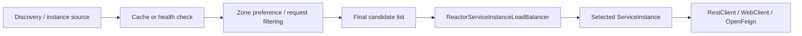

# Testing Supplier Chains, Caching, Zones, and Health Checks

## 1. Lesson objectives

In a microservices system, client-side load balancing is not just picking a `ServiceInstance` via Round Robin. Before the target-selection algorithm runs, Spring Cloud LoadBalancer must know **which instances remain eligible**: what discovery returned, whether the cache holds stale data, which zone each instance belongs to, and whether health checks confirm the instance is healthy.

Testing only the HTTP methods of `RestClient`, `WebClient`, or OpenFeign is insufficient. A request can fail because the supplier provided the wrong list, even though the selection algorithm itself worked properly.

This lesson belongs to the **Automated Testing** chapter of the `SPRING_CLOUD_SERVICE_COMMUNICATION_LOAD_BALANCING` module. The module examines `ServiceInstance` selection by service ID, discovery, health checks, routing policies, and HTTP client integration with retries, timeouts, and observability. Here we focus on **testing the `ServiceInstanceListSupplier` chain**, inspecting each list-transformation layer before a request travels downstream.

After this lesson, you will be able to:

1. Read the `Flux<List<ServiceInstance>>` contract accurately and write independently testable fixtures.
2. Test **zone** filtering, including when no instance exists in the preferred zone.
3. Test **cache hits, cache misses, and invalidation** without `Thread.sleep`.
4. Design **health check** tests with HTTP stubs and bounded waits rather than lucky scheduler timing.
5. Test **supplier ordering** and pinpoint where stale data or unhealthy instances slip into the list.
6. Separate supplier tests from instance-selection, HTTP transport, timeout, and retry tests.

## 2. Where does the supplier chain operate?

`ServiceInstanceListSupplier` emits **lists** of instances for a service ID. Wrappers such as `CachingServiceInstanceListSupplier`, `ZonePreferenceServiceInstanceListSupplier`, and `HealthCheckServiceInstanceListSupplier` can transform that list. Finally, `ReactorServiceInstanceLoadBalancer.choose(Request)` receives the list and returns `Response<ServiceInstance>`.



Suppose `order-service` calls `stock-service`, which has three instances:

| Instance | Zone (metadata) | Status | Testing significance |
| --- | --- | --- | --- |
| `stock-a` | `zone-a` | Healthy | Preferred target when caller is in `zone-a` |
| `stock-b` | `zone-b` | Healthy | Fallback target when no instance remains in the same zone |
| `stock-c` | `zone-a` | Unhealthy | Must be excluded when health checks are actually active |

When health checks exclude C and zone preference is `zone-a`, the expected candidate set is `[stock-a]`. If both A and C are unhealthy, the outcome depends on **the all-down policy of your health-check supplier version**; never blindly assume B is always picked if B is also unhealthy. With zone preference alone over a list containing only B, having no `zone-a` candidates causes the zone supplier to return **the entire input list**, namely `[stock-b]`.

### 2.1. Do not confuse three boundaries

| Boundary | What to test | What not to infer |
| --- | --- | --- |
| `ServiceInstanceListSupplier.get()` or `get(request)` | Candidate set, order, metadata, and emission timing | Does not prove an HTTP request reached the instance |
| `ReactorServiceInstanceLoadBalancer.choose(request)` | Picks one instance from the list or returns `EmptyResponse` | Does not prove the instance is healthy at send time |
| HTTP client calling by service ID | Status, body, exception, actual server request count | Insufficient to verify caching or zone filtering without inspecting the list |

A request might select A and then time out. That is an entirely different outcome from the supplier returning an empty list so LoadBalancer selects no target. Tests must distinguish these two scenarios.

## 3. Designing a layered testing strategy

You should have at least three test layers:

1. **Deterministic unit tests** using `ServiceInstanceListSuppliers.from(...)` or fake suppliers; no network, no Spring Boot context. Used to verify zone filters and caching.
2. **Component/integration tests** with a real chain in `stock-service`'s context, backed by fake discovery and controllable health endpoints. Used to catch wrong wrapper ordering, wrong health-check path config, or scheduler issues.
3. **End-to-end HTTP tests** calling `http://stock-service/...` via a `@LoadBalanced` client or `@FeignClient(name="stock-service")`; count requests received at each instance to connect supplier output to real HTTP behavior.

Do not replace all unit tests with one massive end-to-end test. When a coarse test fails, it is hard to tell apart discovery bugs, stale cache, zone metadata, health probes, Round Robin logic, and HTTP client wiring.

### 3.1. Required dependencies

A Spring Boot + Spring Cloud application can use the following Maven dependencies; **do not override starter versions** when managed by a compatible Spring Boot/Spring Cloud BOM:

```xml
<dependencies>
    <dependency>
        <groupId>org.springframework.cloud</groupId>
        <artifactId>spring-cloud-starter-loadbalancer</artifactId>
    </dependency>
    <dependency>
        <groupId>org.springframework.boot</groupId>
        <artifactId>spring-boot-starter-test</artifactId>
        <scope>test</scope>
    </dependency>
    <dependency>
        <groupId>io.projectreactor</groupId>
        <artifactId>reactor-test</artifactId>
        <scope>test</scope>
    </dependency>
</dependencies>
```

If using reactive health checks via `WebClient`, ensure the corresponding HTTP client library is on the classpath. If testing health checks with `RestTemplate` or `RestClient` in a blocking stack, choose `withBlockingHealthChecks()` or `withBlockingRestClientHealthChecks()` **matching your Spring Cloud version**.

## 4. Shared fixtures: service ID and instances with metadata

Place fixtures in `src/test/java`. You do not need Eureka/Consul running to test supplier logic.

```java
package example.loadbalancer;

import java.time.Duration;
import java.util.List;

import org.springframework.cloud.client.DefaultServiceInstance;
import org.springframework.cloud.client.ServiceInstance;

final class StockFixtures {
    static final String SERVICE_ID = "stock-service";
    static final Duration WAIT = Duration.ofSeconds(2);

    static DefaultServiceInstance instance(String id, int port, String zone) {
        var instance = new DefaultServiceInstance(
                id, SERVICE_ID, "127.0.0.1", port, false);
        instance.getMetadata().put("zone", zone);
        return instance;
    }

    static List<String> ids(List<ServiceInstance> instances) {
        return instances.stream()
                .map(ServiceInstance::getInstanceId)
                .toList();
    }

    private StockFixtures() {}
}
```

`DefaultServiceInstance` explicitly defines `instanceId`, host, port, zone, and metadata in each test. Using finite lists allows assertions on **exact result sets**, rather than running live HTTP calls and guessing from logs.

The `get()` contract has the signature:

```java
Flux<List<ServiceInstance>> get();
```

To inspect a single emission, tests commonly call `supplier.get().next().block(WAIT)` or use `StepVerifier`. **Only block in tests**; never put `block()` into reactive WebClient production code.

If a supplier emits **multiple times over time** (such as health checks), a plain `next()` may capture only the initial state before probes finish. In that case, tests must wait for a **deterministic condition** with a timeout instead of immediately asserting that the first emission is the final healthy list.

## 5. Unit testing zone preference: matching zone and fallback

`ZonePreferenceServiceInstanceListSupplier` reads the caller's zone from `LoadBalancerZoneConfig` (typically populated via `spring.cloud.loadbalancer.zone`) and reads each instance's zone from the `zone` metadata key.

Behaviors to verify:

- **Same-zone instances exist:** returns only instances in that zone.
- **No same-zone instances exist:** returns **the entire list provided by the delegate**.
- **No zone configured:** performs no zone filtering.
- **Delegate returns empty list:** result remains empty.
- **Missing or invalid `zone` metadata:** does not synthesize a zone from host or port.

JUnit 5 test example:

```java
package example.loadbalancer;

import org.junit.jupiter.api.Test;
import org.springframework.cloud.loadbalancer.config.LoadBalancerZoneConfig;
import org.springframework.cloud.loadbalancer.core.ZonePreferenceServiceInstanceListSupplier;
import org.springframework.cloud.loadbalancer.support.ServiceInstanceListSuppliers;

import static example.loadbalancer.StockFixtures.*;
import static org.junit.jupiter.api.Assertions.assertEquals;

class ZonePreferenceSupplierTest {

    @Test
    void keepsOnlyInstancesInPreferredZone() {
        var a = instance("a", 8081, "zone-a");
        var b = instance("b", 8082, "zone-b");
        var c = instance("c", 8083, "zone-a");

        var source = ServiceInstanceListSuppliers.from(SERVICE_ID, a, b, c);
        var zone = new ZonePreferenceServiceInstanceListSupplier(
                source, new LoadBalancerZoneConfig("zone-a"));

        var result = zone.get().next().block(WAIT);
        assertEquals(java.util.List.of("a", "c"), ids(result));
    }

    @Test
    void fallsBackToAllCandidatesIfZoneHasNoMatch() {
        var a = instance("a", 8081, "zone-a");
        var b = instance("b", 8082, "zone-b");

        var source = ServiceInstanceListSuppliers.from(SERVICE_ID, a, b);
        var zone = new ZonePreferenceServiceInstanceListSupplier(
                source, new LoadBalancerZoneConfig("zone-c"));

        assertEquals(java.util.List.of("a", "b"),
                ids(zone.get().next().block(WAIT)));
    }

    @Test
    void preservesEmptyCandidateList() {
        var source = ServiceInstanceListSuppliers.from(SERVICE_ID);
        var zone = new ZonePreferenceServiceInstanceListSupplier(
                source, new LoadBalancerZoneConfig("zone-a"));

        assertEquals(java.util.List.of(),
                ids(zone.get().next().block(WAIT)));
    }
}
```

**Note:** `ZonePreferenceServiceInstanceListSupplier` is a **preference**, not a "strict ban on cross-zone traffic." When no instance in the same zone is found, it deliberately falls back to the rest of the list. If a product requires *staying strictly within the zone*, write a dedicated strict filter and test the zero-candidate case. Do not use built-in zone preference results to claim hard isolation is implemented.

### 5.1. Checking request context with request-aware suppliers

Some wrappers supporting retry, hints, or sticky sessions must call `get(Request)` instead of `get()`. When testing the chain:

1. Create a fake supplier whose `get(request)` returns a different list from `get()`.
2. Call `choose(requestWithContext)` on LoadBalancer or `get(requestWithContext)` on the wrapper under test.
3. Verify the supplier receives the right `Request` and does not lose metadata needed for filtering.

Watch out for differences across Spring Cloud versions: forwarding `get(Request)` through `DelegatingServiceInstanceListSupplier` has had version-specific configuration flags. Avoid assuming every wrapper forwards context by default; in particular, **caching and health checks** are designed to sit before request-dependent filters.

## 6. Testing caching without relying on the wall clock

`CachingServiceInstanceListSupplier` retains the list per service ID and reduces source queries. In tests, distinguish a **cache hit** from an **unchanged discovery source**: if the source always returns A, seeing A twice does not prove caching works.

A solid test design needs:

1. A **mutable delegate**: first returns `[a]`, then changes to `[b]`.
2. A counter tracking actual delegate invocations.
3. A dedicated `CacheManager` for the test.
4. Assertion that the second call still returns `[a]` with source read count `1`.
5. Explicitly evicting the service ID's cache key, then asserting the next call returns `[b]` and the counter increments to `2`.

Example using `ConcurrentMapCacheManager` (no automatic TTL; suitable **only** for verifying hit/miss/invalidation):

```java
package example.loadbalancer;

import java.util.List;
import java.util.concurrent.atomic.AtomicInteger;
import java.util.concurrent.atomic.AtomicReference;

import org.junit.jupiter.api.Test;
import org.springframework.cache.concurrent.ConcurrentMapCacheManager;
import org.springframework.cloud.client.ServiceInstance;
import org.springframework.cloud.loadbalancer.core.CachingServiceInstanceListSupplier;
import org.springframework.cloud.loadbalancer.core.ServiceInstanceListSupplier;
import reactor.core.publisher.Flux;

import static example.loadbalancer.StockFixtures.*;
import static org.junit.jupiter.api.Assertions.*;

class CachingSupplierTest {

    @Test
    void returnsCachedInstancesUntilCacheIsEvicted() {
        var a = instance("a", 8081, "zone-a");
        var b = instance("b", 8082, "zone-a");

        var current = new AtomicReference<List<ServiceInstance>>(List.of(a));
        var sourceReads = new AtomicInteger();

        ServiceInstanceListSupplier delegate = new ServiceInstanceListSupplier() {
            @Override
            public String getServiceId() {
                return SERVICE_ID;
            }

            @Override
            public Flux<List<ServiceInstance>> get() {
                return Flux.defer(() -> {
                    sourceReads.incrementAndGet();
                    return Flux.just(current.get());
                });
            }
        };

        var cacheManager = new ConcurrentMapCacheManager(
                CachingServiceInstanceListSupplier.SERVICE_INSTANCE_CACHE_NAME);
        var cached = new CachingServiceInstanceListSupplier(
                delegate, cacheManager);

        assertEquals(List.of("a"), ids(cached.get().next().block(WAIT)));
        assertEquals(1, sourceReads.get());

        current.set(List.of(b)); // Discovery changed, cache has not.
        assertEquals(List.of("a"), ids(cached.get().next().block(WAIT)));
        assertEquals(1, sourceReads.get());

        var cache = cacheManager.getCache(
                CachingServiceInstanceListSupplier.SERVICE_INSTANCE_CACHE_NAME);
        assertNotNull(cache);
        cache.evict(SERVICE_ID);

        assertEquals(List.of("b"), ids(cached.get().next().block(WAIT)));
        assertEquals(2, sourceReads.get());
    }
}
```

**Limitation of this test:** `ConcurrentMapCacheManager` in this example does not expire automatically. The test **proves the hit/miss/invalidation path**, not that `spring.cloud.loadbalancer.cache.ttl` works. To test TTL, use a real cache implementation with an appropriate clock/expiry controller or a bounded-timeout integration test; avoid `Thread.sleep(35_000)`.

### 6.1. Cache TTL in real applications

Example:

```yaml
spring:
  cloud:
    loadbalancer:
      cache:
        enabled: true
        ttl: 10s
        capacity: 256
```

Spring Cloud LoadBalancer provides a default implementation and can select Caffeine when its dependency is present. `ttl` is the cache list expiration window, **not a guarantee that discovery refreshes right when the TTL ends**; lists are typically reloaded on the next access. Caffeine specification settings can override generic cache properties; if the registry already caches, consider avoiding double caching.

Scenarios to verify in integration tests:

| Change | Expected within TTL | Expected after expiry and next access |
| --- | --- | --- |
| Registry adds instance C | May still see A/B | Can see A/B/C if discovery has updated |
| Registry removes instance A | May still see A | A disappears once source list omits A |
| Network outage to registry | Depends on cache and error policy | Inspect actual logs/exceptions; do not assume default behavior |
| Cache deliberately evicted | Next read reloads from source | Source is invoked again |

**Important observation:** A stale cache can route requests to a removed instance. That does not mean `RoundRobinLoadBalancer` chose wrongly; the algorithm may simply be picking accurately from **a stale cached list**.

## 7. Testing health checks: control probes instead of guessing the scheduler

`HealthCheckServiceInstanceListSupplier` periodically checks each `ServiceInstance`'s health endpoint and emits candidate lists per its version's policy. When service discovery already removes dead instances, an extra health checker may be unnecessary; it is typically more useful with `SimpleDiscoveryClient` or static instance lists.

Probe policies should be tested against **fake HTTP servers with controllable state**. One `AtomicBoolean healthy` per server lets you:

- Return `200` from A when healthy; switch to `503` when unhealthy.
- Keep B returning `200` as a control.
- Bring A back up and observe it rejoin the list.
- Count requests to `/actuator/health` to prove the scheduler runs.

### 7.1. A JDK health endpoint stub

The following helper supports integration tests without adding extra HTTP mocking libraries:

```java
package example.loadbalancer;

import com.sun.net.httpserver.HttpServer;
import java.io.IOException;
import java.net.InetSocketAddress;
import java.util.concurrent.atomic.AtomicBoolean;
import java.util.concurrent.atomic.AtomicInteger;

final class HealthStub implements AutoCloseable {
    final AtomicBoolean healthy = new AtomicBoolean(true);
    final AtomicInteger probes = new AtomicInteger();
    final HttpServer server;

    HealthStub() throws IOException {
        server = HttpServer.create(
                new InetSocketAddress("127.0.0.1", 0), 0);

        server.createContext("/actuator/health", exchange -> {
            probes.incrementAndGet();
            boolean up = healthy.get();
            byte[] body = (up ? "{\"status\":\"UP\"}"
                              : "{\"status\":\"DOWN\"}").getBytes();
            exchange.getResponseHeaders()
                    .add("Content-Type", "application/json");
            exchange.sendResponseHeaders(up ? 200 : 503, body.length);
            try (var response = exchange.getResponseBody()) {
                response.write(body);
            } finally {
                exchange.close();
            }
        });
        server.start();
    }

    int port() {
        return server.getAddress().getPort();
    }

    @Override
    public void close() {
        server.stop(0);
    }
}
```

When creating `DefaultServiceInstance` entries for both stubs, use `localhost`/`127.0.0.1` and the actual `port()`. Health probes should target the exact URL/port registered by the instance. Two local servers do not require Docker, but still need cleanup via `try-with-resources` or `@AfterAll` to avoid port/scheduler leaks.

### 7.2. Test-environment configuration

Example tailored to service ID `stock-service`:

```yaml
spring:
  cloud:
    loadbalancer:
      health-check:
        initial-delay: 0s
        interval: 1s
        path:
          default: /actuator/health
        update-results-list: false
        refetch-instances: true
        refetch-instances-interval: 1s
```

Here `update-results-list=false` lets some versions aggregate the full healthy list before emitting instead of emitting after every individual probe result; still verify your exact version's emission behavior. `refetch-instances=true` is used when the source does not push new lists automatically and discovery snapshots must be re-fetched periodically. One-second intervals are for tests only; production must tune intervals to traffic and freshness needs.

**Always verify the all-down policy for your version:** Some documentation releases state that when all instances are unhealthy, it falls back to the full initial list, while newer source docs describe emitting an empty list. Therefore, **never write tests assuming all-down behavior** without locking your Spring Cloud/BOM version and reading that version's `HealthCheckServiceInstanceListSupplier` implementation. Document your project's expected behavior—*fail open* or *fail closed*—and test accordingly.

### 7.3. Health test scenario with condition waiting

With two stubs A/B, both initially healthy:

1. Build/wire a supplier from discovery containing `ServiceInstance(A, B)`, wrapped by `HealthCheckServiceInstanceListSupplier` in the Spring context (via `withHealthChecks()` or `withBlockingHealthChecks()`).
2. **Wait** until both A's and B's `probes` counters are positive, then confirm the resulting list contains A and B.
3. Flip `A.healthy.set(false)`; wait at least one subsequent probe cycle and verify the list contains only B.
4. Flip `A.healthy.set(true)`; wait for a new probe cycle and verify A returns.
5. Set both A and B unhealthy; verify the **actual all-down policy** of your active version. Do not borrow assertions from a different release branch's docs.

Use **timeout-bounded polling** in tests rather than `Thread.sleep(1000)` followed by an immediate assertion. Pseudo-test illustration with Awaitility:

```java
// Illustrative assertion assuming "supplier" is a real health-check supplier
// created in the Spring context and A, B are two HealthStub instances.
await().atMost(Duration.ofSeconds(8)).untilAsserted(() -> {
    assertTrue(a.probes.get() > 0);
    assertTrue(b.probes.get() > 0);
    assertEquals(List.of("a", "b"), currentHealthyIds(supplier));
});

a.healthy.set(false);
await().atMost(Duration.ofSeconds(8)).untilAsserted(() ->
    assertEquals(List.of("b"), currentHealthyIds(supplier)));
```

The snippet above **illustrates test structure**, not a standalone runnable test class: `await()` requires the `org.awaitility:awaitility` dependency, and `currentHealthyIds` is a helper that must fetch the **latest** snapshot from the health supplier per your chosen emission/version mechanics. If the supplier emits multiple times or replays initial data, calling `get().next()` alone cannot be assumed to reflect the newest state.

When testing a `Flux` directly, you can use `StepVerifier` or `StepVerifier.withVirtualTime`, though virtual time only works when **every involved scheduler is controlled**. If health checks make real HTTP calls, Reactor's virtual scheduler alone will not make the network instant. Use bounded event/polling waits or supply a precisely controllable scheduler/HTTP stub.

## 8. Wrapper ordering determines the meaning of results

Per Spring Cloud LoadBalancer guidance, **caching or health checks go right after the network-backed instance supplier**, ahead of zone, hint, or request filters. With a health-check supplier, you usually **do not need** an extra `CachingServiceInstanceListSupplier` because health checks maintain their own replay/cache mechanism; two cache layers can retain unhealthy states unexpectedly.

### 8.1. Two practical chains

When only zone preference and caching are needed:

```java
import org.springframework.cloud.loadbalancer.core.ServiceInstanceListSupplier;
import org.springframework.context.ConfigurableApplicationContext;
import org.springframework.context.annotation.Bean;

public class StockZoneSupplierConfiguration {
    @Bean
    ServiceInstanceListSupplier stockInstances(
            ConfigurableApplicationContext context) {
        return ServiceInstanceListSupplier.builder()
                .withDiscoveryClient()
                .withCaching()
                .withZonePreference()
                .build(context);
    }
}
```

When reactive health checks and zone preference are needed, replace the cache layer with health checks:

```java
public class StockHealthSupplierConfiguration {
    @Bean
    ServiceInstanceListSupplier stockInstances(
            ConfigurableApplicationContext context) {
        return ServiceInstanceListSupplier.builder()
                .withDiscoveryClient()
                .withHealthChecks()
                .withZonePreference()
                .build(context);
    }
}
```

**These two classes are mutually exclusive configuration choices**, not registered simultaneously for the same service. Place config classes outside automatic component scanning or omit `@Configuration`, then attach **one** class via `@LoadBalancerClient(name="stock-service", configuration=...)`.

`withDiscoveryClient()` fits when `ReactiveDiscoveryClient` and the needed reactive HTTP client are present. For blocking discovery, pick `withBlockingDiscoveryClient()`, and for blocking health checks pick the matching builder (`withBlockingHealthChecks()` or `withBlockingRestClientHealthChecks()` depending on the library). Always check your Spring Cloud version before copying configurations verbatim.

### 8.2. Why does order matter?

Suppose state evolves as follows:

```text
T0: discovery = [A(zone-a, healthy), B(zone-b, healthy)]
T1: A becomes unhealthy, discovery has not removed A yet
T2: health check detects A is unhealthy
T3: A recovers
```

If health checks sit right after discovery, they filter out A at `T2` and zone preference sees only B; with no healthy `zone-a` instance, zone preference returns B. If another cache sat **after health checks**, that cache could keep the stale `[A,B]` list and cause zone preference to keep choosing A. Thus tests must inspect **actual outputs at each layer**, especially across `T1/T2/T3`.

Similarly, if a cache sits after a request-dependent filter, results from an earlier request can be reused for a later request with a different context. Tests should issue two requests with differing hints/zones and verify they do not share wrongly filtered lists.

## 9. Standard test matrix for the entire chain

| Scenario | Source input | Cache/zone/health | Output to verify |
| --- | --- | --- | --- |
| Cold cache | A/B | Cache empty | Delegate called, returns A/B |
| Warm cache | Source switches to B/C | Cache unexpired | Still returns cached snapshot, delegate not called again |
| Cache invalidation | Source B/C | Cache evicted | Returns B/C, delegate called again |
| Zone match | A:zone-a, B:zone-b | Caller zone-a | Only A |
| No zone match | A:zone-a, B:zone-b | Caller zone-c | Fallback A/B |
| No zone configured | A/B | Zone null | Returns source list |
| One instance fails health | A unhealthy, B healthy | Probe updated | Only B once health supplier filters and updates |
| All fail health | A/B unhealthy | Probe updated | Matches confirmed **version all-down policy** |
| Discovery returns empty | [] | Any zone | `[]` or appropriate no-instance error |
| Discovery throws exception | N/A | Cache miss | Error observed, not disguised as empty list |
| Different request hints | A/B with distinct hints | Request-aware filter | No filtered-list leakage from prior requests |
| Retry picks new instance | A/B | Retry-aware supplier + retry policy | Instance chosen per policy; separate retry from filter loop |

Verify assertions against **instance sets and source invocation counts** before inspecting HTTP responses. A test checking only that the final request returns 200 cannot detect traffic going to the wrong zone or stale caches.

## 10. Per-service-ID integration tests

Once unit tests pass, add at least one integration test that creates the Spring child context for the service name. Registration example:

```java
import org.springframework.cloud.loadbalancer.annotation.LoadBalancerClient;
import org.springframework.context.annotation.Configuration;

@Configuration(proxyBeanMethods = false)
@LoadBalancerClient(
        name = "stock-service",
        configuration = StockZoneSupplierConfiguration.class)
class StockLoadBalancerRegistration {}
```

Configure `@LoadBalanced RestClient.Builder` or `@LoadBalanced WebClient.Builder` for the caller and invoke URLs by service ID:

```java
// With RestClient built from @LoadBalanced RestClient.Builder:
String response = restClient.get()
        .uri("http://stock-service/stocks/{sku}", "SKU-1")
        .retrieve()
        .body(String.class);
```

In this test, use fake discovery or `SimpleDiscoveryClient` pointing to two local HTTP stubs. Stubs A and B return bodies containing their `instanceId`, confirming where real requests went.

**Verification contract:**

1. When both A and B are in the list and A shares the caller's zone, repeated client calls hit only A (with retries or instance-changing filters disabled).
2. If A disappears from the source/cached list and the cache is invalidated or its TTL expires, the caller shifts to B per zone-fallback rules.
3. When both instances disappear, the supplier emits `[]` and the client handles no-instance per its integration; do not hardcode that all clients throw the same status exception.
4. Trigger HTTP 503 or timeout from the chosen server and compare server request counts against retry settings. Supplier tests **do not** replace retry tests.

### 10.1. Verifying caching beyond HTTP status codes

If both A and B return 200, an integration test asserting only 200 cannot tell whether traffic went to the right target. Have A and B return distinct headers or bodies:

```text
stock-a -> {"instance":"a","stock":12}
stock-b -> {"instance":"b","stock":12}
```

Then tests for zone switching, cache invalidation, and updated health states can use the returned instance identity for diagnosis.

### 10.2. Avoiding flaky tests

- Do not rely on fixed ports; bind HTTP stubs to port `0` and read the actual port.
- Do not use fixed `Thread.sleep` to wait for cache TTLs or health checks; use deadline-bounded polling and observable events/results.
- Keep tests independent: contexts, caches, schedulers, and stubs must be reset or closed between cases.
- When a `Flux` emits multiple snapshots, know whether the test asserts the **first emission** or the **latest state**.
- Disable retries in supplier-focused tests (e.g., `spring.cloud.loadbalancer.retry.enabled=false`); enable them specifically in retry tests.
- Separate zone tests from health tests so failures immediately identify the offending layer.
- Do not use Round Robin or Random probability distributions to prove filtering; assert the supplier list directly first.

## 11. Diagnosing unexpected test behavior

| Symptom | Possible cause | How to verify |
| --- | --- | --- |
| Test still sees instance A after discovery drops A | Cache holds stale snapshot or registry hasn't refreshed | Count `delegate.get()`, inspect TTL/cache key and source snapshot |
| `zone-a` test still gets B | No `zone-a` instance survived health checks, triggering fallback | Inspect list before and after zone filter |
| Zone filtering does nothing | Wrong `zone` metadata key or caller zone unset | Inspect `LoadBalancerZoneConfig` and instance metadata |
| Health test passes intermittently | Scheduler/probe hasn't run yet; assertion reads first emission | Wait for probe count + list condition with a timeout |
| All-down test contradicts docs | Different Spring Cloud release branch or policy | Check actual version and health supplier source code |
| Cache test hits source every time | Cache name mismatch, different cache manager, caching inactive | Inspect `CachingServiceInstanceListSupplier.SERVICE_INSTANCE_CACHE_NAME` and hits/misses |
| Cache test never updates | Not evicted, TTL unexpired, or registry-level caching | Inspect every cache layer and the source |
| `get(request)` loses hint | Wrapper does not forward request context properly | Use a fake delegate to confirm `get(request)` is called |
| Client API times out while supplier is right | Network/HTTP transport or real server non-responsive | Test HTTP, timeouts, and retries separately |

## 12. Hands-on exercises

1. Extend `ZonePreferenceSupplierTest` to test null zones, uppercase/lowercase zone names, and instances missing `zone` metadata.
2. Extend `CachingSupplierTest` across three source states `[A] → [B] → []`; demonstrate whether empty-list caching behaves differently from non-empty caching in your implementation.
3. Start two `HealthStub` HTTP servers, stop A and restart it; write a test that passes only after probes execute and the healthy list updates.
4. Build the chain `discovery → health → zone`. Make A same-zone but unhealthy, and B cross-zone but healthy; prove B becomes the candidate after the health filter drops A.
5. Build an HTTP test with a `@LoadBalanced` client and responses containing `instanceId`; compare instance selection before and after cache invalidation.
6. When all instances are unhealthy, determine your Spring Cloud version's policy, assert against it, and propose business requirements if fail-closed is preferred over fail-open.

## 13. Reference documentation

- [Spring Cloud Commons – Spring Cloud LoadBalancer](https://docs.spring.io/spring-cloud-commons/reference/spring-cloud-commons/loadbalancer.html): caching, zone preference, health checks, `ServiceInstanceListSupplier` ordering, per-service-ID configuration.
- [Spring Cloud LoadBalancer – Configuration Properties](https://docs.spring.io/spring-cloud-commons/reference/configprops.html): cache TTL and health-check properties; cross-check with your project BOM.
- [Spring Cloud Commons – CachingServiceInstanceListSupplier source](https://github.com/spring-cloud/spring-cloud-commons/blob/main/spring-cloud-loadbalancer/src/main/java/org/springframework/cloud/loadbalancer/core/CachingServiceInstanceListSupplier.java): how the implementation queries cache by service ID.
- [Spring Cloud Commons – ZonePreferenceServiceInstanceListSupplier source](https://github.com/spring-cloud/spring-cloud-commons/blob/main/spring-cloud-loadbalancer/src/main/java/org/springframework/cloud/loadbalancer/core/ZonePreferenceServiceInstanceListSupplier.java): fallback when no same-zone instance exists.
- [Reactor Test – StepVerifier](https://projectreactor.io/docs/test/release/api/reactor/test/StepVerifier.html): verifying emissions and errors from publishers.

**Takeaway:** To test a supplier chain reliably, verify **each layer's output and when data changes**. Caches can retain stale snapshots; zone preference falls back when no preferred-zone match exists; health checks depend on probes, schedulers, and version-specific policies. Only once these layers are clear should you verify `ServiceInstance` selection algorithms and actual HTTP requests.
