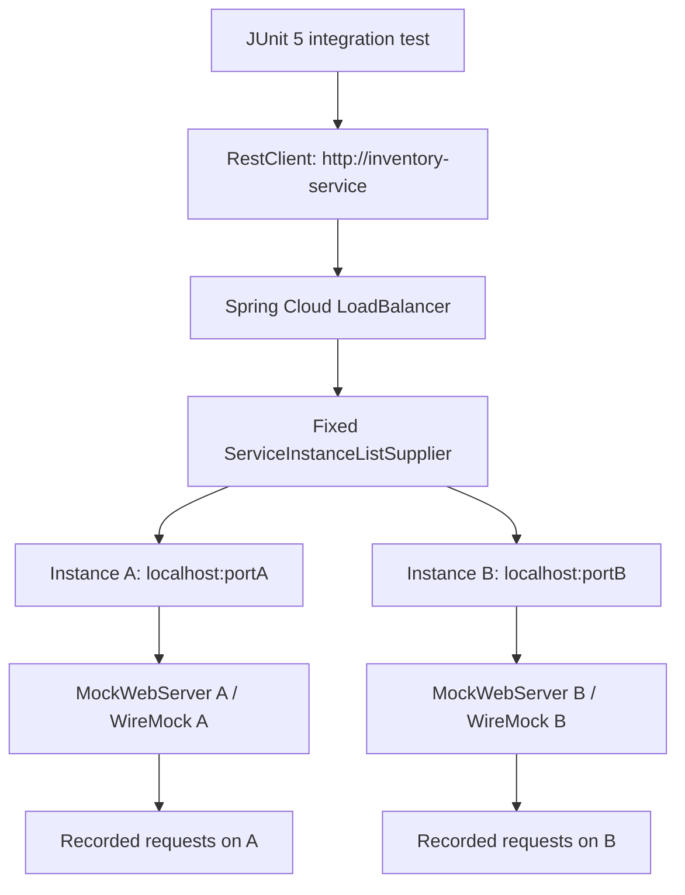

# Setting Up Multiple Mock HTTP Servers with WireMock or MockWebServer

When testing Spring Cloud LoadBalancer, a single mock HTTP server only proves that a client can send a request and receive a response. It **does not prove that LoadBalancer actually chooses among multiple `ServiceInstance`s**. To test round-robin, zone preference, health checks, failover, or retries, your test needs at least two independent endpoints—each with its own port, its own response, and the ability to record the requests actually sent to it.

For example, `order-service` calls `inventory-service` via the logical URI `http://inventory-service`. In production, the service ID resolves to replicas via discovery and `ServiceInstanceListSupplier`. In tests, you can replace the real instance source with a fixed list pointing to two local HTTP servers spun up with **MockWebServer** or **WireMock**. That gives tests control over responses, errors, and delays while letting them verify which instance was chosen.

This lesson belongs to the **Automated Testing** chapter of the `SPRING_CLOUD_SERVICE_COMMUNICATION_LOAD_BALANCING` module. Its scope covers inter-service communication with `RestClient`, `WebClient`, OpenFeign, `ServiceInstance` selection, discovery, health checks, timeouts, retries, and failure observability. The goal is not to emulate all of Kubernetes/Eureka/Consul, but to build a **sufficiently realistic, repeatable HTTP environment** to catch defects in the instance-selection and HTTP client layers.

## 1. Testing at the right boundary: mocking interfaces or real HTTP servers?

Three testing levels are commonly confused:

| Level | Approach | What it checks | What it cannot check |
|---|---|---|---|
| **Algorithm unit test** | Create fake `ServiceInstance`s; call `choose(Request)` or `get(Request)` directly. | Filtering/priority, selection algorithm, empty-list handling. | URI rewriting, HTTP transport, headers, real timeouts. |
| **Mock client interface** | Mockito `@Mock` or a fake bean for `InventoryClient`. | `order-service` business logic. | Virtually bypasses LoadBalancer and TCP. |
| **HTTP stub integration test** | Spin up 2–3 local HTTP servers and call through `@LoadBalanced RestClient/WebClient` or Feign. | Instance selection, rewriting service ID to host:port, sending HTTP, reading responses, observing errors. | Does not automatically verify real registries, production networking, or service meshes. |

Integration tests are not always superior to unit tests. For a custom algorithm, unit tests verify every policy branch quickly and accurately. However, when answering **"Does Spring Cloud LoadBalancer actually dispatch requests across replicas properly?"**, you must test at the HTTP boundary.

## 2. Test topology: two mock servers, one service ID

We will run two servers on loopback:



Both servers return the same JSON shape with distinct identifiers:

```json
{"instanceId":"inventory-a","stock":17}
```

```json
{"instanceId":"inventory-b","stock":17}
```

The crucial detail of the test is **using the logical service ID**, never calling `http://localhost:portA` or `http://localhost:portB` directly in the client code under test. Calling those ports directly only tests the HTTP server and **proves nothing about LoadBalancer**.

### Why use dynamic ports?

When many tests run in CI or multiple workers run in parallel, fixed ports like 8081/8082 collide easily. Both MockWebServer and WireMock support starting on OS-assigned dynamic ports:

- MockWebServer: call `start()` and then read `getPort()`.
- WireMock: configure `dynamicPort()` and then call `port()` after `start()`.
- Once the servers are running, use those ports to build LoadBalancer `ServiceInstance` entries.

**Start HTTP stubs before Spring builds the bean that supplies the instance list.** Reading `port()` before the server starts can produce invalid ports or intermittent errors.

## 3. Dependencies and version selection

An illustrative Gradle Groovy configuration for a Spring Boot/Spring Cloud project with a compatible BOM already selected:

```groovy
dependencies {
    implementation 'org.springframework.boot:spring-boot-starter-web'
    implementation 'org.springframework.cloud:spring-cloud-starter-loadbalancer'

    testImplementation 'org.springframework.boot:spring-boot-starter-test'
    testImplementation 'com.squareup.okhttp3:mockwebserver:4.12.0'
}
```

The examples below illustrate the **MockWebServer 4.x** API (`okhttp3.mockwebserver.*`), Java 17+, and a Spring Boot/Spring Cloud version supporting `RestClient`. This is a test dependency pattern, not an instruction to upgrade or downgrade versions in any specific project. If your project uses MockWebServer 5.x, packages, APIs, and artifacts may differ: match test library versions to your code.

If you choose WireMock instead of MockWebServer, add a WireMock 3.x test dependency compatible with your Java version and stack, such as `org.wiremock:wiremock` pinned in dependency management. **You do not need both libraries installed at once just to test a single call path.**

`WebClient` requires the matching WebFlux dependency; OpenFeign requires the OpenFeign starter. In the main hands-on example, we use `RestClient` to inspect the synchronous HTTP path, then apply the same topology to WebClient and Feign.

## 4. MockWebServer: a real server on localhost with controlled responses

MockWebServer is a lightweight HTTP server built for testing. It accepts real TCP/HTTP traffic, constructs responses, injects headers, simulates slow responses, drops connections, and records incoming requests for assertions.

Standalone server example:

```java
import okhttp3.mockwebserver.MockResponse;
import okhttp3.mockwebserver.MockWebServer;

MockWebServer replicaA = new MockWebServer();
replicaA.start();

replicaA.enqueue(new MockResponse()
    .setResponseCode(200)
    .addHeader("Content-Type", "application/json")
    .setBody("{\"instanceId\":\"inventory-a\",\"stock\":17}"));

int portA = replicaA.getPort();

// After the test finishes:
replicaA.shutdown();
```

`enqueue(...)` works well when you know the request count and want to simulate a **response sequence**: first request returns `500`, next request returns `200`. Each server has its own response queue. If a LoadBalancer test issues multiple calls while only one response is enqueued on server A, subsequent requests reaching A can hang or fail depending on the dispatcher and timeout—a frequent source of flaky tests.

In multi-request tests, use a `Dispatcher` instead of a queue. A dispatcher builds responses based on method/path, allowing A to respond consistently to every contract-compliant request.

## 5. Complete integration test example: two MockWebServers + RestClient

The test below uses:

1. Two real `MockWebServer`s, each listening on a dynamic port.
2. A `ServiceInstanceListSupplier` providing a **fixed** list of two `DefaultServiceInstance`s.
3. `@LoadBalancerClient` to register the supplier in **`inventory-service`'s named context**.
4. A `@LoadBalanced RestClient.Builder` and a `RestClient` bean with `baseUrl("http://inventory-service")`.
5. JUnit 5 assertions verifying **both servers received real HTTP requests**.

### 5.1. Test class and lifecycle of both servers

```java
import java.io.IOException;
import java.util.HashSet;
import java.util.List;
import java.util.Set;
import java.util.concurrent.TimeUnit;

import okhttp3.mockwebserver.Dispatcher;
import okhttp3.mockwebserver.MockResponse;
import okhttp3.mockwebserver.MockWebServer;
import okhttp3.mockwebserver.RecordedRequest;

import org.junit.jupiter.api.AfterAll;
import org.junit.jupiter.api.Test;
import org.springframework.beans.factory.annotation.Autowired;
import org.springframework.boot.SpringBootConfiguration;
import org.springframework.boot.autoconfigure.EnableAutoConfiguration;
import org.springframework.boot.test.context.SpringBootTest;
import org.springframework.cloud.client.ServiceInstance;
import org.springframework.cloud.client.DefaultServiceInstance;
import org.springframework.cloud.client.loadbalancer.LoadBalanced;
import org.springframework.cloud.loadbalancer.annotation.LoadBalancerClient;
import org.springframework.cloud.loadbalancer.core.ServiceInstanceListSupplier;
import org.springframework.context.annotation.Bean;
import org.springframework.web.client.RestClient;
import reactor.core.publisher.Flux;

import static org.junit.jupiter.api.Assertions.*;

@SpringBootTest(
    classes = MultiReplicaLoadBalancerIT.TestApplication.class,
    webEnvironment = SpringBootTest.WebEnvironment.NONE
)
class MultiReplicaLoadBalancerIT {

    static final MockWebServer REPLICA_A = new MockWebServer();
    static final MockWebServer REPLICA_B = new MockWebServer();

    // Static initializer runs before Spring builds the test ApplicationContext.
    static {
        REPLICA_A.setDispatcher(replyAs("inventory-a"));
        REPLICA_B.setDispatcher(replyAs("inventory-b"));
        try {
            REPLICA_A.start();
            REPLICA_B.start();
        } catch (IOException exception) {
            throw new ExceptionInInitializerError(exception);
        }
    }

    private static Dispatcher replyAs(String instanceId) {
        return new Dispatcher() {
            @Override
            public MockResponse dispatch(RecordedRequest request) {
                if (!"GET".equals(request.getMethod())
                        || !"/api/items/42".equals(request.getPath())) {
                    return new MockResponse().setResponseCode(404);
                }

                return new MockResponse()
                    .setResponseCode(200)
                    .addHeader("Content-Type", "application/json")
                    .setBody("{\"instanceId\":\"" + instanceId
                        + "\",\"stock\":17}");
            }
        };
    }

    record InventoryReply(String instanceId, int stock) {}

    @Autowired
    RestClient inventoryRestClient;

    @Test
    void callsBothReplicasThroughLogicalServiceId() {
        int beforeA = REPLICA_A.getRequestCount();
        int beforeB = REPLICA_B.getRequestCount();
        Set<String> reachedReplicas = new HashSet<>();

        for (int attempt = 0; attempt < 12; attempt++) {
            InventoryReply reply = inventoryRestClient.get()
                .uri("/api/items/42")
                .retrieve()
                .body(InventoryReply.class);

            assertNotNull(reply);
            assertEquals(17, reply.stock());
            reachedReplicas.add(reply.instanceId());
        }

        assertTrue(reachedReplicas.contains("inventory-a"));
        assertTrue(reachedReplicas.contains("inventory-b"));

        int callsA = REPLICA_A.getRequestCount() - beforeA;
        int callsB = REPLICA_B.getRequestCount() - beforeB;
        assertTrue(callsA > 0);
        assertTrue(callsB > 0);
        assertEquals(12, callsA + callsB);
    }

    @AfterAll
    static void stopServers() throws IOException {
        REPLICA_A.shutdown();
        REPLICA_B.shutdown();
    }

    @SpringBootConfiguration
    @EnableAutoConfiguration
    @LoadBalancerClient(
        name = "inventory-service",
        configuration = InventoryInstancesConfiguration.class
    )
    static class TestApplication {

        @Bean
        @LoadBalanced
        RestClient.Builder loadBalancedRestClientBuilder() {
            return RestClient.builder();
        }

        @Bean
        RestClient inventoryRestClient(
                @LoadBalanced RestClient.Builder builder) {
            return builder.clone()
                .baseUrl("http://inventory-service")
                .build();
        }
    }

    // Registered in inventory-service's LoadBalancer child context.
    // Must NOT be component-scanned as a global configuration bean.
    static class InventoryInstancesConfiguration {

        @Bean
        ServiceInstanceListSupplier inventoryInstances() {
            List<ServiceInstance> instances = List.of(
                new DefaultServiceInstance(
                    "inventory-a", "inventory-service",
                    "localhost", REPLICA_A.getPort(), false),
                new DefaultServiceInstance(
                    "inventory-b", "inventory-service",
                    "localhost", REPLICA_B.getPort(), false)
            );

            return new ServiceInstanceListSupplier() {
                @Override
                public String getServiceId() {
                    return "inventory-service";
                }

                @Override
                public Flux<List<ServiceInstance>> get() {
                    return Flux.just(instances);
                }
            };
        }
    }
}
```

### 5.2. What is tested and what is not?

Each request follows the path `inventoryRestClient → LoadBalancer selects one of the two ServiceInstances → real HTTP to localhost:portA/portB → JSON decode`. When both servers receive requests, the test proves that the adapter and LoadBalancer exercised **both targets** during the test run.

The test assumes standard default round-robin configuration with no overriding affinity or hard-filter policy. Because it checks the outcome of **12 sequential requests** and requires both replicas to be chosen, switching to a policy that sends traffic to a single replica invalidates that expectation. When customizing the algorithm, update assertions to reflect the algorithm's **selection contract** instead of forcing round-robin assumptions.

The test **does not use a real registry**: a static `ServiceInstanceListSupplier` replaces discovery. That is intentional to eliminate network and control-plane variability when verifying selection/HTTP integration. To test Eureka/Consul/Kubernetes `DiscoveryClient`s, add a separate integration/contract test layer with a real registry or appropriate orchestration environment.

### 5.3. Lifecycle and parallel execution notes

The example puts both servers in static fields so they start **before** Spring builds the child context. In larger suites, manage lifecycles with a dedicated JUnit extension or fixture, avoiding sharing a server pair across parallel tests or caching an `ApplicationContext` bound to ports of stopped servers. When individual test methods expect distinct responses, reset or isolate fixtures before each case; do not assume `getRequestCount()` starts at 0 if another test shared the same server.

**If tests fail because ports changed while a Spring context remained cached**, fix lifecycle/test isolation rather than adding `Thread.sleep` to "wait for LoadBalancer."

## 6. Why not blindly assert the order A, B, A, B?

Round-robin typically alternates between two instances when the list is stable, yet **tests should not depend on an absolute starting index** or accidental timing:

- The algorithm's initial counter may not start at the index the test assumes.
- Other setup/health-check calls or parallel tests can advance selections.
- Discovery or caching may reorder the instance list.
- Retries can add extra selections or reuse the same instance, depending on the integration.
- Weighted, affinity, or zone routing does not guarantee equal request splits.

Instead, assert **the properties you actually care about**, for example:

| Goal | Meaningful assertion |
|---|---|
| Both instances can be picked | After enough requests under an explicit algorithm, both A and B received requests. |
| Never selects outside set | Every returned `instanceId` belongs to `{A,B}`. |
| Correct total call count | Delta `getRequestCount()` across A + B equals expected attempts. |
| Headers preserved | `RecordedRequest.getHeader(...)` on the receiving server matches expected values. |
| Reasonable load split | Compare call counts within tolerances allowed by the algorithm contract, not a fixed random ratio on small samples. |

When testing the **exact selection algorithm**, add unit tests calling `ReactorLoadBalancer.choose(Request)` directly with a fixed supplier so the selection sequence is verified free of HTTP transport effects. HTTP integration tests should verify that the choice **takes effect over the network**.

## 7. RecordedRequest: verifying what the endpoint actually received

MockWebServer records received requests. Beyond counting, you can call `takeRequest(timeout, unit)` to assert details:

```java
RecordedRequest recorded =
    REPLICA_A.takeRequest(1, TimeUnit.SECONDS);

assertNotNull(recorded);
assertEquals("GET", recorded.getMethod());
assertEquals("/api/items/42", recorded.getPath());
```

Only call `takeRequest` on a server **known to have received a request** and after the HTTP call completes. Polling B when LoadBalancer picked A will wait out the timeout and return `null`; that does not prove a bug in the HTTP client.

Note that `takeRequest` **consumes from the recorded request queue**, whereas `getRequestCount()` is a cumulative counter. In large suites, use delta counters and isolated fixtures so data from earlier tests does not leak. With multiple requests across replicas, drain the expected number of `RecordedRequest` objects, group by server, and assert methods/paths/headers. Do not enforce a global cross-server ordering because concurrent requests can finish out of order.

### Do not verify credentials by logging them

Tests can assert that an `Authorization` header was attached when policy requires it, using **dummy credentials** and never printing real bearer tokens or full request dumps to CI logs. When testing user/tenant routing, verify the header crossed the trust boundary properly; an `X-Internal-*` header name does not make a value trustworthy by itself.

## 8. Alternative: two WireMockServers

WireMock fits well when you need stubs matched by method/path/query/header, request journal verification, or multi-step conditional scenarios. Each `WireMockServer` has its own server port and stub registry.

```java
import com.github.tomakehurst.wiremock.WireMockServer;
import static com.github.tomakehurst.wiremock.client.WireMock.*;
import static com.github.tomakehurst.wiremock.core.WireMockConfiguration.*;

WireMockServer replicaA =
    new WireMockServer(wireMockConfig().dynamicPort());
WireMockServer replicaB =
    new WireMockServer(wireMockConfig().dynamicPort());

replicaA.start();
replicaB.start();

replicaA.stubFor(get(urlEqualTo("/api/items/42"))
    .willReturn(aResponse()
        .withStatus(200)
        .withHeader("Content-Type", "application/json")
        .withBody("{\"instanceId\":\"inventory-a\",\"stock\":17}")));

replicaB.stubFor(get(urlEqualTo("/api/items/42"))
    .willReturn(aResponse()
        .withStatus(200)
        .withHeader("Content-Type", "application/json")
        .withBody("{\"instanceId\":\"inventory-b\",\"stock\":17}")));

int portA = replicaA.port();
int portB = replicaB.port();

// Pass portA/portB into the test's ServiceInstance list.

// When the test finishes:
replicaA.stop();
replicaB.stop();
```

This snippet is an **illustrative fixture**; in real tests, bind startup/teardown to JUnit lifecycle hooks (such as `@BeforeAll`/`@AfterAll` or an extension) and build the Spring context **only after** dynamic ports are assigned. You can wire `ServiceInstanceListSupplier` just like in Section 5, without changing the client from a service ID to a hardcoded URL.

WireMock supports verifying the request journal per server, such as:

```java
replicaA.verify(
    atLeast(1),
    getRequestedFor(urlEqualTo("/api/items/42")));
```

Use this assertion only when the test policy guarantees A must receive at least one request. When testing a hard region filter that excludes A, assert the opposite: **A must receive 0 requests**.

### Library comparison

| Criterion | MockWebServer | WireMock |
|---|---|---|
| Common model | Lightweight mock HTTP server, enqueue/dispatcher, `RecordedRequest`. | Rich HTTP stubbing with mappings, request journal, and verify APIs. |
| Running multiple replicas | Instantiate multiple `MockWebServer`s on dynamic ports. | Instantiate multiple `WireMockServer`s on dynamic ports. |
| Sequential responses | `enqueue(...)` queue or dispatcher. | Scenarios/stateful mappings or updated stubs per test. |
| Request verification | `takeRequest(...)`, counts, headers/paths/bodies. | `verify(...)` and per-server request journal. |
| Simulating HTTP errors/delays | `MockResponse`, `SocketPolicy`, and delays. | Response stubs with delays, faults, and scenarios. |
| Best suited for | Small client integration tests with minimal boilerplate. | Multi-branch contract testing and complex request matching. |

Neither library "turns on" Spring Cloud LoadBalancer automatically; they only serve as HTTP endpoints. **The `ServiceInstance` source and `@LoadBalanced` client bean must still be configured properly.**

## 9. Simulating one replica returning 503 while the other stays healthy

An important failure mode is A returning `503 Service Unavailable` while B returns `200 OK`. With MockWebServer, switch A's dispatcher inside an **isolated** fixture:

```java
REPLICA_A.setDispatcher(new Dispatcher() {
    @Override
    public MockResponse dispatch(RecordedRequest request) {
        return new MockResponse()
            .setResponseCode(503)
            .addHeader("Content-Type", "application/json")
            .setBody("{\"error\":\"temporarily unavailable\"}");
    }
});
```

Meanwhile B continues returning `200`. When making multiple calls via the service ID, record both outcome types:

- **Response from A:** real HTTP 503 emitted by the mock server; with `RestClient.retrieve()`, 5xx responses are typically translated into an appropriate exception by default.
- **Response from B:** HTTP 200 with valid JSON.

**Verify whether retry is enabled or disabled.** A request getting 503 from A is **not automatically** re-sent to B. If retries are not enabled at the proper layer, requests to A fail while requests to B succeed. That matches the configured behavior.

Do not rewrite the test to "keep retrying until it succeeds" to hide errors; assert separately the requests received by A, the status emitted by A, and the logical call outcome when retries are explicitly configured.

## 10. Simulating timeouts, connection resets, and socket errors

To test timeouts, introduce a **controlled delay** and configure the caller's HTTP client timeout. With MockWebServer 4.x:

```java
import java.util.concurrent.TimeUnit;

new MockResponse()
    .setResponseCode(200)
    .setHeadersDelay(2, TimeUnit.SECONDS)
    .setBody("{\"instanceId\":\"inventory-a\",\"stock\":17}");
```

When testing a **read/response timeout**, the client timeout must be shorter than the server's applied delay. Do not rely on default timeouts of `RestClient`, `WebClient`, or Feign because they vary by HTTP engine and project configuration. For WebClient/Reactor Netty you can configure `responseTimeout(...)`; for RestClient use an appropriate HTTP request factory; for Feign configure per-client connect/read timeouts.

MockWebServer also provides `SocketPolicy` to simulate transport faults:

```java
import okhttp3.mockwebserver.SocketPolicy;

new MockResponse()
    .setSocketPolicy(SocketPolicy.DISCONNECT_AT_START);
```

This is a **connection/socket failure**, not an upstream HTTP 503 response. When debugging, inspect the exception/cause, HTTP attempt count, selected instance, and timeout stage.

**Separate three scenarios into three distinct tests:**

| Scenario | How to simulate | Expected observation |
|---|---|---|
| Server returns 503 | `setResponseCode(503)`. | Real HTTP response from a replica. |
| Server fails to send headers in time | Delay exceeds response timeout. | Caller times out; cannot assume upstream did not process it. |
| Socket severed | `SocketPolicy.DISCONNECT_AT_START` or controlled server disconnect. | Transport error; no fabricated HTTP status. |

If retries are active, one logical request can produce multiple HTTP attempts. When asserting counts, know whether retries happen in a client wrapper, Feign, Spring Cloud LoadBalancer, or a gateway; each layer has different semantics for attempt limits and re-selecting instances.

## 11. Testing no ServiceInstance vs. an HTTP server not listening

These are two distinct errors often lumped together as `503`:

**No eligible instances:**

```java
// In an isolated test ApplicationContext:
@Bean
ServiceInstanceListSupplier emptyInventorySupplier() {
    return new ServiceInstanceListSupplier() {
        @Override
        public String getServiceId() {
            return "inventory-service";
        }

        @Override
        public Flux<List<ServiceInstance>> get() {
            return Flux.just(List.of());
        }
    };
}
```

Here LoadBalancer has no target to pick, and **no mock server receives an HTTP request**. Depending on the client/adapter, this may map to an exception or a synthetic caller status; do not claim it is a real `503` returned by A or B.

**Instance exists, but connection fails:**

- The supplier still returns a `ServiceInstance` with a specific host and port.
- The target server has shut down or no listener is bound to that port.
- LoadBalancer can select the instance successfully, and then the HTTP client hits connection refused/reset.

Keep this second case separate from "empty discovery" tests because its root cause and recovery differ. Do not pick an arbitrary random port and assume nothing is listening there; prefer fixtures with explicit lifecycles or stub fault-injection mechanisms.

## 12. Testing health checks and zone routing with multiple mock servers

A `ServiceInstance` can carry `zone=zone-a`/`zone-b` metadata. With a request-aware filter or health-check supplier, you can test:

| Replica | Metadata | `/actuator/health` response | Business response |
|---|---|---|---|
| A | `zone=zone-a` | 200 | 200 |
| B | `zone=zone-b` | 200 | 200 |
| C | `zone=zone-b` | 503 or timeout | 503 / connection reset |

Instead of supplying only A and B, add C as well and populate test metadata (via `DefaultServiceInstance#setMetadata(...)` or the constructor matching your Spring Cloud version). Do not confuse a `MockWebServer` returning 503 on a business endpoint with a **health-check supplier automatically evicting the instance**: excluding C only happens when Spring Cloud LoadBalancer is genuinely configured with health checks, probe paths, intervals, and update timing.

### Zone preference vs. hard constraints

Suppose the caller is in `zone-a`:

- If the policy is only **soft zone preference**, A is chosen when healthy; when A becomes ineligible, the system **may** fall back to B if allowed by contract.
- If region is a **hard data-residency constraint**, when the eligible list becomes empty it must fail closed without selecting C or B in a forbidden region.

Test filtering with **unit tests on `supplier.get(Request)`** to verify the eligible set; test selection and HTTP dispatch with multiple stubs to prove disallowed servers **receive zero requests**. When using custom routing headers, values must be normalized/derived from verified policy; user-supplied headers do not automatically grant region selection authority.

## 13. Testing WebClient and OpenFeign on the same topology

The stub-server and `ServiceInstance` list setup is reusable, though each HTTP client bean must be integrated properly:

### WebClient

```java
@Bean
@LoadBalanced
WebClient.Builder loadBalancedWebClientBuilder() {
    return WebClient.builder();
}

@Bean
WebClient inventoryWebClient(
        @LoadBalanced WebClient.Builder builder) {
    return builder.clone()
        .baseUrl("http://inventory-service")
        .build();
}
```

In a test:

```java
StepVerifier.create(
        inventoryWebClient.get()
            .uri("/api/items/42")
            .retrieve()
            .bodyToMono(InventoryReply.class))
    .assertNext(reply ->
        assertTrue(Set.of("inventory-a", "inventory-b")
            .contains(reply.instanceId())))
    .verifyComplete();
```

`StepVerifier` comes from `reactor-test`; add that test dependency if the starter does not pull it in. Reactive `WebClient` typically only sends HTTP traffic when subscribed, so calling `bodyToMono(...)` without subscribing produces **no** `RecordedRequest` on the server.

With retries:

```java
.retryWhen(Retry.backoff(2, Duration.ofMillis(100))
    .filter(this::isRetryable))
```

This is an illustrative configuration: `isRetryable` must be defined by the test/application to retry only valid errors. Note that `retryWhen` re-subscribes to the source without **guaranteeing** the next attempt hits a different replica; record actual instance IDs and request counts on each server.

### OpenFeign

```java
@FeignClient(
    name = "inventory-service",
    contextId = "inventoryRead")
interface InventoryReadClient {

    @GetMapping("/api/items/{id}")
    InventoryReply getItem(@PathVariable("id") String id);
}
```

For Feign to use LoadBalancer in tests, do not specify a fixed `url` on the annotation or properties, and include the proper starter/integration. Setting a URL like `http://localhost:portA` bypasses service-ID replica selection, letting the test report "response succeeded" even though LoadBalancer was never exercised.

Feign can have different retry behavior from `RestClient`/`WebClient` depending on versions; in several Spring Cloud OpenFeign releases, the default integration uses `Retryer.NEVER_RETRY`. Configure retries explicitly per client when needed rather than expecting the same attempt count across all three clients without checking the underlying mechanics.

## 14. Writing low-flake, diagnosable tests

A good HTTP stub integration test maintains **deterministic waiting conditions and initialization state**, independent of test execution order:

1. **Lifecycle:** start servers before the Spring context constructs suppliers; stop them once tests no longer use that context.
2. **Dynamic ports:** always read actual ports from started servers.
3. **No shared mutable state:** fault/timeout tests need isolated fixtures; never mutate dispatchers on servers shared in parallel.
4. **Bounded timeouts:** use `takeRequest(1, TimeUnit.SECONDS)` or bounded awaits; never block indefinitely.
5. **Use delta counters:** measure `getRequestCount()` before and after each scenario to ignore earlier tests.
6. **Contract-based assertions:** verify eligible instance sets and responses/statuses instead of hardcoding round-robin order unless both algorithm and seed are controlled.
7. **Control retries:** keep implicit retries off when testing attempt counts; when enabled, track logical requests and HTTP attempts separately.
8. **Reset caches/health if needed:** spin up separate application contexts for tests that mutate suppliers/topologies instead of editing a static instance list and hoping caches refresh instantly.
9. **Catch errors at the right layer:** HTTP 503, no-instance, connection refused, read timeout, and decode error require distinct assertions.
10. **Use logical service IDs:** test requests must flow through `@LoadBalanced` beans instead of targeting localhost directly.

### Typical causes of flakiness

| Symptom | Likely cause | Fix |
|---|---|---|
| Passes standalone, fails in suite | Context cache holds ports of stopped servers; shared dispatcher mutated. | Scope lifecycles per test class, isolate contexts, or give shared resources strict reset contracts. |
| Occasionally hangs indefinitely | `enqueue` ran out of responses for one replica; `takeRequest()` called without timeout. | Use a general `Dispatcher` or enqueue plenty of responses; use bounded waits. |
| Only A receives traffic | Client points to a fixed URL, skips LoadBalancer, or uses a non-round-robin routing policy. | Inspect `@LoadBalanced` beans, `baseUrl`/Feign `url`, suppliers, and logs. |
| Requests hit A/B but JSON decode fails | Stub doesn't match DTO/content type or returns invalid body. | Assert HTTP body, content type, and contract. |
| Health test fails randomly | Asynchronous health probes/re-caching haven't settled yet. | Control clocks/schedulers in unit tests; use bounded awaits and state assertions in integration tests. |
| Timeout test takes too long | Client timeout unset or set too high. | Configure explicit read/response timeouts; never guess with sleep. |
| Asserts 1 request but sees multiple | Retries enabled in client, LoadBalancer, or proxy. | Disable retries for baseline tests or count attempts per layer. |

## 15. Observing which request reached which replica

A multi-mock-server test should record three layers of evidence:

| Layer | Signal |
|---|---|
| **LoadBalancer** | `targetService`, selected `ServiceInstance`, candidate set/health policy, no-instance reason. |
| **Mock HTTP server** | Actual port, received request method/path/headers/body, emitted response/delay/fault. |
| **Business client** | Logical outcome, HTTP status or exception, duration, retry attempts, decode outcome. |

`RecordedRequest` or WireMock's request journal **proves which mock server received the request**, but does not by itself prove how Spring Cloud selected the instance. For instance, a client hardcoded to A's URL also creates a `RecordedRequest` on A. Therefore combine evidence from the **logical `inventory-service` URI**, **LoadBalancer configuration**, **two independent ports**, and **recorded requests**.

For tracing/logging, attach a test-specific correlation ID per logical request when correlating calls. Avoid putting high-cardinality random `traceId`/`requestId` values into metric labels; never log real tokens, cookies, or personal data. In concurrent tests, verify that request A's correlation ID never leaks onto request B via a singleton filter or `ThreadLocal`.

## 16. Scenario matrix for Spring Cloud LoadBalancer

Recommended test coverage once a multi-server fixture is in place:

| Scenario | Fixture | Primary assertion |
|---|---|---|
| **Round robin** | 2 servers returning 200, fixed supplier. | Both A and B receive HTTP requests via service ID. |
| **No-instance** | Supplier returns empty list. | Zero HTTP requests hit servers; error occurs at instance-selection layer. |
| **Transport failure** | Instance exists but socket resets/refuses. | Transport error, not mistaken for HTTP 503. |
| **Upstream 503** | A returns 503, B returns 200. | Real 503 status from A; retries happen only if configured. |
| **Response timeout** | A delays headers/body. | Client aborts at configured timeout; never hangs indefinitely. |
| **Retry next instance** | A fails, B healthy, matching LB retry policy. | Count attempts and per-attempt selected instances; do not infer from final 200. |
| **Health filtering** | C returns health 503. | C is excluded only after health supplier/probes actually run and update. |
| **Zone preference** | A in zone-a, B in zone-b. | Under valid context, eligible set/selections follow policy. |
| **Hard region constraint** | Only forbidden-region instances healthy. | Fails closed; forbidden-region server receives 0 requests. |
| **Connection reuse** | Sequential requests over a pool. | Record connection metrics if needed; request count does not equal socket count. |
| **Concurrent calls** | N requests with distinct correlation IDs. | No header/context bleed; outcomes match their respective calls. |
| **Instance shutdown** | A stops mid-test. | Distinguish stale discovery/cache, connection reset, and retry outcome. |

Do not stuff the entire matrix into one giant test method. Group into **selection**, **HTTP contract**, **fault tolerance**, **security/routing**, and **concurrency** suites so fixtures and expectations stay clear.

## 17. Extended hands-on exercises

Once the baseline test in Section 5 passes:

1. **Add replica C:** start a third MockWebServer/WireMock on a dynamic port, add its `DefaultServiceInstance` to the supplier, and verify all three can receive HTTP requests under the active algorithm.
2. **Add zone metadata:** place A and B in two zones, configure or write a request-aware supplier, and verify `zone-a` selects only A under a hard constraint.
3. **Simulate 429 responses:** have A return `429` with `Retry-After`. Verify the client does not blindly retry immediately and respects deadlines/budgets when a dedicated policy is enabled.
4. **Simulate read timeouts:** make A respond slowly and B respond quickly; inspect actual attempt counts and total deadline.
5. **Stop A after selection:** observe connection resets, HTTP client exceptions, and retry limits while the instance cache has not refreshed yet.
6. **Compare clients:** reuse the same server stubs with `RestClient`, `WebClient`, and OpenFeign and document differences in filters, exceptions, retries, and timeouts.
7. **Log selected instances:** instrument LoadBalancer lifecycle callbacks in tests and match `selectedInstanceId` against each replica's `RecordedRequest`/request journal.

For every scenario, collect service ID, instance ID, server port, HTTP status/exception, retry attempts, and request counts. Never conclude instance selection works properly from a single successful request.

## 18. Pre-CI checklist

- Every integration test uses **at least two mock HTTP servers** when the goal is verifying multi-replica selection.
- HTTP stubs use **dynamic ports**, start before Spring constructs the `ServiceInstance` source, and shut down cleanly with the test lifecycle.
- Test clients call the **logical service ID** via `@LoadBalanced` builders or LB-integrated Feign, never a hardcoded localhost URL on the client under test.
- Test suppliers provide explicit `DefaultServiceInstance` lists matching the real hosts and ports of running stubs.
- MockWebServer `enqueue`/`Dispatcher` or WireMock mappings cover all expected requests.
- Assertions check **per-server request counts**, methods/paths/headers, and responses—not merely the final JSON payload.
- Avoid assuming round-robin starts at A or retries always switch to B unless explicitly configured.
- Distinguish no-instance, HTTP 503, connection reset, response timeout, and decode failure.
- Add dedicated tests for discovery/health/zone policies if used by the app; stub servers do not replace a real registry.
- Control retries, budgets, deadlines, and attempt counts; never use `Thread.sleep` to mask nondeterminism.
- Avoid sharing dispatchers/queues/state across parallel tests; watch out for Spring context caching and stopped ports.
- Never log real credentials or sensitive full request bodies into CI artifacts.
- Pick WireMock/MockWebServer versions compatible with your Java, Spring Boot, and project BOM; never mix packages across major versions.

**Takeaway:** **WireMock and MockWebServer simulate HTTP servers, while Spring Cloud LoadBalancer decides which server is chosen from a service ID and `ServiceInstance` list.** To genuinely test replica selection, you need multiple independent servers, dynamic ports, a controlled instance source, `@LoadBalanced` clients, and assertions on requests received by each server. When adding 503s, timeouts, resets, health checks, and retries, always separate **instance-selection failures** from **HTTP/transport failures** and verify actual attempt counts. Such a test suite keeps RestClient, WebClient, and OpenFeign communication reliable without depending on full production discovery infrastructure.
