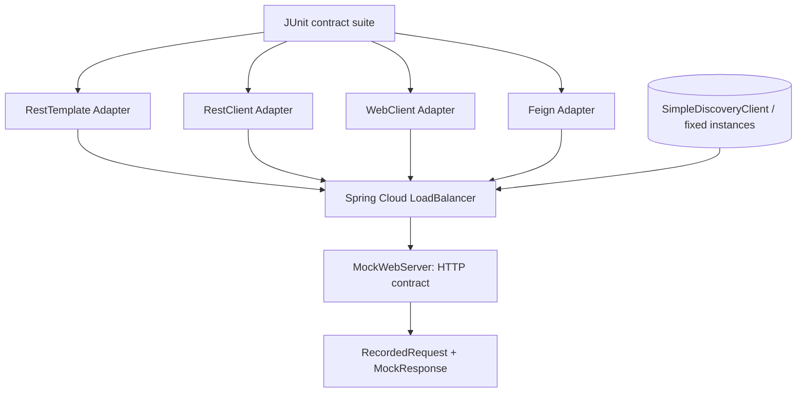
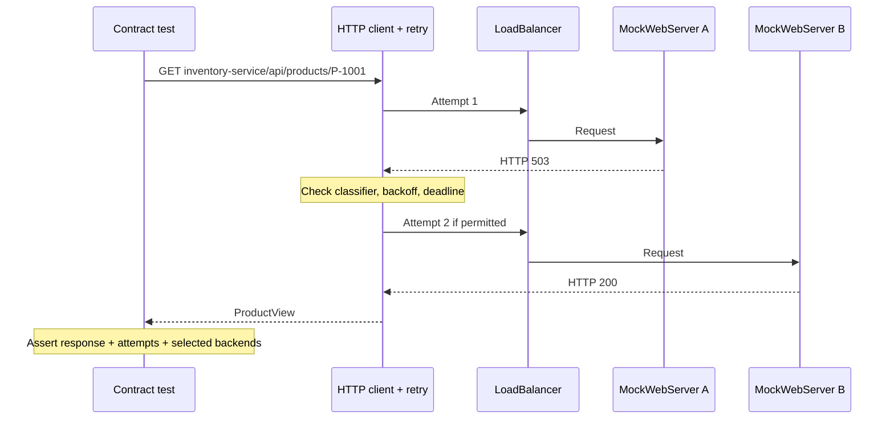
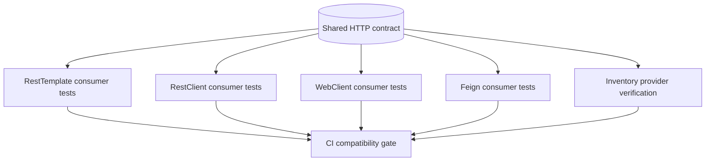

# Testing RestTemplate, RestClient, WebClient, and Feign Against the Same Contract

In a microservices system, `order-service` might call `inventory-service` using `RestTemplate`, `RestClient`, `WebClient`, or `OpenFeign`. When integrated with Spring Cloud LoadBalancer, all four approaches can use the **logical service ID** `inventory-service` to locate a `ServiceInstance`, yet they differ in request construction, response consumption, error handling, and synchronous vs. reactive execution models.

If each team writes tests their own way, one client may drop a header, mis-encode a path variable, automatically retry `POST`, or accidentally call a hostname directly instead of going through LoadBalancer. To prevent this, you need **one shared HTTP contract** and a test suite verifying every implementation.

This lesson belongs to the **Automated Testing** chapter of the Spring Cloud LoadBalancer module. Its goal is to build a reusable contract test suite covering **RestTemplate, RestClient, WebClient, and Feign**; distinguish API-semantics tests from load-balancing tests; use real mock HTTP servers; test errors, retries, and timeouts; and avoid flaky tests.

## 1. What does "the same contract" mean?

A **contract** is the set of behaviors `inventory-service` promises to callers, **independent of the caller's Java library**. For example:

| Input condition | Agreed HTTP behavior | What must be verified across all four clients |
|---|---|---|
| `GET /api/products/P-1001` with header `X-Trace-Test: contract-42` | `200 OK`, `Content-Type: application/json`, body has `id` and `availableQuantity`. | URL/path, outbound header, success status, and proper deserialization. |
| `GET /api/products/missing` | `404 Not Found` with error JSON containing code `PRODUCT_NOT_FOUND`. | Client **does not treat 404 as success**, preserving HTTP status/semantics. |
| Backend returns `503 Service Unavailable` | Transient error handled per declared retry policy. | Do not assume retries occur without policy; count actual HTTP attempts. |
| API requires bearer token | Missing token → `401`; insufficient scope → `403`. | Attaches matching credentials; does not send tokens to wrong audience/host. |
| One instance unreachable | Request may fail connection or retry another instance if retry-aware LoadBalancer is enabled. | Distinguish **no instance found** from **instance selected but unreachable**. |

Example payload:

```json
{
  "id": "P-1001",
  "availableQuantity": 7
}
```

Java 17+ DTO example:

```java
public record ProductView(String id, int availableQuantity) {}
```

**Key point:** A shared contract defines *what* must stay identical. Never force all four libraries to throw **the exact same Java exception** or use identical thread scheduling. A `404` may surface as `HttpClientErrorException` (RestTemplate/RestClient), `WebClientResponseException`, or `FeignException`; tests should normalize on **HTTP status**, not enforce exception class names.

## 2. Separating contract tests from HTTP-transport-specific tests

A solid test suite needs at least three layers:

| Test layer | Real components | Test doubles | What does it prove? |
|---|---|---|---|
| **Unit/adapter test** | Parameter, header, DTO, and error-mapping code in the adapter. | Fake HTTP exchange or mock dependency. | Request mapping and local error classification, fast execution. |
| **HTTP contract integration test** | All four real clients, Jackson/codecs, Spring Cloud LoadBalancer, discovery supplier. | One or two HTTP servers controlled via `MockWebServer`. | Real TCP request, service ID resolved, method/path/header/body/status accurate. |
| **Resilience/topology test** | Client, LoadBalancer, configured retry/timeout/health/supplier. | Backend simulating errors, slowness, disconnects, or two distinct instances. | Real retries, instance selection, timeouts, attempt counts, missing-target behavior. |

Contract tests **do not replace** tests for timeouts, TLS, connection pools, caching, or distribution. Conversely, directly mocking the Java interface `InventoryFeignClient` only tests the interface-calling layer and **does not prove** Feign sent HTTP or LoadBalancer selected a `ServiceInstance`.



This diagram shows the shared testing architecture: `MockWebServer` is a real HTTP server on a dynamic port, **not** a direct mock of `ClientHttpConnector`, `ClientHttpRequestFactory`, or a Feign interface.

## 3. Controlling versions and dependencies before writing tests

Not every client exists in every framework version:

- `RestTemplate`: Spring Framework's long-standing synchronous HTTP client; still useful for testing existing systems.
- `RestClient`: introduced in **Spring Framework 6.1**, common in Spring Boot **3.2+**.
- `WebClient`: part of Spring WebFlux, using reactive pipelines and `Mono`/`Flux`.
- `OpenFeign`: integrated via Spring Cloud OpenFeign and `@FeignClient`.
- Spring Cloud LoadBalancer: requires compatible dependencies and configuration so service IDs resolve.

Example Maven dependencies section; actual versions must be managed by a compatible Spring Boot/Cloud BOM and matching `MockWebServer`/OkHttp versions:

```xml
<dependencies>
    <dependency>
        <groupId>org.springframework.boot</groupId>
        <artifactId>spring-boot-starter-web</artifactId>
    </dependency>
    <dependency>
        <groupId>org.springframework.boot</groupId>
        <artifactId>spring-boot-starter-webflux</artifactId>
    </dependency>
    <dependency>
        <groupId>org.springframework.cloud</groupId>
        <artifactId>spring-cloud-starter-loadbalancer</artifactId>
    </dependency>
    <dependency>
        <groupId>org.springframework.cloud</groupId>
        <artifactId>spring-cloud-starter-openfeign</artifactId>
    </dependency>
    <dependency>
        <groupId>org.springframework.boot</groupId>
        <artifactId>spring-boot-starter-test</artifactId>
        <scope>test</scope>
    </dependency>
    <dependency>
        <groupId>io.projectreactor</groupId>
        <artifactId>reactor-test</artifactId>
        <scope>test</scope>
    </dependency>
    <dependency>
        <groupId>com.squareup.okhttp3</groupId>
        <artifactId>mockwebserver</artifactId>
        <scope>test</scope>
    </dependency>
</dependencies>
```

**Purpose of this example:** combining all four clients in one test module for demonstration. Production services usually **do not need both MVC and WebFlux in every service**. Include only the dependencies for the clients you need to test. Spring Boot may select the servlet application type when both MVC and WebFlux are present; while this does not make `WebClient` blocking, it affects application context configuration. Use compatible dependency management instead of picking arbitrary versions of Feign, Reactor Netty, or OkHttp.

If a test artifact is not managed by the project's BOM, **explicitly declare a compatible version** rather than letting an unversioned dependency break the build. The test snippets below assume Java 17+, JUnit Jupiter, Jackson JSON, and the `okhttp3.mockwebserver.MockWebServer` API chosen by the project.

## 4. Declaring all four clients against the same service ID

In a Spring Boot application with LoadBalancer, register individual HTTP client beans:

```java
import org.springframework.cloud.client.loadbalancer.LoadBalanced;
import org.springframework.context.annotation.Bean;
import org.springframework.context.annotation.Configuration;
import org.springframework.web.client.RestClient;
import org.springframework.web.client.RestTemplate;
import org.springframework.web.reactive.function.client.WebClient;

@Configuration(proxyBeanMethods = false)
class InventoryHttpClientsConfig {

    @Bean
    @LoadBalanced
    RestTemplate inventoryRestTemplate() {
        return new RestTemplate();
    }

    @Bean
    @LoadBalanced
    RestClient.Builder inventoryRestClientBuilder() {
        return RestClient.builder();
    }

    @Bean
    @LoadBalanced
    WebClient.Builder inventoryWebClientBuilder() {
        return WebClient.builder();
    }
}
```

Feign uses an interface rather than a builder like `RestClient.Builder`:

```java
import org.springframework.cloud.openfeign.FeignClient;
import org.springframework.web.bind.annotation.GetMapping;
import org.springframework.web.bind.annotation.PathVariable;
import org.springframework.web.bind.annotation.RequestHeader;

@FeignClient(name = "inventory-service")
public interface InventoryFeignClient {

    @GetMapping("/api/products/{id}")
    ProductView findProduct(
            @PathVariable("id") String productId,
            @RequestHeader("X-Trace-Test") String trace);
}
```

The application must enable Feign client scanning, such as `@EnableFeignClients(clients = InventoryFeignClient.class)`. Because the interface sets only `name` and not a fixed `url`, Feign uses the `inventory-service` service ID when Spring Cloud LoadBalancer is active.

**Why does the example use `RestClient.builder()` and `WebClient.builder()`?** To illustrate the `@LoadBalanced` marker in a minimal test. In production, a Spring Boot-managed builder may carry codecs, TLS, observation, and timeout customizers; when constructing builders manually, verify you do not lose important customizations. Tests should also construct clients **the same way production does** when verifying real behavior.

### Do not confuse the logical URL with the mock server URL

Every client below will call:

```text
http://inventory-service/api/products/P-1001
```

`inventory-service` is a service ID, **not a `localhost` hostname resolvable by DNS**. `SimpleDiscoveryClient` in the test maps that service ID to the mock HTTP server's URI, such as `http://127.0.0.1:54721`. If you accidentally change a client to call the mock server URL directly, the test may still pass while **completely bypassing LoadBalancer**.

## 5. Setting up a mock HTTP server on a dynamic port

OkHttp's `MockWebServer` returns programmed HTTP responses and stores `RecordedRequest`s for assertions. It fits contract integration tests well because it speaks real HTTP over loopback without booting the real `inventory-service` app.

Use `@DynamicPropertySource` to bind the test server's URI into `SimpleDiscoveryClient` **before Spring builds the application context**:

```java
import java.io.IOException;
import okhttp3.mockwebserver.MockWebServer;
import org.junit.jupiter.api.AfterAll;
import org.springframework.test.context.DynamicPropertyRegistry;
import org.springframework.test.context.DynamicPropertySource;

// Excerpt from ProductContractIT.
static final MockWebServer backend = startBackend();

private static MockWebServer startBackend() {
    MockWebServer server = new MockWebServer();
    try {
        server.start(); // OS selects an available port
        return server;
    } catch (IOException ex) {
        throw new ExceptionInInitializerError(ex);
    }
}

@DynamicPropertySource
static void registerInventoryInstance(DynamicPropertyRegistry registry) {
    registry.add(
            "spring.cloud.discovery.client.simple.instances.inventory-service[0].uri",
            () -> backend.url("/").toString());
}

@AfterAll
static void stopBackend() throws IOException {
    backend.shutdown();
}
```

**Never hardcode ports** like `8081` in tests that may run concurrently on CI. OS-assigned ports prevent collisions with other services. `@DynamicPropertySource` fits because the port is only known at runtime. The server must start **before** Spring's binder reads the property; static initialization above handles that.

This is a **snippet inside a test class**, not a standalone Java file. The next section combines all parts into a contract suite. In projects with many test classes, manage server/context lifecycles deliberately; never share one global HTTP server across independent parallel tests.

## 6. Normalizing all four clients behind a test-only adapter

A contract test **does not need to modify production APIs** just to give all four clients the same return type. Write a **test-only** adapter:

```java
record ClientCase(
        String name,
        java.util.function.Function<String, ProductView> readProduct) {}
```

Each adapter takes `productId` and returns `ProductView`, while the four implementations perform HTTP calls in their native style. The `X-Trace-Test` header is passed identically:

| Client | How GET is constructed | How JSON is read |
|---|---|---|
| RestTemplate | `exchange(..., HttpMethod.GET, HttpEntity, ...)` | `ResponseEntity<ProductView>.getBody()` |
| RestClient | `get().uri(...).header(...).retrieve()` | `body(ProductView.class)` |
| WebClient | `get().uri(...).header(...).retrieve()` | `bodyToMono(ProductView.class)` |
| OpenFeign | Java method call with `@PathVariable`, `@RequestHeader` | Feign decoder returns `ProductView` |

**Why can WebClient's test adapter call `block()`?** The shared test runs on JUnit's imperative test thread, not a Reactor event loop; calling `block(Duration)` **only at the test adapter boundary** with a finite timeout keeps the test from hanging. In reactive production code, keep `Mono`/`Flux` end-to-end and use `StepVerifier` in dedicated tests.

In the suite below, `client.readProduct().apply(id)` runs the exact same assertions across all four clients. When testing async cancellation, backpressure, or context propagation, do not force everything through a blocking adapter; add dedicated reactive tests instead.

## 7. Integration test example: one contract suite for all four clients

The example below uses `InventoryHttpClientsConfig`, `InventoryFeignClient`, and `ProductView` from earlier sections. Place them in a matching test/demo package. The `MockWebServer` usage illustrates OkHttp MockWebServer 4.x; if your project uses a different API generation, adjust artifacts/imports to match your pinned version.

```java
import java.io.IOException;
import java.time.Duration;
import java.util.List;
import java.util.Objects;
import java.util.concurrent.TimeUnit;
import java.util.function.Function;

import feign.FeignException;
import okhttp3.mockwebserver.MockResponse;
import okhttp3.mockwebserver.MockWebServer;
import okhttp3.mockwebserver.RecordedRequest;
import org.junit.jupiter.api.AfterAll;
import org.junit.jupiter.api.Test;
import org.springframework.beans.factory.annotation.Autowired;
import org.springframework.boot.SpringBootConfiguration;
import org.springframework.boot.autoconfigure.EnableAutoConfiguration;
import org.springframework.boot.test.context.SpringBootTest;
import org.springframework.cloud.client.loadbalancer.LoadBalanced;
import org.springframework.cloud.openfeign.EnableFeignClients;
import org.springframework.context.annotation.Import;
import org.springframework.http.HttpEntity;
import org.springframework.http.HttpHeaders;
import org.springframework.http.HttpMethod;
import org.springframework.test.context.DynamicPropertyRegistry;
import org.springframework.test.context.DynamicPropertySource;
import org.springframework.web.client.RestClient;
import org.springframework.web.client.RestClientResponseException;
import org.springframework.web.client.RestTemplate;
import org.springframework.web.reactive.function.client.WebClient;
import org.springframework.web.reactive.function.client.WebClientResponseException;

import static org.junit.jupiter.api.Assertions.*;

@SpringBootTest(
        classes = ProductContractIT.TestApplication.class,
        webEnvironment = SpringBootTest.WebEnvironment.NONE)
class ProductContractIT {

    private static final String SERVICE_URL = "http://inventory-service";
    private static final String TRACE_VALUE = "contract-42";
    private static final String SUCCESS_JSON =
            "{\"id\":\"P-1001\",\"availableQuantity\":7}";

    private static final MockWebServer backend = startBackend();

    @Autowired
    @LoadBalanced
    RestTemplate restTemplate;

    @Autowired
    @LoadBalanced
    RestClient.Builder restClientBuilder;

    @Autowired
    @LoadBalanced
    WebClient.Builder webClientBuilder;

    @Autowired
    InventoryFeignClient feignClient;

    @SpringBootConfiguration
    @EnableAutoConfiguration
    @EnableFeignClients(clients = InventoryFeignClient.class)
    @Import(InventoryHttpClientsConfig.class)
    static class TestApplication {}

    private static MockWebServer startBackend() {
        MockWebServer server = new MockWebServer();
        try {
            server.start();
            return server;
        } catch (IOException ex) {
            throw new ExceptionInInitializerError(ex);
        }
    }

    @DynamicPropertySource
    static void instances(DynamicPropertyRegistry properties) {
        properties.add(
                "spring.cloud.discovery.client.simple.instances.inventory-service[0].uri",
                () -> backend.url("/").toString());
    }

    @AfterAll
    static void closeServer() throws IOException {
        backend.shutdown();
    }

    private List<ClientCase> clients() {
        RestClient restClient = restClientBuilder.clone()
                .baseUrl(SERVICE_URL)
                .build();
        WebClient webClient = webClientBuilder.clone()
                .baseUrl(SERVICE_URL)
                .build();

        return List.of(
                new ClientCase("RestTemplate", id -> {
                    HttpHeaders headers = new HttpHeaders();
                    headers.set("X-Trace-Test", TRACE_VALUE);
                    HttpEntity<Void> entity = new HttpEntity<>(headers);
                    return Objects.requireNonNull(
                            restTemplate.exchange(
                                    SERVICE_URL + "/api/products/{id}",
                                    HttpMethod.GET,
                                    entity,
                                    ProductView.class,
                                    id).getBody());
                }),
                new ClientCase("RestClient", id ->
                        Objects.requireNonNull(
                                restClient.get()
                                        .uri("/api/products/{id}", id)
                                        .header("X-Trace-Test", TRACE_VALUE)
                                        .retrieve()
                                        .body(ProductView.class))),
                new ClientCase("WebClient", id ->
                        Objects.requireNonNull(
                                webClient.get()
                                        .uri("/api/products/{id}", id)
                                        .header("X-Trace-Test", TRACE_VALUE)
                                        .retrieve()
                                        .bodyToMono(ProductView.class)
                                        .block(Duration.ofSeconds(3)))),
                new ClientCase("Feign", id ->
                        feignClient.findProduct(id, TRACE_VALUE))
        );
    }

    @Test
    void allClientsHonorSuccessContract() throws Exception {
        for (ClientCase client : clients()) {
            backend.enqueue(new MockResponse()
                    .setResponseCode(200)
                    .addHeader("Content-Type", "application/json")
                    .setBody(SUCCESS_JSON));

            ProductView result = client.readProduct().apply("P-1001");
            assertEquals("P-1001", result.id(), client.name());
            assertEquals(7, result.availableQuantity(), client.name());

            RecordedRequest actual = backend.takeRequest(
                    3, TimeUnit.SECONDS);
            assertNotNull(actual, client.name() + " did not reach backend");
            assertEquals("GET", actual.getMethod(), client.name());
            assertEquals("/api/products/P-1001",
                    actual.getPath(), client.name());
            assertEquals(TRACE_VALUE,
                    actual.getHeader("X-Trace-Test"), client.name());
        }
    }

    @Test
    void allClientsPreserveNotFoundSemantics() throws Exception {
        for (ClientCase client : clients()) {
            backend.enqueue(new MockResponse()
                    .setResponseCode(404)
                    .addHeader("Content-Type", "application/json")
                    .setBody("{\"code\":\"PRODUCT_NOT_FOUND\"}"));

            RuntimeException failure = assertThrows(
                    RuntimeException.class,
                    () -> client.readProduct().apply("missing"),
                    client.name());

            assertEquals(404, httpStatusOf(failure), client.name());

            RecordedRequest actual = backend.takeRequest(
                    3, TimeUnit.SECONDS);
            assertNotNull(actual);
            assertEquals("/api/products/missing", actual.getPath());
        }
    }

    private static int httpStatusOf(RuntimeException error) {
        if (error instanceof RestClientResponseException ex) {
            return ex.getStatusCode().value();
        }
        if (error instanceof WebClientResponseException ex) {
            return ex.getStatusCode().value();
        }
        if (error instanceof FeignException ex) {
            return ex.status();
        }
        throw new AssertionError("Unexpected client error type: " + error);
    }

    private record ClientCase(
            String name, Function<String, ProductView> readProduct) {}
}
```

**Key takeaway:** Classes outside the snippet (`InventoryHttpClientsConfig`, `InventoryFeignClient`, `ProductView`) were defined earlier, so place them in Java files under the same package. `MockWebServer` does not need to be a Spring bean; only its URL needs to be registered as a static `ServiceInstance`.

### Why does `httpStatusOf` need three branches?

RestTemplate and RestClient typically wrap `4xx` responses in `RestClientResponseException` subtypes; WebClient uses `WebClientResponseException`; Feign uses `FeignException`. The test normalizes these to `404`, which is the **HTTP contract**. If your project defines a custom `ErrorDecoder` or exception translator, the contract adapter should map them to a shared domain error such as `ProductNotFound`, and assert on that rather than locking every client to default library exceptions.

### One limitation to note explicitly

This test **assumes retries on `404` are disabled**, and all clients use the intended HTTP transport/configuration. If a transport or custom filter performs unexpected retries, request counts will no longer be 1:1; verify retry settings before drawing pass/fail conclusions.

Because the server and context are shared within the class, do not run test methods of this class in parallel while using FIFO `enqueue()/takeRequest()`. In large suites, isolate queues/servers per test case or use a dispatcher that ties responses to paths/request IDs so tests do not steal each other's queued responses.

## 8. Shared test criteria must cover both request and response

Contract tests commonly fall into the trap of **checking only the response body** while ignoring the outbound request:

```java
assertEquals("P-1001", result.id()); // Not enough to verify the client is right.
```

A thorough test checks:

- HTTP method selected (`GET`, `POST`, ...).
- Path matching template, path variables encoded per contract.
- Query params and required headers, such as `X-Trace-Test`.
- `Content-Type` and `Accept` when required by contract.
- Returned JSON body deserializes with expected fields and types.
- HTTP status semantics, including `404`/`400`/`503` errors.
- **Actual request reaches the mock backend** via service ID, not just a Java method call.

For `POST` or `PUT` APIs, also verify body schema, charset, actual request count, and idempotency. For tokens, verify **header presence and scoping** with controlled dummy tokens; never dump production bearer tokens into `RecordedRequest` logs, snapshots, or CI consoles.

## 9. Error contracts vs. differing HTTP client exceptions

Avoid asserting only exception class names:

```text
RestTemplate/RestClient -> RestClientResponseException (typically for 4xx/5xx)
WebClient               -> WebClientResponseException (when retrieve() gets 4xx/5xx)
OpenFeign               -> FeignException (per default ErrorDecoder)
```

With `WebClient`, `exchangeToMono` can decide how to handle statuses directly, in which case `404` **does not have to become an exception**. With Feign, a custom `ErrorDecoder` can likewise translate `404` into a domain exception. What should remain consistent is a **business contract**:

```java
public sealed interface ProductResult {
    record Found(ProductView value) implements ProductResult {}
    record Missing(String productId) implements ProductResult {}
    record Unavailable(String reason) implements ProductResult {}
}
```

An adapter layer can map `200` → `Found`, `404` → `Missing`, and `503` or network errors → `Unavailable`. That is an application design choice, **not automatic behavior across the four HTTP clients**. When testing the adapter, assert the shared domain result; when testing transport, preserve raw errors so connect failures, read timeouts, and no-instance remain distinguishable.

## 10. Testing WebClient's reactive contract with StepVerifier

In the Section 7 contract integration suite, we used `block(Duration)` to pull results into synchronous assertions alongside the other three clients. However, `WebClient` has behaviors **visible only in reactive tests**: lazy execution on subscription, single emission/completion/error signals, cancellation, and Reactor pipeline timeouts.

Additional test inside `ProductContractIT`:

```java
import reactor.test.StepVerifier;

@Test
void webClientCompletesReactiveContract() throws Exception {
    backend.enqueue(new MockResponse()
            .setResponseCode(200)
            .addHeader("Content-Type", "application/json")
            .setBody(SUCCESS_JSON));

    WebClient client = webClientBuilder.clone()
            .baseUrl(SERVICE_URL)
            .build();

    Mono<ProductView> response = client.get()
            .uri("/api/products/{id}", "P-1001")
            .header("X-Trace-Test", TRACE_VALUE)
            .retrieve()
            .bodyToMono(ProductView.class);

    StepVerifier.create(response)
            .assertNext(product -> {
                assertEquals("P-1001", product.id());
                assertEquals(7, product.availableQuantity());
            })
            .expectComplete()
            .verify(Duration.ofSeconds(3));

    RecordedRequest actual = backend.takeRequest(3, TimeUnit.SECONDS);
    assertNotNull(actual);
    assertEquals("/api/products/P-1001", actual.getPath());
}
```

Import `reactor.core.publisher.Mono` alongside the imports from the previous test class. Pass a timeout to `verify(...)` so tests do not hang if the mock backend or Reactor scheduler stalls.

### Constructing a publisher does not mean HTTP was sent

The `Mono` returned by `bodyToMono(...)` is **lazy**: the actual request fires on subscription. Merely asserting the publisher is non-null or constructing it and ending the test tests zero HTTP behavior.

Do not use `Thread.sleep()` to "wait for HTTP to finish" in reactive tests. `StepVerifier` declares expected signals and verification timeouts cleanly. When testing timeouts with **virtual time**, distinguish Reactor scheduler timeouts from **socket/transport timeouts**: `withVirtualTime` only accelerates operators using a controllable scheduler, not real TCP or DNS timeouts.

### Cancellation and streaming behavior

For `Flux`/SSE streams, tests should verify item counts, completion, or cancellation:

```java
StepVerifier.create(streamingClient.getEvents())
        .expectNextCount(3)
        .thenCancel()
        .verify(Duration.ofSeconds(3));
```

`streamingClient` is a hypothetical gateway. This illustrates verifying the contract of an **open stream**, not the `getProduct` endpoint. Client-side cancellation does not guarantee the backend stopped processing immediately; if HTTP resources are involved, inspect connector lifecycles and metrics.

## 11. Unit testing with MockRestServiceServer: useful, yet does not prove LoadBalancer

For `RestTemplate`, Spring Test provides `MockRestServiceServer` to verify HTTP request construction **without real sockets**:

```java
import org.junit.jupiter.api.Test;
import org.springframework.http.HttpMethod;
import org.springframework.http.MediaType;
import org.springframework.test.web.client.MockRestServiceServer;
import org.springframework.web.client.RestTemplate;

import static org.springframework.test.web.client.match.MockRestRequestMatchers.*;
import static org.springframework.test.web.client.response.MockRestResponseCreators.*;

@Test
void restTemplateMapsPathAndJson() {
    RestTemplate template = new RestTemplate(); // standalone, no LB
    MockRestServiceServer server = MockRestServiceServer
            .bindTo(template)
            .build();

    server.expect(requestTo("http://example.test/api/products/P-1001"))
            .andExpect(method(HttpMethod.GET))
            .andRespond(withSuccess(
                    "{\"id\":\"P-1001\",\"availableQuantity\":7}",
                    MediaType.APPLICATION_JSON));

    ProductView result = template.getForObject(
            "http://example.test/api/products/{id}",
            ProductView.class, "P-1001");

    assertEquals("P-1001", result.id());
    server.verify();
}
```

For `RestClient`, Spring Framework versions supporting `MockRestServiceServer.bindTo(RestClient.Builder)` allow an analogous test:

```java
RestClient.Builder builder = RestClient.builder();
MockRestServiceServer server = MockRestServiceServer
        .bindTo(builder)
        .build();

server.expect(requestTo("http://example.test/api/products/P-1001"))
        .andRespond(withSuccess(
                "{\"id\":\"P-1001\",\"availableQuantity\":7}",
                MediaType.APPLICATION_JSON));

ProductView result = builder.build().get()
        .uri("http://example.test/api/products/{id}", "P-1001")
        .retrieve()
        .body(ProductView.class);

server.verify();
```

**Proper scope of this test:** checking URI expansion, mapping, and client response decoding. `MockRestServiceServer` intercepts requests at the test exchange/request factory, so it **does not prove** real networking/TCP, service discovery, instance counts, or LoadBalancer algorithms. To prove `http://inventory-service` rewrites properly to backend URIs, run integration tests against real HTTP servers as in Section 7.

Likewise:

- Mocking WebClient's `ExchangeFunction` can verify filters/headers and body mapping, yet provides no proof of HTTP transport.
- Directly mocking `InventoryFeignClient` tests `OrderService` logic, not Feign encoders/decoders, `RequestInterceptor`s, or load-balancing wrappers.
- `WebTestClient` primarily tests HTTP **servers** or WebFlux handlers; it does not replace outbound client tests through LoadBalancer.

## 12. Testing two ServiceInstances: choosing real targets, not one mock server

A contract test with **one instance** proves a service ID resolves to an HTTP backend, yet **does not prove load balancing across multiple instances**. Add a dedicated suite with two `MockWebServer`s on two dynamic ports:

```text
inventory-service
   ├─ instance A -> MockWebServer A -> body {"instance":"inventory-a"}
   └─ instance B -> MockWebServer B -> body {"instance":"inventory-b"}
```

In a **separate** test class, register both URIs:

```java
@DynamicPropertySource
static void registerTwoInstances(DynamicPropertyRegistry registry) {
    registry.add(
            "spring.cloud.discovery.client.simple.instances.inventory-service[0].uri",
            () -> inventoryA.url("/").toString());
    registry.add(
            "spring.cloud.discovery.client.simple.instances.inventory-service[1].uri",
            () -> inventoryB.url("/").toString());
}
```

`inventoryA` and `inventoryB` are two `MockWebServer`s started before the Spring context initializes. In a loop sending 10–20 sequential GETs:

1. Enqueue enough `200` responses on **each backend** (or use a stateless dispatcher that answers requests without FIFO queues).
2. Send requests using a `@LoadBalanced` client to the **service ID** `inventory-service`.
3. Record `RecordedRequest`s and count requests per backend.
4. When using round-robin, verify **both instances** were hit without enforcing an absolute starting order.
5. Read `instance` in the response to distinguish backends rather than relying on identical response payloads.

Example assertions after sending the requests:

```java
assertTrue(inventoryA.getRequestCount() > 0,
        "No requests reached inventory A");
assertTrue(inventoryB.getRequestCount() > 0,
        "No requests reached inventory B");
```

**Do not use this assertion with random algorithms on tiny sample sizes**: randomness can repeatedly pick one instance by chance. When verifying an exact selection policy, pin the algorithm/supplier and write dedicated tests for `RoundRobinLoadBalancer` or custom selectors.

### What not to assert

Avoid tests relying on `A → B → A → B` if order is not guaranteed by configuration, concurrent scheduling, counter state, or caching. Also do not treat a downed instance as "test passed because all traffic moved to B" unless retries or health filtering are explicitly configured.

If a per-service-ID circuit breaker is active, breaker state can affect both instances during tests; reset state or isolate test contexts so earlier tests do not alter subsequent ones.

## 13. Testing no-instance errors vs. connection errors

Two situations look identical in a UI yet work completely differently underneath:

**Case A — Discovery has zero `ServiceInstance`s**

```text
Client -> LoadBalancer -> supplier = []
                     -> no endpoint selected
                     -> no-instance error/response per integration
```

**Case B — Discovery returns an instance, but the endpoint is unreachable**

```text
Client -> LoadBalancer -> inventory-1:8081
                     -> TCP connect / HTTP transport fails
                     -> connection exception or retry per policy
```

Write two separate tests, each with a controlled context and supplier:

- A: supplier returns an empty list; assert **zero HTTP requests reach mock backends** and verify the error class/response of your client integration.
- B: supplier returns a closed test endpoint or fault-simulating proxy; assert the client attempted the chosen target and raised a transport error (or recovered per retry policy).

Do not assert by default that **every client receives HTTP 503** when no instance exists: blocking and reactive LoadBalancer integrations can handle this differently, and custom application error mapping may turn it into a domain exception. Assert a specific status or exception only after **defining it as part of your adapter contract**.

### Never use an unlistening port to test connect timeouts

A port with no listening process may return `Connection refused` immediately, **not** a `connect timeout`. To simulate hanging connections, use a fault proxy or controlled test-network simulation, and set a test deadline so CI cannot hang. Never rely on an arbitrary Internet IP to trigger timeouts.

## 14. Testing HTTP 503, retries, and actual request counts

Retries are typically opt-in and can live in multiple layers:

- HTTP transport (Apache HC5, OkHttp, JDK).
- Spring Cloud LoadBalancer retry-aware wrapper/filter.
- Reactor `retryWhen`, Spring Retry, or Resilience4j at the business layer.
- Feign `Retryer` (many Spring Cloud OpenFeign releases default to `Retryer.NEVER_RETRY`).

To test retries, do not merely assert the client eventually returns `200`: count **actual HTTP attempts hitting the backend**.



This is a **conditional scenario**: retry-on-next-instance happens only when version, dependencies, supplier, and policy allow it. Do not assume every `503` retries automatically, nor guarantee the second attempt always picks a different instance.

In a dedicated test:

1. Pin a max-1-retry policy for **idempotent GETs**.
2. Configure mock backends to return `503` first, then `200`.
3. Assert both the response body and `RecordedRequest` count match the policy.
4. Assert trace ID/correlation headers stay consistent across attempts.
5. When testing instance switching, use two backends and observe where each attempt lands.
6. Repeat with `400` or `401` to verify the classifier **does not retry** non-retryable errors.

Never write default tests expecting `POST` to retry after a response timeout without an idempotency key or backend deduplication. A write request may have committed even though the caller saw a timeout.

### Retry tests must stay separate from the shared contract suite

The shared `200/404` suite should run with controlled retry settings so one logical request maps 1:1 to one HTTP request when expected. Put retry tests in their own configuration because RestTemplate, RestClient, WebClient, and Feign **do not share identical default retry policies**, and low-level HTTP transports may recover certain connection failures silently.

## 15. Testing timeouts and slow responses at the right layer

An HTTP request can wait across several distinct phases:

```text
Service discovery -> select instance
  -> pending acquire from connection pool
  -> TCP connect / TLS handshake
  -> wait for response headers
  -> read body / stream
  -> decode and process result
```

Accordingly, "timeout after 1 second" is rarely one uniform contract across all HTTP clients. RestTemplate/RestClient use request-factory socket read timeouts; WebClient uses connector response timeouts or Reactor `timeout`; Feign uses `connectTimeout` and `readTimeout` subject to its active transport.

`MockWebServer` can produce a **controlled slow response**:

```java
backend.enqueue(new MockResponse()
        .setResponseCode(200)
        .addHeader("Content-Type", "application/json")
        .setHeadersDelay(2, TimeUnit.SECONDS)
        .setBody("{\"id\":\"P-1001\",\"availableQuantity\":7}"));
```

Here the server delays before sending **response headers**. With a read/response timeout shorter than 2 seconds, tests can observe the resulting timeout exception; the exact exception type and timing precision depend on the HTTP engine and configuration. This **does not simulate a TCP connect timeout**.

If you need to bound an **entire reactive operation** (everything upstream of the `timeout` operator), test:

```java
Mono<ProductView> response = webClient.get()
        .uri("/api/products/{id}", "P-1001")
        .retrieve()
        .bodyToMono(ProductView.class)
        .timeout(Duration.ofMillis(500));

StepVerifier.create(response)
        .expectError(java.util.concurrent.TimeoutException.class)
        .verify(Duration.ofSeconds(3));
```

This tests a **Reactor overall timeout** at that operator's position; it does not prove `Reactor Netty HttpClient.responseTimeout(...)` or TLS handshake timeouts. In real projects, configure transport timeouts and test them separately when proving transport-level semantics.

### Why not assert exactly 500 ms?

CI runners experience GC pauses, scheduler contention, and jitter. Instead of `assertEquals(500, elapsedMs)`:

- Use a generous outer test deadline so tests do not hang.
- Assert the right outcome type and attempt count when relevant.
- Leave a wide gap between server delay (2 s) and configured timeout (500 ms).
- If timing must be checked, use a reasonable tolerance band rather than millisecond precision.

For **connect timeouts**, use a fault proxy or controlled test network; never confuse `Connection refused` from a closed port with dropped TCP SYNs. For **pool acquisition timeouts**, drive concurrency above pool capacity in a dedicated integration test and observe pending/leased connections; never infer pool saturation from a single request.

## 16. Testing transport errors without fabricating HTTP statuses

HTTP `503` is a **response with a status code**; a TCP disconnect is an error **without a guaranteed HTTP response**. Keep these two cases separate:

```java
import okhttp3.mockwebserver.SocketPolicy;

backend.enqueue(new MockResponse()
        .setSocketPolicy(SocketPolicy.DISCONNECT_AT_START));
```

In matching `MockWebServer` APIs, this policy simulates the server dropping the connection. **Thrown exceptions can differ** across RestTemplate, RestClient, WebClient, and Feign depending on internal retries, keep-alive, protocols, and transports. Never assert the same exception class name across all four.

A test with retries disabled can assert:

1. The caller does not receive a valid `ProductView`.
2. The error is classified as a transport error (or mapped domain error).
3. If the transport retries on its own, observe and record actual attempt counts rather than mistaking it for an upstream `503`.
4. The test runs with a finite deadline and cleans up sockets/`MockWebServer` afterward.

### Intentional fault-injection matrix

| Simulated fault | Tool / setup | Intended conclusion |
|---|---|---|
| `404`, `503`, `429` | `MockResponse.setResponseCode(...)`. | Tests HTTP status mapping, error bodies, retry classifier. |
| Delayed response headers | `setHeadersDelay(...)`. | Tests response/read or Reactor overall timeout depending on config. |
| Slow/choppy body | MockWebServer body delay or streaming dispatcher. | Tests read inactivity, decoders, cancellation. |
| Disconnect/reset | `SocketPolicy` or fault proxy. | Tests transport failures and recovery, not HTTP status codes. |
| No `ServiceInstance` | Fixed supplier / empty discovery profile. | Tests no-instance behavior before TCP is attempted. |
| Unreachable instance URI | Supplier returns an unlistening backend. | Tests connect/refused/timeout per real fault. |
| Backend A fails, B healthy | Two `MockWebServer`s, explicit retry policy. | Tests instance selection and attempt counts. |
| Missing token or wrong scope | Resource server test / HTTP stub inspecting headers and policy. | Tests client authentication/authorization contract. |

Do not mix multiple fault modes in a single test when isolating a specific root cause.

## 17. Testing authentication headers and safe routing

For OAuth2-protected APIs, "the same contract" may include:

- Attaching the bearer access token to the **right service ID**.
- `401` when missing a token and `403` when missing required scopes.
- Never leaking `inventory-service`'s token to an unauthorized URL.
- Token relay propagating the right request/user context; `client_credentials` using the service identity.
- Retries neither stripping `Authorization` nor attaching another user's token on subsequent attempts.

Using a **dummy** mock token, tests can assert the outbound request header:

```java
RecordedRequest actual = backend.takeRequest(3, TimeUnit.SECONDS);
assertNotNull(actual);
assertEquals("Bearer test-token-for-inventory",
        actual.getHeader("Authorization"));
```

This test proves only that the header was sent. It **does not prove the JWT is valid**, audience/scopes match, or the server enforces authorization. To test authorization, test `inventory-service` itself as a Resource Server with tokens signed by test issuer keys or an OAuth2 test setup; never treat a `MockWebServer` returning 200 as proof of auth enforcement.

**Never store or log** real access tokens, client secrets, or sensitive headers in test snapshots, CI console logs, or HTTP wiretaps. `MockWebServer`'s `RecordedRequest` retains full headers in memory; avoid dumping entire request objects to logs and tear down servers after tests.

## 18. Testing consumers and providers to avoid "passing stub, broken real API"

One limitation of `MockWebServer` is that you can program **any response**, even one the real `inventory-service` never produces. Then consumer tests stay green while production breaks due to API contract drift.

Validate **both sides**:

1. **Consumer contract tests:** all four HTTP clients in `order-service` send requests and handle responses per the shared contract artifacts/fixtures.
2. **Provider verification:** the `inventory-service` app handles those request/response scenarios with matching schemas, statuses, headers, and authorization.

Contracts can live as OpenAPI schemas, schema-validated JSON examples, or versioned contract artifacts via Spring Cloud Contract or Pact depending on your platform. If using Spring Cloud Contract, both consumer stubs and provider verification must derive from the same versioned contract; avoid writing four identical mock bodies manually with no provider test.



**Do not confuse a shared contract with a shared implementation.** Clients may use different APIs, yet all must satisfy the same request/response rules. Provider verification validates the real backend; LoadBalancer integration tests validate service ID resolution; both provide complementary evidence.

### Contract versioning

When a provider renames a JSON field from `availableQuantity` to `stockOnHand` or turns `404` into `200` with an empty body, consumer tests should catch the breaking change. Adding a new JSON field when clients are configured to ignore unknown fields can be backward-compatible, yet must be tested against the actual `ObjectMapper`/decoder settings rather than assuming all decoders behave identically.

Changes to pagination, auth scopes, default headers, enum values, and redirect handling are also part of the contract whenever callers depend on them.

## 19. Preventing flaky tests in CI

Flaky tests usually stem from **unisolated resources and timing**, not Spring Cloud LoadBalancer behaving randomly:

| Cause | Symptom | Fix |
|---|---|---|
| Hardcoded port like 8081 already in use | Intermittent CI bind failures. | Use `MockWebServer.start()` with port 0 / dynamic port. |
| Shared `MockWebServer` and `enqueue` across parallel tests | Test A's response consumed by Test B. | Run sequentially or give each case its own server/dispatcher. |
| Spring Test context cache retains old dynamic property | Newer test targets port of stopped server. | Isolate test applications/contexts; use `@DirtiesContext` and explicit lifecycles when needed. |
| Rigid round-robin A-B-A-B assertion | Differing counter/supplier state/scheduling. | Pin algorithm and assert meaningful properties; test exact sequence in unit tests. |
| `Thread.sleep(...)` waiting for async calls | Passes on fast CI, fails on slow CI. | Use `StepVerifier`, `takeRequest(timeout)`, or deadline-bounded polling. |
| Timeout threshold too close to server delay | Passes some days, fails others. | Keep wide margins, tolerances, and overall test deadlines. |
| Retries/connection pools/health cache leak across tests | Unexpected request counts or selected instances. | Separate contexts, reset state, or use isolated fixtures. |
| Feign/WebClient uses unexpected proxy or custom client | Mock server receives zero requests. | Inspect effective beans, Feign delegate, and actual connector. |
| Tests call live OAuth2 / registry systems | Network or external dependency failures. | Use test issuer/registry stubs for contract suites; keep live smoke tests separate. |

### Structuring fixtures for concurrency

If a suite uses `@ParameterizedTest` or `@TestFactory`, ensure each test case owns its response queue. A sequential loop like Section 7 is simple and readable, yet when the first case fails it aborts before checking the other clients. When you need independent per-client reporting, run **four separate test cases** with isolated servers/fixtures or a dispatcher keyed by request ID, avoiding shared FIFO state.

### Resource cleanup

After tests finish, shut down `MockWebServer` so the JVM does not leak sockets; if constructing custom Reactor Netty `ConnectionProvider`s or Apache connection managers, manage their lifecycles cleanly. Do not dispose application-wide HTTP resources owned by Spring Boot while other test classes still share that context.

## 20. Combining logs, metrics, and assertions to trace where requests go

When a Spring Cloud LoadBalancer test fails, pin down at least three facts:

1. **Did the client build the logical request?** Are URL, method, headers, and body right?
2. **Which instance did LoadBalancer pick?** Did the supplier have valid instances and resolve the service ID?
3. **Did the mock HTTP server receive the real attempt?** Do `RecordedRequest` paths/headers and request counts match?

Under fault injection, also capture:

- Connection acquisition and connect/read/response timeouts where exposed by the connector.
- Attempt count after retries and the instance chosen per attempt.
- Whether an HTTP status came from the backend or an exception occurred before any HTTP response.
- Logical latency vs. per-attempt latency.
- Discovery/health/cache state if instances are added or removed.

An **illustrative** log entry:

```text
traceId=contract-42
clientType=WebClient
serviceId=inventory-service
selectedInstance=inventory-test-1
attempt=1
method=GET
path=/api/products/P-1001
httpStatus=200
outcome=SUCCESS
```

Not all fields above are logged automatically by Spring Cloud LoadBalancer out of the box; instrument the appropriate layer or capture them via test fixtures. Never print `Authorization` headers, raw bearer tokens, or sensitive data into CI logs.

### Metrics that cannot prove a contract on their own

- Successful `http.client.requests` only show "some outbound request succeeded," not that path variables or headers were right.
- A latency histogram does not prove traffic went through LoadBalancer.
- A `200` status does not prove which instance answered if every backend returns identical bodies.
- An increasing request count on a mock server does not prove the algorithm chose properly in multi-instance/proxy topologies.

Contract tests require **assertions on `RecordedRequest` and responses**; metrics and tracing supply complementary visibility into intermittent failures and transport phases.

## 21. Minimum test matrix across all four HTTP clients

Use a single test matrix as acceptance criteria rather than writing four arbitrary, divergent suites:

| Scenario | RestTemplate | RestClient | WebClient | OpenFeign |
|---|:---:|:---:|:---:|:---:|
| Successful GET, decodes `ProductView` | ✓ | ✓ | ✓ | ✓ |
| Correct path variable, method, and custom header | ✓ | ✓ | ✓ | ✓ |
| `404` normalized to unified semantics | ✓ | ✓ | ✓ | ✓ |
| `400`/`503` and error body per API contract | ✓ | ✓ | ✓ | ✓ |
| `http://inventory-service` genuinely resolves via LoadBalancer | ✓ | ✓ | ✓ | ✓ |
| No instances: error classified, zero HTTP sent | ✓ | ✓ | ✓ | ✓ |
| Two instances: verifies routing to multiple backends | ✓ | ✓ | ✓ | ✓ |
| Response/body timeout per HTTP engine | ✓ | ✓ | ✓ | ✓ |
| Retries happen only for allowed errors within budget | ✓ | ✓ | ✓ | ✓ |
| OAuth2/Authorization per contract (if endpoint protected) | ✓ | ✓ | ✓ | ✓ |
| Lazy publisher, completion, cancellation | — | — | ✓ | — |
| Blocking thread/executor behavior | ✓ | ✓ | Test separately if using blocking bridge | ✓ |

**A ✓ means an appropriate test must exist**, not that the exact same code runs unmodified across every client without adapters/fixtures. For retries, timeouts, TLS, or pooling, **each client has its own transport implementation**, so test effective configurations rather than setting one timeout value and assuming identical behavior.

### Execution order in CI

One practical structure:

```text
1. Unit tests: DTOs, path/header mapping, error translators, domain adapters
2. Consumer contract tests: 4 clients + MockWebServer + 1 instance
3. LoadBalancer tests: 2 instances, no-instance, supplier/health/cache
4. Resilience tests: 503, disconnects, retries, deadlines, pool saturation
5. Provider contract verification: inventory-service implements API properly
6. Environment smoke tests: discovery, TLS, auth, real network path
```

Do not force unit/contract suites to hit live Eureka, Kubernetes, or Authorization Servers: that makes tests slow and fragile. Live smoke tests are valuable, yet belong separate from deterministic contract tests. Provider tests can run independently of client implementations once contract artifacts are versioned.

## 22. Extended practice and self-check questions

After getting the basic `200/404` suite passing, work through each exercise in order:

1. **Add a query parameter:** `GET /api/products/{id}?includeAvailability=true`. Update contract fixtures and all four adapters, asserting the encoded path and query; avoid raw URL string equality if query param order is not part of the contract.
2. **Add an error body with a stable code:** `{"code":"PRODUCT_NOT_FOUND"}`. Build error translators for all four clients and write a shared test asserting the `ProductNotFound` domain exception.
3. **Add a `POST` with a JSON body:** capture the body in `RecordedRequest` and verify `Content-Type`, schema, and idempotency key. Never enable automatic retries on `POST` without a deduplication contract.
4. **Two instances returning distinct payloads:** verify selected backend IDs and write a separate round-robin test. Avoid sharing response queues across parallel tests.
5. **Remove a backend from the supplier:** distinguish discovery/cache behavior from closing a backend socket. Because `SimpleDiscoveryClient` is static, build a test harness controlling the supplier instead of expecting automatic deregistration.
6. **Error response and retry:** backend returns `503` then `200`; record total actual requests, attempts, and latency. Repeat with `401`/`400` and verify no retry occurs unless specified by contract.
7. **Timeout before response headers:** use `setHeadersDelay`; test transport timeouts and overall deadlines separately. For WebClient, add `StepVerifier` assertions.
8. **Token relay:** verify headers match each request without leaking user A's token to user B under concurrent tests; use dummy credentials.

**Questions to check your understanding:**

- If a test uses `MockRestServiceServer` with `http://inventory-service`, why can't you conclude LoadBalancer selected the right `ServiceInstance`?
- When RestClient raises `HttpClientErrorException.NotFound` while Feign raises `FeignException.NotFound`, is the contract broken?
- Why does a single `MockWebServer` prove service ID resolution without proving distribution across two instances?
- When a backend returns `503` followed by `200` across two HTTP attempts, what failures can a test miss if it only asserts the final response?
- Why isn't closing `localhost:8081` a reliable way to simulate a **TCP connect timeout**?
- When using `@DynamicPropertySource` with dynamic ports, why must you care about Spring Test context caching and backend lifecycles?

## 23. Completion checklist and pitfalls to avoid

- [ ] The HTTP contract explicitly defines methods, paths/queries, headers, response schemas, and status/error semantics.
- [ ] DTOs and serialization settings match across clients, or differences are captured explicitly in the contract.
- [ ] All four clients are configured properly: `@LoadBalanced RestTemplate`, `@LoadBalanced RestClient.Builder`, `@LoadBalanced WebClient.Builder`, and `@FeignClient(name=...)`.
- [ ] Feign does not hardcode a fixed `url` when testing discovery/service ID resolution.
- [ ] `spring-cloud-starter-loadbalancer` is present and the `ServiceInstance` source is controlled in tests.
- [ ] Spring Boot/Cloud, Feign, Reactor Netty/OkHttp, and MockWebServer versions are compatible.
- [ ] Dynamic ports are used; Spring receives mock backend URIs via `@DynamicPropertySource` before context startup.
- [ ] Tests assert both **`RecordedRequest`** (method, path, headers) and **response** (status/body), not just one side.
- [ ] The shared contract normalizes on HTTP status or domain errors, **never forcing all four clients to throw the same Java exception**.
- [ ] The `200/404` contract suite is unaffected by unintended retries or timeouts.
- [ ] Retry tests count real attempts and distinguish transport, LoadBalancer, and business-layer retries.
- [ ] No-instance tests are kept separate from unreachable-endpoint tests.
- [ ] Multi-instance and routing-algorithm tests are separated from basic contract tests.
- [ ] WebClient has dedicated `StepVerifier`/publisher tests; `block(Duration)` is confined to imperative test adapters when needed.
- [ ] No arbitrary `Thread.sleep()` calls or millisecond-exact timing assertions.
- [ ] Never conclude `MockRestServiceServer` or mocked Feign interfaces tested TCP or LoadBalancer.
- [ ] Fault injection, timeouts, HTTP 503s, TLS/auth, and health checks are tested in dedicated suites.
- [ ] Consumer stubs stay aligned with provider verification or versioned contract artifacts.
- [ ] MockWebServer queues, Spring contexts, connection pools, and retry state are isolated between tests.
- [ ] No real tokens, client secrets, or sensitive data are written into `RecordedRequest` dumps or CI logs.
- [ ] Tests run in an appropriate CI environment with flaky-test tracking, never equating one green run to production fault tolerance.

**Conclusion:** A shared **HTTP contract** ensures `RestTemplate`, `RestClient`, `WebClient`, and `OpenFeign` deliver consistent business behavior despite differing APIs, threading models, and error representations. With Spring Cloud LoadBalancer, test **logical service-ID URLs**, **real HTTP calls to mocked `ServiceInstance`s**, and **request/response contracts** together. `MockWebServer` with `@DynamicPropertySource` enables deterministic integration tests; `StepVerifier` verifies reactive semantics; and dedicated suites for retries, timeouts, health checks, tokens, and multiple instances prevent operational differences from hiding. Consumer tests become truly trustworthy only when paired with **provider contract verification** and realistic HTTP client configurations.
