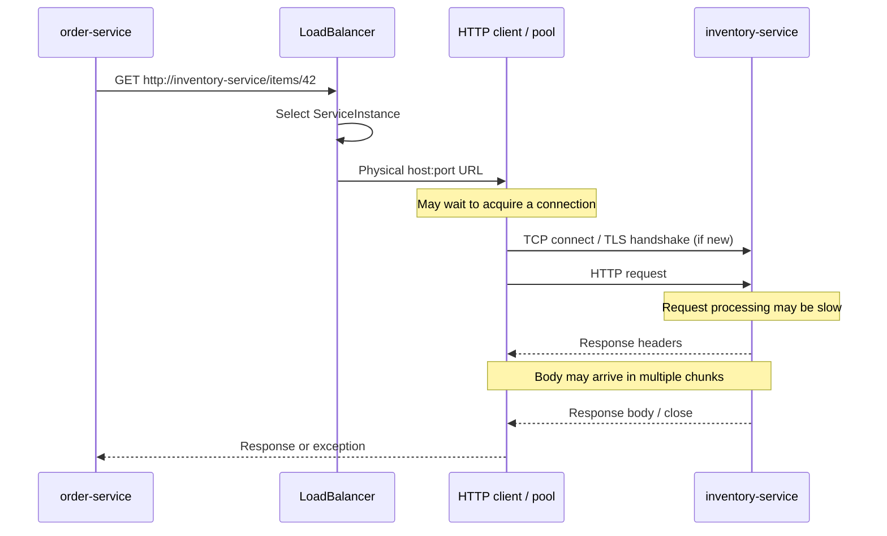
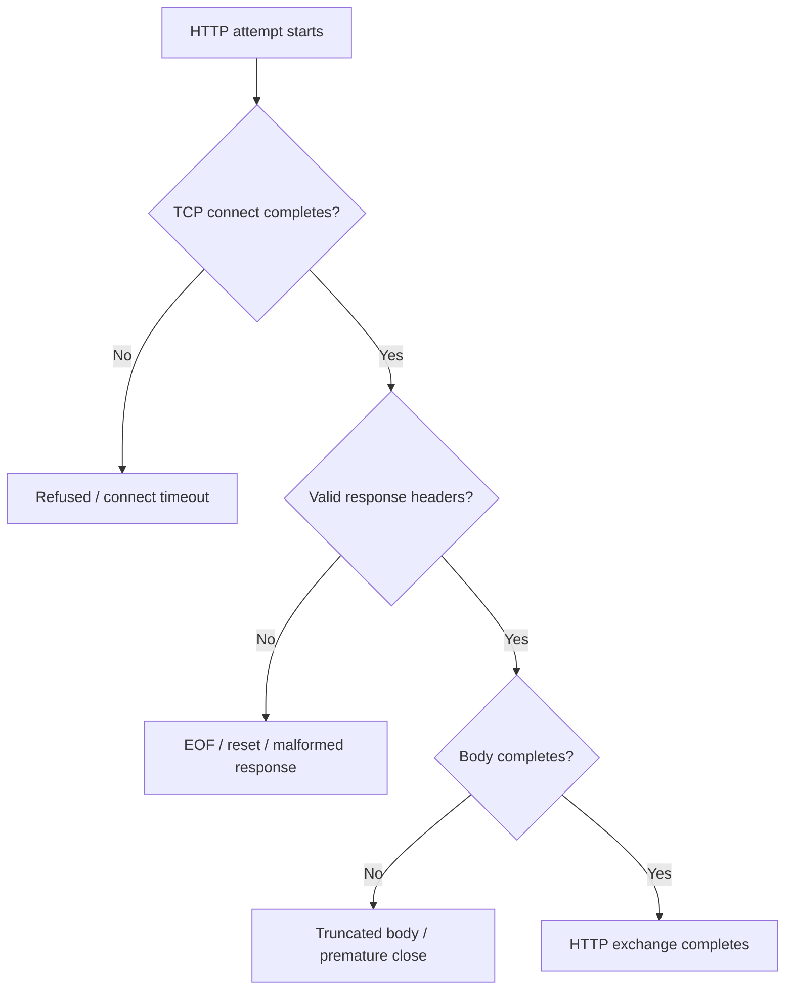
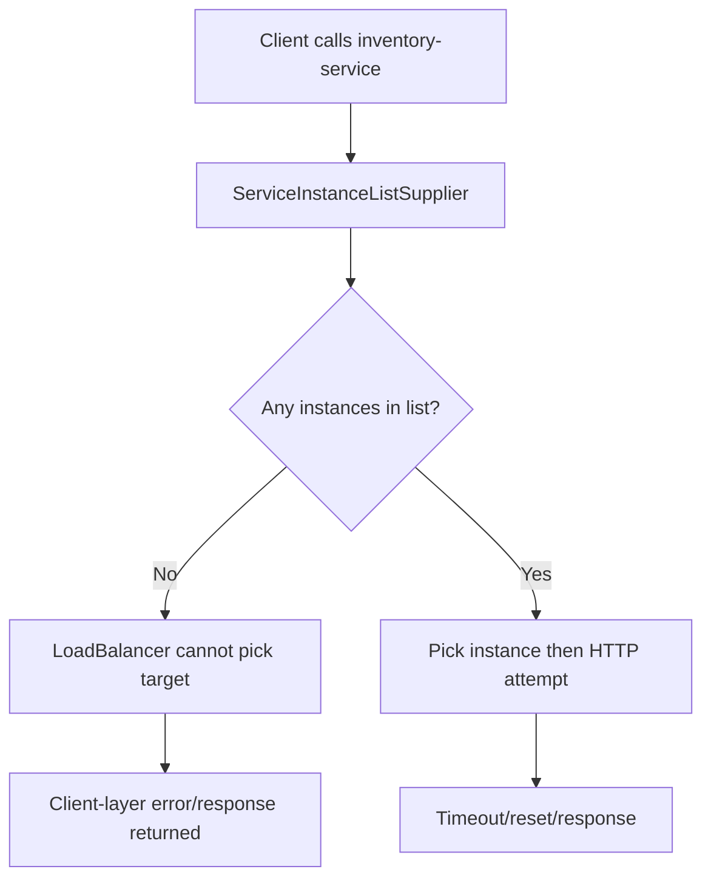
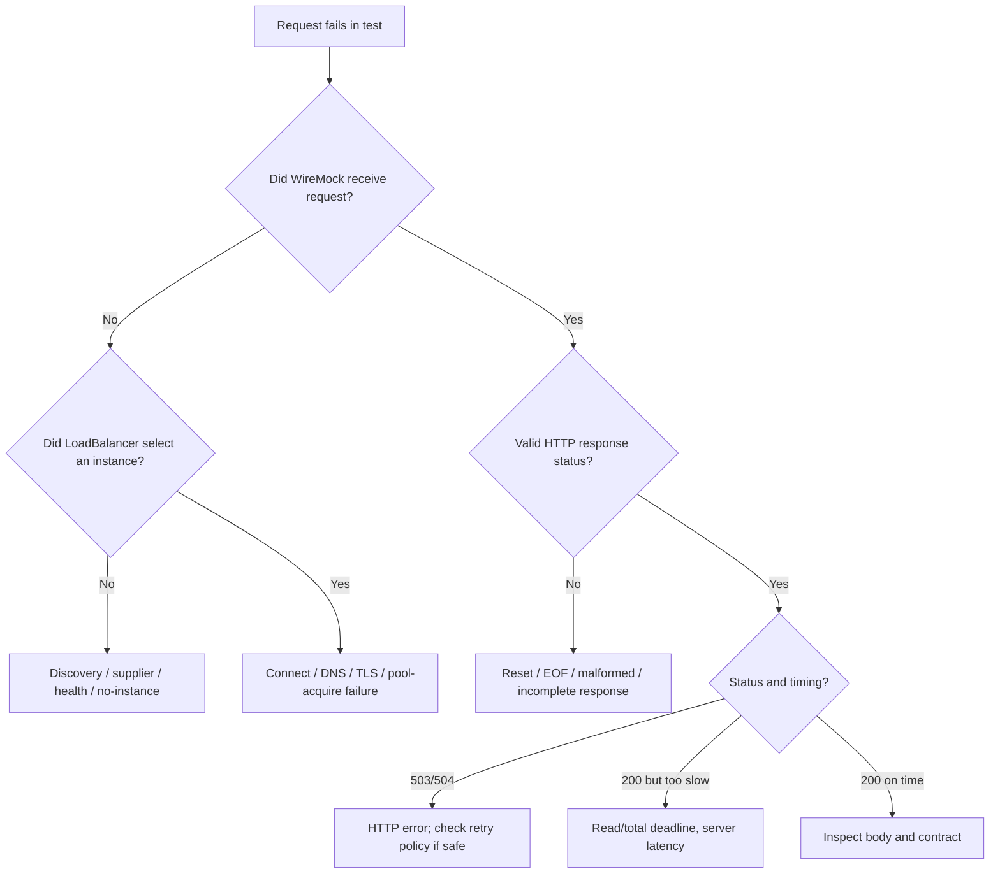

# Testing Timeouts, Dropped Connections, and Slow Responses

An application using Spring Cloud LoadBalancer can call `http://inventory-service` by service ID and select across multiple `ServiceInstance`s via discovery. Yet communication can still fail even when round-robin selection works properly: a connection fails to establish, an open socket drops, a backend responds slowly, or a proxy closes the connection mid-response. **A test verifying only HTTP 200 under normal conditions is not enough to prove an application handles failures reliably.**

This lesson belongs to the **Automated Testing** chapter of the **Spring Cloud Service Communication Load Balancing** module, focusing on **testing timeouts, dropped connections, and slow responses** for `RestClient`, `WebClient`, and key OpenFeign considerations. The goal is to inject controlled faults, prove traffic passes through LoadBalancer, measure HTTP attempts, verify sensible timeouts/retries, and catch defects that exhaust threads or connection pools. All examples use test-environment stub backends; never send fault traffic to production.

## 1. Three primary failure types that cannot share one test

| Failure type | Timing | Common symptoms | Key invariant to verify |
|---|---|---|---|
| **Connect timeout** | New TCP connection does not complete within budget | Connect timeout / wrapped I/O exception | Client does not hold resources waiting too long; never confuse with post-connect errors |
| **Connection refused** | Target OS rejects the connection, e.g., no listening process | `ConnectException: Connection refused` | Usually a **fast** failure; refused is not the same as a timeout |
| **Connection reset / abrupt close** | An established or active socket is closed by peer/proxy before a complete response arrives | `Connection reset`, premature close, EOF | No valid HTTP response; retry only when the operation is safe |
| **Slow response headers** | Connect succeeds; server holds the request before sending headers | Read/response timeout | Connect duration reveals nothing about service time |
| **Slow / chunked body** | Headers arrive on time, but chunks dribble slowly | Inter-chunk idle timeout or total download exceeding deadline | Distinguish **idle/read timeout** from **total deadline** |
| **HTTP 503/504** | Backend/proxy returns a valid HTTP error status | `WebClientResponseException`, `HttpServerErrorException` | This is an **HTTP response**, not a socket reset |
| **No instances** | LoadBalancer finds no `ServiceInstance` before sending | Selection error or client/integration-synthesized response | Not a connection failure to a specific IP |

In particular, a test server delaying responses by `2s` only simulates a **slow response**, because TCP connect typically succeeds immediately. Using it to claim `connectTimeout=500ms` works is a false conclusion.

### 1.1. Timings that must be distinguished



An overall request can span several phases:

\[
T_{\text{end-to-end}} \approx T_{\text{LB}} + T_{\text{pool-acquire}} +
T_{\text{connect/TLS}} + T_{\text{request}} +
T_{\text{server-wait}} + T_{\text{body}}
\]

This is a diagnostic model, **not** a formula every transport automatically measures and exports. With connection reuse, `T_connect` can be 0 when reusing an existing socket. With retries, the entire chain may repeat across multiple attempts.

### 1.2. Every test needs an explicit hypothesis

For example, instead of naming a test `shouldTimeout`, specify:

> "When both instances accept TCP connections but hold response headers for 1,200 ms, a `WebClient` configured with a 300 ms response timeout must fail within the test deadline; each attempt may be recorded by the server and no success body is returned."

Another test for connection reset requires a **transport-layer exception**, not merely asserting HTTP `503`. A retry test counts attempts, rather than checking only that the final outcome is 200.

## 2. Choosing the right testing layer

| Layer | Tools / model | What to test | What it cannot prove |
|---|---|---|---|
| Unit test | Mockito/fake `ExchangeFunction`, fake `ServiceInstanceListSupplier` | Error mapping, policies, selection logic, retry predicates | TCP resets, pooling, TLS, and real socket timeouts |
| Client integration test | WireMock 3, HTTP stub server, WebTestClient/StepVerifier | Delayed headers/body, HTTP statuses, malformed responses, some socket faults | Every kernel/proxy behavior in production environments |
| LoadBalancer integration test | Two stub servers + `SimpleDiscoveryClient` | Service ID routing, failover/attempt counts, no-instance handling | Live service discovery convergence in a cluster |
| Network fault test | Controlled proxy, container network fault injection | SYN drops, latency, packet loss, half-open sockets, proxy idle closes | Business rules like idempotency without dedicated assertions |
| End-to-end / chaos test | Production-like staging topology | Timeouts across gateways/meshes, graceful shutdown, p99 under load | Strict determinism without an isolated environment |

**Rule:** use fakes to test logical decisions; use real HTTP servers to test HTTP behavior; use network fault injection when simulating **the actual TCP layer**. Do not write a mock returning `Mono.error(new TimeoutException())` and claim you tested Reactor Netty's connect timeout.

### 2.1. Why do you need two backend stubs?

Spring Cloud LoadBalancer selects a `ServiceInstance` by **service ID**. To verify whether retries pick another instance, at least two endpoints let you observe behavior:

```text
Caller: GET http://inventory-service/api/items/42
  LoadBalancer picks:
  - inventory-a -> http://127.0.0.1:18081
  - inventory-b -> http://127.0.0.1:18082

Stub A: can delay, reset, or return 503
Stub B: can return 200, or also be slow
```

Both servers need access logs or request journals to answer: **which server received requests, how many times, before/after retry?** Never deduce an A-then-B order from test code, because round-robin carries state and other tests can advance the counter.

### 2.2. Disable retries when establishing a baseline

Before testing a timeout or reset **of a single attempt**, disable retries in all configured layers:

```yaml
spring:
  cloud:
    loadbalancer:
      retry:
        enabled: false
```

For `WebClient`, check whether `retryWhen` is attached at the application or filter level. For OpenFeign, verify which `Retryer` is active; Spring Cloud OpenFeign defaults to `Retryer.NEVER_RETRY` at the Feign layer, **which does not guarantee other layers aren't retrying**. Gateways, meshes, and HTTP transports can each carry independent retry policies.

Any comparison of `elapsed time` or request counts is meaningful only when you know the attempt count.

## 3. Environment setup: WireMock 3 and dynamic ports

WireMock simulates **HTTP statuses, fixed/random delays, chunked dribble**, and several socket faults. In this lab we use **WireMock 3.x**, JUnit 5, and Spring Boot Test. Include matching test dependencies such as `wiremock` or `wiremock-standalone` from your project's WireMock 3 version alongside `spring-boot-starter-test`; never pull two conflicting WireMock artifacts accidentally.

Illustrative Maven example (versions managed via BOM or `dependencyManagement`):

```xml
<dependency>
    <groupId>org.springframework.boot</groupId>
    <artifactId>spring-boot-starter-test</artifactId>
    <scope>test</scope>
</dependency>
<dependency>
    <groupId>org.wiremock</groupId>
    <artifactId>wiremock</artifactId>
    <scope>test</scope>
</dependency>
```

Depending on your release train, add `spring-cloud-starter-loadbalancer`, Spring WebFlux for `WebClient`, and `reactor-test` for `StepVerifier`. Integration tests with real HTTP clients differ from `WebTestClient.bindToController(...)`: binding directly to a controller bypasses TCP and **does not test outbound LoadBalancer**.

### 3.1. Template for starting two servers and configuring SimpleDiscoveryClient

```java
// Imports for @SpringBootTest, @DynamicPropertySource,
// DynamicPropertyRegistry, WireMockServer, and static WireMock helpers
// are omitted to focus on test structure.

@SpringBootTest
class InventoryFaultIntegrationTest {

    static final WireMockServer instanceA =
            new WireMockServer(wireMockConfig().dynamicPort());

    static final WireMockServer instanceB =
            new WireMockServer(wireMockConfig().dynamicPort());

    static {
        instanceA.start();
        instanceB.start();
    }

    @DynamicPropertySource
    static void discovery(DynamicPropertyRegistry registry) {
        registry.add(
                "spring.cloud.discovery.client.simple.instances.inventory-service[0].uri",
                instanceA::baseUrl);
        registry.add(
                "spring.cloud.discovery.client.simple.instances.inventory-service[1].uri",
                instanceB::baseUrl);
        registry.add("spring.cloud.loadbalancer.retry.enabled", () -> false);
    }

    @AfterEach
    void resetStubs() {
        instanceA.resetAll();
        instanceB.resetAll();
    }

    @AfterAll
    static void stopStubs() {
        instanceA.stop();
        instanceB.stop();
    }
}
```

**Meaning:**

- `dynamicPort()` avoids fixed-port collisions on developer machines and CI runners.
- Both servers start before the Spring context reads dynamic properties.
- `SimpleDiscoveryClient` receives two URIs in `inventory-service`'s instance list.
- `retry.enabled=false` establishes a single-attempt baseline along the LB path.
- `resetAll()` clears stub mappings and journal state between tests. For stateful scenarios, reset scenario state completely before each case.

This is a **test skeleton** to extend with a Spring Boot application/test configuration and real HTTP client beans; it is not a standalone runnable test yet. In projects with Eureka or Consul on the classpath, verify which `ServiceInstanceListSupplier` actually serves the list: never assume `SimpleDiscoveryClient` always wins over other sources.

If multiple tests need different discovery lists, avoid mutating dynamic properties after context creation and expecting child LoadBalancer contexts to refresh automatically. Use isolated contexts or a test supplier supporting snapshot updates, depending on your goal.

## 4. Configuring a real WebClient for response timeout tests

To test HTTP-client-layer timeouts, use a real `WebClient` wired to Reactor Netty and LoadBalancer rather than faking the HTTP exchange.

```java
@TestConfiguration(proxyBeanMethods = false)
class FaultClientTestConfiguration {

    @Bean
    @LoadBalanced
    WebClient.Builder faultTestingWebClientBuilder() {
        HttpClient httpClient = HttpClient.create()
                .option(ChannelOption.CONNECT_TIMEOUT_MILLIS, 250)
                .responseTimeout(Duration.ofMillis(300));

        return WebClient.builder()
                .clientConnector(
                        new ReactorClientHttpConnector(httpClient));
    }

    @Bean
    WebClient inventoryTestWebClient(
            @LoadBalanced WebClient.Builder builder) {
        return builder
                .baseUrl("http://inventory-service")
                .build();
    }
}
```

In `@SpringBootTest`, you can use `@Import(FaultClientTestConfiguration.class)` and inject `WebClient inventoryTestWebClient`. Required imports include `io.netty.channel.ChannelOption`, `reactor.netty.http.client.HttpClient`, `ReactorClientHttpConnector`, `WebClient`, and `@LoadBalanced`. If the application already defines `WebClient.Builder` beans, use explicit qualifiers to prevent ambiguity and verify the tested context is instrumented and routed properly.

**Limits that must not be conflated:**

- `CONNECT_TIMEOUT_MILLIS = 250`: applies to establishing a new **TCP connection**.
- `responseTimeout(300ms)`: bounds **response/read wait per Reactor Netty semantics**, not an entire logical operation spanning retries.
- `Mono.timeout(...)`: bounds **publisher wait from that operator's position**, which may cover pool acquisition, connect, response, retries, and backoff depending on placement.
- Connection-pool pending-acquire timeout is yet another limit, configured on `ConnectionProvider` when tested separately.

Setting thresholds too small on resource-constrained CI runners causes false failures. Space timings far apart and test timeouts with reasonable inequalities/bounds rather than millisecond wall-clock equality.

## 5. Testing slow responses before headers

A simple, reproducible case: the client connects, the server receives the request and holds headers for **1,200 ms**, while the client waits only 300 ms for a response.

### 5.1. WireMock fixed delay on both instances

```java
@BeforeEach
void prepareSlowResponse() {
    instanceA.stubFor(get(urlEqualTo("/api/items/42"))
            .willReturn(aResponse()
                    .withStatus(200)
                    .withHeader("Content-Type", "application/json")
                    .withBody("{\"id\":42}")
                    .withFixedDelay(1200)));

    instanceB.stubFor(get(urlEqualTo("/api/items/42"))
            .willReturn(aResponse()
                    .withStatus(200)
                    .withHeader("Content-Type", "application/json")
                    .withBody("{\"id\":42}")
                    .withFixedDelay(1200)));
}
```

**Why configure both?** If only A is slow while round-robin picks fast B, the timeout test passes or fails depending on selection state. When testing **response timeout** in isolation, give every candidate the same fault behavior or pin the supplier to one instance.

### 5.2. Testing with StepVerifier

```java
@Autowired
WebClient inventoryTestWebClient;

@Test
void slowHeadersMustFailInsteadOfWaitingForever() {
    Mono<String> request = inventoryTestWebClient.get()
            .uri("/api/items/42")
            .retrieve()
            .bodyToMono(String.class);

    StepVerifier.create(request)
            .expectError()
            .verify(Duration.ofSeconds(3));

    await().atMost(Duration.ofSeconds(3)).untilAsserted(() -> {
        int received = instanceA.findAll(getRequestedFor(
                urlEqualTo("/api/items/42"))).size()
                + instanceB.findAll(getRequestedFor(
                urlEqualTo("/api/items/42"))).size();
        assertEquals(1, received); // With retries genuinely disabled.
    });
}
```

This example uses `reactor-test`, JUnit 5, and Awaitility (`org.awaitility.Awaitility.await`, requiring its test dependency). `verify(Duration.ofSeconds(3))` is the **outer safeguard deadline for the test itself**, not the transport deadline: the client still enforces its 300 ms response timeout. Under certain timings or faults, the stub's request journal may flush slightly after client failure; `await().atMost(...)` observes the journal within a bounded window instead of using arbitrary `Thread.sleep` guesses.

**Do not assert exact timing like 300 ms ± 1 ms.** Schedulers, GC, OS jitter, CI load, and initial connections add overhead. What matters is that the request does not wait 1,200 ms and succeed, does not hang forever, and sends the baseline attempt count allowed by policy.

### 5.3. Where to assert exception types?

With `WebClient.retrieve()`, a valid HTTP 503 response normally becomes `WebClientResponseException`. Reactor Netty I/O/timeout errors typically wrap into `WebClientRequestException` with a deeper cause such as Netty's `ReadTimeoutException`. Exact exception paths can vary across connectors and release trains.

**Robust tests:** verify the error category—**HTTP status error** vs. **transport error**—without asserting full English error messages or stack-trace details that shift across JDK/OS versions.

## 6. Slow response body: distinct from slow headers

A server may send HTTP 200 and headers fast, then trickle the body very slowly. This is a critical failure mode because **receiving status 200 does not mean the download succeeded**.

### 6.1. WireMock chunked dribble

```java
instanceA.stubFor(get(urlEqualTo("/api/stream"))
        .willReturn(aResponse()
                .withStatus(200)
                .withBody("0123456789".repeat(100))
                .withChunkedDribbleDelay(20, 2000)));
```

With 20 chunks over 2 seconds, the gap between chunks is roughly 100 ms—**shorter than the configured 300 ms response timeout**, even though the full download takes nearly 2 seconds. Therefore, testing termination at a **total deadline** requires a separate check:

```java
Mono<String> body = inventoryTestWebClient.get()
        .uri("/api/stream")
        .retrieve()
        .bodyToMono(String.class)
        .timeout(Duration.ofMillis(1000));

StepVerifier.create(body)
        .expectError(TimeoutException.class)
        .verify(Duration.ofSeconds(3));
```

For deterministic behavior across two instances, stub both A and B identically or pin the supplier to one instance. `TimeoutException` here comes from Reactor's `timeout` operator, distinct from the transport `ReadTimeoutException`.

**Two different expectations:**

- **Read/response timeout:** idle gap receiving data exceeds threshold per transport semantics.
- **Total deadline:** the entire pipeline must complete before an absolute cutoff; even a continuously trickling body must abort once the deadline expires.

For large binary/file responses, avoid `bodyToMono(byte[].class)` in production. Prefer tests consuming `Flux<DataBuffer>` or streaming to a bounded temporary file and verifying cleanup on timeout.

### 6.2. Testing subscription cancellation

```java
StepVerifier.create(
        inventoryTestWebClient.get()
                .uri("/api/stream")
                .retrieve()
                .bodyToFlux(DataBuffer.class))
        .thenCancel()
        .verify();
```

`thenCancel()` only verifies how the Reactor pipeline handles cancellation in tests. To prove **sockets and connection pools do not leak**, inspect active/pending pool metrics and issue subsequent requests after cancellation. With pooled `DataBuffer`s, tests for custom operators must verify proper release/discard per contract; never manually release a buffer still held downstream.

### 6.3. Virtual time does not speed up WireMock's clock

`StepVerifier.withVirtualTime` controls only **Reactor schedulers/operators** wired to use the virtual scheduler. It **does not** advance WireMock fixed delays, TCP sockets, DNS, kernel connect timeouts, or Netty transport timeouts.

Use virtual time for unit tests of `Mono.delay`, retry backoff, and reactive state machines; use real integration tests with generous deadlines, local stubs, and metrics for real HTTP timings. Never mix the two and expect `thenAwait(Duration.ofSeconds(10))` to make a server finish 10 seconds of network I/O in microseconds.

## 7. Dropped connections: separating HTTP faults from TCP faults

A backend can drop a connection before headers, right after headers, or mid-body. Different drop points yield different exceptions and retry implications.



### 7.1. WireMock faults

WireMock offers several fault modes:

| Fault | Simulation | Notes |
|---|---|---|
| `Fault.EMPTY_RESPONSE` | Closes/returns empty without valid HTTP response | Can trigger EOF or protocol errors |
| `Fault.MALFORMED_RESPONSE_CHUNK` | Sends headers then invalid content/closes | Tests decoder/transport failure handling |
| `Fault.RANDOM_DATA_THEN_CLOSE` | Sends garbage bytes before closing | Tests client behavior on malformed HTTP |
| `Fault.CONNECTION_RESET_BY_PEER` | Attempts to close socket with RST | **OS-dependent**; on Windows may hang instead of resetting |

Example:

```java
instanceA.stubFor(get(urlEqualTo("/api/items/42"))
        .willReturn(aResponse()
                .withFault(Fault.EMPTY_RESPONSE)));

instanceB.stubFor(get(urlEqualTo("/api/items/42"))
        .willReturn(aResponse()
                .withFault(Fault.EMPTY_RESPONSE)));
```

Then send a GET and assert a **transport error**, rather than expecting `WebClientResponseException` with HTTP 503. To ensure tests never hang on a particular OS, set a verifier deadline.

### 7.2. Why not rigidly assert "Connection reset by peer"?

WireMock documents that `CONNECTION_RESET_BY_PEER` depends on OS socket-closing mechanics; on some OSes (notably Windows), an immediate RST may not behave as on Unix/Linux. Reactor Netty, Apache HttpClient, OkHttp, and JDK HttpClient may also wrap the error under different classes.

A portable test typically asserts:

1. The HTTP call **fails**.
2. The error is a **transport/protocol failure**, not an HTTP 4xx/5xx response.
3. Execution finishes within the test deadline.
4. No infinite loop occurs when retries are off.
5. The client remains able to execute **subsequent** requests once stubs recover.

If exact TCP RST behavior is required, run a dedicated test in a controlled Linux/container environment with proxy/socket fault injection and document the OS assumptions.

### 7.3. Connection refused differs from resets and timeouts

To simulate **connection refused**, stop a stub or bind an isolated local port guaranteed to have no listener, then target that exact endpoint. The client normally fails fast because the OS rejects the connection.

**Do not stop one of two instances and assume the call must fail:** LoadBalancer may pick the surviving instance. To test a specific failing endpoint, point a direct client at `localhost:port` or use a test context with a single `ServiceInstance`. Test LoadBalancer selection/failover in its own scenario.

**Note:** a server dropping connections after accept causes reset/premature close, not `Connection refused`. Align the fault injection point with your assertion.

## 8. Connect timeout tests: you must control the TCP handshake

WireMock's `withFixedDelay` makes the server **delay the HTTP response**, without blocking SYN/SYN-ACK. Therefore, a test proving `connectTimeout` needs a fault during **socket establishment**.

Options:

- **Network fault injection in containers/staging** dropping SYN packets or creating a controlled blackhole so the handshake never completes.
- **A proxy/transport simulator** capable of delaying TCP connect itself, not merely delaying proxy-to-upstream connect after the client connected to the proxy.
- **Unit-level transport tests** using a fake connector to verify config/exception handling, kept separate from real TCP tests.
- An unrouted/non-existent IP is **not a reliable simulation**: many networks return `Network unreachable` immediately rather than waiting for a connect timeout.

```text
What the test must prove:
T0    client starts a new TCP connect
T1    SYN receives no SYN-ACK within budget
T2    transport reports connect timeout
T3    caller fails or performs bounded retry

Unacceptable:
T0    client connects to WireMock successfully
T1    WireMock sleeps 2 seconds before headers
T2    client hits read timeout
=> then claiming connect timeout was tested.
```

With Toxiproxy, `toxics` slow or sever **data over an already-accepted connection**; they do not automatically simulate a client TCP connect timeout toward the proxy. Know which hop is faulted and verify with packet captures if necessary.

### 8.1. Conditions for connect timeout tests

- Disable connection reuse or force a **fresh connection** so execution enters the connect phase.
- Prevent DNS lookups or pool acquisition delays from skewing results.
- Record start/end timestamps and the full exception chain.
- Keep the test deadline comfortably larger than the configured connect timeout.
- Run on controlled infrastructure rather than public Internet endpoints.

## 9. RestClient: testing blocking timeouts with a real transport

`RestClient` normally blocks the caller thread while waiting for an HTTP response. Slow-fault tests must bound **connect** and **read/response** separately on the actual request factory or HTTP transport.

Example with `SimpleClientHttpRequestFactory`:

```java
@TestConfiguration(proxyBeanMethods = false)
class BlockingFaultClientConfiguration {

    @Bean
    @LoadBalanced
    RestClient.Builder faultTestingRestClientBuilder() {
        SimpleClientHttpRequestFactory factory =
                new SimpleClientHttpRequestFactory();

        factory.setConnectTimeout(250); // milliseconds
        factory.setReadTimeout(300);    // milliseconds

        return RestClient.builder()
                .requestFactory(factory);
    }

    @Bean
    RestClient blockingInventoryClient(
            @LoadBalanced RestClient.Builder builder) {
        return builder.baseUrl("http://inventory-service").build();
    }
}
```

This sample uses Spring Framework's `SimpleClientHttpRequestFactory`; for Apache HttpClient 5, JDK HttpClient, or other engines, configure timeouts **on that transport** rather than blindly copying setters. When building custom builders, production code should apply Spring Boot customizers to preserve observation, converters, and proxy/TLS settings; this test isolates timeout behavior.

### 9.1. JUnit test for slow response headers

```java
@Test
void restClientReadTimeoutIsReported() {
    // WireMock A and B are stubbed with fixedDelay=1200ms as in Section 5.
    assertThatThrownBy(() -> blockingInventoryClient.get()
            .uri("/api/items/42")
            .retrieve()
            .body(String.class))
            .isInstanceOf(ResourceAccessException.class);
}
```

When a response is delayed past read timeout, `RestClient` commonly translates the I/O failure into `ResourceAccessException`. Exact root causes (`SocketTimeoutException`, transport-specific timeouts) vary by request factory, Java version, and Spring version. If using Apache HttpClient, update assertions to match its actual exception hierarchy.

**Avoid creating a standalone `RestClient.create()` in tests to evaluate an application bean:** a new client lacks `@LoadBalanced`, skips the app's factory/pool, and misses its timeout/tracing settings.

### 9.2. Risk of pinning Servlet worker threads

With blocking callers, a slow response holds a worker thread until timeout or completion. Monitor active waiting threads and request pools. A single-request `readTimeoutIsReported` test proves one call; concurrency load tests verify whether the system **fails fast without thread starvation** when many calls slow down at once.

## 10. OpenFeign: testing its specific config and exception mapping

Spring Cloud OpenFeign follows a blocking HTTP model and can pick instances via `FeignBlockingLoadBalancerClient`. Feign clients may run on Apache HttpClient 5, OkHttp, or another transport; timeouts and wrapped exceptions differ from `RestClient` and `WebClient`.

Example test configuration:

```yaml
spring:
  cloud:
    openfeign:
      client:
        config:
          inventory-service:
            connectTimeout: 250
            readTimeout: 300
```

In Spring Cloud OpenFeign config, `connectTimeout` and `readTimeout` are in **milliseconds**. Example interface:

```java
@FeignClient(name = "inventory-service")
interface InventoryFeignClient {

    @GetMapping("/api/items/{id}")
    String getItem(@PathVariable("id") long id);
}
```

Slow-response tests should verify the Feign exception path (e.g., `RetryableException` or a wrapped transport exception depending on transport/decoder) and request counts in stub journals. **Do not assert Reactor Netty exception classes for Feign**, as Feign does not use that client by default.

When adding a custom `Retryer`, test attempt counts, backoff, and idempotency separately. By default Spring Cloud OpenFeign uses `Retryer.NEVER_RETRY` at the Feign layer, yet retries can still exist in LoadBalancer, HTTP transports, or gateways. Always count **backend received requests**, never infer them from Feign method invocation counts.

## 11. HTTP error responses differ from network failures

A valid HTTP 503 status:

```java
instanceA.stubFor(get(urlEqualTo("/api/items/42"))
        .willReturn(aResponse()
                .withStatus(503)
                .withHeader("Content-Type", "application/problem+json")
                .withBody("{\"title\":\"Overloaded\",\"status\":503}")));
```

With `WebClient.retrieve()`, tests can assert the status via the thrown exception:

```java
StepVerifier.create(
        inventoryTestWebClient.get()
                .uri("/api/items/42")
                .retrieve()
                .bodyToMono(String.class))
        .expectErrorMatches(error ->
                error instanceof WebClientResponseException ex
                && ex.getStatusCode().value() == 503)
        .verify(Duration.ofSeconds(3));
```

For deterministic outcomes, configure **both** instances to return 503 or use a single-instance supplier. If A returns 503 and B returns 200, a test can pass via round-robin even when retries are off.

With `RestClient.retrieve()`, HTTP 5xx typically raises `HttpServerErrorException`. With `exchange(...)`, `retrieve()`'s status handlers are not applied automatically; inspect the status inside the callback when using that API.

**Never use a generic `expectAnyError()` helper to claim you verified connection resets, response timeouts, and 503s.** Those failures demand different retry, alerting, and fallback policies.

## 12. Testing no ServiceInstance: failure before HTTP transport

A dedicated test case covers discovery/suppliers returning an empty list. Spring Cloud LoadBalancer finds no instance and surfaces an error or response per the HTTP integration.



When no target is chosen, **no TCP connect hits the inventory stubs**. Assert both conditions:

1. The caller receives the error/response defined by the integration contract.
2. Stub request journals show **zero requests** on A and B.

Tests may use a fake `ServiceInstanceListSupplier` returning `Flux.just(List.of())`, but never mutate the instance list inside a context shared by other tests. Use an isolated context or a test supplier with clean state resets.

When debugging: `no instance` differs from `instance selected but socket connect refused`. Both can look like 5xx at an outer gateway, yet their root causes and remediations are distinct.

## 13. Retries: testing attempt counts, instance selection, and safety conditions

Spring Cloud LoadBalancer offers properties such as:

```yaml
spring:
  cloud:
    loadbalancer:
      retry:
        enabled: true
        max-retries-on-same-service-instance: 0
        max-retries-on-next-service-instance: 1
        retry-on-all-operations: false
        retry-on-all-exceptions: false
        retryable-status-codes:
          - 503
```

This is a **test profile** for verifying retries—never combine it with the `enabled=false` baseline profile. Blocking `RestTemplate` retry support requires Spring Retry on the classpath; reactive `WebClient` uses its own integration. For `RestClient` and OpenFeign, verify actual wiring for your release train rather than assuming every HTTP client behaves identically just from sharing YAML.

### 13.1. Essential retry test cases

| Case | Setup | What must be verified |
|---|---|---|
| GET hits 503, then 200 | One route returns 503, another valid route returns 200; controlled selection order | At most permitted attempts; succeeds when policy genuinely retries |
| GET hits 404 | Both return 404 | Does not retry if policy permits only 503 |
| GET gets reset | Stub drops socket | Retries only if policy recognizes exception; never hangs |
| GET slow response | Header delay exceeds timeout | Retries never exceed overall deadline |
| Non-idempotent POST | Server receives POST, response lost | **Never** automatically resends duplicate request |
| POST with idempotency key | Server stores key and processes once | Retry returns same outcome without double commit |
| Only one instance | No true alternate target exists | Do not assert failover must reach a different host |
| No instances | Supplier returns empty | Never loops socket attempts endlessly |

### 13.2. Do not depend on round-robin starting at A

An anti-pattern:

```java
// Fragile: assumes the first attempt is guaranteed to hit A.
assertEquals(1, instanceA.findAll(
        getRequestedFor(urlEqualTo("/api/items/42"))).size());
assertEquals(1, instanceB.findAll(
        getRequestedFor(urlEqualTo("/api/items/42"))).size());
```

With round-robin, counter state may start at another offset or be shifted by other tests. To make **next-instance retry** tests deterministic:

- Use a fake supplier/LoadBalancer with a predetermined selection sequence in an **isolated test context**, or
- Observe which instance receives the first request and inject faults per test protocol, or
- Unit-test target-selection policy separately from single-stub HTTP retry tests, plus one order-agnostic integration test verifying wiring.

Asserting only "both A and B were called" is insufficient when only one replica remains or LB retry returns to A. Know the **retry context** and eligible candidate set of each test.

### 13.3. Avoid stacked multi-layer retries

A single `inventoryWebClient.get()` call could be retried by:

- Spring Cloud LoadBalancer retry integration.
- Reactor `.retryWhen(...)` on the service method or filter.
- The HTTP client transport in certain cases.
- A gateway or service mesh.

If every layer retries multiple times, total outbound requests can far exceed logical requests. Tests must track **logical request ID**, **attempt count**, and **backend received count** independently. For baselines, turn off all retries outside test scope; when testing one layer, prove that exact layer produced the attempts.

### 13.4. Retries do not replace idempotency

Simulate the case where the server commits an order and the response drops:

```text
POST /orders (Idempotency-Key: key-123)
  -> inventory-a writes data successfully
  -> connection drops before response
  -> caller does not know if operation committed
  -> retry, possibly reaching inventory-b
```

If both replicas do not share deduplication state, retries can create duplicate records. Tests must assert **only one row/transaction committed**, not merely that the retry returned 200. Keys must be validated server-side; setting a header on the client is not enough.

## 14. Total deadlines, backoff, and bounding pending requests

A retried request must account for:

\[
T_{\text{logical}} \approx
\sum_{i=1}^{N} T_{\text{attempt},i}
+ \sum_{i=1}^{N-1} T_{\text{backoff},i}
+ T_{\text{other}}
\]

For instance, if each attempt waits up to 300 ms and one retry has a 200 ms backoff, total time approaches 800 ms plus overhead. If the caller's SLA is 600 ms, cap attempts or enforce a total deadline. Never blindly raise `readTimeout` and let every request stall longer.

In a reactive pipeline, an illustrative way to bound total time:

```java
Mono<String> call = inventoryTestWebClient.get()
        .uri("/api/items/42")
        .retrieve()
        .bodyToMono(String.class)
        .retryWhen(Retry.backoff(1, Duration.ofMillis(100))
                .filter(this::isRetryable))
        .timeout(Duration.ofSeconds(1));
```

`isRetryable` must explicitly whitelist appropriate transport errors or statuses; never retry `CallNotPermittedException`, validation errors, or arbitrary 4xx responses. `.timeout(...)` sits **after** `.retryWhen(...)` so it bounds the outer sequence in this example. If LB retries are also enabled, disable one of the two or recalculate total attempts.

**Additional test:** when both A and B are slow, the application should fail within its deadline without allowing `pendingAcquire` or worker queues to grow unboundedly. Offloading blocking clients to `boundedElastic` does not fix a congested dependency; when used properly, it only keeps the event loop unblocked.

## 15. Testing pools and connection reuse after resets

Some bugs surface only when an HTTP client **reuses an idle socket** closed by a server or proxy. Tests that open a fresh HTTP client or TCP connection per request can miss stale-connection bugs.

Recommended test phases:

1. Send a normal request so the client creates a pooled connection.
2. Return the connection to the pool and let it sit idle past the proxy/backend timeout.
3. Close the socket or trigger a controlled network fault.
4. Send a second request **through the same HTTP client/pool**.
5. Observe whether the client detects the stale socket, opens a new connection, or reports an error.
6. Verify a third request still succeeds and the pool does not keep broken connections indefinitely.

**Do not assert an exact `Connection reset`:** if the server sends a clean FIN and the client reads it in time, the pool normally discards the stale connection cleanly. Errors depend on timing races. To test deterministic reset behavior, use a fault proxy/server supporting predictable socket behavior on a verified OS environment.

Keep two kinds of state separate:

| State | Managed by | When stale/invalid |
|---|---|---|
| `ServiceInstance` list | Discovery, supplier, LoadBalancer cache, health | Picks a dead instance |
| TCP/TLS connections in HTTP pool | Reactor Netty, Apache HttpClient, OkHttp, etc. | Reuses an invalid socket |

LoadBalancer TTL is **not** the HTTP connection pool's `maxIdleTime`. Scale-in tests should inspect both **candidate selection** and **transport connection lifecycle**, rather than blaming every socket reset on round-robin.

## 16. Testing resource protection when all downstream replicas slow down

When both A and B take 5 seconds to respond, retrying to the other replica rarely helps. Test other resilience controls:

| Mechanism | Required test |
|---|---|
| Connect/response timeout | Caller does not hold threads/connections indefinitely |
| Connection pool limit | Pending acquires are bounded; sockets do not grow infinitely |
| Bulkhead | Once permits run out, excess requests fail fast |
| Circuit breaker | Slow-call rate / failure rate opens the circuit at threshold |
| Load shedding | Returns errors or degraded responses per contract instead of queueing everything |
| Retry budget | Outbound attempts do not amplify backend overload |
| Cancellation | Cancelling reactive subscriptions leaks neither `DataBuffer`s nor connections |

### 16.1. Concurrency tests instead of single-request tests

Using a bounded load generator or integration harness, send e.g. 50 concurrent requests through the same `WebClient`/`RestClient` while both stubs are slow. Measure:

- Active and pending requests on the caller.
- p95/p99 latency and timeout rate.
- Requests actually received by backends.
- Blocked threads in `RestClient`/OpenFeign.
- Reactor Netty event-loop responsiveness for `WebClient`.
- `BulkheadFullException`/`CallNotPermittedException` if Resilience4j is configured.

Never conclude "WebClient is always better" from one measurement. Reactive I/O avoids blocking the event loop while waiting on the network, yet a custom `ExchangeFilterFunction` calling `Thread.sleep` or blocking JDBC still stalls the event loop. When every backend is slow, **bounding in-flight work and total deadlines** matters more than swapping client libraries.

### 16.2. Distinguishing slow calls from HTTP errors

If a server returns 200 after 3 seconds against a 500 ms SLO, **status-based availability** looks high while **timely success** is low. A circuit breaker tracking only error rates will not trip; test slow-call thresholds when policy relies on them.

Distinct outcomes:

- 200 after 3 seconds → slow success or client timeout depending on deadline.
- 503 after 100 ms → fast failure.
- No instances → local rejection before HTTP.
- Bulkhead full → local rejection.
- Mid-response reset → transport error after backend receipt.

Never lump all of these under a single "server failure" label.

## 17. Metrics, tracing, and request journals in tests

A trustworthy test correlates three figures:

1. **Logical requests:** how many business operations the caller executed.
2. **Outbound attempts:** how many times the HTTP client/LoadBalancer tried sending.
3. **Backend received requests:** how many requests WireMock/access logs recorded.

An attempt can fail before reaching a backend, so (2) and (3) are not always equal.

With Spring Cloud LoadBalancer, you can enable lifecycle metrics:

```yaml
spring:
  cloud:
    loadbalancer:
      stats:
        micrometer:
          enabled: true
        include-path: false
```

Meters like `loadbalancer.requests.success`, `failed`, and `discard` help investigate target selection. **`success` at the LoadBalancer layer does not always mean HTTP 2xx**: an HTTP 503 response can complete through LB successfully and then be treated as a failure by the client/application. Pair them with `http.client.requests`/server metrics and access logs to see the full picture.

### 17.1. Example counting server receipts

```java
int receivedA = instanceA.findAll(
        getRequestedFor(urlPathEqualTo("/api/items/42")))
        .size();

int receivedB = instanceB.findAll(
        getRequestedFor(urlPathEqualTo("/api/items/42")))
        .size();

int backendReceived = receivedA + receivedB;

assertTrue(backendReceived >= 1);
```

In a retries-disabled baseline with **one request actually reaching a backend**, you can assert `backendReceived == 1`. However, during connect timeouts, connection refused, or no-instance conditions, backends may receive **0**. Adjust assertions to match **the failure phase**, rather than enforcing one server receipt across every scenario.

### 17.2. Keep correlation IDs out of uncontrolled metric tags

In tests, send a stable `X-Test-Request-Id` per logical request to correlate attempts in logs. Never place raw request IDs, tokens, dynamic ID paths, or sensitive payloads into low-cardinality metric labels. Never use debug headers as authorization or tenant identity proof.

## 18. Keeping tests stable in CI

Many timeout tests turn flaky from relying on wall-clock precision or shared state. Guidelines:

- **Dynamic ports:** WireMock `dynamicPort()`; avoid fixed ports like 18081/18082 that can collide.
- **Isolated contexts:** never share mutable LoadBalancer child contexts/suppliers across scenarios requiring different topologies.
- **Reset stubs + journals:** clean up state after each test; each scenario registers its own stubs explicitly.
- **Disable out-of-scope retries:** when not testing retries, keep other layers from sending extra requests.
- **Wide timing margins:** use e.g. 1,200 ms `fixedDelay` vs. 300 ms timeout rather than 310 ms vs. 300 ms.
- **Test deadline larger than app timeout:** avoid letting the verifier cut off a test before the transport reports its error.
- **Do not assert exact error messages:** exception wrappers vary across OSes, JDKs, and HTTP transports.
- **Do not assert fixed A/B order:** round-robin counters retain state, and health/request filters can route differently.
- **No `Thread.sleep` in production client code:** use stub delays in tests and bounded awaits for readiness synchronization.
- **Targeted virtual time:** use only for Reactor retries/backoff/logical timers, never as a substitute for TCP/network clocks.
- **Close resources:** stop WireMock servers, dispose test-owned custom `ConnectionProvider`s, and clean up temp files.
- **Run load tests separately:** do not turn every unit test into a long chaos run; place network fault suites in resource-bounded CI jobs.

### 18.1. Checking what an assertion actually proves

| Assertion | Reliability | Limitation |
|---|---|---|
| `expectError()` | Proves an error occurred | Does not show whether TCP, HTTP, or LoadBalancer failed |
| Exception is `WebClientResponseException` 503 | Proves HTTP 503 was handled | Does not verify retries or instance selection |
| Exception is a transport error | Distinguishes from HTTP status responses | Does not prove a specific TCP RST if wrapped |
| Backend journal recorded 1 request | Proves server received an HTTP request | Does not prove load balancing if pointed to one direct endpoint |
| Both stubs show failover | Proves traffic reached both endpoints | Must distinguish LB retry from two logical requests |
| `loadbalancer.requests.discard` increased | Proves lifecycle failed to select an instance when instrumented | Does not imply socket refused |
| Active connection pool returns to baseline | Suggests cleanup works | Does not guarantee no memory leak without long-duration measurement |

## 19. Recommended project test matrix

| # | Scenario | Simulation | Primary expectation |
|---:|---|---|---|
| 1 | Happy path | A/B return 200 quickly | Correct body, service ID selects instances |
| 2 | Slow headers | Both A/B `fixedDelay` exceed response timeout | Bounded transport timeout |
| 3 | Slow body | Multi-chunk dribble | Verifies read timeout vs. total deadline |
| 4 | Premature close | `EMPTY_RESPONSE`/`MALFORMED_RESPONSE_CHUNK` | Not treated as HTTP 503 |
| 5 | TCP reset | Fault proxy / `CONNECTION_RESET_BY_PEER` on supported OS | Transport error, never hangs |
| 6 | Connection refused | Endpoint has no listener | Fails fast, not mistaken for connect timeout |
| 7 | Connect timeout | Controlled SYN drop / network blackhole | Connect timeout within threshold |
| 8 | 503 | Valid HTTP 503 response | Status mapping, retries only when configured |
| 9 | No instances | Supplier returns empty list | Zero TCP attempts |
| 10 | Failover | One unhealthy, one healthy | Attempt counts and instances match policy |
| 11 | All slow | Every replica responds slowly | Bulkhead/deadline curbs cascading failure |
| 12 | POST after-commit disconnect | Server commits then response drops | No double commit |
| 13 | Idle stale socket | Proxy closes after idle period | Proper reconnect/cleanup |
| 14 | Reactive cancellation | Cancel before body finishes | Does not leak pool connections or `DataBuffer`s |
| 15 | Retry amplification | LB retry + app retry if enabled | Catches attempt counts exceeding budget |

Run the matrix against at least the project's primary HTTP client, plus transport-specific cases: Reactor Netty for `WebClient`, Apache/JDK for `RestClient`, and the active client used by Feign. You do not need to duplicate every test for every endpoint if endpoints share client infrastructure; prioritize one **client contract/resilience suite** plus critical workflows.

## 20. Reading failures so you fix the right layer



If you don't know whether a request passed through LB, do not rush to bump `connectTimeout`. If the backend received the request and returned 503, raising `readTimeout` will not fix an overload policy either. If retrying a GET to another instance is still slow, the entire cluster may be congested rather than round-robin misbehaving.

## 21. Comprehensive hands-on lab

Prepare a Spring Boot project with `@LoadBalanced WebClient.Builder`, `SimpleDiscoveryClient`, and two WireMock servers. Run through the following rounds.

**Round A — Isolate each fault type:**

1. Disable retries across all layers.
2. Stub 200/50 ms responses; verify baseline and candidate set.
3. Stub 1,200 ms header delay with 300 ms response timeout; verify error and single backend receipt.
4. Stub `EMPTY_RESPONSE` then `MALFORMED_RESPONSE_CHUNK`; compare exception categories with HTTP 503.
5. Stub 2-second body dribble with a total `Mono.timeout(1s)`; verify workflow deadline.

**Round B — Switch to blocking clients:**

1. Configure `@LoadBalanced RestClient.Builder` with explicit connect/read timeouts.
2. Run the slow-headers test; verify `ResourceAccessException` or the matching transport wrapper.
3. Run the same test with Feign and check the actual transport and error decoder.
4. Under 20–50 concurrent requests, measure thread and connection pools rather than a single request.

**Round C — Retries and failover:**

1. Enable Spring Cloud LoadBalancer retries specifically for GET and retryable HTTP 503 in a test profile.
2. Make one route return 503 and one return 200 with predictable selection via a dedicated supplier or test control.
3. Record attempts on each stub; verify budget is respected.
4. Make both routes slow; compare p99 and outbound request counts before/after enabling retries.
5. Run a POST idempotency test: server commits once, resets response, then client retries. Assert server data is not written twice.

**Round D — Network faults and operations:**

1. Run the network fault suite in a stable Linux/container/CI environment for SYN drops and RSTs.
2. Stop one instance during active traffic; verify discovery/cache convergence and connection errors.
3. Measure LB metrics, pool pending/active, server receipts, and trace correlation.
4. Trip/close bulkheads and circuit breakers to verify the caller fails within deadline and recovers cleanly.

### 21.1. Completion criteria

- Accurately pinpoint **the failure phase**: pre-instance, connect, pre-headers, body read, or HTTP status.
- Assert **deadlines** while distinguishing client timeouts from test verifier timeouts.
- Zero false positives caused by accidentally picking a healthy instance while testing a faulty one.
- Toggling retries reflects in measured attempt counts without creating duplicate side effects.
- Client leaks neither connections nor buffers after cancellations, timeouts, or socket resets.
- Logs/metrics prove whether real backends actually received requests or not.
- Suite runs stably in CI, with kernel/network-dependent tests split into a dedicated suite.

## 22. Pre-merge checklist

- [ ] Separate tests exist for connect timeout, connection refused, reset/EOF, and response timeout.
- [ ] `WireMock.withFixedDelay` is never used to claim connect timeout was tested.
- [ ] Dynamic ports, stub/journal isolation, and explicit test deadlines are used.
- [ ] Tests verify whether Spring Cloud LoadBalancer selected an instance.
- [ ] The active HTTP transport (Reactor Netty, Apache, JDK, or OkHttp) is known.
- [ ] Test client configs match production timeout/retry/pool settings, or differences are documented.
- [ ] Timeout tests do not depend on round-robin always picking one specific instance.
- [ ] HTTP 503 tests are separated from network exceptions.
- [ ] Retry profiles cap max attempts; baselines do not retry accidentally.
- [ ] Side-effecting POSTs never retry without an idempotency key and server deduplication.
- [ ] Overall deadlines cover retries and backoff, preventing infinite waits.
- [ ] Cancellation/cleanup tests exist for reactive bodies and long-running requests.
- [ ] Server journals, LB lifecycle data, and transport metrics are available for diagnosis.
- [ ] TCP RST/SYN drop tests run on verified OS/network environments without forcing Linux semantics on Windows CI.
- [ ] No tokens, sensitive request bodies, or secret-bearing raw URLs are logged in logs or metrics.
- [ ] Domain Content QA and build test execution are separated per project workflow; this lesson is instructional and does not claim tests were executed here.

**Conclusion:** testing service-to-service resilience takes more than returning HTTP 500 from a server and watching the app error out. To evaluate Spring Cloud LoadBalancer and HTTP clients properly, **inject faults at the exact layer**—from missing `ServiceInstance`, connect timeouts, and TCP resets to slow headers and slow bodies—then prove **deadlines, retry budgets, idempotency, instance selection, and resource cleanup** using evidence from both caller and backends. `RestClient`, `WebClient`, and OpenFeign differ in execution mechanics, yet all require repeatable, measurable automated tests that never confuse network faults with HTTP errors.

## References

- [Spring Cloud Commons — Common Abstractions, Retrying Failed Requests](https://docs.spring.io/spring-cloud-commons/reference/spring-cloud-commons/common-abstractions.html): blocking/reactive retries, activation conditions, and instance selection.
- [Spring Cloud Commons — Spring Cloud LoadBalancer](https://docs.spring.io/spring-cloud-commons/reference/spring-cloud-commons/loadbalancer.html): `ServiceInstanceListSupplier`, caching, health checks, per-client config, and lifecycle.
- [Spring Cloud Commons — Configuration Properties](https://docs.spring.io/spring-cloud-commons/reference/configprops.html): `spring.cloud.loadbalancer.retry.*` and LB stats.
- [Spring Framework — WebClient Configuration](https://docs.spring.io/spring-framework/reference/web/webflux-webclient/client-builder.html): connect/read/response timeouts and the Reactor Netty connector.
- [Reactor Netty — HTTP Client](https://projectreactor.io/docs/netty/release/reference/http-client.html): response timeout, connect timeout, connection pools, and metrics.
- [WireMock — Simulating Faults](https://wiremock.org/docs/simulating-faults/): fixed delays, chunked dribble, corrupt HTTP responses, connection resets, and OS limitations.
- [Project Reactor — Testing](https://projectreactor.io/docs/core/release/reference/testing.html): `StepVerifier`, virtual time, and testing reactive publishers.
- [Spring Cloud OpenFeign — Features](https://docs.spring.io/spring-cloud-openfeign/reference/spring-cloud-openfeign.html): timeouts, retry behavior, and integration.
