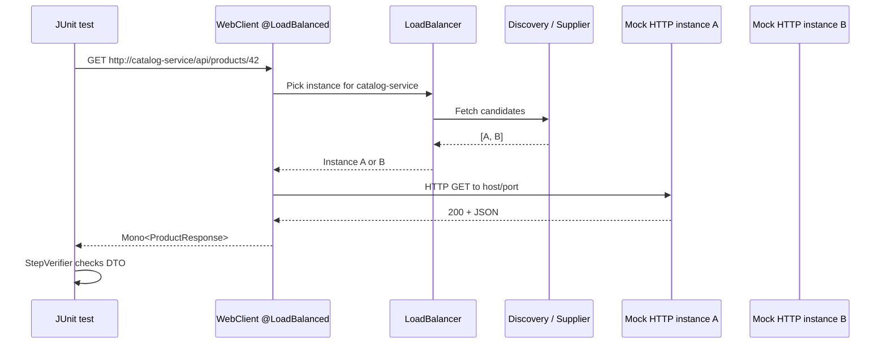

# Reactive Testing with StepVerifier and Time Control

When integrating `WebClient` with Spring Cloud LoadBalancer, a call to `http://catalog-service` depends on more than the HTTP response. Before sending the request, the application must fetch the `ServiceInstance` list, apply discovery, health checks, zone/hint rules, select an instance, and then open a connection. Each step can emit data, complete empty, emit an error, or arrive later than expected.

In reactive code built on Project Reactor, calling a method and immediately asserting its return value is insufficient: the return value is typically a `Mono<T>` or `Flux<T>` that emits nothing until **subscribed**. `StepVerifier` from `reactor-test` lets you verify **signal order, emitted items, errors, completion, cancellation, and timing** on Publishers. With `VirtualTimeScheduler`, many tests involving `delay`, `timeout`, and `retryWhen` run quickly and deterministically without `Thread.sleep()`.

This lesson belongs to the **Automated Testing** section of the Spring Cloud LoadBalancer module. It focuses on testing **instance selectors and reactive suppliers**, simulating missing instances or slow discovery sources, controlling time at the Reactor layer, and distinguishing unit tests from integration tests that actually traverse WebClient, LoadBalancer, HTTP connectors, and target servers.

## 1. Splitting the problem into testing layers

The same symptom—"cannot call `catalog-service`"—can originate at several layers. Never try to prove every behavior with one giant integration test.

| Layer | Subject under test | Data / test double | What to assert |
|---|---|---|---|
| Reactive operator | `Mono`/`Flux`, `timeout`, `retryWhen`, `onErrorResume` | Fake publisher, virtual time | Exact signals, timestamps, attempt counts, and fallbacks |
| `ServiceInstanceListSupplier` | Candidate list, custom filter/hint/health | Fixed instance list or `TestPublisher` source | Output candidates match the request context |
| `ReactorServiceInstanceLoadBalancer` | Selection algorithm | Fake supplier, no real HTTP | Server present/absent, instance in valid set, safe on empty list |
| WebClient response mapping | `retrieve`, `onStatus`, DTO/JSON | Fake `ExchangeFunction` | HTTP 2xx/4xx/5xx classification and proper decoding |
| HTTP + LoadBalancer integration | `@LoadBalanced WebClient.Builder`, client context, discovery, and test backends | Real mock instances, fake HTTP servers | Service ID resolved, request reaches right destination, accurate HTTP response |
| Operational integration | Retries, timeouts, health checks, caching, scale-in | Test-environment registry/servers | Discovery convergence, network failures, retries, and realistic latency |

**Principle:** `StepVerifier` excels at verifying a Publisher, yet **does not prove a real HTTP request reached the right instance**. To test connections, TLS, DNS, wire format, and live HTTP responses, you still need integration tests with matching servers and connectors.

## 2. Setting up Reactor Test and JUnit

In a Spring Boot/WebFlux project already using Reactor, add `reactor-test` in test scope. Maven example:

```xml
<dependency>
    <groupId>io.projectreactor</groupId>
    <artifactId>reactor-test</artifactId>
    <scope>test</scope>
</dependency>
<dependency>
    <groupId>org.springframework.boot</groupId>
    <artifactId>spring-boot-starter-test</artifactId>
    <scope>test</scope>
</dependency>
```

When testing LoadBalancer algorithms, the project must also declare `spring-cloud-starter-loadbalancer` aligned with your active **Spring Cloud BOM**. Never mix a `reactor-test` version incompatible with `reactor-core`; prefer the version managed by Spring Boot dependency management.

Common imports:

```java
import java.time.Duration;
import java.util.concurrent.TimeoutException;

import org.junit.jupiter.api.Test;
import reactor.core.publisher.Flux;
import reactor.core.publisher.Mono;
import reactor.test.StepVerifier;
import reactor.test.publisher.TestPublisher;
import reactor.test.scheduler.VirtualTimeScheduler;
import reactor.util.retry.Retry;
```

Not every example needs all of these imports. Under JUnit 5, `StepVerifier` runs inside a test method and fails the assertion whenever actual signals diverge from expectations.

**Scope of this lesson:** snippets use common Reactor and Spring Cloud LoadBalancer APIs. Specific constructors or packages in Spring Cloud can vary across release trains, so always align dependencies and verify against your actual BOM when turning examples into repository tests.

## 3. Reading Publisher signals with StepVerifier

A `Mono<T>` can emit **at most one** value before completing, complete empty, or emit an error. A `Flux<T>` can emit multiple values. `StepVerifier` subscribes and verifies the signal sequence instead of extracting values with `block()`.

Successful `Mono` example:

```java
@Test
void monoEmitsProductAndCompletes() {
    Mono<String> publisher = Mono.just("catalog-1");

    StepVerifier.create(publisher)
            .expectNext("catalog-1")
            .verifyComplete();
}
```

Multi-element `Flux` example:

```java
@Test
void fluxEmitsCandidateIdsInOrder() {
    Flux<String> ids = Flux.just(
            "catalog-1", "catalog-2", "catalog-3");

    StepVerifier.create(ids)
            .expectNext("catalog-1", "catalog-2", "catalog-3")
            .verifyComplete();
}
```

Empty completion and error emission examples:

```java
@Test
void emptyPublisherCompletesWithoutNextValue() {
    StepVerifier.create(Mono.<String>empty())
            .verifyComplete();
}

@Test
void publisherPropagatesError() {
    StepVerifier.create(
            Mono.<String>error(
                    new IllegalStateException("discovery failed")))
            .expectErrorMatches(error ->
                    error instanceof IllegalStateException
                    && "discovery failed".equals(error.getMessage()))
            .verify();
}
```

Commonly used steps:

| StepVerifier API | Meaning |
|---|---|
| `expectSubscription()` | Asserts the subscription signal before checking subsequent signals |
| `expectNext(value)` | Matches a single `onNext` value |
| `assertNext(consumer)` | Checks multiple properties of an emitted item via assertions |
| `expectNextCount(n)` | Verifies item count without comparing individual values |
| `expectError(type)` / `expectErrorMatches(predicate)` | Verifies a terminal error |
| `verifyComplete()` | Asserts the Publisher completes successfully |
| `thenCancel().verify()` | Cancels the subscription and completes verification |
| `thenAwait(duration)` | Advances waiting time in the scenario; not a real sleep under virtual time |
| `expectNoEvent(duration)` | Asserts no new signals arrive during the specified interval |

**Note:** `expectNoEvent` counts **subscription** itself as an event. If you want to verify "after subscribing, no value or error has arrived yet," place `expectSubscription()` **before** `expectNoEvent(...)`.

## 4. Testing instance selection with a fixed supplier

To test LoadBalancer, start with a **stable** instance list independent of Eureka/Consul, with no HTTP servers and no discovery wait times.

Example using the built-in `RoundRobinLoadBalancer` with a test `ServiceInstanceListSupplier`. You can place this test in its own JUnit class:

```java
import static org.junit.jupiter.api.Assertions.*;

import java.util.List;

import org.junit.jupiter.api.Test;
import org.springframework.beans.factory.support.DefaultListableBeanFactory;
import org.springframework.cloud.client.DefaultServiceInstance;
import org.springframework.cloud.client.ServiceInstance;
import org.springframework.cloud.client.loadbalancer.DefaultRequest;
import org.springframework.cloud.loadbalancer.core.RoundRobinLoadBalancer;
import org.springframework.cloud.loadbalancer.core.ServiceInstanceListSupplier;

import reactor.core.publisher.Flux;
import reactor.test.StepVerifier;

class RoundRobinReactiveTest {

    private static final String SERVICE_ID = "catalog-service";

    private static final class FixedSupplier
            implements ServiceInstanceListSupplier {

        private final List<ServiceInstance> instances;

        FixedSupplier(List<ServiceInstance> instances) {
            this.instances = List.copyOf(instances);
        }

        @Override
        public String getServiceId() {
            return SERVICE_ID;
        }

        @Override
        public Flux<List<ServiceInstance>> get() {
            return Flux.just(instances);
        }
    }

    private static RoundRobinLoadBalancer newLoadBalancer(
            List<ServiceInstance> instances) {

        DefaultListableBeanFactory factory =
                new DefaultListableBeanFactory();

        factory.registerSingleton(
                "catalogInstances",
                new FixedSupplier(instances));

        return new RoundRobinLoadBalancer(
                factory.getBeanProvider(
                        ServiceInstanceListSupplier.class),
                SERVICE_ID);
    }

    private static ServiceInstance instance(
            String instanceId, int port) {
        return new DefaultServiceInstance(
                instanceId, SERVICE_ID, "127.0.0.1", port, false);
    }

    @Test
    void choosesOnlyFromRegisteredCandidates() {
        RoundRobinLoadBalancer loadBalancer = newLoadBalancer(
                List.of(
                        instance("catalog-1", 8101),
                        instance("catalog-2", 8102)));

        StepVerifier.create(
                loadBalancer.choose(new DefaultRequest<>()))
                .assertNext(response -> {
                    assertTrue(response.hasServer());

                    ServiceInstance chosen = response.getServer();
                    assertEquals(SERVICE_ID, chosen.getServiceId());

                    assertTrue(List.of(
                            "catalog-1", "catalog-2")
                            .contains(chosen.getInstanceId()));
                })
                .verifyComplete();
    }
}
```

What this proves: a selection emits **one `Response<ServiceInstance>`**, has a server, carries the right service ID, and picks from the supplied list. It does not require the first chosen instance to be `catalog-1`, since round-robin seeds/counters vary by constructor, bean lifecycle, or version.

**Do not use this assertion style to claim load distributes evenly in production.** This test has no network, backend latency, health filters, zone preference, sticky sessions, or multiple caller processes. It focuses strictly on the **reactive contract of instance selection**.

## 5. No-instance cases and supplier errors

Even more important than the happy path is **an empty candidate list**. At the LoadBalancer layer, the expected outcome is usually a `Response` containing no server; in HTTP integration, that turns into an error response or exception depending on client and config.

Reusing the helpers from the previous section:

```java
@Test
void returnsNoServerWhenCandidateListIsEmpty() {
    RoundRobinLoadBalancer loadBalancer =
            newLoadBalancer(List.of());

    StepVerifier.create(
            loadBalancer.choose(new DefaultRequest<>()))
            .assertNext(response ->
                    assertFalse(response.hasServer()))
            .verifyComplete();
}
```

**Crucial distinction:** "no instance" is not an HTTP `404 Not Found` returned by `catalog-service`. No connection to catalog occurred; the cause may be empty discovery, all instances dropped by health checks, unmatched zone/hint filters, or a misconfigured named client context.

For a failing supplier, tests should verify **how the error propagates** per the contract of the LoadBalancer under test. Example fake publisher emitting an exception:

```java
ServiceInstanceListSupplier brokenSupplier =
        new ServiceInstanceListSupplier() {

            @Override
            public String getServiceId() {
                return "catalog-service";
            }

            @Override
            public Flux<List<ServiceInstance>> get() {
                return Flux.error(
                        new IllegalStateException(
                                "discovery unavailable"));
            }
        };
```

Register `brokenSupplier` in a test bean factory as before, then:

```java
StepVerifier.create(
        loadBalancer.choose(new DefaultRequest<>()))
        .expectErrorMatches(error ->
                error instanceof IllegalStateException
                && error.getMessage()
                        .contains("discovery unavailable"))
        .verify();
```

In this snippet, `loadBalancer` is assumed to be wired with `brokenSupplier`. If a custom algorithm has a policy to **fall back to a cached instance list** when discovery errors out, expected signals must reflect that policy rather than assuming every supplier failure propagates raw exceptions.

## 6. Verifying `Request` context propagation to the supplier

Some `ServiceInstanceListSupplier`s inspect per-request context like hints, sticky-session cookies, or retry metadata to filter candidates. If a custom LoadBalancer calls `supplier.get()` instead of `supplier.get(request)`, static-list tests may still pass while request-based routing silently fails.

Example spy supplier recording the received request:

```java
import java.util.List;
import java.util.concurrent.atomic.AtomicReference;

import org.springframework.cloud.client.ServiceInstance;
import org.springframework.cloud.client.loadbalancer.Request;
import org.springframework.cloud.loadbalancer.core.ServiceInstanceListSupplier;
import reactor.core.publisher.Flux;

final class RecordingSupplier
        implements ServiceInstanceListSupplier {

    private final List<ServiceInstance> instances;
    private final AtomicReference<Request> observed =
            new AtomicReference<>();

    RecordingSupplier(List<ServiceInstance> instances) {
        this.instances = List.copyOf(instances);
    }

    @Override
    public String getServiceId() {
        return "catalog-service";
    }

    @Override
    public Flux<List<ServiceInstance>> get() {
        return Flux.just(instances);
    }

    @Override
    public Flux<List<ServiceInstance>> get(Request request) {
        observed.set(request);
        return get();
    }

    Request lastRequest() {
        return observed.get();
    }
}
```

When `RecordingSupplier` is registered in the test LoadBalancer's bean factory:

```java
DefaultRequest<String> request =
        new DefaultRequest<>("hint-canary");

StepVerifier.create(loadBalancer.choose(request))
        .assertNext(response -> assertTrue(response.hasServer()))
        .verifyComplete();

assertSame(request, recordingSupplier.lastRequest());
```

This snippet uses JUnit's `assertSame`; `loadBalancer` and `recordingSupplier` must be **wired together via the test provider**, not unrelated variables.

This test proves only that **the request context reached the supplier**, not that hint policies filtered properly. To test hint/zone/sticky filtering for real, add candidates with distinct metadata and assert the filtered list or selected instance per your supplier's semantics.

## 7. Controlling emission timing with `TestPublisher`

`TestPublisher` from `reactor-test` lets tests decide exactly when a source emits items, completes, or errors. It is especially useful to prove LoadBalancer **waits for the discovery supplier** instead of returning an invalid instance prematurely.

Conceptual example with a list source:

```java
import java.util.List;

import reactor.test.publisher.TestPublisher;
import reactor.test.StepVerifier;
import org.springframework.cloud.client.ServiceInstance;

TestPublisher<List<ServiceInstance>> source =
        TestPublisher.create();

ServiceInstanceListSupplier supplier =
        new ServiceInstanceListSupplier() {

            @Override
            public String getServiceId() {
                return "catalog-service";
            }

            @Override
            public Flux<List<ServiceInstance>> get() {
                return source.flux();
            }
        };
```

After registering this supplier in LoadBalancer's provider, you can control when it emits snapshots:

```java
StepVerifier.create(
        loadBalancer.choose(new DefaultRequest<>()))
        .expectSubscription()
        .then(() -> source.next(
                List.of(instance("catalog-1", 8101))))
        .assertNext(response -> {
            assertTrue(response.hasServer());
            assertEquals(
                    "catalog-1",
                    response.getServer().getInstanceId());
        })
        .verifyComplete();
```

In this snippet, `loadBalancer` and the `instance(...)` helper are prepared as in Section 4, and `supplier` wraps `source.flux()`. A LoadBalancer consuming the first snapshot can complete right after the `next` signal even before the source calls `complete()`. When testing multi-snapshot publishers, clarify whether the algorithm reads only the first emission or stays subscribed to updates.

Useful scenarios:

- `source.next(List.of())`: source responds, but with zero candidates.
- `source.error(new IllegalStateException(...))`: discovery stream fails.
- `source.complete()` before emitting a list: supplier emits zero snapshots; empty-publisher handling should be verified.
- Multiple `next` calls: verify whether `next()` takes only the first emission or a custom supplier handles refreshes differently.

Do not use `TestPublisher` to pretend a real registry or TCP socket failed. This remains a **unit test for Reactive Streams**, not a full network stack simulation.

## 8. Controlling time: real time vs. virtual time

Distinguish two approaches:

| Testing approach | Clock used | Best for | Limitations |
|---|---|---|---|
| Standard `StepVerifier.create(...)` | Wall clock / real schedulers | Fast operations, time-independent Publishers, bounded integration tests | Can wait slowly; prone to flakiness on tight margins |
| `StepVerifier.withVirtualTime(...)` | Reactor's `VirtualTimeScheduler` | `delayElements`, `Mono.delay`, `timeout`, `Retry.backoff` on compatible schedulers | Does not speed up DNS/TCP/TLS, HTTP connectors, or non-Reactor libraries |

**Virtual time** replaces waiting on the wall clock with advancing a virtual scheduler clock for Reactor operators. Example of a Publisher emitting only after 10 seconds:

```java
@Test
void verifiesDelayedMonoWithoutRealWaiting() {
    StepVerifier.withVirtualTime(
            () -> Mono.delay(Duration.ofSeconds(10)))
            .expectSubscription()
            .expectNoEvent(Duration.ofSeconds(9))
            .thenAwait(Duration.ofSeconds(1))
            .expectNext(0L)
            .verifyComplete();
}
```

Here:

1. `withVirtualTime` activates the virtual scheduler context.
2. The supplier `() -> Mono.delay(...)` **constructs the Publisher after the virtual scheduler is active**.
3. `expectSubscription()` confirms the subscription.
4. `expectNoEvent(9 s)` confirms nothing arrives before the 10-second virtual mark.
5. `thenAwait(1 s)` advances the virtual clock to the emission point.
6. `expectNext(0L)` and `verifyComplete()` verify the expected result.

**Common mistake:** constructing a timer/scheduler-backed Publisher *before* calling `withVirtualTime` and passing that prebuilt Publisher into the lambda. Some operators capture the real scheduler at assembly time, rendering virtual time ineffective. Always construct **the entire time-dependent pipeline inside the supplier lambda**.

`expectNoEvent` after `expectSubscription` is essential; placing `expectNoEvent` first counts the subscription itself as an event and fails immediately.

## 9. Testing `timeout` without `Thread.sleep()`

Suppose the application sets a deadline on fetching an instance list, and the supplier never emits a value. Instead of sleeping two real seconds, test the timeout with virtual time:

```java
@Test
void timesOutWhenNoSignalArrives() {
    StepVerifier.withVirtualTime(
            () -> Mono.<String>never()
                    .timeout(Duration.ofSeconds(2)))
            .expectSubscription()
            .thenAwait(Duration.ofSeconds(2))
            .expectError(TimeoutException.class)
            .verify(Duration.ofSeconds(5));
}
```

The `TimeoutException` here comes from **Reactor's `timeout` operator**, which does not mean an HTTP client opened a TCP socket and hit connect/read timeout. `verify(Duration.ofSeconds(5))` is a **real-time safety limit** on the test itself to prevent hangs; it does not replace `timeout(Duration.ofSeconds(2))` inside the pipeline.

With LoadBalancer, you can also attach a deadline at a boundary under test:

```java
Mono<Response<ServiceInstance>> choice =
        loadBalancer.choose(new DefaultRequest<>())
                .timeout(Duration.ofSeconds(2));
```

To use virtual time, put **the entire `choice` creation** inside `withVirtualTime`'s lambda:

```java
StepVerifier.withVirtualTime(() ->
        loadBalancer.choose(new DefaultRequest<>())
                .timeout(Duration.ofSeconds(2)))
        .expectSubscription()
        .thenAwait(Duration.ofSeconds(2))
        .expectError(TimeoutException.class)
        .verify(Duration.ofSeconds(5));
```

In this example, `loadBalancer` must use a non-emitting supplier (`Flux.never()`) for the timeout to fire. If the supplier immediately returns `EmptyResponse`, the pipeline completes before the timeout and the test should expect a "no server" outcome instead of `TimeoutException`.

**Distinguish timeouts carefully:** instance-selection timeout, pool-lease timeout, connect timeout, response/read timeout, and end-to-end deadline are separate boundaries. Virtual time proves Reactor operator semantics, **not real socket timeout timings in Reactor Netty or HTTP clients**.

## 10. Deterministic testing of retry and backoff

Retries allow a single logical request to trigger multiple subscriptions/HTTP attempts. Asserting only `expectNext(...)` while ignoring attempt counts lets a test pass even when retry policy logic is broken or multiplies load excessively.

Example where a source fails twice and succeeds on the third try using `Retry.backoff`:

```java
import java.time.Duration;
import java.util.concurrent.atomic.AtomicInteger;
import reactor.core.publisher.Mono;
import reactor.test.StepVerifier;
import reactor.util.retry.Retry;

@Test
void retriesTwiceAndThenSucceeds() {
    AtomicInteger attempts = new AtomicInteger();

    StepVerifier.withVirtualTime(() ->
            Mono.defer(() -> {
                int current = attempts.incrementAndGet();

                if (current < 3) {
                    return Mono.<String>error(
                            new IllegalStateException("temporary"));
                }

                return Mono.just("catalog-1");
            })
            .retryWhen(
                    Retry.backoff(2, Duration.ofSeconds(1))
                            .jitter(0d)))
            .expectSubscription()
            .thenAwait(Duration.ofSeconds(4))
            .expectNext("catalog-1")
            .verifyComplete();

    assertEquals(3, attempts.get());
}
```

This example requires importing JUnit's `assertEquals`. `Retry.backoff(2, ...)` allows **at most two retries**, meaning up to three attempts. Backoff normally grows exponentially; `jitter(0d)` is used **in tests** to eliminate randomness and make timing predictable. Advancing four virtual seconds simply steps past retry intervals and is not a production time-budget recommendation.

**Do not assume this retry test proves Spring Cloud LoadBalancer picks another instance on the next attempt.** It only tests resubscribing to a `Mono`. Proving a retry-aware supplier excludes the prior instance requires appropriate request context and instance lists, or an integration test executing the real LoadBalancer retry policy.

### 10.1. Verifying errors that must not be retried

For HTTP `400`, `401`, `403`, or `404`, most API contracts forbid retrying the same request, while `429` and certain `5xx` statuses require explicit rules. Tests should exercise a predicate:

```java
Retry retryPolicy = Retry.backoff(
                2, Duration.ofMillis(100))
        .jitter(0d)
        .filter(error -> error instanceof TimeoutException);
```

If the pipeline emits `IllegalArgumentException` or a business error excluded by the predicate, verify the error terminates **on the first attempt**. For order-creating `POST`s, retries must consider idempotency because the server may have processed the request even when the response dropped.

### 10.2. Timeout placement changes test semantics

```java
// Per-attempt timeout applied before retrying.
source.timeout(Duration.ofSeconds(2))
      .retryWhen(retryPolicy);

// Overall deadline across the whole pipeline including retries/backoff.
source.retryWhen(retryPolicy)
      .timeout(Duration.ofSeconds(5));
```

These two arrangements have different meanings. The first can exceed two seconds overall due to retries; the second caps the entire sequence including retries and backoff. To test overall deadlines, make the source sufficiently slow and use virtual time if all involved timers belong to Reactor.

## 11. Testing delayed instance lists

A supplier can return `Flux<List<ServiceInstance>>` with a delay (for instance, a test stub simulating slow snapshot emission). No real sleep is needed:

```java
ServiceInstanceListSupplier delayedSupplier =
        new ServiceInstanceListSupplier() {

            @Override
            public String getServiceId() {
                return "catalog-service";
            }

            @Override
            public Flux<List<ServiceInstance>> get() {
                return Flux.just(List.of(
                        instance("catalog-1", 8101)))
                        .delayElements(Duration.ofSeconds(5));
            }
        };
```

After registering `delayedSupplier` in LoadBalancer's provider:

```java
StepVerifier.withVirtualTime(() ->
        loadBalancer.choose(new DefaultRequest<>()))
        .expectSubscription()
        .expectNoEvent(Duration.ofSeconds(4))
        .thenAwait(Duration.ofSeconds(1))
        .assertNext(response -> {
            assertTrue(response.hasServer());
            assertEquals(
                    "catalog-1",
                    response.getServer().getInstanceId());
        })
        .verifyComplete();
```

**Note:** `delayElements(Duration)` here simulates **Reactor signal timing**, not real Eureka, Consul, DNS, or registry latency. If a real supplier uses blocking threads or a scheduler outside the virtual scheduler's control, test with real time or a matching fake clock/transport.

When using custom suppliers, check whether `get(request)` is used to preserve hints, cookies, or retry context. Simulating a slow list should not accidentally bypass a request-dependent filter active in production.

## 12. WebClient: using a fake `ExchangeFunction` to test decoding and HTTP errors

Test HTTP response handling at the right layer. When you only want to verify how `WebClient.retrieve()` converts responses into DTOs or exceptions, **you do not need LoadBalancer**.

Example WebClient with a fake `ExchangeFunction` always returning JSON:

```java
import static org.junit.jupiter.api.Assertions.assertEquals;

import org.junit.jupiter.api.Test;
import org.springframework.http.HttpHeaders;
import org.springframework.http.HttpStatus;
import org.springframework.http.MediaType;
import org.springframework.web.reactive.function.client.ClientResponse;
import org.springframework.web.reactive.function.client.ExchangeFunction;
import org.springframework.web.reactive.function.client.WebClient;

import reactor.core.publisher.Mono;
import reactor.test.StepVerifier;

class CatalogWebClientTest {

    record ProductResponse(String id, String name) { }

    @Test
    void mapsJsonResponseToDto() {
        ExchangeFunction fakeExchange = request ->
                Mono.just(
                        ClientResponse.create(HttpStatus.OK)
                                .header(
                                        HttpHeaders.CONTENT_TYPE,
                                        MediaType.APPLICATION_JSON_VALUE)
                                .body(
                                        "{\"id\":\"42\",\"name\":\"Keyboard\"}")
                                .build());

        WebClient client = WebClient.builder()
                .exchangeFunction(fakeExchange)
                .build();

        Mono<ProductResponse> response = client.get()
                .uri("http://catalog-service/api/products/42")
                .retrieve()
                .bodyToMono(ProductResponse.class);

        StepVerifier.create(response)
                .assertNext(product -> {
                    assertEquals("42", product.id());
                    assertEquals("Keyboard", product.name());
                })
                .verifyComplete();
    }
}
```

In this test, `catalog-service` is merely a URL used to build the request; `fakeExchange` intercepts before transport, so **there is no DNS, LoadBalancer, HTTP socket, or real server**. The test verifies WebClient decoding and codecs; without Jackson/codecs matching the DTO, it fails at the decode layer.

To test an error status:

```java
ExchangeFunction fakeExchange = request -> Mono.just(
        ClientResponse.create(HttpStatus.SERVICE_UNAVAILABLE)
                .body("upstream unavailable")
                .build());

WebClient client = WebClient.builder()
        .exchangeFunction(fakeExchange)
        .build();

StepVerifier.create(
        client.get()
                .uri("http://catalog-service/api/products/42")
                .retrieve()
                .bodyToMono(String.class))
        .expectErrorMatches(error ->
                error instanceof WebClientResponseException ex
                && ex.getStatusCode().value() == 503)
        .verify();
```

The second snippet requires importing `WebClientResponseException` from `org.springframework.web.reactive.function.client`. With `retrieve()`, HTTP 4xx/5xx statuses map to response exceptions, whereas real connection errors belong to request exceptions. Exact exception types may change if the app uses `onStatus` or custom handlers.

**Never confuse a `WebClientResponseException(503)` from `fakeExchange` with a LoadBalancer "no instance" error.** Both can share a status code in certain integrations, yet arise at different stages. Unit tests must clearly state which error is simulated.

## 13. Real integration tests with `@LoadBalanced WebClient.Builder`

After unit tests, add **integration tests** verifying the full chain:



A practical setup:

1. Boot a test application context with the Spring Cloud LoadBalancer dependency and a **static** instance source, without an external registry.
2. Have the instance source return `DefaultServiceInstance`s pointing to the **real ports** of one or two mock HTTP servers (such as MockWebServer/WireMock).
3. Use the `@LoadBalanced WebClient.Builder` from the Spring context rather than constructing an isolated `WebClient.builder()` that skips auto-configuration.
4. Send logical URLs with service ID `catalog-service` and path variables; verify mock servers record method, path, headers, and body.
5. Verify responses with `StepVerifier` and check which server received the request via mock server assertions.
6. Cover empty lists, backend 503s, connection refused, connector-level timeouts, and enabled retry configs.

Integration tests should enforce **reasonable real-time timeouts** while waiting for responses and mock servers; never leave tests hanging indefinitely if a connection or background task stalls. Use `StepVerifier.create(publisher).expectNext(...).verifyComplete()` or terminal `verify(Duration.ofSeconds(...))` overloads as appropriate.

**Never use virtual time to speed up TCP handshakes, connect timeouts, DNS refreshes, TLS, or real HTTP servers.** Those components do not necessarily use Reactor's `VirtualTimeScheduler`. Virtual time fits **Reactive Streams logic**; integration tests need real clocks, stable mock servers, and controlled environment inputs.

## 14. Verifying cancellation and resource cleanup

In reactive pipelines, requests can be cancelled when callers disconnect, upstream time budgets expire, or `take`/`timeout` terminates a subscription. If a custom supplier or LoadBalancer opens its own subscription inside `choose()`, it can leak work after downstream cancels.

Example verifying a Publisher receives a cancel signal:

```java
import static org.junit.jupiter.api.Assertions.assertEquals;

import java.util.concurrent.atomic.AtomicInteger;
import reactor.core.publisher.Mono;
import reactor.test.StepVerifier;

AtomicInteger cancellations = new AtomicInteger();

Mono<String> neverCompletes = Mono.<String>never()
        .doOnCancel(cancellations::incrementAndGet);

StepVerifier.create(neverCompletes)
        .expectSubscription()
        .thenCancel()
        .verify();

assertEquals(1, cancellations.get());
```

This test confirms a **cancellation signal** reached the Publisher; it does not yet prove HTTP connections were reclaimed, pool slots returned, or child contexts closed. When custom code manages resources, add lifecycle checks such as `doFinally` on pipelines, `Disposable` cleanup for periodic tasks, and context-shutdown tests.

When using `Flux.interval` or an infinite publisher, avoid calling `verifyComplete()` because the source never completes; use `thenCancel().verify()` or a bounding operator like `take(n)` depending on your goal.

### 14.1. Concurrency tests go beyond `expectNextCount`

A custom round-robin using `AtomicInteger` or a supplier holding immutable snapshots should be tested under concurrent subscriptions. Example:

```java
Flux<Response<ServiceInstance>> selections = Flux
        .range(0, 500)
        .flatMap(
                i -> loadBalancer.choose(new DefaultRequest<>())
                        .subscribeOn(Schedulers.parallel()),
                32);

StepVerifier.create(selections)
        .expectNextCount(500)
        .verifyComplete();
```

Additional imports include `Response`, `ServiceInstance`, and `Schedulers`. This code verifies 500 results arrived, **not thread-safety**. Add assertions on every result: `hasServer()`, ID in valid snapshot, zero exceptions, and no state corruption. If the instance list changes concurrently, do not demand rigid sequential round-robin ordering.

For true race conditions, add multi-round stress tests, snapshot transitions 3 → 2 → 0 instances, cancellations, and retries; check algorithmic invariants rather than relying solely on emission counts.

## 15. Anti-patterns that make reactive tests slow or flaky

| Anti-pattern | Why it is harmful | Better alternative |
|---|---|---|
| `Thread.sleep(5000)` in unit tests | Slow and flaky under heavy CI load | `withVirtualTime`, `thenAwait` |
| `Mono.block()` to extract values | Turns blocking, loses signal/cancellation checks | `StepVerifier.create(...)` |
| `subscribe()` then immediately asserting a local variable | Race between callback and assertion | Let `StepVerifier` drive subscriptions |
| Building timer pipelines before `withVirtualTime` | Scheduler may already be captured | Build pipelines inside the supplier lambda |
| `expectNoEvent` as the very first step | Subscription counts as an event | Call `expectSubscription()` first |
| Testing HTTP connectors with virtual time | DNS/TCP/TLS do not use the virtual scheduler | Real-time integration tests |
| Random retry jitter with tight timing assertions | Nondeterministic test | Use `jitter(0d)` in tests or assert non-timing invariants |
| Asserting exact first round-robin instance | Seed and initial position vary | Assert candidate membership; assert distribution only with controlled seed/state |
| Tests without real-time timeouts | CI can hang forever | `verify(Duration)` or test runner timeout |
| Running virtual-scheduler tests in parallel | Can interfere with global scheduler hooks | Isolate virtual-time tests; avoid parallel execution with global schedulers |
| Using `StepVerifier` on a fake `ExchangeFunction` and claiming LB works | No real LB/HTTP in the fake | Integration test with `@LoadBalanced` and mock HTTP servers |
| Using `expectNextCount` and calling it a load-balancing test | Only counts emissions, ignores invariants | Assert service ID / instance ID, snapshots, and no-instance behavior |

**Special pitfall with virtual time:** Reactor swaps scheduler factories/hooks during virtual-time tests. If multiple tests manipulate global schedulers concurrently, they can interfere with one another. Run virtual-time tests isolated and never call `VirtualTimeScheduler.getOrSet()` without calling `reset()`; using `StepVerifier.withVirtualTime` properly manages initialization and cleanup automatically.

## 16. Test matrix for reactive Spring Cloud LoadBalancer

A thorough suite defines **input – behavior – expected signal** clearly:

| Scenario | Input | Expected outcome |
|---|---|---|
| Single instance | `[catalog-1]` | `Response.hasServer() = true`, ID is `catalog-1` |
| Multiple instances | `[catalog-1, catalog-2]` | Instance belongs to candidate set; no seed assumptions |
| No instances | `[]` | `Response.hasServer() = false` at LB layer |
| Supplier error | `Flux.error(...)` | Error signal or policy-defined fallback |
| Supplier completes empty | `Flux.empty()` | Empty/no-server per algorithm logic |
| Slow supplier | Snapshot after 5 virtual seconds | No value before deadline, selects properly afterward |
| Request hint/cookie | `get(request)` with metadata | Supplier receives context and filters accurately |
| Reactor timeout | `Mono.never().timeout(...)` | `TimeoutException` at configured virtual threshold |
| Successful retry | Two transient failures then success | Up to configured attempts, expected backoff |
| Non-retryable error | 4xx business failure | Zero retries when predicate disallows |
| HTTP 200 | Fake `ExchangeFunction` returning JSON | Decoder produces DTO |
| HTTP 503 | Fake `ExchangeFunction` returning error response | `WebClientResponseException` or custom mapping |
| LoadBalancer integration | Service ID + mock HTTP instances | Request hits selected instance's address |
| Cancellation | Unfinished Publisher cancelled | Cancel signal and resources cleaned up properly |
| Concurrency | Multiple concurrent subscriptions selecting | No races, no state leaks, results belong to snapshot |

Across multiple Spring Cloud versions, separate tests of **framework APIs** from tests of **application contracts**. For instance, the HTTP status on no-instance can vary by integration/config, yet the invariant "never silently call a host outside the valid candidate list" always remains worth verifying.

## 17. Checklist when writing new tests

- [ ] Does the test clearly target **one layer**: operator, supplier, LoadBalancer, WebClient codec, or HTTP integration?
- [ ] Is test data controlled without depending on production registries?
- [ ] Are success, empty list, supplier error, and abnormal latency all covered?
- [ ] Does `StepVerifier` verify `onNext`, terminal signals, errors, and cancellations where relevant?
- [ ] When using `withVirtualTime`, are timer-based Publishers constructed **inside the lambda** after virtual time starts?
- [ ] Are `Thread.sleep()` calls avoided when testing Reactor backoff or delays?
- [ ] Do retries define clear attempt caps, error predicates, and timeouts, avoiding random jitter in deterministic tests?
- [ ] Do tests with hang risks enforce real-time deadlines?
- [ ] Do tests avoid inferring from a fake publisher that discovery, TLS, or HTTP networking works?
- [ ] Are there assertions for `serviceId`, valid instance IDs, request context, and no-instance failures?
- [ ] Are cancellation, concurrency, and refresh/scale-in tested for stateful custom LoadBalancers?
- [ ] Do tests avoid touching live registries/services or mutating business data outside test environments?

## 18. Key takeaways

`StepVerifier` verifies **Reactive Streams contracts**: which items are emitted, whether streams complete, which errors surface, and how subscriptions cancel. With Spring Cloud LoadBalancer, it tests `ReactorServiceInstanceLoadBalancer.choose(Request)`, `ServiceInstanceListSupplier`, and policies handling empty or delayed candidate lists.

`StepVerifier.withVirtualTime` verifies `delay`, `timeout`, and `Retry.backoff` quickly and deterministically, provided pipelines use compatible schedulers and are created at the right time. **Virtual time does not replace integration tests over real sockets.** A sustainable testing strategy separates Reactor unit tests, instance-selection tests, WebClient response-mapping tests, and a focused integration suite verifying service IDs, discovery, networking, timeouts, and retries under realistic conditions.
