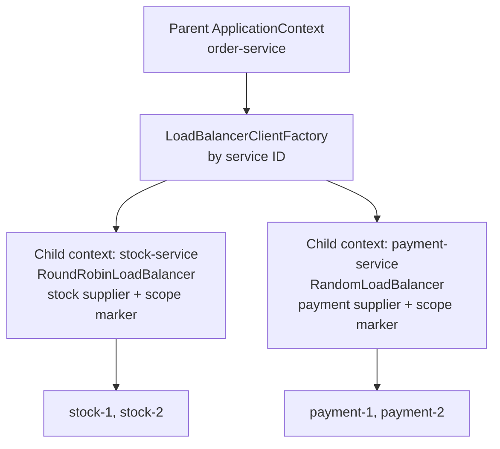

# Testing Per-Service-ID Configuration and Child Contexts

## 1. Why test LoadBalancer configuration scoping?

The `order-service` application calls two services:

- `stock-service` must select instances via **Round Robin** for even rotation.
- `payment-service` must select instances via **Random** for a separate experimental policy.

In Spring Cloud LoadBalancer, configuring `stock-service` must never alter the algorithm, supplier, or dedicated beans of `payment-service`. A subtle bug occurs when a configuration class passed to `@LoadBalancerClient` sits inside the main application's component scan. Then a bean intended for one service can be registered in the **parent application context** and leak into other services.

In the `SPRING_CLOUD_SERVICE_COMMUNICATION_LOAD_BALANCING` module, you learn client-side load balancing by `service ID`, discovery, health checks, routing, `RestClient`/`WebClient`/OpenFeign integration, timeouts/retries, and failure observability. This lesson belongs to the **Automated Testing** chapter and focuses on proving each service ID actually uses **its intended algorithm, `ServiceInstanceListSupplier`, properties, and bean scope**.

After this lesson, you will be able to:

1. Explain the relationship between the **parent context**, **per-service-ID child contexts**, and `LoadBalancerClientFactory`.
2. Register two distinct configurations via `@LoadBalancerClients` and recognize global component-scan hazards.
3. Write integration tests verifying LoadBalancer types, instance sources, service IDs, and bean isolation.
4. Verify per-client properties and distinguish them from global properties.
5. Design tests for lazy context initialization, caching/health checks, HTTP routing, and retries without creating execution-order-dependent tests.

## 2. How do Spring Cloud LoadBalancer child contexts work?

Spring Cloud LoadBalancer creates a **named child application context** for each service ID. By default, a service's context is **lazily initialized** the first time load balancing is needed for that service; eager loading can be configured to initialize earlier.



When an HTTP client calls `http://stock-service/stocks/SKU-1` through `@LoadBalanced`, the `stock-service` segment of the URL is the **service ID**; `LoadBalancerClientFactory` uses that ID to look up the load balancer and related beans from the appropriate context.

Key distinctions:

| Concept | Example | Role in tests |
|---|---|---|
| Parent application context | `order-service` application | Holds auto-configuration and shared beans |
| Named child context | `stock-service` | Holds the algorithm and supplier configured specifically for this ID |
| `LoadBalancerClientFactory` | Bean in parent | Looks up beans by client name; creates child contexts on demand |
| `@LoadBalancerClient(name = ...)` | `stock-service` | Associates custom config with the exact service ID |
| `ReactorServiceInstanceLoadBalancer` | `RoundRobinLoadBalancer` | Picks an instance from that context's supplier |
| `ServiceInstanceListSupplier` | List of `stock-*` | Supplies eligible instances for that service |
| `spring.application.name` | `order-service` | Name of the **running** app; does not replace target service IDs |
| `@FeignClient(contextId = ...)` | `stockFeignV2` | Isolates Feign bean configs; does not automatically rename the LoadBalancer service ID |

**Important caveat:** Child contexts still have a **parent–child relationship**. By Spring rules, a child context can see beans defined in the parent. Thus "having a separate child context" does not automatically guarantee every bean is isolated. Proper setup means service-specific beans **are registered inside that service's child context**, never accidentally promoted into the parent.

### 2.1. The contract tests must protect

For two service IDs `stock-service` and `payment-service`:

- `factory.getInstance("stock-service", ReactorServiceInstanceLoadBalancer.class)` must resolve to the stock algorithm.
- `factory.getInstance("payment-service", ReactorServiceInstanceLoadBalancer.class)` must resolve to the payment algorithm.
- `stock-service`'s supplier must never emit instances with `serviceId="payment-service"`, and vice versa.
- Two marker beans with the same **Java type** or **bean name** can coexist in two child contexts without conflict.
- Client-specific markers must never appear in the parent context.
- Repeated `getInstance` calls for the same service ID in the same app normally return the bean from the already-created context; querying another service must not "overwrite" the previous service's bean.

## 3. Configuring two distinct services

This setup uses Spring Cloud LoadBalancer with Spring Boot and Java 17+. Use dependencies managed by **compatible Spring Boot and Spring Cloud BOMs**; never mix unaligned starter versions manually.

```xml
<dependencies>
    <dependency>
        <groupId>org.springframework.cloud</groupId>
        <artifactId>spring-cloud-starter-loadbalancer</artifactId>
    </dependency>
    <dependency>
        <groupId>org.springframework.boot</groupId>
        <artifactId>spring-boot-starter-test</artifactId>
        <scope>test</scope>
    </dependency>
</dependencies>
```

### 3.1. Registering configurations per service ID

```java
import org.springframework.boot.SpringBootConfiguration;
import org.springframework.boot.autoconfigure.EnableAutoConfiguration;
import org.springframework.cloud.loadbalancer.annotation.LoadBalancerClient;
import org.springframework.cloud.loadbalancer.annotation.LoadBalancerClients;

@SpringBootConfiguration(proxyBeanMethods = false)
@EnableAutoConfiguration
@LoadBalancerClients({
    @LoadBalancerClient(
        name = "stock-service",
        configuration = StockLoadBalancerConfig.class
    ),
    @LoadBalancerClient(
        name = "payment-service",
        configuration = PaymentLoadBalancerConfig.class
    )
})
public class TestApplication {
}
```

`@LoadBalancerClients` registers multiple configurations on the same application. You can also place `@LoadBalancerClient` separately across configuration classes; what must stay consistent is **matching `name` with the service ID used in HTTP calls**.

**Never put `@Configuration` on `StockLoadBalancerConfig` or `PaymentLoadBalancerConfig` when they reside inside the main application's component scan.** Spring Cloud registers them into their dedicated contexts via the annotation. If you must mark them with `@Configuration`, place them outside the parent's component scan and test that they are never imported into the parent.

### 3.2. Defining dedicated algorithms, instance sources, and marker beans

Stock configuration example:

```java
import org.springframework.cloud.client.DefaultServiceInstance;
import org.springframework.cloud.client.ServiceInstance;
import org.springframework.cloud.loadbalancer.core.ReactorLoadBalancer;
import org.springframework.cloud.loadbalancer.core.RoundRobinLoadBalancer;
import org.springframework.cloud.loadbalancer.core.ServiceInstanceListSupplier;
import org.springframework.cloud.loadbalancer.support.LoadBalancerClientFactory;
import org.springframework.cloud.loadbalancer.support.ServiceInstanceListSuppliers;
import org.springframework.context.annotation.Bean;
import org.springframework.core.env.Environment;

public class StockLoadBalancerConfig {

    @Bean
    ReactorLoadBalancer<ServiceInstance> stockAlgorithm(
            LoadBalancerClientFactory factory, Environment env) {
        String serviceId = env.getRequiredProperty(
                LoadBalancerClientFactory.PROPERTY_NAME);

        return new RoundRobinLoadBalancer(
                factory.getLazyProvider(
                        serviceId, ServiceInstanceListSupplier.class),
                serviceId);
    }

    @Bean
    ServiceInstanceListSupplier stockInstances(Environment env) {
        String serviceId = env.getRequiredProperty(
                LoadBalancerClientFactory.PROPERTY_NAME);

        return ServiceInstanceListSuppliers.from(
                serviceId,
                new DefaultServiceInstance(
                        "stock-1", serviceId, "127.0.0.1", 18081, false),
                new DefaultServiceInstance(
                        "stock-2", serviceId, "127.0.0.1", 18082, false));
    }

    @Bean
    ScopeMarker scopeMarker(Environment env) {
        return new ScopeMarker(
                env.getRequiredProperty(LoadBalancerClientFactory.PROPERTY_NAME),
                "round-robin");
    }
}
```

Payment configuration example:

```java
import org.springframework.cloud.client.DefaultServiceInstance;
import org.springframework.cloud.client.ServiceInstance;
import org.springframework.cloud.loadbalancer.core.RandomLoadBalancer;
import org.springframework.cloud.loadbalancer.core.ReactorLoadBalancer;
import org.springframework.cloud.loadbalancer.core.ServiceInstanceListSupplier;
import org.springframework.cloud.loadbalancer.support.LoadBalancerClientFactory;
import org.springframework.cloud.loadbalancer.support.ServiceInstanceListSuppliers;
import org.springframework.context.annotation.Bean;
import org.springframework.core.env.Environment;

public class PaymentLoadBalancerConfig {

    @Bean
    ReactorLoadBalancer<ServiceInstance> paymentAlgorithm(
            LoadBalancerClientFactory factory, Environment env) {
        String serviceId = env.getRequiredProperty(
                LoadBalancerClientFactory.PROPERTY_NAME);

        return new RandomLoadBalancer(
                factory.getLazyProvider(
                        serviceId, ServiceInstanceListSupplier.class),
                serviceId);
    }

    @Bean
    ServiceInstanceListSupplier paymentInstances(Environment env) {
        String serviceId = env.getRequiredProperty(
                LoadBalancerClientFactory.PROPERTY_NAME);

        return ServiceInstanceListSuppliers.from(
                serviceId,
                new DefaultServiceInstance(
                        "payment-1", serviceId, "127.0.0.1", 19081, false),
                new DefaultServiceInstance(
                        "payment-2", serviceId, "127.0.0.1", 19082, false));
    }

    @Bean
    ScopeMarker scopeMarker(Environment env) {
        return new ScopeMarker(
                env.getRequiredProperty(LoadBalancerClientFactory.PROPERTY_NAME),
                "random");
    }
}
```

The marker shares a **Java type**, yet each child context holds a distinct **bean instance**:

```java
public record ScopeMarker(String serviceId, String policy) {}
```

Ports `18081/18082/19081/19082` in the examples are merely `ServiceInstance` data for **target-selection tests**; the next test does not send HTTP traffic, so no server needs to listen on those ports. When moving to end-to-end HTTP tests, use real addresses of running stub servers.

### 3.3. Why use `LoadBalancerClientFactory.PROPERTY_NAME`?

Inside each child context, Spring Cloud populates a property identifying the **active client name**. Reading it from `Environment` yields:

```text
Inside stock child context:
  serviceId = stock-service

Inside payment child context:
  serviceId = payment-service
```

This keeps configuration reusable by service ID rather than hardcoding `"stock-service"` inside an algorithm and accidentally reusing that bean for payment. `getLazyProvider(serviceId, ServiceInstanceListSupplier.class)` resolves the supplier from the matching named context when the algorithm executes.

`ServiceInstanceListSuppliers.from(...)` is a fixed-instance fixture keeping tests completely independent of live discovery. In production, substitute `withDiscoveryClient()`, `withBlockingDiscoveryClient()`, caching, and zone/health checks as appropriate.

## 4. Integration test: proving beans do not leak between contexts

The test example uses JUnit 5 and Spring Boot Test. You can place `TestApplication`, `StockLoadBalancerConfig`, `PaymentLoadBalancerConfig`, and `ScopeMarker` in the same package under `src/test/java`, or make them `static nested class`es inside the test and name them accordingly. Ensure **no component scan accidentally pulls both child config classes into the parent**.

```java
import java.time.Duration;
import java.util.List;

import org.junit.jupiter.api.Test;
import org.springframework.beans.factory.annotation.Autowired;
import org.springframework.boot.test.context.SpringBootTest;
import org.springframework.cloud.client.ServiceInstance;
import org.springframework.cloud.client.loadbalancer.DefaultRequest;
import org.springframework.cloud.client.loadbalancer.Response;
import org.springframework.cloud.loadbalancer.core.RandomLoadBalancer;
import org.springframework.cloud.loadbalancer.core.ReactorServiceInstanceLoadBalancer;
import org.springframework.cloud.loadbalancer.core.RoundRobinLoadBalancer;
import org.springframework.cloud.loadbalancer.core.ServiceInstanceListSupplier;
import org.springframework.cloud.loadbalancer.support.LoadBalancerClientFactory;
import org.springframework.context.ApplicationContext;

import static org.junit.jupiter.api.Assertions.*;

@SpringBootTest(
    classes = TestApplication.class,
    properties = {
        "spring.cloud.loadbalancer.cache.enabled=false",
        "spring.cloud.loadbalancer.retry.enabled=false"
    })
class ClientContextIsolationTest {
    private static final Duration TIMEOUT = Duration.ofSeconds(2);

    @Autowired
    LoadBalancerClientFactory factory;

    @Autowired
    ApplicationContext parent;

    @Test
    void algorithmsAreSpecificToEachService() {
        var stock = factory.getInstance(
                "stock-service", ReactorServiceInstanceLoadBalancer.class);
        var payment = factory.getInstance(
                "payment-service", ReactorServiceInstanceLoadBalancer.class);

        assertNotNull(stock);
        assertNotNull(payment);
        assertInstanceOf(RoundRobinLoadBalancer.class, stock);
        assertInstanceOf(RandomLoadBalancer.class, payment);
        assertNotSame(stock, payment);

        // For the same service ID, the factory reuses the bean from the same context.
        assertSame(stock, factory.getInstance(
                "stock-service", ReactorServiceInstanceLoadBalancer.class));
    }

    @Test
    void suppliersStayWithinTheirOwnService() {
        var stock = factory.getInstance(
                "stock-service", ServiceInstanceListSupplier.class);
        var payment = factory.getInstance(
                "payment-service", ServiceInstanceListSupplier.class);

        assertNotNull(stock);
        assertNotNull(payment);
        assertNotSame(stock, payment);
        assertEquals("stock-service", stock.getServiceId());
        assertEquals("payment-service", payment.getServiceId());

        assertEquals(List.of("stock-1", "stock-2"), instanceIds(stock));
        assertEquals(List.of("payment-1", "payment-2"),
                instanceIds(payment));
    }

    @Test
    void markersAreIsolatedAndNotRegisteredInParent() {
        var stock = factory.getInstance("stock-service", ScopeMarker.class);
        var payment = factory.getInstance("payment-service", ScopeMarker.class);

        assertNotNull(stock);
        assertNotNull(payment);
        assertEquals("stock-service", stock.serviceId());
        assertEquals("round-robin", stock.policy());
        assertEquals("payment-service", payment.serviceId());
        assertEquals("random", payment.policy());
        assertNotSame(stock, payment);

        // Parent must never contain client-specific markers.
        assertTrue(parent.getBeansOfType(ScopeMarker.class).isEmpty());
    }

    @Test
    void selectedInstancesHaveTheExpectedServiceId() {
        assertChosenFrom("stock-service", List.of("stock-1", "stock-2"));
        assertChosenFrom(
                "payment-service", List.of("payment-1", "payment-2"));
    }

    private void assertChosenFrom(String serviceId, List<String> allowedIds) {
        var lb = factory.getInstance(
                serviceId, ReactorServiceInstanceLoadBalancer.class);
        assertNotNull(lb);

        Response<ServiceInstance> response =
                lb.choose(new DefaultRequest()).block(TIMEOUT);

        assertNotNull(response);
        assertTrue(response.hasServer());
        ServiceInstance chosen = response.getServer();
        assertEquals(serviceId, chosen.getServiceId());
        assertTrue(allowedIds.contains(chosen.getInstanceId()));
    }

    private static List<String> instanceIds(
            ServiceInstanceListSupplier supplier) {
        List<ServiceInstance> instances =
                supplier.get().next().block(TIMEOUT);
        assertNotNull(instances);
        return instances.stream()
                .map(ServiceInstance::getInstanceId)
                .toList();
    }
}
```

**What the test verifies:**

- Stock uses `RoundRobinLoadBalancer` and payment uses `RandomLoadBalancer`, even though both live in the same parent application.
- Each supplier returns its exact **service ID and instance IDs**. If both sources were shared, the test fails even if random HTTP responses happened to return 200.
- Both `scopeMarker` beans share a bean name in code yet belong to separate child contexts; the parent sees zero client `ScopeMarker` beans.
- `choose(...)` returns an instance of **the right target service**, rather than merely checking `hasServer=true`.

**Note on determinism:** For `RandomLoadBalancer`, the test **never asserts** payment always picks `payment-1`. For `RoundRobinLoadBalancer`, it likewise avoids depending on internal seeds or test execution order. It asserts only that the selected instance belongs to the right candidate set and `service ID`. To test distribution ratios, write a dedicated statistical test with tolerances.

## 5. Verifying per-service-ID properties configuration

Alongside Java config, Spring Cloud LoadBalancer supports properties prefixed with:

```text
spring.cloud.loadbalancer.clients.<clientId>.*
```

Example (for Spring Cloud Commons versions supporting per-client properties):

```yaml
spring:
  cloud:
    loadbalancer:
      health-check:
        initial-delay: 1s
        interval: 25s
      clients:
        stock-service:
          health-check:
            interval: 5s
        payment-service:
          health-check:
            interval: 30s
      eager-load:
        clients:
          - stock-service
```

In this example, `stock-service` uses a 5-second health-check interval and `payment-service` uses 30 seconds when those clients actually include the corresponding health-check supplier. `initial-delay=1s` sets the default. **Setting an interval property does not create a health checker automatically** if the supplier chain lacks a health-check supplier.

Verify properties in two steps:

1. Inspect the **bound values** in the corresponding service context or confirm effective configuration instead of merely grepping YAML text.
2. When a property affects runtime behavior (health interval, retries, caching), test with controllable instance sources or probes to verify it actually takes effect.

### 5.1. Not every property can be toggled independently per client

Some properties act as **global enable/disable** switches, such as:

| Property | Implication to remember |
|---|---|
| `spring.cloud.loadbalancer.enabled` | Globally enables/disables LoadBalancer |
| `spring.cloud.loadbalancer.retry.enabled` | Retry has a global flag; per-client properties typically tune/disable it when globally enabled |
| `spring.cloud.loadbalancer.cache.enabled` | Global cache flag; to disable caching for one client, declare a custom supplier chain without caching |
| `spring.cloud.loadbalancer.stats.micrometer.enabled` | Controls LoadBalancer stats globally |
| `spring.cloud.loadbalancer.clients.<id>.health-check.interval` | Customizable per service in supporting versions |

Consult the docs/configprops of your **exact BOM**: per-client structures and exceptions vary across versions. Properties under `spring.cloud.openfeign.client.config.<name>` configure the **Feign client** (such as timeouts and `Retryer`) and do not configure LoadBalancer algorithms for that service ID.

## 6. Testing lazy initialization and eager loading

Spring Cloud LoadBalancer normally initializes `stock-service`'s context **the first time a client needs it**. To initialize upfront, use:

```yaml
spring:
  cloud:
    loadbalancer:
      eager-load:
        clients:
          - stock-service
          - payment-service
```

When writing lazy-initialization tests, **never** assert how many contexts were created after earlier tests already invoked `factory.getInstance(...)`. Spring Test can **cache the parent ApplicationContext across tests**, meaning child contexts may already exist. JUnit test execution order is not a system contract.

An accurate testing strategy:

1. Create an **isolated, clean test context** (e.g., a dedicated test class or `@DirtiesContext` with an explicit reason).
2. Inside each child config class, increment an `AtomicInteger` when the marker bean is instantiated; read counters **before** calling `getInstance` and before any client eagerly triggers that service.
3. For lazy init: right after parent startup, unused client counters should be 0; invoke `factory.getInstance("stock-service", ScopeMarker.class)` and confirm stock increments by 1 while payment remains 0.
4. For eager-load targeting `stock-service`: right after parent startup, stock is already initialized while payment initializes only on first use.
5. Close all opened contexts and avoid static mutable counters across tests without resetting them.

Verify **actual bean/context instantiation**, not startup duration. Whether an app starts fast or slow proves nothing about lazy vs. eager behavior.

## 7. Frequently overlooked scoping bugs

### 7.1. Child config class component-scanned into the parent

Example of an error-prone structure:

```java
// Located inside a package scanned by @SpringBootApplication.
@Configuration
public class StockLoadBalancerConfig {
    @Bean
    ReactorLoadBalancer<ServiceInstance> stockAlgorithm(...) {
        // Bean intended solely for stock-service.
    }
}
```

If this class is also passed to `@LoadBalancerClient(configuration=...)`, Spring may register the bean in both **parent** and **child**. Then the parent bean becomes visible to other children; type-based lookups or `@ConditionalOnMissingBean` can yield unpredictable results.

The fix is keeping child config classes outside the parent's component scan or leaving them **without `@Configuration`** so they are registered exclusively via `@LoadBalancerClient`. The `markersAreIsolatedAndNotRegisteredInParent` test catches this defect directly.

### 7.2. Hardcoding the wrong service ID in a supplier

```java
@Bean
ServiceInstanceListSupplier wrongSupplier() {
    // Bug if this config is used for payment-service:
    return ServiceInstanceListSuppliers.from(
            "stock-service", /* ... */);
}
```

A bean inside the right child context can still supply the wrong list if someone hardcoded another service's name. Tests must assert `supplier.getServiceId()` **and** each `ServiceInstance.getServiceId()`, never just that the list is non-empty.

### 7.3. Creating a global bean for a single-service requirement

If you intend to customize every service, a global config is deliberate and appropriate. When a requirement applies only to `stock-service`, use `@LoadBalancerClient(name="stock-service", configuration=...)`. Testing only "stock uses the right algorithm" is **not enough**; prove `payment` and at least one uncustomized service still keep their own policies.

### 7.4. Feign context differs from LoadBalancer context

An interface `@FeignClient(name = "stock-service", contextId = "stockClientV2")` creates a dedicated Feign context keyed by `contextId`, yet **the LoadBalancer service ID remains `stock-service`** as long as you call by that name without a static `url` bypassing discovery. Never pass `contextId` as the key to `@LoadBalancerClient` when HTTP traffic uses a different service ID.

## 8. End-to-end HTTP tests by service ID

The earlier test verified bean wiring and instance selection without **sending HTTP requests**. To verify end-to-end behavior, run real stub servers on dynamic ports:

```text
order-service
  ├─ GET http://stock-service/stocks/SKU-1
  │    ├─ stock-1 -> {"service":"stock-service","instance":"stock-1"}
  │    └─ stock-2 -> {"service":"stock-service","instance":"stock-2"}
  └─ GET http://payment-service/methods
       ├─ payment-1 -> {"service":"payment-service","instance":"payment-1"}
       └─ payment-2 -> {"service":"payment-service","instance":"payment-2"}
```

With `RestClient`, you can write:

```java
import org.springframework.cloud.client.loadbalancer.LoadBalanced;
import org.springframework.context.annotation.Bean;
import org.springframework.context.annotation.Configuration;
import org.springframework.web.client.RestClient;

@Configuration(proxyBeanMethods = false)
public class HttpClientConfig {
    @Bean
    @LoadBalanced
    RestClient.Builder loadBalancedBuilder() {
        return RestClient.builder();
    }
}
```

```java
// In test/app code injecting the @LoadBalanced RestClient.Builder:
RestClient client = builder.build();

String stockBody = client.get()
        .uri("http://stock-service/stocks/{sku}", "SKU-1")
        .retrieve()
        .body(String.class);

String paymentBody = client.get()
        .uri("http://payment-service/methods")
        .retrieve()
        .body(String.class);
```

Verify:

- `stockBody` reports `service=stock-service` and an instance matching `stock-*`; likewise for payment.
- Each stub tracks access counts, proving HTTP requests **actually reached** the chosen instances.
- Zero stock requests reach payment, or vice versa.
- For Round Robin, stock instances are cycled in **a retry-disabled** environment without relying on the initial seed; avoid asserting the very first request always hits `stock-1`.
- For Random, assert **membership in the expected instance set**; never use a handful of requests to prove probability distributions.
- After updating the supplier or health/discovery state, responses shift to match the active list.

Replace the `ServiceInstanceListSuppliers.from(...)` fixture with `ServiceInstance` entries using the **real ports of your running stub servers**. If you reuse the illustrative ports from Section 3 and issue HTTP calls, you will hit connection failures unrelated to bean scoping.

For `WebClient`, apply the same pattern with `@LoadBalanced WebClient.Builder`; for OpenFeign, use `@FeignClient(name="stock-service")` with no fixed URL. Timeouts, retries, and statuses must be verified separately at the client layer, as one logical call can generate multiple HTTP attempts.

## 9. Regression-prevention test matrix

| Scenario | What to assert | Defect caught |
|---|---|---|
| Stock configured with Round Robin | Stock uses the right algorithm | Wrong/missing bean loaded |
| Payment configured with Random | Payment uses Random | Stock config leaked into payment |
| Separate suppliers per client | `serviceId` and individual instance IDs | Wrong service ID or shared supplier |
| Same-named `scopeMarker` bean in two clients | Marker values differ per ID | Parent/child context mix-up |
| Parent contains no client marker | `parent.getBeansOfType(...)` is empty | Child config globally component-scanned |
| Repeated `getInstance` for same service | Returns same bean from same context | Child context not reused as expected |
| Uncalled service | Child not created yet when lazy, in a clean context | Unexpected eager initialization |
| Eager-load stock | Stock initialized at startup | Misconfigured eager-load properties |
| Per-service health interval | Bound property value and distinct probe cadence | Property treated globally or wrong key |
| Uncustomized client | Default algorithm unaltered globally | Leaked bean/custom config |
| HTTP call via service ID | Real server receives request for the right service | Fixed URL/config bypassed load balancing |
| Retry/timeout on one service | Attempt count and outcome match that service | Unexpected extra calls |
| Child context closed/reset | Resources, caches, schedulers cleaned up | Cross-test contamination |

In tests without network goals, set `spring.cloud.loadbalancer.retry.enabled=false` and use fixed suppliers for determinism. Test caching and health checks separately per service context using bounded condition waits instead of `Thread.sleep`.

## 10. Diagnosing test failures

| Symptom | Where to look |
|---|---|
| `stock-service` uses Random despite Round Robin config | Name in `@LoadBalancerClient`, whether config class was scanned into parent, bean types |
| `factory.getInstance(...)` returns `null` | Auto-configuration/classpath, service name, whether child config exposes the expected bean type |
| Payment supplier emits `stock-1` | Hardcoded service ID in `ServiceInstanceListSupplier` or wrong context lookup |
| Parent finds `ScopeMarker` | Child config was component-scanned or imported into parent |
| Lazy test always finds context already created | Shared cached Spring context or earlier `factory.getInstance(...)` call |
| All clients share the same health interval | Per-client property binding, or supplier actually lacks a health check |
| Both clients hit the same HTTP stub | Hardcoded URL, missing `@LoadBalanced`, or wrong service ID mapping |
| More HTTP requests than logical calls | Feign/LoadBalancer/gateway retries or test loop issuing multiple calls |
| Random selection test is flaky | Assertion depends on distribution or fixed ordering |

**Helpful debugging technique:** Fetch beans via `LoadBalancerClientFactory.getInstance(serviceId, type)` for each service, logging their concrete class and `supplier.getServiceId()`. When two services behave unexpectedly, separate **context config-loading bugs** from **selection-logic bugs**; fix scoping before touching algorithms.

## 11. Extended exercises

1. Register a third `shipping-service` **with no** custom configuration. Write a test confirming the default algorithm (typically Round Robin) while proving neither stock's nor payment's markers appear in shipping's child context.
2. Replace stock's fixed source with a supplier carrying `zone` metadata; enable zone preference **only** for stock. Verify payment retains Random and its own instance list.
3. Write a lazy-initialization test starting from a clean parent context, counting `ScopeMarker` instantiations before and after calling `getInstance` per service ID. Then enable eager-load for stock only and compare.
4. Configure distinct per-client health-check intervals for stock and payment with two health stubs recording probe timestamps. Test with bounded timeouts, mindful of schedulers and Spring Cloud version behavior.
5. Write a test demonstrating what happens when `@Configuration` is deliberately placed on `StockLoadBalancerConfig` inside the parent component scan. Which assertion fails first: LoadBalancer type, marker scope, or HTTP routing?
6. Use `@FeignClient(name="stock-service", contextId="stockClientV2")` and explain why `@LoadBalancerClient(name="stock-service")` still governs instance selection, while distinguishing Feign's own timeout settings.

## 12. References

- [Spring Cloud Commons – LoadBalancer](https://docs.spring.io/spring-cloud-commons/reference/spring-cloud-commons/loadbalancer.html): named child contexts, `@LoadBalancerClient(s)`, eager loading, and per-client configuration.
- [Spring Cloud Commons – Configuration Properties](https://docs.spring.io/spring-cloud-commons/reference/configprops.html): property names and version-specific defaults.
- [Spring Cloud source – LoadBalancerClientConfiguration](https://github.com/spring-cloud/spring-cloud-commons/blob/main/spring-cloud-loadbalancer/src/main/java/org/springframework/cloud/loadbalancer/annotation/LoadBalancerClientConfiguration.java): default algorithms/suppliers and conditional bean registration.
- [Spring Cloud source – NamedContextFactory](https://github.com/spring-cloud/spring-cloud-commons/blob/main/spring-cloud-context/src/main/java/org/springframework/cloud/context/named/NamedContextFactory.java): named context creation, client-name propagation, and context bean lookup.
- [Spring Cloud source – LoadBalancerTests](https://github.com/spring-cloud/spring-cloud-commons/blob/main/spring-cloud-loadbalancer/src/test/java/org/springframework/cloud/loadbalancer/core/LoadBalancerTests.java): examples testing factories and service instance selection.

**Key takeaway:** **Per-service-ID configuration** works reliably only when selection and supplier beans live inside **the exact intended child context**, never leaking to the parent or other services. Effective tests verify **bean types, instance sources, service IDs, bean scope, context creation timing, and real HTTP routing** together—ensuring customizing LoadBalancer for one service never inadvertently alters communication with any other service.
