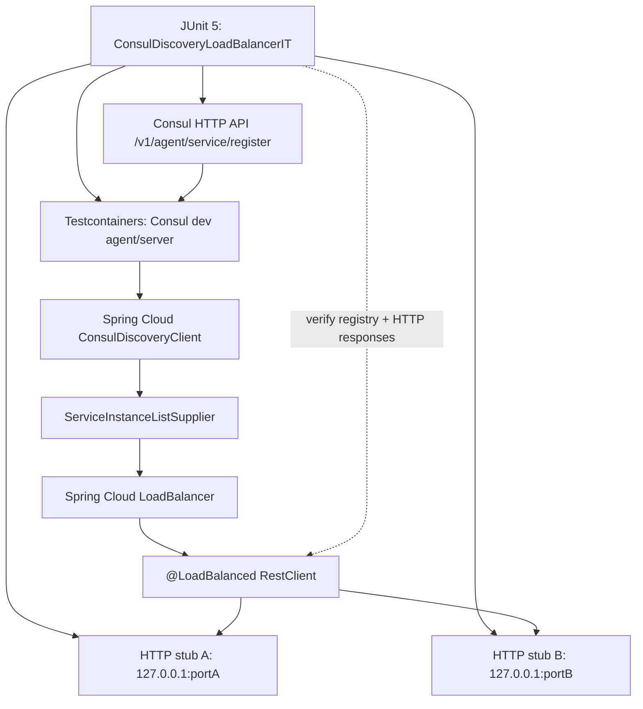

# Verifying Real Discovery Integration in an Isolated Environment

In a microservices system, a load-balancing test can pass green even when the application has never connected to a **real service registry**. If a test supplies the `ServiceInstance` list itself via `SimpleDiscoveryClient` or a mocked `DiscoveryClient`, it checks the selection algorithm and HTTP path, yet **does not verify** real behaviors of Eureka, Consul, or live discovery platforms: registration, instance publication, health-status filtering, removal updates, and convergence latency.

This lesson belongs to the **Automated Testing** chapter of the `SPRING_CLOUD_SERVICE_COMMUNICATION_LOAD_BALANCING` module. The goal is to build an **integration test with real service discovery in a completely isolated environment**, verifying the full path from registry → `DiscoveryClient` → `ServiceInstanceListSupplier` → Spring Cloud LoadBalancer → RestClient → real HTTP replicas receiving requests. The primary example uses **Consul running inside Testcontainers**, two JDK `HttpServer` stubs, and JUnit 5. The same principles apply to Eureka, Kubernetes Discovery, WebClient, and OpenFeign.

> **Core message:** To verify discovery integration, you need a **real registry backend** in the test; yet that backend must be a dedicated test resource created and destroyed per test, never a staging/production registry, and never manually altering service names or states of live services.

## 1. How does "real discovery" differ from a fake instance list?

Different testing levels answer different questions.

| Level | Instance list source | What it verifies | What it does not verify |
|---|---|---|---|
| Algorithm unit test | Mock/static `ServiceInstanceListSupplier` | Round robin, random, metadata filtering, empty list | Registry APIs, registration, health, propagation |
| Registry-free integration test | `SimpleDiscoveryClient` with configured URIs | `@LoadBalanced` RestClient/WebClient, host selection, HTTP calls | Discovery protocols and real lifecycles |
| **Real-discovery integration test** | **Isolated Consul/Eureka instance** | Registry registration/query, `DiscoveryClient`, supplier, HTTP routing, instance health state | Every failure mode of a production cluster |
| Staging end-to-end | Registry, gateways, DNS, TLS, production-like network | Cross-service integration across layers | Strict isolation and perfect repeatability |
| Resilience/chaos test | Discovery cluster with fault injection | Network partitions, cluster restarts, stale caches, recovery | Fast, simple feedback of unit tests |

A test that merely asserts:

```java
assertEquals(2,
        simpleDiscoveryClient.getInstances("inventory-service").size());
```

does not prove Consul or Eureka was ever called. It proves only that **a static configuration list** holds two items. This lesson requires stronger proof: the test itself **registers instances via Consul's HTTP API**, Spring Cloud Consul **reads them back from Consul**, and the load-balanced HTTP client **actually calls one of those replicas**.

## 2. Test scope and participating components

Deployment topology:



Components:

1. **Real Consul** inside a Docker container, without mocking registry HTTP responses.
2. **Two real HTTP servers** running on the test host, each on a dynamic port returning `inventory-a`/`inventory-b`.
3. **Consul HTTP API** to register and deregister each instance.
4. **Consul TTL health checks** to flip an instance to `passing` or `critical` under test control without waiting for real network errors.
5. **Spring Cloud Consul `DiscoveryClient`** querying Consul and returning `ServiceInstance` lists.
6. **Spring Cloud LoadBalancer** selecting an instance by service ID.
7. **`RestClient`** built from a `@LoadBalanced RestClient.Builder` bean calling `http://inventory-service/whoami`.
8. **Awaitility** polling until registry/discovery state converges instead of fixed `Thread.sleep(...)`.

**Intentional model boundary:** HTTP stubs run in the test JVM, and Consul **merely stores** `Address=127.0.0.1` and each stub's port. **The Consul container does not send requests to that loopback address.** TTL checks are updated **directly via Consul's API**; hence this test verifies real registry + health filtering, while **not yet verifying Consul actively probing HTTP health endpoints**. See Section 17 if you want to test active HTTP health probes.

## 3. Why choose Consul + Testcontainers?

A shared registry on a developer machine couples tests to external state:

- A service with the same name is already registered.
- An instance from another team appears unexpectedly.
- The registry restarts mid-CI run.
- Health check state lingers from earlier runs.
- Timing and deploy order make tests irreproducible.
- Tests accidentally delete registrations belonging to another environment.

Testcontainers eliminates most of these risks by spinning up a **fresh registry per test class/run**, mapping dynamic ports, and managing the Docker container lifecycle.

| Isolation requirement | Solution |
|---|---|
| Fresh registry per test | `GenericContainer` running Consul `agent -dev` |
| No port 8500 collision | Testcontainers `getMappedPort(8500)` |
| No interference with external services | Test JVM points only at the container's Consul |
| No live endpoints needed | Two dynamic-port test `HttpServer`s |
| Do not register the test app itself | `spring.cloud.consul.discovery.register=false` |
| No leaked instances across tests | `@BeforeEach` re-registers, `@AfterEach` deregisters |
| Independent of test execution order | Every method sets up its own initial state |
| No retry noise | `spring.cloud.loadbalancer.retry.enabled=false` |
| No LB cache masking updates | `spring.cloud.loadbalancer.cache.enabled=false` |

**Never run Consul `-dev` mode in production.** Dev mode is chosen for short-lived tests without multi-node clustering, ACLs, or production TLS; CI must isolate Docker/networks and never expose Consul ports to the Internet.

## 4. Environment prerequisites and dependencies

Minimum prerequisites for this guide:

- JDK 17+ for Java text blocks and the `java.net.http.HttpClient` API.
- Spring Boot with `RestClient` (Spring Framework 6.1+) and a compatible Spring Cloud release train.
- Testcontainers-compatible Docker Engine/Podman with permissions to launch containers in CI.
- Maven/Gradle managing versions via matching Spring Boot parent/BOM and Spring Cloud BOM.
- CI networking able to pull the Consul image from an approved internal registry or Docker Hub.
- No stray `SimpleDiscoveryClient` config registering `inventory-service` simultaneously in this test.

Example Maven dependencies (assuming the project **already imports a compatible Spring Cloud BOM**):

```xml
<dependencies>
    <dependency>
        <groupId>org.springframework.boot</groupId>
        <artifactId>spring-boot-starter-web</artifactId>
    </dependency>

    <dependency>
        <groupId>org.springframework.cloud</groupId>
        <artifactId>spring-cloud-starter-loadbalancer</artifactId>
    </dependency>

    <dependency>
        <groupId>org.springframework.cloud</groupId>
        <artifactId>spring-cloud-starter-consul-discovery</artifactId>
    </dependency>

    <dependency>
        <groupId>org.springframework.boot</groupId>
        <artifactId>spring-boot-starter-test</artifactId>
        <scope>test</scope>
    </dependency>

    <dependency>
        <groupId>org.springframework.boot</groupId>
        <artifactId>spring-boot-testcontainers</artifactId>
        <scope>test</scope>
    </dependency>

    <dependency>
        <groupId>org.testcontainers</groupId>
        <artifactId>junit-jupiter</artifactId>
        <scope>test</scope>
    </dependency>

    <dependency>
        <groupId>org.awaitility</groupId>
        <artifactId>awaitility</artifactId>
        <scope>test</scope>
    </dependency>
</dependencies>
```

Pull the Testcontainers version from Spring Boot's dependency management or your project BOM; never mix random major versions. `spring-boot-testcontainers` integrates Testcontainers with Spring Boot, though the example below relies mainly on the JUnit extension and `@DynamicPropertySource`; in projects with strict dependency management, check before adding redundant starters.

Example pinned image:

```java
DockerImageName.parse("hashicorp/consul:1.22.7")
```

This is an **illustrative pinned tag**; for stable CI, pin an organization-vetted image digest taking CPU architecture and registry reachability into account. Never use `latest`, as behavior can shift between pipeline runs.

## 5. Test case design and expected outcomes

| Scenario | Consul action | `DiscoveryClient` expectation | HTTP client expectation |
|---|---|---|---|
| Two healthy instances | Register A/B, both TTL `passing` | Returns A and B | Calls both instances via service ID |
| Instance B unhealthy | Set B's check to `critical` | Returns only A when `query-passing=true` | New requests go to A |
| B recovers | Set B back to `passing` | Both A and B reappear | B can be chosen again |
| Deregister B | Consul deletes B's registration | Returns only A | Routes only to A |
| Deregister both A and B | Delete both | Empty list | Zero requests reach HTTP stubs; caller fails |
| Unregistered service ID | Nothing registered under that name | Empty list | No instance selected |
| Registry unavailable | Stop/block Consul | Query errors or stale cache remains | Behavior depends on discovery/cache/fallback; test separately |
| B still registered while HTTP port down | Consul TTL still `passing` | May still list B | Connect fails when B is picked |

Do not conflate `critical` status with shutting down an HTTP server. **An unhealthy instance in Consul** is a health-query outcome. **An unreachable instance** is a transport failure. TTL checks let you simulate them separately.

## 6. Minimal Spring Boot test configuration

In the test class, use `@SpringBootTest(webEnvironment = NONE)` with properties:

```properties
spring.application.name=discovery-it-client
spring.cloud.consul.discovery.enabled=true
spring.cloud.consul.discovery.register=false
spring.cloud.consul.discovery.query-passing=true
spring.cloud.consul.config.enabled=false

spring.cloud.loadbalancer.cache.enabled=false
spring.cloud.loadbalancer.retry.enabled=false
```

`spring.cloud.consul.host` and `spring.cloud.consul.port` are injected **dynamically** via `@DynamicPropertySource` from Testcontainers; **never hardcode** `localhost:8500`.

Meaning:

- `discovery.enabled=true` keeps Spring Cloud Consul `DiscoveryClient` active.
- `register=false` stops the Spring Boot test app from registering itself as a service.
- `query-passing=true` tells Consul to return only instances with `passing` health checks per Consul semantics.
- `config.enabled=false` avoids accidentally loading config from Consul KV if that integration is also present.
- LB cache and retries are disabled so one call maps closely to one selection/HTTP attempt, improving observability.
- This is a registry test, **not a cache TTL or retry test**. Once the baseline works, write separate tests with caching/retries enabled to measure propagation.

Per Spring Cloud Consul documentation, `query-passing` instructs Consul queries to filter for `passing` health checks. Without this property, B can still appear even after its TTL check turns `critical`. Treat it as a **verified test precondition**, not something omitted while still expecting health filtering.

## 7. Configuring RestClient with @LoadBalanced

Spring Cloud LoadBalancer must be wired into the transport. For `RestClient`:

```java
import org.springframework.boot.SpringBootConfiguration;
import org.springframework.boot.autoconfigure.EnableAutoConfiguration;
import org.springframework.cloud.client.loadbalancer.LoadBalanced;
import org.springframework.context.annotation.Bean;
import org.springframework.web.client.RestClient;

@SpringBootConfiguration
@EnableAutoConfiguration
class DiscoveryTestApp {

    @Bean("discoveryLoadBalancedBuilder")
    @LoadBalanced
    RestClient.Builder discoveryLoadBalancedBuilder() {
        return RestClient.builder();
    }
}
```

Invocation:

```java
RestClient client = builder.build();

String result = client.get()
        .uri("http://inventory-service/whoami")
        .retrieve()
        .body(String.class);
```

**The hostname `inventory-service` is a service ID.** LoadBalancer resolves that name and picks an instance supplied by `ConsulDiscoveryClient`. Using `http://127.0.0.1:<port>` calls a stub directly and **proves neither discovery nor LoadBalancer**. Using `RestClient.create(...)` outside the Spring-configured builder falls back to DNS and skips client-side load balancing.

### 7.1. Why not mock `DiscoveryClient`?

A mock like this can test selecting an instance:

```java
when(discoveryClient.getInstances("inventory-service"))
        .thenReturn(List.of(instanceA, instanceB));
```

However, it skips the core question of this lesson: **whether Spring Cloud Consul actually calls Consul's HTTP API properly, how the registry updates, and whether health filters apply**. Keep that mock in a separate unit test rather than replacing a real Consul test.

## 8. Registry registration via Consul's HTTP API

Consul's agent exposes these endpoints:

| Method | Endpoint | Effect |
|---|---|---|
| `PUT` | `/v1/agent/service/register` | Registers an instance with service ID and health check |
| `PUT` | `/v1/agent/service/deregister/{instanceId}` | Removes an instance registered on the agent |
| `PUT` | `/v1/agent/check/pass/{checkId}` | Marks TTL check `passing` |
| `PUT` | `/v1/agent/check/fail/{checkId}` | Marks TTL check `critical` |
| `GET` | `/v1/health/service/{serviceName}?passing=true` | Queries instances with `passing` health |
| `GET` | `/v1/catalog/service/{serviceName}` | Lists catalog entries; **not** equivalent to health-query semantics |

Example JSON registering A:

```json
{
  "ID": "inventory-a",
  "Name": "inventory-service",
  "Address": "127.0.0.1",
  "Port": 18081,
  "Check": {
    "CheckID": "ttl-inventory-a",
    "Name": "Test health inventory-a",
    "TTL": "10m"
  }
}
```

Details:

- `Name` is the **logical service ID**, shared across registrations.
- `ID` is the **unique instance/registration ID** on the agent; A and B must differ.
- `Address` and `Port` are what **the test `order-service` JVM** connects to, not an address the container uses to reach the host.
- `CheckID` identifies the TTL health check; the test explicitly signals `pass`/`fail`.
- `TTL=10m` avoids accidental expiration during short tests. Longer suites must heartbeat periodically or adjust accordingly; in production, TTL checks require real heartbeats.

**Consul will not probe the HTTP stub itself** under a TTL check. When the test hits `/check/pass/ttl-inventory-a`, Consul considers the instance healthy even if HTTP server A has died. That separation is deliberate so registry health state and network reachability are tested independently.

## 9. Complete test code: Testcontainers + Consul + two HTTP stubs

Place this example in a Java test file, such as:

```text
src/test/java/com/example/discovery/ConsulDiscoveryLoadBalancerIT.java
```

This code illustrates JUnit 5, Spring Boot with `RestClient`, Spring Cloud Consul Discovery, Spring Cloud LoadBalancer, Testcontainers, and Awaitility. **It requires no pre-running external Consul server.**

### 9.1. Imports and test class definition

```java
package com.example.discovery;

import java.io.IOException;
import java.io.OutputStream;
import java.io.UncheckedIOException;
import java.net.InetSocketAddress;
import java.net.URI;
import java.net.http.HttpClient;
import java.net.http.HttpRequest;
import java.net.http.HttpResponse;
import java.nio.charset.StandardCharsets;
import java.time.Duration;
import java.util.ArrayList;
import java.util.List;
import java.util.Set;
import java.util.concurrent.atomic.AtomicInteger;

import com.sun.net.httpserver.HttpServer;
import org.junit.jupiter.api.AfterAll;
import org.junit.jupiter.api.AfterEach;
import org.junit.jupiter.api.BeforeEach;
import org.junit.jupiter.api.Tag;
import org.junit.jupiter.api.Test;
import org.junit.jupiter.api.parallel.Execution;
import org.junit.jupiter.api.parallel.ExecutionMode;

import org.springframework.beans.factory.annotation.Autowired;
import org.springframework.beans.factory.annotation.Qualifier;
import org.springframework.boot.SpringBootConfiguration;
import org.springframework.boot.autoconfigure.EnableAutoConfiguration;
import org.springframework.boot.test.context.SpringBootTest;
import org.springframework.cloud.client.ServiceInstance;
import org.springframework.cloud.client.discovery.DiscoveryClient;
import org.springframework.cloud.client.loadbalancer.LoadBalanced;
import org.springframework.context.annotation.Bean;
import org.springframework.test.annotation.DirtiesContext;
import org.springframework.test.context.DynamicPropertyRegistry;
import org.springframework.test.context.DynamicPropertySource;
import org.springframework.web.client.RestClient;

import org.testcontainers.containers.GenericContainer;
import org.testcontainers.containers.wait.strategy.Wait;
import org.testcontainers.junit.jupiter.Container;
import org.testcontainers.junit.jupiter.Testcontainers;
import org.testcontainers.utility.DockerImageName;

import static org.assertj.core.api.Assertions.*;
import static org.awaitility.Awaitility.await;

@Testcontainers
@Tag("integration")
@Execution(ExecutionMode.SAME_THREAD)
@DirtiesContext(classMode = DirtiesContext.ClassMode.AFTER_CLASS)
@SpringBootTest(
        classes = ConsulDiscoveryLoadBalancerIT.TestApp.class,
        webEnvironment = SpringBootTest.WebEnvironment.NONE,
        properties = {
                "spring.application.name=discovery-it-client",
                "spring.cloud.consul.discovery.enabled=true",
                "spring.cloud.consul.discovery.register=false",
                "spring.cloud.consul.discovery.query-passing=true",
                "spring.cloud.consul.config.enabled=false",
                "spring.cloud.loadbalancer.cache.enabled=false",
                "spring.cloud.loadbalancer.retry.enabled=false"
        })
class ConsulDiscoveryLoadBalancerIT {

    private static final String SERVICE = "inventory-service";

    @Container
    static final GenericContainer<?> CONSUL =
            new GenericContainer<>(
                    DockerImageName.parse("hashicorp/consul:1.22.7"))
                    .withExposedPorts(8500)
                    .withCommand(
                            "agent", "-dev", "-client=0.0.0.0")
                    .waitingFor(
                            Wait.forHttp("/v1/status/leader")
                                    .forPort(8500)
                                    .forStatusCode(200));

    private static final ProbeServer A =
            ProbeServer.start("inventory-a");
    private static final ProbeServer B =
            ProbeServer.start("inventory-b");

    private static final HttpClient CONSUL_HTTP =
            HttpClient.newHttpClient();

    @DynamicPropertySource
    static void consulProperties(DynamicPropertyRegistry registry) {
        registry.add(
                "spring.cloud.consul.host",
                CONSUL::getHost);
        registry.add(
                "spring.cloud.consul.port",
                () -> CONSUL.getMappedPort(8500));
    }

    @Autowired
    DiscoveryClient discoveryClient;

    @Autowired
    @Qualifier("loadBalancedBuilder")
    RestClient.Builder builder;

    @SpringBootConfiguration
    @EnableAutoConfiguration
    static class TestApp {

        @Bean("loadBalancedBuilder")
        @LoadBalanced
        RestClient.Builder loadBalancedBuilder() {
            return RestClient.builder();
        }
    }

    // See test methods and helpers in the following sections.
}
```

`@Container` lets the Testcontainers JUnit extension manage Consul's lifecycle. `@DynamicPropertySource` injects the container's **real host and mapped port** into the Spring `Environment` before creating the discovery client.

`@DirtiesContext(AFTER_CLASS)` is included because Spring TestContext can cache an `ApplicationContext` longer than a static container's lifetime. Once the container stops after the test class, no context holding connections to that stopped container should be reused. In suites managing containers as Spring beans/service connections, lifecycle handling differs and should be designed accordingly.

### 9.2. HTTP stub with marker and request counter

Add this nested class inside `ConsulDiscoveryLoadBalancerIT` (same file):

```java
private static final class ProbeServer implements AutoCloseable {

    private final HttpServer server;
    private final AtomicInteger calls = new AtomicInteger();

    private ProbeServer(String instanceId) throws IOException {
        this.server = HttpServer.create(
                new InetSocketAddress("127.0.0.1", 0), 0);

        server.createContext("/whoami", exchange -> {
            calls.incrementAndGet();
            byte[] payload = instanceId.getBytes(
                    StandardCharsets.UTF_8);

            exchange.getResponseHeaders().set(
                    "Content-Type", "text/plain; charset=UTF-8");
            exchange.getResponseHeaders().set(
                    "X-Instance-Id", instanceId);

            exchange.sendResponseHeaders(200, payload.length);
            try (OutputStream out =
                         exchange.getResponseBody()) {
                out.write(payload);
            }
        });

        server.start();
    }

    static ProbeServer start(String instanceId) {
        try {
            return new ProbeServer(instanceId);
        } catch (IOException error) {
            throw new UncheckedIOException(error);
        }
    }

    int port() {
        return server.getAddress().getPort();
    }

    int calls() {
        return calls.get();
    }

    @Override
    public void close() {
        server.stop(0);
    }
}
```

Here:

- Port `0` asks the OS for an unused port, preventing CI collisions.
- Response bodies carry `inventory-a` or `inventory-b`, letting the client prove **which instance answered**.
- `AtomicInteger` records how many HTTP requests the stub actually received.
- The stub is not a mocked `DiscoveryClient`; it is a real HTTP endpoint advertised by Consul as a service instance.

### 9.3. Helpers talking to the real Consul instance

Add these methods to **the same test class**:

```java
private static String consulBaseUrl() {
    return "http://" + CONSUL.getHost()
            + ":" + CONSUL.getMappedPort(8500);
}

private static void consulPut(String path, String body) {
    HttpRequest.Builder request =
            HttpRequest.newBuilder(
                    URI.create(consulBaseUrl() + path));

    if (body == null) {
        request.PUT(HttpRequest.BodyPublishers.noBody());
    } else {
        request.header("Content-Type", "application/json");
        request.PUT(
                HttpRequest.BodyPublishers.ofString(body));
    }

    try {
        HttpResponse<String> response = CONSUL_HTTP.send(
                request.build(),
                HttpResponse.BodyHandlers.ofString());

        assertThat(response.statusCode())
                .as("Consul PUT %s: %s", path, response.body())
                .isBetween(200, 299);
    } catch (InterruptedException error) {
        Thread.currentThread().interrupt();
        throw new IllegalStateException(
                "Interrupted during Consul HTTP call", error);
    } catch (IOException error) {
        throw new UncheckedIOException(error);
    }
}

private static void register(String id, int port) {
    String json = """
            {
              "ID": "%s",
              "Name": "inventory-service",
              "Address": "127.0.0.1",
              "Port": %d,
              "Check": {
                "CheckID": "ttl-%s",
                "Name": "Test TTL health %s",
                "TTL": "10m"
              }
            }
            """.formatted(id, port, id, id);

    consulPut(
            "/v1/agent/service/register"
                    + "?replace-existing-checks=true",
            json);
}

private static void passing(String id) {
    consulPut("/v1/agent/check/pass/ttl-" + id, null);
}

private static void critical(String id) {
    consulPut("/v1/agent/check/fail/ttl-" + id, null);
}

private static void deregister(String id) {
    consulPut("/v1/agent/service/deregister/" + id, null);
}

private RestClient loadBalancedClient() {
    return builder.clone().build();
}

private String whoAmI(RestClient client) {
    return client.get()
            .uri("http://inventory-service/whoami")
            .retrieve()
            .body(String.class);
}

private void awaitPorts(int... expected) {
    await().atMost(Duration.ofSeconds(20))
            .pollInterval(Duration.ofMillis(250))
            .untilAsserted(() -> {
                List<Integer> ports = discoveryClient
                        .getInstances(SERVICE)
                        .stream()
                        .map(ServiceInstance::getPort)
                        .toList();

                assertThat(ports)
                        .containsExactlyInAnyOrder(
                                java.util.Arrays.stream(expected)
                                        .boxed().toArray(Integer[]::new));
            });
}
```

These helpers use the **real HTTP API**. `register(...)` creates registrations with service name, instance ID, host/port, and TTL check. `passing`/`critical` toggle Consul health state, while `deregister` removes registrations from the agent.

`awaitPorts` **polls Spring Cloud's `DiscoveryClient`** until it returns the expected ports. Rather than querying Consul directly, this verifies the full Consul → Spring Cloud client path. The 20-second poll ceiling is a **test bound**, not a fixed parameter for every CI environment.

### 9.4. Setup and cleanup before/after each test

```java
@BeforeEach
void registerHealthyInstances() {
    register("inventory-a", A.port());
    register("inventory-b", B.port());

    passing("inventory-a");
    passing("inventory-b");

    awaitPorts(A.port(), B.port());
}

@AfterEach
void cleanupRegistrations() {
    try {
        deregister("inventory-a");
    } finally {
        deregister("inventory-b");
    }
}

@AfterAll
static void stopHttpServers() {
    A.close();
    B.close();
}
```

Every test starts with both A and B `passing`. Afterward, registrations are cleaned up even if an assertion fails. If the Consul container crashes, cleanup may fail; keep container/error logs so **test-logic bugs** stay distinct from **infrastructure failures**.

Notes:

- Do not use `@TestMethodOrder` to make the second test rely on state from the first.
- The class uses `@Execution(SAME_THREAD)` so test methods do not mutate health/registrations concurrently inside one registry.
- A and B are static class resources. When scaling across parallel test classes, give each class its own container or service ID namespace.
- Never let the test's `inventory-service` name collide with an external registry: every request must stay aimed at the **isolated Consul container**.

## 10. Test case 1 — Consul returns two instances and RestClient calls both

Add JUnit method:

```java
@Test
void discoversTwoRealInstancesAndRoutesHttpRequests() {
    List<ServiceInstance> discovered =
            discoveryClient.getInstances(SERVICE);

    assertThat(discovered)
            .extracting(ServiceInstance::getPort)
            .containsExactlyInAnyOrder(A.port(), B.port());

    RestClient client = loadBalancedClient();
    List<String> responses = new ArrayList<>();

    for (int n = 0; n < 8; n++) {
        responses.add(whoAmI(client));
    }

    assertThat(responses)
            .allMatch(Set.of(
                    "inventory-a", "inventory-b")::contains);

    // With default RoundRobinLoadBalancer and 2 candidates:
    assertThat(responses)
            .contains("inventory-a", "inventory-b");

    assertThat(A.calls() + B.calls()).isGreaterThanOrEqualTo(8);
}
```

**Evidence collected:**

1. `discoveryClient.getInstances("inventory-service")` returns the exact two ports **registered in Consul**.
2. `@LoadBalanced RestClient` calls the **logical service ID** without knowing ports A or B.
3. Both HTTP servers return their markers; the client observes responses from both A and B.
4. Zero HTTP responses arrive from any endpoint outside the registered instances.

Do not assert a rigid sequence `A,B,A,B,...`, because the round-robin index may have been advanced earlier or the list order may differ. **Under default RoundRobin with two eligible instances**, asserting that both appear across eight sequential calls is safe. If the app uses custom random/sticky/hint/zone policies, adjust assertions to match the active policy.

### 10.1. Why verify ports instead of only reading instance IDs?

Some discovery implementations normalize instance IDs or metadata differently across versions. Both HTTP stub ports are values **created by the test itself**, so matching ports both proves registrations reached the client and avoids depending on provider-formatted ID strings. When testing metadata/zones, add dedicated tests setting `Meta` and asserting `getMetadata()`.

### 10.2. When results return only `inventory-a`

Possible causes:

- Supplier sees only one instance.
- B is not `passing` or is filtered by health queries.
- Caching, zone, or hint filters exclude B.
- The app is not using default RoundRobin.
- Requests accidentally target a direct URL pinned to A.
- Retries or another HTTP client path is intervening.

Isolate layer by layer: Consul registry → Spring `DiscoveryClient` → supplier eligible list → selected `ServiceInstance` → stub response marker.

## 11. Test case 2 — B critical, A continues serving

Add method:

```java
@Test
void filtersUnhealthyInstanceThroughRealConsul() {
    critical("inventory-b");

    awaitPorts(A.port());

    RestClient client = loadBalancedClient();

    int beforeB = B.calls();
    for (int n = 0; n < 6; n++) {
        assertThat(whoAmI(client))
                .isEqualTo("inventory-a");
    }

    assertThat(B.calls()).isEqualTo(beforeB);

    // Recover within the same test.
    passing("inventory-b");
    awaitPorts(A.port(), B.port());
}
```

**What is proved:** Consul still holds B's registration, yet the `passing=true` health query excludes B while `critical`. Spring Cloud Consul `DiscoveryClient` returns the updated candidate set, and LoadBalancer routes exclusively to A once the set converges.

**What is not proved:** whether the Consul agent actively probed B's HTTP health endpoint. The TTL status was set directly by the test; to verify active HTTP probing, use the Section 17 variant.

### 11.1. If B keeps appearing after turning `critical`

Check in order:

- Is `spring.cloud.consul.discovery.query-passing=true` active?
- Does TTL check `ttl-inventory-b` actually belong to registration ID `inventory-b`?
- Did `/v1/agent/check/fail/ttl-inventory-b` return 2xx?
- Is Spring Cloud using `ConsulDiscoveryClient` or a different discovery source?
- Is LoadBalancer or a supplier caching stale data?
- Are tests running in parallel with another test flipping B back to `passing`?

`awaitPorts(...)` must time out and fail if convergence never happens; **never** replace it with `Thread.sleep(100)` or weaken the assertion to "B is okay occasionally."

## 12. Test case 3 — Deregister both replicas and verify no-instance

Add method:

```java
@Test
void stopsRoutingWhenBothRegistrationsDisappear() {
    RestClient client = loadBalancedClient();

    // B is removed while A stays alive.
    deregister("inventory-b");
    awaitPorts(A.port());

    assertThat(whoAmI(client)).isEqualTo("inventory-a");

    // Remove A as well.
    deregister("inventory-a");
    awaitPorts();

    int beforeA = A.calls();
    int beforeB = B.calls();

    assertThatThrownBy(() -> whoAmI(client))
            .isInstanceOf(RuntimeException.class);

    // Neither endpoint receives a request from the failed call.
    assertThat(A.calls()).isEqualTo(beforeA);
    assertThat(B.calls()).isEqualTo(beforeB);
}
```

This test is crucial for catching **hidden fallbacks or hardcoded physical URLs**. Once both A and B are deregistered and `DiscoveryClient` returns an empty list, logical calls to `inventory-service` must never hit A or B.

**The exact exception class** thrown by `RestClient` on no-instance can differ across Spring Cloud release trains and HTTP client integrations: a 503 generated by LoadBalancer and converted by `retrieve()`, or a selection error surfaced as another exception. Never assert that every version throws the exact same exception class. Assert **zero HTTP requests reach the stubs** and **the caller receives no fake success response**, then choose status/exception assertions matching your application version.

If the business intentionally defines a fallback or circuit breaker, test that the fallback triggers **per policy** rather than assuming every fallback is a bug.

## 13. Stronger evidence: inspecting Consul's HTTP API directly

Checking `DiscoveryClient` is essential, and querying Consul endpoints directly confirms the registry truly changed:

```text
GET /v1/agent/services
GET /v1/agent/checks
GET /v1/health/service/inventory-service?passing=true
GET /v1/catalog/service/inventory-service
```

Comparison:

| Source | When B is `critical` |
|---|---|
| `/v1/agent/services` | B remains **registered** |
| `/v1/agent/checks` | B's check is `critical` |
| `/v1/health/service/inventory-service?passing=true` | B is **absent** |
| `DiscoveryClient.getInstances("inventory-service")` | B is **absent** when client sets `query-passing=true` |
| HTTP client after convergence | Does not route to B |

This distinguishes **lost registration** from **instance still registered yet filtered as unhealthy**. In Consul, `/catalog/service/...` reflects the catalog view rather than `/health/service/...?...` semantics. Asserting on the catalog endpoint when the goal is "healthy instances only" leads to false conclusions.

### 13.1. Metadata fields worth capturing

- `serviceId`: logical name.
- `instanceId`: registration ID.
- `host`, `port`, `secure`/scheme.
- `metadata`: zone, version, hint, weight if present.
- `registryHealth`: `passing/warning/critical`.
- `retrievedAt`: query timestamp.
- `selectedInstance`: replica chosen by LoadBalancer.
- `actualHttpResponder`: marker from HTTP stub.

Never put request IDs, dynamic ports, or arbitrary IPs into uncontrolled Micrometer tags; logging them in test assertions/output is enough.

## 14. Why use polling instead of fixed sleeps?

Service discovery exhibits **eventual consistency** across multiple layers:

```text
Consul registration
      ↓
Consul health query / catalog update
      ↓
Spring Cloud ConsulDiscoveryClient
      ↓
ServiceInstanceListSupplier
      ↓
LoadBalancer cache / health filter (if enabled)
      ↓
HTTP client
```

Even after `PUT /agent/service/register` returns 2xx, an immediate query may not reflect the update yet—especially with multi-node registries, watches, caches, or network delays. Tests should therefore use:

```java
await().atMost(Duration.ofSeconds(20))
        .pollInterval(Duration.ofMillis(250))
        .untilAsserted(() ->
                assertThat(discoveryClient
                        .getInstances("inventory-service"))
                        .hasSize(2));
```

Bounded polling guarantees:

- Early success as soon as data converges.
- Failure with a clear assertion message after a deadline.
- No wasted fixed wait on fast machines.
- Independence from exact thread/scheduler timing.
- Ability to attach a registry snapshot on timeout for investigation.

**Avoid infinite retries**: misconfigured service IDs or settings must fail within bounds, never hang CI.

### 14.1. Two moments to distinguish

- **Registry write acknowledged:** Consul accepted the registration/health mutation.
- **Consumer observed update:** the app's Spring `DiscoveryClient`/supplier observes the change.

An end-to-end test must observe the second moment. Never check only the HTTP `PUT` status and declare discovery working.

## 15. When enabling caching, health suppliers, and retries

The baseline test disables LoadBalancer caching and retries. When testing production behaviors, enable them **in separate tests**, avoiding mixing confounding factors into one measurement.

| Feature | How to include in tests | What to measure |
|---|---|---|
| LB cache | Enable `spring.cloud.loadbalancer.cache.enabled` with an appropriate TTL | Time from deregister until selection stops using the old instance |
| Consul watch | Enable catalog watch if the app relies on it | Watch events and reflection latency |
| Health-aware supplier | Configure matching supplier chain | How post-health-filter list differs from raw discovery list |
| Same-instance retry | Configure retries + client dependencies | HTTP attempts per logical call |
| Next-instance retry | Enable retry-aware supplier with two instances | Whether B is chosen after A fails |
| Zone/hint | Register matching metadata | Post-filter candidates match requirements |
| TLS/mTLS | Consul/HTTP stubs using TLS and test certs | Truststore, SANs, hostname verification |
| Timeouts | Slow or disconnecting stubs | Distinct classification of connect/read/deadline failures |

### 15.1. Caches can retain vanished instances

When LB caching is enabled, deregistering B from Consul **does not mean requests immediately stop picking B**. The supplier may serve a stale snapshot until TTL/replay/update. A test can:

1. Register A/B; wait for Spring to see both.
2. Issue enough calls so LB caches the list.
3. Deregister B; record timestamp `t0`.
4. Poll selections/responses until B is no longer picked after convergence mechanisms run.
5. Record `t1 - t0` as **convergence latency**.
6. Assert a reasonable upper time bound rather than "must vanish within 1 ms."

**Never use `DiscoveryClient.getInstances()` alone to claim the LB cache updated.** Discovery may return `[A]` while `CachingServiceInstanceListSupplier` still holds `[A, B]`. To measure the real LB layer, instrument the supplier or observe selection behavior under controlled conditions.

### 15.2. Consul `query-passing` is not `HealthCheckServiceInstanceListSupplier`

`spring.cloud.consul.discovery.query-passing=true` asks the **Consul registry** to filter checks. Spring Cloud LoadBalancer's `HealthCheckServiceInstanceListSupplier` is a **client-side filter** that actively probes instance health endpoints. They operate at different layers with separate intervals and caches, and may coexist.

When testing health filtering, know exactly which layer performs the filtering to interpret outcomes accurately. In this lesson's main example, filtering comes from **Consul health queries**.

### 15.3. Retries distort naive request counting

With retries enabled, one logical call might hit A then B. Never assert "each Java call emits exactly one HTTP request." Use correlation IDs and counters on stubs A and B to count actual HTTP attempts. For writes, enable retries only with idempotency or a safe contract.

## 16. Isolating tests across layers, not just Docker containers

Testcontainers isolates only the registry backend. Add further isolation layers:

### 16.1. Data isolation

- Never reuse service IDs pointing to an external registry.
- Register unique instance IDs in the test agent.
- Across parallel test classes, use randomized prefixes or separate containers.
- Explicitly set up registrations and TTL states before each test.
- Deregister after each test; stopping the dev container discards all remaining agent data.

### 16.2. Network isolation

- Test JVM connects only to the Testcontainers host/mapped port.
- HTTP stubs bind `127.0.0.1` and dynamic ports rather than `0.0.0.0` unless external traffic is required.
- Prevent the app from silently falling back to `localhost:8500` where a developer's local Consul might run.
- Never register `host.testcontainers.internal` as an instance address if **the JVM client** cannot resolve that hostname; it is primarily for **containers reaching the host**.
- If CI uses a remote Docker engine, verify the container address provided by Testcontainers and host/container routing.

### 16.3. Lifecycle isolation

- `@Container static` scopes one registry to the test class lifecycle.
- Spring TestContext caches contexts; `@DirtiesContext(AFTER_CLASS)` prevents reusing a client context pointing to a stopped container.
- When tests share a context, never stop the container before the context is closed.
- Avoid blindly enabling container reuse for suites needing strict data resets.
- Never silently swap `GenericContainer` for a mock when CI lacks Docker: tag/mark appropriately and report an explicit skip or failure.

### 16.4. Security isolation

Consul `agent -dev` typically does not represent production ACL/TLS configurations. Never expose admin APIs on public networks. When testing tokens, ACLs, certificate rotation, or mTLS, stand up a **dedicated security-configured test registry** with test-only secrets; never use production tokens or certificates.

## 17. Extension: Consul actively probing real HTTP health endpoints

The main test uses **TTL health checks** for stability and to separate registry state from stub TCP state. To test **Consul HTTP checks** actively polling servers A and B, solve the container-to-host networking gap:

- HTTP stubs run on the host machine.
- Consul runs inside a container.
- `127.0.0.1` **inside the container** refers to the Consul container, **not** the test JVM.
- Thus `Check.HTTP=http://127.0.0.1:<hostPort>/health` fails when the Consul container executes the check.

Testcontainers supports exposing host ports to containers:

```java
// Execute after host HTTP servers start,
// and before creating/starting the Consul container.
Testcontainers.exposeHostPorts(serverA.port(), serverB.port());
```

Consul can then probe:

```text
http://host.testcontainers.internal:<portA>/health
http://host.testcontainers.internal:<portB>/health
```

Example HTTP check registration **replacing TTL**:

```json
{
  "ID": "inventory-a",
  "Name": "inventory-service",
  "Address": "127.0.0.1",
  "Port": 18081,
  "Check": {
    "CheckID": "http-inventory-a",
    "Name": "Inventory A real HTTP health",
    "HTTP": "http://host.testcontainers.internal:18081/health",
    "Interval": "1s",
    "Timeout": "500ms"
  }
}
```

`Address=127.0.0.1` still serves **the JVM client outside the container**, while `Check.HTTP` serves **the Consul agent inside the container**. These are two separate network perspectives and must be designed explicitly. Depending on Docker/CI setup, `Testcontainers.exposeHostPorts(...)` must be invoked before container start and may require host-access permissions.

Extended scenario:

1. Stub returns `200` on `/health` when healthy.
2. Consul HTTP check transitions to `passing`.
3. Switch stub B's `/health` to return `503` without stopping TCP.
4. Wait until Consul marks B `critical` and Spring `DiscoveryClient` returns only A.
5. Client calls service ID and receives responses exclusively from A.
6. Restore B's `/health` to `200`; wait until B becomes selectable again.

**Do not use this extension before networking is configured properly.** Section 9–12 TTL health checks are sufficient to test registry query/filtering behavior, whereas HTTP health probing is a **deeper** integration test.

## 18. Variants for Eureka and Kubernetes Discovery

Choosing Consul here is a concrete example, not a mandate to migrate real registries to Consul.

### 18.1. Eureka

With Spring Cloud Netflix Eureka, stand up an isolated Eureka Server, start two client instances performing real Eureka registration, and wait for Eureka clients to fetch the list. Differences from Consul:

- Registration and heartbeat leases follow distinct mechanisms.
- Eureka server/client registry caches and fetch intervals mean deregistered replicas take time to converge.
- Multiple cache layers may exist: Eureka SDK and Spring Cloud LoadBalancer.
- `eureka.client.register-with-eureka` and `fetch-registry` must be set appropriately on each app/test client.
- Tests must never assume immediate deregistration removes instances from all clients instantaneously.

Tests must prove `DiscoveryClient` is genuinely backed by Eureka and poll consumer state. Never create a fake `SimpleDiscoveryClient` and label it an Eureka test.

### 18.2. Kubernetes Discovery

For Kubernetes discovery, use an isolated Kubernetes cluster such as `kind`/`k3d` or a dedicated test cluster, deploy Services/EndpointSlices/Pods, and configure Spring Cloud Kubernetes Discovery matching your implementation.

Differences:

- "Instances" may come from Kubernetes Service endpoints, depending on namespace, selectors, and readiness probes.
- Watch/list APIs and RBAC permissions must be configured.
- Kubernetes Service DNS/load balancing **does not mean** client-side Spring Cloud LoadBalancer is picking Pods.
- Never use a production cluster just to test an unregistration reaction.

### 18.3. Choosing the right level of realism

| Goal | Appropriate environment |
|---|---|
| Round-robin selection over static list | Unit test + `SimpleDiscoveryClient` |
| Verify Consul HTTP registration/query | Real Consul container, TTL checks |
| Verify Consul HTTP health probing | Consul container + host networking/real probe |
| Verify Eureka heartbeats/leases/caches | Real Eureka server + Eureka clients in test |
| Verify Kubernetes endpoints/watches | `kind`/`k3d` test cluster and RBAC |
| Verify production gateways/TLS/firewalls | Production-like secured staging environment |

## 19. Running in CI: separating speed tiers and Docker requirements

Do not force every unit test to require Docker when most do not need a registry. A clean convention:

```text
Unit tests:
  *Test.java
  run on every pull request, no Docker needed

Integration tests:
  *IT.java
  require Docker/Testcontainers and registry images
  run in dedicated CI job or build profile

Resilience/E2E:
  *ChaosIT.java, *E2E.java
  run in environments permitted to inject faults
```

Maven example when matching plugins/naming conventions are configured:

```shell
# Run a single integration class when Surefire/Failsafe is configured appropriately.
mvn -Dtest=ConsulDiscoveryLoadBalancerIT test
```

If a project routes `*IT` tests to Maven Failsafe, run `mvn verify` with proper includes rather than assuming Surefire runs `*IT` automatically. Check your build's actual naming conventions.

CI checklist:

- Docker daemon available with permission to launch containers.
- Consul image pinned/pulled from a controlled registry.
- Testcontainer mapped ports allocated dynamically rather than hardcoding `8500`.
- JUnit/CI timeouts accommodate image startup while keeping tight await deadlines.
- Artifact logs capture Consul startup, registry HTTP 4xx/5xx responses, and assertion failures.
- Container/resource cleanup runs even when tests fail.
- Parallelism is bounded; multiple tests never mutate the same service ID inside one registry simultaneously.
- Tests require zero production tokens, network routes, or credentials.

### 19.1. What if Docker is unavailable?

When CI lacks Docker:

- Integration jobs can fail fast reporting the missing infrastructure requirement.
- Unit-only pipelines can **explicitly** skip via profiles/tags.
- Never silently count a skipped integration test as **a PASS for Consul integration**.
- Never swap `GenericContainer` for a mock while keeping the "real discovery" label and acceptance criteria.

## 20. Troubleshooting common discovery integration test failures

| Symptom | Common cause | Check |
|---|---|---|
| Testcontainers fails to start | Docker daemon permissions, image pull failure | Docker engine, Testcontainers logs, image tag |
| Spring hits `localhost:8500` on host | `@DynamicPropertySource` inactive or bootstrap config overriding | Effective `spring.cloud.consul.host/port` |
| `DiscoveryClient` always returns empty | Wrong registration `Name`, check still critical, wrong Consul agent | `/agent/services`, `/agent/checks`, `/health/service?...` |
| A/B registered but not yet visible | Registry propagation or watch/cache delay | Poll Spring `DiscoveryClient` and inspect Consul health endpoint |
| Critical B still appears | `query-passing` disabled or mismatched check ID | Effective properties and TTL check state |
| `No instances available for inventory-service` | Wrong service ID or both ineligible | Service `Name` in Consul, logical URI, and filters |
| `UnknownHostException: inventory-service` | Client uses a builder missing `@LoadBalanced` | `RestClient` bean and interceptor |
| Requests always hit A | B absent from eligible set or client uses direct URL | Discovery list, markers, RoundRobin policy |
| A/B order assertion fails | RR index/lazy child context or test concurrency | Avoid rigid ordering assertions |
| Connects to `127.0.0.1` fail | Stub stopped or client running **inside another container** | Network topology and registered host/port |
| Consul HTTP health check fails | Container cannot reach host loopback | `Testcontainers.exposeHostPorts` + `host.testcontainers.internal` |
| Deregistered B still gets selected | Stale LB cache or wrong client context | Toggle cache per test; measure convergence |
| `GET` sent multiple times | Retries in LB or HTTP client | `retry.enabled=false` and stub request counts |
| Second test fails to hit Consul | Spring TestContext reused context pointing to stopped container | `@DirtiesContext` / container lifecycle strategy |
| TTL health turns critical unexpectedly | TTL expired on slow test or missing heartbeat | Increase test TTL or heartbeat periodically |
| Status flips don't match real HTTP availability | TTL tracks only registry flags, not network reachability | Use separate HTTP health-check tests |
| Passes locally, fails on remote Docker CI | Host vs. container addressing differences | Mapped ports, Docker network, runner topology |
| Tests touch external environments | Hardcoded registry host/port or shared service ID | Container isolation, dynamic properties, block external access |

## 21. Metrics and logs that make tests investigable

Beyond assertions, log key test facts:

```text
testCase=HEALTH_FILTER
consulHost=localhost
consulPort=<mappedPort>
serviceId=inventory-service
registeredIds=[inventory-a, inventory-b]
passingIds=[inventory-a]
discoveredPorts=[<portA>]
clientUri=http://inventory-service/whoami
httpResponder=inventory-a
logicalCallOutcome=SUCCESS
```

This is a custom diagnostic format, **not Spring Cloud's default log output**. In CI, logging dynamic hosts/ports helps diagnose failures quickly. Never write ACL tokens, private keys, credentialed URLs, or sensitive response bodies into artifact logs.

Measurements to keep distinct:

| Measurement | Purpose |
|---|---|
| Consul register acknowledgment | Did the agent accept the registration? |
| Health status update | Did TTL check flip passing/critical properly? |
| Consumer discovery latency | How long until Spring `DiscoveryClient` sees the new state? |
| Eligible instance count | How many instances remain after filters? |
| Selected instance | Which replica did LoadBalancer choose? |
| Server-observed HTTP requests | Which stub actually received the request? |
| Final outcome | Did the client see success, HTTP error, or exception? |
| Cache convergence time | After deregister, how long until LB stops picking the old instance? |

Never equate "discovery returned two instances" with "both instances actually received requests": tests must prove both steps.

## 22. Accuracy traps in discovery tests

### 22.1. Never assume zero convergence time

Consul updates quickly on a local dev agent; production registries involve watches, client caches, and network latency. Use `await().atMost(...)` to model convergence rather than asserting registry changes appear **instantaneously** in the Spring client.

### 22.2. Never assert every "no-instance" error is HTTP 503

Some blocking/reactive clients synthesize an internal 503 response while others raise an exception when no instance is found. Match assertions to your integration/version and always verify **zero HTTP stubs received requests**.

### 22.3. Never test `@LoadBalanced` while forgetting the registry

A `@LoadBalanced` bean alone does not prove `ConsulDiscoveryClient` queried Consul properly. Assert the discovered list after the test itself mutates Consul's registry, then assert client requests reach real stubs.

### 22.4. Do not force Random to hit both A and B in a handful of calls

Tests using the default `RoundRobinLoadBalancer` can expect both instances across several controlled calls. With random algorithms, repeated picks of the same instance are valid; prioritize asserting the policy class and that every selection belongs to the candidate set.

### 22.5. Registry TTL health is not real application health

When setting Consul TTL to `passing`, Consul trusts the instance is healthy for that TTL window. If a stub crashes while still `passing`, the registry continues advertising it. To test live health endpoints, use HTTP health checks and the Section 17 networking setup.

### 22.6. Discovered differs from eligible and selected

Consul discovery may return A and B while a LoadBalancer supplier using zone/hint/metadata or client-side health leaves only A. On failure, log **pre-filter set**, **post-filter set**, **selected instance**, and **HTTP responder**.

### 22.7. Never disable production TLS/auth just to "make tests pass"

Running Consul dev mode without ACLs/TLS belongs strictly in isolated tests. When production requires ACLs/TLS, build a dedicated test suite with test identities/CAs rather than disabling hostname verification or using production tokens.

## 23. Acceptance checklist

- [ ] A **real** service registry starts and stops within the test, never touching staging/production registries.
- [ ] `@DynamicPropertySource` supplies the registry's actual host and mapped port.
- [ ] The test app does not self-register in Consul unless self-registration is under test.
- [ ] Both HTTP stubs bind dynamic ports, return distinct markers, and clean up properly.
- [ ] Both are registered via Consul's `/agent/service/register`.
- [ ] Each instance has a distinct ID while sharing `Name=inventory-service`.
- [ ] TTL checks are marked `passing` before asserting two instances.
- [ ] Spring's `DiscoveryClient.getInstances()` returns the exact URIs/ports from Consul.
- [ ] `RestClient` is built from the `@LoadBalanced` bean.
- [ ] The caller targets the **logical service ID** hostname, never stub IPs/ports directly.
- [ ] HTTP requests reach A and B with matching marker responses.
- [ ] When B turns `critical`, both Consul health queries and Spring `DiscoveryClient` exclude B per test policy.
- [ ] When B turns `passing` again, the app observes B without restarting the context.
- [ ] When both A and B deregister, the client receives no success response and zero stubs receive new HTTP requests.
- [ ] State transitions are awaited via deadline-bounded polling rather than fixed sleeps.
- [ ] Caching and retries are disabled in the baseline, with dedicated tests for production settings.
- [ ] Test cases are independent of execution order and do not run concurrently over shared registrations.
- [ ] CI has Docker and a pinned Consul image, with managed logs and cleanup.
- [ ] Tests distinguish registry health status from transport/network reachability.
- [ ] Tests never create or delete services, ACLs, or certificates outside the isolated environment.
- [ ] Final reporting records registered, discovered, selected, HTTP responder, and final outcome.

## 24. Summary

**Verifying real discovery integration** requires a live registry, Spring's discovery client, real suppliers and LoadBalancer, and HTTP endpoints proving requests reach the right replicas. `SimpleDiscoveryClient` is great for fast unit and integration tests, yet cannot substitute for testing registration, health filtering, and instance updates in Eureka, Consul, or Kubernetes.

With Consul inside Testcontainers, every test can **spin up its own registry**, register two dynamic-port HTTP instances via `/v1/agent/service/register`, toggle TTL checks `passing/critical`, watch `DiscoveryClient.getInstances("inventory-service")` converge, and confirm `@LoadBalanced RestClient` calls the right instances. When both deregister, the client must stop routing and fail cleanly rather than falling back to a leftover physical URL.

To keep tests reliable in CI, isolate **registry, data, networking, and Spring context lifecycles**, await eventual consistency with bounded polling, disable noisy cache/retry layers in the baseline, retain negative cases, and always distinguish **registration → discovery → selection → HTTP attempt → final result**. This forms the foundation for expanding into active HTTP health probes, registry outages, retries/fallbacks, TLS, and production discovery.

### References

- [Spring Cloud Consul — Service Discovery](https://docs.spring.io/spring-cloud-consul/reference/discovery.html) — `spring-cloud-starter-consul-discovery`, registration, health, `DiscoveryClient`, and `query-passing`.
- [HashiCorp Consul — Agent Service HTTP API](https://developer.hashicorp.com/consul/api-docs/agent/service) — `register`/`deregister` and service checks.
- [HashiCorp Consul — Agent Check HTTP API](https://developer.hashicorp.com/consul/api-docs/agent/check) — TTL checks `pass`/`fail`.
- [HashiCorp Consul — Health HTTP API](https://developer.hashicorp.com/consul/api-docs/health) — `/health/service/{service}?passing=true`.
- [Spring Boot — Testcontainers](https://docs.spring.io/spring-boot/reference/testing/testcontainers.html) — JUnit extension, `@Container`, `@DynamicPropertySource`, and context lifecycle.
- [Testcontainers for Java — Networking](https://java.testcontainers.org/features/networking/) — mapped ports, `exposeHostPorts`, and `host.testcontainers.internal`.
- [Spring Cloud Commons — LoadBalancer](https://docs.spring.io/spring-cloud-commons/reference/spring-cloud-commons/loadbalancer.html) — suppliers, selection, caching, retries, health, and round robin.
- [Spring Cloud Commons — Common Abstractions](https://docs.spring.io/spring-cloud-commons/reference/spring-cloud-commons/common-abstractions.html) — `@LoadBalanced RestClient.Builder`.
