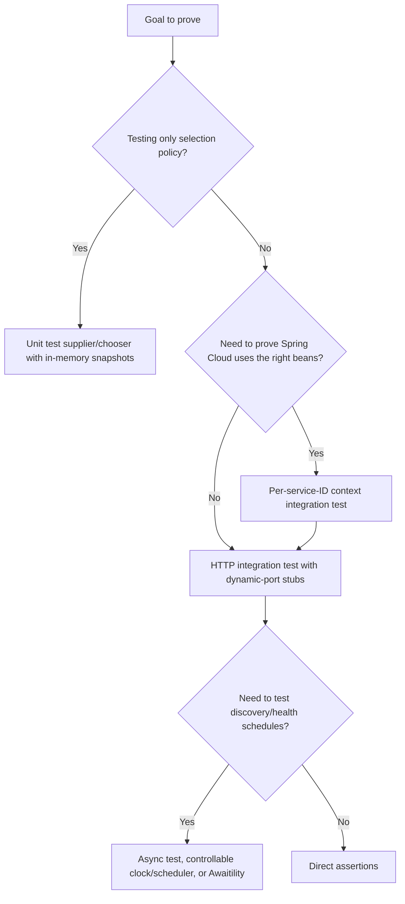

# Keeping Tests Stable Under Parallel Execution and Changing Instance Lists

A Spring Cloud LoadBalancer test suite can pass reliably on a developer's laptop and still fail randomly in CI when multiple tests run in parallel or when the `ServiceInstance` list changes. Usually the cause is not a broken load-balancing algorithm, but **tests depending on shared state, execution order, discovery update timing, or Round Robin counter positions**.

For example, a test calls `inventory-service` and asserts **the first call always hits instance A and the second always hits B**. In practice, Spring Cloud LoadBalancer can initialize per-service-ID contexts lazily, cache instance lists, initialize the Round Robin counter at a non-fixed offset, and have other tests consume turns on the shared counter. When instances are added or removed between calls, even index division changes.

This **Automated Testing** topic guides you in writing high-value tests in the `SPRING_CLOUD_SERVICE_COMMUNICATION_LOAD_BALANCING` module: verifying instance selection by service ID, discovery/health checks, routing, and missing-target errors, while keeping tests stable under parallel load, dynamic instances, retries, and timeouts. The approach centers on **isolating fixtures, asserting invariants, controlling update timing, and using bounded asynchronous waits**.

## 1. Where does a "flaky" test usually fail?

Consider two mocked replicas:

```text
inventory-service
  A: localhost:8091
  B: localhost:8092
```

A naive test:

```java
// AVOID: assumes Round Robin always starts at A.
assertEquals("A", inventoryClient.getItem("42").servedBy());
assertEquals("B", inventoryClient.getItem("42").servedBy());
```

What this test silently assumes:

1. No prior call targeted `inventory-service` before this test.
2. The instance-selection counter starts at a fixed value.
3. The discovery list always arrives in `[A, B]` order.
4. No other test shares the same LoadBalancer or context.
5. Caching, health checks, and retries do not alter the candidate list.
6. Every request triggers **one HTTP attempt** and always succeeds.

If just one assumption fails, the test fails even though the system picked **a valid instance**. Conversely, a test checking only HTTP 200 can stay green forever even if the client skipped the service ID and hardcoded a port.

### Matrix of nondeterminism sources

| Source of nondeterminism | Symptom under parallel execution | Appropriate test design |
|---|---|---|
| Round Robin counter | A/B order flips between runs | Assert allowed candidate set or use isolated seed/instance per test |
| Reused per-service-ID context | Test B inherits Test A's state | Independent context/fixture; avoid mutating global beans |
| Shared stub registry | One test removes an instance while another needs it | Dedicated registry/supplier per test |
| In-place mutation of `List<ServiceInstance>` | `ConcurrentModificationException` or half-updated state | Immutable snapshots published atomically |
| LoadBalancer cache | Registry updated yet client still sees stale snapshot | Disable cache when testing instant updates, or test bounded refresh separately |
| Scheduled health checker | Instances appear/disappear on unpredictable intervals | Fake health source, controllable scheduler, or eventual assertions |
| Fixed ports | Two test classes collide on port 8091 | Dynamic-port HTTP stubs with scoped lifecycles |
| `Thread.sleep` | Too fast locally, too slow in CI | Condition-based awaits with clear timeouts and error messages |
| Automatic retries | One logical call fires multiple HTTP requests | Test attempts and retry budgets independently |
| Tests using `static` or mutable singletons | Tests interfere with each other | Avoid shared mutable state; isolate/lock if unavoidable |

**Principle:** testing single-target selection algorithms, testing list-update propagation, and testing HTTP integration are **three separate verification layers**. Never use a single HTTP response assertion to stand in for all three.

## 2. Defining the right invariants to check

When verifying LoadBalancer behavior, start from **what must always be true** rather than an accidental observed sequence.

| Scenario | Assertion to write | Flaky-prone assertion |
|---|---|---|
| Candidate set `[A, B]` | Every selection belongs to `{A, B}` | First request always picks A |
| Only B remains | Every selection after update becomes visible is B | Must wait exactly 50 ms to pick B |
| Empty list | No server, `hasServer()==false` | Enforcing one exception class across all HTTP clients |
| Adding C | After a deterministic sync point, C can become a candidate | C is guaranteed to be picked within the first two calls |
| Region filtering | Never selects an out-of-region instance | A hardcoded host is always picked |
| Concurrent requests | Never picks outside published sets; zero race exceptions | Exact 50/50 A/B split on a short batch |
| Retries | Attempts stay within budget and hit only valid targets | Retries guaranteed to switch to another instance |
| Health/refetch | Eventually reaches desired state within test deadline | State flips immediately after a fixed `sleep` |

### 2.1. Round Robin is stateful and has no global "first call"

`RoundRobinLoadBalancer` maintains a cycling position and provides a constructor accepting `seedPosition`. In normal usage, the initial position can be seeded randomly. When multiple requests select instances concurrently, **completion order** also differs from invocation order.

Suppose the list transitions from `[A, B]` to `[B, C, D]`:

```text
snapshot #1 = [A, B]       → index = position % 2
snapshot #2 = [B, C, D]    → index = position % 3
```

There is no guarantee the next request moves to B or C based on earlier history. Proper tests verify **targets come from the matching snapshot** and hard constraints hold, rather than extrapolating modulo arithmetic across list size changes.

## 3. Choosing the testing layer before writing fixtures



**Supplier unit tests:** fast, zero HTTP sockets, explicitly pass `ServiceInstance`s per snapshot. Ideal for proving zone filtering, fallbacks, and candidate-set selection.

**Chooser unit tests:** instantiate a fresh `RoundRobinLoadBalancer` per test with its own supplier. Ideal for verifying `Response<ServiceInstance>`, missing-target behavior, and concurrency invariants.

**Spring context integration tests:** verify `@LoadBalancerClient`, per-service-ID child contexts, and `ServiceInstanceListSupplier` registration. Ideal for catching per-service configs accidentally promoted globally.

**HTTP integration tests:** use real or stub HTTP providers via `@LoadBalanced RestClient.Builder`, `WebClient.Builder`, or OpenFeign. Ideal for proving logical URIs rewrite to physical instance URIs and measuring HTTP attempts.

**Scheduling/health integration tests:** verify discovery refresh, health probes, and cache TTLs using controllable clocks/schedulers where possible, or bounded condition checks otherwise.

Never force `@SpringBootTest` onto every case: booting a Spring context and opening sockets in every test makes suites slower, harder to isolate, and more prone to resource contention than small unit tests.

## 4. Immutable instance-list fixtures with atomic updates

A core rule for parallel safety is **never mutate an `ArrayList` while multiple requests read it**. Instead of calling `clear()`/`add()` on a shared list, build a fresh immutable list and publish it via `AtomicReference`.

The `ServiceInstanceListSupplier` template below acts as an in-memory test registry:

```java
import java.util.List;
import java.util.Objects;
import java.util.concurrent.atomic.AtomicReference;

import org.springframework.cloud.client.ServiceInstance;
import org.springframework.cloud.client.loadbalancer.Request;
import org.springframework.cloud.loadbalancer.core.ServiceInstanceListSupplier;

import reactor.core.publisher.Flux;

public final class SnapshotServiceInstanceListSupplier
        implements ServiceInstanceListSupplier {

    private final String serviceId;
    private final AtomicReference<List<ServiceInstance>> snapshot =
            new AtomicReference<>(List.of());

    public SnapshotServiceInstanceListSupplier(String serviceId) {
        this.serviceId = Objects.requireNonNull(serviceId);
    }

    @Override
    public String getServiceId() {
        return serviceId;
    }

    public void publish(List<ServiceInstance> instances) {
        // Copy before publishing: callers cannot mutate published lists.
        snapshot.set(List.copyOf(instances));
    }

    public List<ServiceInstance> current() {
        return snapshot.get();
    }

    @Override
    public Flux<List<ServiceInstance>> get() {
        // Read snapshot on subscription, not at Flux creation time.
        return Flux.defer(() -> Flux.just(snapshot.get()));
    }

    @SuppressWarnings("rawtypes")
    @Override
    public Flux<List<ServiceInstance>> get(Request request) {
        return get();
    }
}
```

### Guarantees and limitations of this fixture

- `publish()` swaps the entire list reference atomically; readers never observe a half-updated "removed A but haven't added B yet" state.
- `List.copyOf()` prevents adding or removing elements from the published list; in tests, construct `DefaultServiceInstance` once and **never mutate metadata** after publishing.
- `Flux.defer` reads the snapshot **at subscription time**, so new requests do not see stale lists captured when the fixture was built.
- Each test should create **its own supplier instance**. Sharing one supplier across parallel tests prevents data corruption via atomic swaps, yet **does not stop tests from overwriting each other's expectations**.
- The supplier simulates only list changes—not automatic caching, health probes, or network discovery; test those mechanisms separately.

### Creating `ServiceInstance`s with stable IDs

```java
import java.util.Map;

import org.springframework.cloud.client.DefaultServiceInstance;
import org.springframework.cloud.client.ServiceInstance;

static ServiceInstance instance(String id, int port, String zone) {
    return new DefaultServiceInstance(
            id,
            "inventory-service",
            "127.0.0.1",
            port,
            false,
            Map.of("zone", zone));
}
```

In tests, `instanceId` should distinguish A/B/C; never infer IDs solely from list index. Ports in this fixture are object metadata **without open sockets**, so no port collisions happen. For real HTTP integration tests, use OS-assigned dynamic ports.

## 5. Testing RoundRobinLoadBalancer without depending on accidental order

Spring Cloud's `RoundRobinLoadBalancer` accepts `ObjectProvider<ServiceInstanceListSupplier>` and `serviceId`. In unit tests, build a local bean factory to inject your fixture directly:

```java
import org.springframework.beans.factory.support.DefaultListableBeanFactory;
import org.springframework.cloud.loadbalancer.core.RoundRobinLoadBalancer;
import org.springframework.cloud.loadbalancer.core.ServiceInstanceListSupplier;

static RoundRobinLoadBalancer newBalancer(
        SnapshotServiceInstanceListSupplier supplier) {

    DefaultListableBeanFactory factory =
            new DefaultListableBeanFactory();
    factory.registerSingleton("testInstanceSupplier", supplier);

    // Fixed seed aids unit-test debugging; never treat it as an
    // ordering guarantee in shared-context integration tests.
    return new RoundRobinLoadBalancer(
            factory.getBeanProvider(ServiceInstanceListSupplier.class),
            supplier.getServiceId(),
            0);
}
```

This helper uses an **isolated bean factory**, requiring no full Spring Boot context and no `static` singletons across tests. JUnit Jupiter example:

```java
import static org.junit.jupiter.api.Assertions.assertEquals;
import static org.junit.jupiter.api.Assertions.assertFalse;
import static org.junit.jupiter.api.Assertions.assertNotNull;
import static org.junit.jupiter.api.Assertions.assertTrue;

import java.time.Duration;
import java.util.HashSet;
import java.util.List;
import java.util.Set;

import org.junit.jupiter.api.Test;
import org.springframework.cloud.client.ServiceInstance;
import org.springframework.cloud.client.loadbalancer.DefaultRequest;
import org.springframework.cloud.client.loadbalancer.Response;
import org.springframework.cloud.loadbalancer.core.RoundRobinLoadBalancer;

class DynamicListRoundRobinTest {

    private static Response<ServiceInstance> choose(
            RoundRobinLoadBalancer balancer) {
        Response<ServiceInstance> response = balancer
                .choose(new DefaultRequest<>())
                .block(Duration.ofSeconds(2));
        assertNotNull(response, "LoadBalancer must emit a Response");
        return response;
    }

    @Test
    void selectsOnlyPublishedInstances() {
        var a = instance("A", 8091, "zone-a");
        var b = instance("B", 8092, "zone-b");

        var supplier = new SnapshotServiceInstanceListSupplier(
                "inventory-service");
        supplier.publish(List.of(a, b));
        var balancer = newBalancer(supplier);

        Set<String> observed = new HashSet<>();
        for (int i = 0; i < 20; i++) {
            var response = choose(balancer);
            assertTrue(response.hasServer());
            String selectedId = response.getServer().getInstanceId();
            assertTrue(Set.of("A", "B").contains(selectedId));
            observed.add(selectedId);
        }

        // With an isolated balancer, fixed snapshot [A, B],
        // and 20 sequential selections, both must get picked.
        assertEquals(Set.of("A", "B"), observed);
    }

    @Test
    void usesNewSnapshotAfterPublish() {
        var a = instance("A", 8091, "zone-a");
        var b = instance("B", 8092, "zone-b");
        var c = instance("C", 8093, "zone-c");

        var supplier = new SnapshotServiceInstanceListSupplier(
                "inventory-service");
        supplier.publish(List.of(a, b));
        var balancer = newBalancer(supplier);

        choose(balancer); // May consume an arbitrary turn.
        supplier.publish(List.of(c));

        for (int i = 0; i < 10; i++) {
            var response = choose(balancer);
            assertTrue(response.hasServer());
            assertEquals("C", response.getServer().getInstanceId());
        }
    }

    @Test
    void emptySnapshotHasNoServer() {
        var supplier = new SnapshotServiceInstanceListSupplier(
                "inventory-service");
        supplier.publish(List.of());
        var balancer = newBalancer(supplier);

        var response = choose(balancer);
        assertFalse(response.hasServer());
    }
}
```

The `instance(...)` and `newBalancer(...)` helpers from Sections 4–5 can live as `static` methods on the test class or in a dedicated test fixture class under `src/test/java`; they are presented separately to highlight each responsibility.

### Why is this test stable?

- Every test method constructs a **fresh supplier and chooser**, inheriting zero counter state from other tests.
- `selectsOnlyPublishedInstances` verifies the **candidate-set invariant**; observing both A and B comes from 20 sequential selections on one isolated balancer, independent of whether the first turn picks A or B.
- `usesNewSnapshotAfterPublish` needs no `sleep`: the fixture uses no cache or scheduler, and `Flux.defer` reads the new snapshot on subscription. After publishing `[C]`, every subsequent choice must be C.
- `emptySnapshotHasNoServer` checks `Response.hasServer()` instead of coupling to a specific `RestClient`/`WebClient`/Feign exception.

**Do not over-extrapolate** that an integrated application with caching and health checks switches lists as instantaneously as this unit fixture. Those layers have their own lifecycles and need bounded eventual-consistency tests.

### 5.1. When is asserting exact order reasonable?

If **exact selection ordering** itself is a requirement of a custom algorithm, test it on a fresh instance with a fixed seed, immutable list, and sequential calls. Test that function/chooser directly rather than going through a shared Spring application context.

There is no reason to assert `A→B→A→B` in an HTTP integration test meant only to prove `inventory-service` is load-balanced. HTTP connections, retries, and request scheduling can vary observed order even when every selection is valid.

## 6. Testing concurrent selection without checking completion order

To test thread safety, run **multiple concurrent calls on one chooser** within **a single test**. Simultaneously swap snapshots between `[A, B]` and `[B, C]`.

A valid test must guarantee:

- Zero exceptions from concurrent list reads and writes.
- Every result contains a server belonging to the published instance sets.
- Each snapshot holds only allowed instances, with no mid-flight object mutation.
- Never require selections to finish in the exact order requests started.

```java
import static org.junit.jupiter.api.Assertions.assertNotNull;
import static org.junit.jupiter.api.Assertions.assertTrue;

import java.time.Duration;
import java.util.List;
import java.util.Set;
import java.util.concurrent.CompletableFuture;
import java.util.concurrent.CountDownLatch;
import java.util.concurrent.ExecutorService;
import java.util.concurrent.Executors;
import java.util.concurrent.TimeUnit;
import java.util.stream.IntStream;

import org.junit.jupiter.api.Test;
import org.springframework.cloud.client.loadbalancer.DefaultRequest;

class ConcurrentDynamicListTest {

    @Test
    void changingSnapshotsDoesNotBreakConcurrentSelection()
            throws Exception {
        var a = instance("A", 8091, "zone-a");
        var b = instance("B", 8092, "zone-b");
        var c = instance("C", 8093, "zone-c");

        var supplier = new SnapshotServiceInstanceListSupplier(
                "inventory-service");
        supplier.publish(List.of(a, b));
        var balancer = newBalancer(supplier);

        ExecutorService pool = Executors.newFixedThreadPool(8);
        CountDownLatch start = new CountDownLatch(1);
        try {
            List<CompletableFuture<Void>> tasks =
                    IntStream.range(0, 8)
                            .mapToObj(worker ->
                                    CompletableFuture.runAsync(() -> {
                                        try {
                                            start.await();
                                            for (int i = 0; i < 100; i++) {
                                                if (worker == 0) {
                                                    supplier.publish(i % 2 == 0
                                                            ? List.of(a, b)
                                                            : List.of(b, c));
                                                } else {
                                                    var result = balancer
                                                            .choose(new DefaultRequest<>())
                                                            .block(Duration.ofSeconds(2));
                                                    assertNotNull(result);
                                                    assertTrue(result.hasServer());
                                                    assertTrue(Set.of("A", "B", "C")
                                                            .contains(result.getServer()
                                                                    .getInstanceId()));
                                                }
                                            }
                                        } catch (InterruptedException interrupted) {
                                            Thread.currentThread().interrupt();
                                            throw new RuntimeException(interrupted);
                                        }
                                    }, pool))
                            .toList();

            start.countDown();
            CompletableFuture.allOf(
                    tasks.toArray(new CompletableFuture[0]))
                    .get(15, TimeUnit.SECONDS);
        } finally {
            pool.shutdownNow();
        }
    }
}
```

Assertions inside `CompletableFuture` propagate to `allOf(...).get(...)`. If any task fails, JUnit receives the exception and fails the test; never call `submit(...)` and **ignore the `Future`** or worker-thread failures will vanish silently.

**Limitation of this test:** observing zero races across 100 iterations is not a mathematical proof of universal thread safety. However, the test enforces the immutable-snapshot publishing rule, runs fast without `sleep`, and provides a useful regression check. To hunt deeper concurrency bugs, run higher iteration counts in a dedicated stress suite or specialized tooling rather than turning daily functional tests into multi-minute random benchmarks.

### 6.1. Verifying snapshots at a deterministic barrier

When updates occur **concurrently**, a request can read the old snapshot just before `publish` or the new snapshot right after. That is why the test above checks membership in `{A, B, C}`. To assert "from this point onward only C is chosen," introduce a **synchronization barrier**:

1. Wait for the writer to finish `publish(List.of(c))`.
2. Ensure no other writer continues mutating the list.
3. Issue **new selections after the barrier**.
4. Assert every selection comes from the new snapshot in a non-cached fixture.

Never assert that a request started **before** `publish` must see the new snapshot. Depending on subscription timing and supplier evaluation, choosing A or B remains valid.

## 7. Isolating Spring contexts and per-service-ID configuration

Spring Cloud LoadBalancer uses an **isolated child context per service ID**, typically initialized lazily on first request. That context holds `ServiceInstanceListSupplier`, `ReactorLoadBalancer`, and per-service routing beans. This is where integration tests often share state accidentally.

Suppose two test classes both call `http://inventory-service`, yet one expects `[A, B]` and the other expects `[C]`. If both share **the same cached application context** and mutate the same supplier bean, parallel runs overwrite each other's fixtures. Adding `@BeforeEach reset()` is unsafe because one test's `@BeforeEach` can execute **mid-request** for another test.

### 7.1. Preferred isolation strategies

| Strategy | When to use | Notes |
|---|---|---|
| Fresh supplier/chooser per unit test | Testing algorithms / list filtering | Fastest, most isolated; no Spring context needed |
| Dedicated fixed context/config per test class | Testing bean / LoadBalancer integration | Never mutate another class's fixture |
| Distinct service ID per fixture | Testing multiple service-ID configs | Verify the client actually calls that exact service ID |
| Scoped dynamic-port HTTP/registry stubs | Testing real network communication | Never share a global static stub mutated by other tests |
| `@DirtiesContext` | A test truly dirties a shared Spring context | Slow context rebuilds; does not synchronize with concurrent tests sharing the context |
| `@ResourceLock` or `@Execution(SAME_THREAD)` | An unisolatable shared resource exists | Intentional last resort; reduces parallelism |

**Never abuse `@DirtiesContext`** just to paper over mutable global state: it marks a context for eviction from the cache, yet if other concurrent tests already hold that context while one test mutates a shared bean, concurrency conflicts still occur.

### 7.2. Registering a dedicated supplier for a test client

Example test configuration scoped to `inventory-service`'s child context:

```java
import org.springframework.cloud.loadbalancer.core.ServiceInstanceListSupplier;
import org.springframework.context.annotation.Bean;
import org.springframework.context.annotation.Configuration;

@Configuration(proxyBeanMethods = false)
public class InventoryLbTestConfiguration {

    @Bean
    ServiceInstanceListSupplier inventoryTestSupplier() {
        SnapshotServiceInstanceListSupplier supplier =
                new SnapshotServiceInstanceListSupplier(
                        "inventory-service");
        supplier.publish(java.util.List.of());
        return supplier;
    }
}
```

Bind this configuration to the exact service ID in the **test application**, never in production:

```java
import org.springframework.boot.autoconfigure.SpringBootApplication;
import org.springframework.cloud.loadbalancer.annotation.LoadBalancerClient;

@SpringBootApplication
@LoadBalancerClient(
        name = "inventory-service",
        configuration = InventoryLbTestConfiguration.class)
public class LoadBalancerTestApplication {
}
```

Place `InventoryLbTestConfiguration` **outside the main application's component scan**, or structure tests so it loads only in the child context. If Spring scans it into the parent context, that `ServiceInstanceListSupplier` bean can apply globally and pollute tests for other service IDs.

To update the fixture **on the actual bean inside the child context**, use `LoadBalancerClientFactory`:

```java
import org.springframework.cloud.loadbalancer.support.LoadBalancerClientFactory;
import org.springframework.cloud.loadbalancer.core.ServiceInstanceListSupplier;

ServiceInstanceListSupplier configured =
        clientFactory.getInstance(
                "inventory-service", ServiceInstanceListSupplier.class);

SnapshotServiceInstanceListSupplier supplier =
        (SnapshotServiceInstanceListSupplier) configured;

supplier.publish(java.util.List.of(a, b));
```

Here `clientFactory` is injected from the Spring context, and `a`, `b` are test `ServiceInstance` fixtures. **Only cast** when configuration guarantees that exact bean type; if caching/health/decorator wrappers sit on top, the top-level bean type differs and you must access your fixture through a dedicated test service or hook. Never cast blindly and blame `ClassCastException` on Spring Cloud.

If multiple tests access this child context simultaneously, `publish` calls still interfere with one another. Prefer **separate contexts per suite** or avoid mutating lists in tests marked `CONCURRENT`.

### 7.3. Never let test configs alter production

Keep test suppliers out of the production application's `@ComponentScan`. Put them under `src/test/java` using explicit test scopes and service IDs. A test accidentally registering a `@Primary ServiceInstanceListSupplier` in the parent context can make unrelated clients pick the same fake list and mask real discovery failures.

## 8. Real HTTP tests: dynamic ports and observable targets

For integration tests using `RestClient`, `WebClient`, or OpenFeign, the goal is proving:

1. The client calls a logical URL by **service ID**, never a hardcoded stub port.
2. LoadBalancer picks a `ServiceInstance` from the fixture.
3. The real HTTP request reaches the **intended stub server**.
4. Once the fixture updates and refresh completes, subsequent requests obey the new candidate set.
5. When the supplier is empty, **zero providers receive requests**.

### 8.1. Dynamic ports instead of hardcoding 8091/8092

Inside the test JVM, use `MockWebServer` or an equivalent HTTP stub. Example with `okhttp3.mockwebserver.MockWebServer`:

```java
import okhttp3.mockwebserver.MockResponse;
import okhttp3.mockwebserver.MockWebServer;

void prepareServers() throws Exception {
    try (MockWebServer serverA = new MockWebServer();
         MockWebServer serverB = new MockWebServer()) {

        serverA.start();  // OS chooses an available port.
        serverB.start();

        serverA.enqueue(new MockResponse()
                .addHeader("Content-Type", "application/json")
                .setBody("{\"id\":\"42\",\"servedBy\":\"A\"}"));
        serverB.enqueue(new MockResponse()
                .addHeader("Content-Type", "application/json")
                .setBody("{\"id\":\"42\",\"servedBy\":\"B\"}"));

        int portA = serverA.getPort();
        int portB = serverB.getPort();

        // In an integration test, publish ServiceInstances with
        // portA/portB and invoke the @LoadBalanced HTTP client.
        // Verify stubs actually received requests before closing servers.
    }
}
```

This snippet **illustrates server lifecycle**, not a complete integration test: it assumes supplier and HTTP client configuration already exist. Stub responses must also include all fields expected by real DTOs (e.g., `name`/`available`). After reading ports, register instances with `host=127.0.0.1` and the assigned ports rather than hardcoding `localhost:8091`.

`MockWebServer` is an **optional test dependency**, not bundled by Spring Cloud LoadBalancer. You can swap in WireMock, MockServer, JDK `HttpServer`, or Testcontainers depending on your goals; the principles of isolation and dynamic ports remain identical.

### 8.2. Resource initialization and teardown rules

| Resource | Recommendation |
|---|---|
| HTTP stub server | Create per test or test class, dynamic port, close in `@AfterEach`/`@AfterAll` or try-with-resources |
| `ServiceInstanceListSupplier` | Instantiate fresh per test or isolated context; never share mutable lists |
| `RestClient`/`WebClient` | Build from `@LoadBalanced` builders in integration tests; avoid bare builders |
| HTTP connections | Close clients/pools when contexts shut down; leave no background requests running after tests |
| Testcontainers | Manage container/port lifecycles cleanly; never assume fixed mapped ports |
| Request counters | Reset capture buffers and stub queues between phases |
| Test properties | Explicit namespaces/service IDs; never mutate JVM-wide `System.setProperty` during parallel tests |

Never pick "random ports" by probing for a free port first and binding the server afterward: another process can claim the port in between (**TOCTOU**). Always let the server **bind port 0** (or the library's dynamic-port API) and read the assigned port after startup.

### 8.3. How to assert when switching from A/B to C

Suppose stubs A/B are registered and C is a newly added replica:

```text
Phase 1:
  snapshot = [A, B]
  send requests to http://inventory-service
  every provider receiving traffic belongs to {A, B}

Barrier:
  publish snapshot = [C]
  if caching/health active: await refresh convergence
  clear or mark Phase 1 captures

Phase 2:
  send NEW requests to http://inventory-service
  all responses/captures belong to C
  A and B receive zero new Phase 2 requests
```

**Avoid** asserting that an in-flight request started in Phase 1 but completing during Phase 2 must switch to C; that request may have chosen A/B before `publish`. For clean assertions, wait for all Phase 1 requests to finish before the barrier.

In tests with multiple clients or retries, `providerRequestCount` can exceed logical calls. Inspect retry configs and state the expected **attempt count** explicitly rather than assuming one `RestClient.get()` always equals one network request across every stack.

## 9. Caching shifts when new lists become visible

Spring Cloud LoadBalancer caches instance lists, typically via `CachingServiceInstanceListSupplier`. If a test updates discovery stubs while LoadBalancer keeps using the old cache, that **may be correct TTL behavior**, not a test reading the wrong code.

### Two kinds of tests to keep separate

**Instant-update logic tests:** omit caching and health schedulers; use `SnapshotServiceInstanceListSupplier` directly as in Sections 4–6. Each `publish` takes effect on the very next subscription.

**Cache-refresh tests:** explicitly enable caching with a short TTL, bound expiration timing, and verify the new snapshot becomes visible eventually. Never expect instant visibility right after `publish`.

A dedicated configuration for tests needing instant updates:

```yaml
spring:
  cloud:
    loadbalancer:
      cache:
        enabled: false
```

However, **disabling this property alone is insufficient if the test creates a custom caching supplier or uses a discovery client with its own cache**. Inspect the real supplier chain. Spring Cloud documentation recommends placing caching right after the network-backed instance supplier and ahead of request-dependent filters; placing a cache at the wrong position can reuse **one request's filtered list for another request**.

### 9.1. When testing caching itself

```yaml
spring:
  cloud:
    loadbalancer:
      cache:
        enabled: true
        ttl: 500ms
```

The 500 ms value is illustrative for testing and must be verified against your Spring Cloud version and cache configuration. When Caffeine is present, `spring.cloud.loadbalancer.cache.caffeine.spec` can override other cache properties like TTL. Never assume `ttl: 500ms` applies if another Caffeine spec is active.

**Never write** `Thread.sleep(501)` and assert immediately: schedulers, OSes, and CI have jitter, and cache write timestamps can differ from test timestamps. Poll **an observable condition** within a reasonable maximum timeout.

## 10. Health checks and discovery refetch are separate schedules

When using `HealthCheckServiceInstanceListSupplier`, tests must account for:

- Health probe cadence and `initial-delay`/`interval`.
- Whether discovery pushes new snapshots continuously or returns lists only on demand.
- `refetch-instances`, if enabled, and its refetch interval.
- Caches inside discovery or inside the health supplier.
- The **all-instances-unhealthy** case: standard health suppliers often **fall back to the source list** rather than returning empty when the source still has instances.

Example lab config for faster refresh observation than production:

```yaml
spring:
  cloud:
    loadbalancer:
      health-check:
        initial-delay: 0s
        interval: 200ms
        refetch-instances: true
        refetch-instances-interval: 200ms
        repeat-health-check: true
        path:
          inventory-service: /actuator/health/readiness
```

This is a **test configuration**, not a recommendation to probe 5 times/second in production. Declaring properties alone does not enable the health supplier; tests must assemble the matching `ServiceInstanceListSupplier` chain, e.g., `withHealthChecks()` or `withBlockingHealthChecks()` depending on your HTTP stack. Avoid wrapping a health supplier in an unnecessary extra caching layer.

### 10.1. Never confuse "all unhealthy" with "discovery empty"

```text
Discovery: [A, B], Health: [A]  -> eligible A
Discovery: [A, B], Health: []   -> may fall back to [A, B]
Discovery: [],     Health: []   -> no source left to fall back to
```

A test asserting "when all probes return 503, LoadBalancer always returns `EmptyResponse`" can **contradict the default behavior** of `HealthCheckServiceInstanceListSupplier`. If you need fail-closed semantics, implement a custom health policy and test it directly rather than asserting expectations opposite to the active implementation.

### 10.2. Bounded waiting for health outcomes

With Awaitility (optional test dependency), you can write:

```java
import static org.awaitility.Awaitility.await;
import static org.junit.jupiter.api.Assertions.assertEquals;
import static org.junit.jupiter.api.Assertions.assertNotNull;

import java.time.Duration;
import java.util.List;
import java.util.Set;
import java.util.stream.Collectors;

await()
        .atMost(Duration.ofSeconds(8))
        .pollInterval(Duration.ofMillis(50))
        .untilAsserted(() -> {
            List<ServiceInstance> visible = healthSupplier.get()
                    .blockFirst(Duration.ofSeconds(1));
            assertNotNull(visible, "Health supplier emitted no list");

            Set<String> visibleIds = visible
                    .stream()
                    .map(ServiceInstance::getInstanceId)
                    .collect(Collectors.toSet());
            assertEquals(Set.of("B"), visibleIds);
        });
```

This pattern makes sense **when at least one instance probes healthy and the supplier actually emits lists**; `assertNotNull` catches silent non-emitting publishers clearly. If all probes fail, default fallback behavior can keep `visibleIds` non-empty. That is why `visibleIds` is named instead of `healthyIds`—to avoid equating **the visible list** with **actual probe results**.

`atMost` is a **test deadline**, not "a delay to let data fix itself." If the condition never passes, Awaitility fails with diagnosable evidence instead of running forever. Also avoid setting `atMost` too small relative to the real `health-check.interval`.

## 11. JUnit 5 configuration for parallel execution

JUnit Jupiter supports parallel execution, yet **enabling one property does not automatically run all tests concurrently**. You must configure default modes for both methods and classes.

Example test-scoped `junit-platform.properties`:

```properties
junit.jupiter.execution.parallel.enabled=true
junit.jupiter.execution.parallel.mode.default=concurrent
junit.jupiter.execution.parallel.mode.classes.default=concurrent
junit.jupiter.execution.parallel.config.strategy=fixed
junit.jupiter.execution.parallel.config.fixed.parallelism=4
```

This config serves as a **parallel execution profile to expose fixture contamination**, not something required for every heavy suite. Before enabling it, audit shared resources:

| Resource | Risk under parallel runs | Mitigation |
|---|---|---|
| Singleton Spring bean holding mutable `List<ServiceInstance>` | Test A edits Test B's list | Dedicated supplier per test/context; immutable snapshots |
| Child context sharing `serviceId` | Shared chooser position/cache across tests | Separate configs; avoid global order assertions |
| `System.setProperty` / process env vars | One test alters another's config | Use test-specific property sources; never mutate global state mid-suite |
| Fixed-port mock HTTP server | Bind failures or cross-test traffic | Dynamic ports, test-scoped lifecycles |
| Shared database schema/state | Data collisions, unique constraints | Separate schemas/namespaces/keys and clean transactions |
| Shared MockServer/WireMock expectations | One test consumes another's stubs | Isolated stub instances or independent request matching |
| Static Reactor scheduler / `VirtualTimeScheduler` | Tests manipulate each other's clock | Never share a global virtual clock across concurrent tests |
| `@MockBean` / test bean overrides | Context cache thrashing or mistimed resets | Fixed test contexts, minimal override scope |

### 11.1. `@ResourceLock` when a shared resource cannot be isolated

Suppose certain integration tests must share a single mocked registry:

```java
import org.junit.jupiter.api.Test;
import org.junit.jupiter.api.parallel.ResourceAccessMode;
import org.junit.jupiter.api.parallel.ResourceLock;

class SharedRegistryIntegrationTest {

    @Test
    @ResourceLock(
            value = "test-registry-inventory",
            mode = ResourceAccessMode.READ_WRITE)
    void changesRegistrySnapshot() {
        // Only tests declaring the same lock name are serialized.
    }
}
```

`@ResourceLock` lets JUnit synchronize tests **that declare the same resource lock**. It does not protect the registry from background threads or other tests **that omit the lock**; apply it consistently across all tests touching that shared resource.

Another option is `@Execution(ExecutionMode.SAME_THREAD)` on test classes with unisolatable state. Still, **reducing parallelism is a fallback**, not a fix for caching bugs or execution-order-dependent tests.

### 11.2. `@TestInstance(PER_CLASS)` does not imply parallel safety

With `@TestInstance(TestInstance.Lifecycle.PER_CLASS)`, every test method in the class shares one test instance and its mutable fields. When methods run concurrently, fields like `currentInstances` or `capturedRequests` can suffer unexpected concurrent modification.

Prefer local fixtures created per method; if `PER_CLASS` is needed for expensive setup, manage shared resources thread-safely without conflicting expectations, or restrict execution mode on that class.

## 12. Avoiding wall-clock dependence in reactive tests

Reactor provides `StepVerifier` to verify `Mono`/`Flux` signals. For logic driven purely by timers/schedulers, **virtual time** avoids waiting real seconds.

Example of a publisher retrying an instance lookup after an **application-defined** backoff:

```java
import java.time.Duration;

import reactor.core.publisher.Mono;
import reactor.test.StepVerifier;

StepVerifier.withVirtualTime(() ->
        Mono.delay(Duration.ofSeconds(30))
                .map(tick -> "snapshot-refetched"))
        .expectSubscription()
        .thenAwait(Duration.ofSeconds(30))
        .expectNext("snapshot-refetched")
        .verifyComplete();
```

The crucial detail is that `withVirtualTime` takes a **`Supplier<Publisher<?>>`**; time-based publishers must be **constructed after the virtual scheduler activates**. Building `Mono.delay(...)` beforehand captures the real scheduler and leaves the test waiting on wall-clock time.

### 12.1. What `StepVerifier` alone cannot "virtualize"

- TCP connects to real HTTP stubs.
- OS/HTTP-transport-managed socket timeouts.
- Discovery clients running private schedulers without injected virtual schedulers.
- Spring Cloud background health checks whose clock/scheduler hasn't been replaced in tests.

For these, use **bounded real-time integration tests**, controllable schedulers, or appropriate mocks/fakes; never expect virtual time to make a real registry refresh instantly.

**Parallelism note:** some Reactor virtual-time mechanisms swap global scheduler factories during tests. Never let multiple tests mutate the global virtual scheduler concurrently in the same JVM; isolate them in separate suites or lock the shared scheduler resource.

### 12.2. Distinguishing `StepVerifier` from LoadBalancer tests

`StepVerifier.create(supplier.get()).expectNext(...)` proves the supplier's publisher emits the right list. It **does not prove** the HTTP client called the right service ID. Conversely, an integration test checking only `servedBy=A` does not prove the supplier handles empty snapshots or update races properly.

Keep layers distinct:

```text
Supplier unit test      -> List<ServiceInstance> snapshots
Chooser unit test       -> Response<ServiceInstance> / hasServer
Reactive pipeline test  -> Publisher signals, retry/backoff/timeout
HTTP integration test   -> Real requests to selected instances
Spring wiring test      -> Beans and child contexts per service ID
```

## 13. Retries and timeouts introduce extra nondeterminism to measure separately

With retries enabled, **one logical request does not necessarily equal one HTTP attempt**. A GET hitting `503` and retrying can hit two providers—or even more if retries span multiple layers. A test asserting "server A received exactly one request" while retries are active will flake.

| Test setup | Expected behavior to verify |
|---|---|
| Retries disabled | One logical call produces at most one attempt at the controlled layer |
| Max 1 retry | At most two attempts **at that layer**; check whether other layers also retry |
| Retry avoids previous instance | May switch to another instance when candidates remain; not guaranteed with one replica |
| List changes between attempts | Later attempts can pick from the new snapshot **if** integration re-reads the supplier |
| First attempt times out | Cannot be sure the provider never processed it, especially for POST |
| Overall deadline expires | Stops retrying even if a later status might succeed |
| Health check drops instance | Retries may see probe/cached snapshots rather than instantaneous state |

### 13.1. Count attempts, don't check only the final response

A retry test should assert:

```text
logicalRequestCount = 1
providerAttemptCount = 2
firstAttempt.status = 503
secondAttempt.status = 200
finalResult = SUCCESS
overallDuration <= configuredDeadline + boundedSchedulingTolerance
```

This is **assertion pseudocode**, not built-in Spring Cloud metrics. Determine expected attempt counts from the exact retry mechanism enabled. A LoadBalancer test focused solely on selection can **disable retries** intentionally to eliminate noise.

### 13.2. CI timeouts and realistic bounds

Do not pick a tiny timeout just because an operation takes 2 ms on a laptop. For integration tests involving sockets/HTTP on CPU-shared CI runners:

1. Pick deadlines large enough to avoid scheduling false negatives.
2. Use **condition polling** instead of fixed `sleep`s.
3. On timeout, report **actual snapshots and attempts** to tell caching bugs apart from selection bugs.
4. Never bump timeouts to several minutes when a simple test hangs; diagnose deadlocks, stalled callbacks, or unclosed resources instead.
5. Distinguish **business request deadlines** from **outer test supervision timeouts**. The test timeout wrapping setup and assertions can exceed the business HTTP deadline.

JUnit's `@Timeout(15)` prevents infinite hangs, yet does not replace timeouts on `Mono.block(Duration)`, HTTP transports, or Awaitility. On timeout, ensure executors/servers shut down and in-flight requests cancel.

### 13.3. Write operations and concurrent testing

For `POST` requests creating orders or payments, retrying after a read timeout can cause duplicate side effects if the first attempt committed. Such tests require **stable idempotency keys**, shared unique constraints/state stores across instances, and assertions on actual committed business transactions.

Never count HTTP receipts on a server and declare "exactly once." A server can receive two HTTP attempts and deduplicate them into **one logical effect**—that is what write-operation tests must verify.

## 14. Regression test matrix for dynamic lists

Organize a stable suite around **the signal to prove** and **the layer asserting it**, rather than pushing every scenario through one slow full-stack test.

| Case | Snapshot / condition | Mandatory expectation | Appropriate layer |
|---|---|---|---|
| Single replica | `[A]` | 20 selections all pick A | Chooser unit test |
| Two stable replicas | `[A, B]` | Every choice in `{A,B}`; sequential calls reach both | Chooser unit test |
| Empty discovery | `[]` | `hasServer()==false` | Chooser unit test |
| Non-emitting publisher | `Flux.empty()` | Test captures chooser/adapter behavior without hanging | Unit + version-specific integration |
| Scale-out | `[A] → [A,B]` | Post-barrier selections belong to allowed snapshot | Supplier/chooser unit test |
| Scale-in | `[A,B] → [B]` | A no longer chosen after barrier and refresh completion | Unit + HTTP integration |
| List reordered | `[A,B] → [B,A]` | Never picks unknown instance; independent of first turn | Chooser unit test |
| Zone metadata changed | Instance moves zone in new snapshot | Hard/soft constraints still enforced properly | Custom supplier unit test |
| Concurrent selection | `[A,B]`, 8 workers | Zero race exceptions; target always valid | Concurrency unit test |
| Concurrent selection + updates | `[A,B] ↔ [B,C]` | Never observes half-updated state | Concurrency unit test |
| Active cache TTL | Registry flips `[A] → [B]` | Old snapshot may persist until TTL; eventually picks B | Cache integration test |
| Readiness flips | A unhealthy, B healthy | Per probe cadence: favors/keeps B | Health integration test |
| All unhealthy | Discovery still holds `[A,B]` | Verify health supplier fallback rather than assuming `[]` | Health integration test |
| Parallel test execution | Distinct fixtures in tests A and B | Zero state bleed, zero port conflicts | JUnit parallel suite |
| HTTP selects properly | Providers A/B return `servedBy` | Responses come from registered instances without bypassing LB | HTTP integration test |
| Closed port | Instance listed yet unlistening | Connect failure, not confused with empty selection | HTTP integration test |
| Retry | 503 then 200 | Attempt count obeys policy within deadline | HTTP integration test |
| Breaker OPEN | Disallows new calls | Zero outbound HTTP requests once breaker rejects | Resilience integration test |

### 14.1. Every test needs an explicit snapshot boundary

For uncached snapshot fixtures, `supplier.publish(...)` is the exact synchronization point between **sequential** steps. With real registries, health checks, or caches, "publishing to the registry" marks only when **the data source changed**, not when **LoadBalancer saw the new data**. Wait for an observable condition confirming the refresh reached the client before asserting.

When testing behavior **during the transition window**, specify explicitly what choices are acceptable: typically either the old or new snapshot, never an element from a half-mutated list. Never write tests requiring "immediately after registry update, every in-flight request must switch targets."

### 14.2. Verifying hard constraints even under concurrent load

With a custom supplier filtering `region=vn` and preferring `zone-a`, concurrency tests must check more than ID membership in the union of A/B/C. They must assert **every selection satisfies the mandatory region**, even while another thread publishes an out-of-region instance into discovery.

Invariant example:

```java
// Inside a dedicated policy test:
Response<ServiceInstance> response = choose(balancer);
if (response.hasServer()) {
    assertEquals("vn",
            response.getServer().getMetadata().get("region"));
}
```

This invariant is stronger than "HTTP status 200," because a wrong-region instance can return 200 while violating routing policy.

## 15. Workflow for diagnosing a flaky test in CI

When a test fails intermittently, do not immediately raise `Thread.sleep` from 500 ms to 2 seconds. Investigate with data:

| Symptom | Common cause | Action to take |
|---|---|---|
| First request sometimes A, sometimes B | Different Round Robin seed/counter, reused context | Drop first-order assertion; create isolated chooser |
| Passes alone, fails in suite | Shared Spring context, port, registry, or static field | Isolate fixtures and run under controlled parallelism |
| `Address already in use` bind error | Fixed port across stubs | Use port 0 and scoped server shutdown |
| Still picks A after publishing B | Cache TTL, health refetch hasn't run, stale snapshot | Inspect chain, TTL, and eventual conditions |
| Occasional `ConcurrentModificationException` | Test mutates `ArrayList` while chooser reads | Publish `List.copyOf()` via `AtomicReference` |
| Expected 1 HTTP request, saw 2 | Retries in client/LB/gateway | Log attempt index; disable retries in selection tests |
| `sleep`-based test fails on slow CI | Thread/scheduler timing dependence | Await observable condition with bounded timeout |
| All-down health test still picks instance | Health supplier fails open to source list | Check default behavior and policy |
| "Empty" test gets connection refused | List still holds dead port | Separate empty-selection from transport failure |
| Test hangs forever | Non-emitting publisher, missing timeout, executor leak | Bound `block()`/Awaitility and clean up resources |
| Test B mutates Test A's state | Mutable bean in shared child context | Use test-specific contexts; never mutate shared suppliers |
| Results differ on high-CPU CI runners | Different thread scheduling and completion order | Assert invariants, never completion order under concurrency |

### 15.1. What information to capture on test failure?

Useful fields in a failure report:

- Test name, unique run ID, and seed **if the test intentionally uses randomness**.
- `serviceId`, active context/test profile, and enabled cache/health/retry settings.
- Fixture snapshot ID/sequence and published instance IDs/hosts/ports.
- `selectedInstanceId`, post-filter candidate count, and `hasServer()` status.
- Timestamps for publish, request start, and subscriber response receipt.
- HTTP attempts and per-phase provider captures.
- Eventual-condition duration and configured timeout ceiling.
- Exception root cause, distinguishing selection, connection, HTTP status, and decoding.

Never log tokens, cookies, user data, or sensitive full response bodies. Test fixtures can use simple names like A/B/C and local ports to avoid PII or uncontrolled cardinality.

### 15.2. Reproducing intermittent failures reliably

1. Run the **failing test** alone under the same test profile.
2. Repeat that test many times **inside the same JVM** to expose per-iteration state leaks.
3. Run the entire class/suite with JUnit parallel execution enabled to expose resource collisions.
4. Vary test execution order rather than relying on the default order.
5. Log snapshot sequences and attempt counts to separate selection bugs from network errors.
6. Once shared state is found, fix fixture/test isolation before increasing timeouts.
7. Keep a small, fast, timing-independent regression test to prevent recurrence.

A test failing 1 in 100 times does not mean "rerun until green"; reruns gather evidence, not a substitute for fixing state boundaries or expectations.

## 16. Pre-parallelization checklist

- [ ] Every test has its own `ServiceInstanceListSupplier` fixture or isolated context/namespace.
- [ ] Instance lists are published via **immutable snapshots**, never `clear/add` on shared lists.
- [ ] `ServiceInstance`s have stable IDs and metadata is never mutated after publishing.
- [ ] No test asserts "the first request always hits instance A" in a shared/parallel context.
- [ ] Chooser tests verify `hasServer()`, allowed instance sets, and hard constraints.
- [ ] Cases exist for `[]` and, when required by custom selectors, non-emitting publishers.
- [ ] Selections across snapshot transitions use explicit **barriers**, without expecting instant updates when caching is enabled.
- [ ] Per-service-ID Spring child contexts are configured cleanly; test configs never leak to production or other services.
- [ ] No static mutable registries, fake clocks, or capture queues are shared unsynchronized across concurrent tests.
- [ ] HTTP stubs use dynamic ports and shut down servers and connection pools at teardown.
- [ ] Tests never bypass LoadBalancer with a bare HTTP client when verifying service-ID routing.
- [ ] Unit tests open zero unnecessary sockets; integration tests verify real provider receipts.
- [ ] Caching and health refetch use dedicated profiles, explicit TTLs/intervals, and bounded eventual assertions.
- [ ] No `Thread.sleep` used as primary synchronization; use `CountDownLatch`, `Future`, Awaitility, or `StepVerifier`.
- [ ] Reactor virtual-time tests are isolated when running alongside tests using global schedulers.
- [ ] Retries, circuit breakers, and timeouts have dedicated tests measuring actual HTTP attempts and deadlines.
- [ ] Write operations verify idempotency and actual committed side effects under retries.
- [ ] When a test fails, logs capture snapshot, service ID, selected instance, attempts, and failure origin for diagnosis.
- [ ] Re-verify in CI under bounded parallelism rather than only on a personal laptop.

## 17. Summary

**Stable Spring Cloud LoadBalancer tests are not about predicting a random sequence.** What tests must prove is that every selection respects published lists and constraints, snapshot updates never expose half-updated state, empty lists follow the no-target path cleanly, and real HTTP traffic reaches only eligible replicas.

A sustainable strategy is: **isolated fixtures → immutable snapshots → invariant assertions → update barriers → eventual assertions for caching/health → measured HTTP attempts → clean resource teardown**. This speeds up CI through parallel execution while still catching real defects in discovery, health checks, RestClient/WebClient/OpenFeign, retries, and routing instead of raising false alarms from timing or shared state.

### References

- [Spring Cloud Commons — Spring Cloud LoadBalancer](https://docs.spring.io/spring-cloud-commons/reference/spring-cloud-commons/loadbalancer.html): per-service-ID child contexts, Round Robin, `ServiceInstanceListSupplier`, caching, health checks, and refetching.
- [Spring Cloud Commons — Configuration Properties](https://docs.spring.io/spring-cloud-commons/reference/configprops.html): `cache.enabled`, `cache.ttl`, `health-check.interval`, `refetch-instances`, and related properties.
- [Spring Cloud Commons — RoundRobinLoadBalancer source](https://github.com/spring-cloud/spring-cloud-commons/blob/main/spring-cloud-loadbalancer/src/main/java/org/springframework/cloud/loadbalancer/core/RoundRobinLoadBalancer.java): seed constructor, selection counter, and empty-list handling.
- [JUnit 5 User Guide — Parallel Execution](https://docs.junit.org/5.12.1/user-guide/index.html#writing-tests-parallel-execution): execution modes, `@ResourceLock`, and parallel strategies.
- [Project Reactor — Testing](https://projectreactor.io/docs/core/release/reference/testing.html): `StepVerifier`, virtual time, and testing time-dependent publishers.
- [Awaitility](https://github.com/awaitility/awaitility): bounded condition waiting instead of `Thread.sleep` in asynchronous integration tests.
