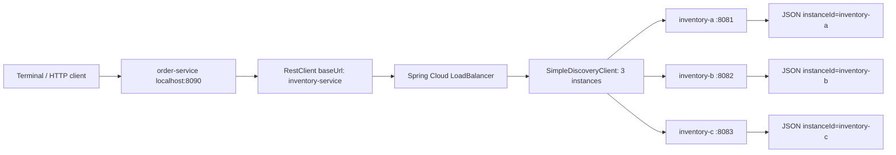
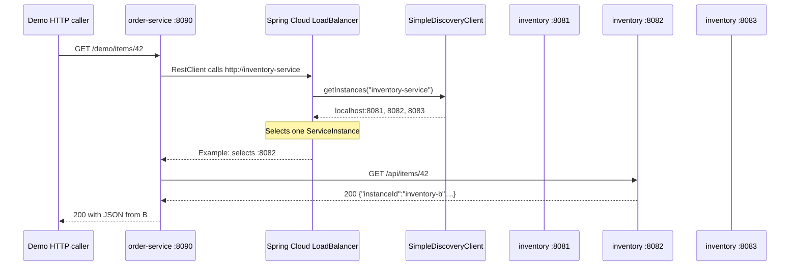

# Building a Caller and Three Replicas That Return Distinct Identifiers

An effective way to learn Spring Cloud LoadBalancer is to **run one caller and three replicas of the same target service yourself**, and then observe which replica receives each request. If you only send a request to a single `localhost:8081` address and get `200 OK`, you have only proven that HTTP works; you **have not proven that client-side load balancing actually selects across multiple `ServiceInstance` entries by service ID**.

In this hands-on exercise, we build `inventory-service` with three separate processes, where each process responds to the same API but returns a different `instanceId`: `inventory-a`, `inventory-b`, and `inventory-c`. An `order-service` application uses `@LoadBalanced RestClient.Builder`, calls the logical URI `http://inventory-service`, and Spring Cloud LoadBalancer selects a concrete host/port from the preconfigured instance list.

This lesson belongs to the **Hands-On Project** chapter of the `SPRING_CLOUD_SERVICE_COMMUNICATION_LOAD_BALANCING` module. It serves as the foundation for the upcoming exercises on discovery, health checks, zone/hint routing, WebClient, OpenFeign, retry/timeout, and error observability. The goal of this lesson is to **get an observable topology up and running**, not to deploy a production registry or production resilience right from the start.

## 1. Objectives and Completion Criteria

After completing this lesson, you should be able to:

1. Create a single Spring Boot HTTP API, run it as **three independent processes** on three ports, and return each process's distinct identifier.
2. Create a separate caller application that calls by **service ID** without hard-coding replica ports in business code.
3. Register three test `ServiceInstance` entries using `SimpleDiscoveryClient` so Spring Cloud LoadBalancer retrieves the list under `inventory-service`.
4. Send multiple requests and verify that responses carry different `instanceId` values; compare with the logs from each server process.
5. Distinguish between LoadBalancer **successfully selecting an instance** and the HTTP transport **actually connecting and receiving a successful response**.
6. Try stopping one replica and explain why having two remaining running replicas is **not enough** on its own to guarantee every request succeeds when discovery has not updated or health filtering is not enabled.

**Primary acceptance criteria:** the three direct endpoints return three distinct IDs; calling `http://localhost:8090/demo/items/42` repeatedly through the caller shows that A, B, and C are all used under the default round-robin configuration and a stable instance list. All test requests must go through the service ID `inventory-service` on the caller.

## 2. Lab Architecture



| Role | Application | Port | Identifier Configuration |
|---|---|---:|---|
| Caller | `order-service` | 8090 | `spring.application.name=order-service` |
| Replica A | `inventory-service` | 8081 | `app.instance-id=inventory-a` |
| Replica B | `inventory-service` | 8082 | `app.instance-id=inventory-b` |
| Replica C | `inventory-service` | 8083 | `app.instance-id=inventory-c` |

The three replicas use **the same source code and the same JAR artifact**. The only difference in this example is the **runtime configuration values** (port and instance ID). This model closely resembles deploying a single image/container into multiple Pods: one logical application, multiple independent processes.

Note: `app.instance-id` is a **custom identifier defined for this lab so the server can return it**. It does not automatically equal `ServiceInstance.getInstanceId()` from the discovery provider. You must distinguish the ID in the JSON response from the ID that LoadBalancer stores in its instance list; in advanced observability lessons, you can intentionally synchronize them according to your deployment contract.

## 3. Tools and Versions

You need JDK 17+, Maven, a terminal, and an HTTP client tool such as `curl` or PowerShell `Invoke-RestMethod`. The code examples use Spring Boot 3.x, Spring Cloud LoadBalancer, and `RestClient` (available since Spring Framework 6.1).

To give the `pom.xml` snippets concrete version pairs, this lesson demonstrates with:

| Component | Illustrative Version |
|---|---|
| Java | 17 |
| Spring Boot | 3.4.3 |
| Spring Cloud release train | 2024.0.1 |
| Build tool | Maven 3.9.x or compatible |

This is **a historical version pair used to reproduce the lesson**, not a claim about the current latest version. If your project chooses a different Spring Boot/Spring Cloud release train, use a **compatible BOM** and re-check the APIs/configuration; do not upgrade one side independently as it may cause compatibility errors.

### Workspace Structure

Create two independent Maven projects:

```text
loadbalancer-lab/
├── inventory-replica/
│   ├── pom.xml
│   └── src/main/
│       ├── java/com/example/inventory/
│       │   ├── InventoryApplication.java
│       │   └── InventoryController.java
│       └── resources/application.yml
└── order-caller/
    ├── pom.xml
    └── src/main/
        ├── java/com/example/order/
        │   ├── OrderApplication.java
        │   ├── InventoryClientConfiguration.java
        │   ├── InventoryReply.java
        │   └── OrderController.java
        └── resources/application.yml
```

Each code snippet below specifies the **file to create in the hands-on project**. These are files in the sample project that the learner creates themselves, not instructions to modify the source of the module containing this Markdown lesson.

## 4. Building the Target Application: inventory-replica

### Step 4.1 — Maven pom.xml for inventory-replica

Create `inventory-replica/pom.xml`:

```xml
<?xml version="1.0" encoding="UTF-8"?>
<project xmlns="http://maven.apache.org/POM/4.0.0"
         xmlns:xsi="http://www.w3.org/2001/XMLSchema-instance"
         xsi:schemaLocation="http://maven.apache.org/POM/4.0.0
         https://maven.apache.org/xsd/maven-4.0.0.xsd">
    <modelVersion>4.0.0</modelVersion>

    <parent>
        <groupId>org.springframework.boot</groupId>
        <artifactId>spring-boot-starter-parent</artifactId>
        <version>3.4.3</version>
        <relativePath/>
    </parent>

    <groupId>com.example</groupId>
    <artifactId>inventory-replica</artifactId>
    <version>0.0.1-SNAPSHOT</version>
    <name>inventory-replica</name>

    <properties>
        <java.version>17</java.version>
    </properties>

    <dependencies>
        <dependency>
            <groupId>org.springframework.boot</groupId>
            <artifactId>spring-boot-starter-web</artifactId>
        </dependency>
        <dependency>
            <groupId>org.springframework.boot</groupId>
            <artifactId>spring-boot-starter-actuator</artifactId>
        </dependency>
    </dependencies>

    <build>
        <plugins>
            <plugin>
                <groupId>org.springframework.boot</groupId>
                <artifactId>spring-boot-maven-plugin</artifactId>
            </plugin>
        </plugins>
    </build>
</project>
```

`spring-boot-starter-web` provides the HTTP server/REST controller. `spring-boot-starter-actuator` is added to expose health endpoints for later experiments; **merely adding Actuator does not mean the caller's LoadBalancer has enabled client-side health checks**.

### Step 4.2 — Bootstrap Class

Create `src/main/java/com/example/inventory/InventoryApplication.java`:

```java
package com.example.inventory;

import org.springframework.boot.SpringApplication;
import org.springframework.boot.autoconfigure.SpringBootApplication;

@SpringBootApplication
public class InventoryApplication {

    public static void main(String[] args) {
        SpringApplication.run(InventoryApplication.class, args);
    }
}
```

### Step 4.3 — Controller Returning instanceId

Create `src/main/java/com/example/inventory/InventoryController.java`:

```java
package com.example.inventory;

import org.slf4j.Logger;
import org.slf4j.LoggerFactory;
import org.springframework.beans.factory.annotation.Value;
import org.springframework.web.bind.annotation.GetMapping;
import org.springframework.web.bind.annotation.PathVariable;
import org.springframework.web.bind.annotation.RestController;

@RestController
public class InventoryController {

    private static final Logger log =
        LoggerFactory.getLogger(InventoryController.class);

    private final String instanceId;

    public InventoryController(
            @Value("${app.instance-id}") String instanceId) {
        this.instanceId = instanceId;
    }

    @GetMapping("/api/items/{itemId}")
    public InventoryReply getItem(
            @PathVariable String itemId) {

        log.info("event=inventory_request instanceId={} operation={}",
            instanceId, "GET /api/items/{itemId}");

        return new InventoryReply(itemId, 17, instanceId);
    }

    public record InventoryReply(
        String itemId,
        int stock,
        String instanceId
    ) {}
}
```

The controller returns a Java `record`; Spring MVC/Jackson serializes it to JSON. `stock=17` is illustrative data kept **identical across all three replicas** so the exercise focuses solely on observing load balancing. The log records the runtime-supplied `instanceId` and does not log sensitive content from the request.

Expected output from replica A:

```json
{
  "itemId": "42",
  "stock": 17,
  "instanceId": "inventory-a"
}
```

### Step 4.4 — application.yml for inventory

Create `src/main/resources/application.yml`:

```yaml
spring:
  application:
    name: inventory-service

server:
  port: 8081

app:
  instance-id: inventory-a

management:
  endpoints:
    web:
      exposure:
        include: health,info
```

The values in YAML are the **defaults when running a single replica**. When running the JAR with `--server.port` and `--app.instance-id` arguments, Spring Boot prioritizes the command-line values for each respective process, allowing three replicas to run from the same source code.

Do not confuse `spring.application.name=inventory-service` (the logical application name) with `app.instance-id=inventory-a` (the per-process identifier used for observation).

## 5. Build Once and Run Three Replicas

In the `inventory-replica` directory, build the application:

```bash
mvn -DskipTests package
```

The generated artifact in this example:

```text
inventory-replica/target/inventory-replica-0.0.1-SNAPSHOT.jar
```

Open **three independent terminals**, all positioned inside the `inventory-replica` directory, and run each command below in a **different terminal**.

Terminal A:

```bash
java -jar target/inventory-replica-0.0.1-SNAPSHOT.jar \
  --server.port=8081 \
  --app.instance-id=inventory-a
```

Terminal B:

```bash
java -jar target/inventory-replica-0.0.1-SNAPSHOT.jar \
  --server.port=8082 \
  --app.instance-id=inventory-b
```

Terminal C:

```bash
java -jar target/inventory-replica-0.0.1-SNAPSHOT.jar \
  --server.port=8083 \
  --app.instance-id=inventory-c
```

The commands use the `\` character for line continuation **in Bash/sh syntax**. On Windows PowerShell, place each `java -jar ... --server.port=... --app.instance-id=...` command on a **single line** in three terminal windows instead of copying the Bash line-continuation syntax verbatim.

### Verification Step Before Building the Caller

Call the three replicas directly:

```bash
curl -i http://localhost:8081/api/items/42
curl -i http://localhost:8082/api/items/42
curl -i http://localhost:8083/api/items/42
```

Expected results:

| Direct Call | HTTP | `instanceId` Value |
|---|---|---|
| `localhost:8081/api/items/42` | 200 | `inventory-a` |
| `localhost:8082/api/items/42` | 200 | `inventory-b` |
| `localhost:8083/api/items/42` | 200 | `inventory-c` |

You can also check `GET /actuator/health` on each port. If all three business endpoints are not yet returning the correct IDs, **do not move on to the caller step**: LoadBalancer cannot fix a replica running on the wrong port, misconfigured, or not yet started.

## 6. Building the Caller Application: order-caller

Unlike the three inventory replicas, `order-service` is **a separate Spring Boot application** with no inventory-handling controller. It acts as the caller, using `RestClient` with a service ID to access the inventory replicas.

### Step 6.1 — Maven pom.xml for order-caller

Create `order-caller/pom.xml`:

```xml
<?xml version="1.0" encoding="UTF-8"?>
<project xmlns="http://maven.apache.org/POM/4.0.0"
         xmlns:xsi="http://www.w3.org/2001/XMLSchema-instance"
         xsi:schemaLocation="http://maven.apache.org/POM/4.0.0
         https://maven.apache.org/xsd/maven-4.0.0.xsd">
    <modelVersion>4.0.0</modelVersion>

    <parent>
        <groupId>org.springframework.boot</groupId>
        <artifactId>spring-boot-starter-parent</artifactId>
        <version>3.4.3</version>
        <relativePath/>
    </parent>

    <groupId>com.example</groupId>
    <artifactId>order-caller</artifactId>
    <version>0.0.1-SNAPSHOT</version>
    <name>order-caller</name>

    <properties>
        <java.version>17</java.version>
        <spring-cloud.version>2024.0.1</spring-cloud.version>
    </properties>

    <dependencyManagement>
        <dependencies>
            <dependency>
                <groupId>org.springframework.cloud</groupId>
                <artifactId>spring-cloud-dependencies</artifactId>
                <version>${spring-cloud.version}</version>
                <type>pom</type>
                <scope>import</scope>
            </dependency>
        </dependencies>
    </dependencyManagement>

    <dependencies>
        <dependency>
            <groupId>org.springframework.boot</groupId>
            <artifactId>spring-boot-starter-web</artifactId>
        </dependency>
        <dependency>
            <groupId>org.springframework.cloud</groupId>
            <artifactId>spring-cloud-starter-loadbalancer</artifactId>
        </dependency>
    </dependencies>

    <build>
        <plugins>
            <plugin>
                <groupId>org.springframework.boot</groupId>
                <artifactId>spring-boot-maven-plugin</artifactId>
            </plugin>
        </plugins>
    </build>
</project>
```

`spring-cloud-starter-loadbalancer` provides the client-side LB part; Spring Cloud Commons also provides the `SimpleDiscoveryClient` mechanism that uses a statically configured list for labs. You **do not need** to start a Eureka Server/Consul/Kubernetes to run this example. Switching to a real discovery registry in later lessons only replaces the **source of the `ServiceInstance` list**, not the entire HTTP calling logic.

### Step 6.2 — application.yml: Three Instances of the Same Service ID

Create `order-caller/src/main/resources/application.yml`:

```yaml
spring:
  application:
    name: order-service
  cloud:
    discovery:
      client:
        simple:
          instances:
            inventory-service:
              - uri: http://localhost:8081
              - uri: http://localhost:8082
              - uri: http://localhost:8083

server:
  port: 8090
```

This configuration tells `SimpleDiscoveryClient` that the service ID `inventory-service` currently has three candidate addresses. When Spring Cloud LoadBalancer needs to call `inventory-service`, it retrieves the list from the discovery client and selects an instance using the configured algorithm.

**Topology note:** `localhost` is only suitable when the caller and the three replicas run on **the same machine/host network** in a lab. If each application runs in a separate container, `localhost` inside the caller container points back to the **caller container itself**, not the replicas. When moving to Docker Compose/Kubernetes, you must use appropriate hostnames/networks and discovery.

### Step 6.3 — Bootstrap Class for the Caller

Create `src/main/java/com/example/order/OrderApplication.java`:

```java
package com.example.order;

import org.springframework.boot.SpringApplication;
import org.springframework.boot.autoconfigure.SpringBootApplication;

@SpringBootApplication
public class OrderApplication {

    public static void main(String[] args) {
        SpringApplication.run(OrderApplication.class, args);
    }
}
```

### Step 6.4 — Configuring RestClient to Go Through LoadBalancer

Create `src/main/java/com/example/order/InventoryClientConfiguration.java`:

```java
package com.example.order;

import org.springframework.cloud.client.loadbalancer.LoadBalanced;
import org.springframework.context.annotation.Bean;
import org.springframework.context.annotation.Configuration;
import org.springframework.web.client.RestClient;

@Configuration
public class InventoryClientConfiguration {

    @Bean
    @LoadBalanced
    RestClient.Builder loadBalancedRestClientBuilder() {
        return RestClient.builder();
    }

    @Bean
    RestClient inventoryRestClient(
            @LoadBalanced RestClient.Builder builder) {

        return builder.clone()
            .baseUrl("http://inventory-service")
            .build();
    }
}
```

**Two decisive points:**

1. `@LoadBalanced` marks the builder so Spring Cloud injects the `ServiceInstance` selection mechanism into HTTP request execution.
2. `baseUrl("http://inventory-service")` uses a **logical name** — it does not contain the port of replica A, B, or C.

If you replace it with `http://localhost:8081`, you have **bypassed the goal of the lesson**: requests will go directly to A without load balancing by service ID. If you omit `@LoadBalanced` or lack the corresponding starter, the HTTP transport may try to resolve `inventory-service` as a regular DNS name and fail, depending on environment configuration.

Use `builder.clone()` to avoid having one client bean mutate a shared builder that is reused by other beans.

### Step 6.5 — Response DTO on the Caller Side

Create `src/main/java/com/example/order/InventoryReply.java`:

```java
package com.example.order;

public record InventoryReply(
    String itemId,
    int stock,
    String instanceId
) {}
```

The DTO on the caller does not need to share the same Java class as the target service. What matters is a **compatible JSON contract**. In production, two services can have independent source codebases and release cycles.

### Step 6.6 — Demo Endpoint Calling Inventory by Service ID

Create `src/main/java/com/example/order/OrderController.java`:

```java
package com.example.order;

import java.util.concurrent.TimeUnit;
import org.slf4j.Logger;
import org.slf4j.LoggerFactory;
import org.springframework.web.bind.annotation.GetMapping;
import org.springframework.web.bind.annotation.PathVariable;
import org.springframework.web.bind.annotation.RestController;
import org.springframework.web.client.RestClient;

@RestController
public class OrderController {

    private static final Logger log =
        LoggerFactory.getLogger(OrderController.class);

    private final RestClient inventoryRestClient;

    public OrderController(RestClient inventoryRestClient) {
        this.inventoryRestClient = inventoryRestClient;
    }

    @GetMapping("/demo/items/{itemId}")
    public InventoryReply getItem(@PathVariable String itemId) {
        long started = System.nanoTime();

        InventoryReply reply = inventoryRestClient.get()
            .uri("/api/items/{id}", itemId)
            .retrieve()
            .body(InventoryReply.class);

        long durationMs = TimeUnit.NANOSECONDS.toMillis(
            System.nanoTime() - started);

        if (reply == null) {
            throw new IllegalStateException(
                "inventory-service returned an empty body");
        }

        log.info(
            "event=inventory_call_completed targetService={} " +
            "reportedReplica={} durationMs={}",
            "inventory-service", reply.instanceId(), durationMs);

        return reply;
    }
}
```

Here, `reportedReplica` is the **ID returned by upstream in JSON**, not data taken directly from the `LoadBalancer.choose(...)` result. This is sufficient to observe the replicas in the lab. In real applications, server-returned ID data must not be used to make access-control decisions, and internal topology should not be exposed through public APIs.

This controller snippet illustrates the happy path; it does not yet include timeouts, retries, `@ControllerAdvice`, or production error standards. When HTTP/transport errors occur, `RestClient` may throw exceptions according to its default behavior. We will use that intentionally to learn how to distinguish errors, rather than masking everything with a fallback right away.

## 7. Running the Caller and Seeing All Three Replicas Appear

Once all three inventory processes on ports `8081`, `8082`, and `8083` are running, open a fourth terminal in the `order-caller` directory:

```bash
mvn -DskipTests package
java -jar target/order-caller-0.0.1-SNAPSHOT.jar
```

The caller runs on port `8090`. Send a request:

```bash
curl -i http://localhost:8090/demo/items/42
```

The response may be:

```json
{"itemId":"42","stock":17,"instanceId":"inventory-b"}
```

The `instanceId` value on the first call **does not have to be A**. The default round-robin algorithm typically alternates selections across the known instance set, but counter initialization and other requests can affect the first selection.

### Sending Repeated Requests to Observe Distribution

In Bash:

```bash
for i in $(seq 1 12); do
  curl -s http://localhost:8090/demo/items/42
  echo
done
```

In PowerShell:

```powershell
1..12 | ForEach-Object {
    (Invoke-RestMethod "http://localhost:8090/demo/items/42").instanceId
} | Group-Object | Select-Object Name, Count
```

Example PowerShell output in a **stable environment with only one client calling sequentially**:

```text
Name         Count
----         -----
inventory-a      4
inventory-b      4
inventory-c      4
```

This is an **illustrative result**, not a guarantee that every run will be exactly 4–4–4. When using round robin on a fixed list with no other interleaved calls, request count distribution is usually balanced; however, retries, health filtering, other algorithms, or concurrency can change the counts.

**What needs to be verified is not a strict A → B → C order**, but that the caller selected from **all three instances** via the service ID. Check the three inventory terminals to see each process print the `event=inventory_request` log when called.

## 8. Behind the Scenes: What Did Spring Cloud LoadBalancer Do?

A request from `OrderController` goes through these logical steps:



Spring Cloud LoadBalancer may use caching or a `ServiceInstanceListSupplier` internally, so the diagram **describes responsibilities**, rather than claiming every request always calls the discovery provider immediately. A caller can select again from a cached list; the source of that list in the lab is the static configuration of `SimpleDiscoveryClient`.

| Component | Responsibility in the Lab |
|---|---|
| `OrderController` | Receives demo requests and calls RestClient. |
| `@LoadBalanced RestClient.Builder` | Enables resolving logical URIs through Spring Cloud LB. |
| `SimpleDiscoveryClient` | Provides the list of URIs for the service ID. |
| `ServiceInstanceListSupplier` | Supplies candidate instances to LoadBalancer. |
| `RoundRobinLoadBalancer` (common default) | Selects one instance from the available list. |
| RestClient HTTP transport | Establishes/reuses a connection to the chosen host/port. |
| `InventoryController` | Returns JSON with the ID of the process that actually handled the request. |

**Note:** Spring Cloud LoadBalancer is a **client-side load balancer** inside the caller application. There is no standalone "LoadBalancer" HTTP server listening at `inventory-service:80` in this topology. It selects the target during HTTP client execution.

## 9. Distinguishing Five Easily Confused Identifiers

| Identifier | Example | What Is It Used For? |
|---|---|---|
| `spring.application.name` of inventory | `inventory-service` | Logical name of the target application; in production typically used for discovery registration. |
| Service ID used by the caller | `inventory-service` | Key used to look up the `ServiceInstance` list. |
| Instance URI/host:port | `http://localhost:8082` | Transport address for sending TCP/HTTP traffic. |
| `app.instance-id` on inventory | `inventory-b` | Custom application data returned so learners can identify the replica. |
| `ServiceInstance.getInstanceId()` | Provider-specific or generated from config. | Instance identifier in Spring Cloud's model; may differ from `app.instance-id`. |

If you change `app.instance-id=inventory-b` to `app.instance-id=inventory-x` without changing the port, `SimpleDiscoveryClient` can still pick `localhost:8082`; only the **JSON marker returned by the server** changes. If you change a URI in discovery to a port with no server running, LoadBalancer can still pick the instance per configuration, but the HTTP transport will fail.

That is why in this lab it is important to distinguish:

```text
LoadBalancer SELECTED a ServiceInstance
    ≠
HTTP client CONNECTED SUCCESSFULLY
    ≠
Upstream COMPLETED business processing
    ≠
Caller RECEIVED AND DECODED the response
```

## 10. Failure Experiment 1: Stopping One Replica While Keeping Static Discovery

While all three replicas are running, stop **terminal B** (the process on `8082`). Do not change `order-caller/application.yml` and do not restart the caller yet.

Send several requests again to:

```bash
curl -i http://localhost:8090/demo/items/42
```

What can happen:

- Calls that pick A or C still return JSON successfully.
- Calls that pick B, while the instance list still contains `localhost:8082`, may cause the HTTP client to encounter connection refused or a transport error.
- Some integrations have retry if configured; **the default lab does not assume retry/failover is enabled**.

**Explanation:** `SimpleDiscoveryClient` in this lab is a **static** list. It does not automatically check the liveness of each URI in the sense of "if a process stops, immediately remove it from the list." `@LoadBalanced` also **does not automatically enable `HealthCheckServiceInstanceListSupplier`** just because inventory exposes `/actuator/health`.

Different HTTP client versions/components map errors and timeouts differently. What to note is that **the error occurs because an instance is no longer listening**; do not automatically attribute it to a real HTTP `503` sent by server B — since server B has stopped, it may not return any HTTP response at all.

To recover the lab, restart B:

```bash
java -jar target/inventory-replica-0.0.1-SNAPSHOT.jar \
  --server.port=8082 \
  --app.instance-id=inventory-b
```

If you want the caller to **actively remove B**, you can edit the static configuration list and restart the caller to pick up the new configuration. In advanced lessons, replace `SimpleDiscoveryClient` with a dynamic registry plus cache/health suppliers, configure refresh intervals, and test budgeted failover.

## 11. Failure Experiment 2: No Eligible Instances Available

**Having no instances** is different from **having an instance whose server process stopped running**.

Test separately: stop `order-service`, temporarily remove the `inventory-service` entry from `spring.cloud.discovery.client.simple.instances` or configure a new service ID with no matching entries; then restart the caller. When `RestClient` calls a service ID with no valid `ServiceInstance` at all, LoadBalancer cannot pick a target.

Do not assume that stopping all three inventory processes creates an "empty discovery" case: the static list still contains three URIs, even though no process is listening.

| Scenario | Instance Selection Result | HTTP Transport |
|---|---|---|
| Static list has A/B/C, all three running | Can select A/B/C. | Sends HTTP if the connection works. |
| Static list has B, but process B is stopped | Can still **select B**. | Connection refused/reset or corresponding error. |
| No entry for the service ID | No instance to select. | No TCP call to a valid replica. |
| B returns a `503` response from a running controller/stub | Selected and connected to B. | Receives a **real HTTP 503** from upstream. |

Depending on the integration and version, no-instance may be translated into an exception or a synthetic status at the client layer. In logs/metrics, distinguish **`no_eligible_instance`** from **`upstream_http_503`**; the two incidents require different handling.

After this experiment, **restore the caller's YAML** with the exact original three URIs and restart to continue.

## 12. Failure Experiment 3: One Replica Intentionally Returns HTTP 503

To produce a real HTTP error that affects only one replica, you can add a test endpoint in `InventoryController`:

```java
@GetMapping("/api/demo/status")
public ResponseEntity<String> demoStatus() {
    if ("inventory-b".equals(instanceId)) {
        return ResponseEntity.status(503)
            .body("inventory-b unavailable for demo");
    }
    return ResponseEntity.ok(instanceId + " is healthy");
}
```

This is an **optional extension snippet**, not part of the required controller code in section 4. It requires importing `org.springframework.http.ResponseEntity` and rebuilding/restarting all three JARs; use it only in the lab environment.

If the caller adds an endpoint calling `/api/demo/status` via `RestClient`, requests picking A or C receive `200`, while requests picking B receive **HTTP `503`**. With `retrieve()`, `RestClient` may throw an exception for 5xx per default status handling. Compare the result with section 10:

- B **is running and returns `503`**: there is a real HTTP status from B.
- B **is stopped**: there is no HTTP response from B, only a connection/transport error.
- No eligible instance exists: LoadBalancer cannot select a target, which differs from both cases above.

Only after clearly distinguishing these errors should you add retries, timeouts, circuit breakers, or health checks. Blind retries can amplify load and do not automatically guarantee the next attempt selects a different replica.

## 13. Inspecting Logs: Which Process Received the Request?

When calling repeatedly through order, you can see three sets of logs:

```text
inventory-a:
event=inventory_request instanceId=inventory-a operation=GET /api/items/{itemId}

inventory-b:
event=inventory_request instanceId=inventory-b operation=GET /api/items/{itemId}

inventory-c:
event=inventory_request instanceId=inventory-c operation=GET /api/items/{itemId}
```

And the log from order:

```text
event=inventory_call_completed targetService=inventory-service
reportedReplica=inventory-b durationMs=19
```

For every call in the lab, the log from the inventory process is proof of **which server the request reached**, while the JSON response lets you see that the server processed it and returned a result. If you need to log **the `ServiceInstance` selected on the caller side before HTTP**, you must instrument at the Spring Cloud LoadBalancer layer (such as lifecycle/Observation depending on the version), because `reportedReplica` in `OrderController` is only available after decoding the JSON response.

In production, do not expose Pod IDs, internal hostnames, or sensitive metadata in public APIs; returning `instanceId` in this lesson is a **learning tool**. For real observability, use trace/span IDs, service ID, operation templates, and selected instance IDs in controlled internal logs, and never log tokens/cookies.

## 14. Using WebClient or OpenFeign After RestClient Works

The three inventory replicas and the instance-source configuration **do not need to change** to try another HTTP client. The caller application only needs to use the proper Spring Cloud LoadBalancer integration.

### Reactive WebClient

If you add Spring WebFlux to the caller:

```java
@Bean
@LoadBalanced
WebClient.Builder loadBalancedWebClientBuilder() {
    return WebClient.builder();
}

@Bean
WebClient inventoryWebClient(
        @LoadBalanced WebClient.Builder builder) {
    return builder.clone()
        .baseUrl("http://inventory-service")
        .build();
}
```

Example reactive endpoint/gateway:

```java
Mono<InventoryReply> item(String id) {
    return inventoryWebClient.get()
        .uri("/api/items/{id}", id)
        .retrieve()
        .bodyToMono(InventoryReply.class);
}
```

`WebClient` typically only executes HTTP when there is a **subscription**. If you only construct a `Mono` without subscribing, do not expect logs to appear on the three replicas. If you add retries, the ordering of Reactor operators affects the deadline scope and number of attempts.

### Declarative OpenFeign

When adding the OpenFeign starter and enabling `@EnableFeignClients` for the package containing the interface:

```java
@FeignClient(
    name = "inventory-service",
    contextId = "inventoryRead"
)
interface InventoryReadClient {

    @GetMapping("/api/items/{itemId}")
    InventoryReply getItem(
        @PathVariable("itemId") String itemId);
}
```

Do not set `url = "http://localhost:8081"` in `@FeignClient` if the goal is to test LoadBalancer choosing among A/B/C; a fixed URL can bypass service ID resolution via discovery. Any Feign retryer, timeout, and `ErrorDecoder` must be configured according to the exact version/Feign context, rather than assuming `RestClient` rules apply.

**A sensible learning approach:** get `RestClient` working across the three replicas first; then change one factor at a time (`WebClient`, Feign, retry, health, custom routing) and compare how the results/request path change.

## 15. Do Not Confuse Request Distribution with Actual Load Distribution

In this lab, all three replicas return `stock=17` almost instantaneously. If calling sequentially 12 times yields a 4–4–4 distribution, that only illustrates that the number of **request selections** was split evenly under the test policy.

In a real system:

- One request might take 20 ms while another takes 2 seconds.
- One replica might process larger payloads or run on weaker CPU.
- A failed HTTP attempt may be retried, making the number of attempts differ from the number of logical requests.
- Connection pools, HTTP/2 multiplexing, health filtering, zone routing, and affinity can prevent load from splitting evenly by request count.
- A replica might be healthy when discovery supplies it, yet die right before the caller connects.

Therefore, **splitting selection counts evenly does not mean splitting CPU, latency, or connection count evenly**. When extending the lab, also measure p95/p99 latency, succeeded/failed request counts, attempts, selected instances, and connection behavior.

### Should You Add Thread.sleep to the Controller to Make It "Easier to See"?

There is no need for the basic lab. `Thread.sleep` on every HTTP request ties up servlet threads and can skew tests because the server itself is slowed down by artificial code. If you need a timeout/slow-replica experiment, create a dedicated test endpoint with **controlled** delay rather than accidentally adding sleep to normal APIs.

## 16. Common Errors When Running the Lab

| Symptom | Possible Cause | How to Check/Fix |
|---|---|---|
| `Address already in use` on 8081/8082/8083 | Another process holds the port or an old replica was not stopped. | Check processes/ports, stop the right process, or choose different ports and update the caller as well. |
| All three direct calls return `inventory-a` | Three processes were started with the same `--app.instance-id` or overrides were forgotten. | Check command-line/runtime properties of each process. |
| Direct calls OK, but caller reports unknown host `inventory-service` | Missing `@LoadBalanced`, missing starter, or the `RestClient` bean does not use the right builder. | Check bean config, dependencies, and logical `baseUrl`. |
| Caller only ever returns `inventory-a` | Client uses a fixed URL for A, only one instance is configured, or another policy is active. | Check YAML `simple.instances` and `baseUrl` in source code. |
| Caller reports intermittent connection refused | A replica in the list is no longer listening. | Call each port directly; distinguish static discovery from dynamic health checks. |
| Caller startup fails due to Cloud compatibility | Spring Boot and Spring Cloud BOMs do not match. | Pick a compatible release train; do not just disable the compatibility verifier to hide the error. |
| JSON deserialization error | Caller DTO does not match JSON fields or response has the wrong content type. | Inspect the direct JSON and the Java record/constructor. |
| Caller in Docker cannot reach host localhost | `localhost` inside a container refers to the container itself. | Use the network hostname/port or container-environment discovery. |
| Result is not strictly A→B→C | Counter initialization, other requests, concurrency, or a different policy. | Observe the set of instances and hit counts instead of hard-coding the first order. |
| Stopped a replica, yet caller still picks it | `SimpleDiscoveryClient` provides a static list. | Use updated discovery/health or edit the list and restart the caller in the lab. |
| Health endpoint reports UP, yet business requests fail | A health signal does not guarantee every endpoint works. | Check the business call path, timeouts, readiness, and policies. |
| `No servers available` | Service ID mismatch or the list was filtered down to empty. | Verify `inventory-service` in the client URI and YAML, separate from connection refused. |

## 17. Extension Tasks

After meeting the basic acceptance criteria, work through these in order:

1. **Add replica D:** run the same JAR on port 8084 with `app.instance-id=inventory-d`, add its URI to the caller's `SimpleDiscoveryClient`, and restart the caller. Verify all four IDs appear.
2. **Vary stock per instance:** add an `app.stock` property to observe responses coming from each process, while keeping in mind not to use inconsistent data like this to model production inventory.
3. **Record call duration:** have the caller log `durationMs`; intentionally make one replica slow and observe that round robin does not automatically balance by processing time.
4. **Enable explicit timeouts:** configure `RestClient`'s HTTP transport and verify behavior when one replica is slow; distinguish connect/read timeouts from overall deadlines.
5. **Add bounded retries:** test retrying on the same/different instance for connection errors, preserve idempotency for write operations, and observe attempts.
6. **Health checks:** use Actuator `/actuator/health`, configure the appropriate health-check supplier, and prove an unhealthy instance is excluded per refresh cycle.
7. **Zone routing:** add zone metadata to instances and use suppliers/algorithms to prefer a zone; distinguish soft preference from hard region constraints.
8. **Write integration tests:** replace the three real processes with multiple `MockWebServer` or `WireMock` instances on dynamic ports and assert how many requests each server receives.
9. **Observe instance selection:** configure LoadBalancer lifecycle/observability in the caller to log `targetService`, `selectedInstanceId`, HTTP status, no-instance events, and retry outcomes.

Each extension task should change **one factor at a time**. Keep the "three processes, one caller, logical service ID" baseline for comparison; if you enable retries, add zone routing, and switch HTTP clients all at once, it is very hard to tell which factor caused the new behavior.

## 18. Lab Checklist and Report

Before wrapping up, verify:

- Built `inventory-replica` into **a single JAR** and ran three real processes on 8081, 8082, and 8083.
- All three processes share `spring.application.name=inventory-service` but have distinct `app.instance-id` values.
- Direct calls to each port return `200`, `stock=17`, and the corresponding A/B/C ID.
- The caller runs separately on port 8090 and uses `@LoadBalanced RestClient.Builder`.
- The caller's business code **does not hard-code** `localhost:8081/8082/8083`.
- `SimpleDiscoveryClient` on the caller lists the exact three URIs under the same `inventory-service` key.
- Repeated calls to `/demo/items/42` show all three replicas receiving requests under the appropriate policy.
- Each server's `inventory_request` log confirms requests reached that process.
- You can distinguish `app.instance-id` in JSON from discovery's `ServiceInstance.getInstanceId()`.
- Tested stopping a replica and explained why static discovery can still select the stopped port.
- Distinguished no-instance, connection refused, upstream HTTP 503, and decode errors.
- Avoided assuming LoadBalancer automatically configures retries, health checks, or CPU-based balancing.
- Recorded the Spring Boot/Cloud version pair in use and any compatibility errors if encountered.

A short report table:

| Test | How to Execute | Expected Result |
|---|---|---|
| Direct A | GET `:8081/api/items/42` | `instanceId=inventory-a` |
| Direct B | GET `:8082/api/items/42` | `instanceId=inventory-b` |
| Direct C | GET `:8083/api/items/42` | `instanceId=inventory-c` |
| Caller | 12 × GET `:8090/demo/items/42` | Sees A/B/C via service ID. |
| Stop B | Stop process `:8082`, call caller again. | Errors may occur when LB still picks B from the static list; A/C can still work. |
| No-instance | Remove instance config for the service ID in a separate test. | Cannot select a target; distinct from transport error. |
| Recovery | Restart B and restore original YAML. | Requests through the caller can reach all three replicas as in the baseline. |

**Key takeaway:** **three processes running the same application do not automatically create client-side load balancing**. For the caller to distribute requests, you need a **service ID**, a **source of `ServiceInstance` entries**, an **HTTP client integrated with Spring Cloud LoadBalancer**, and multiple endpoints actually receiving requests. In this lab, `SimpleDiscoveryClient` provides three URIs, `@LoadBalanced RestClient` calls `http://inventory-service`, and each replica returns its own `instanceId` to make the selection visible. Once this baseline works, you have a solid reference point to test dynamic discovery, health checks, zone routing, WebClient, OpenFeign, retry/timeout, and observability in a controlled manner.
