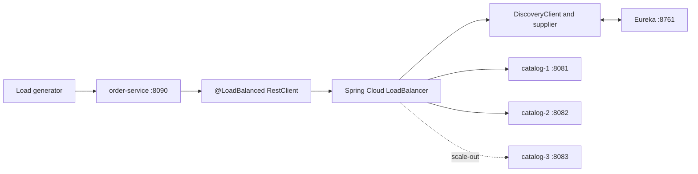
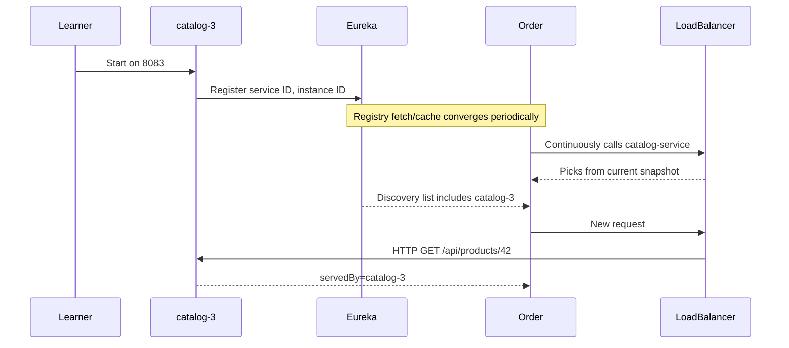
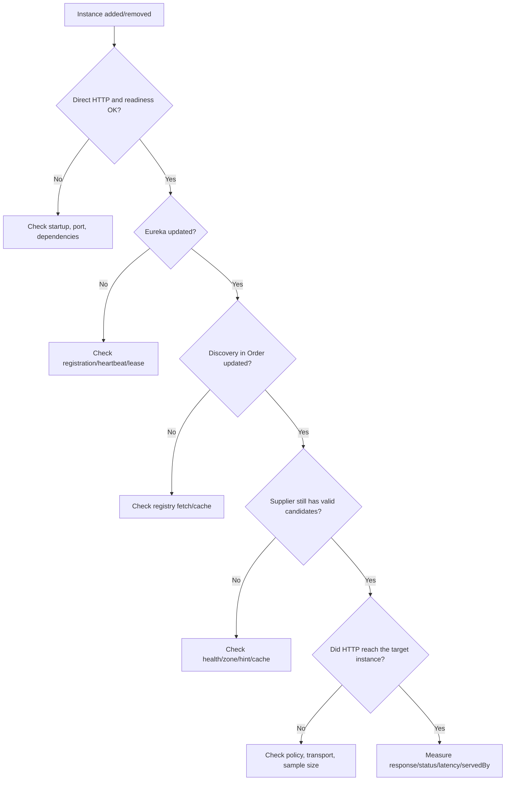

# Adding and Removing Replicas While the System Is Under Load

When deploying microservices systems, the replica count of a service changes with traffic, release schedules, and availability. For example, `catalog-service` might scale from two to three instances during peak hours, and then scale back down to two when traffic subsides. Throughout that process, `order-service` still needs to call Catalog via its **service ID** and Spring Cloud LoadBalancer.

Seeing an extra instance appear on the service discovery dashboard does not prove that callers have started using that instance yet. Conversely, a stopped instance can linger in a registry snapshot or caller cache, causing some HTTP requests to fail. This hands-on project helps distinguish **registration status**, **LoadBalancer's candidate list**, **the instance that actually received the request**, and **HTTP outcomes** while the cluster topology changes continuously.

The lab uses Eureka Server, multiple Catalog processes running the same source code, and an Order service using `@LoadBalanced RestClient.Builder`. You will generate load while adding and removing instances, capturing timestamps, HTTP statuses, latencies, and `servedBy`. The same principles apply to `WebClient` and OpenFeign, even though timeouts, retries, and instrumentation are configured differently.

> **Scope:** Commands and ports are local-run examples. Choose **compatible** Spring Boot and Spring Cloud BOMs for your project; do not treat this configuration as a production setup.

## 1. Objectives and Completion Criteria

This lesson is complete when you can:

1. Run two Catalog replicas registered under the same service ID with distinct instance IDs and ports.
2. Call `http://catalog-service` from Order without hard-coding `localhost:8081` in the client.
3. Generate continuous traffic and record `servedBy`, status, latency, and request timestamps.
4. Add `catalog-3` while traffic is still running and measure the time from instance readiness/registration to the first request served via Order.
5. Stop `catalog-2` gracefully, observing when it stops being selected and any transition errors.
6. Perform one **abrupt** stop in the lab and analyze registry leases, caches, connection errors, and recovery.
7. Distinguish between discovery, health/readiness, LoadBalancer, TCP, and target-application issues.

Do not use "requests must strictly alternate 1–2–3" as a criterion because selection policies, counters, retries, and per-client snapshots can vary. A good outcome is that **topology changes converge, errors are bounded, and root causes are measurable**.

## 2. Lab Architecture



A typical request:

- The client calls `GET http://localhost:8090/api/orders/check/42`.
- Order calls the logical URL `http://catalog-service/api/products/42`.
- Spring Cloud LoadBalancer fetches the `ServiceInstance` list from discovery/supplier, then selects a valid instance per policy.
- Catalog returns JSON containing the product ID, `servedBy`, and a timestamp.
- Order returns that response to the caller; the payload confirms **which replica actually served the request**.

| Application | Port | Role |
|---|---:|---|
| Eureka Server | `8761` | Service registry |
| Order | `8090` | Caller using LoadBalancer |
| Catalog #1 | `8081` | Initial replica |
| Catalog #2 | `8082` | Initial replica, to be removed |
| Catalog #3 | `8083` | Replica to be added under load |

The lab assumes all three Catalog instances serve **the same API contract** and are interchangeable. If instances run incompatible v1/v2 APIs, you must design dedicated versioning/fail-closed routing policies before splitting traffic.

## 3. Dependencies and Environment

You can create three independent Spring Boot projects or three Maven modules:

```text
loadbalancer-live-lab/
|-- eureka-server/
|-- catalog-service/
|-- order-service/
```

| Project | Starter Dependencies |
|---|---|
| Eureka Server | `spring-boot-starter`, `spring-cloud-starter-netflix-eureka-server` |
| Catalog | `spring-boot-starter-web`, `spring-boot-starter-actuator`, `spring-cloud-starter-netflix-eureka-client` |
| Order | `spring-boot-starter-web`, `spring-boot-starter-actuator`, `spring-cloud-starter-netflix-eureka-client`, `spring-cloud-starter-loadbalancer` |

If using Maven and managing the BOM manually, import a `spring-cloud-dependencies` version compatible with the Spring Boot parent; do not assign arbitrary versions to individual starters. Example dependency management snippet:

```xml
<dependencyManagement>
  <dependencies>
    <dependency>
      <groupId>org.springframework.cloud</groupId>
      <artifactId>spring-cloud-dependencies</artifactId>
      <version>${spring-cloud.version}</version>
      <type>pom</type>
      <scope>import</scope>
    </dependency>
  </dependencies>
</dependencyManagement>
```

The `spring-cloud.version` property must match your chosen release train. Ensure ports `8761`, `8090`, `8081`, `8082`, and `8083` are free, along with compatible Java and build tools and multiple terminals to run separate processes.

## 4. Eureka Server

Bootstrap class:

```java
package com.example.discovery;

import org.springframework.boot.SpringApplication;
import org.springframework.boot.autoconfigure.SpringBootApplication;
import org.springframework.cloud.netflix.eureka.server.EnableEurekaServer;

@SpringBootApplication
@EnableEurekaServer
public class EurekaServerApplication {
    public static void main(String[] args) {
        SpringApplication.run(EurekaServerApplication.class, args);
    }
}
```

`application.yml`:

```yaml
server:
  port: 8761

spring:
  application:
    name: eureka-server

eureka:
  client:
    register-with-eureka: false
    fetch-registry: false
```

Once started, the dashboard is typically at `http://localhost:8761/`. Initially there are no Catalog instances; once Catalog registers, Eureka begins displaying them.

**Note:** the registry and clients synchronize periodically. An updated dashboard does not mean Order received the new snapshot instantaneously. Eureka also has heartbeats/leases, eviction, and a self-preservation mechanism that can delay removal of abruptly stopped instances.

## 5. Building Catalog to Return Its Instance ID

Each Catalog process runs **the same code** with its own port and instance ID so the response reveals which backend processed the request.

DTO:

```java
package com.example.catalog;

public record ProductResponse(
        String id,
        String name,
        String servedBy,
        long serverTimeEpochMs) { }
```

Controller:

```java
package com.example.catalog;

import org.springframework.beans.factory.annotation.Value;
import org.springframework.web.bind.annotation.GetMapping;
import org.springframework.web.bind.annotation.PathVariable;
import org.springframework.web.bind.annotation.RequestMapping;
import org.springframework.web.bind.annotation.RestController;

@RestController
@RequestMapping("/api/products")
public class CatalogController {

    private final String instanceId;
    private final long delayMs;

    public CatalogController(
            @Value("${eureka.instance.instance-id}") String instanceId,
            @Value("${lab.delay-ms:0}") long delayMs) {
        this.instanceId = instanceId;
        this.delayMs = delayMs;
    }

    @GetMapping("/{id}")
    public ProductResponse getProduct(@PathVariable String id)
            throws InterruptedException {

        // Artificial delay for experiment purposes only.
        if (delayMs > 0) {
            Thread.sleep(delayMs);
        }

        return new ProductResponse(id, "Keyboard " + id,
                instanceId, System.currentTimeMillis());
    }
}
```

`Thread.sleep(...)` is a way to simulate a slow backend in a **Spring MVC lab** and should not be used in production handlers or inside reactive event loops. Application entrypoint:

```java
package com.example.catalog;

import org.springframework.boot.SpringApplication;
import org.springframework.boot.autoconfigure.SpringBootApplication;

@SpringBootApplication
public class CatalogApplication {
    public static void main(String[] args) {
        SpringApplication.run(CatalogApplication.class, args);
    }
}
```

Catalog's `application.yml` configuration:

```yaml
server:
  port: 8081
  shutdown: graceful

spring:
  application:
    name: catalog-service
  lifecycle:
    timeout-per-shutdown-phase: 20s

eureka:
  client:
    service-url:
      defaultZone: http://localhost:8761/eureka/
  instance:
    instance-id: catalog-local
    prefer-ip-address: true

management:
  endpoint:
    health:
      probes:
        enabled: true
  endpoints:
    web:
      exposure:
        include: health,info,metrics

lab:
  delay-ms: 0
```

`catalog-local` is only a default ID. **Each process must override it to `catalog-1`, `catalog-2`, or `catalog-3`**. If multiple processes register with duplicate instance IDs, the registry can merge or overwrite entries, invalidating the experiment from the start.

Illustrative response:

```json
{
  "id": "42",
  "name": "Keyboard 42",
  "servedBy": "catalog-2",
  "serverTimeEpochMs": 1790000000000
}
```

The timestamp is illustrative; actual values come from `System.currentTimeMillis()`. With Actuator, you can check `/actuator/health`, `/actuator/health/liveness`, and `/actuator/health/readiness`. **Eureka does not filter by all Actuator readiness groups by default**: being registered does not guarantee an instance is serving API traffic properly.

## 6. Building Order and the Load-Balanced RestClient

`RestClient` bean with LoadBalancer and timeouts:

```java
package com.example.orders;

import org.springframework.cloud.client.loadbalancer.LoadBalanced;
import org.springframework.context.annotation.Bean;
import org.springframework.context.annotation.Configuration;
import org.springframework.http.client.SimpleClientHttpRequestFactory;
import org.springframework.web.client.RestClient;

@Configuration(proxyBeanMethods = false)
public class CatalogHttpConfiguration {

    @Bean
    @LoadBalanced
    RestClient.Builder loadBalancedRestClientBuilder() {
        SimpleClientHttpRequestFactory factory =
                new SimpleClientHttpRequestFactory();

        factory.setConnectTimeout(1_000);
        factory.setReadTimeout(3_000);

        return RestClient.builder().requestFactory(factory);
    }
}
```

DTO for Order to decode JSON:

```java
package com.example.orders;

public record ProductResponse(
        String id,
        String name,
        String servedBy,
        long serverTimeEpochMs) { }
```

Order Controller:

```java
package com.example.orders;

import org.springframework.beans.factory.annotation.Qualifier;
import org.springframework.web.bind.annotation.GetMapping;
import org.springframework.web.bind.annotation.PathVariable;
import org.springframework.web.bind.annotation.RequestMapping;
import org.springframework.web.bind.annotation.RestController;
import org.springframework.web.client.RestClient;

@RestController
@RequestMapping("/api/orders")
public class OrderController {

    private final RestClient catalogClient;

    public OrderController(
            @Qualifier("loadBalancedRestClientBuilder")
            RestClient.Builder builder) {
        this.catalogClient = builder
                .baseUrl("http://catalog-service")
                .build();
    }

    @GetMapping("/check/{productId}")
    public ProductResponse checkProduct(
            @PathVariable String productId) {
        return catalogClient.get()
                .uri("/api/products/{id}", productId)
                .retrieve()
                .body(ProductResponse.class);
    }
}
```

Spring Boot entrypoint:

```java
package com.example.orders;

import org.springframework.boot.SpringApplication;
import org.springframework.boot.autoconfigure.SpringBootApplication;

@SpringBootApplication
public class OrderApplication {
    public static void main(String[] args) {
        SpringApplication.run(OrderApplication.class, args);
    }
}
```

Order's `application.yml`:

```yaml
server:
  port: 8090

spring:
  application:
    name: order-service
  cloud:
    loadbalancer:
      cache:
        enabled: false

eureka:
  client:
    service-url:
      defaultZone: http://localhost:8761/eureka/
    registry-fetch-interval-seconds: 5

management:
  endpoints:
    web:
      exposure:
        include: health,info,metrics
```

Notes:

- `catalog-service` is a **service ID**, not a fixed IP/hostname for DNS to resolve.
- `@LoadBalanced` and the LoadBalancer dependency enable selecting a `ServiceInstance` from the available discovery source.
- Disabling `spring.cloud.loadbalancer.cache` is only to make the lab easier to observe; **it does not disable Eureka client's own cache and registry fetch cycle**.
- Lowering `registry-fetch-interval-seconds` speeds up experiments, **without guaranteeing convergence in exactly five seconds**.
- Request-factory timeouts do not automatically cover discovery, queuing, and retries. By default the lab does not enable retries.
- When no candidates exist, the HTTP integration may return an error/exception depending on version; do not misinterpret that error as "product does not exist."

## 7. Starting the First Two Replicas

Package the three applications with Maven/Gradle or run them from your IDE with separate arguments. The commands assume JARs have been built and the terminal is inside `loadbalancer-live-lab`; **adjust JAR names to match your actual artifacts**.

**Terminal 1 — Eureka:**

```powershell
$eurekaJar = "eureka-server/target/eureka-server-0.0.1-SNAPSHOT.jar"
java -jar $eurekaJar
```

**Terminal 2 — Catalog 1:**

```powershell
$catalogJar = "catalog-service/target/catalog-service-0.0.1-SNAPSHOT.jar"
java -jar $catalogJar --server.port=8081 --eureka.instance.instance-id=catalog-1
```

**Terminal 3 — Catalog 2:**

```powershell
$catalogJar = "catalog-service/target/catalog-service-0.0.1-SNAPSHOT.jar"
java -jar $catalogJar --server.port=8082 --eureka.instance.instance-id=catalog-2
```

**Terminal 4 — Order:**

```powershell
$orderJar = "order-service/target/order-service-0.0.1-SNAPSHOT.jar"
java -jar $orderJar
```

Each terminal runs an independent process. Verify both backends directly:

```powershell
Invoke-RestMethod "http://localhost:8081/api/products/42"
Invoke-RestMethod "http://localhost:8082/api/products/42"
```

Expect `servedBy` to be `catalog-1` and `catalog-2` respectively. Check the dashboard at `http://localhost:8761/` and confirm both instance IDs appear under the `catalog-service` service ID. If only one appears, check for duplicate IDs, ports, and registration logs; **do not proceed to load testing until both replicas are visible**.

## 8. Measuring the Baseline Before Scaling

Call through Order, not directly to Catalog:

```powershell
1..12 | ForEach-Object {
    $response = Invoke-RestMethod "http://localhost:8090/api/orders/check/42"
    "{0}: {1}" -f $_, $response.servedBy
}
```

Once discovery in Order converges, the results should include both `catalog-1` and `catalog-2`. Round-robin tends to distribute selections across available instances, though **a strict 1–2–1–2 order is not guaranteed** across every configuration or measurement window.

Save the baseline:

| Observation | Contents |
|---|---|
| Eureka | Two registered instances |
| Direct HTTP | Both return 200 and the right `servedBy` |
| HTTP via Order | Called by service ID, status and `servedBy` |
| Discovery on Order | Visible instance list if instrumented |
| Performance | Throughput, errors, p50/p95 under test load |
| Logs/traces | Timestamps sufficient to correlate events |

Three distinct questions: **what does the registry see, which candidates does LoadBalancer have, and which replica actually received the HTTP request?** Only the `servedBy` field from a successful HTTP response proves an instance processed a specific request.

## 9. Maintaining Continuous Load and Capturing CSV Data

Run the following PowerShell script in another terminal so it runs continuously while you add and remove Catalog instances:

```powershell
$endpoint = "http://localhost:8090/api/orders/check/42"
$csv = Join-Path $env:TEMP "loadbalancer-live-lab.csv"
"timestamp,latency_ms,status,served_by" | Set-Content -Path $csv -Encoding UTF8

while ($true) {
    $timer = [System.Diagnostics.Stopwatch]::StartNew()
    $status = "200"
    $servedBy = "-"

    try {
        $response = Invoke-RestMethod -Uri $endpoint -TimeoutSec 4 -ErrorAction Stop
        $servedBy = [string]$response.servedBy
    }
    catch {
        if ($null -ne $_.Exception.Response) {
            $status = [string][int]$_.Exception.Response.StatusCode
        }
        else {
            $status = "transport_or_timeout"
        }
    }

    $timer.Stop()
    $timestamp = (Get-Date).ToString("o")
    $row = "{0},{1},{2},{3}" -f $timestamp, $timer.ElapsedMilliseconds, $status, $servedBy
    Add-Content -Path $csv -Value $row -Encoding UTF8
    Write-Host $row
    Start-Sleep -Milliseconds 100
}
```

Each line records timestamp, duration, status or transport error, and the serving instance when a response succeeds. **Hypothetical** format example:

```csv
timestamp,latency_ms,status,served_by
2026-11-17T21:10:00.0000000+07:00,34,200,catalog-1
2026-11-17T21:10:00.1500000+07:00,41,200,catalog-2
2026-11-17T21:10:00.3000000+07:00,9,503,-
```

Press `Ctrl+C` to stop. This is a **sequential** loop—one request at a time followed by a 100 ms sleep; it is helpful for observing convergence, **not** representative of peak throughput or heavy concurrent load.

If `hey` is installed, you can separately test with multiple concurrent connections:

```powershell
hey -z 60s -c 20 http://localhost:8090/api/orders/check/42
```

`hey` typically outputs duration statistics, RPS, and status codes; you will need additional sampling/logs to see which replica served requests. Avoid pushing concurrency so high on a local machine that Eureka, Order, and Catalog all bottleneck simultaneously and obscure root causes.

## 10. Experiment A — Adding `catalog-3` Under Load

Keep the load loop from section 9 running, and open a new terminal:

```powershell
$catalogJar = "catalog-service/target/catalog-service-0.0.1-SNAPSHOT.jar"
java -jar $catalogJar --server.port=8083 --eureka.instance.instance-id=catalog-3
```

Record the milestones:

| Milestone | Observation |
|---|---|
| T0 | Start `catalog-3` |
| T1 | Port 8083 answers direct HTTP and appropriate readiness |
| T2 | Eureka dashboard publishes `catalog-3` |
| T3 | Order's DiscoveryClient/supplier sees the new instance, if instrumented |
| T4 | CSV records `served_by=catalog-3` for the first time |



The interval `T4−T2` includes registry fetch/cache latency **plus** the wait for a selection turn to land on `catalog-3`, so it does not equal a single cache TTL. After convergence, CSV rows can contain all three IDs.

### 10.1. Summarizing After Stopping Load

```powershell
$csv = Join-Path $env:TEMP "loadbalancer-live-lab.csv"
$rows = @(Import-Csv $csv)

$rows |
    Where-Object { $_.status -eq "200" } |
    Group-Object served_by |
    Sort-Object Name |
    Select-Object Name, Count

$rows | Group-Object status | Select-Object Name, Count

$rows |
    Where-Object { $_.served_by -eq "catalog-3" } |
    Select-Object -First 1
```

Aggregating the whole file includes the phase **before scale-out**, so `catalog-3` may show fewer total requests even if the post-T4 split is fairly even. To compare phases, filter the CSV by timestamps or use separate files per phase.

## 11. Experiment B — Removing `catalog-2` with Graceful Shutdown

Wait until all three Catalog instances are ready, keep traffic flowing, and press `Ctrl+C` in the `catalog-2` terminal. Spring Boot is configured with:

```yaml
server:
  shutdown: graceful

spring:
  lifecycle:
    timeout-per-shutdown-phase: 20s
```

Spring Boot, with a supporting server, attempts to stop accepting new requests and let in-flight requests finish within the shutdown timeout. The Eureka client typically deregisters when the application context closes cleanly. **This is not an atomic switch across all clients**:

- Eureka may not have removed the record yet.
- Order may still hold an older discovery snapshot.
- A request that already selected `catalog-2` earlier may finish late.
- A request that selects the old instance right after the listener stops accepting connections may fail.
- Remaining Catalog instances continue serving new requests.

Record S0 = time shutdown started, S1 = stopped accepting new traffic, S2 = Eureka removed instance, S3 = Order's candidate list dropped it, S4 = last successful response recording `catalog-2`, S5 = traffic stabilized on the remaining two instances.

**S4 can be later than S2** if a request was already in flight. For transport errors, the CSV cannot record `servedBy` even though LoadBalancer selected a host; inspect logs/traces to identify the target of failed attempts.

In production, coordinate **readiness/no-new-traffic → update registry/routing → wait for convergence → drain in-flight requests → stop process**. `server.shutdown=graceful` alone does not guarantee this entire sequence across every registry or orchestrator.

## 12. Experiment C — Abrupt Stop to Observe Stale Instances

After B, suppose `catalog-1` and `catalog-3` remain. Keep load running and intentionally terminate the `catalog-1` process immediately in the test environment without graceful shutdown.

**Only perform this against the verified PID of the lab process.** On Windows you can use Task Manager; do not kill all Java processes. Never perform forced termination tests in production or shared environments.

Expected sequence:

1. The process has no chance to deregister.
2. Eureka can keep the record until heartbeat/lease expiration and eviction run; self-preservation may further delay eviction.
3. Discovery/caching on Order can continue supplying the dead instance.
4. LoadBalancer can select a host:port that is no longer serving.
5. The HTTP client receives connection refused/reset/timeout or another error.
6. Once snapshots converge, remaining successful traffic goes to `catalog-3`.

Record the termination time, first failure time, failure count, last time Order selected `catalog-1` (if traced), and recovery time. Do not assume all errors return one HTTP status: `503` can come from having no server to select or from upstream, whereas connection refused typically occurs after a target was selected.

After the experiment, you can restart `catalog-1` to observe registration and scale-out again.

## 13. Diagnosing When Scaling Happened Yet Traffic Did Not Change



| Symptom | Possible Cause | Where to Look |
|---|---|---|
| New Catalog does not appear in Eureka | Wrong service name, registry URL, duplicate instance ID | Registration logs, dashboard |
| Registry shows three, Order only calls two | Eureka client fetch or LB cache/supplier not updated | Snapshot directly inside Order |
| Registered yet not serving | Readiness does not equal membership | Actuator and readiness/routing policy |
| Graceful shutdown still has errors | Stale window or pre-selected in-flight requests | Timeline S0–S5, traces |
| Abrupt stop causes prolonged errors | Lease/eviction/self-preservation/cache | Eureka, `DiscoveryClient`, supplier |
| Selection ratios look skewed | Short window, sticky/zone/weight/seed | Policy and per-phase stats |
| p95 increases after scale-out | Slow instance warm-up, backend or DB pool contention | Per-backend metrics |

**Two separate cache layers:** Eureka client holds a registry snapshot; Spring Cloud LoadBalancer can use its own caching supplier. Disabling LoadBalancer cache does not disable Eureka client cache. Changing one TTL does not guarantee immediately refreshing the other layer.

**Health filter is not enabled automatically:** `HealthCheckServiceInstanceListSupplier` can filter out unhealthy instances when configured with an appropriate probe path, timeout, and refresh interval. The basic lab leaves this supplier off so registry/cache effects are clearly visible.

## 14. Timeouts, Retries, and Load After Removing a Replica

Right when an instance disappears, retries can help a read call survive transient connection errors, yet they also risk triggering a **retry storm** while the cluster has reduced capacity.

| Mechanism | Scope |
|---|---|
| Connect timeout | Waiting to open a connection to the chosen instance's host:port |
| Read/response timeout | Waiting for HTTP data per request factory semantics |
| LoadBalancer | Selecting an instance from currently visible candidates |
| Retry | Deciding which errors are retried, attempt count, and backoff |
| Total deadline | Bounding overall duration of a logical request if configured |

The basic lab **leaves retries disabled** so each business request maps cleanly to one instance selection. When extending it:

- Only retry transient errors with a **bounded number of attempts** and controlled backoff/jitter.
- Record both **logical requests** and **HTTP attempts**; one request may be sent multiple times.
- Do not assume retries automatically pick a different instance. Policies, sticky sessions, and stale discovery lists can select the same old instance again.
- For order-creating `POST` calls or state-mutating operations, retry only when the contract has an appropriate idempotency mechanism.
- Account for total queuing, connect, read, and retry time inside the caller's latency budget.

**Capacity drops during scale-in.** Suppose three instances can each safely handle around 30 concurrent requests under measured conditions; removing one instance cuts total reference capacity from roughly 90 to 60. This is merely an illustrative calculation for homogeneous instances. If 80 concurrent requests keep arriving, raising timeouts or adding retries does not create extra processing capacity.

### 14.1. Comparing With and Without a Health-Aware Supplier

When the registry still advertises a dead address, `HealthCheckServiceInstanceListSupplier` can be configured to probe and filter instances on the caller side. If running this experiment, note:

1. The health supplier is **not enabled automatically** simply because Actuator is present.
2. Probes have their own path/interval/timeout, incur update latency, and can fail due to network or authorization issues.
3. A readiness probe returning `UP` does not prove every business HTTP endpoint succeeds.
4. The health supplier modifies the candidate set **for the caller using it**, without directly editing Eureka's records.
5. Test a baseline **without health filter** first, then **with health filter**, under the same load to compare the error window and probing overhead.

Avoid changing lease properties, registry fetch, health intervals, retries, and caching all at once, or it becomes very difficult to tell which change actually improved convergence.

## 15. Analyzing CSV Data and Writing an Experiment Report

After stopping the load loop, read the CSV with PowerShell:

```powershell
$csv = Join-Path $env:TEMP "loadbalancer-live-lab.csv"
$rows = @(Import-Csv $csv)

# Distribution of successful responses by instance.
$rows |
    Where-Object { $_.status -eq "200" } |
    Group-Object served_by |
    Sort-Object Name |
    Select-Object Name, Count

# Distribution of statuses/error groups.
$rows |
    Group-Object status |
    Sort-Object Name |
    Select-Object Name, Count
```

Compute approximate p95 using **nearest-rank**:

```powershell
$latencies = @(
    $rows |
        ForEach-Object { [double]$_.latency_ms } |
        Sort-Object
)

if ($latencies.Count -gt 0) {
    $index = [Math]::Ceiling(0.95 * $latencies.Count) - 1
    $p95 = $latencies[[int]$index]
    "Approximate p95: $p95 ms"
}
```

This is p95 over the **recorded sample**, which may not match Prometheus or `hey` histogram calculations. Because the loop sends requests sequentially and waits for each response before starting the next, it can also miss how slow responses delay incoming traffic (*coordinated omission*). For capacity/SLO testing, use a proper load generator and arrival/concurrency model.

### 15.1. Splitting Phases Before Aggregating

Use the timestamps when instances were added/removed to isolate phases. PowerShell example:

```powershell
$phaseStart = [DateTimeOffset]::Parse("2026-11-17T21:15:00+07:00")
$phaseEnd   = [DateTimeOffset]::Parse("2026-11-17T21:20:00+07:00")

$phaseRows = @(
    $rows | Where-Object {
        $t = [DateTimeOffset]::Parse($_.timestamp)
        $t -ge $phaseStart -and $t -lt $phaseEnd
    }
)

$phaseRows |
    Group-Object served_by |
    Select-Object Name, Count
```

The dates/times are illustrative; replace them with **your actual lab timestamps**. Never use the full file from when only two instances existed to infer the post-scale-out distribution ratio.

Report table:

| Metric | Baseline | Scale-out | Graceful scale-in | Abrupt stop |
|---|---:|---:|---:|---:|
| Active instance count | 2 | 3 | 2 | 1 |
| Total observed HTTP requests | ... | ... | ... | ... |
| 2xx response rate | ... | ... | ... | ... |
| Transport/timeout error count | ... | ... | ... | ... |
| p95 latency | ... | ... | ... | ... |
| Time from registry change to request hitting new snapshot | – | ... | ... | ... |
| Last request to removed instance | – | – | ... | ... |

**Do not enter fabricated numbers as measured results.** With only `servedBy` from successful responses, you cannot identify which instance was chosen on failed requests; to measure the last selection timestamp, add logging/tracing at the LoadBalancer or HTTP client step.

## 16. Automating Candidate-Set Verification

Running real processes verifies discovery, HTTP, and shutdown, while certain selector properties should be tested **independently** using a fake supplier instead of waiting on a registry.

Example preparing snapshots with two then three instances:

```java
List<ServiceInstance> initial = List.of(
        new DefaultServiceInstance(
                "catalog-1", "catalog-service",
                "127.0.0.1", 8081, false),
        new DefaultServiceInstance(
                "catalog-2", "catalog-service",
                "127.0.0.1", 8082, false));

List<ServiceInstance> afterScaleOut = List.of(
        initial.get(0),
        initial.get(1),
        new DefaultServiceInstance(
                "catalog-3", "catalog-service",
                "127.0.0.1", 8083, false));
```

When testing a custom `ServiceInstanceListSupplier`, you can store the snapshot in an `AtomicReference<List<ServiceInstance>>` and update it atomically to simulate topology changes. Verify:

1. Two-instance snapshot: selector returns only an ID in `{catalog-1, catalog-2}`.
2. Three-instance snapshot: `catalog-3` is in the candidate set and can be selected per policy.
3. Snapshot removing `catalog-2`: it is no longer chosen from **the new snapshot**.
4. Empty snapshot: the LoadBalancer layer returns `Response.hasServer() == false`, without dividing by zero or arbitrarily keeping a stale address.
5. Concurrent requests during snapshot swaps: no races, index errors, or state leaks.
6. With request-based hint/zone/sticky policies, verify the supplier receives `get(request)` and the policy preserves context.

This test does not prove Eureka, TCP, TTLs, or graceful shutdown converged. To verify real HTTP requests, you still need integration tests with one or more mock backends on real ports, or the multi-process lab above.

If using `WebClient`, you can verify reactive signals with `StepVerifier`; `withVirtualTime` is only suitable for Reactor timeout/retry/delay logic and does not "speed up" real TCP connections, DNS, or Eureka's heartbeat/eviction timers.

## 17. Common Operational Mistakes

| Mistake | Consequence | Prevention |
|---|---|---|
| Three processes sharing the same `eureka.instance.instance-id` | Registry misses replicas or overwrites entries | Assign unique IDs and verify immediately on dashboard |
| Calling `localhost:8081` to conclude LoadBalancer works | Bypasses service discovery/LoadBalancer | Call via Order using service ID |
| Watching only the Eureka dashboard | Ignores caller cache/`DiscoveryClient` | Observe registry, supplier, and `servedBy` |
| Expecting new instances to receive traffic immediately | Ignores registry fetch/cache/selection | Record T1–T4 |
| Assuming graceful shutdown guarantees zero errors | Stale windows and in-flight requests still exist | Drain traffic in stages |
| Force-killing and expecting instant deregistration | Lease/eviction/self-preservation take time | Measure convergence and inspect discovery mechanics |
| Enabling retries before establishing baseline | Conflates logical requests with HTTP attempts | Test without retries first, enable in controlled steps |
| Pushing excessive load on a laptop | Eureka, Order, and Catalog choke together | Start with light load and ramp up gradually |
| Expecting round-robin to be strictly balanced over 10 requests | Wrong conclusions from small samples and seed/policy | Collect enough samples and check the algorithm |
| Disabling LB cache and assuming zero stale data remains | Eureka client still caches the registry | Measure each discovery/supplier layer |
| Killing the wrong Java process | Disrupts other applications on the machine | Verify PID and port before acting |
| Exposing management endpoints to the public Internet | Security risk | Keep lab local and secure Actuator |

## 18. Acceptance Checklist and Cleanup

- [ ] Eureka displays the `catalog-service` service ID and both initial replicas.
- [ ] Both Catalog instances return the right `servedBy` when called directly.
- [ ] Order calls `http://catalog-service` via `@LoadBalanced RestClient.Builder`.
- [ ] Continuous request data was captured while adding and removing replicas.
- [ ] Recorded when `catalog-3` became ready, registered, and served its first request via Order.
- [ ] Removed `catalog-2` via graceful shutdown, recording errors and when selection stopped.
- [ ] Performed an abrupt stop **strictly in the lab** and distinguished stale-registry errors from HTTP transport errors.
- [ ] Compiled a table of statuses, `servedBy`, latencies, and convergence milestones; stated sample limitations.
- [ ] Avoided treating LoadBalancer round-robin, readiness, or retries as a zero-error guarantee.
- [ ] Stopped the load generator and all remaining lab processes.

To clean up, press `Ctrl+C` on the load loop, stop Order, any remaining Catalog processes, and then Eureka. If using forced termination in a test environment, terminate **only verified PIDs**, never kill Java processes en masse. The CSV file in the temp directory can be kept as lab evidence or deleted per your practice environment's policy.

## 19. Extending the Lab to WebClient, OpenFeign, and Advanced Policies

You can keep Eureka and the three Catalog instances unchanged and swap only the caller:

- **WebClient:** use `@LoadBalanced WebClient.Builder`, return `Mono<ProductResponse>`, and observe cancellation and Reactor Netty pooling. Separate logical requests from HTTP attempts when retrying.
- **OpenFeign:** use `@FeignClient(name = "catalog-service")`, verifying encoders/decoders, connect/read timeouts, and retryers per your actual configuration.
- **Health-aware supplier:** enable `HealthCheckServiceInstanceListSupplier` and compare the error window after an abrupt stop. Do not confuse caller-side health filtering with registry changes.
- **Zone/hint:** attach metadata to `catalog-3` and test zone/canary preference behavior; when APIs are incompatible, avoid falling back to the wrong version.
- **Request-based sticky:** send a cookie preferring an instance; remove that instance and verify fallback and independent session storage policies.
- **Retry/circuit breaker:** add bounded resilience and measure how much final errors drop versus how much total attempts grow.
- **Tracing/metrics:** record `serviceId`, selected instance, attempt, latency, and status; keep high-cardinality request/instance IDs in appropriate logs/traces rather than metric labels.

Change **one factor at a time**, keeping the baseline and timeline intact rather than enabling retries, altering cache TTLs, and swapping algorithms in the same run.

## 20. Summary

**Scale-out** is more than starting another process: the new instance must become ready, register under the right service ID, and gradually enter callers' candidate lists. **Scale-in** is more than stopping a process: clients must stop selecting the old instance, in-flight requests must drain, and every registry/cache layer has its own convergence delay. **Abrupt termination** is a distinct scenario where leases/eviction and connection failures dominate.

With Spring Cloud LoadBalancer, `DiscoveryClient` and `ServiceInstanceListSupplier` determine **which instances are eligible at a given moment**; `RestClient`, `WebClient`, and OpenFeign send HTTP requests to the selected instance. To prove a system handles adding and removing replicas under load, measure **the registry, the caller's candidate list, and real HTTP outcomes** together. Timelines, error rates, and latencies provide far stronger evidence than merely spotting multiple instances on a dashboard.
