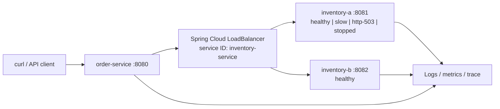
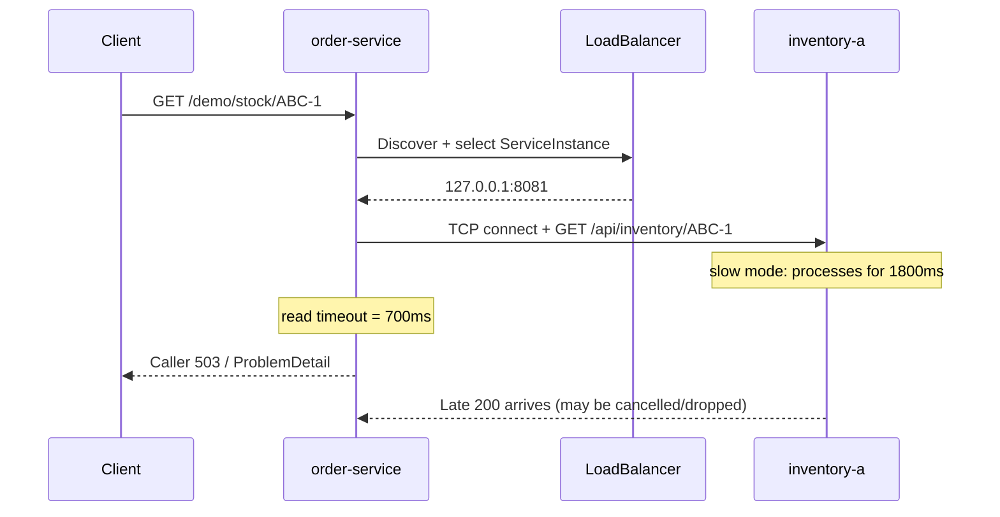

# Simulating a Slow, Failing, or Unreachable Replica

## 1. Objectives and Deliverables

In the **Hands-On Project** chapter of the `SPRING_CLOUD_SERVICE_COMMUNICATION_LOAD_BALANCING` module, we build a scenario close to real operations: `order-service` calls `inventory-service` via **Spring Cloud LoadBalancer**, while one of the replicas becomes slow, returns errors, or stops accepting connections. This hands-on project brings together `ServiceInstance` selection by service ID, discovery, health checks, routing policies, `RestClient`/`WebClient`/OpenFeign, timeouts, retries, and observability.

**Business context:** `order-service`'s `GET /demo/stock/{sku}` API queries stock availability. Two processes register under the `inventory-service` service ID: `inventory-a` on port 8081 and `inventory-b` on port 8082. Each replica returns its `instanceId` to confirm where the request actually landed.

This lab answers the following questions:

1. When A responds in 1,800 ms while the client's read limit is 700 ms, what kind of error do we observe?
2. When A returns HTTP 503 immediately, how does that differ from a connect/read timeout?
3. When A stops completely, why can the caller still attempt to send requests to A's address under `SimpleDiscoveryClient`?
4. If B is healthy, why can we not assume every subsequent request always routes to B?
5. At which layer do retries, health suppliers, and circuit breakers intervene; when do they **not** activate automatically?
6. Which logs, traces, and metrics prove an instance selection, an HTTP attempt, retry counts, and the final outcome?
7. How can we write automated tests without depending on initial Round Robin order or arbitrary wait times?

### Expected Deliverables

- Two independent `inventory-service` replicas that can be restarted in three modes: `healthy`, `slow`, and `http-503`.
- An `order-service` calling by service ID `inventory-service` through Spring Cloud LoadBalancer, without hard-coding a single replica in the client.
- Fourth test: **stopping** process A to produce a connection refused scenario.
- A result table distinguishing HTTP 200, upstream HTTP 503, read timeout, connect failure, and no-instance.
- Logs carrying logical request IDs and replica IDs, plus a table of attempt counts, outcomes, and latencies collected by the learner.
- Extension labs testing bounded retries, health filtering, and error observability after establishing the baseline.

**Safety scope:** inject faults only in local lab/test environments; never expose a fault-toggle endpoint publicly, never block real production network traffic, and never enable unbounded retries in production. The timeout/port/delay values below are for learning and are **not recommended copy-paste production settings**.

## 2. Architecture and Failure Scenarios



**One logical request** is the client's request to `order-service`. **One HTTP attempt** is a single actual HTTP call from the caller to a replica. When retries are enabled, one logical request can trigger multiple attempts, even across two different replicas.

| Mode of A | What Happens on the Path to A | Primary Observation | What Must Not Be Concluded |
|---|---|---|---|
| `healthy` | Returns JSON HTTP 200 quickly | `instanceId=inventory-a`, low latency | Both replicas have equal capacity |
| `slow` | Sleeps 1,800 ms before returning HTTP 200 | With a 700 ms read timeout, the caller may hit `ResourceAccessException` due to read timeout | The server definitely aborted processing after caller timeout |
| `http-503` | Returns HTTP 503 with an error body | `RestClientResponseException` / status 503 | LoadBalancer has automatically removed A from the registry |
| `stopped` | No process listening on port 8081 | Connection refused / I/O error; may happen faster than connect timeout | A automatically disappeared from `SimpleDiscoveryClient` |
| No instances in list | LoadBalancer cannot select a server | Zero HTTP exchanges to A/B | Equivalent to connection refused or server-returned 503 |

The columns above describe **technical expectations**, not measured data. Exact exceptions and behaviors may vary by HTTP transport, OS, and Spring Cloud Release Train.

### 2.1. Distinguishing Four Time Layers



- **Discovery/list latency:** time taken to fetch/refresh the `ServiceInstance` list, including real registries, caches, and health suppliers.
- **Choose latency:** time taken by the algorithm to select one element from the supplied instance set.
- **Connect timeout:** upper bound for establishing a TCP connection to the selected address. `ECONNREFUSED` can occur immediately without waiting out the full timeout.
- **Read/response timeout:** upper bound waiting for response data on the connection; it does not automatically cover discovery, retry backoff, and all steps of a logical request.
- **End-to-end deadline:** total acceptable duration for the **entire** logical request, including retries, delays, and fallbacks.

Do not add per-stage p95s together to infer overall p95; measure actual end-to-end latency per request.

## 3. Prerequisites

### 3.1. Reference Stack

Examples are based on **Spring Boot 3.x / Spring Framework 6.x** APIs, Java 17+, and a Spring Cloud Release Train **compatible with your project's Boot version**. The examples use `RestClient` with Spring Cloud LoadBalancer support; if using Boot 4 / Commons 5.x, check exact class names, dependencies, retry/observability behavior, and configuration metadata for your version.

Suggested dependencies:

| Application | Required Dependency | Purpose |
|---|---|---|
| `inventory-service` | `spring-boot-starter-web` | Create HTTP test endpoint and three fault modes |
| `inventory-service` (optional) | `spring-boot-starter-actuator` | Health/metrics for extension labs |
| `order-service` | `spring-boot-starter-web` | Endpoint receiving user requests |
| `order-service` | `spring-cloud-starter-loadbalancer` | `@LoadBalanced RestClient.Builder` and instance selection |
| `order-service` (optional) | `spring-boot-starter-actuator` | Health and metrics observation |
| `order-service` (optional) | `spring-retry` | Needed by some **blocking** retry paths, depending on version/integration |
| `order-service` (optional) | `spring-boot-starter-webflux` | Reactive `WebClient` exercise |
| `order-service` (optional) | `spring-cloud-starter-openfeign` | OpenFeign exercise |

To avoid depending on an external registry in this lab, we use **`SimpleDiscoveryClient`** with a static instance list. Once the fundamentals are clear, you can swap in Eureka, Consul, Kubernetes `DiscoveryClient`, or your project's test containers.

### 3.2. Suggested Learning Project Layout

```text
load-balancer-fault-lab/
├── inventory-service/
│   └── src/main/java/.../
│       ├── InventoryApplication.java
│       └── InventoryFaultController.java
└── order-service/
    └── src/main/java/.../
        ├── OrderApplication.java
        ├── LoadBalancedClientConfig.java
        └── StockProxyController.java
```

This is a **reference layout**, not an instruction for the worker to generate those files. In a multi-module Maven or Gradle project, place code in the respective modules and let the Spring Boot/Spring Cloud BOMs manage versions; **never manually pick artifacts with conflicting major versions**.

Core dependencies example in the `inventory` module:

```xml
<dependencies>
  <dependency>
    <groupId>org.springframework.boot</groupId>
    <artifactId>spring-boot-starter-web</artifactId>
  </dependency>
  <dependency>
    <groupId>org.springframework.boot</groupId>
    <artifactId>spring-boot-starter-actuator</artifactId>
  </dependency>
</dependencies>
```

And the `order` module:

```xml
<dependencies>
  <dependency>
    <groupId>org.springframework.boot</groupId>
    <artifactId>spring-boot-starter-web</artifactId>
  </dependency>
  <dependency>
    <groupId>org.springframework.cloud</groupId>
    <artifactId>spring-cloud-starter-loadbalancer</artifactId>
  </dependency>
  <dependency>
    <groupId>org.springframework.boot</groupId>
    <artifactId>spring-boot-starter-actuator</artifactId>
  </dependency>
</dependencies>
```

In the Maven parent/BOM, import `spring-cloud-dependencies` matching the chosen Release Train. Do not set an arbitrary version on `spring-cloud-starter-loadbalancer` alone while omitting the BOM; incompatibilities can cause startup failures that look like algorithm bugs.

## 4. Creating inventory-service with Simulation Modes

### 4.1. Spring Boot Application

```java
@SpringBootApplication
public class InventoryApplication {

    public static void main(String[] args) {
        SpringApplication.run(InventoryApplication.class, args);
    }
}
```

One JAR is launched twice with different `server.port` and `app.instance-id` arguments. Instance A will switch modes via startup properties; instance B stays healthy during the initial tests.

### 4.2. Fault-Injection Controller

```java
@RestController
@RequestMapping("/api/inventory")
class InventoryFaultController {

    private static final Logger log =
            LoggerFactory.getLogger(InventoryFaultController.class);

    @Value("${app.instance-id:inventory-unknown}")
    private String instanceId;

    @Value("${app.fault.mode:healthy}")
    private String mode;

    @Value("${app.fault.delay-ms:1800}")
    private long delayMs;

    @GetMapping("/{sku}")
    ResponseEntity<Map<String, Object>> get(
            @PathVariable String sku,
            @RequestHeader(name = "X-Lab-Request-Id",
                           defaultValue = "-") String requestId) {

        long start = System.nanoTime();
        log.info("inventory.start requestId={} instance={} mode={} sku={}",
                requestId, instanceId, mode, sku);

        if ("http-503".equalsIgnoreCase(mode)) {
            log.warn("inventory.reject requestId={} instance={}",
                    requestId, instanceId);
            return ResponseEntity.status(HttpStatus.SERVICE_UNAVAILABLE)
                    .header(HttpHeaders.RETRY_AFTER, "1")
                    .body(Map.of(
                            "instanceId", instanceId,
                            "error", "LAB_UNAVAILABLE"));
        }

        if ("slow".equalsIgnoreCase(mode)) {
            try {
                Thread.sleep(Math.max(0L, delayMs));
            }
            catch (InterruptedException ex) {
                Thread.currentThread().interrupt();
                return ResponseEntity.status(
                                HttpStatus.SERVICE_UNAVAILABLE)
                        .body(Map.of(
                                "instanceId", instanceId,
                                "error", "LAB_INTERRUPTED"));
            }
        }

        long elapsedMs = TimeUnit.NANOSECONDS.toMillis(
                System.nanoTime() - start);
        log.info("inventory.done requestId={} instance={} ms={}",
                requestId, instanceId, elapsedMs);

        return ResponseEntity.ok(Map.of(
                "sku", sku,
                "available", 12,
                "instanceId", instanceId));
    }
}
```

Required imports (your IDE can add them): `org.springframework.web.bind.annotation.*`, `org.springframework.http.*`, `org.springframework.beans.factory.annotation.Value`, `org.slf4j.*`, `java.util.Map`, and `java.util.concurrent.TimeUnit`.

**Do not put this fault-injection code into production.** `Thread.sleep` is a simple way to add delay in a **Spring MVC test server**, not on a WebFlux event loop. With real data, never log SKUs if they are PII/sensitive resource IDs; in this lab `ABC-1` is purely dummy data.

### 4.3. Per-Process Properties

`inventory-service/src/main/resources/application.yml` can contain:

```yaml
spring:
  application:
    name: inventory-service

server:
  port: 8081

app:
  instance-id: inventory-a
  fault:
    mode: healthy
    delay-ms: 1800

management:
  endpoints:
    web:
      exposure:
        include: health,info
```

Use command-line arguments to override `server.port`, `app.instance-id`, and `app.fault.mode` when starting process B or injecting faults on A.

Note that `http-503` is the status code of the **business endpoint** in the lab. If `/actuator/health` still returns UP, standard health probes may keep treating replica A as healthy. This reflects a common real-world scenario: an instance accepts connections while its business API fails or slows down.

## 5. Configuring order-service to Select Instances by Service ID

`order-service` uses `SimpleDiscoveryClient` instead of a real registry. Both A and B share the same **service ID** `inventory-service`, with distinct `instanceId` values and addresses:

```yaml
spring:
  application:
    name: order-service
  cloud:
    discovery:
      client:
        simple:
          instances:
            inventory-service:
              - uri: http://127.0.0.1:8081
                instance-id: inventory-a
              - uri: http://127.0.0.1:8082
                instance-id: inventory-b
    loadbalancer:
      cache:
        enabled: false
      retry:
        enabled: false

server:
  port: 8080

management:
  endpoints:
    web:
      exposure:
        include: health,info,metrics
```

**Explanation:**

- `http://inventory-service` is the logical name used by the client, not a physical DNS hostname.
- `SimpleDiscoveryClient` returns the two statically configured addresses; it **does not automatically remove A** if process A stops.
- `cache.enabled=false` reduces moving parts in the baseline; `SimpleDiscovery` itself remains a **static list**, which does not mean health/discovery refreshes automatically from live state.
- `retry.enabled=false` ensures **one HTTP send** per logical request in the baseline, assuming no retries at another HTTP/gateway layer.
- When running in Docker/Kubernetes, `127.0.0.1` points to **the caller's own container/pod**, not to another replica. Use hostnames/URIs reachable by `order-service`.

### 5.1. When Does the List Update?

Under static configuration, restarting A does not alter the set of two URIs known to the caller. If you want to simulate **real scale-in**, use dynamic discovery or a test supplier that allows mutating the list. A losing connectivity and A being **removed from the registry** are two separate scenarios that should be tested independently.

Do not assume `HealthCheckServiceInstanceListSupplier` is automatically enabled just because its class is on the dependency classpath. You must explicitly configure the supplier/filter; health updates also carry latency and fallback policies.

## 6. Creating a RestClient with LoadBalancer and Explicit Timeouts

In Spring Boot 3.x, `RestClient.Builder` can be customized by Spring Boot for converters and observations; the `@LoadBalanced` bean should preserve those customizers while letting Spring Cloud LoadBalancer attach its interceptor.

```java
@Configuration(proxyBeanMethods = false)
class LoadBalancedClientConfig {

    @Bean
    @LoadBalanced
    RestClient.Builder loadBalancedRestClientBuilder(
            RestClientBuilderConfigurer configurer) {
        return configurer.configure(RestClient.builder());
    }
}
```

`RestClientBuilderConfigurer` belongs to Spring Boot 3.x configuration; builder creation/annotations may differ across Release Trains. Do not register two beans with the `@LoadBalanced` qualifier and expect Spring to pick the right one automatically on injection. In projects that already expose a Boot-customized builder compatible with LoadBalancer, reuse it rather than creating a duplicate bean.

### 6.1. Setting Connect Timeout and Read Timeout

```java
@RestController
@RequestMapping("/demo")
class StockProxyController {

    private static final Logger log =
            LoggerFactory.getLogger(StockProxyController.class);

    private final RestClient inventoryClient;

    StockProxyController(
            @LoadBalanced RestClient.Builder builder) {

        SimpleClientHttpRequestFactory transport =
                new SimpleClientHttpRequestFactory();

        // Milliseconds in the int overload.
        transport.setConnectTimeout(300);
        transport.setReadTimeout(700);

        this.inventoryClient = builder.clone()
                .baseUrl("http://inventory-service")
                .requestFactory(transport)
                .build();
    }

    @GetMapping("/stock/{sku}")
    ResponseEntity<?> get(@PathVariable String sku) {
        String requestId = UUID.randomUUID().toString();
        long start = System.nanoTime();

        log.info("caller.start requestId={} sku={}", requestId, sku);
        try {
            InventoryStock stock = inventoryClient.get()
                    .uri("/api/inventory/{sku}", sku)
                    .header("X-Lab-Request-Id", requestId)
                    .retrieve()
                    .body(InventoryStock.class);

            if (stock == null || stock.available() == null
                    || stock.available() < 0
                    || !sku.equals(stock.sku())) {
                return error(HttpStatus.BAD_GATEWAY,
                        "INVALID_INVENTORY_RESPONSE");
            }

            log.info(
                    "caller.success requestId={} instance={} ms={}",
                    requestId, stock.instanceId(),
                    elapsedMs(start));
            return ResponseEntity.ok(stock);
        }
        catch (RestClientResponseException ex) {
            log.warn(
                    "caller.http-error requestId={} status={} ms={}",
                    requestId, ex.getStatusCode().value(),
                    elapsedMs(start));

            HttpStatus result =
                    ex.getStatusCode().value() == 503
                            ? HttpStatus.SERVICE_UNAVAILABLE
                            : HttpStatus.BAD_GATEWAY;

            return error(result, "INVENTORY_UPSTREAM_HTTP_ERROR");
        }
        catch (ResourceAccessException ex) {
            log.warn(
                    "caller.io-error requestId={} cause={} ms={}",
                    requestId, ex.getClass().getSimpleName(),
                    elapsedMs(start));

            return error(HttpStatus.SERVICE_UNAVAILABLE,
                    "INVENTORY_TRANSPORT_UNAVAILABLE");
        }
    }

    private static long elapsedMs(long start) {
        return TimeUnit.NANOSECONDS.toMillis(
                System.nanoTime() - start);
    }

    private static ResponseEntity<ProblemDetail> error(
            HttpStatus status, String code) {

        ProblemDetail problem = ProblemDetail.forStatus(status);
        problem.setTitle("Unable to verify inventory");
        problem.setDetail("Inventory dependency is temporarily unavailable");
        problem.setProperty("code", code);
        return ResponseEntity.status(status).body(problem);
    }
}

record InventoryStock(
        String sku, Integer available, String instanceId) {}
```

Required imports: `org.springframework.web.bind.annotation.*`, `org.springframework.http.*`, `org.springframework.web.client.RestClient`, `RestClientResponseException`, `ResourceAccessException`, `org.springframework.http.client.SimpleClientHttpRequestFactory`, `org.slf4j.*`, `java.util.UUID`, and `java.util.concurrent.TimeUnit`.

**This is the lab's HTTP error mapping**: it preserves the distinction between upstream HTTP errors and transport errors. Production code must define explicit contracts for 400/401/403/404/409/429, trace/correlation, and error sanitization; never map every status blindly to 502/503.

### 6.2. Why Use Integer Instead of int?

`Integer available` can be `null` if the JSON response omits the field. `int available` silently defaults to 0 on some deserialization paths, causing "response missing stock count" to be mistaken for "out of stock." The lab should **validate** the schema before trusting the values.

### 6.3. Note on Pre-HTTP Failures

When no `ServiceInstance` exists in discovery, exception/status behavior can differ by Spring Cloud/HTTP client version. The snippet above focuses on **HTTP 503 from the server** and **network I/O errors**; the no-instance scenario must be tested separately with an adapter/error handler suited to your actual version, rather than assuming all failures land in those two catch blocks.

## 7. Starting the Healthy A/B Baseline

After building the projects with Maven/Gradle, open **three independent terminals**. Assuming the JARs are in `target`:

**Terminal A:**

```bash
java -jar inventory-service/target/inventory-service.jar \
  --server.port=8081 \
  --app.instance-id=inventory-a \
  --app.fault.mode=healthy
```

**Terminal B:**

```bash
java -jar inventory-service/target/inventory-service.jar \
  --server.port=8082 \
  --app.instance-id=inventory-b \
  --app.fault.mode=healthy
```

**Caller Terminal:**

```bash
java -jar order-service/target/order-service.jar \
  --server.port=8080
```

The `\` character is Unix shell line continuation; on Windows PowerShell, **write each command on a single line** or use PowerShell's line-continuation syntax. The JAR filenames are illustrative and must match your project's actual artifacts. The documentation worker **does not execute build/test commands**, so the outputs below are expectations for learners to verify.

Test each replica directly:

```bash
curl -i http://127.0.0.1:8081/api/inventory/ABC-1
curl -i http://127.0.0.1:8082/api/inventory/ABC-1
```

Expected results: both HTTP 200; A returns `instanceId=inventory-a`, B returns `instanceId=inventory-b`.

Then test through the caller:

```bash
curl -i http://127.0.0.1:8080/demo/stock/ABC-1
curl -i http://127.0.0.1:8080/demo/stock/ABC-1
curl -i http://127.0.0.1:8080/demo/stock/ABC-1
curl -i http://127.0.0.1:8080/demo/stock/ABC-1
```

With default Round Robin and two stable instances, selections typically alternate A/B; however, **do not assert the first request is always A** if seed/child context/background requests are uncontrolled. The baseline goal is proving **both instances receive real HTTP traffic**, with each successful request returning JSON from the replica that processed it.

On Windows PowerShell, use `curl.exe` instead of the `curl` alias if you want syntax matching the commands above.

## 8. Scenario 1 — One Slow Replica

### 8.1. Setup

Stop A with Ctrl+C, keep B healthy, and restart A in `slow` mode:

```bash
java -jar inventory-service/target/inventory-service.jar \
  --server.port=8081 \
  --app.instance-id=inventory-a \
  --app.fault.mode=slow \
  --app.fault.delay-ms=1800
```

When calling A directly, the HTTP server waits around 1,800 ms before returning 200. However, `order-service` has `readTimeout=700ms`, so calls hitting A typically trigger a read timeout before A finishes responding.

When calling B directly, responses remain fast. This isolates a single slow replica rather than taking down the entire service ID.

### 8.2. Execution

```bash
curl -i http://127.0.0.1:8081/api/inventory/ABC-1
curl -i http://127.0.0.1:8082/api/inventory/ABC-1

curl -i http://127.0.0.1:8080/demo/stock/ABC-1
curl -i http://127.0.0.1:8080/demo/stock/ABC-1
curl -i http://127.0.0.1:8080/demo/stock/ABC-1
curl -i http://127.0.0.1:8080/demo/stock/ABC-1
```

**Expected observations:**

| If LoadBalancer Picks | Upstream Behavior | Caller Behavior with Configured Timeout |
|---|---|---|
| A | HTTP 200 after ~1,800 ms | May throw `ResourceAccessException` (root cause read timeout) and caller returns 503 |
| B | HTTP 200 almost immediately | Caller returns 200 with `instanceId=inventory-b` |

If A still logs `inventory.done` after the caller already timed out, that is **not evidence that the timeout malfunctioned**. The server can finish processing even though the caller closed the socket or discarded the result. Likewise, never use a timeout on a write operation to conclude a transaction did not commit.

### 8.3. What Should You Measure?

- Caller: `requestId`, elapsed time, root exception class/cause, HTTP attempt count.
- A: `inventory.start` and `inventory.done` with the same request ID; elapsed ~1,800 ms.
- B: received request count and elapsed time.
- With tracing: A's server span may complete later; the caller span may finish earlier with a timeout.
- With metrics: distinguish `http.client.requests`, `http.server.requests`, and LoadBalancer-specific metrics per version; do not assume they share identical labels/definitions.

**Do not look at a single 200 result and conclude no timeout occurred**: that request may simply have landed on B.

## 9. Scenario 2 — One Replica Returns HTTP 503

### 9.1. Setup

Keep B healthy and restart A:

```bash
java -jar inventory-service/target/inventory-service.jar \
  --server.port=8081 \
  --app.instance-id=inventory-a \
  --app.fault.mode=http-503
```

A immediately returns `503 Service Unavailable` at the HTTP application layer. This is neither connection refused nor a read timeout, and it does not mean the registry has removed A.

### 9.2. Calling Directly and Through LoadBalancer

```bash
curl -i http://127.0.0.1:8081/api/inventory/ABC-1
curl -i http://127.0.0.1:8082/api/inventory/ABC-1

curl -i http://127.0.0.1:8080/demo/stock/ABC-1
curl -i http://127.0.0.1:8080/demo/stock/ABC-1
curl -i http://127.0.0.1:8080/demo/stock/ABC-1
```

Expected results:

- Requests hitting A: connection succeeds, receives HTTP 503 from inventory, `RestClient.retrieve()` throws `RestClientResponseException`, and the lab caller returns `503 ProblemDetail` with `code=INVENTORY_UPSTREAM_HTTP_ERROR`.
- Requests hitting B: receives HTTP 200, returning body `inventory-b`.
- With retries off and a static snapshot, **one HTTP failure does not automatically force picking B next**. Round Robin keeps advancing its counter; Random can pick A multiple times in a row.
- The `Retry-After: 1` header from A is merely HTTP metadata; the lab client **does not automatically read it to schedule a retry**, because retries are off.

**Distinguish the source of 503:** a 503 in the caller's response can come from **upstream A**, from **LoadBalancer having no instances**, or from **the caller mapping a timeout error to 503**. Always log the root cause and whether an HTTP attempt occurred rather than looking only at the status code.

## 10. Scenario 3 — One Replica Stops Accepting Connections

### 10.1. Setup

Keep B healthy. Stop A with Ctrl+C, **without** editing `SimpleDiscoveryClient` in the caller.

Verify:

```bash
curl -i http://127.0.0.1:8081/api/inventory/ABC-1
curl -i http://127.0.0.1:8082/api/inventory/ABC-1
```

A typically produces `Connection refused` because no process is listening on port 8081; B still returns 200. Depending on host/OS/firewall, connecting might time out instead of refusing immediately. **Do not call this a read timeout** when the TCP connection was never even established.

### 10.2. Calling Through the Caller

```bash
curl -i http://127.0.0.1:8080/demo/stock/ABC-1
curl -i http://127.0.0.1:8080/demo/stock/ABC-1
curl -i http://127.0.0.1:8080/demo/stock/ABC-1
curl -i http://127.0.0.1:8080/demo/stock/ABC-1
```

If LoadBalancer selects A, the HTTP client hits a connection failure. If it selects B, the request succeeds. `SimpleDiscoveryClient` still returns both addresses because the list lives in static configuration; **a stopped instance** is different from **an instance evicted from the registry**.

### 10.3. Connection Refused Differs from a Network Blackhole

| Simulation | Transport-Layer Expectation | Lab Limitation |
|---|---|---|
| Stop process A, port has no listener | Usually very fast `ECONNREFUSED` | Does not verify the 300 ms connect timeout is used |
| Drop TCP packets to A via a network fault proxy | May wait until connect timeout | Requires tools like Toxiproxy or **test-only** network controls |
| A accepts TCP but sends no response | Read/response timeout | Can be simulated with `slow` mode or proxy delay |
| Server actively resets connection | Connection reset / I/O error | Not synonymous with HTTP 503 |

Do not alter firewalls or routes on shared workstations or production machines to simulate a "blackhole." If using Toxiproxy/test containers, scope the proxy **strictly to tests** and reset it afterward.

## 11. Scenario 4 — Zero Instances Available

To observe how this differs from A being stopped, use a **dedicated test configuration**: remove all `inventory-service` URIs from `SimpleDiscoveryClient` and restart the caller, or supply a fake `ServiceInstanceListSupplier` returning an empty list.

This state is different from having both instances stopped while still listed in discovery. When the set is empty, LoadBalancer has no server to select:

```text
ServiceInstanceListSupplier: []
         |
         v
LoadBalancer.choose(): no server
         |
         v
Zero HTTP exchanges to inventory-a/b
```

On reactive clients, depending on version/filter, no-instance may synthesize an HTTP 503 response at the caller; on blocking clients, it may throw an exception or map to another status. Do not hard-code a single exception type without checking your version.

**Verification question:** which log proves a request reached a backend? In a true no-instance condition, A/B will **not** log `inventory.start` for that request; there should be no network connection to either replica's port.

## 12. Recording the Experiment Results Table

Do not inspect only the HTTP status; track who LoadBalancer selected, whether the request reached the server, and at which stage failure occurred. The table below is for **learners to fill in themselves**, not executed output:

| Test | State of A | State of B | Selected Instance | HTTP Attempt Reached Server? | Caller Status | Failure/Stage | Duration ms |
|---|---|---|---|---|---|---|---|
| B01 | healthy | healthy | A/B | Yes | 200 | — | ... |
| S01 | slow 1800ms | healthy | A/B | Yes | 200/503 | Read timeout if A | ... |
| E01 | http-503 | healthy | A/B | Yes | 200/503 | Upstream 503 if A | ... |
| D01 | stopped | healthy | A/B | No if A chosen | 200/503 | Connect refused if A | ... |
| N01 | no-instance | healthy | None | No | Adapter-dependent | No-instance | ... |
| R01 | http-503 | healthy | A then possibly B | One or more | Per retry | Attempts/backoff | ... |
| H01 | unhealthy per health probe | healthy | Per filtered list | Per probe policy | Per outcome | Health filtering | ... |

Every result must be **backed by evidence**: `X-Lab-Request-Id`, caller logs, A/B logs, backend request counts, timestamps, and the run's configuration. Run enough times for both A and B to appear; a single request does not prove load balancing.

### 12.1. Two Easily Confused Count Concepts

```text
logical_requests_total = number of client calls to /demo/stock
http_attempts_total    = total actual GETs sent to inventory replicas
retry_attempts_total   = max(0, attempts - 1) per logical request
```

When retries are off, the first two totals usually match **except for no-instance, pre-HTTP errors, or cancelled requests**. When retries are enabled, `http_attempts_total` can exceed `logical_requests_total`; that represents real extra load sent downstream.

## 13. Extension 1 — Enabling Bounded Retries and Measuring Effectiveness

### 13.1. Why Were Retries Off at the Start?

Retries can let a call fail on A and succeed on B on the next attempt. That helps end users, yet hides that A is failing if you only check the final HTTP 200. To observe root causes directly, complete the **retries-off** baseline first.

### 13.2. Example Policy Trying a Different Instance

Reference property group in Spring Cloud Commons 4.3:

```yaml
spring:
  cloud:
    loadbalancer:
      retry:
        enabled: true
        retry-on-all-operations: false
        retry-on-all-exceptions: false
        max-retries-on-same-service-instance: 0
        max-retries-on-next-service-instance: 1
        retryable-status-codes:
          - 503
        avoid-previous-instance: true
```

**Important:** these properties express **retry intent**, while actual retry execution depends on the HTTP client, LoadBalancer integration, `spring-retry` for some blocking branches, and the Spring Cloud version. Do not assume enabling these properties makes `RestClient` and OpenFeign retry identically. Verify **actual HTTP attempt counts** in backend logs. In Spring Cloud OpenFeign, `Retryer.NEVER_RETRY` is Feign's own default; do not confuse it with retry policies of other stacks.

Sensible bounds for read-only GET paths:

- Retry at most once on the next instance; never retry unboundedly.
- Retry only classified transient failures like 503 or connect/read failures **if the request is safe** and time budget remains.
- Never blindly retry payment/reservation `POST` requests without idempotency and deduplication.
- Avoid enabling retries simultaneously at the gateway, LoadBalancer, HTTP client, and service layers; attempts can multiply.

### 13.3. Retry-Aware Selection Does Not Guarantee Switching Replicas

`avoid-previous-instance=true` can instruct the retry supplier to avoid the failed instance **when other valid candidates remain**. If only A exists, caches are stale, health/zone filters narrow candidates, or the context lacks information, the second choice may still not change. Tests must log the `instanceId` of **each attempt** rather than asserting "attempt 2 is always B" for all topologies.

### 13.4. Total Deadline Matters More Than Per-Attempt Timeout

Suppose two attempts can each wait 700 ms with a 150 ms backoff:

```text
Attempt 1      700 ms
Backoff        150 ms
Attempt 2      700 ms
Overhead        50 ms
--------------------
Total         1600 ms
```

If `order-service`'s API has a 1,000 ms SLO, this design blows the budget even though **each individual attempt** has a 700 ms read timeout. Enforce an end-to-end deadline at the logical request layer or compute remaining budget before retrying, especially with reactive `retryWhen`.

In Spring Cloud LoadBalancer **reactive retry**, `spring.cloud.loadbalancer.retry.backoff.enabled` and `min-backoff`/`max-backoff`/`jitter` relate to Reactor retries; **do not assume they apply identically to blocking `RestClient`**. Avoid copying reactive properties across every HTTP stack and assuming exponential backoff is active.

## 14. Extension 2 — Health Checks and Instance Filtering

### 14.1. Readiness Differs from Business HTTP Success

Actuator `/actuator/health` can still return UP while `GET /api/inventory/{sku}` returns 503 due to fault mode. If the health probe **does not reflect** business failures, a health-based supplier may keep treating A as healthy.

To test health filtering:

1. Add an appropriate health/readiness indicator that reports DOWN or 503 when the fault mode should count as unavailable.
2. Register `HealthCheckServiceInstanceListSupplier` for **service ID `inventory-service`** matching your Spring Cloud version.
3. Point to the right health probe path on each instance, such as `/actuator/health` or a dedicated probe path.
4. Wait for the supplier to probe and refresh the list (subject to interval/refetch/cache delays).
5. Inspect **the eligible instance set**, not just one Round Robin hit going to B.
6. When A recovers, observe when A rejoins the list.

### 14.2. Attaching the Supplier to One Service ID

Illustrative configuration per Spring Cloud Commons 4.3:

```java
@LoadBalancerClient(
        name = "inventory-service",
        configuration = InventoryLoadBalancerConfiguration.class)
@SpringBootApplication
public class OrderApplication {

    public static void main(String[] args) {
        SpringApplication.run(OrderApplication.class, args);
    }
}

class InventoryLoadBalancerConfiguration {

    @Bean
    ServiceInstanceListSupplier instanceSupplier(
            ConfigurableApplicationContext context) {
        return ServiceInstanceListSupplier.builder()
                .withDiscoveryClient()
                .withBlockingHealthChecks()
                .build(context);
    }
}
```

Place the dedicated LoadBalancer configuration class **outside the root application context's component scan** or ensure it is registered only inside the child context for `inventory-service`; avoid accidentally applying that supplier globally. This snippet is version-dependent; `withBlockingHealthChecks()` fits the blocking branch, while reactive has its own corresponding builder option.

### 14.3. Limitations to Understand

- Probes run on a schedule; removing A is **not instantaneous** after one HTTP failure.
- `HealthCheckServiceInstanceListSupplier` may **fall back to returning all instances** if zero healthy instances are found (depending on implementation/version/config). Thus health checks do not guarantee strict fail-closed behavior.
- Health filters do not replace connect/read timeouts; an instance that degrades between two probes can still be chosen.
- `SimpleDiscoveryClient` still retains static URIs; the health supplier filters inside the pipeline without deleting lines from the registry.
- In Kubernetes, readiness probes and EndpointSlice/service discovery updates also have propagation delay; never treat green/red readiness as instantaneous global state.

## 15. Extension 3 — Reactive WebClient

When the caller uses WebFlux/`WebClient`, keep the same two replicas and fault modes for comparison. Key difference: the HTTP exchange executes when the `Mono` **is subscribed**, not when the publisher is constructed.

Illustrative Reactor Netty client connector setup:

```java
@Bean
@LoadBalanced
WebClient.Builder loadBalancedWebClientBuilder(
        ObjectProvider<WebClientCustomizer> customizers) {

    HttpClient httpClient = HttpClient.create()
            .option(ChannelOption.CONNECT_TIMEOUT_MILLIS, 300)
            .responseTimeout(Duration.ofMillis(700));

    WebClient.Builder builder = WebClient.builder()
            .clientConnector(
                    new ReactorClientHttpConnector(httpClient));

    customizers.orderedStream()
            .forEach(customizer -> customizer.customize(builder));

    return builder;
}
```

The builder above demonstrates preserving Spring Boot `WebClientCustomizer` beans (including observations when configured) and attaching `@LoadBalanced`. Import the corresponding classes from Reactor Netty, Netty, Spring WebFlux, and Spring Boot; compatible WebFlux/Reactor Netty dependencies are required. In a project that already provides an instrumented builder, avoid applying customizers/observation filters twice and duplicating spans.

A call:

```java
Mono<InventoryStock> readStock(
        WebClient inventoryClient, String sku) {

    return inventoryClient.get()
            .uri("/api/inventory/{sku}", sku)
            .retrieve()
            .bodyToMono(InventoryStock.class)
            .switchIfEmpty(Mono.error(
                    new IllegalStateException("Empty inventory body")));
}
```

`inventoryClient` must be created from the `@LoadBalanced` builder with `baseUrl("http://inventory-service")`. Use `StepVerifier` or return `Mono` from a controller; never call `block()` on a WebFlux event loop.

### 15.1. Distinguishing Timeout and Retry in a Reactive Pipeline

```java
return inventoryClient.get()
        .uri("/api/inventory/{sku}", sku)
        .retrieve()
        .bodyToMono(InventoryStock.class)
        .retryWhen(Retry.backoff(1, Duration.ofMillis(100))
                .maxBackoff(Duration.ofMillis(300))
                .jitter(0.5)
                .filter(this::isTransientFailure))
        .timeout(Duration.ofSeconds(1));
```

`isTransientFailure` is an application predicate you **must define properly**; `Retry.backoff(1, ...)` permits at most **one retry**, meaning two attempts total. Placing `timeout` outside `retryWhen` bounds the overall publisher including attempts and backoff, whereas Reactor Netty's `responseTimeout` only guards the transport response. Do not enable LoadBalancer retry and service-layer `retryWhen` simultaneously unless intentionally measuring attempt multiplication.

`timeout` can emit cancellation downstream, yet it does not guarantee an HTTP server that already received the request aborts blocking work or rolls back a transaction.

## 16. Extension 4 — OpenFeign

When experimenting with OpenFeign, the service-ID API remains similar:

```java
@FeignClient(name = "inventory-service")
interface InventoryFeignClient {

    @GetMapping("/api/inventory/{sku}")
    InventoryStock read(@PathVariable("sku") String sku);
}
```

Configure **Feign-specific** timeouts, for example in Spring Cloud OpenFeign:

```yaml
spring:
  cloud:
    openfeign:
      client:
        config:
          inventory-service:
            connectTimeout: 300
            readTimeout: 700
```

These values are in milliseconds in OpenFeign versions supporting these properties; verify against your exact version and HTTP transport. Spring Cloud OpenFeign defaults to `Retryer.NEVER_RETRY`, so a timeout or 503 on one attempt is not automatically retried by Feign. If adding a custom `Retryer`/`ErrorDecoder`, explicitly decide whether HTTP 503 maps to a retryable error and count real attempts.

Do not compare raw exception names directly across Feign, `RestClient`, and `WebClient`: Feign throws `FeignException`, `WebClient` throws `WebClientResponseException` and `WebClientRequestException`, and `RestClient` throws `RestClientResponseException`/`ResourceAccessException`. Map them to **stable domain error categories** at the adapter boundary while keeping root causes for observability.

## 17. Observing Failures: Logs, Metrics, and Tracing

### 17.1. A Request ID Does Not Replace Distributed Tracing

This lab uses `X-Lab-Request-Id` to correlate caller and server logs. This header **does not** replace W3C `traceparent`. When Micrometer Tracing and instrumented HTTP clients/servers are active, look for:

- A shared `traceId` across spans belonging to the same logical request, assuming context propagation works.
- Distinct `spanId` values for each HTTP client/server attempt; that is normal.
- Retries producing multiple HTTP client spans under the same logical request.
- When no instance is selected, no inventory server span should exist because **no HTTP request was sent to inventory**.
- Sampling or exporter delays can hide spans in the UI even when HTTP context propagation succeeded; do not confuse that with lost context.

### 17.2. Which Metrics Can Be Measured?

| Type | Purpose | Limitation |
|---|---|---|
| `http.server.requests` / timer by version | Latency and status at caller/replicas | Names/labels may differ in Boot/OTel stacks |
| HTTP client metrics | Latency calling inventory by URI template/status/exception | Requires an instrumented builder |
| `loadbalancer.requests.*` | Success/failure/discard per LB lifecycle when integration is enabled | Does not automatically equal total HTTP attempts or business errors |
| `logical_requests_total` (custom) | Number of user-initiated calls | Does not multiply on retries |
| `inventory_http_attempts_total` (custom) | Number of HTTP exchanges to inventory | Tag instance/reason with bounded cardinality |
| `inventory_failures_total` (custom) | Connect/read timeouts, upstream 503, no-instance | Keep source/cause separate |
| `retry_attempts_total` (custom) | Attempts after the initial attempt | Do not conflate with successful requests |
| `end_to_end_latency` p50/p95/p99 | Time from caller inbound to response | Measured across **the same logical request** |

The "custom" metrics are **suggestions**, not metrics Spring Cloud creates automatically with those exact names. `spring.cloud.loadbalancer.stats.micrometer.enabled=true` can enable lifecycle metrics when matching dependencies exist; avoid confusing `loadbalancer.requests.failed` with every client HTTP error in all cases.

### 17.3. Avoiding High Cardinality and Data Leaks

Never use `sku`, user IDs, bearer tokens, raw paths with IDs, or `requestId` as **metric tags**. Detailed fields belong in access-controlled, masked, retention-bounded logs and traces. With two lab instances, `instanceId` has low cardinality; in production with tens of thousands of ephemeral pods, watch out for label explosion.

## 18. Designing Reproducible Automated Tests

Manual runs build intuition; CI tests must isolate dependencies on timing, random seeds, and machine ports.

### 18.1. Unit Testing Instance Selection

Create a fake `ServiceInstanceListSupplier` returning a stable `[A,B]`, then assert:

- Empty list ⇒ `hasServer()==false`.
- Only B ⇒ always selects B.
- Two instances ⇒ every selection belongs to `{A,B}`.
- Round Robin with fixed seed and sequential subscription ⇒ can test exact cycle when implementation behavior is known.
- Random ⇒ test set membership, never assert the first choice is always A.

This is **selection unit testing** and requires no running inventory processes.

### 18.2. Integration Testing with Two Mock Servers

Use WireMock/`MockWebServer` or test HTTP servers, start A/B on dynamic ports, and inject their URIs via `@DynamicPropertySource`. Start with both instances healthy, then change **A's** behavior to:

1. Return HTTP 200 after delay > read timeout.
2. Return HTTP 503 immediately.
3. Stop server A to trigger connection refused.
4. Restart A to verify recovery.

Each case keeps B healthy, disables retries in the baseline, and records server request counts and caller elapsed time. Never hard-code 8081/8082 in parallel CI runs.

### 18.3. Avoiding Flaky Assertions

Bad test:

```java
// WRONG: uncontrolled seed, prior selections, or scheduling.
assertThat(firstResponse.instanceId()).isEqualTo("inventory-a");
Thread.sleep(500);
assertThat(secondResponse.instanceId()).isEqualTo("inventory-b");
```

Good test:

```java
// Suggested assertion when all responses succeed:
assertThat(actualIds)
        .allSatisfy(id -> assertThat(id)
                .isIn("inventory-a", "inventory-b"));

// With one slow replica: assert on server request logs
// and backend state rather than gambling on selection order.
```

If you need to **force** the first attempt to hit A to test timeouts, use a supplier returning only A in a dedicated test or a test-specific policy you control. Then test recovery to B with snapshot `[B]`; never rely on a random seed and retries happening to land on B.

### 18.4. Timeout Tests Need Safe Margins

With a 1,800 ms server delay and a 700 ms client timeout, the gap is wide enough to distinguish read timeouts reliably in most lab environments. However, CI runners can experience scheduling/GC/network jitter; tests should **await conditions with a deadline**, inspect root exceptions/HTTP attempt logs, and never assert elapsed time equals exactly 700 ms.

When testing Reactor backoff, use `StepVerifier.withVirtualTime` for pipelines using the compatible scheduler; virtual time does not fast-forward real TCP timeouts or real health probes.

## 19. Acceptance Matrix and Rubric

| Code | Test Case | Pass Criteria |
|---|---|---|
| F01 | Both A and B healthy | Caller reaches both via service ID and returns valid JSON |
| F02 | A slow 1800 ms, read timeout 700 ms | Requests actually hitting A are cut off at caller; requests to B still succeed |
| F03 | A http-503, B healthy | Distinguishes upstream HTTP 503 from HTTP 200 on B |
| F04 | A stopped, B healthy | Recognizes connect error when hitting A, not mistaken for A returning 503 |
| F05 | No-instance | Zero HTTP requests sent to A/B; error raised at caller |
| F06 | Caller restarted while A still stopped | Static SimpleDiscovery list still contains A unless config was edited |
| F07 | A recovers | Requests hitting A return 200 again without changing logical API URL |
| F08 | Health filtering enabled properly | Eligible list changes per probe/policy with reasonable delay |
| F09 | Bounded retry | Attempt count never exceeds policy; records instance per attempt |
| F10 | Single instance only | Does not claim retry always switches to another node |
| F11 | Both instances failing | No retry storm; caller terminates per attempts/deadline |
| F12 | Domain 404 | Not confused with no-instance or retried unconditionally |
| F13 | WebClient variant | Same failure modes, distinguishing reactive timeouts/exceptions |
| F14 | OpenFeign variant | Connect/read timeouts and Feign `Retryer` properly configured |
| F15 | Observability | Includes request ID, latency/exception/status, and per-replica evidence |
| F16 | Unit/integration CI | Does not depend on random seeds or fixed sleeps |

**Suggested Rubric (100 points):**

| Criterion | Points |
|---|---:|
| Two-replica topology and calling via service ID | 20 |
| Simulating slow/503/stopped and accurately classifying errors | 25 |
| Distinguishing timeouts/HTTP status/no-instance without semantic confusion | 20 |
| Evidenced retry/health behavior with clear attempts and deadlines | 15 |
| Logging/metrics/tracing, report with timestamps and instance IDs | 10 |
| Isolated, reproducible, non-flaky tests | 10 |

Point values are instructor suggestions only, not module metadata. Do not grade solely by "how many HTTP 200 responses arrived" because fallbacks, retries, or traffic hitting B can mask A's failure.

## 20. Common Configuration Mistakes

| Symptom | Likely Cause | How to Check/Fix |
|---|---|---|
| Caller reports `UnknownHostException: inventory-service` | HTTP client is not `@LoadBalanced` | Check builder/bean/filter and logical URL |
| Caller always hits A | Only one instance in SimpleDiscovery, seed/snapshot, or physical client `baseUrl` | Check discovery list and A/B request logs |
| A stopped yet caller still tries to connect to A | Static discovery still holds URI | Expected baseline behavior; needs dynamic discovery/health filtering |
| A returns 503 yet `/actuator/health` stays UP | Fault is in business endpoint; health does not reflect it | Use an appropriate readiness policy |
| Slow requests still return 200 via caller | Request hit B or transport timeout not applied | Check `instanceId` and `requestFactory` |
| Read timeout fires later than 700 ms | Connection/queue/network/GC or multiple attempts | Measure stages/overhead and retry layers |
| Retry enabled yet no second attempt happens | Missing retry dependency/adapter, non-retryable exception, or deadline expired | Check wiring/version and server request counts |
| Retries three times even though configured for once | Retries enabled at multiple layers | Designate a single retry owner |
| One request picks B and assumes A was evicted | Round Robin/Random may just pick B | Check supplier eligible list and health state |
| No-instance returns 503, mistaken for upstream 503 | Response synthesized by caller before HTTP | Check A/B request logs and lifecycle |
| Trace breaks when switching instances | HTTP client not instrumented or context not propagated | Check Boot builder, W3C `traceparent`, span links |
| Direct curl to A is slow yet caller is fast | Caller hit B or timed out early | Log `instanceId` and elapsed time |
| A returns 200 after caller timed out | Server kept processing after client gave up | Do not infer "request had no side effects" |
| `localhost` fails inside Docker | Each container has its own loopback | Use reachable hostnames/ports |
| CI fails only on another runner | Occupied fixed ports, sleeps/races, randomness source | Dynamic ports, fake suppliers, await conditions |

## 21. Analysis Questions and Extension Exercises

### Exercise 1 — Why Do Half the Requests Fail?

With two replicas A/B, Round Robin, and retries off, A always returns 503 while B returns 200. Over many selections on a stable snapshot, explain why the success rate approaches 50% yet **cannot** be predicted to equal exactly 50% on a small sample or when concurrency/retries interfere.

### Exercise 2 — Read Timeout or Connect Failure?

Run A in `slow` mode (1,800 ms) and then stop A. Compare exception root causes, elapsed times, and `inventory.start` logs. Explain why stopping A typically fails faster than `connectTimeout=300ms`.

### Exercise 3 — Where Did the 503 Come From?

Create three cases: A returns 503, caller has no instances, and caller maps a read timeout to 503. Write logs/error codes distinguishing all three causes without leaking stack traces or internal addresses in public responses.

### Exercise 4 — Pros and Cons of Retries

Enable one retry for GET after confirming the initial attempt to A fails. Measure attempts to A/B and total latency. Then make both A and B fail and verify retries are bounded. Explain the impact of a retry storm if 100 callers retry simultaneously.

### Exercise 5 — Health Checks Are Not an Oracle

Keep `/actuator/health` UP while the inventory endpoint returns 503. Observe whether the health supplier removes A. Then update the health probe appropriately and measure filtering/update latency. When all instances become unhealthy, verify the fallback policy instead of assuming an empty list.

### Exercise 6 — Real Scale-In

Replace SimpleDiscovery with a fake `ServiceInstanceListSupplier` emitting `[A,B]` and then `[B]`. Assert that after the supplier updates, LoadBalancer stops choosing A in the new snapshot. Compare this with stopping A while leaving `[A,B]` intact.

### Exercise 7 — 1,000 ms Deadline

Keep a 700 ms read timeout, allow one retry, and set a 150 ms backoff. Calculate the case where both attempts take 700 ms (excluding overhead). Propose an end-to-end deadline and a rule to skip retrying when remaining budget is too small.

### Exercise 8 — Fault Injection for Write Transactions

Design `POST /reservations` assuming server A commits to the DB and the response is lost. Explain why retrying on B can double-book if the two replicas do not share an idempotency key/deduplication state. Propose a contract and tests preventing double reservation.

### Exercise 9 — Comparing RestClient, WebClient, and OpenFeign

Run the same topologies and fault modes across all three clients, tabulating exception types, timeout behaviors, and attempt counts. Present the differences caused by **client transport/retry wiring**, without attributing them to Round Robin.

### Exercise 10 — Writing an Operations Report

Write a report covering total logical requests, attempt counts, upstream HTTP 503 errors, read/connect errors, success rate, end-to-end p95, hits per instance, sample traces, and recommendations: adjust timeouts/retries/health or fix business readiness.

### Completion Checklist

- [ ] Two independent inventory replicas returning distinct `instanceId` values.
- [ ] Caller uses service ID through Spring Cloud LoadBalancer without hard-coding physical replicas.
- [ ] Captured a retries-off baseline before testing resilience.
- [ ] Properly simulated `slow`, `http-503`, and `stopped`.
- [ ] Distinguished connection refused, connect timeout, read timeout, upstream 503, and no-instance.
- [ ] Understood that stopping A does not remove its URI from SimpleDiscovery.
- [ ] Avoided treating readiness UP as a guarantee that every endpoint works.
- [ ] Avoided asserting Round Robin's first request always hits A.
- [ ] Counted HTTP attempts on the server, not just final caller statuses.
- [ ] When enabling retries, accounted for attempts and the full logical-request deadline.
- [ ] Never enabled retries on POST without idempotency.
- [ ] Captured request IDs/traces, statuses, latencies, and instance IDs in measurements.
- [ ] CI tests use dynamic ports/fake suppliers without relying on sleeps/races.
- [ ] Tested no-instance and all-unhealthy per actual version behavior.
- [ ] Cleaned up fault-injection processes and restored the lab environment.

## Official References

- [Spring Cloud Commons 4.3 — Spring Cloud LoadBalancer](https://docs.spring.io/spring-cloud-commons/reference/4.3/spring-cloud-commons/loadbalancer.html): `ServiceInstance`, `ServiceInstanceListSupplier`, Round Robin, discovery, health checks, retries, and service-ID selection.
- [Spring Cloud Commons 4.3 — Configuration Properties](https://docs.spring.io/spring-cloud-commons/reference/4.3/configprops.html): `spring.cloud.loadbalancer.*` properties, retry, caching, and health-check timing.
- [Spring Framework — REST Clients](https://docs.spring.io/spring-framework/reference/integration/rest-clients.html): `RestClient`, HTTP exception handling, timeouts, and request factories.
- [Spring Framework — WebClient](https://docs.spring.io/spring-framework/reference/web/webflux-webclient.html): reactive requests, error handling, connectors, and cancellation.
- [Spring Cloud OpenFeign](https://docs.spring.io/spring-cloud-openfeign/reference/spring-cloud-openfeign.html): Feign client configuration, connect/read timeouts, and retry behavior.
- [Spring Boot — Actuator Health](https://docs.spring.io/spring-boot/reference/actuator/endpoints.html): health/readiness endpoints, exposure, and HTTP status mapping.
- [Project Reactor — Testing](https://projectreactor.io/docs/core/release/reference/testing.html): `StepVerifier` and virtual-time testing.
- [Spring Cloud — Release Train](https://spring.io/projects/spring-cloud/): check compatibility between Spring Boot and Spring Cloud before running code.

**Conclusion:** a slow replica, a replica returning HTTP 503, and an unreachable replica produce **three distinct failure signals**. Spring Cloud LoadBalancer is responsible for choosing a `ServiceInstance` from the currently known list; it does not automatically delete an instance after one HTTP failure. Only by practicing **layer by layer** — discovery, selection, transport timeouts, HTTP status, retries, health, and observability — can we verify how a system recovers, whether errors are being masked or load amplified, and which improvements truly fit the business requirements.
