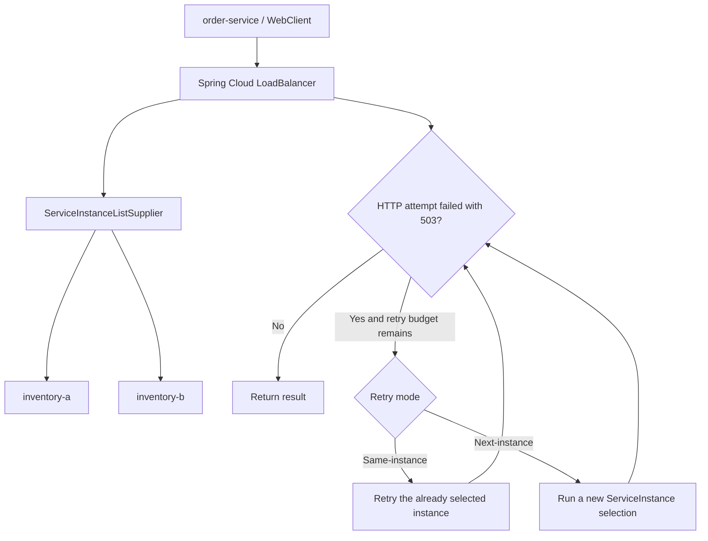
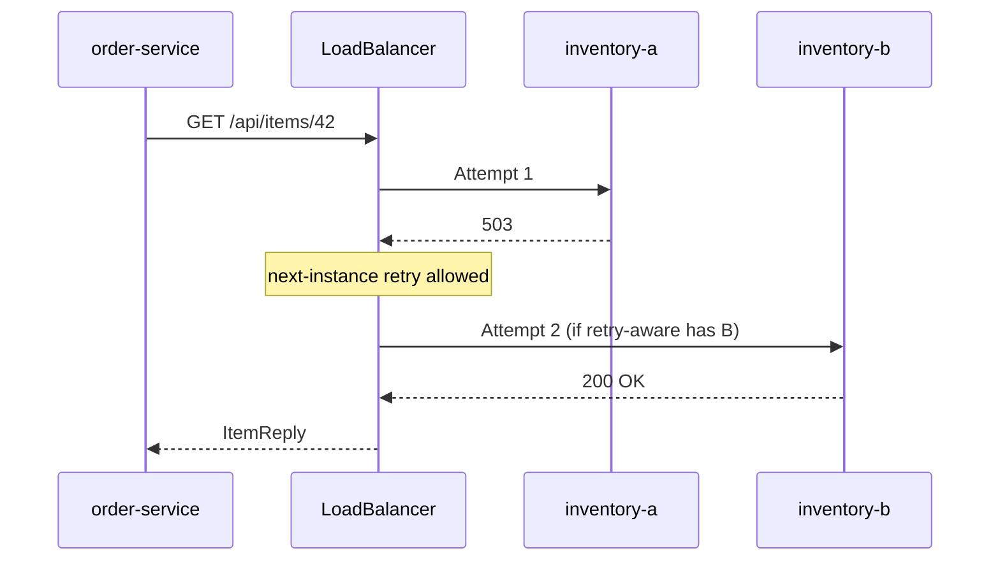
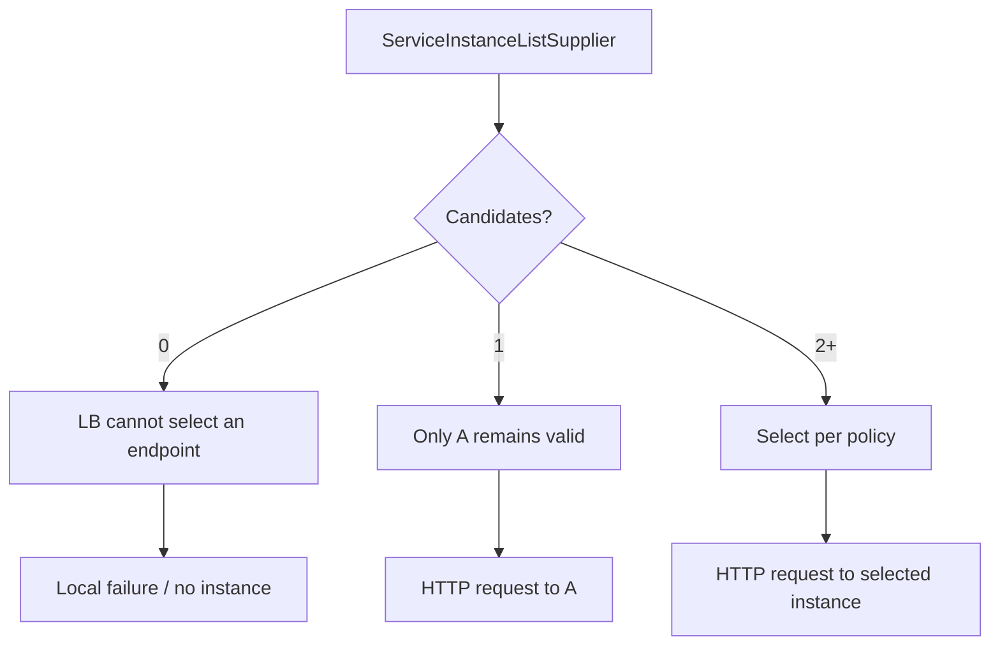
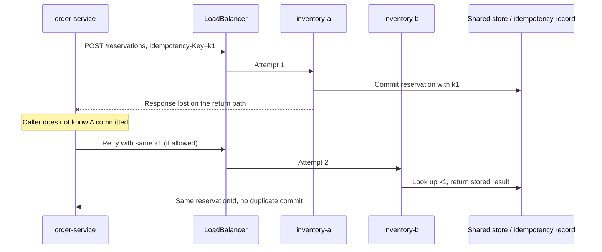

# Comparing Same-Instance Retry and Next-Instance Retry

In Spring Cloud LoadBalancer, when calling `http://inventory-service/api/items/42`, the application does not need to know backend IPs: LoadBalancer looks up the `ServiceInstance` list, chooses a replica, and sends the HTTP request to its host/port. When a request fails, **retry** can either resend to **the same replica that just failed** or ask LoadBalancer to **select another replica**. The two options look similar as "retrying," yet differ in load distribution, recovery odds, latency, and business safety.

This comprehensive hands-on exercise belongs to the **Hands-On Project** chapter of the **Spring Cloud Service Communication Load Balancing** module. Learners will build an `order-service` calling an `inventory-service` with two replicas, configure both retry styles, inject HTTP `503`/timeout faults, collect request journals, and verify what actually happens. The main examples use `WebClient` + Spring Cloud LoadBalancer to make the reactive mechanism easy to observe; later sections explain how to apply the same ideas to `RestTemplate`, `RestClient`, and OpenFeign without assuming every client shares the same retry path.

> **Verification goal:** do not stop at seeing a final success or error response; you must know **how many outbound attempts were sent, which instance each attempt hit, why it retried, the total duration, and any business side effects**.

## 1. What Should You Be Able to Do After This Lesson?

After completing this lab, you can:

1. Create two HTTP stub instances under the same service ID using `SimpleDiscoveryClient` and dynamic ports.
2. Distinguish `max-retries-on-same-service-instance` from `max-retries-on-next-service-instance`.
3. Read request journals properly to confirm whether retries stayed on one replica or switched to another.
4. Know when `RetryAwareServiceInstanceListSupplier` can exclude the previously tried instance, and when switching to a different IP is **not guaranteed**.
5. Test HTTP status errors, connection failures, and slow responses without lumping all errors into one bucket.
6. Set attempt budgets, backoff, timeouts, and deadlines to avoid retry storms.
7. Preserve zone/tenant/API-version constraints during retries; avoid duplicate `POST` side effects.
8. Measure metrics, isolate application bugs, and write CI-stable automated tests.

This lesson covers **client-side load balancing**, not Kubernetes Service configuration, server-side proxy load balancing, or advanced weighted distribution algorithms.

## 2. Lab Topology and the Two Retry Paths

Suppose the caller `order-service` sees two replicas of `inventory-service`:

| service ID | instance ID | Test Address | Function |
|---|---|---|---|
| `inventory-service` | `inventory-a` | `127.0.0.1:18081` | Returns inventory status |
| `inventory-service` | `inventory-b` | `127.0.0.1:18082` | Same API/contract |

The ports above are only for illustration. In the main integration tests, we use **dynamic ports** to avoid CI conflicts.



### 2.1. Retrying the Same Replica

If the first attempt hits A and the policy allows **one retry on the same instance**, the expected sequence is:

```text
Logical request: GET /api/items/42
  Attempt 1: inventory-a -> HTTP 503
  Attempt 2: inventory-a -> HTTP 503 or 200
```

Pros: avoids re-selecting an instance and can recover from transient local glitches (e.g., a fleeting connection reset or a briefly busy resource that clears). Cons: if A is overloaded, repeated retries **pile more load onto A** without improving the outcome.

### 2.2. Retrying on the Next Selected Instance

If the first attempt hits A and the configuration permits one **next-instance** retry, the *desired sequence in a lab with two healthy replicas and an active retry-aware supplier* is:

```text
Logical request: GET /api/items/42
  Attempt 1: inventory-a -> HTTP 503
  Attempt 2: inventory-b -> HTTP 503 or 200
```

Pros: gives a chance to route around a failure affecting only A. Cons: re-selecting an instance does not guarantee finding a healthier replica; if **both A and B are overloaded**, the second attempt just prolongs the request and amplifies load.

**Key reminder:** `max-retries-on-next-service-instance` means **re-running `ServiceInstance` selection before retrying**, not guaranteeing a different instance. `RetryAwareServiceInstanceListSupplier` can prefer avoiding the previous instance when another valid candidate exists; verify your supplier, configuration, and actual instance count.

## 3. Spring Cloud LoadBalancer Retry Policy

Common kebab-case property names:

```yaml
spring:
  cloud:
    loadbalancer:
      retry:
        enabled: true
        max-retries-on-same-service-instance: 0
        max-retries-on-next-service-instance: 1
        avoid-previous-instance: true
        retry-on-all-operations: false
        retry-on-all-exceptions: false
        retryable-status-codes:
          - 503
```

| Property | Meaning and What to Check |
|---|---|
| `retry.enabled` | Enables LoadBalancer retry logic when **the right client integration and dependencies** are present |
| `max-retries-on-same-service-instance` | Additional retries on **each selected instance** |
| `max-retries-on-next-service-instance` | Additional retry rounds that **re-select an instance** |
| `avoid-previous-instance` | Lets the retry-aware supplier try to exclude the previous instance during re-selection when possible |
| `retry-on-all-operations` | Whether retries are allowed outside `GET`; defaults to `false` |
| `retry-on-all-exceptions` | Whether all exceptions are retried; defaults to `false` and should usually stay off |
| `retryable-status-codes` | Specifies HTTP status codes that trigger retries, such as `503` |
| `retryable-exceptions` | Allowed exception list; verify how the HTTP client translates exceptions |
| `backoff.enabled` | Flag for Reactor retry backoff; verify behavior per release train |

In the current Spring Cloud Commons configuration properties table, notable defaults are **same = 0, next = 1, avoid previous = true, retry-on-all-operations = false, retry-on-all-exceptions = false**, and an **empty** `retryable-status-codes`. `retry.enabled` defaults to `true` in properties, **but that does not mean every HTTP client actually retries**; it still depends on client integration and classpath.

### 3.1. Attempt Count Differs from Retry Count

These properties count **additional retries**, not total attempts. In Spring Cloud's retry model where same-instance retries apply per selected instance:

\[
N_{\text{max, theoretical}}
\le (R_{\text{next}}+1)\times(R_{\text{same}}+1)
\]

Where `R_same` is `max-retries-on-same-service-instance` and `R_next` is `max-retries-on-next-service-instance`:

| Same | Next | Max Total Attempts in Model | Possible Sequence |
|---:|---:|---:|---|
| 0 | 0 | 1 | `A` |
| 1 | 0 | 2 | `A → A` |
| 0 | 1 | 2 | `A → B` if a suitable B exists |
| 2 | 0 | 3 | `A → A → A` |
| 0 | 2 | 3 | `A → B → ...` |
| 1 | 1 | 4 | `A → A → B → B` if B is chosen |

**This is a model upper bound for budgeting**, not a promise that every version executes every step. Retries can stop early on success, non-retryable errors, deadlines, circuit breakers, cancellations, or no remaining instances. If retries also exist in Feign, Reactor, a gateway, or a service mesh, system-wide attempts can **multiply further**.

### 3.2. Same-Instance Retries Reset for Each Newly Selected Instance

With `same=1, next=1`, a common misinterpretation is "the entire request gets one same-instance retry plus one next-instance retry, totaling three attempts." Spring Cloud documentation states that **same-instance retries are counted per selected instance**, so an execution path can reach up to four attempts as shown in the table above.

Do not build default alerts around that formula without measuring your current implementation; **count real outbound HTTP attempts** in the lab.

## 4. Conditions to Actually Enable Retries: Blocking vs. Reactive Differ

Spring Cloud Commons documents two main paths:

| HTTP Client | Call Style | Conditions to Watch |
|---|---|---|
| Load-balanced `RestTemplate` | Blocking | Requires `spring-retry` on the classpath for retry integration per docs |
| Load-balanced `WebClient` | Reactive | Requires reactive LoadBalancer filter and properly enabled/configured retry |
| Load-balanced `RestClient` | Blocking | Check support/wiring per Spring Cloud release train; do not assume it automatically mirrors `RestTemplate` |
| Spring Cloud OpenFeign | Blocking | Defaults to `Retryer.NEVER_RETRY` at the Feign layer; retries at other layers must be verified |
| Spring HTTP Interface | Adapter-dependent | Relies on underlying `RestClient`/`WebClient`; `@HttpExchange` alone adds no retry |

Because this lesson must **compare both instance-selection styles within one consistent model**, the primary lab uses `WebClient`, configuring separate test contexts for each mode. When moving to blocking/Feign later, focus on verifying **attempt counts and actual receiving instances**, rather than assuming one YAML drives every retry layer identically.

### 4.1. Basic Dependencies for the Lab

Maven example (versions managed by compatible Spring Boot/Spring Cloud BOMs):

```xml
<dependencies>
    <dependency>
        <groupId>org.springframework.boot</groupId>
        <artifactId>spring-boot-starter-webflux</artifactId>
    </dependency>

    <dependency>
        <groupId>org.springframework.cloud</groupId>
        <artifactId>spring-cloud-starter-loadbalancer</artifactId>
    </dependency>

    <dependency>
        <groupId>org.springframework.boot</groupId>
        <artifactId>spring-boot-starter-test</artifactId>
        <scope>test</scope>
    </dependency>

    <dependency>
        <groupId>io.projectreactor</groupId>
        <artifactId>reactor-test</artifactId>
        <scope>test</scope>
    </dependency>

    <dependency>
        <groupId>org.wiremock</groupId>
        <artifactId>wiremock</artifactId>
        <scope>test</scope>
    </dependency>
</dependencies>
```

Choose a WireMock 3 version compatible with your JDK and Spring Boot/JUnit versions. Spring Cloud blocking-retry projects require `org.springframework.retry:spring-retry`; it is not strictly needed just for `WebClient` reactive tests, though a release train may involve it for certain `RetryAwareServiceInstanceListSupplier` mechanisms. **Inspect the actual dependency tree and supplier** when using `avoid-previous-instance` instead of guessing from property names.

To observe metrics:

```xml
<dependency>
    <groupId>org.springframework.boot</groupId>
    <artifactId>spring-boot-starter-actuator</artifactId>
</dependency>
```

In real projects, the Maven layout typically places the BOM in `dependencyManagement`. Never attach an arbitrary Spring Cloud starter version to a Boot application from a different release train.

## 5. Assembling the Sample order-service Application

Suggested lab layout (this is an **illustrative layout**, not an instruction to create files inside the knowledge module):

```text
src/main/java/.../
  OrderApplication.java
  InventoryGateway.java
  InventoryDto.java

src/test/java/.../
  RetryLabClientConfig.java
  SameInstanceRetryIT.java
  NextInstanceRetryIT.java

src/test/resources/
  application-retry-same.yml       (or @SpringBootTest properties)
  application-retry-next.yml
```

In this example, `inventory-service` is simulated purely with two WireMock servers—no Eureka or Kubernetes required. Minimal application:

```java
@SpringBootApplication
public class OrderApplication {
    public static void main(String[] args) {
        SpringApplication.run(OrderApplication.class, args);
    }
}
```

### 5.1. Creating a Load-Balanced WebClient Builder

```java
import org.springframework.boot.test.context.TestConfiguration;
import org.springframework.cloud.client.loadbalancer.LoadBalanced;
import org.springframework.context.annotation.Bean;
import org.springframework.web.reactive.function.client.WebClient;

@TestConfiguration(proxyBeanMethods = false)
public class RetryLabClientConfig {

    @Bean
    @LoadBalanced
    WebClient.Builder retryLabBuilder() {
        return WebClient.builder();
    }

    @Bean("inventoryLabClient")
    WebClient inventoryLabClient(
            @LoadBalanced WebClient.Builder builder) {
        return builder
                .baseUrl("http://inventory-service")
                .build();
    }
}
```

`RetryLabClientConfig` is a `@TestConfiguration` so the test controls the client. Use `@Import(RetryLabClientConfig.class)` on the test context. An application with multiple `WebClient.Builder` beans may need an explicit `@Qualifier` alongside `@LoadBalanced` to prevent injecting the wrong builder.

`@LoadBalanced` on the **builder** instructs Spring Cloud to resolve targets by `service ID`. Simply setting base URL `http://inventory-service` on a plain `WebClient.builder()` causes the client to attempt raw DNS resolution instead of using Spring Cloud LoadBalancer.

### 5.2. Gateway Calling the Service ID Client

```java
@Service
class InventoryGateway {

    private final WebClient client;

    InventoryGateway(
            @Qualifier("inventoryLabClient") WebClient client) {
        this.client = client;
    }

    Mono<String> readItem(long id) {
        return client.get()
                .uri("/api/items/{id}", id)
                .retrieve()
                .bodyToMono(String.class);
    }
}
```

Until subscribed, `Mono<String>` does not perform any network request. Inside a **JUnit test method**, you can call `.block(Duration.ofSeconds(5))` to observe the outcome synchronously; **never** do that inside a WebFlux/event-loop application handler.

Do not add `.retryWhen(...)` inside `InventoryGateway` while measuring LoadBalancer retries, as that adds another retry layer and distorts attempt counts.

## 6. Using Two WireMock Servers on Dynamic Ports

We want to keep the same two-candidate list across all measurements while making both instances **always return 503** during the two baseline comparison tests. That technique is cleaner than making A fail and B succeed upfront, because the test distinguishes **routing behavior** regardless of whether round-robin starts on A or B.

### 6.1. JUnit Fixture Initialized Before the Spring Context

```java
import com.github.tomakehurst.wiremock.WireMockServer;
import org.springframework.test.context.DynamicPropertyRegistry;
import org.springframework.test.context.DynamicPropertySource;

import static com.github.tomakehurst.wiremock.core.WireMockConfiguration.wireMockConfig;
import static com.github.tomakehurst.wiremock.client.WireMock.*;

class TwoInstanceTestSupport {

    static final WireMockServer A =
            new WireMockServer(wireMockConfig().dynamicPort());
    static final WireMockServer B =
            new WireMockServer(wireMockConfig().dynamicPort());

    static {
        A.start();
        B.start();
    }

    @DynamicPropertySource
    static void registerDiscovery(DynamicPropertyRegistry registry) {
        registry.add(
            "spring.cloud.discovery.client.simple.instances.inventory-service[0].uri",
            A::baseUrl);
        registry.add(
            "spring.cloud.discovery.client.simple.instances.inventory-service[1].uri",
            B::baseUrl);
    }

    static void resetAndStub503() {
        A.resetAll();
        B.resetAll();

        A.stubFor(get(urlEqualTo("/api/items/42"))
                .willReturn(aResponse()
                        .withStatus(503)
                        .withBody("inventory-a busy")));

        B.stubFor(get(urlEqualTo("/api/items/42"))
                .willReturn(aResponse()
                        .withStatus(503)
                        .withBody("inventory-b busy")));
    }

    static int hits(WireMockServer server) {
        return server.findAll(
                getRequestedFor(urlEqualTo("/api/items/42"))).size();
    }
}
```

**This is a condensed fixture**: when sharing a static fixture across **multiple test classes**, clearly define lifecycle ownership, shut servers down only after the **entire suite** completes, and avoid letting one class stop them while another still uses them. A simpler approach is giving **each test class its own two servers stopped in its own `@AfterAll`**; duplicate the fixture per class so test contexts share no state. Avoid leaving static servers running indefinitely across multi-suite builds.

- `dynamicPort()` avoids hard-coded `18081/18082` conflicts on CI.
- `@DynamicPropertySource` supplies URIs before the `ApplicationContext` builds the instance source.
- `SimpleDiscoveryClient` must actually be the active list source; if Eureka/Consul is on the test classpath, verify the actual supplier/`DiscoveryClient`.
- `resetAll()` clears mappings and the request journal. Never call reset **while** another test's request is still in flight.
- Do not share this fixture across two test classes running in parallel if they mutate mappings and request journals.

A practical detail: `@SpringBootTest` classes can cache parent/child contexts and LoadBalancer contexts separately. To compare different configurations, use **two isolated test contexts**, rather than mutating properties at runtime and expecting an already built retry filter to switch policies.

## 7. Test A: Retrying the Same Replica

### 7.1. "same" Configuration Profile

Keep retries on, allowing one retry on **the same instance** and zero retries on the next instance:

```yaml
spring:
  cloud:
    loadbalancer:
      retry:
        enabled: true
        max-retries-on-same-service-instance: 1
        max-retries-on-next-service-instance: 0
        retry-on-all-operations: false
        retry-on-all-exceptions: false
        retryable-status-codes:
          - 503
        avoid-previous-instance: true
```

Suggested filename: `application-retry-same.yml`. Do not activate it simultaneously with `retry-next`. Alternatively, use `@SpringBootTest(properties = {...})` if your test suite prefers avoiding extra YAML files.

**Expectation:** when a single request hits 503, there are at most **two attempts** and **both hit the same instance**. Regardless of whether round-robin initially picks A or B, the distribution pattern is:

| `hits(A)` | `hits(B)` | Meaning |
|---:|---:|---|
| 2 | 0 | Selected A first, retried A |
| 0 | 2 | Selected B first, retried B |
| 1 | 1 | **Not** the expected same-only path; check other configs or whether re-selection happened |
| 1 | 0 | No retry occurred or second attempt was not sent |
| 0 | 1 | No retry occurred or second attempt was not sent |

### 7.2. Illustrative JUnit Integration Test

```java
@SpringBootTest(properties = {
    "spring.cloud.loadbalancer.retry.enabled=true",
    "spring.cloud.loadbalancer.retry.max-retries-on-same-service-instance=1",
    "spring.cloud.loadbalancer.retry.max-retries-on-next-service-instance=0",
    "spring.cloud.loadbalancer.retry.retryable-status-codes[0]=503",
    "spring.cloud.loadbalancer.retry.retry-on-all-operations=false"
})
@Import(RetryLabClientConfig.class)
class SameInstanceRetryIT extends TwoInstanceTestSupport {

    @Autowired
    InventoryGateway gateway;

    @BeforeEach
    void configureServer() {
        resetAndStub503();
    }

    @Test
    void retriesOnTheSameInstance() {
        StepVerifier.create(gateway.readItem(42L))
                .expectErrorMatches(error ->
                    error instanceof WebClientResponseException ex
                    && ex.getStatusCode().value() == 503)
                .verify(Duration.ofSeconds(5));

        await().atMost(Duration.ofSeconds(2))
                .untilAsserted(() -> {
                    int a = hits(A);
                    int b = hits(B);
                    assertEquals(2, a + b);
                    assertTrue((a == 2 && b == 0)
                            || (a == 0 && b == 2));
                });
    }
}
```

Imports for JUnit 5, Spring Boot Test, Reactor Test `StepVerifier`, Awaitility `await`, and static assertions are omitted for brevity. `await()` requires the `org.awaitility:awaitility` test dependency if not already present. If using the abstract fixture from section 6, add **shared lifecycle cleanup** managed by test infrastructure; if you want a completely self-contained class, move A/B and `@DynamicPropertySource` into this class and stop them in `@AfterAll`.

**There is no guarantee** the test passes from YAML alone if the application defines a custom `WebClient` lacking the retry filter, or has `.retryWhen` elsewhere. The test exists specifically to catch miswiring.

### 7.3. Proving It via the Request Journal

After the test, sum total attempts:

\[
N_{\text{received}} = \text{hits(A)} + \text{hits(B)}
\]

When both servers return a valid HTTP 503 response and requests actually reach WireMock, `N_received` must equal **2** under the `same` profile in an isolated environment. Never use the number of Java `readItem(...)` calls as the attempt count, since a single invocation can emit two HTTP requests.

A server request journal does not record attempts **that failed to connect**; connect-timeout experiments require caller metrics/traces to count attempts that never reached a server.

## 8. Test B: Re-Selecting a Replica After Failure

### 8.1. "next" Configuration Profile

Set `same = 0`, `next = 1`:

```yaml
spring:
  cloud:
    loadbalancer:
      retry:
        enabled: true
        max-retries-on-same-service-instance: 0
        max-retries-on-next-service-instance: 1
        avoid-previous-instance: true
        retry-on-all-operations: false
        retry-on-all-exceptions: false
        retryable-status-codes:
          - 503
```

**Lab expectation:** two attempts total; with a two-instance list, no other filters, retry context passed to `RetryAwareServiceInstanceListSupplier`, and `avoid-previous-instance` active, the second attempt **hits the other instance**.

```text
If attempt 1 picks A:
    A = 503 -> retry-aware removes A from candidates -> picks B
    hits(A)=1, hits(B)=1

If attempt 1 picks B:
    B = 503 -> retry-aware removes B from candidates -> picks A
    hits(A)=1, hits(B)=1
```

Noticeably, the outcome **does not depend on which instance was chosen first**.

### 8.2. JUnit Code with Separate Test-Class Properties

```java
@SpringBootTest(properties = {
    "spring.cloud.loadbalancer.retry.enabled=true",
    "spring.cloud.loadbalancer.retry.max-retries-on-same-service-instance=0",
    "spring.cloud.loadbalancer.retry.max-retries-on-next-service-instance=1",
    "spring.cloud.loadbalancer.retry.avoid-previous-instance=true",
    "spring.cloud.loadbalancer.retry.retryable-status-codes[0]=503"
})
@Import(RetryLabClientConfig.class)
class NextInstanceRetryIT extends TwoInstanceTestSupport {

    @Autowired
    InventoryGateway gateway;

    @BeforeEach
    void configureServer() {
        resetAndStub503();
    }

    @Test
    void retriesAfterSelectingAnotherInstance() {
        StepVerifier.create(gateway.readItem(42L))
                .expectErrorMatches(error ->
                    error instanceof WebClientResponseException ex
                    && ex.getStatusCode().value() == 503)
                .verify(Duration.ofSeconds(5));

        await().atMost(Duration.ofSeconds(2))
                .untilAsserted(() -> {
                    assertEquals(1, hits(A));
                    assertEquals(1, hits(B));
                });
    }
}
```

The **1/1** assertion here is a **test verification criterion** confirming retry-aware routing is active in the lab topology, not a blanket promise for every deployment. If the test yields `2/0` or `0/2` despite `next=1`:

1. Confirm the supplier exposes both candidates after filtering.
2. Confirm a `RetryAwareServiceInstanceListSupplier` bean is active on the current retry path and your version/classpath satisfies its requirements.
3. Confirm `avoid-previous-instance` is in effect and the retry context propagates the previous instance.
4. Check whether the application defines a custom `ReactorServiceInstanceLoadBalancer` or instance-pinning policy.
5. Verify instance IDs and `ServiceInstance` metadata are distinct; never register two records with identical endpoints/identities.
6. Check whether HTTP attempts are being driven by a different retry layer.

**Lifecycle pitfall:** `SameInstanceRetryIT` and `NextInstanceRetryIT` in this example **must not run in parallel against one static fixture**. In a real test suite, isolate fixture servers per class or use suite-level resource locks and cleanup; never shut down A/B after the first class while the second class still points at stopped servers.

## 9. Direct Comparison Table

Both servers return 503, with negligible backoff and no retries at other layers:

| Criterion | Same-Only Retry | Next-Only Retry |
|---|---|---|
| `same` | `1` | `0` |
| `next` | `0` | `1` |
| Logical requests | 1 | 1 |
| Expected outbound HTTP attempts | 2 | 2 |
| WireMock request counts | `2/0` or `0/2` | `1/1` **when retry-aware routing is active** |
| Final outcome | 503 | 503 |
| Extra instance selection step? | No on same-instance retry | Yes |
| Guarantees recovery? | No | No |
| Load on one instance | Can concentrate more on one | Can spread across replicas |
| Needs retry-aware supplier to prefer another instance? | No | Yes, to avoid previous |
| Best suited for | Transient glitch on a recovering connection/target with headroom | Failure isolated to one instance while another healthy replica exists |

Making both return **503** is **deliberate experimental design**: we measure routing and attempt counts independently of success outcomes. Only after proving the routing path should you switch A to failing and B to healthy to evaluate failover benefit.

### 9.1. Real Measurements to Record in Your Table

| Run | Mode | First Instance | Attempts A | Attempts B | HTTP Result | p95/p99 | Notes |
|---|---|---|---:|---:|---|---|---|
| 1 | same | Measure yourself | Measure | Measure | Measure | Measure | Retry conditions met? |
| 2 | next | Measure yourself | Measure | Measure | Measure | Measure | Avoided previous? |
| 3 | same | Measure yourself | Measure | Measure | Measure | Measure | A slow / B healthy |
| 4 | next | Measure yourself | Measure | Measure | Measure | Measure | A slow / B healthy |
| 5 | next | Measure yourself | Measure | Measure | Measure | Measure | Single instance only |

Never enter fabricated numbers into "Measure yourself" columns. The `2/0` and `1/1` figures earlier are **expectations when configuration and assumptions hold**, not actual results executed in this document.

## 10. When A Fails and B Is Healthy: Is Next-Instance Always Better?

This is the most beneficial case for next-instance retry:



If A **always returns 503** while B **always returns 200**, next-instance retry can rescue a request that started on A. Same-instance retry hitting A again keeps failing; yet if the initial request happened to start on B, **both modes succeed on the first attempt**—no retry saved the request.

### 10.1. Making an A-First Test Deterministic

Do not hard-code an assumption that round-robin picks A first. You can:

- Provide a test `ServiceInstanceListSupplier` or test LoadBalancer with deterministic selection ordering; **verify** any custom filters still preserve request constraints.
- Run **an A-only test context** to verify same-instance policy, and an A+B context with a deterministic selection supplier to verify next-instance.
- Add a test-only switch in the stub/discovery source or a custom deterministic `ReactorServiceInstanceLoadBalancer` used **only in tests**, then disable it when testing production routing.

If taking the last approach, ensure the test does not accidentally **replace the very retry logic** you want to verify. Use a test fake that controls only the *initial choice*, leaving the retry pipeline matching production integration.

### 10.2. Unsynchronized Data Across Replicas

Even if B is healthier than A, routing to B can still be wrong at the business level if the two replicas do not share identical state. For example:

- A just persisted a record, while B reads from a stale cache.
- An upload session lives in A's RAM, so B knows nothing about it.
- B resides in a different region without permission to process the caller's tenant.
- B's API version is incompatible with the caller.

In such cases, never sacrifice consistency or authorization just to return HTTP 200. Service discovery, retry-aware suppliers, and custom metadata filters must jointly enforce **hard constraints** on tenant, region, version, and data residency.

## 11. When All Replicas Are Slow: Next-Instance Can Make Things Worse

Configure both WireMock stubs to return 200 **after 1,500 ms**, while the client has a 500 ms response timeout. With retries enabled, one logical request can wait nearly twice the timeout plus backoff before failing.

```java
A.stubFor(get(urlEqualTo("/api/items/42"))
        .willReturn(aResponse()
                .withStatus(200)
                .withFixedDelay(1500)));

B.stubFor(get(urlEqualTo("/api/items/42"))
        .willReturn(aResponse()
                .withStatus(200)
                .withFixedDelay(1500)));
```

If using Reactor Netty, configure the response timeout on the corresponding transport:

```java
HttpClient http = HttpClient.create()
        .option(ChannelOption.CONNECT_TIMEOUT_MILLIS, 300)
        .responseTimeout(Duration.ofMillis(500));

WebClient.Builder builder = WebClient.builder()
        .clientConnector(new ReactorClientHttpConnector(http));
```

This snippet configures only **transport timeouts**, without `@LoadBalanced`. In a real test, attach this connector to the **`@LoadBalanced WebClient.Builder` bean** built in section 5 instead of creating a direct client outside the Spring context.

**Expected behavior:** same-instance retry keeps load on the instance that just timed out; next-instance retry shifts an attempt to another instance, which is also slow. When **both** are slow, both attempts can time out, slowing down the caller's response and doubling outbound requests.

### 11.1. Distinguishing Transport Timeouts from Total Deadlines

- `connectTimeout` bounds establishing a new TCP connection.
- `responseTimeout` bounds waiting for a response per Reactor Netty semantics.
- `Mono.timeout` placed **after** the retry operator (if used) can bound the overall publisher chain.
- `pendingAcquireTimeout` bounds waiting for a pooled connection, which is a separate phase.
- The gateway or business request's overall deadline may be shorter than the sum of local timeouts.

Do not assume two attempts × 500 ms always equals exactly 1,000 ms; selection, connecting, scheduling, backoff, and overhead all add time.

### 11.2. Enabling Backoff Without Creating a Retry Storm

Reactive wait-time control configuration:

```yaml
spring:
  cloud:
    loadbalancer:
      retry:
        enabled: true
        max-retries-on-same-service-instance: 0
        max-retries-on-next-service-instance: 1
        retryable-status-codes: [503]
        backoff:
          enabled: true
          min-backoff: 100ms
          max-backoff: 1s
          jitter: 0.5
```

Per the configuration properties table, `backoff.enabled` controls applying **Reactor retry backoff** and defaults to `false`. Prose documentation in some release trains contains confusing phrasing about its default; check your exact version's properties table and **measure intervals between requests** in an integration test. With blocking retry/Spring Retry, backoff is typically provided via `LoadBalancedRetryFactory`/`BackOffPolicy` rather than this Reactor backoff YAML.

Jitter only spreads retry timestamps; it creates zero extra capacity for an overloaded backend. When every replica is slow, you often need **a smaller retry budget**, bulkheads, and circuit breakers rather than more retries.

## 12. Single-Replica Case

If discovery returns only A:

```text
ServiceInstanceListSupplier:
  [inventory-a]
```

`max-retries-on-next-service-instance=1` **cannot guarantee selecting B**, because B does not exist. The retry-aware mechanism may avoid filtering A out when no alternative candidates remain, or the request may fail depending on policy/version. Thus, a "next" attempt can still hit **A** if the framework re-selects A from a single-element list.

### 12.1. Reasonable Test Criteria

For a single-instance test:

1. Verify only A exists in the source list.
2. Send one logical request eligible for retry.
3. Verify total attempts **do not exceed the policy**.
4. Do not assert two different hosts/ports were hit.
5. Check the final success/error against the endpoint and budget.

If your system has only one replica yet your policy requires "retry only when another instance exists," build a custom policy or supplier for that rule; never infer from the name `max-retries-on-next-service-instance` that retrying A is automatically forbidden.

## 13. Zero Instances: Different from Both Same and Next Retry

If discovery returns **an empty list**, no TCP connection is ever opened to any inventory stub. Failure occurs during `ServiceInstance` selection, not as a socket reset after sending a request.



The test should verify:

- Caller error/response matches your client integration contract.
- `hits(A)=0` and `hits(B)=0` if both WireMock servers are running while the supplier returns empty.
- `loadbalancer.requests.discard` may increment when lifecycle metrics are enabled.
- No assumption that `max-retries-on-next-instance=1` can somehow invent a new instance.

Separate unit tests where the supplier returns `Flux.just(List.of())` from the A/B suite: never mutate shared discovery while other tests are running.

## 14. Retrying by HTTP Status vs. by Exception

In the baseline experiment, both A and B return HTTP `503`. That is a **valid HTTP response**, distinct from:

- `Connection refused`: no listener on host:port.
- TCP reset after connect: transport-level disconnect.
- Read timeout: server received the request but did not respond in time.
- No instance: no target to open a socket to.
- `404`: server responded that the resource was not found.

### 14.1. Testing Status 503 Specifically

```yaml
spring:
  cloud:
    loadbalancer:
      retry:
        retryable-status-codes:
          - 503
```

Then verify attempt counts. Do not assume all HTTP 5xx responses retry when `retryable-status-codes` is empty. Documentation also lists default retryable exceptions such as `IOException`, `TimeoutException`, and `RetryableStatusCodeException` depending on integration; the actual exception types fed into the retry policy can vary by client.

### 14.2. Testing That 404 Is Non-Retryable

Both stubs return 404:

```java
A.stubFor(get(urlEqualTo("/api/items/42"))
        .willReturn(aResponse().withStatus(404)));
B.stubFor(get(urlEqualTo("/api/items/42"))
        .willReturn(aResponse().withStatus(404)));
```

If the policy allows only `503` and `retry-on-all-exceptions` is off, a logical request must stop after the first attempt. `WebClient.retrieve()` normally turns HTTP 404 into `WebClientResponseException.NotFound`, though an LB filter/operator can inspect the raw response prior to `retrieve()`. Only assert one backend received request after verifying no outer retry layer is active.

### 14.3. Reset/Timeout Tests Are Separate Cases

WireMock can inject `Fault.EMPTY_RESPONSE` or `Fault.CONNECTION_RESET_BY_PEER`, though the exact exception varies with OS and HTTP transport. Do not force tests to match the exact `"Connection reset by peer"` string; distinguishing **transport failure** from HTTP status responses is enough for most portable tests.

More importantly, when a connect timeout happens **before the backend receives the request**, both A and B request journals can show **0**, even though the client tried to connect. To count attempts including pre-HTTP failures, you need transport/LB metrics or test-proxy packet/attempt capture.

## 15. Same/Next Should Not Be the Retry Mechanism for Every HTTP Method

In Spring Cloud LoadBalancer, `retry-on-all-operations=false` is the default, and retry logic is conservatively designed for `GET`. Flipping it to `true` **does not** make `POST` idempotent.

| Operation | Retry Risk | Conditions to Consider |
|---|---|---|
| `GET /items/42` | Low side effect if API honors semantics | Transient error, reasonable timeout and budget |
| `PUT /items/42` | Depends on versioning/conditional updates | Operation must be idempotent; ETag/If-Match if needed |
| `DELETE /items/42` | May need to handle already-deleted state | Clear contract on 404/success on retry |
| `POST /reservations` | Can double-book reservations | Idempotency key and durable deduplication |
| `POST /payments` | Can duplicate financial transactions | Provider idempotency, transactions/reconciliation |
| `POST /upload` streaming | Body is not always replayable | Upload ID/chunk hash, replay-safe request body |

### 15.1. Committed Server-Side, Lost Response Scenario



The server must persist `Idempotency-Key` **atomically with the side effect** and check request fingerprint, tenant, retention window, and `IN_PROGRESS`/`COMPLETED` status. Merely sending a header from the caller without shared deduplication across replicas **does not make retries safe**.

### 15.2. Double-Commit Prevention Test

1. Send a `POST` with key `k1` through A; have the test stub/service write to shared state and drop the response **after** commit.
2. Allow retry (per policy) to A or B.
3. Assert the reservation count in the shared store is **1**.
4. Assert both attempts with the same key receive the **same reservation ID** when the server can reply.
5. Change the body while keeping the same key: the server must detect the conflict per contract.
6. Never enable retries on `POST` in production until both this test and concurrency tests pass.

**Do not rely on WireMock's request journal alone as proof of "no double commit"**: the journal only counts arriving HTTP requests and does not inspect application transaction state. Test against an atomic mock store or a real backend test.

## 16. Practicing with RestTemplate, RestClient, and OpenFeign

### 16.1. Blocking RestTemplate + Spring Retry

Spring Cloud Commons documents retry support for load-balanced `RestTemplate` using Spring Retry on the classpath:

```xml
<dependency>
    <groupId>org.springframework.retry</groupId>
    <artifactId>spring-retry</artifactId>
</dependency>
```

Client definition:

```java
@Configuration(proxyBeanMethods = false)
class BlockingClientConfiguration {

    @Bean
    @LoadBalanced
    RestTemplate loadBalancedRestTemplate() {
        return new RestTemplate();
    }
}
```

Calling by service ID:

```java
String item = restTemplate.getForObject(
        "http://inventory-service/api/items/{id}",
        String.class, 42L);
```

**What to compare:** the same `max-retries-on-same-service-instance`/`max-retries-on-next-service-instance` properties apply, yet measure attempts before assuming identical semantics to `WebClient`. Blocking retry uses Spring Retry and can use a custom `BackOffPolicy` via `LoadBalancedRetryFactory`.

### 16.2. RestClient + Spring Cloud LoadBalancer

`RestClient` uses `@LoadBalanced RestClient.Builder`:

```java
@Bean
@LoadBalanced
RestClient.Builder loadBalancedRestClientBuilder() {
    return RestClient.builder();
}

@Bean
RestClient inventoryRestClient(
        @LoadBalanced RestClient.Builder builder) {
    return builder.baseUrl("http://inventory-service").build();
}
```

**Do not** automatically assume `RestClient`'s retry path matches `RestTemplate` across every Spring Cloud release train. Inspect the auto-configured interceptor/HTTP request factory and run the same A/B request-journal test. If your blocking stack lacks LoadBalancer retry integration in your version, you can place a retry policy at another layer **intentionally**, while preventing stacked retries across multiple layers.

### 16.3. OpenFeign Has Its Own Retry Mechanism

```java
@FeignClient(name = "inventory-service")
interface InventoryFeignClient {

    @GetMapping("/api/items/{id}")
    ItemReply read(@PathVariable("id") long id);
}
```

Spring Cloud OpenFeign registers `Retryer.NEVER_RETRY` by default at the Feign layer, differing from core Feign's default. Still, to find **actual** attempt counts, inspect LoadBalancer, transport, gateways, and custom Feign retryers.

For the lab, keep a single clear retry layer. If using a custom Feign `Retryer`, comparing "same" vs "next" requires verifying whether that layer **re-invokes LoadBalancer to choose an instance**, rather than assuming Spring Cloud LoadBalancer properties apply identically.

### 16.4. Spring HTTP Interface Does Not Add Retries Automatically

`@HttpExchange`/`@GetExchange` declares a contract, not a retry policy. The proxy delegates to `RestClientAdapter` or `WebClientAdapter` and inherits the runtime behavior of the underlying client. When migrating a `@FeignClient` to an HTTP Interface, re-run attempt-count, timeout, exception-mapping, and LB-routing tests rather than only checking identical JSON DTOs.

## 17. Deadlines and Backoff: Two Attempts Are Not Always Better Than One

Suppose each attempt can take up to 800 ms, with a 200 ms backoff:

\[
T_{\text{logical}} \lesssim
T_{\text{attempt 1}} +
T_{\text{backoff}} +
T_{\text{attempt 2}} +
T_{\text{other}}
\]

If both attempts time out, total elapsed time approaches `800 + 200 + 800 = 1,800 ms` plus overhead. If the caller's SLA is 1 second, executing all attempts blows the budget. Enforce an **overall deadline** at an appropriate business boundary and skip retrying when insufficient time remains.

| Scenario | Same-Instance | Next-Instance |
|---|---|---|
| Brief network glitch on one socket | Can recover | Can recover, with extra selection step |
| One replica overloaded, another healthy | Likely to fail again | Has a chance to recover |
| All replicas overloaded | Adds load to the same target | Spreads extra load without fixing root cause |
| Only one replica exists | Retries A | May still pick A |
| Sticky/local state required | Temporarily preserves locality | Risks missing state unless state is shared |
| Hard zone/tenant constraint | Target unchanged | Must still honor filters and access control |

### 17.1. Retry Amplification When Multiple Layers Are Enabled

If a gateway allows up to two attempts and `WebClient`/LoadBalancer also allows up to two attempts, one logical request can generate up to:

\[
N_{\text{outbound}} \le 2 \times 2 = 4
\]

This is an illustrative upper bound when every layer exhausts its budget. Adding a Feign retryer or service mesh amplifies calls further. Retries improve p99 during localized faults, yet **worsen** widespread outages. Track `outbound_attempts / logical_requests` rather than success rate alone.

### 17.2. Limiting Concurrency Alongside Retries

Use bulkheads (semaphores), circuit breakers, connection pool limits, and rate limiting to protect callers and downstream services. When `503` signals overload, rapid immediate retries can worsen the outage. With `429/503` and `Retry-After`, clients need policies respecting that guidance when supported by contract rather than retrying faster than instructed.

## 18. Observing the Right Three Metrics

To prove both modes, separate:

1. **Logical requests**: how many times the caller invoked `readItem(42)`.
2. **Outbound attempts**: how many times the HTTP client tried sending, including errors **before the server received anything**.
3. **Backend received requests**: how many HTTP requests A/B received (WireMock journal).

```text
One logical GET:
  Attempt 1: connect timeout before server receives request
  Attempt 2: reaches B, HTTP 200

Logical requests = 1
Outbound attempts = 2
Backend received requests = 1
```

Never assume `backendReceived == outboundAttempts`.

### 18.1. LoadBalancer Micrometer Metrics

To observe the LoadBalancer lifecycle:

```yaml
spring:
  cloud:
    loadbalancer:
      stats:
        micrometer:
          enabled: true
        include-path: false
```

With a `MeterRegistry` and matching integration, Spring Cloud LoadBalancer provides meters such as:

| Meter | Contents | Caveat |
|---|---|---|
| `loadbalancer.requests.success` | Load-balanced exchange returned a response to the client layer | Not synonymous with HTTP 2xx |
| `loadbalancer.requests.failed` | Lifecycle error/exception | Depends on instrumentation path |
| `loadbalancer.requests.discard` | No instance could be selected | Distinct from backend 503 |
| `loadbalancer.requests.active` | Currently active requests | Not directly thread/connection count |

Do not rely on `success` alone to claim a retry succeeded at the business level. You can have **two 503 responses** where the LB lifecycle still records responses arriving. Cross-check with `http.client.requests`, HTTP status codes, and server journals.

### 18.2. Per-Attempt Tracing and Logging

When integrating tracing, each outbound attempt can produce a span/event depending on instrumentation placement. Attach a single `X-Lab-Request-Id` per logical request and an attempt index from a controlled retry layer (if needed) to observe:

```text
requestId=lab-001, attempt=1, serviceId=inventory-service,
selected=inventory-a, status=503

requestId=lab-001, attempt=2, serviceId=inventory-service,
selected=inventory-b, status=200
```

Do not assume a `WebClient` filter placed outside the retry operator executes once per attempt; its position in the filter chain relative to the retry operator determines that. **Server request journals** and LoadBalancer lifecycle hooks provide crucial corroborating evidence.

Never put raw request IDs, tokens, user IDs, or resource-specific paths into low-cardinality metric labels.

## 19. Troubleshooting Unexpected Lab Behavior

| Symptom | Likely Cause | How to Check |
|---|---|---|
| `same=1` yet total attempts is 1 | Retry integration not active, status not retryable, or direct client | Inspect `@LoadBalanced` bean, filters, properties, and WireMock status |
| `next=1` yet still `2/0` | Retry-aware supplier inactive or only one candidate | Check supplier chain, `avoid-previous-instance`, version/classpath, and filters |
| Both modes yield `1/1` | Retry outside LB or instance always re-selected | Disable `retryWhen`/retryer/gateway retries and check lifecycle |
| Counted 3–4 attempts despite same=1/next=0 | Multi-layer retries or config overrides | Count attempts at caller/proxy/stub and inspect merged properties |
| Both endpoints hit yet final result is 503 | Both backends are failing | This is the intended baseline case, not a test failure |
| A-failing, B-healthy test sometimes skips retry | First request picked B and returned 200 | Make initial selection deterministic in that test |
| Single instance yet next retry still hits A | No alternative exists; policy falls back | Not a bug unless contract requires distinctness |
| `503` does not retry while IO error retries | `retryable-status-codes` unconfigured or different exception mapping | Separate status tests from transport tests |
| Fails on CI while passing locally | Port conflicts, shared context, parallel runs, journal races | Dynamic ports, isolated contexts, bounded awaits |
| Edited YAML but behavior stayed the same | Cached parent/LB child context | Create a fresh test context or rebuild tests |
| Retried onto an instance in another zone | Supplier filter/hint ignored inside retry context | Check request-scoped hard constraints |
| Retrying POST created duplicate reservation | Missing shared idempotency | Test server-side dedup and stop unsafe retries |

### 19.1. Supplier Chain Order Matters

With discovery and filters:

```text
Discovery source
    -> (cache or health per architecture)
    -> zone/metadata/request filters
    -> retry-awareness per configuration
    -> selected ServiceInstance
```

This is a **conceptual** diagram: actual decorator ordering depends on how `ServiceInstanceListSupplier` is built and the version. Spring Cloud generally recommends placing caching/health close to discovery and ahead of request-sensitive filters. When the retry-aware supplier needs the previous instance, it must receive the **request context** carrying retry metadata; calling `get()` without passing the request drops that context.

**Never** design retries to bypass hard filters for strict zones, tenants, or API versions. If filtering leaves only one candidate, preserving data integrity and authorization beats picking a different IP at all costs.

## 20. Making Tests Stable and Repeatable in CI

1. **Dynamic ports:** use WireMock `dynamicPort()` or `WireMockExtension`.
2. **Config per test class:** `same` and `next` belong in separate Spring contexts; never mutate `application.yml` at runtime expecting filters to change.
3. **Isolate source and LB contexts:** if a class defines a custom LoadBalancer child context, ensure other contexts do not share mutable state.
4. **Reset stubs and request journals:** do this before each test case; never run parallel tests against the same WireMock servers.
5. **Do not assume A is always first:** the both-503 case tests `same` vs `next` independently of initial order.
6. **Avoid overly tight timing assertions:** leave clear margins between delays and timeouts; keep overall test deadlines wider than HTTP timeouts.
7. **Count attempts rather than method calls:** verify at backends and pre-network instrumentation.
8. **Do not share the same path for GET and health probes:** health checks send their own requests and pollute journals.
9. **Keep URI templates stable:** `/api/items/42` in tests, avoiding interference from another client sharing the bean.
10. **Leave no background scheduled retries after tests:** ensure reactive publishers terminate/cancel cleanly and HTTP pools clean up after the suite.
11. **Isolate destructive scenarios:** server stops, instance removals, and network blackholes belong in separate test contexts so they do not affect subsequent cases.
12. **Traceability:** on test failure, print request journals and selected instance IDs while redacting tokens/PII.

### 20.1. Avoiding the False Positive of a "Single Successful Response" Test

A test like:

```java
assertEquals("OK", gateway.readItem(42).block());
```

**does not prove failover**, because the first request might simply have hit the healthy replica. You must guarantee **a proven failed first attempt**, then observe the subsequent attempt. In this lesson, having both A and B return 503 when measuring paths ensures a failure triggers every retry.

### 20.2. Do Not Use Virtual Time to Fake HTTP Time

`StepVerifier.withVirtualTime` controls Reactor schedulers/operators when wired properly, making it useful for retry backoff **in unit tests**. It does not virtualize WireMock network latency, TCP connects, or read timeouts. For real HTTP integration tests, use real wall-clock time with generous deadlines, and isolate exact backoff timing assertions in dedicated virtual-time unit tests if needed.

## 21. Advanced Practice Rounds

Once both baseline tests pass:

### Round A — Increasing Same-Instance Retries

Set `same=2, next=0` with both A and B returning 503. Verify all three attempts go to the same instance. Then switch to `same=1, next=1`, observe up to four attempts, and verify how the framework groups them per instance. If the result differs from the upper bound, analyze why it stopped early or how configuration/implementation differed.

### Round B — Fault on Only One Replica

Make A return 503 and B return 200. Pin the initial selection to A **in tests only** and compare:

- same-only: both attempts to A can return 503.
- next-only + retry-aware: attempt 2 can route to B and return 200.

Measure differences in success rate, latency, and attempts; never extrapolate from a single call that happened to start on B.

### Round C — Both Replicas Slow

Set A/B delay to 1,500 ms and transport timeout to 500 ms. Compare:

- no retry;
- same-only once;
- next-only once;
- next-only with backoff/jitter.

Record `p95/p99`, outbound RPS, in-flight request count, active connection pool usage, and total deadline. The takeaway is realizing **retries do not make slow instances faster**.

### Round D — Losing One Instance

While traffic is running, stop A and either update discovery/supplier or leave A in the snapshot depending on the scenario. Compare:

- Delay due to stale discovery/cache.
- Connection refused when picking A.
- Whether next-instance retry switches to B.
- Whether health checks filter A out before new selections.
- Once only B remains, whether next retry still switches IPs.

Do not treat cache TTL, health checks, and TCP keep-alive as one mechanism.

### Round E — POST and Idempotency

Use `POST /reservations` against a mock server with shared state. Have the first attempt commit and drop the response, then test same/next with an idempotency key. Assert the record is created only once and both replicas can look up the same key. Then disable deduplication to verify the test catches duplicate side effects.

## 22. Lab Acceptance Criteria

| Criterion | Pass Condition |
|---|---|
| Discovery | Two instances exist under one service ID and caller routes via Spring Cloud LoadBalancer |
| Same-only | Two HTTP attempts hit **the exact same** endpoint in the 503 case for one logical request |
| Next-only | Two attempts hit **two different** endpoints when retry-aware supplier/candidates satisfy lab assumptions |
| Baseline | With retries off, a 503 GET produces exactly one HTTP attempt |
| Error mapping | 404, 503, and socket reset/timeout are tested as distinct scenarios |
| Retry budget | Attempts never exceed the tested layer's limit and never multiply unexpectedly |
| Deadline | Caller stops within budget even when all replicas are slow |
| Idempotency | POST creates no duplicate side effects when server deduplicates, or retries are disabled if unsafe |
| State | With one or zero instances, tests do not assume `next` always finds another target |
| Observability | Logical request ID, selected instance, backend journals, and metrics captured as needed |
| Test isolation | CI does not depend on fixed ports, round-robin starting indices, or shared mutable state |

## 23. Self-Check Questions

**Question 1.** With `same=1, next=0` and both A/B always returning 503, the test observes only one backend request. Does that prove retry is enabled?

*No.* Likely only the initial attempt ran; check retryable status codes, wiring, retry layers, and request journals. Two attempts to the same instance are required to prove this case.

**Question 2.** Does `same=0, next=1` guarantee the retry goes to a new IP?

*No.* It requests re-selection, while candidate sets, retry-aware suppliers, and constraints determine the outcome. If only one instance exists, a different IP cannot be chosen.

**Question 3.** When a `POST` writes data and its response is lost, is next-instance retry safer than same-instance retry?

*Not automatically.* Whichever instance receives the retry, the server can still create duplicate side effects. Either enforce idempotency against shared state or do not auto-retry.

**Question 4.** If both instances are slow, will next-instance retry reduce p99?

*No guarantee.* It can force the request to wait through another timeout/backoff, worsening both p99 and backend load.

**Question 5.** Why does a both-503 test evaluate same-vs-next better than A-503/B-200 alone?

*Because both initial paths must hit the error condition to trigger retry*, regardless of whether initial round-robin picks A or B. The test measures routing directly without relying on final success.

## 24. Final Checklist

- [ ] Exactly two distinct `ServiceInstance` entries under the same service ID with the right host/port.
- [ ] `@LoadBalanced` enabled on the HTTP client used in tests.
- [ ] Baseline test with `retry.enabled=false` and no retries at other layers.
- [ ] Explicitly defined which HTTP errors are retryable; `503` declared clearly.
- [ ] Tested same-only `same=1,next=0`, counting two attempts to the same target.
- [ ] Tested next-only `same=0,next=1`, proving target selection follows the retry context.
- [ ] Avoided assuming round-robin always starts on A.
- [ ] Tested single-instance and empty-list edge cases to verify policy bounds.
- [ ] Tested socket/read timeout failures and distinguished them from HTTP 503.
- [ ] Enforced overall deadlines, backoff, and retry budgets within SLO.
- [ ] Tested safe/idempotent POST retries or disabled retries on non-GET operations.
- [ ] Captured metrics/logs comparing logical requests, outbound attempts, and backend requests.
- [ ] Documented the Spring Boot/Spring Cloud release train and client/transport tested.
- [ ] Cleaned up test contexts, WireMock journals, and resources without running parallel tests on shared state.
- [ ] Understood this article is a **hands-on guide**, not proof that a repo build/test suite was already executed.

**Conclusion:** **same-instance** retry primarily gives one target a second chance against fleeting errors; **next-instance** retry lets LoadBalancer pick a new target and recover when failure is isolated to a single replica. However, **next-instance does not guarantee a different IP**, and both modes can worsen incidents when all backends are overloaded or requests are non-idempotent. To compare them properly, inject identical faults on A and B, isolate configurations, **count outbound attempts via request journals**, and expand into timeouts, health checks, retry-aware suppliers, deadlines, and idempotency. Only enable policies backed by real measurements.

## References

- [Spring Cloud Commons — Common Abstractions: Retrying Failed Requests](https://docs.spring.io/spring-cloud-commons/reference/spring-cloud-commons/common-abstractions.html): `maxRetriesOnSameServiceInstance`, `maxRetriesOnNextServiceInstance`, reactive/blocking retries, and `RetryAwareServiceInstanceListSupplier`.
- [Spring Cloud Commons — Configuration Properties](https://docs.spring.io/spring-cloud-commons/reference/configprops.html): defaults for `spring.cloud.loadbalancer.retry.*` and `avoid-previous-instance`.
- [Spring Cloud Commons — Spring Cloud LoadBalancer](https://docs.spring.io/spring-cloud-commons/reference/spring-cloud-commons/loadbalancer.html): `ServiceInstanceListSupplier`, health, caching, request context, lifecycle, and metrics.
- [WireMock — JUnit Jupiter](https://wiremock.org/docs/junit-jupiter/): dynamic ports, multiple instances, and resetting test state.
- [WireMock — Verifying Requests](https://wiremock.org/docs/verifying/): request journal and counting requests received by backends.
- [WireMock — Stateful Behaviour](https://wiremock.org/docs/stateful-behaviour/): stateful response scenarios for retry/after-commit testing.
- [WireMock — Simulating Faults](https://wiremock.org/docs/simulating-faults/): delayed responses, socket faults, and environment caveats.
- [Project Reactor — Testing](https://projectreactor.io/docs/core/release/reference/testing.html): `StepVerifier`, virtual time, and testing reactive flows.
- [Spring Cloud OpenFeign — Features](https://docs.spring.io/spring-cloud-openfeign/reference/spring-cloud-openfeign.html): retryer, timeouts, and Feign integration.
