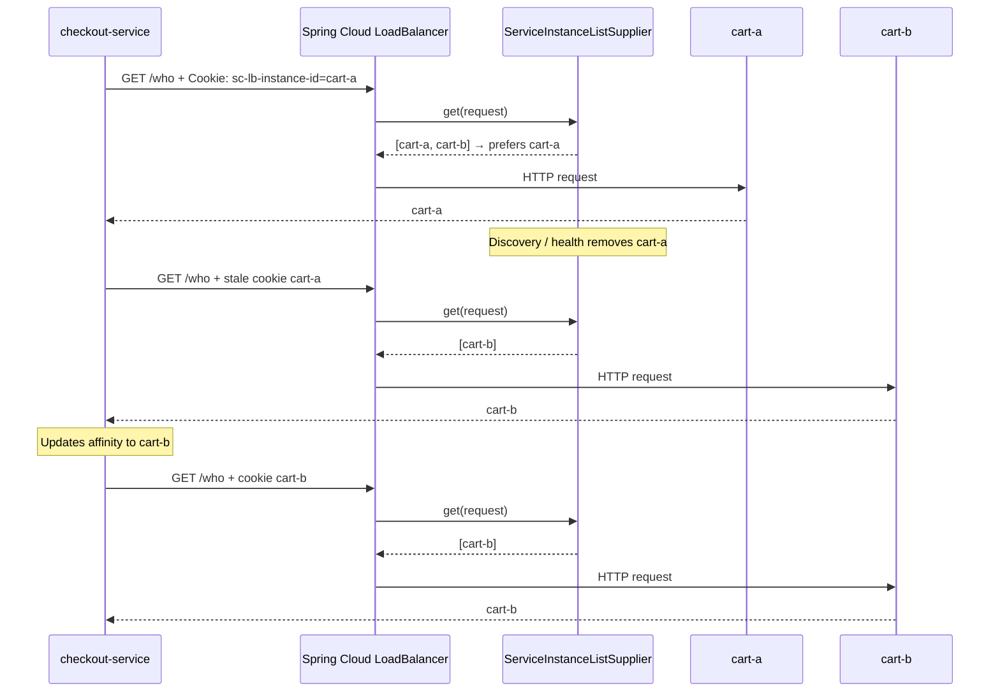

# Testing Sticky Sessions When the Preferred Replica Is Lost

## 1. Objectives and Problem Statement

In a microservices system, `checkout-service` calls `cart-service` by **service ID**. To leverage local caches or reduce connection warm-up cost, we want subsequent calls in a session to **prefer the same replica**. However, if that replica is removed from the list of available instances, requests must route to a remaining replica. Clinging forever to the old instance turns sticky sessions into a single point of failure.

This lesson belongs to the **Hands-On Project** chapter of the `SPRING_CLOUD_SERVICE_COMMUNICATION_LOAD_BALANCING` module. The module covers `ServiceInstance` selection by service ID, discovery, health checks, routing policies, `RestClient`/`WebClient`/OpenFeign, timeouts/retries, and failure observability. This exercise combines multiple mechanisms to answer a practical question: **When the preferred instance disappears, is the session still served, and which instance do subsequent requests prefer?**

After this lesson, you will be able to:

1. Distinguish **request-based sticky sessions** from **same-instance preference** and understand the limits of each.
2. Configure `RequestBasedStickySessionServiceInstanceListSupplier` for a specific service ID.
3. Use `WebClient` and the `sc-lb-instance-id` cookie to test instance preference.
4. Remove the preferred instance from the candidate list, observe failover routing, and update affinity on the caller side.
5. Distinguish **discovery having removed the instance** from **an instance being dead while discovery/cache still holds the stale entry**.
6. Write automated tests with two dynamic-port HTTP stubs, without Eureka/Consul/Docker and without relying on `Thread.sleep`.

**Completion criteria:** When A and B are both available, requests carrying the cookie preferring A consistently reach A; when A disappears from the list, requests carrying the **old** cookie still reach B; after the caller updates the cookie to B, requests continue routing to B even when A returns. When zero instances exist, the test must clearly detect the failure.

## 2. Sticky Sessions Are Really a Preference



There are **two** mechanisms in Spring Cloud LoadBalancer often loosely referred to as "sticky":

| Mechanism | What Does It Rely On? | Preference Scope | When Preferred Instance Disappears |
| --- | --- | --- | --- |
| `SameInstancePreferenceServiceInstanceListSupplier` | The instance **previously selected by LoadBalancer** | Supplier-level selection state; does not isolate individual user sessions | Prefers another remaining instance in the list |
| `RequestBasedStickySessionServiceInstanceListSupplier` | `instanceId` inside the **current request's** cookie | Per cookie value passed by the caller on each request | Does not force selecting the removed instance; picks from available candidates |

In this lesson, we choose **request-based sticky sessions** because the scenario requires simulating **a specific session**. With `SameInstancePreferenceServiceInstanceListSupplier`, requests from multiple users passing through the same supplier share the "previously selected instance" state, so it cannot provide per-user sticky sessions.

**Stickiness is a preference, not a guarantee:** if the instance whose ID is in the cookie has not been removed from the list yet stops answering network calls, the selector may still pick it. Requests then hit connection errors or timeouts. Recovery requires discovery/health checks updating the list, or an appropriate retry policy at the HTTP/LoadBalancer layer.

### 2.1. Target Selection Contract to Preserve

The selection flow looks like this:

```text
HTTP request (Cookie / request context)
    -> RequestBasedStickySessionServiceInstanceListSupplier
    -> Remaining available ServiceInstance list
    -> ReactorServiceInstanceLoadBalancer.choose(Request)
    -> Response<ServiceInstance> or EmptyResponse
    -> Send HTTP to the selected instance
```

The key invariant is that **the chosen instance must belong to the list returned by the supplier**. A cookie carrying an old ID is not authority to force LoadBalancer to keep using that instance. In real environments, the candidate list comes from discovery, caches, and health checks; in this lab, we mutate the list explicitly using a fake source so test outcomes are deterministic.

## 3. Test Scenario

Run two replicas of `cart-service` inside the test process, each backed by a JDK HTTP server:

| Replica | `instanceId` | Endpoint | Response |
| --- | --- | --- | --- |
| A | `cart-a` | `GET /who` | Text `cart-a` |
| B | `cart-b` | `GET /who` | Text `cart-b` |

Both servers bind **dynamic ports** using port `0`; they do not depend on Docker, DNS, or an external service registry. `checkout-service` uses `@LoadBalanced WebClient.Builder` to call `http://cart-service/who`. A fake supplier in `cart-service`'s child context holds the current instance list, switching from `[A, B]` to `[B]`, then `[A, B]`, or `[]`.

| Phase | Instance List | Cookie Sent by Caller | Expected Outcome |
| --- | --- | --- | --- |
| A: Normal | `[A, B]` | `cart-a` | Consistently selects A |
| B: A disappears from discovery | `[B]` | **Old** cookie `cart-a` | Selects B; zero HTTP calls to A |
| C: Caller switches affinity | `[B]` | `cart-b` | Continues selecting B |
| D: A returns | `[A, B]` | `cart-b` | Continues preferring B |
| E: No targets | `[]` | `cart-b` | No-instance error; zero requests to A/B |
| F: Stale cookie check | `[A, B]` | `cart-a` | May prefer A again because A reappeared |

Phase F helps detect applications that **forget to update the cookie after failover**. Once A returns, the stale cookie can pull the session back to A even after it moved to B. For applications with local state, that is a data-consistency hazard.

## 4. Preparing the Environment

Use Java 17+, JUnit 5, Spring Boot, and a compatible Spring Cloud version. Maven dependencies for app/test:

```xml
<dependencies>
    <dependency>
        <groupId>org.springframework.boot</groupId>
        <artifactId>spring-boot-starter-webflux</artifactId>
    </dependency>
    <dependency>
        <groupId>org.springframework.cloud</groupId>
        <artifactId>spring-cloud-starter-loadbalancer</artifactId>
    </dependency>
    <dependency>
        <groupId>org.springframework.boot</groupId>
        <artifactId>spring-boot-starter-test</artifactId>
        <scope>test</scope>
    </dependency>
</dependencies>
```

Manage versions with **compatible Spring Boot BOM + Spring Cloud BOM** for your project. The code below uses APIs from Spring Cloud LoadBalancer versions supporting `ServiceInstanceListSupplier.builder().withBase(...).withRequestBasedStickySession()`. Never pull an individual `spring-cloud-loadbalancer` version from another release line and mix it with your current Boot version.

In the lab, set test properties:

```properties
spring.cloud.loadbalancer.retry.enabled=false
spring.cloud.loadbalancer.cache.enabled=false
spring.cloud.loadbalancer.sticky-session.add-service-instance-cookie=true
```

The first two flags isolate sticky behavior: we do not have to guess how many times an HTTP request retried or whether an unexpired cache intervened. The third flag tells the `WebClient` LoadBalancer layer to **update the cookie to the newly selected instance on the outbound downstream request**. It does not automatically emit a `Set-Cookie` header back to browsers; persisting new affinity in callers requires its own mechanism.

Per Spring Cloud docs, request-based sticky sessions work when HTTP request data is passed to LoadBalancer, such as via `ClientRequestContext` in the `WebClient` integration. Do not pass an empty `Request` or use an HTTP client that drops cookies from context and expect the supplier to know the session ID.

## 5. Configuring LoadBalancer per Service ID

In production, you can configure:

```yaml
spring:
  cloud:
    loadbalancer:
      configurations: request-based-sticky-session
      sticky-session:
        add-service-instance-cookie: true
```

The `configurations: request-based-sticky-session` option applies LoadBalancer configuration to matching clients; to scope it strictly to `cart-service`, register a dedicated configuration using `@LoadBalancerClient` like this:

```java
import org.springframework.cloud.loadbalancer.annotation.LoadBalancerClient;
import org.springframework.context.annotation.Configuration;

@Configuration(proxyBeanMethods = false)
@LoadBalancerClient(
    name = "cart-service",
    configuration = CartStickyLoadBalancerConfig.class
)
public class CartStickyRegistration {}
```

Class declaring `@Bean ServiceInstanceListSupplier` for the child context:

```java
import org.springframework.cloud.loadbalancer.core.ServiceInstanceListSupplier;
import org.springframework.context.ConfigurableApplicationContext;
import org.springframework.context.annotation.Bean;

// Do not let this class be component-scanned as a global @Configuration.
public class CartStickyLoadBalancerConfig {
    @Bean
    ServiceInstanceListSupplier cartSupplier(
            ConfigurableApplicationContext context) {
        return ServiceInstanceListSupplier.builder()
                .withDiscoveryClient()
                .withCaching()
                .withRequestBasedStickySession()
                .build(context);
    }
}
```

In production, `withDiscoveryClient()` needs a `ReactiveDiscoveryClient`; if only a blocking `DiscoveryClient` is available, choose `withBlockingDiscoveryClient()`. Place caching right after discovery and before request-based filtering to avoid caching cookie-pinned results from an earlier session. If using `HealthCheckServiceInstanceListSupplier`, it usually sits right after discovery without stacking unnecessary extra caching because the health supplier has its own replay mechanism.

**In the integration test below**, we replace real discovery with a mutable `ServiceInstanceListSupplier` via `withBase(...)`. This lets us control the exact moment A leaves the list while still exercising **Spring Cloud's official sticky wrapper**, rather than writing a fake sticky algorithm and testing our own fake.

## 6. Complete Integration Test Code

Create `src/test/java/example/loadbalancer/StickyFailoverLabTest.java` in your Spring Boot application. The code starts two HTTP servers, builds `cart-service`'s child context, calls through a load-balanced `WebClient`, and mutates the instance list to verify the full failover lifecycle.

### 6.1. Test: Preferred A, A Disappears, B Receives Traffic

```java
package example.loadbalancer;

import com.sun.net.httpserver.HttpServer;
import java.io.IOException;
import java.net.InetSocketAddress;
import java.nio.charset.StandardCharsets;
import java.time.Duration;
import java.util.List;
import java.util.concurrent.atomic.AtomicInteger;
import java.util.concurrent.atomic.AtomicReference;

import org.junit.jupiter.api.Test;
import org.springframework.beans.factory.annotation.Autowired;
import org.springframework.boot.SpringBootConfiguration;
import org.springframework.boot.autoconfigure.EnableAutoConfiguration;
import org.springframework.boot.test.context.SpringBootTest;
import org.springframework.cloud.client.DefaultServiceInstance;
import org.springframework.cloud.client.ServiceInstance;
import org.springframework.cloud.client.loadbalancer.LoadBalanced;
import org.springframework.cloud.loadbalancer.annotation.LoadBalancerClient;
import org.springframework.cloud.loadbalancer.core.ServiceInstanceListSupplier;
import org.springframework.context.ConfigurableApplicationContext;
import org.springframework.context.annotation.Bean;
import org.springframework.web.reactive.function.client.WebClient;
import reactor.core.publisher.Flux;

import static org.junit.jupiter.api.Assertions.*;

@SpringBootTest(
    classes = StickyFailoverLabTest.LabApp.class,
    webEnvironment = SpringBootTest.WebEnvironment.NONE,
    properties = {
        "spring.cloud.loadbalancer.retry.enabled=false",
        "spring.cloud.loadbalancer.cache.enabled=false",
        "spring.cloud.loadbalancer.sticky-session.add-service-instance-cookie=true"
    }
)
class StickyFailoverLabTest {
    private static final Duration WAIT = Duration.ofSeconds(5);
    private static final String COOKIE_NAME = "sc-lb-instance-id";

    @Autowired
    LabInstances cluster;

    @Autowired
    @LoadBalanced
    WebClient.Builder clientBuilder;

    @Test
    void switchesFromPreferredAtoBWhenADisappears() {
        // Do not put instance port in URL: this is a service ID.
        WebClient client = clientBuilder.build();
        cluster.showBoth();

        // Phase A: a session preferring cart-a.
        for (int i = 0; i < 5; i++) {
            assertEquals("cart-a", call(client, "cart-a"));
        }
        assertEquals(5, cluster.hitsA.get());
        assertEquals(0, cluster.hitsB.get());

        // Phase B: simulate discovery/health removing A.
        cluster.showOnlyB();
        assertEquals("cart-b", call(client, "cart-a")); // Stale cookie!
        assertEquals(5, cluster.hitsA.get()); // No further hits to A.
        assertEquals(1, cluster.hitsB.get());

        // Phase C: caller notices new instance and switches affinity to B.
        String currentAffinity = "cart-b";
        for (int i = 0; i < 3; i++) {
            assertEquals("cart-b", call(client, currentAffinity));
        }

        // Phase D: A returns; cookie B must continue preferring B.
        cluster.showBoth();
        for (int i = 0; i < 3; i++) {
            assertEquals("cart-b", call(client, currentAffinity));
        }
        assertEquals(5, cluster.hitsA.get());
        assertEquals(7, cluster.hitsB.get());

        // Phase E: zero ServiceInstances.
        cluster.showNone();
        int beforeA = cluster.hitsA.get();
        int beforeB = cluster.hitsB.get();
        assertThrows(RuntimeException.class,
                () -> call(client, currentAffinity));
        assertEquals(beforeA, cluster.hitsA.get());
        assertEquals(beforeB, cluster.hitsB.get());

        // Phase F: if keeping old cookie A, traffic can return to A when A comes back.
        cluster.showBoth();
        assertEquals("cart-a", call(client, "cart-a"));
        assertEquals(beforeA + 1, cluster.hitsA.get());
    }

    private String call(WebClient client, String preferredInstanceId) {
        return client.get()
                .uri("http://cart-service/who")
                .cookie(COOKIE_NAME, preferredInstanceId)
                .retrieve()
                .bodyToMono(String.class)
                .block(WAIT);
    }

    // Parent test application; no need to start Spring's HTTP server.
    @SpringBootConfiguration(proxyBeanMethods = false)
    @EnableAutoConfiguration
    @LoadBalancerClient(
        name = "cart-service",
        configuration = StickySupplierConfig.class
    )
    static class LabApp {
        @Bean
        @LoadBalanced
        WebClient.Builder lbWebClientBuilder() {
            return WebClient.builder();
        }

        @Bean(destroyMethod = "close")
        LabInstances labInstances() {
            return new LabInstances();
        }
    }

    // Bean scoped to child context of service ID "cart-service".
    // Do not annotate @Configuration inside parent component scan.
    static class StickySupplierConfig {
        @Bean
        ServiceInstanceListSupplier cartSupplier(
                LabInstances cluster,
                ConfigurableApplicationContext context) {
            return ServiceInstanceListSupplier.builder()
                    .withBase(new MutableInstances(cluster))
                    .withRequestBasedStickySession()
                    .build(context);
        }
    }

    static final class MutableInstances
            implements ServiceInstanceListSupplier {
        private final LabInstances cluster;

        MutableInstances(LabInstances cluster) {
            this.cluster = cluster;
        }

        @Override
        public String getServiceId() {
            return "cart-service";
        }

        @Override
        public Flux<List<ServiceInstance>> get() {
            // Flux.defer reads the LATEST snapshot on every subscription.
            return Flux.defer(() -> Flux.just(cluster.available()));
        }
    }

    static final class LabInstances implements AutoCloseable {
        final AtomicInteger hitsA = new AtomicInteger();
        final AtomicInteger hitsB = new AtomicInteger();

        final HttpServer serverA;
        final HttpServer serverB;
        final ServiceInstance instanceA;
        final ServiceInstance instanceB;

        private final AtomicReference<List<ServiceInstance>> visible;

        LabInstances() {
            serverA = startServer("cart-a", hitsA);
            serverB = startServer("cart-b", hitsB);

            instanceA = new DefaultServiceInstance(
                    "cart-a", "cart-service", "127.0.0.1",
                    serverA.getAddress().getPort(), false);
            instanceB = new DefaultServiceInstance(
                    "cart-b", "cart-service", "127.0.0.1",
                    serverB.getAddress().getPort(), false);

            visible = new AtomicReference<>(
                    List.of(instanceA, instanceB));
        }

        List<ServiceInstance> available() {
            return visible.get();
        }

        void showBoth() {
            visible.set(List.of(instanceA, instanceB));
        }

        void showOnlyB() {
            visible.set(List.of(instanceB));
        }

        void showNone() {
            visible.set(List.of());
        }

        private static HttpServer startServer(
                String instanceId, AtomicInteger hits) {
            try {
                HttpServer server = HttpServer.create(
                        new InetSocketAddress("127.0.0.1", 0), 0);

                server.createContext("/who", exchange -> {
                    hits.incrementAndGet();
                    // Record cookie received downstream for debugging.
                    String cookie = String.join("; ",
                            exchange.getRequestHeaders()
                                    .getOrDefault("Cookie", List.of()));
                    exchange.getResponseHeaders()
                            .add("X-Observed-Cookie", cookie);

                    byte[] body =
                            instanceId.getBytes(StandardCharsets.UTF_8);
                    exchange.getResponseHeaders().add(
                            "Content-Type", "text/plain; charset=utf-8");
                    try {
                        exchange.sendResponseHeaders(200, body.length);
                        try (var stream = exchange.getResponseBody()) {
                            stream.write(body);
                        }
                    } finally {
                        exchange.close();
                    }
                });
                server.start();
                return server;
            } catch (IOException error) {
                throw new IllegalStateException(
                        "Cannot start " + instanceId, error);
            }
        }

        @Override
        public void close() {
            serverA.stop(0);
            serverB.stop(0);
        }
    }
}
```

**Why does this example genuinely test Spring Cloud LoadBalancer?**

- `MutableInstances` only **supplies the list**; cookie inspection and instance preference are handled by Spring Cloud's `withRequestBasedStickySession()`. Thus the test does not implement its own fake sticky algorithm and merely test that fake.
- `@LoadBalancerClient(name="cart-service")` creates an isolated configuration inside `cart-service`'s child context; other services keep their own suppliers.
- The URL `http://cart-service/who` goes through `@LoadBalanced WebClient.Builder`. LoadBalancer resolves A/B's real ports from `ServiceInstance` entries rather than from the caller's URL.
- `Flux.defer(...)` reads the `AtomicReference` when an instance is needed. Since the lab intentionally disables caching, `showOnlyB()` takes effect on the very next call without waiting for a TTL.
- Servers A and B return their IDs in the **actual HTTP body**, so assertions prove which replica truly received the request; `hitsA`/`hitsB` record actual received HTTP hits, which differ from logical calls if retries are enabled.
- `WebClient` does not automatically retain cookies across calls: the test explicitly sends the cookie. After receiving `cart-b`, the test simulates the caller updating its affinity to `cart-b`.

This code assumes current Spring Cloud builder APIs and auto-configuration compatible with your chosen Spring Boot version. Before integrating into a project, verify the **BOM**, and register **only one `ServiceInstanceListSupplier` bean** for the `cart-service` context to avoid conflicts with the default supplier.

### 6.2. How to Run and Interpret Results

Place the test in an application with Maven Wrapper and run:

```bash
./mvnw -Dtest=StickyFailoverLabTest test
```

On Windows PowerShell, use the corresponding Maven Wrapper:

```powershell
.\mvnw.cmd -Dtest=StickyFailoverLabTest test
```

The test passes when all assertions on **instance IDs**, **server hit counts**, **zero hits to A after removal**, and **no-instance failure** succeed. The test intentionally avoids static ports or Round Robin order assumptions. If your Spring Cloud version alters how cookies enter `ClientRequestContext`, verify against that release line's documentation before adjusting the test.

Do not rewrite the test as "sleep a few seconds and hope A gets dropped," as results would depend on discovery/health speed. Mutating the snapshot list **directly** isolates the sticky-session contract from list-refresh latency.

## 7. What Happens to the Cookie After Failover?

Spring Cloud supports the property:

```yaml
spring:
  cloud:
    loadbalancer:
      sticky-session:
        add-service-instance-cookie: true
```

Per the docs, this flag **adds/updates the cookie carrying the chosen instance ID on the HTTP request forwarded by LoadBalancer**. For example, if the caller sends `sc-lb-instance-id=cart-a` while A was removed, the actual request goes to B, so the cookie seen by B can be updated to `cart-b`.

**Do not confuse this cookie with a browser session cookie:** `WebClient` sending a cookie downstream does not mean a gateway's HTTP response automatically includes `Set-Cookie` for the browser. If you want browsers or external clients to stick to B on subsequent requests, the application/gateway layer must **reliably read the routing result, emit a response cookie**, and control its domain/path/expiry/security flags.

To inspect the cookie received by the backend, you can swap `call(...)` for a variant that also reads response headers:

```java
private void inspectForwardedCookie(WebClient client, String preference) {
    var response = client.get()
            .uri("http://cart-service/who")
            .cookie("sc-lb-instance-id", preference)
            .retrieve()
            .toEntity(String.class)
            .block(Duration.ofSeconds(5));

    assertNotNull(response);
    System.out.println("Selected instance: " + response.getBody());
    System.out.println("Downstream saw Cookie: " +
            response.getHeaders().getFirst("X-Observed-Cookie"));
}
```

This is an **extra diagnostic aid**; do not treat the echoed header as an official production API contract. In tests, the source of truth for which instance served the call is `response.getBody()` from each stub and the server hit counters. If an HTTP request has multiple cookies or multiple `Cookie` headers, header merging varies by HTTP transport; inspect actual output before asserting exact cookie strings.

With the default cookie name `sc-lb-instance-id`, the test works without overriding the cookie-name property. When customizing the cookie name, look up `spring.cloud.loadbalancer.sticky-session.instance-id-cookie-name` in **your exact version's configuration properties**; some doc sections mention different paths. Do not guess property names just because the app starts cleanly.

## 8. An Often-Overlooked Failure: Instance Dead Yet Still in the List

The lab's `showOnlyB()` simulates **discovery or health checks having removed A**. That differs from:

```text
ServiceInstanceListSupplier still returns [A, B]
Caller's cookie = cart-a
A actually stopped listening / stopped responding
```

With that state, request-based stickiness can still prefer A. Without retries or circuit breakers, the client receives a connection error or timeout. Therefore:

| Scenario | Supplier List | Appropriate Outcome |
| --- | --- | --- |
| A unhealthy and removed by supplier | `[B]` | Prefers B; cookie A does not force picking A |
| A stopped while discovery/cache still holds A | `[A,B]` | May still pick A and fail |
| A removed after TTL or health probe | Transitions from `[A,B]` to `[B]` | Requests **after list refresh** stabilize on B |
| Both A and B unavailable | `[]` | `EmptyResponse`/no-instance; no backend reachable |
| A comes back online | `[A,B]` | New cookie B keeps preferring B; old cookie A may pick A again |

To extend the lab, you can add `stopA()` to `LabInstances`, call `serverA.stop(0)`, and **keep the list as `[A,B]`**. When sending cookie A, assert the exception rather than expecting automatic failover to B. Only after `showOnlyB()` or health/discovery removes A should you expect traffic to route to B. Because JDK `HttpServer` cannot be restarted after `stop` as initially constructed, isolate this scenario into **a separate test** with fresh fixtures.

### 8.1. Caching and Health Checks in Real Environments

A production chain may look like:

```text
DiscoveryClient / ReactiveDiscoveryClient
    -> CachingServiceInstanceListSupplier
    -> RequestBasedStickySessionServiceInstanceListSupplier
    -> RoundRobinLoadBalancer
```

Or with properly configured health checks:

```text
DiscoveryClient / ReactiveDiscoveryClient
    -> HealthCheckServiceInstanceListSupplier
    -> RequestBasedStickySessionServiceInstanceListSupplier
    -> RoundRobinLoadBalancer
```

The cache or health supplier should sit **right after network discovery retrieval**, ahead of request-based filtering. The health-check supplier has its own replay/cache mechanism, so avoid stacking an extra caching supplier needlessly. If enabling `spring.cloud.loadbalancer.cache.ttl`, do not confuse "TTL expired" with "server evicted immediately": a subsequent access triggers loading the fresh list, and discovery itself might still return stale entries.

In integration tests with health checks, expose two health endpoints and use bounded polling to assert **the post-probe snapshot** instead of `Thread.sleep`. Also check your exact version's policy when **all instances are unhealthy**; fallback-to-all vs. empty-list behavior varies across Spring Cloud versions.

## 9. Do Retries and Timeouts Change the Outcome?

The lab disables retries so backend hit counts match invocations 1-to-1. In production:

1. **Feign** in Spring Cloud OpenFeign defaults to `Retryer.NEVER_RETRY` at the Feign layer, though LoadBalancer or infrastructure may still retry when enabled.
2. **WebClient/RestClient** have HTTP client timeouts; retries at Reactor, LoadBalancer, or gateway layers must be evaluated separately.
3. When an attempt times out while A remains in the list, a retry might **pick A again** or switch instances depending on `RetryAwareServiceInstanceListSupplier`, retry policy, and request context.
4. One logical call can produce multiple HTTP attempts. Never infer active user or session counts directly from backend hit counts.

Further practice: enable bounded retries for idempotent GETs after verifying basic routing. Log **attempt count**, **selected instance**, and **final outcome** separately. When testing state-mutating calls like order-creation `POST`s, design idempotency to avoid duplicate side effects.

Never crank up unbounded retries to "mask" sticky sessions pointing at a dead instance. The real fix is updating the candidate list accurately and falling back cleanly.

## 10. Observing the System After Failover

A useful dashboard/trace should capture:

| Signal | How to Measure | Meaning |
| --- | --- | --- |
| Logical calls to `cart-service` | Caller timer/counter | Business call volume |
| HTTP attempts per instance | HTTP server metrics / A/B access logs | Requests actually received by each replica |
| Selected instance | Span/log with `service ID`, `instance ID` | Confirms shift to B after A is removed |
| No-instance | `loadbalancer.requests.discard` with Micrometer stats on | Discovery/health returned no candidates |
| Timeouts and connection errors | HTTP client observations + error logs | Distinguishes dead instance from no-instance |
| Accepted retries/attempts | Retry-policy/transport metrics | Quantifies extra load during failover |
| Old/new cookie affinity | Sanitized test logs with sensitive session data redacted | Detects callers failing to update preferred ID |

To enable LoadBalancer statistics:

```yaml
spring:
  cloud:
    loadbalancer:
      stats:
        micrometer:
          enabled: true
management:
  endpoints:
    web:
      exposure:
        include: health,metrics,prometheus
```

With Actuator and a matching `MeterRegistry`/Prometheus registry, observe `loadbalancer.requests.active`, `loadbalancer.requests.success`, `loadbalancer.requests.failed`, and `loadbalancer.requests.discard`. **Caution:** `loadbalancer.requests.success` means the LoadBalancer call ended with a forwarded response, not automatically HTTP 2xx; correlate with HTTP client outcomes.

In tracing/logs, never place raw session IDs, tokens, or cookies into metric labels. Log controlled instance IDs and attach correlation IDs in traces/logs, since real session cookies can be sensitive data.

## 11. Additional Tests to Catch Operational Bugs

| Test Case | Input / Setup | Expected Behavior |
| --- | --- | --- |
| Normal sticky | `[A,B]`, cookie A | A receives all calls under identical conditions |
| Cookie absent from list | `[B]`, cookie A | B receives the request |
| No cookie sent | `[A,B]` | Default LoadBalancer policy picks a candidate; **no** automatic per-user stickiness |
| Invalid cookie | `[A,B]`, cookie `unknown` | Falls back across remaining list |
| A dead while cache still has A | Cache `[A,B]`, cookie A | May hit network error to A; tests TTL/cache |
| A removed by health check | List becomes `[B]` | New requests go to B |
| Client updates cookie to B | `[A,B]`, cookie B | B continues being preferred even after A recovers |
| Client fails to update cookie | `[A,B]`, cookie A | May swing back to A |
| All instances disappear | `[]` | Clear no-instance error; zero backend attempts |
| B slower than timeout | `[B]`, cookie A | HTTP-layer timeout; do not blame instance selection |
| Retries enabled | `[A,B]` and retryable failure | Count actual attempts; retry policy may switch instances |
| Concurrent sessions | Cookies A and B in interleaved requests | Both sessions preserve independent affinity when request context propagates cleanly |

Interleaved tests are essential. A test with only **one caller sending cookie A** will miss accidentally replacing request-based stickiness with global "previously selected" state.

### 11.1. Two-Session Test Snippet

Add to the test class from section 6 while both A and B are available:

```java
@Test
void independentCookiesSelectIndependentInstances() {
    cluster.showBoth();
    WebClient client = clientBuilder.build();

    for (int i = 0; i < 10; i++) {
        assertEquals("cart-a", call(client, "cart-a"));
        assertEquals("cart-b", call(client, "cart-b"));
    }
}
```

If this interleaved test fails while the single-session test passes, check whether the request cookie actually reaches `RequestBasedStickySessionServiceInstanceListSupplier.get(Request)`, and verify caching was not accidentally placed **after** request-based filtering.

## 12. Self-Assessment Questions

1. Given list `[A, B]` and cookie A, if A closes its socket while discovery still returns A, is automatic failover to B guaranteed? What else is needed?
2. When the supplier returns only `[B]` while the cookie still carries A, why does the supplier refuse to force selecting A?
3. After failover, if A recovers and the old cookie stays unchanged, where can subsequent requests go? How does that impact locally stored session state?
4. Why cannot `SameInstancePreferenceServiceInstanceListSupplier` fully replace per-user request-based stickiness?
5. What does `add-service-instance-cookie=true` alter on the downstream HTTP request? Does it automatically emit `Set-Cookie` back to browsers?
6. How would you prove sticky routing using **replica response bodies**, **access counts**, and **traces** instead of checking HTTP 200 alone?
7. Propose a coordinated policy across health checks, cache TTL, retries, and timeouts so users fail over from A to B within your SLO.

## 13. Lab Acceptance Criteria

This lesson is complete with evidence of the following:

- Configured `@LoadBalanced WebClient.Builder` calling by **service ID `cart-service`** with `RequestBasedStickySessionServiceInstanceListSupplier`.
- Both replicas return distinct instance IDs and expose HTTP request counters.
- With cookie A, initial requests route consistently to A.
- When A leaves the available list, requests carrying cookie A still reach B; A's hit count **does not increase**.
- After updating affinity to B, B continues to be selected once A returns.
- When the list is empty, the client receives an error/no-instance and zero backends receive requests.
- Separately explained the case where **A is dead while the list/cache has not refreshed**.
- Verified that a request-based cookie does not leak as shared "previous instance" state across distinct sessions.

### References

- [Spring Cloud Commons – Spring Cloud LoadBalancer](https://docs.spring.io/spring-cloud-commons/reference/spring-cloud-commons/loadbalancer.html): request-based sticky sessions, same-instance preference, supplier builders, caching/health checks, and `WebClient` integration.
- [Spring Cloud Commons – Configuration Properties](https://docs.spring.io/spring-cloud-commons/reference/configprops.html): `sticky-session.add-service-instance-cookie`, cookie name, and cache/retry properties.
- [Spring Cloud Commons – LoadBalancerClientConfiguration](https://github.com/spring-cloud/spring-cloud-commons/blob/main/spring-cloud-loadbalancer/src/main/java/org/springframework/cloud/loadbalancer/annotation/LoadBalancerClientConfiguration.java): how the framework builds suppliers for each option and per-service context.
- [Spring Cloud Commons – RoundRobinLoadBalancer](https://github.com/spring-cloud/spring-cloud-commons/blob/main/spring-cloud-loadbalancer/src/main/java/org/springframework/cloud/loadbalancer/core/RoundRobinLoadBalancer.java): `choose(Request)` and candidate handling.

**Key takeaway:** Sticky sessions **prefer** an instance based on a cookie or request context, yet only instances **supplied by the supplier** are valid targets. Failing over after A is lost relies on discovery/cache/health updating the list; to keep a session on B after failover, the caller must maintain the new affinity. Testing with real HTTP and server-side counters is the surest way to separate routing bugs from timeouts, retries, and stale instance lists.
