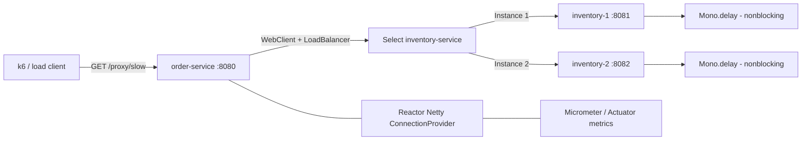
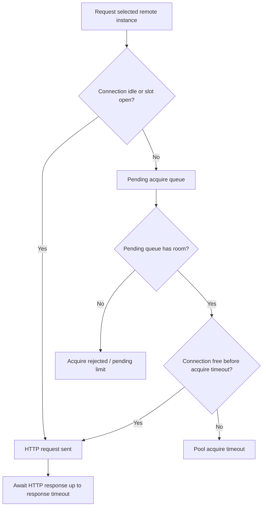
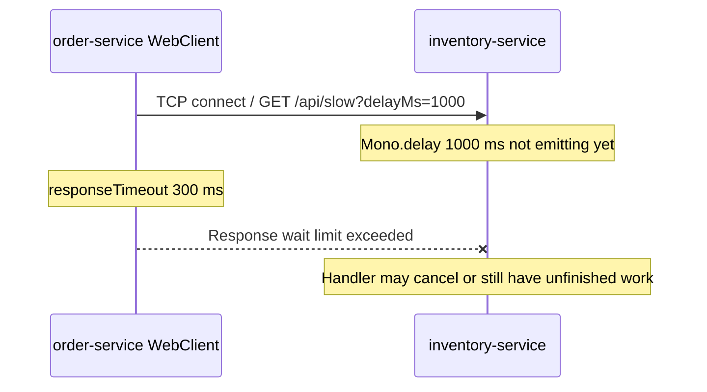

# Measuring the Impact of Timeouts and Pool Limits

In a microservices system, lowering `readTimeout` from 3 seconds to 500 ms makes requests fail faster, yet it does not make the backend faster. Raising `maxConnections` from 4 to 100 reduces socket acquisition wait on the caller, yet it can also send too many concurrent requests into the target service and its database. With Spring Cloud LoadBalancer, a service ID such as `inventory-service` can also map to **multiple `ServiceInstance` entries**, where each remote address can maintain its own connection pool.

This **Hands-On Project** builds a compact lab to **measure**—rather than guess—the effects of **connect timeout, response timeout, overall deadline, connection pool size, and pending acquisition timeout** on throughput, p95/p99 latency, error rate, and traffic distribution across instances.

We use `WebClient` and Reactor Netty for straightforward control over connection pools and metrics; the same experimental method applies to `RestClient` and `OpenFeign`, though pool configuration APIs and exception types differ. Spring Cloud LoadBalancer handles `ServiceInstance` selection by service ID; the HTTP connector handles TCP, pooling, and timeouts.

> All URIs, ports, pool sizes, and timeout thresholds below are for **local/lab machines**, not recommended production defaults. Measurements are collected by the learner; this lesson never fabricates benchmark figures.

## 1. Objectives and Completion Criteria

After this lab, you should be able to:

1. Launch **two `inventory-service` instances** and one `order-service` caller using `@LoadBalanced WebClient.Builder`.
2. Prove requests route through service ID `http://inventory-service`, rather than calling a fixed `localhost` URL from the gateway.
3. Tune `ConnectionProvider.maxConnections`, `pendingAcquireMaxCount`, `pendingAcquireTimeout`, TCP connect timeout, and Reactor Netty `responseTimeout`.
4. Distinguish requests **waiting on the pool**, **failing TCP connect**, **waiting too long for a response**, and **exceeding the overall deadline**.
5. Measure requests/s, p50/p95/p99, errors, HTTP attempt counts, and active/idle/pending pool gauges under the same workload.
6. Explain why growing the pool can merely shift the bottleneck to the backend, and why overly tight timeouts cause errors even while instances are healthy.
7. Tabulate results, make evidence-based tuning decisions, and re-test when one instance is slower than the other.

**Pass criteria:** a working lab setup on compatible Spring Boot/Spring Cloud versions, evidence from HTTP responses/metrics/logs that both instances were selected, a comparison table across scenarios under matching load, and conclusions grounded in **real measurements** rather than guesswork from configuration.

## 2. Lab Architecture



| Component | Role | What We Want to Observe |
|---|---|---|
| `order-service` | Receives load-generator requests, picks an instance, calls downstream HTTP. | End-to-end latency, errors, pool pending, and timeouts. |
| `inventory-1` | Returns JSON response after a simulated delay. | Request count, instance ID, processing time. |
| `inventory-2` | Same API; can add extra delay to introduce skew. | Request share and latency when two instances differ in capacity. |
| `SimpleDiscoveryClient` | Supplies two static `ServiceInstance` entries for the service ID. | No external registry needed; easy to repeat measurements. |
| Reactor Netty `ConnectionProvider` | Manages pools per remote HTTP transport address. | Active/idle/pending counts and acquire wait time. |
| `k6` | Drives controlled concurrency and measures latency/error rate. | p50/p95/p99, throughput, HTTP statuses, per-instance distribution. |

The lab uses **HTTP/1.1 over loopback** to avoid TLS/proxy variables; HTTPS, proxies, and dynamic discovery can be added later as extension exercises. In Docker/Kubernetes, a container's `localhost` does not point to other containers; replace URIs with DNS/reachable addresses matching the real topology.

### Which Phases Does a Logical Operation Pass Through?

```text
k6
  -> order-service receives GET /proxy/slow
     -> WebClient queries Spring Cloud LoadBalancer
        -> selects ServiceInstance host:port
        -> acquires connection from pool for that remote
           -> opens new TCP connect or reuses socket
           -> sends HTTP GET /api/slow
              -> inventory-service holds response for delay
              -> returns JSON
        -> WebClient reads and decodes response
     -> order-service returns result to k6
```

**Classification note:** pool acquisition wait occurs **before** the HTTP request is sent. `connectTimeout` normally bounds opening a new TCP socket, not pending pool acquisition. Reactor Netty's `responseTimeout` covers waiting for response data, **not an absolute deadline** for the entire logical operation; we add Reactor `Mono.timeout(...)` to enforce and measure the overall deadline.

## 3. Preparing Environment and Versions

You need Java **17+**, Maven, an IDE/editor, an HTTP tool like `curl`, and the `k6` load-testing tool. A reference pair for the APIs in this lesson is **Spring Boot 3.3.x** with **Spring Cloud 2023.0.x** per Spring Cloud's compatibility matrix; for new projects, choose a currently supported, organization-approved pair. Never mix Spring Boot, Spring Cloud, Reactor Netty, and Spring Framework versions arbitrarily.

Create **two independent Maven projects**:

```text
loadbalancer-pool-lab/
  inventory-service/
    pom.xml
    src/main/java/lab/inventory/InventoryApplication.java
    src/main/resources/application.yml
  order-service/
    pom.xml
    src/main/java/lab/order/OrderApplication.java
    src/main/resources/application.yml
  load.js
```

Each Maven project uses the chosen Spring Boot parent/BOM. Minimum dependencies:

| Project | Core Dependencies |
|---|---|
| `inventory-service` | `spring-boot-starter-webflux`, `spring-boot-starter-actuator`. |
| `order-service` | `spring-boot-starter-webflux`, `spring-cloud-starter-loadbalancer`, `spring-boot-starter-actuator`, `micrometer-registry-prometheus` (if scraping Prometheus). |

For `order-service`, import the compatible Spring Cloud BOM. The minimal Maven example below **explicitly uses Spring Boot 3.3.8 and Spring Cloud 2023.0.5 for illustration**; for new projects, choose supported patch releases and check the compatibility matrix instead of pinning old versions indefinitely:

```xml
<project xmlns="http://maven.apache.org/POM/4.0.0"
         xmlns:xsi="http://www.w3.org/2001/XMLSchema-instance"
         xsi:schemaLocation="http://maven.apache.org/POM/4.0.0 https://maven.apache.org/xsd/maven-4.0.0.xsd">
    <modelVersion>4.0.0</modelVersion>
    <parent>
        <groupId>org.springframework.boot</groupId>
        <artifactId>spring-boot-starter-parent</artifactId>
        <version>3.3.8</version>
        <relativePath/>
    </parent>
    <groupId>lab</groupId>
    <artifactId>order-service</artifactId>
    <version>1.0-SNAPSHOT</version>
    <properties>
        <java.version>17</java.version>
        <spring-cloud.version>2023.0.5</spring-cloud.version>
    </properties>
    <dependencyManagement>
        <dependencies>
            <dependency>
                <groupId>org.springframework.cloud</groupId>
                <artifactId>spring-cloud-dependencies</artifactId>
                <version>${spring-cloud.version}</version>
                <type>pom</type>
                <scope>import</scope>
            </dependency>
        </dependencies>
    </dependencyManagement>
    <dependencies>
        <dependency>
            <groupId>org.springframework.boot</groupId>
            <artifactId>spring-boot-starter-webflux</artifactId>
        </dependency>
        <dependency>
            <groupId>org.springframework.cloud</groupId>
            <artifactId>spring-cloud-starter-loadbalancer</artifactId>
        </dependency>
        <dependency>
            <groupId>org.springframework.boot</groupId>
            <artifactId>spring-boot-starter-actuator</artifactId>
        </dependency>
        <dependency>
            <groupId>io.micrometer</groupId>
            <artifactId>micrometer-registry-prometheus</artifactId>
        </dependency>
    </dependencies>
    <build>
        <plugins>
            <plugin>
                <groupId>org.springframework.boot</groupId>
                <artifactId>spring-boot-maven-plugin</artifactId>
            </plugin>
        </plugins>
    </build>
</project>
```

The example uses a **compatibility reference version pair**, not a claim about the latest security patch at deployment time. For `inventory-service`, use the same Boot parent, group/version/plugins, change the artifact ID to `inventory-service`, omit the Spring Cloud BOM and LoadBalancer dependency, and keep WebFlux + Actuator.

**Controlling variables:** on initial runs, enable no extra retries, no circuit breaker, no real service registry, no proxy/TLS, and no simulated database. Only introduce those one at a time after understanding pool and timeout effects.

## 4. Building inventory-service: A Controlled Slow Backend

File `inventory-service/src/main/resources/application.yml`:

```yaml
spring:
  application:
    name: inventory-service
server:
  port: ${SERVER_PORT:8081}
lab:
  instance-id: ${LAB_INSTANCE_ID:inventory-1}
  extra-delay-ms: ${LAB_EXTRA_DELAY_MS:0}
management:
  endpoints:
    web:
      exposure:
        include: health,info,metrics
```

File `inventory-service/src/main/java/lab/inventory/InventoryApplication.java`:

```java
package lab.inventory;

import java.time.Duration;
import java.util.concurrent.atomic.AtomicLong;

import org.springframework.beans.factory.annotation.Value;
import org.springframework.boot.SpringApplication;
import org.springframework.boot.autoconfigure.SpringBootApplication;
import org.springframework.web.bind.annotation.GetMapping;
import org.springframework.web.bind.annotation.RequestHeader;
import org.springframework.web.bind.annotation.RequestParam;
import org.springframework.web.bind.annotation.RestController;
import reactor.core.publisher.Mono;

@SpringBootApplication
public class InventoryApplication {
    public static void main(String[] args) {
        SpringApplication.run(InventoryApplication.class, args);
    }
}

@RestController
class InventoryController {
    private final String instanceId;
    private final long extraDelayMs;
    private final AtomicLong counter = new AtomicLong();

    InventoryController(
            @Value("${lab.instance-id}") String instanceId,
            @Value("${lab.extra-delay-ms:0}") long extraDelayMs) {
        this.instanceId = instanceId;
        this.extraDelayMs = extraDelayMs;
    }

    @GetMapping("/api/slow")
    Mono<InventoryReply> slow(
            @RequestParam(defaultValue = "200") long delayMs,
            @RequestHeader(value = "X-Lab-Request-Id", defaultValue = "manual")
                    String requestId) {

        long requested = Math.max(0, Math.min(delayMs, 10_000));
        long actualDelay = Math.min(10_000,
                Math.max(0, requested + extraDelayMs));

        return Mono.delay(Duration.ofMillis(actualDelay))
                .map(tick -> new InventoryReply(
                        instanceId, requestId, actualDelay,
                        counter.incrementAndGet()));
    }
}

record InventoryReply(
        String instance, String requestId, long delayMs, long sequence) {}
```

### Why Use Mono.delay?

`Mono.delay` simulates a server **withholding its response body** for a duration **without blocking the Netty event loop**. For a small JSON payload, the backend connection typically stays occupied until the response completes, making it ideal for observing HTTP/1.1 connection-pool occupancy on the caller.

This models **slow service time**, not saturated CPU or DB pools. In production, adding connections cannot overcome CPU, database, or thread limits; an extension exercise tests that bottleneck differently.

`sequence` counts requests **that completed the handler** per instance, not TCP connections. When a client times out or cancels, server-side work and counter increments depend on cancellation; never use `sequence` alone to infer received requests. To count attempts accurately, add an inbound request counter or dedicated HTTP server metric.

## 5. Building order-service: LoadBalancer, Pool, and Three Time Bounds

File `order-service/src/main/resources/application.yml`:

```yaml
spring:
  application:
    name: order-service
  cloud:
    discovery:
      client:
        simple:
          instances:
            inventory-service:
              - uri: http://localhost:8081
              - uri: http://localhost:8082
    loadbalancer:
      retry:
        enabled: false

server:
  port: 8080

lab:
  pool:
    max-connections: ${LAB_POOL_MAX_CONNECTIONS:4}
    pending-acquire-max-count: ${LAB_POOL_PENDING_MAX_COUNT:16}
    pending-acquire-timeout-ms: ${LAB_POOL_ACQUIRE_TIMEOUT_MS:300}
  http:
    connect-timeout-ms: ${LAB_HTTP_CONNECT_TIMEOUT_MS:500}
    response-timeout-ms: ${LAB_HTTP_RESPONSE_TIMEOUT_MS:1500}
    overall-timeout-ms: ${LAB_HTTP_OVERALL_TIMEOUT_MS:2500}

management:
  endpoints:
    web:
      exposure:
        include: health,info,metrics,prometheus
  metrics:
    tags:
      application: order-service
```

The initial values apply **per remote pool** in Reactor Netty; they do not mean the entire `order-service` can open at most four TCP connections across two backends.

File `order-service/src/main/java/lab/order/OrderApplication.java`:

```java
package lab.order;

import java.time.Duration;
import java.util.UUID;

import io.netty.channel.ChannelOption;
import org.slf4j.Logger;
import org.slf4j.LoggerFactory;
import org.springframework.beans.factory.annotation.Value;
import org.springframework.boot.SpringApplication;
import org.springframework.boot.autoconfigure.SpringBootApplication;
import org.springframework.cloud.client.loadbalancer.LoadBalanced;
import org.springframework.context.annotation.Bean;
import org.springframework.context.annotation.Configuration;
import org.springframework.http.client.reactive.ReactorClientHttpConnector;
import org.springframework.stereotype.Service;
import org.springframework.web.bind.annotation.GetMapping;
import org.springframework.web.bind.annotation.RequestHeader;
import org.springframework.web.bind.annotation.RequestParam;
import org.springframework.web.bind.annotation.RestController;
import org.springframework.web.reactive.function.client.WebClient;
import reactor.core.publisher.Mono;
import reactor.netty.http.client.HttpClient;
import reactor.netty.resources.ConnectionProvider;

@SpringBootApplication
public class OrderApplication {
    public static void main(String[] args) {
        SpringApplication.run(OrderApplication.class, args);
    }
}

@Configuration(proxyBeanMethods = false)
class InventoryHttpConfiguration {

    @Bean(destroyMethod = "dispose")
    ConnectionProvider inventoryPool(
            @Value("${lab.pool.max-connections}") int maxConnections,
            @Value("${lab.pool.pending-acquire-max-count}") int pendingMax,
            @Value("${lab.pool.pending-acquire-timeout-ms}") long acquireMs) {

        return ConnectionProvider.builder("inventory-lab-pool")
                .maxConnections(maxConnections)
                .pendingAcquireMaxCount(pendingMax)
                .pendingAcquireTimeout(Duration.ofMillis(acquireMs))
                .maxIdleTime(Duration.ofSeconds(20))
                .metrics(true)
                .build();
    }

    @Bean
    @LoadBalanced
    WebClient.Builder inventoryLoadBalancedBuilder(
            ConnectionProvider inventoryPool,
            @Value("${lab.http.connect-timeout-ms}") int connectMs,
            @Value("${lab.http.response-timeout-ms}") long responseMs) {

        HttpClient transport = HttpClient.create(inventoryPool)
                .option(ChannelOption.CONNECT_TIMEOUT_MILLIS, connectMs)
                .responseTimeout(Duration.ofMillis(responseMs));

        return WebClient.builder()
                .clientConnector(new ReactorClientHttpConnector(transport));
    }
}

@Service
class InventoryGateway {
    private final WebClient client;
    private final Duration overallDeadline;

    InventoryGateway(
            @LoadBalanced WebClient.Builder inventoryLoadBalancedBuilder,
            @Value("${lab.http.overall-timeout-ms}") long overallMs) {

        this.client = inventoryLoadBalancedBuilder
                .baseUrl("http://inventory-service")
                .build();
        this.overallDeadline = Duration.ofMillis(overallMs);
    }

    Mono<InventoryReply> fetch(long delayMs, String requestId) {
        return client.get()
                .uri(builder -> builder.path("/api/slow")
                        .queryParam("delayMs", delayMs)
                        .build())
                .header("X-Lab-Request-Id", requestId)
                .retrieve()
                .bodyToMono(InventoryReply.class)
                .timeout(overallDeadline);
    }
}

@RestController
class ProxyController {
    private static final Logger log =
            LoggerFactory.getLogger(ProxyController.class);
    private final InventoryGateway gateway;

    ProxyController(InventoryGateway gateway) {
        this.gateway = gateway;
    }

    @GetMapping("/proxy/slow")
    Mono<InventoryReply> slow(
            @RequestParam(defaultValue = "200") long delayMs,
            @RequestHeader(value = "X-Lab-Request-Id", required = false)
                    String incomingRequestId) {

        String requestId = incomingRequestId == null
                || incomingRequestId.isBlank()
                ? UUID.randomUUID().toString()
                : incomingRequestId;

        return gateway.fetch(delayMs, requestId)
                .doOnError(error -> log.warn(
                        "requestId={} downstreamFailure={} message={}",
                        requestId,
                        error.getClass().getSimpleName(),
                        error.getMessage()));
    }
}

record InventoryReply(
        String instance, String requestId, long delayMs, long sequence) {}
```

### Explaining the Time Limits in Configuration

| Setting | Lab Default | Where Applied | When Does It Typically Trigger? |
|---|---:|---|---|
| `pendingAcquireTimeout` | 300 ms | `ConnectionProvider`. | The remote's pool is saturated and the request must wait for a connection. |
| `CONNECT_TIMEOUT_MILLIS` | 500 ms | Netty TCP connect. | A new socket must open, yet the TCP connection fails to establish in time. |
| `responseTimeout` | 1,500 ms | Reactor Netty HTTP response. | Response bytes are not received within the transport limit, e.g., backend is slow to send first byte. |
| `Mono.timeout(overallDeadline)` | 2,500 ms | `WebClient` pipeline in gateway. | Total time from subscription to result exceeds deadline, including pool wait and instance selection inside that pipeline. |

**Further distinction:** `pendingAcquireMaxCount=16` is the number of requests allowed to wait for a connection per remote pool, **not 16 TCP connections**. When the pending queue is full, rejection occurs immediately without waiting 300 ms. `maxIdleTime=20s` bounds how long an idle connection remains eligible before eviction; it does not time out an in-flight request after 20 seconds.

### Why Disable Retries Before Measuring?

One logical operation can generate multiple HTTP attempts if Spring Cloud LoadBalancer, the Reactor pipeline, or the transport retries automatically. Then `k6` counts one logical HTTP request to `order-service` while inventory receives multiple attempts. To isolate pool and timeout effects, we set `spring.cloud.loadbalancer.retry.enabled=false`, omit `retryWhen`, and disable business-layer retries. Even so, **HTTP transport may still perform certain internal recoveries**; inspect server/proxy access logs when investigating failure counts.

### Responsibility Boundaries

- `Spring Cloud LoadBalancer` picks `inventory-1` or `inventory-2` by service ID.
- `ConnectionProvider` allocates/reuses sockets per remote endpoint.
- Reactor Netty enforces connect and response timeouts.
- Reactor `timeout` enforces the caller-side overall deadline.
- `inventory-service` only simulates service time; it has no visibility into `order-service`'s pending pool queue.

This code uses `WebClient.builder()` directly to highlight the connector and pool cleanly. In production apps, inspect Spring Boot's `WebClientCustomizer`/observation/SSL customizations so replacing the builder does not drop instrumentation; do not treat this snippet as production-ready configuration.

## 6. Starting the Three Processes and Verifying the Service ID

The following commands are executed **by the learner**. Each project needs its own terminal; start the two backend instances first so the caller does not hit connection refused during warm-up.

Windows PowerShell example:

```powershell
# Terminal 1, inside inventory-service/
$env:SERVER_PORT = "8081"
$env:LAB_INSTANCE_ID = "inventory-1"
$env:LAB_EXTRA_DELAY_MS = "0"
mvn spring-boot:run
```

```powershell
# Terminal 2, inside inventory-service/
$env:SERVER_PORT = "8082"
$env:LAB_INSTANCE_ID = "inventory-2"
$env:LAB_EXTRA_DELAY_MS = "0"
mvn spring-boot:run
```

```powershell
# Terminal 3, inside order-service/
mvn spring-boot:run
```

On macOS/Linux, set equivalent environment variables before running `mvn spring-boot:run`; when using Maven Wrapper, substitute the OS-appropriate wrapper command for `mvn`.

Test both backend endpoints directly:

```bash
curl -H "X-Lab-Request-Id: manual-a" \
  "http://localhost:8081/api/slow?delayMs=100"

curl -H "X-Lab-Request-Id: manual-b" \
  "http://localhost:8082/api/slow?delayMs=100"
```

Expected body looks like:

```json
{
  "instance": "inventory-1",
  "requestId": "manual-a",
  "delayMs": 100,
  "sequence": 1
}
```

The `sequence` value depends on how many requests have run; the JSON above is illustrative, not a fixture whose sequence number must match verbatim.

Next, call **through the caller/LoadBalancer**:

```bash
curl -H "X-Lab-Request-Id: via-lb-001" \
  "http://localhost:8080/proxy/slow?delayMs=250"
```

Call multiple times and inspect `instance` in the responses. With both servers healthy and default Round Robin, both instances typically appear. Do not strictly assert `1-2-1-2` ordering if concurrent calls, different counter initialization, or a custom LoadBalancer exist.

**If calling `http://inventory-service` raises `UnknownHostException`**, inspect the `@LoadBalanced WebClient.Builder` bean, the Spring Cloud LoadBalancer starter, and `SimpleDiscoveryClient`'s list. Never "fix" it by changing the gateway's base URL to `http://localhost:8081`: that might "work" while completely bypassing the service-ID objective.

## 7. Generating Controlled Load with k6

Save this script as `load.js` **inside the learner's lab directory**:

```javascript
import http from 'k6/http';
import { check } from 'k6';
import { Counter } from 'k6/metrics';

const instanceResponses = new Counter('lab_instance_responses');
const non200 = new Counter('lab_non200_responses');

export const options = {
  scenarios: {
    constant_concurrency: {
      executor: 'constant-vus',
      vus: Number(__ENV.VUS || 16),
      duration: __ENV.DURATION || '30s',
    },
  },
};

export default function () {
  const base = __ENV.BASE_URL || 'http://localhost:8080';
  const delayMs = Number(__ENV.DELAY_MS || 500);
  const requestId = 'k6-' + __VU + '-' + __ITER;
  const url = base + '/proxy/slow?delayMs=' + delayMs;

  const response = http.get(url, {
    timeout: '10s',
    headers: { 'X-Lab-Request-Id': requestId },
  });

  if (response.status === 200) {
    const body = response.json();
    const valid = check(body, {
      'instance and correlation returned': item =>
        ['inventory-1', 'inventory-2'].includes(item.instance)
        && item.requestId === requestId,
    });
    if (valid) {
      instanceResponses.add(1, { instance: body.instance });
    }
  } else {
    non200.add(1, { status: String(response.status) });
  }
}
```

Example `k6` invocation:

```bash
k6 run -e BASE_URL=http://localhost:8080 \
  -e VUS=16 -e DURATION=30s -e DELAY_MS=500 load.js
```

In PowerShell, keep the command on one line or use PowerShell's backtick line continuation; `\` in the bash command is strictly Unix shell syntax.

**Key points about k6:**

- `constant-vus` keeps a fixed number of virtual users sending requests back-to-back; **each VU runs at most one HTTP request at a time in this script**, so concurrent in-flight requests at the caller stay close to VUs.
- `http_req_duration` measures the HTTP request phase from `k6`'s perspective, **not** `inventory-service`'s duration alone; pair with backend metrics to separate them.
- `http_req_failed` reports the ratio of requests `k6` considers failed per expected-response policy; by default non-2xx counts as failed. `lab_non200_responses` counts non-200 statuses, including cases needing investigation.
- `lab_instance_responses` groups parsed successful responses by the two fixed lab instances. Production must control metric cardinality when instances churn continuously.
- `k6`'s 10-second request timeout is **the load generator's timeout**; keep it comfortably longer than `order-service`'s timeouts so you do not confuse the two timeout sources.

For clean benchmarks, save JSON/CSV or Prometheus outputs separately and compare only **matching load-generator configs, hardware, durations, and instance counts**. Warm up the applications before each measurement to minimize JIT, DNS, and TCP cold-start distortion.

## 8. Measuring Metrics at Caller and Backend

Do not diagnose causes from `k6` output alone. `k6` sees **the entire path** `k6 → order-service → inventory-service`, while the connection pool lives inside `order-service`.

### 8.1. Metrics from k6

Metrics to record for every run:

| Metric | Meaning | Why Does It Matter? |
|---|---|---|
| `http_reqs` rate | Actual HTTP throughput from k6 to caller (requests/s). | Measures throughput at the test boundary. |
| `http_req_duration` p50/p95/p99 | HTTP latency distribution from k6's view. | Reveals end-to-end tail latency. |
| `http_req_failed` | Share of unexpected responses or network errors per k6 policy. | Flags tuning that drives excessive errors. |
| `lab_non200_responses` | Counts grouped by non-200 status. | Separates successes from errors; does not replace caller error classification. |
| `lab_instance_responses` | Successful response counts per backend instance. | Shows routing across completed responses. |
| `iterations` | Count of k6 script iterations. | In this lab, one iteration equals one logical request to the caller. |

To make `k6` print p99 in its summary, update `options` in `load.js`:

```javascript
export const options = {
  summaryTrendStats: [
    'avg', 'min', 'med', 'p(90)', 'p(95)', 'p(99)', 'max',
  ],
  scenarios: {
    constant_concurrency: {
      executor: 'constant-vus',
      vus: Number(__ENV.VUS || 16),
      duration: __ENV.DURATION || '30s',
    },
  },
};
```

This **replaces** the earlier `options` object; do not declare it twice in the same script. When reporting p99, clarify it covers **all HTTP requests recorded by k6**, including failed ones if any occurred. To track tail latency of **successful operations** separately, add a custom `Trend` metric and record duration only when status/body pass checks. Never inspect only successes while ignoring rising error rates.

### 8.2. Connection Pool Metrics in order-service

With `ConnectionProvider.metrics(true)` and a compatible Micrometer registry, Reactor Netty exposes provider metrics such as **active**, **idle**, and **pending connections**, grouped by remote/pool depending on version. Never hard-code meter names in dashboards without verifying the exact registered meters first.

In the lab, query:

```bash
curl "http://localhost:8080/actuator/metrics"
curl "http://localhost:8080/actuator/prometheus"
```

Look for meters prefixed with `reactor.netty.connection.provider` (when instrumentation is active), such as:

```text
reactor.netty.connection.provider.active.connections
reactor.netty.connection.provider.idle.connections
reactor.netty.connection.provider.pending.connections
```

These are **common meter names in Reactor Netty**; verify exact meters exposed by your running version. If missing, check `micrometer-registry-prometheus`, auto-configuration, pool metrics enabled, whether real traffic has flowed, whether the right `ConnectionProvider` is wired, and whether the connector is truly Reactor Netty.

With Prometheus/Grafana, scrape every 1–5 seconds in the lab or sample alongside `k6`; `active/idle/pending` are **point-in-time gauges**, never summed like request counters. When traffic bursts last only milliseconds, coarse scraping can miss pending spikes; supplement with timeout/error counters in logs and traces.

### 8.3. Backend Metrics

Check `inventory-service` on both ports:

```bash
curl "http://localhost:8081/actuator/metrics"
curl "http://localhost:8082/actuator/metrics"
```

Cross-check:

- HTTP server request counts and durations for `/api/slow`.
- In-flight request counts, response errors, and simulated delays.
- JVM CPU/GC on each instance to distinguish generator limits from app behavior.
- Per-process network/sockets when verifying connection reuse.

The `sequence` field in JSON helps identify instances and completed responses; it is not an accurate counter for cancelled requests. To count how many attempts the server **received** including client cancellations, instrument request entry before delayed processing.

### 8.4. Correlation to Distinguish Requests and Attempts

`order-service` forwards `X-Lab-Request-Id` from `k6` to backends. Log the same ID in the caller, load-balancing logs (if instrumented), and the HTTP server. When retries are enabled, multiple attempts share one operation ID; add a separate `attempt` field to tell them apart.

**Never log real credentials, tokens, sensitive query parameters, or full HTTP bodies.** Expose Actuator and Prometheus in this example only on loopback or management networks; never expose diagnostic endpoints publicly to the Internet.

## 9. Capacity Calculations Before Running Measurements

Suppose in the lab:

- Both `ServiceInstance` replicas speak HTTP/1.1.
- `maxConnections = 2` per remote pool.
- Each HTTP response holds a connection for **roughly 800 ms**.
- Payloads are small, with no proxy or HTTP/2 multiplexing.

At most **around four active connections can exist across the two remote pools**. Ideal throughput is bounded by:

```text
2 instances × 2 connections/instance ≈ 4 active connections
4 / 0.8 seconds ≈ 5 HTTP responses/second (ideal estimate)
```

This is purely **an estimate to form a hypothesis**, not a real benchmark. Actual numbers depend on client/server overhead, connection reuse, scheduling, network, payload sizes, instance distribution, and connector policies. With HTTP/2 multiplexing, one TCP connection carries multiple streams, so the division above **no longer describes request concurrency accurately**.

### Little's Law

In steady state:

```text
L ≈ λ × W

L: average number of concurrent operations in the system under observation
λ: average arrival/completion rate per second
W: average time an operation spends in the system (seconds)
```

For example, if `λ = 10 requests/s` and `W = 0.5 s`, expect roughly `L = 5` average in-flight operations **within the same measurement boundary**. Never use this formula to derive optimal `maxConnections` straight from p99: it describes **averages** in steady state and ignores bursts, queue tails, errors, retries, and multiple remote pools.

### Why Can Growing the Pool Slow Down the Backend?

When the pool is small, the caller caps concurrent attempts sent downstream; excess requests wait or fail fast at the pool. When you widen the pool, far more requests hit the backend simultaneously. If the backend has a 10-connection DB pool or a fixed CPU quota, the bottleneck moves to the server queue or DB, driving p99 up even as caller pool pending drops. Thus **reducing pending wait does not necessarily improve end-to-end latency**.

## 10. Controlled Experiment Matrix

Design independent scenarios. On every run:

1. Stop `order-service` and update **the environment variables**.
2. Restart the caller so a fresh `ConnectionProvider` takes the active configuration.
3. Confirm both backends are up with per-instance delays matching the scenario.
4. Warm up with light load, then run the benchmark for the same duration.
5. Save the `k6` summary, caller/backend metrics, error counts, and instance breakdown.
6. Reset to baseline before the next scenario if needed.

| Code | Max Connections / Remote | Pending Max | Acquire Timeout | Response Timeout | Overall Deadline | VUs | Backend Delay | Goal |
|---|---:|---:|---:|---:|---:|---:|---:|---|
| **A – Baseline** | 16 | 32 | 2000 ms | 3000 ms | 5000 ms | 8 | 250 ms | Headroom capacity, baseline latency. |
| **B – Small pool, fail fast** | 2 | 8 | 150 ms | 3000 ms | 5000 ms | 32 | 800 ms | Observe pending and acquire timeouts/rejections. |
| **C – Small pool, allow waiting** | 2 | 64 | 3000 ms | 3000 ms | 6000 ms | 16 | 300 ms | See queuing raise p95/p99 while potentially cutting errors vs B. |
| **D – Short response timeout** | 16 | 32 | 2000 ms | 300 ms | 5000 ms | 8 | 1000 ms | Isolate response timeout from pooling. |
| **E – Short overall deadline** | 16 | 32 | 2000 ms | 3000 ms | 400 ms | 8 | 1000 ms | Observe Reactor deadline firing before response timeout. |
| **F – Wide pool, slow backend** | 32 | 64 | 2000 ms | 3000 ms | 5000 ms | 32 | 800 ms | Compare throughput/latency vs small pool and inspect backend load. |

These values are **test inputs**, not exact expected results. Even scenario A can experience cold-start, GC, or constrained hardware effects. When metrics disagree with hypotheses, inspect **effective configuration**, load-generator behavior, and HTTP protocol before blaming Spring Cloud LoadBalancer.

### PowerShell Setup Example for Scenario B

In the `order-service` terminal, stop the app and restart it:

```powershell
$env:LAB_POOL_MAX_CONNECTIONS = "2"
$env:LAB_POOL_PENDING_MAX_COUNT = "8"
$env:LAB_POOL_ACQUIRE_TIMEOUT_MS = "150"
$env:LAB_HTTP_CONNECT_TIMEOUT_MS = "500"
$env:LAB_HTTP_RESPONSE_TIMEOUT_MS = "3000"
$env:LAB_HTTP_OVERALL_TIMEOUT_MS = "5000"
mvn spring-boot:run
```

Then in the load-generator terminal:

```powershell
k6 run -e VUS=32 -e DURATION=30s -e DELAY_MS=800 load.js
```

Set matching environment variables for each remaining scenario column; without restarting the caller, the old `ConnectionProvider` bean keeps its prior settings and invalidates comparisons.

### Rules for Repeated Runs

To reduce noise, run multiple repetitions under matching conditions, follow consistent restart/warm-up procedures, alternate order (e.g., A–B–A), and log CPU/GC/disk and `k6` generator health. Never draw p99 conclusions from a 3-second run. Reliable p99 estimates need enough samples; with too few requests, a single outlier dominates p99.

## 11. Analyzing Scenario A: Establishing Baseline Before Tuning

**Setup:** pool 16 per remote, pending 32, acquire timeout 2 s, response timeout 3 s, overall deadline 5 s, 8 VUs, backend delay 250 ms.

### Steps

1. Start both backends with extra delay 0.
2. Start the caller with scenario A's environment variables.
3. Call the endpoint through `order-service` a few times to warm up and confirm two distinct `instance` values.
4. Run `k6` with 8 VUs for 30–60 seconds.
5. Record requests/s, p50/p95/p99, HTTP error rate, and per-remote pool active/pending.

### Pre-Run Hypothesis

At light load, both remote pools readily supply available connections, **pending stays near 0 most of the time**, responses take a few hundred milliseconds plus overhead, and error rates should be near zero. If reality contradicts this, do not jump to scenario B yet: inspect backend ports, discovery, CPU/memory, and connection setup time in your environment.

### Questions to Answer

- Did both `inventory-1` and `inventory-2` genuinely receive requests?
- Are connections reused, or is every call opening a new socket?
- Was p99 skewed by initial cold-start calls?
- Does `k6`'s `http_reqs` match logical requests arriving at the caller?
- Were all metrics captured over the same time window?

Baseline is a reference point for **your specific configuration and hardware**, not a universal constant across machines.

## 12. Scenarios B and C: Saturated Pool — Fail Fast or Wait?

With small `maxConnections` and many VUs, requests cannot grab a connection immediately. Distinguish three outcomes:



### Scenario B — Small Pool, Short Wait

With `maxConnections=2` per remote, pending max 8, and acquire timeout 150 ms, a burst of 32 concurrent requests at 800 ms delay exceeds initial capacity.

**Expected observations if hypothesis holds:**

- Active connections per remote stay near 2 under load.
- Pending connections climb and approach the limit.
- Requests get rejected or hit acquisition timeout **before any HTTP request reaches inventory**.
- `k6` sees errors; server-side request counts can be lower than caller attempts/logical requests.
- p95 across **all requests** might even look lower when many requests fail very early — that is not an SLO improvement.

Do not assume a pool acquisition failure yields HTTP 504; in the example controller, unhandled exceptions cause Spring Boot to return `500`/default error responses from the caller. To classify accurately, inspect **exception causes** and pool metrics rather than relying on `k6` status codes alone.

### Scenario C — Allowing a Longer Pending Queue

Keep max connections at 2 per remote while raising pending queue size and acquire timeout. More requests queue, wait for a connection to free up, and succeed. Acquisition error rate drops, yet **p95/p99 latency climbs** due to caller-side queuing delay.

Here is the trade-off:

| Policy | Strengths | Risks |
|---|---|---|
| Fail fast on pool saturation | Sheds load early, caps in-flight/waiting operations, shrinks queue memory. | Increases error rate unless caller has fallbacks or rate limiting. |
| Large pending queue and long wait | Absorbs short traffic spikes without errors. | Raises tail latency and memory; risks breaching business deadlines. |
| Increase max connections | Cuts pool wait if backend has headroom. | Pushes more concurrent requests downstream, risking backend overload. |

### To Know Which Parameter Helped, Change **One Variable at a Time**

The A–F matrix above is an illustrative scenario set, **not a strict single-variable controlled design**. To establish causation:

1. Hold `VUS=32`, `delayMs=800`, the same two instances, and all other timeouts constant.
2. Run B, then **only increase** `pendingAcquireTimeout` from 150 to 3000 ms while keeping pending max at 8. Separate acquire timeouts from queue-full rejections.
3. Reset to B, then **only increase** `pendingAcquireMaxCount` from 8 to 64. Observe allowed queued operations and p99 without expecting a wider queue to create throughput.
4. Reset to B, then **only increase** `maxConnections` from 2 to 16. Observe active connections, throughput, backend in-flight load, and errors.
5. Repeat in reverse order and interleave baseline runs to reduce drift.

**Never compare B and C (which differ in VUs, delay, and multiple settings) and claim a single parameter caused the difference.**

## 13. Scenario D: Response Timeout Shorter Than Backend Response Time

With `responseTimeout=300 ms`, backend delay around 1000 ms, and ample pool capacity, **response-wait timeouts** appear.



### Reading the Results

- Active pool still has room; pending stays low.
- TCP connect succeeds well before timeout.
- Server received the request, yet did not reply in time.
- Client may report `ReadTimeoutException` or a wrapped `WebClientRequestException` depending on Reactor Netty/Spring version.
- `k6` receives an error from `order-service`, which may differ from an `inventory-service` HTTP status (here the server never emitted 504).

To verify causation with a **single variable**, hold the workload and everything else constant while raising `responseTimeout` from 300 to 1500 ms. If success rates climb while the server still takes ~1000 ms, evidence confirms response timeout was the cutoff; **it does not mean the service got faster**.

### TTFB Differs from Total Duration

The lab endpoint emits one small JSON body after the delay, making first-byte timeout easy to see. For SSE/streaming emitting chunks every few seconds, Reactor Netty's response timeout typically watches **gaps between reads**, not the total stream duration. Use `Mono.timeout` or explicit deadline orchestration whenever an API must finish within a fixed wall-clock bound.

## 14. Scenario E: Overall Deadline Cuts Off Before Response Timeout

Configure:

```text
responseTimeout = 3000 ms
overallDeadline = 400 ms
backendDelay    = 1000 ms
```

With ample pool headroom and healthy backend connectivity, `Mono.timeout(Duration.ofMillis(400))` terminates the publisher before Reactor Netty's 3-second response timeout fires.

**Outcomes to verify:**

1. `k6` sees failures earlier than the backend delay.
2. Caller logs `java.util.concurrent.TimeoutException` from the Reactor operator (or a pipeline-wrapped equivalent).
3. The HTTP connector receives cancellation; exact socket behavior depends on transport and I/O stage.
4. The backend **may already have received the request** even though the caller stopped waiting. For write calls, cancellation does not guarantee transaction rollback.

Compare against a run that **only raises overall deadline** from 400 to 2000 ms while holding response timeout at 3000 ms and backend delay at 1000 ms. When requests succeed, you proved the deadline governed the outcome—not that CPU or DB performance improved.

### Where Does the Deadline Start?

In the lab code, `timeout(overallDeadline)` wraps the `WebClient` publisher and starts upon subscription. It covers everything inside that publisher—LoadBalancer resolution, pool acquisition, and HTTP response—**but excludes** time `k6` spent queuing before entering the controller or business logic outside this publisher.

In multi-service workflows, enforce overall deadlines at an appropriate business boundary and propagate remaining budgets downstream; never assume one `Mono.timeout` inside a gateway covers the user's entire end-to-end HTTP request.

## 15. Scenario F: Increasing Pool Size vs. Backend Serving Capacity

Scenario F runs 32 VUs, 800 ms delay, and max 32 connections per remote. Because `Mono.delay` is non-blocking, the mock backend easily handles many concurrent calls. Consequently, **a wider pool can boost throughput and clear queues in this lab**.

That **does not prove** pool 32 is good in production. Real services also contend on:

- Servlet/executor threads or Reactor event-loop work.
- Database connections and transaction locks.
- Downstream caches/Redis/further HTTP calls.
- CPU/memory/GC, disk I/O, and network bandwidth.
- Rate limiters, circuit breakers, admission control, and internal queues.

If the backend has a 10-connection DB pool, raising the caller's pool from 2 to 32 shifts queuing from the caller into the DB, driving backend p99 up or triggering 503s. That is why you must monitor **backend saturation** alongside caller pool metrics.

### How Can You Add a Backend Capacity Limit?

You can extend the mock endpoint with a semaphore or fixed-slot non-blocking concurrency limiter returning `503` when slots are exhausted. Conceptual logic:

```text
If backend in-flight < maxBackendOperations:
    acquire slot
    execute Mono.delay(...)
    return response and release slot in doFinally
Else:
    reject cleanly with HTTP 503
```

If implementing this, make sure the permit counter is thread-safe, releases on cancel/error, and **never blocks the Netty event loop** with `Semaphore.acquire()`. This is an **optional extension**, not a required edit to section 4's `inventory-service` code.

With a backend limiter in place, run a controlled comparison using identical VUs/delay/timeouts with a small pool then a large pool: if widening the pool raises server rejections, you observed **bottleneck shifting** rather than staring blindly at `k6` throughput.

## 16. Heterogeneous Instances: Turn-Based Fairness Differs from Capacity

This experiment illustrates why load balancing is more than counting selections.

Keep `inventory-1` at `LAB_EXTRA_DELAY_MS=0`. Restart `inventory-2` with:

```powershell
# Terminal inventory-2
$env:SERVER_PORT = "8082"
$env:LAB_INSTANCE_ID = "inventory-2"
$env:LAB_EXTRA_DELAY_MS = "800"
mvn spring-boot:run
```

Call with `delayMs=300` from the caller:

```text
inventory-1: ~300 ms simulated backend time
inventory-2: ~1100 ms simulated backend time
```

### Investigation Questions

- Do request counts to both backends remain roughly equal under Round Robin?
- How do logical p95/p99 change when one instance is slower?
- Which remote pool holds higher active connections despite nearly equal hit counts?
- If `responseTimeout` is lowered to 700 ms, do errors concentrate on requests routed to `inventory-2`?
- Do both instances' health endpoints still report UP, and is that enough to claim both meet SLOs?

**Explanation:** Round Robin tries to equalize **selections**, not **in-flight requests**, CPU, DB pool usage, or per-instance latency. The slower backend holds HTTP connections longer, so its remote pool accumulates more active connections and pending acquisitions.

If you count only **successful responses** per instance in `k6`, totals can look skewed because the slow instance timed out; that does not mean LoadBalancer picked it less often. To measure selection distribution, add `ServiceInstance`-selection logging/tracing or inbound attempt counters on each backend.

### Relationship to Health Checks and Discovery

`SimpleDiscoveryClient` in the lab returns a static list. It does not drop `inventory-2` just because it takes 800 ms extra. A basic health check still reports UP; evicting solely for high latency requires careful policy design and awareness of health-flapping risks. During autoscaling, an instance removed from discovery can still have idle sockets sitting in the HTTP pool until evicted; **discovery lifecycle is distinct from TCP lifecycle**.

## 17. Instance Disappears: Do Not Confuse with Connect Timeout

Stop `inventory-2` while leaving `http://localhost:8082` in `SimpleDiscoveryClient`, then send several GET requests through the caller.

Some attempts pick the dead URI while others hit `inventory-1`. When a host is reachable yet **no listener** binds the port, the usual error is `Connection refused`, often failing almost instantaneously. This is **not evidence** that the 500 ms TCP connect timeout fired.

| Scenario | Typical Outcome | What to Verify |
|---|---|---|
| URI still in supplier, port has no listener | Connection refused or transport exception. | Client picked a dead instance; stale discovery. |
| Network drops SYN packets in a lab proxy | TCP connect hangs up to connect timeout. | Real network fault, distinct from refused. |
| Supplier is completely empty | No-instance error before creating TCP request. | Service ID/supplier/health state, not connect timeout. |
| Healthy instance remains and retry-aware LB is on | May retry onto another instance per policy. | Real attempt count, idempotency, selected instance. |

**To reproduce a real connect timeout**, use a **lab-controlled** fault-injection proxy or network namespace dropping packets to one backend. Never target arbitrary Internet IPs or alter production firewalls.

Before enabling retries, confirm the baseline issues only one attempt per config. If next-instance retry is enabled, the caller may succeed after hitting the dead instance, while total latency and HTTP attempts rise. Never treat a final `200` as proof that all attempts succeeded.

## 18. Retrying Under Load: Compound Effect on Timeouts and Pools

The core lab intentionally **disables retries** so single-attempt effects are clear. To study interactions, open a dedicated experiment branch strictly for **idempotent GETs**. The snippet below requires importing `org.springframework.web.reactive.function.client.WebClientResponseException`:

```java
// Conceptual snippet inside InventoryGateway; do not mix with
// the no-retry path when building the baseline table.
Mono<InventoryReply> result = client.get()
        .uri(builder -> builder.path("/api/slow")
                .queryParam("delayMs", delayMs)
                .build())
        .header("X-Lab-Request-Id", requestId)
        .retrieve()
        .bodyToMono(InventoryReply.class)
        .retryWhen(reactor.util.retry.Retry
                .backoff(1, Duration.ofMillis(100))
                .filter(error -> error instanceof WebClientResponseException response
                        && response.getStatusCode().value() == 503))
        .timeout(overallDeadline);
```

**This replaces** `InventoryGateway.fetch`; do not keep two definitions side by side. It permits at most **one extra retry** on `503`, with `Mono.timeout` placed **outside retry** to bound all attempts + backoff. To actually see `503`s, add a controlled backend fault endpoint/fixture returning `503`: the original `/api/slow` only returns `200` on completion and does not emit `503` on its own.

**Note:** Spring Cloud LoadBalancer retry settings and HTTP transport behavior can still interact with Reactor retries. Never enable multiple retry layers without measuring attempt counts. Enabling retries when backends are already overloaded can turn "fail fast at pool" into "more attempts, longer held connections, worse p99."

### Comparing Three Rates

1. **Logical requests/s:** rate of `k6` calls to `order-service`.
2. **HTTP attempts/s to inventory:** rate of actual requests reaching backends, including retries.
3. **Success-after-retry rate:** logical operations saved by the second attempt.

If attempts double while success-after-retry stays low and backend p99 spikes, retries are burning capacity for little gain. For `POST`/write operations, retry only with server-side idempotency keys/deduplication; a read timeout never proves a request failed to commit.

## 19. Separating Closed-Loop Tests from Fixed-Arrival-Rate Tests

`constant-vus` is a **closed-loop workload**: each VU sends a new request only after the previous one finishes. When the system slows down, VUs stay blocked longer and **the request generation rate drops automatically**. It is great for fixed-concurrency observation, yet insufficient to prove the system sustains a **fixed arrival rate**.

To apply constant pressure at 20 requests/s, replace `options` in `load.js` with:

```javascript
export const options = {
  summaryTrendStats: [
    'avg', 'min', 'med', 'p(90)', 'p(95)', 'p(99)', 'max',
  ],
  scenarios: {
    fixed_arrival: {
      executor: 'constant-arrival-rate',
      rate: Number(__ENV.RATE || 20),
      timeUnit: '1s',
      duration: __ENV.DURATION || '60s',
      preAllocatedVUs: 64,
      maxVUs: 256,
    },
  },
};
```

```bash
k6 run -e RATE=20 -e DURATION=60s \
  -e DELAY_MS=800 load.js
```

Watch `dropped_iterations`: if `k6` cannot start iterations on schedule, **the load generator itself** ran out of VUs or CPU/network. Never blame `order-service` for the entire RPS shortfall without checking `maxVUs` and `dropped_iterations`. Use a generator host with ample CPU/network headroom.

**Comparison rule:** stick to one workload model within an experiment group. Never compare p99 from a `constant-vus` run against p99 from a `constant-arrival-rate` run and attribute the difference solely to pool size, because the arrival patterns are fundamentally different.

## 20. Tabulating Results Before Drawing Conclusions

After each run, fill in **actual measurements** and error types from logs/metrics. Never present hypothesized values as benchmark figures.

| Scenario | Measured RPS | p50 (ms) | p95 (ms) | p99 (ms) | Error Rate | Active / Remote | Pending / Remote | Primary Error |
|---|---:|---:|---:|---:|---:|---:|---|---|
| A – Baseline | … | … | … | … | … | … | … | … |
| B – Small pool, fail fast | … | … | … | … | … | … | … | … |
| C – Small pool, large queue | … | … | … | … | … | … | … | … |
| D – Short response timeout | … | … | … | … | … | … | … | … |
| E – Short overall deadline | … | … | … | … | … | … | … | … |
| F – Wide pool | … | … | … | … | … | … | … | … |

For `active/pending`, record **observed statistics (e.g., max or time-window p95 gauge)** and sampling interval; never write an ambiguous "8" if it is summed across two pools. If a metric is missing, write **not measured** rather than 0.

### Single-Variable Control Comparison Table

| Pair | Factors Held Constant | Single Changed Variable | Question Answered |
|---|---|---|---|
| B vs B1 | VUs, delay, max connections, pending max, response/overall timeout. | Acquire timeout 150 → 3000 ms. | Did requests fail from acquire wait timeout or full queue? |
| B vs B2 | VUs, delay, max connections, acquire/response/overall timeout. | Pending max 8 → 64. | Does allowing more queuing cut rejections at the cost of p99? |
| B vs B3 | VUs, delay, pending max, timeouts. | Max connections 2 → 16. | Is pool capacity the primary bottleneck? |
| D vs D1 | VUs, delay, pool, overall deadline. | Response timeout 300 → 1500 ms. | Did requests fail because the response threshold was too short? |
| E vs E1 | VUs, delay, pool, response timeout. | Overall deadline 400 → 2000 ms. | Is the overall deadline cutting operations off too early? |

In this table, arrows denote **intended configuration changes**, not measured metrics. When recording results, also capture success rate, CPU/GC, and backend p99 so you do not optimize by simply "moving the queue" unseen.

### Evaluate Against SLOs, Never Pick "Highest Raw RPS"

A configuration is only worth choosing if it meets all criteria simultaneously:

- Target throughput of **successful logical operations/s**.
- p95/p99 within the agreed latency budget.
- Error rate within allowed bounds under valid load.
- Headroom on caller pool pending/connection churn and backend resources.
- No retry storms or data corruption from overly tight deadlines or excessive attempts.

If configuration X yields 1,000 RPS with 20% errors while configuration Y yields 850 RPS with near-100% success and lower p99, **do not blindly pick X** for its raw RPS. Base decisions on SLOs, business value, and resource cost.

## 21. Playbook: Distinguishing Error Types by Measurable Signals

An HTTP error from `order-service` does not tell you whether the request reached `inventory-service`. Start with this table:

| Signal | Suspect Layer | Evidence to Collect | Avoid Jumping to Conclusion |
|---|---|---|---|
| Active pool near max, pending rising, acquire timeout/reject | **Caller connection pool**. | Reactor Netty pool gauges, error cause, server inbound attempts. | "Inventory is slow" purely from a caller 500. |
| Pending near 0, TCP connect timeouts rising | **Network/TCP connect**. | Remote address, SYN/retransmissions, proxies, network policies. | "Need to raise response timeout." |
| Connection refused when an instance stops | **Remote port not listening**, likely stale discovery. | Selected instance, URI, listener/port. | "Connect timeout" when refusal is immediate. |
| Pool healthy, TCP connect OK, read/response timeout | **Slow response or network read**. | Server handler spans, TTFB, transport read-timeout cause. | "Network glitch" when server delay caused it. |
| Reactor `TimeoutException` from `Mono.timeout` | Publisher **overall deadline**. | Operation timeline, attempts, and queue time. | "Downstream returned HTTP 504" from a client-side exception. |
| One instance p99 high, other normal | **Instance skew / per-route pool**. | Selected instance, backend handler/DB metrics, per-remote pool. | "Selector is unfair" from success counts alone. |
| HTTP `503` from backend/gateway | **Overloaded/unavailable service or gateway**. | Error response source, proxy/server logs, backend concurrency. | "TCP connect timeout." |
| HTTP `504` from gateway/proxy | **Gateway upstream response timeout**, possibly slow backend. | Gateway upstream timings, trace IDs, backend metrics. | "`Mono.timeout` defaults to 504." |
| HTTP 500 rises after tightening timeouts | **Unhandled caller exception** is likely. | `ProxyController` error log, cause chain, k6 output. | "Inventory returned 500" when backend saw no HTTP. |

In the lab code, `ProxyController` logs the error and leaves exception handling to Spring WebFlux defaults. Thus `k6` can observe `500` during pool/timeout experiments, **so the HTTP status seen by `k6` must not be used alone to diagnose root cause**. To return `503`/`504` from the caller, write an explicit policy-driven error handler and **document that the caller mapped the status**, not the backend.

### Root Cause May Sit Beneath Wrapper Exceptions

`WebClientRequestException` or similar wrappers often **wrap** Reactor Netty exceptions like closed connections or pool acquire timeouts. When classifying errors, inspect a bounded causal chain and correlate logs/stacks rather than checking only `error.getClass().getSimpleName()`. At the same time, avoid dumping thousands of stack traces per second during benchmarks: heavy logging saturates caller CPU/disk and introduces an artificial bottleneck.

## 22. Extending the Lab to RestClient and OpenFeign

The experiment uses `WebClient` because Reactor Netty exposes `ConnectionProvider` and clear thresholds. Methodologically, `RestClient` and `OpenFeign` require answering the same four questions: did the service ID select the right instance, did the request wait on a pool, where are connect/read timeouts enforced, and how much load do caller and backend bear?

| Client | Where Timeouts Are Configured | Where Pools Are Managed | Testing Notes |
|---|---|---|---|
| `RestClient` | `ClientHttpRequestFactory` per HTTP engine; factory-specific connect/read timeouts. | Apache HC5 connection manager, JDK client, or chosen transport. | `@LoadBalanced RestClient.Builder`; verify the actual request factory. |
| `OpenFeign` | `spring.cloud.openfeign.client.config.<client>.connectTimeout`, `readTimeout`, and version transport settings. | `feign-hc5`/Apache HC5 or OkHttp if selected. | `@FeignClient(name="inventory-service")`; inspect `FeignBlockingLoadBalancerClient` wrapper/delegate. |
| `WebClient` | Connector connect/response timeout and Reactor `timeout`. | Reactor Netty `ConnectionProvider` or other connector pool. | `@LoadBalanced WebClient.Builder`; do not look for Netty metrics when using JDK/Jetty connectors. |
| `RestTemplate` (legacy systems) | `ClientHttpRequestFactory`. | Depends on request factory/HTTP engine. | `@LoadBalanced RestTemplate`; do not assume pooled transport automatically. |

With Apache HC5, distinguish **max total** from **max per route**, plus **connection request timeout** for pool waits. Never copy Reactor Netty's `maxConnections` number straight into HC5 without reading each transport's semantics. With OkHttp, `ConnectionPool` and `Dispatcher` have different APIs; do not assume an HC5-like "2 per-route" default exists.

For fair cross-client comparisons:

1. Keep the two-instance topology, endpoint, payload size, delay, and `k6` workload constant.
2. Match transport/connection-pool settings by **actual concurrency capacity**, not identical parameter names.
3. Keep timeouts/deadlines aligned and disable unnecessary retries.
4. Measure the same metrics: logical latency, throughput, errors, backend in-flight, and connection churn.
5. State HTTP/1.1 vs. HTTP/2 explicitly; HTTP/2 multiplexing alters the socket-to-request relationship.

**Never declare a library "fastest" from a single local machine.** Results depend on HTTP engine, TLS/proxies, JVM, CPU, connection reuse, payload sizes, instance count, and workload. The lab's goal is understanding **limiting mechanisms**, not picking a library from decontextualized numbers.

## 23. Common Measurement Mistakes

### Mistake 1 — Growing the Pool, Seeing Pending Drop, and Declaring Victory

Lower pool pending may just mean pushing more concurrency onto the backend. If server DB waits, CPU, or error rates climb, caller optimization merely relocated the bottleneck. Always inspect **end-to-end SLOs** and resources on both sides.

### Mistake 2 — Short Timeouts Lower p99 and Calling It an Improvement

When many requests fail early, overall p99 can drop while users receive fewer successful responses. Report **success rate**, **successful-request p99**, and **failed-request latency/error breakdown** side by side.

### Mistake 3 — Treating One maxConnections as a Service-ID Global Cap

With Reactor Netty in the lab's HTTP/1.1 setup, connection pools are typically scoped **per remote address**. Two instances can have two pools, each with its own limit. Measure per remote rather than assuming one number caps the entire app.

### Mistake 4 — Raising Read/Response Timeout for Pool Errors

If a request never acquired a connection, `responseTimeout` has not even started measuring response wait. Measure pending acquire and connection request timeouts separately.

### Mistake 5 — Mistaking Connect Timeout for a Slow Server

Connect timeout fires when establishing a new TCP connection fails in time. A server that accepted the HTTP request yet is slow to send its first byte involves read/response timeout, not TCP connect.

### Mistake 6 — Changing VUs, Delay, Pool, and Timeouts Simultaneously

You cannot isolate which variable drove the change. To infer causality, hold other factors fixed, repeat trials, vary order, and control warm-up.

### Mistake 7 — Using Successful Responses as Instance-Selection Distribution

Slow instances time out before returning responses. Counting only successes per instance underreports how often LoadBalancer **selected** the slow instance. Use selection traces or backend inbound attempt counters.

### Mistake 8 — Adding Percentiles Together

Never add `p99(pool wait) + p99(connect) + p99(server)` to claim `p99(total)`: those p99s belong to **different requests**, and phases overlap or get skipped via connection reuse. Analyze critical-path traces and end-to-end histograms over the same operation set.

### Mistake 9 — Confusing Load-Generator Bottlenecks with App Bottlenecks

`k6` also consumes CPU, network, and VUs. If `dropped_iterations` rises in a fixed-arrival-rate test, check whether the generator ran out of capacity. An underpowered VM can skew results long before the caller saturates.

### Mistake 10 — Concluding from Too Short a Measurement Window

JIT warm-up, GC, DNS caching, connection warm-up, and OS noise cause p99 jitter. Gather adequate samples, repeat runs, verify trends, and report variance/confidence where needed.

## 24. Extension Lab Exercises

**Exercise A — SLA-driven pool sizing:** define measurable targets, e.g., ≥99% success and p95 within a fixed budget at `VUS=16`, `delayMs=300`. Test `maxConnections` 2, 4, 8, and 16 under the same load. Find the smallest setting meeting the SLA with sensible headroom, and explain why 16 is not automatically best.

**Exercise B — Timeout sensitivity:** hold backend delay steady while testing `responseTimeout` 200, 400, 800, and 1500 ms with a larger overall deadline. Plot timeout vs. success rate vs. p99; distinguish failing fast from true performance.

**Exercise C — Queue budget:** hold pool at 2 per remote and test `pendingAcquireTimeout` 100/500/2000 ms at constant arrival rate. Measure full-queue rejections vs. acquisition timeouts and explain why not every error waits out the full timeout.

**Exercise D — Instance skew:** raise `inventory-2`'s extra delay and compare selected-instance counts, successful-response counts, and per-remote active/pending gauges. Conclude whether Round Robin balances in-flight requests.

**Exercise E — Adding a proxy or TLS:** run a controlled test proxy, enable HTTPS with valid certificates, and compare cold vs. warm connect/TLS. Never disable certificate verification just to benchmark faster. Treat the new network path as a changed variable rather than comparing directly to plain loopback HTTP.

**Exercise F — Retry budget:** enable one controlled retry on HTTP 503 GETs, measuring real HTTP attempts and total deadlines. Demonstrate how retries improve success in localized faults yet amplify load when backends are slow.

**Exercise G — Automating a test:** write a JUnit integration test with two mock HTTP servers and `@DynamicPropertySource`, verifying service-ID resolution, one response-timeout case, and one pending-acquire-timeout case. For timeouts, use wide margins, bounded deadlines, and never assert exact milliseconds.

## 25. Pre-Conclusion and Pre-Production Checklist

- [ ] Verified `@LoadBalanced WebClient.Builder` and discovery supplier select **the two real lab `ServiceInstance` entries**.
- [ ] Identified the logical service ID and chosen remote host:port without accidentally calling a fixed URL.
- [ ] Verified HTTP/1.1 vs. HTTP/2; never apply single-socket/single-active-request assumptions to HTTP/2 multiplexing.
- [ ] Understood Reactor Netty `maxConnections` is per remote pool and distinct from max pending queue size.
- [ ] Configured separate connect timeout, pending acquire timeout, response timeout, and overall deadline.
- [ ] Distinguished pool-acquire errors, TCP connect refused/timeouts, response timeouts, and Reactor overall timeouts.
- [ ] Disabled/controlled retries before baseline; when retries are on, measured actual downstream HTTP attempts.
- [ ] Controlled warm-up/restarts, identical workloads, and adequate samples for p95/p99.
- [ ] Collected `k6` throughput, latency distributions, and error rates; checked generator capacity.
- [ ] Collected Reactor Netty per-remote active/idle/pending pool gauges plus caller and backend CPU/GC metrics.
- [ ] Avoided treating a 0 pending gauge as proof of zero queue bursts when scraping coarsely.
- [ ] Evaluated successful operations/s and error rate rather than optimizing raw HTTP attempts/s.
- [ ] Used **single-variable** comparison pairs to establish causation.
- [ ] When widening pools, inspected backend in-flight load, DB/executor capacity, and p99.
- [ ] Under instance skew, separated selection counts from successful response counts.
- [ ] When stopping a backend, distinguished stale discovery from response timeout or connection refused.
- [ ] Never used random external IPs or production firewalls to simulate TCP connect timeouts.
- [ ] Bounded concurrency and retries, enforced overall deadlines, and prevented retry storms.
- [ ] Never exposed Actuator/Prometheus publicly or logged tokens/secrets in traces/logs.
- [ ] When tuning production, used canary rollouts and rollback plans while measuring before/after safely under real traffic.
- [ ] Documented Java/Boot/Cloud/Reactor Netty versions, hardware, OS, instance count, VUs/arrival rate, and test duration.

## 26. Summary

Through a two-backend and `@LoadBalanced WebClient` lab, three commonly conflated mechanisms become clear:

1. **Connection pool limits** govern how many HTTP connections/requests can run concurrently per remote pool and how deep the caller's pending queue can grow. Too small a pool causes acquisition waits and rejections; too large a pool pushes congestion downstream into the backend.
2. **Connect and response timeouts** guard different I/O phases. Failing to establish TCP and waiting on a backend slow to reply are distinct failure modes; misconfigured thresholds trigger errors even while services are processing normally.
3. **Overall deadline** bounds the entire wrapped publisher/operation, including caller-side phases and retries if placed outside them. It does not roll back work already executed by the backend.

Spring Cloud LoadBalancer adds **`ServiceInstance` selection** for a logical service ID, while Reactor Netty owns pooling, TCP, and response timeouts. Therefore, sound tuning follows the loop: **hypothesize → measure per phase and per remote → change one variable → re-measure success rate, p95/p99, throughput, and backend load**. Never choose settings merely because requests "worked" or raw RPS peaked; choose bounds aligned with SLOs, resource budgets, and system-wide resilience.
