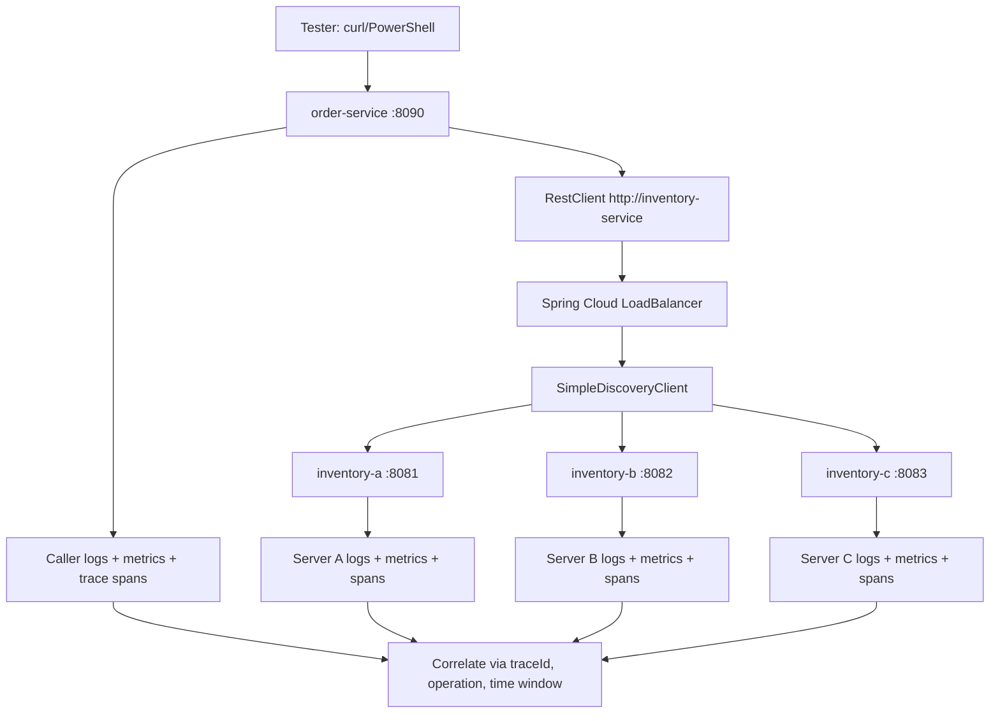
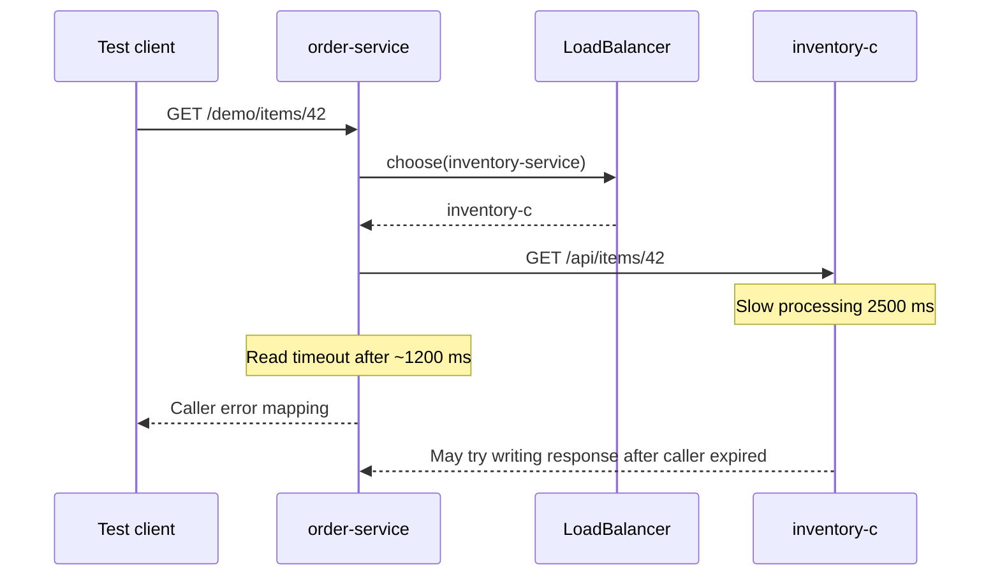
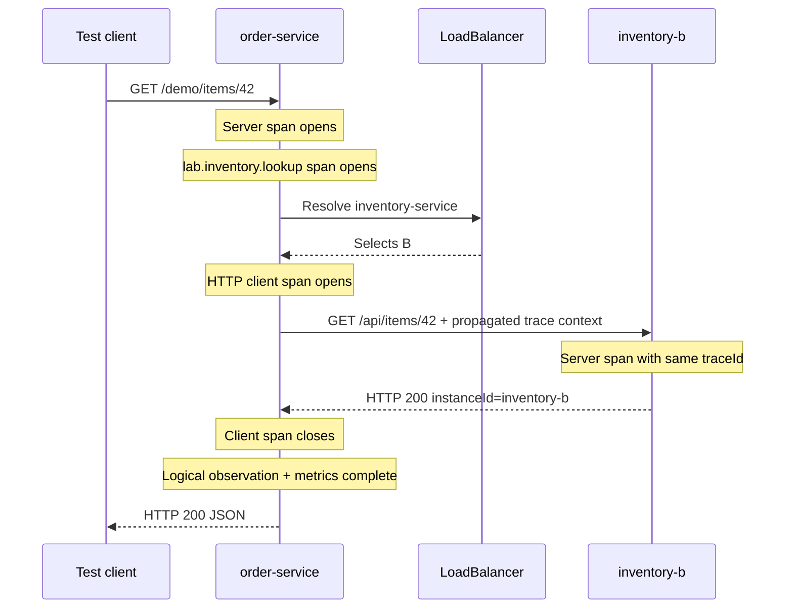

# Correlating Logs, Metrics, Traces, and Experimental Results

In a microservices system, the question "why are users seeing slow requests?" can rarely be answered by **a single** log line, **a single** chart, or **a single** trace. For example, `order-service` calls `inventory-service` via Spring Cloud LoadBalancer: the first call might pick replica A, the second might pick B, and a slow replica might cause the caller to time out even after the server finished processing the request. If you only see HTTP `200` at the end, you do not know how many attempts ran; if you only see `5xx` metrics, you do not know which instance failed; if you only look at one trace, you might miss thousands of other requests hitting the same issue.

This hands-on exercise teaches **correlating logs, metrics, and distributed traces as evidence** rather than guessing root cause from a single signal. We use one `order-service` caller, three `inventory-service` replicas, a static `ServiceInstance` list from `SimpleDiscoveryClient`, and an `@LoadBalanced` `RestClient`. Controlled scenarios cover the happy path, a replica returning `503`, timeouts, a stopped replica, zero eligible instances, and retries in the extension phase.

This lesson belongs to the **Hands-On Project** chapter of the `SPRING_CLOUD_SERVICE_COMMUNICATION_LOAD_BALANCING` module, covering Spring Cloud LoadBalancer instance selection by service ID, discovery, health checks, routing, and communication via `RestClient`, `WebClient`, and OpenFeign, with `SPECIAL_NOTE` adding no extra constraints. All numbers, instance names, and settings in this lesson are **intentional learning data**, not default production settings.

## 1. Objectives and Deliverables

After this lab, you should be able to prove:

1. **Logs:** locate a call from `order-service` to `inventory-service`, identify its logical outcome, status/exception, and the replica **reported as having handled it** when a response exists.
2. **Metrics:** measure logical call counts, success/error rates, call durations, HTTP server requests, and the impact of failure scenarios **without using request IDs as metric labels**.
3. **Traces:** link the inbound request to `order-service`, the outbound client call to inventory, and the inbound request on the receiving replica via trace ID and parent-child spans when tracing is configured.
4. **Correlation:** distinguish `LoadBalancer found no ServiceInstance`, `selected an instance but failed to connect`, `upstream genuinely returned 503`, and `client-side decode/timeout`.
5. **Experimentation:** compile a table of hypothesis → action → evidence across all three signals → conclusion, along with limitations that cannot yet be inferred.

Minimum deliverables:

- Three inventory replicas on ports `8081`, `8082`, and `8083`, plus one caller on `8090`.
- Structured logs with `service`/`instanceId`, `operation`, `outcome`, `durationMs`, and `traceId` when tracing is enabled.
- Metric snapshots from `/actuator/metrics` or `/actuator/prometheus` on the caller and replicas.
- At least one valid multi-service trace when an OTLP collector/tracing backend is running.
- A results table covering **at least four scenarios**, including at least one real HTTP error and one failure with no upstream response.

## 2. Architecture: Three Evidence Sources, One Logical Request



**Three terms you must distinguish:**

| Concept | Meaning | Example |
|---|---|---|
| **Logical call** | One business intent from the caller to invoke inventory. | Fetch stock for item `42` once. |
| **LoadBalancer selection** | One choice of a `ServiceInstance` from the candidate list. | Select `localhost:8082`. |
| **HTTP attempt** | One attempt to send/receive HTTP over the transport. | Connect to `:8082` and read the response. |

In the baseline configuration **with retries off across all layers**, one logical call typically corresponds to one gateway invocation and one HTTP attempt. Once retries are enabled in the gateway, OpenFeign, `WebClient`, Spring Cloud LoadBalancer, or a proxy, those counts **can diverge**. Never use a business-layer counter to claim the physical HTTP attempt count if the transport below can retry.

## 3. Logs, Metrics, and Traces Answer Different Questions

| Signal | Unit of Observation | Where Is It Strongest? | What Does It Not Prove Alone? |
|---|---|---|---|
| **Logs** | Discrete events with timestamps/context. | Exception details, service ID, replica ID, failover decisions. | System-wide trends if logs are sampled or dropped. |
| **Metrics** | Aggregated time series (counters, timers, gauges...). | Error rates, latency distributions, retry rates, load levels. | Which specific instance handled a specific request without traces/logs. |
| **Distributed traces** | A trace of related parent-child spans. | Caller → downstream relationships and per-hop latency. | Total traffic volume when sampling is below 100%; does not replace metrics. |

A practical workflow when p95 latency spikes: **metrics show when and how wide the impact is**, **traces pinpoint the slow hop**, and **logs explain the specific state or error**.

Signals can appear contradictory while both remain true: inventory logged "sent 200," while order hit a timeout because the response arrived past the deadline. Always reconcile **timestamps, measurement boundaries, and request lifecycles** instead of assuming one source is lying.

## 4. Standardizing Identity and Schema Before Running Tests

In the lab:

| Field | Example | Where Does It Come From? | Reliability |
|---|---|---|---|
| `callerService` | `order-service` | Caller's `spring.application.name`. | Application runtime config. |
| `targetService` | `inventory-service` | Service ID in `RestClient.baseUrl`. | Calling intent; does not prove an instance. |
| `instanceId` on server | `inventory-b` | `app.instance-id` when launching the replica. | Server-configured; useful in labs. |
| `selectedInstanceId` | If captured from LB lifecycle. | `ServiceInstance` after selection. | Selection evidence; does not mean the request reached the server. |
| `reportedReplica` | `inventory-b` | Header/JSON response returned by the server. | Server-self-reported evidence; exists only if a valid response arrived. |
| `traceId` | 32 hex chars (typical). | Tracing instrumentation. | Correlates spans/logs; not an auth token. |
| `spanId` | 16 hex chars (typical). | Tracing instrumentation. | Identifies a span; differs between caller and server. |
| `operation` | `GET /api/items/{id}` | Route template defined in code. | Low-cardinality label. |
| `outcome` | `success`, `http_status_error`, `transport_error`. | Classification at the observation point. | Must pair with stage to avoid misreading. |

**Never put raw URLs, item IDs, user IDs, bearer tokens, cookies, `traceId`, or ephemeral Pod IPs into metric labels.** Such high-detail fields blow up cardinality or leak sensitive data. Use access-controlled traces and logs for per-request debugging, and keep aggregated metric labels to bounded value sets.

Sample log schema:

```json
{
  "event": "logical_call_finished",
  "callerService": "order-service",
  "targetService": "inventory-service",
  "operation": "GET /api/items/{id}",
  "outcome": "success",
  "reportedReplica": "inventory-b",
  "durationMs": 41,
  "clientInvocations": 1,
  "traceId": "4bf92f3577b34da6a3ce929d0e0e4736"
}
```

These values are **illustrative**, not a mandatory format auto-generated by Spring Boot. An application can log structured messages and let the logging framework inject `timestamp`, `traceId`, and `spanId` from MDC.

## 5. Preparing Tools and Projects

This lab runs on a personal machine with JDK 17+, Maven, four terminals, and `curl` or PowerShell. For consistent APIs, we illustrate with Spring Boot **3.4.3** and Spring Cloud **2024.0.1**. This is **an illustrative reproduction pair**, not a claim of being the latest release; in real projects, select compatible Boot/Cloud BOMs.

Each application needs:

- `spring-boot-starter-web`: Spring MVC HTTP controllers.
- `spring-boot-starter-actuator`: metrics/health endpoints and Micrometer Observation foundation.
- `micrometer-registry-prometheus`: exposes Prometheus-formatted metrics at `/actuator/prometheus`.
- `micrometer-tracing-bridge-otel` and `opentelemetry-exporter-otlp`: turns observations into OpenTelemetry spans and exports over OTLP when a receiver is available.
- Specifically **order-service** also adds `spring-cloud-starter-loadbalancer` and the Spring Cloud BOM.

A tracing backend such as Jaeger/Tempo/OTel Collector is **optional for viewing traces in a UI**, though an OTLP receiver is required to collect spans out-of-process. Even without a backend running, you can still inspect MDC logs and metrics; just never claim "traces exported successfully" when no collector received spans.

### Two-Application Layout

```text
observability-lab/
├── inventory-replica/
│   ├── pom.xml
│   └── src/main/
│       ├── java/com/example/inventory/
│       │   ├── InventoryApplication.java
│       │   └── InventoryController.java
│       └── resources/application.yml
└── order-caller/
    ├── pom.xml
    └── src/main/
        ├── java/com/example/order/
        │   ├── OrderApplication.java
        │   ├── InventoryClientConfig.java
        │   ├── InventoryReply.java
        │   ├── InventoryGateway.java
        │   ├── DemoController.java
        │   └── DownstreamErrorAdvice.java
        └── resources/application.yml
```

These are **sample project files for the learner to create**, not instructions to add files to the knowledge module containing this lesson.

## 6. Adding Observability Dependencies to inventory-replica

Create `inventory-replica/pom.xml`:

```xml
<?xml version="1.0" encoding="UTF-8"?>
<project xmlns="http://maven.apache.org/POM/4.0.0"
         xmlns:xsi="http://www.w3.org/2001/XMLSchema-instance"
         xsi:schemaLocation="http://maven.apache.org/POM/4.0.0
         https://maven.apache.org/xsd/maven-4.0.0.xsd">
    <modelVersion>4.0.0</modelVersion>

    <parent>
        <groupId>org.springframework.boot</groupId>
        <artifactId>spring-boot-starter-parent</artifactId>
        <version>3.4.3</version>
        <relativePath/>
    </parent>

    <groupId>com.example</groupId>
    <artifactId>inventory-replica</artifactId>
    <version>0.0.1-SNAPSHOT</version>

    <properties>
        <java.version>17</java.version>
    </properties>

    <dependencies>
        <dependency>
            <groupId>org.springframework.boot</groupId>
            <artifactId>spring-boot-starter-web</artifactId>
        </dependency>
        <dependency>
            <groupId>org.springframework.boot</groupId>
            <artifactId>spring-boot-starter-actuator</artifactId>
        </dependency>
        <dependency>
            <groupId>io.micrometer</groupId>
            <artifactId>micrometer-registry-prometheus</artifactId>
        </dependency>
        <dependency>
            <groupId>io.micrometer</groupId>
            <artifactId>micrometer-tracing-bridge-otel</artifactId>
        </dependency>
        <dependency>
            <groupId>io.opentelemetry</groupId>
            <artifactId>opentelemetry-exporter-otlp</artifactId>
        </dependency>
    </dependencies>

    <build>
        <plugins>
            <plugin>
                <groupId>org.springframework.boot</groupId>
                <artifactId>spring-boot-maven-plugin</artifactId>
            </plugin>
        </plugins>
    </build>
</project>
```

Boot's dependency management supplies compatible versions for the unversioned dependencies above. If using another tracing bridge (Brave instead of OpenTelemetry), do not mix multiple bridges simultaneously without good reason; propagation and exporters must stay consistent across the lab.

### Inventory Bootstrap Class

`src/main/java/com/example/inventory/InventoryApplication.java`:

```java
package com.example.inventory;

import org.springframework.boot.SpringApplication;
import org.springframework.boot.autoconfigure.SpringBootApplication;

@SpringBootApplication
public class InventoryApplication {

    public static void main(String[] args) {
        SpringApplication.run(InventoryApplication.class, args);
    }
}
```

### Controller Returning ID with Fault-Injection Modes

`src/main/java/com/example/inventory/InventoryController.java`:

```java
package com.example.inventory;

import org.slf4j.Logger;
import org.slf4j.LoggerFactory;
import org.springframework.beans.factory.annotation.Value;
import org.springframework.http.ResponseEntity;
import org.springframework.web.bind.annotation.GetMapping;
import org.springframework.web.bind.annotation.PathVariable;
import org.springframework.web.bind.annotation.RestController;

@RestController
public class InventoryController {

    private static final Logger log =
        LoggerFactory.getLogger(InventoryController.class);

    private final String instanceId;
    private final String faultMode;

    public InventoryController(
            @Value("${app.instance-id}") String instanceId,
            @Value("${app.fault-mode:none}") String faultMode) {
        this.instanceId = instanceId;
        this.faultMode = faultMode;
    }

    @GetMapping("/api/items/{itemId}")
    public ResponseEntity<InventoryReply> findItem(
            @PathVariable String itemId) {

        log.info(
            "event=inbound_inventory_call instanceId={} operation={} faultMode={}",
            instanceId, "GET /api/items/{id}", faultMode);

        if ("slow".equals(faultMode)) {
            try {
                Thread.sleep(2500);
            } catch (InterruptedException ex) {
                Thread.currentThread().interrupt();
                throw new IllegalStateException(
                    "Interrupted during test delay", ex);
            }
        }

        if ("http503".equals(faultMode)) {
            log.warn(
                "event=inventory_response instanceId={} httpStatus=503",
                instanceId);
            return ResponseEntity.status(503)
                .header("X-Lab-Instance", instanceId)
                .body(new InventoryReply(itemId, 0, instanceId));
        }

        log.info(
            "event=inventory_response instanceId={} httpStatus=200",
            instanceId);
        return ResponseEntity.ok()
            .header("X-Lab-Instance", instanceId)
            .body(new InventoryReply(itemId, 17, instanceId));
    }

    public record InventoryReply(
        String itemId, int stock, String instanceId) {}
}
```

`Thread.sleep(2500)` is strictly for **fault injection in a Spring MVC test service**; never inject artificial sleeps in production handlers or on a Reactor Netty event loop. `X-Lab-Instance` is returned by the server to help internal correlation; **never expose Pod IDs, hostnames, or detailed topology in public APIs**.

All three processes run the same JAR artifact with distinct `app.instance-id` and `app.fault-mode` arguments. In the baseline, all three use `fault-mode=none`.

## 7. Configuring Actuator, Tracing, and Structured Logging in Inventory

Create `inventory-replica/src/main/resources/application.yml`:

```yaml
spring:
  application:
    name: inventory-service

server:
  port: 8081

app:
  instance-id: inventory-a
  fault-mode: none

management:
  endpoints:
    web:
      exposure:
        include: health,info,metrics,prometheus
  tracing:
    sampling:
      probability: 1.0
  otlp:
    tracing:
      endpoint: http://localhost:4318/v1/traces

logging:
  structured:
    format:
      console: logstash
```

In Spring Boot 3.4.x, structured console logging turns each event into JSON logs; when tracing integration is active, MDC includes `traceId` and `spanId`. **Check real logs**: if IDs are missing, propagation might not be active or logging customizers might not be preserving context.

`management.tracing.sampling.probability=1.0` is intended strictly for **low-traffic test environments** to make trace correlation easy. Production usually avoids 100% trace sampling due to cost, sensitive data, and volume. The OTLP endpoint assumes a receiver listening on `localhost:4318` on the same host; adjust the URI to match your topology if apps and collector run in separate containers.

In the lab, Actuator metrics and `/actuator/prometheus` should only be accessed over loopback or controlled networks. Never expose all management endpoints to the Internet just to collect evidence.

## 8. Building order-caller: RestClient with Dedicated Observations and Metrics

### Caller Maven POM

Create `order-caller/pom.xml`:

```xml
<?xml version="1.0" encoding="UTF-8"?>
<project xmlns="http://maven.apache.org/POM/4.0.0"
         xmlns:xsi="http://www.w3.org/2001/XMLSchema-instance"
         xsi:schemaLocation="http://maven.apache.org/POM/4.0.0
         https://maven.apache.org/xsd/maven-4.0.0.xsd">
    <modelVersion>4.0.0</modelVersion>

    <parent>
        <groupId>org.springframework.boot</groupId>
        <artifactId>spring-boot-starter-parent</artifactId>
        <version>3.4.3</version>
        <relativePath/>
    </parent>

    <groupId>com.example</groupId>
    <artifactId>order-caller</artifactId>
    <version>0.0.1-SNAPSHOT</version>

    <properties>
        <java.version>17</java.version>
        <spring-cloud.version>2024.0.1</spring-cloud.version>
    </properties>

    <dependencyManagement>
        <dependencies>
            <dependency>
                <groupId>org.springframework.cloud</groupId>
                <artifactId>spring-cloud-dependencies</artifactId>
                <version>${spring-cloud.version}</version>
                <type>pom</type>
                <scope>import</scope>
            </dependency>
        </dependencies>
    </dependencyManagement>

    <dependencies>
        <dependency>
            <groupId>org.springframework.boot</groupId>
            <artifactId>spring-boot-starter-web</artifactId>
        </dependency>
        <dependency>
            <groupId>org.springframework.boot</groupId>
            <artifactId>spring-boot-starter-actuator</artifactId>
        </dependency>
        <dependency>
            <groupId>org.springframework.cloud</groupId>
            <artifactId>spring-cloud-starter-loadbalancer</artifactId>
        </dependency>
        <dependency>
            <groupId>io.micrometer</groupId>
            <artifactId>micrometer-registry-prometheus</artifactId>
        </dependency>
        <dependency>
            <groupId>io.micrometer</groupId>
            <artifactId>micrometer-tracing-bridge-otel</artifactId>
        </dependency>
        <dependency>
            <groupId>io.opentelemetry</groupId>
            <artifactId>opentelemetry-exporter-otlp</artifactId>
        </dependency>
    </dependencies>

    <build>
        <plugins>
            <plugin>
                <groupId>org.springframework.boot</groupId>
                <artifactId>spring-boot-maven-plugin</artifactId>
            </plugin>
        </plugins>
    </build>
</project>
```

### Bootstrap Class

`order-caller/src/main/java/com/example/order/OrderApplication.java`:

```java
package com.example.order;

import org.springframework.boot.SpringApplication;
import org.springframework.boot.autoconfigure.SpringBootApplication;

@SpringBootApplication
public class OrderApplication {

    public static void main(String[] args) {
        SpringApplication.run(OrderApplication.class, args);
    }
}
```

### Configuring SimpleDiscoveryClient and Tracing

`order-caller/src/main/resources/application.yml`:

```yaml
spring:
  application:
    name: order-service
  cloud:
    discovery:
      client:
        simple:
          instances:
            inventory-service:
              - uri: http://localhost:8081
              - uri: http://localhost:8082
              - uri: http://localhost:8083

server:
  port: 8090

management:
  endpoints:
    web:
      exposure:
        include: health,info,metrics,prometheus
  tracing:
    sampling:
      probability: 1.0
  otlp:
    tracing:
      endpoint: http://localhost:4318/v1/traces

logging:
  structured:
    format:
      console: logstash
```

`SimpleDiscoveryClient` in the lab supplies three static URIs for **the same service ID**. It does not remove a stopped instance automatically unless a health supplier/refresh is configured. Do not treat a static YAML list as dynamic discovery like Eureka, Consul, or Kubernetes.

### RestClient Bean and ObservationRegistry

Create `order-caller/src/main/java/com/example/order/InventoryClientConfig.java`:

```java
package com.example.order;

import io.micrometer.observation.ObservationRegistry;
import org.springframework.cloud.client.loadbalancer.LoadBalanced;
import org.springframework.context.annotation.Bean;
import org.springframework.context.annotation.Configuration;
import org.springframework.http.client.SimpleClientHttpRequestFactory;
import org.springframework.web.client.RestClient;

@Configuration
public class InventoryClientConfig {

    @Bean
    @LoadBalanced
    RestClient.Builder loadBalancedRestClientBuilder(
            ObservationRegistry observationRegistry) {
        return RestClient.builder()
            .observationRegistry(observationRegistry);
    }

    @Bean
    RestClient inventoryRestClient(
            @LoadBalanced RestClient.Builder builder) {

        SimpleClientHttpRequestFactory requestFactory =
            new SimpleClientHttpRequestFactory();
        requestFactory.setConnectTimeout(800);
        requestFactory.setReadTimeout(1200);

        return builder.clone()
            .baseUrl("http://inventory-service")
            .requestFactory(requestFactory)
            .build();
    }
}
```

Here, `@LoadBalanced` wires `ServiceInstance` selection. `ObservationRegistry` attaches HTTP client observations so metrics and tracing fire when matching handlers are active. Creating a raw `RestClient.builder()` without the required observation registry/customizer can drop client instrumentation. In real projects, use Spring Boot's auto-configured builder or ensure custom builders retain Observation instrumentation.

`SimpleClientHttpRequestFactory` is only for **demonstrating timeouts** in the lab, not a production HTTP pool recommendation. `connectTimeout`/`readTimeout` bound transport I/O; they do not automatically bound total logical request duration once retries/backoff are added.

## 9. Writing the Gateway Recording Logical Outcomes and Custom Metrics

Create DTO `order-caller/src/main/java/com/example/order/InventoryReply.java`:

```java
package com.example.order;

public record InventoryReply(
    String itemId, int stock, String instanceId) {}
```

Create `order-caller/src/main/java/com/example/order/InventoryGateway.java`:

```java
package com.example.order;

import java.util.concurrent.TimeUnit;
import io.micrometer.core.instrument.MeterRegistry;
import io.micrometer.core.instrument.Timer;
import io.micrometer.observation.Observation;
import io.micrometer.observation.ObservationRegistry;
import org.slf4j.Logger;
import org.slf4j.LoggerFactory;
import org.springframework.stereotype.Service;
import org.springframework.web.client.ResourceAccessException;
import org.springframework.web.client.RestClient;
import org.springframework.web.client.RestClientResponseException;

@Service
public class InventoryGateway {

    private static final Logger log =
        LoggerFactory.getLogger(InventoryGateway.class);

    private static final String TARGET = "inventory-service";

    private final RestClient client;
    private final MeterRegistry meters;
    private final ObservationRegistry observations;

    public InventoryGateway(
            RestClient inventoryRestClient,
            MeterRegistry meters,
            ObservationRegistry observations) {
        this.client = inventoryRestClient;
        this.meters = meters;
        this.observations = observations;
    }

    public InventoryReply findItem(String id) {
        long started = System.nanoTime();
        String outcome = "success";

        Observation observation =
            Observation.createNotStarted(
                "lab.inventory.lookup", observations)
                .lowCardinalityKeyValue("target.service", TARGET)
                .start();

        try (Observation.Scope ignored = observation.openScope()) {
            // Counts invocations into RestClient at this gateway.
            // Does not automatically equal physical HTTP attempts.
            meters.counter(
                "lab.outbound.client.invocations",
                "target.service", TARGET).increment();

            InventoryReply reply = client.get()
                .uri("/api/items/{id}", id)
                .retrieve()
                .body(InventoryReply.class);

            if (reply == null) {
                throw new IllegalStateException(
                    "Inventory response body is empty");
            }

            log.info(
                "event=logical_call_finished targetService={} " +
                "operation={} outcome=success reportedReplica={} durationMs={}",
                TARGET, "GET /api/items/{id}",
                reply.instanceId(), elapsedMs(started));

            return reply;
        } catch (RestClientResponseException ex) {
            outcome = "http_status_error";
            observation.error(ex);
            log.warn(
                "event=logical_call_finished targetService={} " +
                "outcome={} clientStatus={} durationMs={}",
                TARGET, outcome, ex.getStatusCode().value(),
                elapsedMs(started));
            throw ex;
        } catch (ResourceAccessException ex) {
            outcome = "transport_error";
            observation.error(ex);
            log.warn(
                "event=logical_call_finished targetService={} " +
                "outcome={} exceptionType={} durationMs={}",
                TARGET, outcome, ex.getClass().getSimpleName(),
                elapsedMs(started));
            throw ex;
        } catch (RuntimeException ex) {
            outcome = "other_error";
            observation.error(ex);
            log.warn(
                "event=logical_call_finished targetService={} " +
                "outcome={} exceptionType={} durationMs={}",
                TARGET, outcome, ex.getClass().getSimpleName(),
                elapsedMs(started));
            throw ex;
        } finally {
            observation.lowCardinalityKeyValue("outcome", outcome);
            observation.stop();

            meters.counter(
                "lab.outbound.logical.calls",
                "target.service", TARGET,
                "outcome", outcome).increment();

            Timer.builder("lab.outbound.logical.duration")
                .tag("target.service", TARGET)
                .tag("outcome", outcome)
                .register(meters)
                .record(System.nanoTime() - started,
                    TimeUnit.NANOSECONDS);
        }
    }

    private static long elapsedMs(long started) {
        return TimeUnit.NANOSECONDS.toMillis(
            System.nanoTime() - started);
    }
}
```

The code deliberately separates:

- `lab.outbound.client.invocations`: number of times the gateway invoked `RestClient`, **not necessarily** physical HTTP attempts if lower layers retry.
- `lab.outbound.logical.calls`: completed logical calls recorded in `finally`, broken down by `outcome`.
- `lab.outbound.logical.duration`: duration of the call from the gateway's viewpoint, encompassing instance selection, HTTP I/O, and decoding.
- `lab.inventory.lookup`: a custom `Observation` wrapping the logical call; exported as a span when the tracing bridge is active.

The `lab.*` names are **application-defined metrics/observations**, distinct from Spring Boot's built-in HTTP metrics. Never put `itemId`, instance IDs, or trace IDs into tags. When `RestClientResponseException` carries status `503`, this example logs `clientStatus=503` without **proving that upstream actually sent 503**: LoadBalancer integration can also synthesize a similar error when zero instances exist. To confirm the source, inspect server logs/traces and instrument the selection step.

## 10. Exposing the Demo Endpoint and Meaningful Error Responses

`order-caller/src/main/java/com/example/order/DemoController.java`:

```java
package com.example.order;

import org.springframework.web.bind.annotation.GetMapping;
import org.springframework.web.bind.annotation.PathVariable;
import org.springframework.web.bind.annotation.RestController;

@RestController
public class DemoController {

    private final InventoryGateway inventoryGateway;

    public DemoController(InventoryGateway inventoryGateway) {
        this.inventoryGateway = inventoryGateway;
    }

    @GetMapping("/demo/items/{itemId}")
    public InventoryReply item(@PathVariable String itemId) {
        return inventoryGateway.findItem(itemId);
    }
}
```

If exceptions from `RestClient` go unhandled, the caller can return unhelpful default errors. To prevent leaking URLs or stack traces to external clients in the lab, add a simple response mapping:

`order-caller/src/main/java/com/example/order/DownstreamErrorAdvice.java`:

```java
package com.example.order;

import org.springframework.http.HttpStatus;
import org.springframework.http.ProblemDetail;
import org.springframework.http.ResponseEntity;
import org.springframework.web.bind.annotation.ExceptionHandler;
import org.springframework.web.bind.annotation.RestControllerAdvice;
import org.springframework.web.client.RestClientException;

@RestControllerAdvice
public class DownstreamErrorAdvice {

    @ExceptionHandler(RestClientException.class)
    ResponseEntity<ProblemDetail> dependencyUnavailable(
            RestClientException ignored) {

        ProblemDetail detail = ProblemDetail.forStatusAndDetail(
            HttpStatus.BAD_GATEWAY,
            "Inventory dependency call did not complete.");
        return ResponseEntity.status(HttpStatus.BAD_GATEWAY)
            .body(detail);
    }
}
```

The caller returns `502 Bad Gateway` to indicate the dependency call failed in **the demo API contract**. That **does not mean upstream returned 502**; upstream may have returned 503, the caller may have timed out, or LoadBalancer failed to select an instance. To find the real cause, inspect **gateway logs/metrics/traces and server logs**. Production apps should classify errors more finely per their error contracts instead of returning `502` for every business error.

## 11. Starting the Tracing Backend (Optional) and Four Applications

To inspect traces in a UI, run a backend accepting **OTLP HTTP** with a trace viewer UI, such as Jaeger or Tempo. If using Jaeger all-in-one 1.x with OTLP support, an illustrative command is:

```bash
docker run --rm --name lb-lab-jaeger \
  -e COLLECTOR_OTLP_ENABLED=true \
  -p 16686:16686 \
  -p 4318:4318 \
  jaegertracing/all-in-one:1.62.0
```

This command is **strictly a lab setup**: verify the image/tag and port availability in your Docker environment. Never run multiple collectors competing for port `4318`. If you already run OpenTelemetry Collector/Tempo, keep it and point `management.otlp.tracing.endpoint` accordingly. Without a tracing backend, skip the UI view; you can still correlate logs and metrics.

In both Maven directories, build:

```bash
mvn -DskipTests package
```

From `inventory-replica`, open three separate terminals:

**Replica A:**

```bash
java -jar target/inventory-replica-0.0.1-SNAPSHOT.jar \
  --server.port=8081 \
  --app.instance-id=inventory-a \
  --app.fault-mode=none
```

**Replica B:**

```bash
java -jar target/inventory-replica-0.0.1-SNAPSHOT.jar \
  --server.port=8082 \
  --app.instance-id=inventory-b \
  --app.fault-mode=none
```

**Replica C:**

```bash
java -jar target/inventory-replica-0.0.1-SNAPSHOT.jar \
  --server.port=8083 \
  --app.instance-id=inventory-c \
  --app.fault-mode=none
```

From `order-caller`, open a fourth terminal:

```bash
java -jar target/order-caller-0.0.1-SNAPSHOT.jar
```

The `\` line continuation above is for Bash/sh. On Windows PowerShell, put `java -jar ... --server.port=... --app.instance-id=...` on a **single line** in each terminal. `localhost` only works when all four processes share the same host/network; inside Docker, `localhost` inside the caller container does not reach inventory containers.

Quick verification:

```bash
curl -i http://localhost:8081/api/items/42
curl -i http://localhost:8082/api/items/42
curl -i http://localhost:8083/api/items/42
curl -i http://localhost:8090/actuator/health
```

Before running experiments, all three inventory endpoints must return their right `instanceId` and the caller must be up. If a trace backend is running, check that the receiver/UI reports no export errors; without a backend, **do not mistake export errors for LoadBalancer failures**.

## 12. Experiment 1 — Baseline: All Three Replicas Healthy

Send 12 **sequential** calls through the caller:

```bash
for i in $(seq 1 12); do
  curl -sS -w ' callerStatus=%{http_code}\n' \
    http://localhost:8090/demo/items/42
done
```

PowerShell:

```powershell
1..12 | ForEach-Object {
    (Invoke-RestMethod "http://localhost:8090/demo/items/42").instanceId
} | Group-Object | Select-Object Name, Count
```

With a stable instance list, one caller, and default Round Robin, you typically see all of A/B/C selected; a 4–4–4 split is an **illustrative result**, not a promise about starting order or balanced CPU load.

### Correlating All Three Evidence Sources

**Logs:** in order, look for `event=logical_call_finished`, `targetService=inventory-service`, `outcome=success`, `reportedReplica=inventory-a/b/c`, and duration. In inventory, find the matching `event=inbound_inventory_call`/`inventory_response`.

**Metrics:** check success counts on the custom counters:

```bash
curl -s http://localhost:8090/actuator/metrics/lab.outbound.logical.calls
curl -s http://localhost:8090/actuator/metrics/lab.outbound.logical.duration
curl -s http://localhost:8090/actuator/metrics/http.client.requests
curl -s http://localhost:8090/actuator/metrics/http.server.requests
```

Check metrics on inventory:

```bash
curl -s http://localhost:8081/actuator/metrics/http.server.requests
curl -s http://localhost:8082/actuator/metrics/http.server.requests
curl -s http://localhost:8083/actuator/metrics/http.server.requests
```

`/actuator/metrics/<name>` displays individual registered meters once traffic arrives; `/actuator/prometheus` exports time series with Prometheus naming/label formatting. Exact HTTP metric names depend on version and active instrumentation; if `http.client.requests` does not appear, inspect `ObservationRegistry`/builder/Actuator instead of guessing fake values.

**Traces:** search for service `order-service` in the tracing UI and pick a trace for `GET /demo/items/{id}`. When instrumentation/propagation is active, the trace looks like:

```text
order-service: HTTP SERVER  GET /demo/items/{id}
  └── order-service: lab.inventory.lookup
        └── order-service: HTTP CLIENT GET inventory-service
              └── inventory-service: HTTP SERVER GET /api/items/{id}
```

Exact span names vary by instrumentation and version. What matters is **the same `traceId` spanning both services**, proper parent-child nesting, and span durations; client and server having different `spanId` values is normal.

### How to Interpret the Baseline

If order logs 12 successful custom logical calls while the sum of `http.server.requests` across all three inventory replicas exceeds 12, check for direct curl calls, health probes, other checks, or hidden retries. Never conclude LoadBalancer duplicated requests from unfiltered aggregate counters across routes or time windows.

## 13. Experiment 2 — Replica B Returns a Real HTTP 503

Stop **only** process B and restart it on port `8082` with:

```bash
java -jar target/inventory-replica-0.0.1-SNAPSHOT.jar \
  --server.port=8082 \
  --app.instance-id=inventory-b \
  --app.fault-mode=http503
```

A and C stay at `fault-mode=none`. Send repeated requests to the caller and observe some requests failing when LoadBalancer picks B while requests hitting A/C succeed. Leave retries off to keep baseline interpretation clear.

| Signal | Evidence to Observe | What Must Not Be Inferred |
|---|---|---|
| **Order logs** | `clientStatus=503` and `outcome=http_status_error` on some logical calls. | Do not infer from status alone that every `503` came from upstream B. |
| **Inventory B logs** | `event=inventory_response`, `instanceId=inventory-b`, `httpStatus=503`. | Not no-instance: B was running and returned a response. |
| **Inventory B metrics** | HTTP server requests for the route with `status=503` increment. | Total metrics may include traffic from other tests. |
| **Trace** | Shows client → server B path when sampled/exported; upstream span shows error/status per instrumentation. | Span error flags do not always map 1-to-1 with HTTP 503. |

The caller can return **HTTP 502** via `DownstreamErrorAdvice`, while **upstream B returned 503**. These two statuses belong to **two different HTTP hops** and do not contradict each other.

This provides far stronger proof than merely seeing `order-service 502`: server B actually recorded matching access/request logs and 503 metrics for the same time/trace.

## 14. Experiment 3 — Replica C Responds Slower Than Read Timeout

Stop and restart C with `--app.fault-mode=slow`:

```bash
java -jar target/inventory-replica-0.0.1-SNAPSHOT.jar \
  --server.port=8083 \
  --app.instance-id=inventory-c \
  --app.fault-mode=slow
```

Controller C sleeps ~2,500 ms while the caller sets `readTimeout=1200ms`. When LoadBalancer picks C, the caller hits a timeout/transport error **before C replies**.



What to verify:

- **Caller logs:** outcome `transport_error` (or the HTTP engine's specific exception), duration near timeout plus overhead; no upstream HTTP status exists.
- **Server C logs:** the request reached C; the server may still log `inventory_response 200` after the caller timed out, or fail writing to a closed socket.
- **Metrics:** client/logical duration rises; errors increment on the caller, while server metrics may report different statuses/latencies due to differing measurement boundaries.
- **Trace:** the client span may end earlier than the server span; the trace viewer may show overlap or a late-finishing server span.

**Crucial takeaway:** "caller timed out" does not mean "upstream never processed the request." Especially for side-effectful `POST`/`PATCH` calls, retries require proper idempotency/deduplication.

Do not try to solve this simply by raising every timeout. Evaluate downstream capacity, business deadlines, concurrency limits, pooling, and retry policies.

## 15. Experiment 4 — Selecting an Existing List Entry Whose Process Stopped

Stop B completely while leaving the caller's `SimpleDiscoveryClient` unchanged and without restarting order. The static source still contains `http://localhost:8082`.

When the selector picks B:

1. **LoadBalancer succeeds in choosing B** because B is still in the list.
2. **HTTP transport fails to connect** and throws connection refused/reset.
3. **Zero new inbound request logs appear on inventory B** because B is not running.
4. **The caller fails** and may return 502 via ErrorAdvice; that **does not** prove upstream B returned 502/503.

Compare with Experiment 2:

| Experiment | Is Process B Listening? | Is There an HTTP Response from B? | Primary Evidence |
|---|---|---|---|
| B returns `503` | Yes. | Yes, status 503. | Server B logs/metrics/traces. |
| B is stopped | No. | Usually none. | Client connection error; zero new server requests. |

If the caller uses a connection pool, a stale socket may throw connection reset instead of connection refused; it is still a **transport error**. Static discovery does not auto-evict a URI by health even if `/actuator/health` exists; enable/configure health filtering or dynamic discovery in extension labs.

## 16. Experiment 5 — Zero Eligible ServiceInstances

To distinguish from a stopped process, create a separate test case: temporarily delete all three entries under `spring.cloud.discovery.client.simple.instances.inventory-service` on the caller and restart order, or supply a test supplier bean returning `List.of()` for the service ID.

With an empty list:

- LoadBalancer cannot choose a `ServiceInstance`.
- Zero real HTTP requests hit A/B/C from this call.
- The adapter may throw an exception or synthesize a response/status depending on version. **Seeing status 503 on the client does not prove any inventory server returned 503.**
- Replica server metrics and logs **do not increment** for this call.

Instrument LoadBalancer lifecycle/Observation for **your exact version** to log `selection_failed`/`no_eligible_instance` and `targetService`. Never log a bogus `selectedInstanceId=inventory-a` when no instance was selected. Without that hook, you can infer no-instance from an empty supplier list plus zero server requests, though you cannot yet claim traces capture the selection phase completely.

After testing, **restore all three URIs** and restart the caller. Never leave fault-test configs as team defaults.

## 17. Experiment 6 — Enabling Retries and Measuring Amplification

In prior scenarios, the gateway performed one `RestClient` invocation. To test retries, add a policy with a **clear single owner** at the calling layer (e.g., a Spring Retry/Resilience4j wrapper) restricted to safe GETs and transient failures; cap at **three HTTP attempts** (initial plus two retries), with backoff+jitter and an **overall deadline**. Never retry `4xx`, `413`, authorization errors, or non-recoverable decode errors.

Conceptual logic (pseudocode, **not standalone runnable Java**):

```text
logicalId = stable ID of the GET operation
deadline = now + 2s

for attemptNumber in 1..3:
    if deadline expired: stop
    record attempt_started
    try:
        RestClient GET via inventory-service
        record actual outcome and selected instance if known
        return result
    catch retryable transport/selected HTTP errors:
        if attemptNumber == 3: stop
        bounded exponential backoff + jitter
        continue

record logical_call_finished
```

If retries live **inside** the HTTP client or LoadBalancer, move attempt counters and logs into that layer; `lab.outbound.client.invocations` in `InventoryGateway` **is insufficient** to count lower-level HTTP attempts. If a retry wrapper sits **outside** `InventoryGateway`, the gateway runs multiple times per higher-level logical operation, so logical-request counting must move outside the wrapper as well.

### Correlating Data Under Retries

| Metric | Without Retry | With Retry |
|---|---|---|
| Logical requests | Business operations initiated. | Must remain identical under the same test traffic. |
| Client invocations | Roughly equal to logical calls in baseline. | Increases if retry wraps the gateway; may stay unchanged if retry sits below. |
| Real HTTP attempts | Typically one per logical call in no-retry baseline. | Can be multiple per logical call. |
| Selected instances | One selection without retry or re-routing. | Can re-select **the same** or **a different** instance. |
| Latency p95/p99 | No added backoff. | Can climb due to extra attempts and backoff. |
| Downstream load | Original traffic. | Can increase; measure hit counts at replicas. |

If retries raise success rate while driving upstream p99 and requests/second into instability, you cannot call that an "unqualified improvement." Weigh retry budgets, circuit breakers, bulkheads, and idempotency requirements.

## 18. Performing Request-by-Request Correlation via traceId

With Micrometer Tracing/OTLP active:

1. Find an inbound log in order and grab its `traceId` (if logging/tracing are active).
2. Filter order's `event=logical_call_finished` logs by that same `traceId`.
3. Locate `event=inbound_inventory_call` in process A/B/C with the matching trace ID when propagation succeeded.
4. Open the trace viewer, look up the trace ID, and compare spans across `order-service` and `inventory-service`.
5. Compare durations of the logical observation, HTTP client span, and server span. Differences arise from discovery, pool waits, encoding/decoding, network transit, and span overlap.
6. Confirm `reportedReplica` in the successful response matches the inventory process that actually logged the inbound call.

An ideal trace on the happy path:



**A missing trace does not mean the request never happened.** The collector might not have received it, sampling may have skipped it, context propagation may have failed, or logs might lack the field. Verify sampling/export/propagation before using "no span visible" as proof that a request never reached upstream.

### Selected Instance and Reported Replica Are Not Identical

`reportedReplica` exists only when the response carries the lab payload. If connecting to B fails before the server replies, there is no JSON `reportedReplica`; the selected `ServiceInstance` **may still** have been B.

To log selections accurately, use Spring Cloud LoadBalancer's lifecycle/Observation hooks for your version. Do not assume an arbitrary `ClientHttpRequestInterceptor` sees the rewritten physical host/port URI; interceptor ordering and retries can differ.

## 19. Building a Minimal Dashboard Without Heavy Monitoring Infrastructure

Even without Prometheus/Grafana deployed, Actuator exposes plenty of learning data. A minimal dashboard includes:

| Widget / Calculation | Source | Meaning |
|---|---|---|
| Logical calls by outcome | `lab.outbound.logical.calls` | How many operations succeeded vs. failed. |
| Logical call latency | `lab.outbound.logical.duration` | Total time caller waited on upstream. |
| HTTP client requests | `http.client.requests` when instrumented. | Client HTTP outcome/status/latency distribution. |
| Inventory inbound HTTP statuses | `http.server.requests` per replica. | Which replica returned 200 vs. 503. |
| Instance selection counts | LoadBalancer lifecycle custom events/metrics if present. | How the selector distributed across the service ID. |
| Retry attempts | Retry owner / HTTP transport instrumentation. | Request amplification during recovery. |
| Timeouts / no-instance | Custom logs/metrics per error stage. | Separates discovery, transport, and server statuses. |

With a Prometheus scraper, scrape each target separately instead of a single aggregated endpoint:

```yaml
scrape_configs:
  - job_name: order-caller
    static_configs:
      - targets: ["localhost:8090"]
    metrics_path: /actuator/prometheus

  - job_name: inventory-replicas
    static_configs:
      - targets:
          - "localhost:8081"
          - "localhost:8082"
          - "localhost:8083"
    metrics_path: /actuator/prometheus
```

This example assumes Prometheus runs **in the same network namespace as the apps**. If Prometheus runs inside a container, `localhost` refers to the Prometheus container; use appropriate hostnames/services/host gateways. Never copy this scrape config verbatim into production without authentication, service discovery, network policies, and secured management endpoints.

### Avoid Drawing Conclusions from Absolute Counter Totals

Counters accumulate across prior tests, direct curls, health probes, Actuator scrapes, or earlier runs. Always:

1. Take a snapshot **before** the experiment.
2. Send an exact, controlled batch of requests.
3. Take a snapshot **after**.
4. Compare **deltas** grouped by operation/outcome/status and time window.

In Prometheus, use `rate(...)`/`increase(...)` over an appropriate window rather than reading a raw counter value at one instant as RPS. For histograms/percentiles, collect enough samples and verify histogram/SLO bucket settings; a single call yields no trustworthy p99.

## 20. Experimental Results Correlation Table

Compile a summary table (replace **illustrative entries with real measurements**):

| Scenario | Caller Logs | Metrics | Traces / Server Logs | Valid Conclusion |
|---|---|---|---|---|
| **Baseline 12 GETs** | 12 `success`; A/B/C seen in responses. | 12 successful logical calls if no other traffic ran. | Servers A/B/C log inbound; traces split per request. | LB selects multiple replicas and HTTP works. |
| **B returns 503** | Several `http_status_error` with status 503; caller may return 502. | Logical errors rise; server B 503s rise. | B logs inbound/503 and server span if sampled. | Upstream B **genuinely** returned HTTP 503. |
| **C responds slowly** | `transport_error`/timeout when C is selected. | Caller latency/errors rise. | C may log inbound and finish late. | Caller timeout does not prove server failed to process. |
| **B stopped, static registry** | Connection refused/reset while B still selected. | Caller errors rise; B receives zero new requests. | Zero new server B spans. | Instance is listed yet transport cannot connect. |
| **No instances** | No eligible instance if selection instrumentation exists. | Inventory inbound counts do not rise from that call. | Zero matching server requests. | Discovery/filter/selection failure, not upstream HTTP 503. |
| **Bounded retries on** | Logical outcome may succeed after multiple attempts. | Attempts/traffic rise; p99 may rise. | Multiple client attempts/spans, possibly switching instances. | Recovery has a cost and requires a retry budget. |

Never fill "no trace" cells with "no request occurred" unless sampling and exporting are verified. Never infer that the selector picked A from B's JSON on another call. Every conclusion must rest on **the same logical request/trace ID or the same controlled time window**.

### Sample Experiment Report Template

```text
Experiment ID: LB-OBS-03
Hypothesis: slow inventory-c will cause caller timeout before server finishes.
Traffic: 12 sequential GETs via order-service, retries disabled.
Topology: inventory A/B none, C slow; SimpleDiscoveryClient A/B/C.
Client timeout: readTimeout=1200ms.

Log evidence:
  - Caller event/outcome + duration (note traceId if available).
  - Inventory C inbound and response events.
Metrics evidence:
  - Delta of lab.outbound.logical.calls by outcome.
  - Delta of http.server.requests on C.
Trace evidence:
  - Caller client span vs C server span / export status.

Observation:
  - Actual request counts, error rate, duration, missing/present traces.
Conclusion:
  - Conclusion directly supported by the evidence.
Limitations:
  - Sampling, concurrent test traffic, HTTP client/pool, caching.
```

## 21. Common Contradictions When Comparing All Three Signals

| Observed Contradiction | Possible Explanation | How to Verify |
|---|---|---|
| Caller timed out yet inventory logged `200` | Server finished after deadline; response lost; differing measurement boundaries. | Compare timestamps, trace spans, socket write errors, and client deadline. |
| Caller saw `status=503` yet B logged no 503 | Adapter synthesized response/no-instance; status came from another proxy. | Inspect selection logs, outbound server spans, proxy access logs. |
| Client metric count exceeds logical call count | Multiple retry attempts, health calls, another instrumented layer. | Audit retry owner, time window, URI templates, and custom counters. |
| Inventory A logged request yet no server span appears | Sampling/exporter inactive, broken propagation, or collector failure. | Check trace ID, backend collector, sampling, and exporter logs. |
| Server C trace outlasts client span | Client timed out/cancelled before C finished. | Measure both caller latency and server processing duration. |
| After scale-in, requests still hit B | `SimpleDiscoveryClient`/cache holds stale data; connection reuse. | Inspect eligible list/refresh, selected instance, and HTTP transport. |
| Aggregate metrics keep climbing after test stops | Scrapes, health probes, background traffic, long-lived exporters/processes. | Filter by route/instance and take deltas over a bounded window. |
| Tracing UI shows only a fraction of calls | Low sampling, exporter drops, or mismatched service names. | Set sampling 1.0 in lab, check receiver, and query by trace ID. |

Explanations are **hypotheses**, never guaranteed root causes. Final conclusions must be backed by at least one independent piece of evidence.

## 22. Notes When Switching to WebClient and OpenFeign

The three inventory replicas and signal collection stay valid. What changes is the HTTP client and how it is instrumented:

| Aspect | RestClient | WebClient | OpenFeign |
|---|---|---|---|
| LB client setup | `@LoadBalanced RestClient.Builder`. | `@LoadBalanced WebClient.Builder`. | `@FeignClient(name="inventory-service")` with matching integration, no static URL. |
| Call lifecycle | Blocking invocation. | Reactive subscription; an unsubscribed `Mono` sends nothing. | Declarative, typically blocking. |
| Outcome logging | Wrapper/interceptor; separate response headers from decode. | `doOnError`/`doFinally`, `exchangeToMono`, operator scope. | Wrapper / Feign `Logger` / `ErrorDecoder`. |
| Trace propagation | Observation-instrumented HTTP client. | Reactor Context and Micrometer Context Propagation/tracing. | Feign Micrometer integration/tracing per dependencies and version. |
| Retries | Spring Retry/Resilience4j or LB integration. | `retryWhen`/resilience operator. | `Retryer`, LB retry, resilience wrapper. |
| Pitfalls | Threads/pools blocked by timeouts. | MDC loss on scheduler switches; cancellations. | `Retryer`/Feign config beans leaking across clients. |

Especially with `WebClient`, never call `MDC.put(...)` on one thread and expect context to follow every reactive callback automatically; configure Reactor Context and context propagation properly. With Feign, never enable `Logger.Level.FULL` in production just to inspect traces, as it can log tokens, cookies, and sensitive payloads.

## 23. Operational Safety and Observability Cost

**In the lab:**

- Run fault injection only on test machines/clusters; never send destructive load or terminate shared services.
- Use dummy item IDs and dummy tokens if auth is needed; never put secrets into logs, trace attributes, or metric labels.
- 100% trace sampling makes sense only for very small, controlled traffic.
- Never expose Actuator/Prometheus endpoints publicly; guard them with network policies and auth in real systems.
- Never log raw URIs with secret query params, `Authorization`, cookies, financial bodies, or PII.
- Avoid emitting a log event per byte or record; excessive logging creates I/O overhead, degrades performance, and skews experiments.
- When simulating retries, bound attempts, backoff+jitter, and deadlines, and verify idempotency. Never use retries to override zone/region/tenant constraints.

In production, metric cardinality and retention cost real budget. Controlled-value `targetService`, `operation`, and `outcome` labels are far safer than `selectedInstanceId`, dynamic IPs, or `traceId`. Per-instance details belong in sampled, access-controlled logs and traces.

## 24. Acceptance Checklist

- Running one `order-service` and three `inventory-service` processes returning distinct `instanceId` values.
- Caller uses `http://inventory-service` via `@LoadBalanced RestClient.Builder` without hard-coding ports in the gateway.
- `SimpleDiscoveryClient` lists three URIs, and tests clearly note when the static list diverges from runtime health.
- Structured logs capture service ID, operation, outcome, duration, and **reported** replica when a response exists.
- Tracing instrumentation is configured on both caller and inventory; when an OTLP receiver runs, trace IDs link across services.
- Actuator exposes custom `lab.outbound.logical.calls` and `lab.outbound.logical.duration` once traffic flows, with an active `MeterRegistry`.
- `http.server.requests` data collected per inventory process; source and limits of `http.client.requests` understood.
- In baseline, A/B/C all receive requests under appropriate selection without forcing Round Robin to start on A.
- In the HTTP 503 scenario, evidence proves **real server B** returned 503, distinct from caller-mapped statuses.
- In the timeout scenario, conclusions stay scoped to **the caller boundary** without claiming the server skipped processing.
- In the stopped-replica scenario, identified **stale instance → transport error**.
- In the no-instance scenario, avoided inventing a fake replica or confusing it with upstream 503.
- When retries are active, distinguished logical calls, client invocations, HTTP attempts, and LB selections; measured amplification.
- All metric comparisons use deltas/time windows, isolating noise from health probes and ad-hoc curls.
- Compiled hypothesis, action, log evidence, metric evidence, trace evidence, conclusion, and limitations for at least four scenarios.

**Conclusion:** Spring Cloud LoadBalancer answers **"which `ServiceInstance` should be picked for this service ID?"**, while the HTTP client and server decide whether the request is sent, received, and decoded successfully. **Logs** capture per-event details, **metrics** capture aggregate trends and rates, and **traces** connect hops of a single operation. This hands-on exercise is complete only when all three signals are **reconciled across their measurement boundaries**—especially for real `503`s, timeouts, stale instances, no-instance states, and retries. Once you know which evidence supports which claim, you can tune discovery, health checks, routing, timeouts, and resilience from empirical data rather than guesswork.
