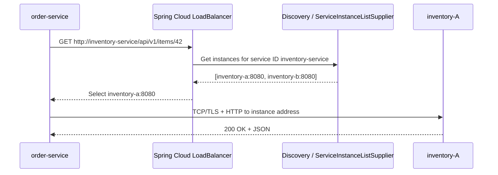
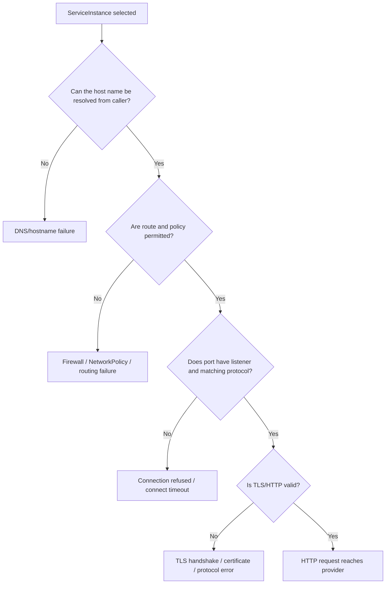
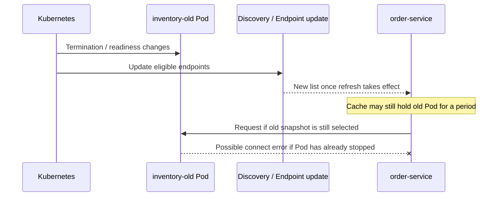
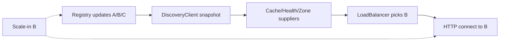

# Advertised and Reachable Addresses Across Environments

In a Spring Cloud LoadBalancer application, a call to `http://inventory-service/api/v1/items/42` usually **does not send HTTP directly to the hostname** `inventory-service`. When the HTTP client is integrated with LoadBalancer, that name is a **service ID**: Spring Cloud retrieves a list of `ServiceInstance` entries from discovery or a static source, selects an instance, and connects to the `host:port` published for that instance. If the published address is not reachable from **the network where the caller is running**, no matter how good Round Robin or retry is, the request will not succeed.

For example, `inventory-service` runs inside Docker and listens on `0.0.0.0:8080`. Another container must connect to an address such as `http://inventory-a:8080` on the same Docker network; an application running directly on the host machine can use the published port `http://localhost:18091`; while a Pod in Kubernetes needs an address reachable **inside the cluster**. It is the same process, yet **the listen address, advertised address, and the address the client uses to connect can all differ**.

This lesson belongs to the **Deployment** chapter of the `SPRING_CLOUD_SERVICE_COMMUNICATION_LOAD_BALANCING` module. The goal is to properly understand these three address types, how to verify routing by service ID/`ServiceInstance`, and examples for local, Docker Compose, Kubernetes, and VM/NAT; while applying them with `RestClient`, `WebClient`, OpenFeign, health checks, TLS, retry/timeout, and observability so service-to-service communication stays reliable in real deployments.

## 1. Three address concepts that must be kept separate

| Concept | Question to answer | Example |
|---|---|---|
| **Bind/listen address** | Which interface and port is the server process listening on? | `0.0.0.0:8080` |
| **Advertised/registered address** | Which address does discovery or `ServiceInstance` configuration publish? | `inventory-a:8080` |
| **Reachable destination** | Where can the client actually send TCP/TLS/HTTP **from its own network**? | Container B → `inventory-a:8080`; host → `localhost:18091` |

An address is considered *reachable* only when verified from **the caller's location**, not just from the provider itself. Pinging or curling on the provider does not prove that another container, Pod, VM, or network zone can reach that same address.

### 1.1. Binding 0.0.0.0 is not an address to advertise

`0.0.0.0` in an IPv4 server configuration usually means **listening on all suitable IPv4 interfaces**. It is a wildcard socket-bind address, **not a stable target hostname** for clients. For IPv6, `::` plays a similar wildcard role in corresponding configurations.

```yaml
server:
  address: 0.0.0.0
  port: 8080
```

The configuration above may be appropriate when a container needs to accept connections from other containers. However, registering a `ServiceInstance` with `host=0.0.0.0` is a design mistake: a wildcard address **does not specify a concrete target machine for clients to reach**. In addition, listening on all interfaces can increase the exposure surface; proper firewalls, network policies, ingress, and authentication for each environment are required.

### 1.2. Localhost is always interpreted relative to the caller process

`127.0.0.1`/`localhost` is the loopback of the **network namespace where the client runs**. They do not automatically point to the provider machine:

- Apps A and B both run directly on the same machine: `localhost` may be valid.
- App A is in a container and B is in a **different container**: `localhost` from A is **container A**, not B.
- App A is in Kubernetes Pod A and B is in Pod B: `localhost` in A points to **Pod A's network namespace**.
- VM A calls VM B: `localhost` in A does not point to VM B.

One intentional exception: containers **within the same Kubernetes Pod** typically share a network namespace, so they can communicate over loopback if ports do not conflict. Do not generalize this to different Pods.

### 1.3. An end-to-end routing diagram



The conceptual diagram assumes Spring Cloud LoadBalancer is attached to the HTTP client and the discovery source returns addresses **reachable from `order-service`**. If `inventory-a` cannot be resolved by the caller's DNS, the port is not open, a network policy blocks it, or the TLS hostname does not match, the failure occurs **after the instance selection step**.

## 2. Service ID is not synonymous with DNS hostname

In an application with `@LoadBalanced RestClient.Builder`, the URL `http://inventory-service` is integrated with LoadBalancer: the host part of the URL is used as the **service ID**. LoadBalancer picks an instance from the supplier, and then the HTTP client connects to the host/port of the chosen instance.

Conversely:

```java
// Logical URL: requires a RestClient configured with @LoadBalanced.
loadBalancedRestClient.get()
        .uri("http://inventory-service/api/v1/items/42")
        .retrieve()
        .body(String.class);

// Bare client: typically resolves inventory-service directly via DNS,
// without automatically using Spring Cloud's ServiceInstanceListSupplier.
RestClient.create()
        .get()
        .uri("http://inventory-service/api/v1/items/42")
        .retrieve()
        .body(String.class);
```

The two call snippets may look alike, yet **they take different paths**. If Docker/Kubernetes DNS also has an `inventory-service` hostname, the bare client might succeed via DNS, leading learners to **assume** the code is already using Spring Cloud LoadBalancer. To verify LoadBalancer for real, you must observe the selected instance and the adapter/filter attached to the HTTP client.

### 2.1. Structure of ServiceInstance

A typical `ServiceInstance` provides:

- `getServiceId()`: the logical name requested by the client.
- `getInstanceId()`: the replica ID (if provided by the discovery source).
- `getHost()` and `getPort()`: the address/port the HTTP client is expected to use.
- `isSecure()` or URI scheme: information about secure connectivity for the instance.
- `getMetadata()`: zone, region, version, or routing metadata depending on the source.
- `getUri()`: the URI represented from the instance's information.

Registering the right service ID with the wrong `host` or `port` will still fail the request. Likewise, a `ServiceInstance` carrying `zone=vn-a` metadata does not create a network path to that address; network routing and TLS must work independently.

### 2.2. DNS discovery and instance-level discovery are two different strategies

| Strategy | Which address does the client use? | Who usually performs load balancing? |
|---|---|---|
| **DNS/virtual service** | A Service name such as `inventory.default.svc.cluster.local` | Kubernetes Service/kube-proxy/eBPF or proxy/mesh |
| **Spring Cloud instance-level LoadBalancer** | The `ServiceInstance` of each replica/endpoint | Spring Cloud LoadBalancer selects the instance on the client side |
| **Combining both** | An instance may itself point to a virtual IP/Service | Risk of adding an extra load-balancing layer that is hard to observe |

In Kubernetes, calling Service DNS directly may **not need** Spring Cloud LoadBalancer. If you already use Spring Cloud discovery to fetch **individual Pods/endpoints**, client-side selection by Pod has its own purpose. Choose intentionally, avoiding deploying multiple mechanisms simultaneously without knowing where the instance decision actually happens.

## 3. Conditions for an advertised address to actually be reachable

Not only must `host:port` exist; multiple steps must be right:



| Check | What to verify |
|---|---|
| **Name/IP** | Does the caller have DNS/routing for the published hostname/IP? |
| **Port** | Is it the container port, host-published port, Service port, or backend port? |
| **Bind interface** | Is the provider listening on the interface where the request arrives? |
| **Routing/NAT** | Are paths across namespaces/VPCs/subnets/zones and NAT mappings correct? |
| **Network policy** | Do firewalls/Security Groups/Kubernetes NetworkPolicies allow the TCP flow? |
| **Scheme/TLS** | Do `http`/`https` and the certificate match the hostname/audience? |
| **Readiness** | Is the application ready to serve business requests? |
| **Registry freshness** | Have scaled-in or IP-changed endpoints been removed from the list? |

**Important:** TCP connectivity **does not guarantee** the API is ready. The provider can still return HTTP 503 due to a failing dependency, 404 due to a wrong path, or 401 due to required authentication. Conversely, an empty discovery list prevents the client from attempting TCP to any provider, and some HTTP integrations may generate a synthetic 503 on the LoadBalancer side.

## 4. Address matrix by deployment environment

Assume inventory listens on container/service port `8080`. The table below describes **several common setups**, not mandatory addresses:

| Environment caller → provider | Address the client can use | Conditions |
|---|---|---|
| Two JVMs on the **same machine** | `http://localhost:8091`, `http://localhost:8092` | Each JVM listens on the right port on the host |
| JVM running on host → published container | `http://localhost:18091` | Docker publishes `18091:8080` on the host |
| Container A → container B on the same Docker network | `http://inventory-a:8080` | Service/container name DNS is reachable within the network |
| Container A → service running on host | Platform-appropriate host gateway, e.g. `host.docker.internal` where supported | Does not work by default in every Linux/Docker setup |
| Pod A → Pod B in Kubernetes | Pod IP:container port, **if** policy/route allows | Instance-level discovery provides real Pod IPs and traffic is permitted |
| Pod A → Kubernetes Service | `http://inventory.default.svc.cluster.local:8080` | Kubernetes Service/DNS routes to ready Pods |
| Client outside cluster → Kubernetes workload | Published Ingress/Gateway/LoadBalancer endpoint | Do not use internal ClusterIP/PodIP directly |
| VM A → VM B in VPC | `http://inventory-01.internal:8080` | Proper private DNS, subnet route, and firewall |
| Client outside VPC → private VM | Protected reverse proxy/LB/public endpoint | Do not advertise unroutable private IPs |
| Multi-region/private network | Routable private DNS address or approved gateway | Control region policy, latency, TLS, and network segmentation |

Do not use `host.docker.internal` as a default hostname for every Linux CI server or cluster. Do not use Pod IPs or ClusterIPs as if they were always reachable from a public browser. **A valid address always depends on the caller's location and the actual network architecture.**

## 5. Local environment: two JVMs on the same machine

In a simple lab, run two providers on separate ports:

```bash
java -jar inventory-service.jar --server.port=8091
java -jar inventory-service.jar --server.port=8092
```

On the client `order-service`, configure a static discovery source specifically for local:

```yaml
# application-local.yml, order-service
spring:
  cloud:
    discovery:
      client:
        simple:
          instances:
            inventory-service:
              - uri: http://127.0.0.1:8091
              - uri: http://127.0.0.1:8092
```

When running the client **directly on the same OS**, both loopback addresses are reachable. `SimpleDiscoveryClient` lets you simulate two `ServiceInstance` entries without needing an Eureka/Consul/Kubernetes registry. This list is static, so when an instance stops, **the client may still pick the dead port**; to avoid that, update the list, add health checks, or use appropriate dynamic discovery.

### 5.1. Binding only on loopback can be right for labs

A provider may choose:

```yaml
# application-local.yml, inventory-service
server:
  address: 127.0.0.1
  port: 8091
```

When you only want the application to accept requests from the host itself, binding loopback reduces the exposure surface. However, if you put this configuration into Docker and expect another container to connect, the listener only exists on the **provider container's** loopback, and other containers will not be able to reach it.

**Do not mechanically copy `server.address: 0.0.0.0` into every environment**: the right value depends on traffic needs, network policies, and security policies.

## 6. Docker Compose: distinguishing container port from published host port

This is an environment where address mistakes happen easily because **the same provider has at least two perspectives**:

```text
Host machine               Docker network
-------------------       --------------------------------
localhost:18091  --------> inventory-a:8080 (container A)
localhost:18092  --------> inventory-b:8080 (container B)
                            ^
                            |
                    order-service container
                    calls inventory-a:8080 / inventory-b:8080
```

Assume the application images have been built with tags for the lab. Example `compose.yml`:

```yaml
services:
  inventory-a:
    image: inventory-service:lab
    environment:
      SERVER_PORT: "8080"
    ports:
      - "127.0.0.1:18091:8080"

  inventory-b:
    image: inventory-service:lab
    environment:
      SERVER_PORT: "8080"
    ports:
      - "127.0.0.1:18092:8080"

  order-service:
    image: order-service:lab
    environment:
      SERVER_PORT: "8080"
      SPRING_PROFILES_ACTIVE: compose
    ports:
      - "127.0.0.1:18080:8080"
    depends_on:
      - inventory-a
      - inventory-b
```

On the Compose project's default network, services normally resolve **`inventory-a`** and **`inventory-b`**. Therefore, in `order-service` running inside a container, configure Spring Cloud LoadBalancer as follows:

```yaml
# application-compose.yml, inside the order-service image/config
spring:
  cloud:
    discovery:
      client:
        simple:
          instances:
            inventory-service:
              - uri: http://inventory-a:8080
              - uri: http://inventory-b:8080
```

Those two URIs are **appropriate advertised addresses for clients on the same Compose network**. They are not the ports published on the host.

| Caller | Which inventory-A address to use in the example |
|---|---|
| `order-service` **container** | `http://inventory-a:8080` |
| `curl` running on the **host machine** | `http://127.0.0.1:18091` |
| Browser on host calling `order-service` | `http://127.0.0.1:18080` |
| Container on a disconnected network | Cannot automatically reach `inventory-a`; requires proper network/routing |

**Typical mistake:** putting `http://localhost:18091` into `application-compose.yml` inside the `order-service` container. Then `localhost` points to the `order-service` container itself, not the host and not `inventory-a`. Similarly, setting `http://inventory-a:18091` is usually wrong because 18091 is the **host-published port**, not the port container A listens on within the Docker network.

### 6.1. Published ports are not required for container-to-container communication

Within a Compose network, container A can receive requests from container B on `8080` **even without declaring `ports`**, as long as the service listens on the appropriate network interface and network policy allows it. `ports` in the example is only for developers calling from the host to debug. Binding published ports to `127.0.0.1` avoids exposing lab ports on all host interfaces, though it **does not replace internal network controls**.

### 6.2. Container name, DNS, and startup do not equal readiness

- Compose usually provides DNS by **service name** on the same network; do not assume an arbitrary name in `ServiceInstance` will be resolved by DNS.
- `depends_on` in its basic form orders container startup, **it does not guarantee the Java application is ready to serve APIs**. With healthchecks and appropriate conditions, readiness timing can be controlled better.
- When a container is recreated, **the container IP can change**. Prefer stable service DNS names over hardcoded container IPs; if using a static Spring Cloud instance list, understand caching/DNS and endpoint refresh.
- If Compose scales one service into multiple containers under the same service name, one DNS name may return multiple addresses, which **does not automatically mean** Spring Cloud `SimpleDiscoveryClient` receives each replica as a separate `ServiceInstance`.

Do not rely rigidly on a container IP printed from a single `docker inspect` to build long-lived deployment configurations; that is point-in-time information.

## 7. Kubernetes: Pod IP, ClusterIP/Service DNS, and Ingress are three distinct layers

Kubernetes offers two common internal call paths:

1. **Calling Kubernetes Service DNS** (for example `http://inventory.default.svc.cluster.local:8080`). A Kubernetes Service provides a stable virtual endpoint and distributes to eligible Pods. This path **does not require** Spring Cloud LoadBalancer to select individual Pods.
2. **Calling via Spring Cloud LoadBalancer with Pod/endpoint discovery**. The discovery source provides a list of `ServiceInstance` entries corresponding to Pods/endpoints the caller can reach. Spring Cloud selects a specific `ServiceInstance` before HTTP.

Avoid accidentally using both layers while thinking the client is distributing across Pods: if Spring Cloud's supplier returns **a single instance that is the Kubernetes Service DNS/ClusterIP**, Spring Cloud only picks that virtual endpoint; Pod selection happens at the Kubernetes/proxy layer.

### 7.1. Example workload and Service for DNS-based communication

Illustrative manifest, assuming the image has been published to a private registry and the application has `spring-boot-starter-actuator` with the readiness probe enabled on the same port 8080:

```yaml
apiVersion: apps/v1
kind: Deployment
metadata:
  name: inventory
spec:
  replicas: 2
  selector:
    matchLabels:
      app: inventory
  template:
    metadata:
      labels:
        app: inventory
    spec:
      terminationGracePeriodSeconds: 30
      containers:
        - name: inventory
          image: registry.example.test/inventory-service:1.0.0
          ports:
            - name: http
              containerPort: 8080
          readinessProbe:
            httpGet:
              path: /actuator/health/readiness
              port: http
            periodSeconds: 5
            timeoutSeconds: 2
---
apiVersion: v1
kind: Service
metadata:
  name: inventory
spec:
  type: ClusterIP
  selector:
    app: inventory
  ports:
    - name: http
      port: 8080
      targetPort: http
```

In the same `default` namespace, another Pod can call `http://inventory:8080`; the illustrative FQDN is typically `inventory.default.svc.cluster.local` (the cluster domain **may differ** from `cluster.local` depending on the environment). This is the **Service address**, not an individual Pod address.

`ClusterIP` and Pod IPs are usually meant only for the cluster-internal network and specifically routed networks. Do not register them as targets for an application running on a laptop outside the cluster and expect direct access. Clients outside the cluster need Ingress, Gateway, a LoadBalancer Service, or a separately managed connection path.

### 7.2. If using Spring Cloud LoadBalancer at the Pod level

In an architecture requiring client-side zone/metadata policies, Spring Cloud's discovery source can fetch **individual endpoints** from Kubernetes via an appropriate discovery integration. In that case, verify:

- `ServiceInstance.getHost()` is a Pod IP or **Pod/endpoint hostname actually reachable from the caller**.
- `getPort()` is the port the Pod listens on, **not a NodePort/Ingress public port**.
- The list contains the right eligible replicas and updates when Pods are replaced, scaled out/in, or change readiness.
- The application/discovery integration has permission to access the Kubernetes API or endpoint source via properly configured RBAC/ServiceAccount.
- NetworkPolicy, service mesh, and mTLS allow calling Pod IPs directly or require going through a managed proxy.
- Retries and health caches do not keep selecting terminated Pods for too long.

Do not assume every Spring Cloud Kubernetes library provides Pod IPs directly in the same configuration style: some discovery modes use Services and EndpointSlices/Endpoints, while others use a proxy mechanism; inspect the **instances actually returned**.

### 7.3. Why not advertise Pod IPs outside the cluster?

Pod IPs typically **change when a Pod is recreated** and are scoped to CNI/cluster routing. A client on another VM or the Internet does not necessarily have a route to that address. Publishing Pod IPs to a registry serving external clients can cause waves of connect timeouts even when every Pod is UP in Kubernetes.

If the caller is outside the cluster while inventory runs inside the cluster, registering an **Ingress/Gateway endpoint** suitable for the caller may be more appropriate; however, in that case Spring Cloud LoadBalancer is choosing among **advertised gateways/endpoints**, not directly choosing individual Pods. Clarify which layer is responsible for distributing requests.

### 7.4. Readiness and rolling updates

During a rolling update:



Readiness, graceful shutdown, preStop/termination grace period (when needed), EndpointSlice updates, and client-side caching/health must work together. **There is no absolute race-free guarantee** between instance selection and Pod termination; safe timeouts/retries for idempotent operations and proper traffic draining remain important.

## 8. VMs, private networks, and registries: registration data must fit the caller's perspective

With VMs or bare-metal, services typically register hostnames/IPs into Eureka, Consul, or another registry. An address like `inventory-01.internal.example:8080` may work for machines inside the VPC but fail for clients on the Internet, subnets without a route, or unpeered VPCs.

Example provider with stable private DNS:

```yaml
# application-vm.yml, inventory-service
spring:
  application:
    name: inventory-service

server:
  address: 0.0.0.0
  port: 8080

# Example with Spring Cloud Netflix Eureka, if the project uses Eureka.
eureka:
  client:
    service-url:
      defaultZone: http://eureka.internal.example:8761/eureka/
  instance:
    hostname: inventory-01.internal.example
    prefer-ip-address: false
    non-secure-port: 8080
```

This is an **illustrative Eureka configuration**, meaningful only when the project has the appropriate Eureka dependencies and setup. Production must protect the registry with network/auth/TLS; the `http` URL above is only for describing a controlled internal network model, not a recommendation to transmit unencrypted registry traffic in all systems.

In many Eureka setups, `prefer-ip-address: true` prefers advertising the IP instead of the hostname. However, **the chosen IP must still be reachable from clients**. If the machine has multiple NICs, a VPN, container networks, or public/private addresses, do not enable this option and assume Spring will automatically pick the right interface for every caller.

### 8.1. When NAT or a reverse proxy is involved

Suppose the provider listens on `10.0.2.15:8080`, while an external caller only sees `api.internal-gateway.example:443` via a proxy. Advertising `10.0.2.15:8080` to that caller is wrong if the network cannot route to it. Yet advertising `gateway:443` to **all** internal callers can also cause hairpin NAT or unnecessary external hops.

A common topology:

```text
Client in VPC ---------> inventory-01.internal:8080

Client in other net ---> gateway.internal.example:443
                         |
                         +--TLS/proxy--> inventory-01.internal:8080
```

**One service ID may need different discovery configurations by environment or caller group.** A registry does not automatically guarantee that "one advertised endpoint serves every network." Choose a consistent DNS/network or proxy architecture with clear policies rather than patching individual failures by hardcoding IPs into clients.

### 8.2. Avoid registering ephemeral VM/container IPs

With auto-scaling or rolling deployments, IPs can change. Manage registration/deregistration lifecycles, TTL/heartbeats, health/readiness, and cache durations. If the registry still holds stale endpoints, LoadBalancer can select an address that no longer exists. This is **stale service discovery**, distinct from an empty list.

If using IPs instead of hostnames for performance, weigh DNS TTL, IP churn, TLS certificates, and failover techniques; **a fixed IP is not always more reliable than managed DNS**.

## 9. HTTPS, mTLS, and compatibility among scheme, host, and port

An address that **accepts TCP connections** can still fail **valid HTTPS communication**. For example, a client calls `https://inventory.internal.example:8443`, while the provider only serves HTTP on port 8080, or the TLS certificate does not contain the hostname `inventory.internal.example`. In that case Spring Cloud LoadBalancer may pick a completely valid instance yet the HTTP client still fails.

The fields must together describe **one real connection path**:

| Component | What must match |
|---|---|
| Scheme `http`/`https` | Does the receiver at that address/port speak the right protocol? |
| `ServiceInstance.isSecure()` / URI | Is the secure flag consistent with the actual endpoint? |
| Hostname | Can the caller resolve it via DNS and does it match the certificate at the TLS termination point? |
| Port | Does the port have a real TLS/HTTP listener, without confusing host-published/Pod/Service ports? |
| Truststore | Does the caller trust the CA that signed the server certificate? |
| mTLS | Does the client have an appropriate certificate and does the server validate the client's identity? |
| Proxy/mesh | Where does TLS terminate, and is HTTP between proxy and backend protected per policy? |

With a static list, an example with HTTPS endpoints:

```yaml
spring:
  cloud:
    discovery:
      client:
        simple:
          instances:
            inventory-service:
              - uri: https://inventory-a.internal.example:8443
              - uri: https://inventory-b.internal.example:8443
```

**Do not** change the URI to `http://...:8443` just because a test is failing the handshake, nor disable hostname verification/trust checks as a "quick fix." Determine which port speaks HTTP vs. TLS and ensure the certificate has a SAN matching the actual hostname used.

### 9.1. Watch out when LoadBalancer selects an IP but the certificate is issued for a DNS name

If discovery returns `host=10.0.2.15` while the certificate only has SAN `inventory.internal.example`, a client connecting via HTTPS to the **IP** may hit a hostname verification failure. Sending an HTTP header `Host: inventory.internal.example` alone **does not fix** TLS verification or SNI safely.

Proper solutions may include using a DNS hostname matching the certificate, configuring service mesh identity, or designing TLS endpoints/CAs around the address the client actually calls. Do not hardcode `Host` to "force" a different hostname and assume it is secure.

### 9.2. Do not trust discovery metadata blindly

`secure`, `zone`, `region`, or `version` metadata are selection hints, **not a substitute for endpoint authentication**. An instance declaring `isSecure=true` is not enough to guarantee peer authentication if the HTTP client is configured to skip certificate checks.

For sensitive operations, trust, audience, and authorization constraints must be verified at the TLS and application layers, not solely based on service IDs or metadata labels.

## 10. Spring Cloud LoadBalancer: client code stays unchanged, address config changes per environment

A good deployment goal is **never hardcoding provider host/port in business code**. Code always calls a logical service ID; environment configuration/discovery determines the list of reachable endpoints.

### 10.1. RestClient integrated with LoadBalancer

Example for Spring Framework 6.1+ with compatible Spring Cloud:

```java
import org.springframework.cloud.client.loadbalancer.LoadBalanced;
import org.springframework.context.annotation.Bean;
import org.springframework.context.annotation.Configuration;
import org.springframework.web.client.RestClient;

@Configuration
class InventoryClientConfiguration {

    @Bean
    @LoadBalanced
    RestClient.Builder loadBalancedRestClientBuilder() {
        return RestClient.builder();
    }
}
```

```java
import org.springframework.beans.factory.annotation.Qualifier;
import org.springframework.stereotype.Service;
import org.springframework.web.client.RestClient;

record ItemDto(String id, String servedBy) {
}

@Service
class InventoryGateway {

    private final RestClient client;

    InventoryGateway(
            @Qualifier("loadBalancedRestClientBuilder")
            RestClient.Builder builder) {
        this.client = builder
                .baseUrl("http://inventory-service")
                .build();
    }

    ItemDto getItem(String id) {
        return client.get()
                .uri("/api/v1/items/{id}", id)
                .retrieve()
                .body(ItemDto.class);
    }
}
```

The application needs `spring-cloud-starter-loadbalancer` along with an HTTP starter and a Spring Cloud BOM compatible with Spring Boot. `InventoryGateway` only knows `inventory-service`; on local, Compose, or VM, `ServiceInstanceListSupplier` will supply the host/port suitable for the caller. **If you do not use a builder bean annotated with `@LoadBalanced`**, RestClient may try to resolve `inventory-service` via DNS and bypass the Spring Cloud supplier.

### 10.2. WebClient integrated with LoadBalancer

```java
import org.springframework.cloud.client.loadbalancer.LoadBalanced;
import org.springframework.context.annotation.Bean;
import org.springframework.context.annotation.Configuration;
import org.springframework.web.reactive.function.client.WebClient;

@Configuration
class ReactiveClientConfiguration {

    @Bean
    @LoadBalanced
    WebClient.Builder loadBalancedWebClientBuilder() {
        return WebClient.builder();
    }
}
```

```java
import org.springframework.beans.factory.annotation.Qualifier;
import org.springframework.stereotype.Service;
import org.springframework.web.reactive.function.client.WebClient;
import reactor.core.publisher.Mono;

@Service
class ReactiveInventoryGateway {

    private final WebClient client;

    ReactiveInventoryGateway(
            @Qualifier("loadBalancedWebClientBuilder")
            WebClient.Builder builder) {
        this.client = builder
                .baseUrl("http://inventory-service")
                .build();
    }

    Mono<ItemDto> getItem(String id) {
        return client.get()
                .uri("/api/v1/items/{id}", id)
                .retrieve()
                .bodyToMono(ItemDto.class);
    }
}
```

`WebClient` normally executes when the publisher is subscribed to. Instance selection, connection, and response handling occur in an asynchronous pipeline; timeout configuration at the HTTP client layer or `Mono.timeout(...)` should enforce an appropriate deadline. Do not call `block()` on an event loop just to debug.

### 10.3. OpenFeign using a service ID

```java
import org.springframework.cloud.openfeign.FeignClient;
import org.springframework.web.bind.annotation.GetMapping;
import org.springframework.web.bind.annotation.PathVariable;

@FeignClient(name = "inventory-service")
public interface InventoryFeignClient {

    @GetMapping("/api/v1/items/{id}")
    ItemDto getItem(@PathVariable("id") String id);
}
```

A Feign client requires `spring-cloud-starter-openfeign`, `@EnableFeignClients` (or appropriate Feign scanning), and LoadBalancer integration. If you define a fixed `@FeignClient(url = "...")` on a client, that path **can bypass service-name load balancing**; double-check whether you want to call **a URL** or **a service ID**.

Similarly, with `RestTemplate`, you must use a `@LoadBalanced RestTemplate`, not a bare instance created without interceptors. Regardless of which HTTP client you use, **the address actually connected to** must be reachable from the caller's network namespace.

## 11. Health, discovery cache, and rollouts affect the address being selected

An advertised address that is valid today may stop being valid after scale-in, container restart, Pod IP change, or VM replacement. The system has at least three point-in-time snapshots:

1. **Registry/source:** which endpoints are currently published.
2. **ServiceInstanceListSupplier/cache:** which list the client currently sees.
3. **HTTP request with selected instance:** which target the request opens a connection to at that moment.



If B is terminated between selection and connection, the HTTP client may receive connection refused/reset. Increasing timeouts usually **cannot fix** a dead address; proper deregistration, readiness, refresh, and retry mechanisms are needed.

### 11.1. Health checks must use the real instance address

`HealthCheckServiceInstanceListSupplier` can probe an endpoint such as `/actuator/health/readiness` on each instance. The probe path must be reachable from **the LoadBalancer client's environment**, and the readiness status must reflect serving capability per policy.

If a service uses a different management port than its application port, do not assume the health supplier knows that port automatically. You must configure/design the probe with the right address, or rely on readiness managed by orchestration/registry. Simply enabling health-check properties also **does not guarantee** the corresponding supplier has been added to the chain.

Worth knowing: some versions/default behaviors of `HealthCheckServiceInstanceListSupplier` **fall back to the source list** when no instance passes the health probe even though discovery still has data. This can increase availability during false probe failures, but **is not fail-closed**. If policy forbids sending traffic to unhealthy instances, test and design for that explicitly.

### 11.2. Retries only help if the failure is recoverable

| Failure type | Retryable? | Conditions |
|---|---|---|
| No instance found | Only if discovery can refresh within deadline | Do not retry indefinitely against the same empty snapshot |
| Selected instance has non-listening port | Possibly for idempotent GETs | Fresh snapshot or another instance may be reachable |
| Stale DNS | Possibly after resolver/cache refresh | Backoff and overall deadline |
| TLS certificate hostname mismatch | Usually **no** | Fix certificate/advertised hostname instead of retrying |
| NetworkPolicy/firewall blocks all | Cannot be fixed by retry | Fix policy/routing |
| Provider returns transient 503 | Possibly for GET/idempotent | Health/circuit breaker, backoff, and deadline |
| POST already sent then read timeout | **Do not retry blindly** | Requires idempotency key and duplicate-write protection |

Separating **instance selection failures** from **connecting-to-selected-instance failures** avoids inflating every connect/read timeout. A synthetic `503` due to an empty list does not prove the provider returned 503; a `Connection refused` after target selection does not prove discovery had no instances.

## 12. Locality-based address selection without breaking safety boundaries

Across multiple zones/regions, one service ID may have replicas in different network areas. Metadata can be used to prefer instances closer to the caller, but only when the address is truly routable and data policy permits it.

| Criterion | Example | How to handle |
|---|---|---|
| Hard constraint: data residency | Data may only be processed in `region=vn` | Do not fall back to another region just because instances exist |
| Hard constraint: network policy | Caller cannot access subnet X | Do not select endpoint X even if registered in the registry |
| Soft preference: zone | Prefer `zone-a` to reduce latency | May fall back to another zone **within the allowed set** |
| Soft preference: weight | Prefer one version during rollout | Do not pick a version with an incompatible API contract |
| TLS identity | Trust only issued service identities | Do not disable hostname verification when selection changes |

A discovery list **with elements** does not guarantee **reachable and permitted candidates**. When no valid endpoints remain, a custom supplier should intentionally return an empty list/`EmptyResponse`, rather than falling back to "all instances" and crossing security boundaries.

If a service mesh already handles locality/failover, decide whether Spring Cloud LoadBalancer still needs its own locality policy. Two independent policies can distribute traffic unexpectedly or make failures hard to explain.

## 13. Diagnosing from where the caller actually runs

The most important operational rule in this lesson: **do not test connectivity only from the provider machine**. If `order-service` runs inside a container, Pod, or VM, test from that environment — where DNS, routing, firewalls, service mesh, and truststores actually apply.

### 13.1. Checking address resolution and HTTP responses

In Linux environments with standard utilities available:

```bash
# Check if the advertised hostname resolves from the caller.
getent hosts inventory-a

# Inspect TCP errors, timing, and HTTP status from the caller itself.
curl --verbose --connect-timeout 2 --max-time 5 \
  'http://inventory-a:8080/api/v1/items/42'

# Check readiness on the actual instance if permitted.
curl --silent --show-error --include --max-time 5 \
  'http://inventory-a:8080/actuator/health/readiness'
```

`getent`/`curl` are not always present in minimal or distroless images. If the application image lacks a shell/debug tools, use a **debug container/Pod with equivalent permissions and network path**, rather than modifying the production image just to install curl.

On Windows PowerShell, check hostname and TCP:

```powershell
Resolve-DnsName inventory-01.internal.example
Test-NetConnection inventory-01.internal.example -Port 8080
Invoke-WebRequest -Uri 'http://inventory-01.internal.example:8080/api/v1/items/42'
```

A successful `Test-NetConnection` only proves a port accepts TCP connections; it **does not verify the API contract, tokens, or ability to read JSON responses**. For HTTPS, verify the certificate and protocol in the actual HTTP client.

### 13.2. Docker Compose: check internal DNS, not host DNS

```bash
# If the order-service container has sh + curl:
docker compose exec order-service sh -c \
  "curl -sv --max-time 5 http://inventory-a:8080/api/v1/items/42"

# From the host, check the published port.
curl -sv --max-time 5 \
  'http://127.0.0.1:18091/api/v1/items/42'
```

If `docker compose exec ... sh` fails because the image is distroless, that **does not prove the network is broken**. Run an equivalent check from a debug container attached to the **same Compose network**.

Note that `inventory-a:8080` from a container and `127.0.0.1:18091` from the host may lead to the same provider, yet **they are not two URLs you can swap freely across every caller**.

### 13.3. Kubernetes: cross-check Service and Pods/endpoints

Useful status commands (require appropriate Kubernetes permissions):

```bash
kubectl get pods -n default -l app=inventory -o wide
kubectl get service -n default inventory -o wide
kubectl get endpointslices -n default \
  -l kubernetes.io/service-name=inventory
```

Then test from a Pod/debug Pod sharing the **same network policy** as `order-service`:

```bash
# Run only if the order-service image has curl:
kubectl exec -n default deploy/order-service -- \
  curl -sv --max-time 5 \
  'http://inventory.default.svc.cluster.local:8080/api/v1/items/42'
```

If `kubectl exec` returns `Forbidden`, that is an **RBAC issue for debug operations**, not direct proof that the application cannot reach inventory. If Service DNS resolves but requests fail, inspect EndpointSlices, readiness, `targetPort`, NetworkPolicy, and proxy/mesh.

When using Spring Cloud instance-level discovery, compare the **selected `ServiceInstance.getHost()/getPort()`** with actual Pod IPs/endpoints. If there is only one `ServiceInstance` pointing to a ClusterIP, testing Pod-level Round Robin on the Spring Cloud side is meaningless.

### 13.4. Decision table from failure symptoms

| Symptom observed from caller | Error source to check first |
|---|---|
| No `ServiceInstance` | Wrong service ID, discovery registry, supplier/filter/cache |
| Instance `0.0.0.0` selected | Wildcard bind address advertised instead of routable target |
| `127.0.0.1` selected from another container/Pod | Loopback address in wrong network namespace |
| `UnknownHostException` / unresolved host | Advertised name does not exist in caller's DNS |
| `ConnectException: Connection refused` | Host reachable but port has no listener or actively refuses |
| Connect timeout | Route, firewall/network policy, unresponsive host, or network congestion |
| TLS handshake/hostname mismatch | Wrong scheme, certificate, truststore, SNI, or TLS port |
| HTTP 404 from provider | Business route/contract; not automatically a selection failure |
| HTTP 503 **with no provider trace** | Possibly generated by LoadBalancer, gateway, or proxy |
| Provider returns 503 **with access log** | Backend received request but could not serve at that moment |
| Sometimes works, sometimes connect refused | Stale registry, rolling update, some replicas have wrong advertised address |
| Host can reach it but container cannot | Port publish/namespace/network mismatch; wrong client config |

When a direct connection test to an instance works but calling via service ID fails, compare the **final URL used by the HTTP client** with the selected `ServiceInstance`. If they differ, check the LoadBalancer adapter, URI reconstruction, scheme, and proxy. When even direct provider tests fail, fix that environment's DNS/TCP/TLS/HTTP first.

## 14. Spring Boot lab: verifying the selected address locally

This lab demonstrates the **real path** through LoadBalancer, not just a curl command hitting the provider directly. It uses two providers whose responses mark which instance handled them and a client using a logical URL.

### 14.1. Provider returning port-based ID

In the `inventory-service` project with Spring Boot Web:

```java
import org.springframework.beans.factory.annotation.Value;
import org.springframework.web.bind.annotation.GetMapping;
import org.springframework.web.bind.annotation.PathVariable;
import org.springframework.web.bind.annotation.RestController;

record ItemDto(String id, String servedBy) {
}

@RestController
class InventoryDemoController {

    private final int port;

    InventoryDemoController(@Value("${server.port}") int port) {
        this.port = port;
    }

    @GetMapping("/api/v1/items/{id}")
    ItemDto getItem(@PathVariable String id) {
        return new ItemDto(id, "inventory-port-" + port);
    }
}
```

Start them:

```bash
# Terminal A
java -jar inventory-service.jar --server.port=8091

# Terminal B
java -jar inventory-service.jar --server.port=8092
```

Verify directly from the host:

```bash
curl -i http://127.0.0.1:8091/api/v1/items/42
curl -i http://127.0.0.1:8092/api/v1/items/42
```

You should see `servedBy=inventory-port-8091` and `inventory-port-8092` respectively. If a provider fails at this step, do not test the LoadBalancer algorithm yet.

### 14.2. Client calls service ID, not hardcoded host/port

In `order-service`, use `InventoryClientConfiguration` and `InventoryGateway` from section 10. Add a controller:

```java
import org.springframework.web.bind.annotation.GetMapping;
import org.springframework.web.bind.annotation.PathVariable;
import org.springframework.web.bind.annotation.RestController;

@RestController
class OrderDemoController {

    private final InventoryGateway inventory;

    OrderDemoController(InventoryGateway inventory) {
        this.inventory = inventory;
    }

    @GetMapping("/test/items/{id}")
    ItemDto item(@PathVariable String id) {
        return inventory.getItem(id);
    }
}
```

Use `application-local.yml` from section 5 and set the client port differently from the two providers:

```bash
java -jar order-service.jar \
  --spring.profiles.active=local \
  --server.port=8080
```

Call through the client multiple times:

```bash
curl -sS 'http://127.0.0.1:8080/test/items/42'
curl -sS 'http://127.0.0.1:8080/test/items/42'
curl -sS 'http://127.0.0.1:8080/test/items/42'
curl -sS 'http://127.0.0.1:8080/test/items/42'
```

With an unchanged two-instance list, both healthy, and the default `RoundRobinLoadBalancer`, a sequence of calls will normally observe both `servedBy` values. **Do not hardcode an expectation that the first request must go to 8091**: the Round Robin counter may start at another position or may have been incremented by prior calls.

The goal of the lab is to prove the client calls one logical URL while the actual destination changes according to the selected `ServiceInstance`.

### 14.3. Moving from local to Compose without changing business code

Keep `InventoryGateway` unchanged; only swap the discovery configuration using `application-compose.yml`:

```text
Local profile:
  inventory-service -> 127.0.0.1:8091, 127.0.0.1:8092

Compose profile:
  inventory-service -> inventory-a:8080, inventory-b:8080

Business code:
  baseUrl("http://inventory-service")  // unchanged
```

If you carry `application-local.yml` verbatim into the `order-service` container, the connect error to loopback is an **environment configuration issue**, not proof that Round Robin is broken.

### 14.4. Two informative failure experiments

**Wrong advertised port:** in a test profile, register `http://127.0.0.1:8999` without running a server on 8999. LoadBalancer still picks the instance, yet the HTTP client reports connection refused/timeout. Note that **a `ServiceInstance` was selected**, so you do not mislabel it as a discovery failure.

**Wrong service ID:** change the logical URL to `http://unknown-inventory` in an isolated test without adding a matching service ID to `SimpleDiscoveryClient`. Now LoadBalancer may return a synthetic no-instance/503 **before connecting to any provider**. A bare client without `@LoadBalanced` would only report a DNS failure; that is a different test.

Do not deliberately shut down backends in production or overwrite the real application's discovery list to run these two experiments.

## 15. Integration test: published destinations must be reachable from the client

Unit testing `RoundRobinLoadBalancer` can prove it chooses a `ServiceInstance` from the list, yet **cannot prove that address is reachable**. An integration test should open real HTTP servers on **ephemeral ports**, register those URIs for the client, and send requests through a `@LoadBalanced` builder.

### 15.1. Test using JDK HttpServer and @DynamicPropertySource

The example below is for a Spring Boot test project that already has `InventoryGateway`/`InventoryClientConfiguration` as in section 10, `spring-cloud-starter-loadbalancer`, and the test starter. Adjust main configuration/test scanning to your specific project:

```java
import static org.junit.jupiter.api.Assertions.assertEquals;

import java.io.IOException;
import java.io.OutputStream;
import java.net.InetSocketAddress;
import java.nio.charset.StandardCharsets;
import java.util.HashSet;
import java.util.Set;

import com.sun.net.httpserver.HttpServer;
import org.junit.jupiter.api.AfterAll;
import org.junit.jupiter.api.Test;
import org.springframework.beans.factory.annotation.Autowired;
import org.springframework.boot.test.context.SpringBootTest;
import org.springframework.test.annotation.DirtiesContext;
import org.springframework.test.context.DynamicPropertyRegistry;
import org.springframework.test.context.DynamicPropertySource;

@SpringBootTest(webEnvironment = SpringBootTest.WebEnvironment.NONE)
@DirtiesContext(classMode = DirtiesContext.ClassMode.AFTER_CLASS)
class LoadBalancedAddressIntegrationTest {

    private static final HttpServer A = startServer("A");
    private static final HttpServer B = startServer("B");

    private static HttpServer startServer(String label) {
        try {
            HttpServer server = HttpServer.create(
                    new InetSocketAddress("127.0.0.1", 0), 0);
            server.createContext("/api/v1/items/42", exchange -> {
                String json = "{\"id\":\"42\",\"servedBy\":\""
                        + label + "\"}";
                byte[] body = json.getBytes(StandardCharsets.UTF_8);
                exchange.getResponseHeaders()
                        .set("Content-Type", "application/json");
                exchange.sendResponseHeaders(200, body.length);
                try (OutputStream output = exchange.getResponseBody()) {
                    output.write(body);
                }
            });
            server.start();
            return server;
        } catch (IOException error) {
            throw new IllegalStateException(
                    "Cannot open HTTP test server", error);
        }
    }

    @DynamicPropertySource
    static void advertisedAddresses(DynamicPropertyRegistry registry) {
        registry.add(
                "spring.cloud.discovery.client.simple.instances."
                        + "inventory-service[0].uri",
                () -> "http://127.0.0.1:" + A.getAddress().getPort());
        registry.add(
                "spring.cloud.discovery.client.simple.instances."
                        + "inventory-service[1].uri",
                () -> "http://127.0.0.1:" + B.getAddress().getPort());
        registry.add(
                "spring.cloud.loadbalancer.cache.enabled",
                () -> "false");
    }

    @Autowired
    InventoryGateway inventoryGateway;

    @Test
    void bothAdvertisedInstancesAreActuallyReachable() {
        Set<String> observed = new HashSet<>();

        for (int i = 0; i < 12; i++) {
            observed.add(inventoryGateway.getItem("42").servedBy());
        }

        // Do not depend on whether the first request picks A or B.
        assertEquals(Set.of("A", "B"), observed);
    }

    @AfterAll
    static void stopServers() {
        A.stop(0);
        B.stop(0);
    }
}
```

Notes when using this example:

- `HttpServer` belongs to the JDK module `jdk.httpserver`. Under custom module-path setups, tests must be allowed to use this module.
- `InetSocketAddress("127.0.0.1", 0)` lets **the OS assign free ports**, avoiding hardcoded 8091/8092 collisions during parallel test runs.
- `@DynamicPropertySource` registers the URIs **before the Spring context creates the discovery client**; it does not mutate JVM-wide system properties.
- The test assumes the running application context has a `@LoadBalanced RestClient.Builder` injected into `InventoryGateway`. If the project has other test profiles, custom suppliers, or discovery clients, resolve conflicts so this exact list is used.
- Disable LoadBalancer caching **within test scope** to avoid TTL interference. If a test explicitly adds another `CachingServiceInstanceListSupplier`, inspect the real supplier chain rather than relying only on the property.
- `@DirtiesContext(AFTER_CLASS)` prevents reusing a context whose URIs still point to already-closed HTTP servers. Other tests running in parallel still need separate contexts/fixtures.
- What is verified is that **both advertised addresses actually return an HTTP response matching the DTO**. It does not automatically prove that addresses in Docker/Kubernetes/VMs are reachable; each environment needs its own network verification.

### 15.2. Testing additional misconfigurations

| Test | Misconfiguration introduced | Result to assert |
|---|---|---|
| No instance | Do not declare `inventory-service` | No target selected; zero provider requests |
| Wrong loopback | Container client registers host's `127.0.0.1:8091` | Cannot reach provider in another namespace |
| Wrong port | Instance points to port with no listener | Instance selected, transport error |
| Wrong scheme | `https://` to an HTTP-only port | TLS/protocol failure |
| Wrong certificate identity | HTTPS endpoint returns cert not matching host | Rejected by TLS verification |
| Stale instance | Registry keeps stopped Pod/VM | Picking old target can cause connect error |
| Healthy replacement | Registry/health updates to new endpoint | New requests eventually pick new endpoint |
| Restricted region | Discovery only has endpoints outside allowed region | Does not call endpoint violating hard constraint |

Do not create invalid certificates or block networks in production to learn; these tests belong in local, CI, staging, or approved chaos testing environments.

## 16. Observability: knowing which address the client selected and connected to

When the service ID is right but requests still fail, simply logging `"inventory-service unavailable"` is not enough. A trace needs to distinguish at least **target selection**, **connection**, **HTTP response**, and **timeout cause**.

| Field to observe | Diagnostic role |
|---|---|
| `serviceId` | Logical service name called |
| `instanceId` | Replica selected by LoadBalancer |
| `advertisedHost` / `advertisedPort` | Values taken from `ServiceInstance` |
| `resolvedIp` | IP actually used by resolver/transport (if instrumentable) |
| `uriScheme` | HTTP or HTTPS; avoid logging sensitive credentials/queries |
| `discoveredCount` / `eligibleCount` | Were instances present or did filters empty the list? |
| `zone` / `region` | Did the target satisfy locality and hard constraints? |
| `connectDuration` / `tlsDuration` | Delay in network or handshake? |
| `httpStatus` and `responseOrigin` | Did the provider return the error or did gateway/LoadBalancer synthesize the status? |
| `exceptionClass` / `errorPhase` | DNS, connect, TLS, pool, read, decode, or business? |
| `retryAttempt` / `retryReason` | Did retry re-select a target or reuse the old one? |
| `traceId` / `spanId` | Correlate client span with provider/gateway |
| `snapshotAge` / `discoveryRefresh` | How stale might the address be? |

These are **recommended field names for instrumentation**, not all built-in Spring Cloud LoadBalancer metrics. You can combine Micrometer Observation/OpenTelemetry, `ServiceInstance` selection logs, and HTTP transport telemetry. Do not assume TCP resolved IP is provided automatically by the framework; if needed, extract it from the resolver/client or network layer.

### 16.1. Do not create unbounded metric cardinality

`serviceId`, error type, and duration buckets are usually suitable as metric tags. `traceId`, request ID, URIs containing path parameters, user ID, and tokens should **not** be used as metric labels. For `instanceId`, `host`, `region`, or `zone`, evaluate the number of variants and churn in auto-scaling environments.

Do not log Bearer tokens, cookies, personal data, or raw `baggage` just to investigate a connection failure. Necessary hostnames/ports may be logged under proper access control, while carefully avoiding exposing internal network structure in public error responses.

### 16.2. 503 errors can originate before any connection

Some HTTP client integrations return a synthetic HTTP `503` when LoadBalancer finds no instance. In that case:

```text
serviceId = inventory-service
selectedInstance = none
providerRequestCount = 0
observedStatus = 503
```

which is completely different from:

```text
serviceId = inventory-service
selectedInstance = inventory-A
providerRequestCount = 1
observedStatus = 503
responseOrigin = provider
```

The fields above are a **desired logging model**, not output automatically printed by Spring Cloud under those exact names. Misclassifying the source of a 503 can lead operations teams to raise provider timeouts when the real bug is advertised address/discovery configuration.

### 16.3. SLOs and loss-of-reachability signals

Useful post-deploy signals:

- **Selection failures** rising: check empty discovery, suppliers/filters, service ID.
- **Connect failures by instance** rising: check advertised IP/host/port, Pod/VM termination, firewalls, routing.
- **TLS failures** rising after cert/route changes: check scheme and certificate identity.
- **Read timeouts** rising while connect stays normal: check backend latency, pools, retries, and upstream processing.
- **Cross-zone fallback** rising: check preferred zone, health, policy, and cross-zone latency.
- **Retry rate** rising after rollout: check stale registry/cache and graceful shutdown.

A successfully retried operation can still hide multiple failed HTTP attempts against instances with wrong addresses. Monitor **attempt-level telemetry** alongside logical request success rates so deployment issues are not missed.

## 17. Deployment runbook: from listen address to real call path

When moving `inventory-service` to a new environment, inspect in the following order to avoid "service is UP but clients cannot call it."

### Step 1 — Identify where the caller runs

Explicitly record the caller:

- JVM running on the same host or a different host?
- Which Compose network does the Docker container belong to?
- Which namespace, cluster, and network policy does the Kubernetes Pod belong to?
- Does the VM have private routes/VPC peering/VPN to the backend?
- Does traffic pass through an API gateway, reverse proxy, or service mesh?

Do not start with "the provider is listening on port 8080" without knowing **whether the caller can reach that network namespace**.

### Step 2 — Choose discovery source and load-balancing level

Pick one of these models:

| Model | Target source used by caller |
|---|---|
| Static lab | `SimpleDiscoveryClient` supplies environment-appropriate URIs |
| Service registry | Eureka/Consul/registry supplies per-instance hostname/port |
| Kubernetes Service DNS | Caller uses Service DNS; load balancing happens mainly at Kubernetes/proxy |
| Kubernetes Pod discovery | Spring Cloud fetches individual directly callable endpoints |
| Gateway/mesh | Caller hits endpoint published by proxy/mesh, without assuming Pod IPs |

Do not flip back and forth between models just to work around a single DNS error. For example, if choosing Pod-level discovery, ensure callers genuinely have a network path to Pod IPs.

### Step 3 — Check provider bind and advertised values

On the provider, confirm:

1. The port is actually listening.
2. The bind interface fits where requests will arrive.
3. The registry/supplier publishes the **right hostname/IP and port**.
4. The HTTP/HTTPS scheme matches the listener/proxy.
5. Region/zone/version metadata does not cause clients to pick disallowed addresses.

A container listening on `0.0.0.0:8080` while the registry advertises `localhost:8080` to an external VM is still broken at the **advertised address step**, even though binding was right.

### Step 4 — Test from the caller's network

First resolve DNS, then test TCP/TLS, and finally call an HTTP endpoint:

```text
service ID inventory-service
      |
      v
Is ServiceInstance host/port right?
      |
      v
Does caller DNS/routing to that host work?
      |
      v
Do connect + TLS work?
      |
      v
Do HTTP request and auth/contract work?
```

Do not treat a test from a developer laptop as proof for a Pod in the cluster when the two environments have different DNS and firewalls. Testing an instance directly separates network failures from Spring Cloud LoadBalancer issues.

### Step 5 — Verify lifecycle/health and prevent stale addresses

Test a rolling restart/scale down in staging:

- New instances join the candidate pool only when **ready** per policy.
- Terminating instances are removed from discovery/endpoints in a timely manner.
- Clients refresh cache/discovery/health within measurable time.
- In-flight requests have a chance to finish or be safely retried when a backend stops.
- After rollout completes, no lingering traffic hits old IPs/ports.

If the app still advertises old addresses minutes after scale-in, fix registry/TTL/lifecycle rather than letting clients retry the same operation repeatedly.

### Step 6 — Deliberately verify failure modes

In staging, test at minimum:

- Wrong service ID → no instance selected, zero provider requests.
- Wrong advertised host/port → instance selected but connect fails.
- Wrong HTTP/HTTPS scheme → transport/TLS error, not masked by a fake `404` or `200`.
- One replica removed from discovery → selection shifts to remaining replicas per refresh policy.
- All-down readiness → understand whether your supplier behaves fail-open or fail-closed.
- Proxy/gateway present → verify which endpoint actually terminates TLS and where backend selection occurs.

Do not automatically "fall back to all hosts in the registry" if those replicas belong to a disallowed region or fail the contract version.

## 18. Common configuration mistakes

| Mistake | Typical consequence | Fix |
|---|---|---|
| Advertising `0.0.0.0` as hostname | Client lacks a valid target machine identifier | Use an actually reachable hostname/IP |
| Advertising `localhost` to clients in other containers/VMs/Pods | Client calls itself | Use addresses suited to the caller's network |
| Using host-published port for container-to-container calls | `inventory-a:18091` has no listener | Use the **container port** on the Docker network |
| Using container port from host without publishing | Host has no matching endpoint | Use the published port or proper network route |
| Giving Pod IP/ClusterIP to clients outside the cluster | No route, timeouts | Use allowed Ingress/Gateway/LB endpoints |
| Using bare RestClient/WebClient thinking LoadBalancer is active | Direct DNS, skips service ID supplier | Use `@LoadBalanced` builder or intentionally call DNS |
| Registering one Service DNS as individual Pods | Spring Cloud does not really pick replicas | Decide between DNS-level vs. instance-level balancing |
| Enabling `prefer-ip-address` on multi-NIC/NAT hosts | Registry may advertise unreachable IP | Choose network interface/address per deployment |
| Changing HTTP to HTTPS without updating port/cert | TLS handshake/hostname mismatch | Align scheme, port, cert, and trust |
| Disabling TLS hostname verification | Increases risk of connecting to wrong peer | Fix advertised hostname/certificate, never bypass |
| Looking only at container status `running` | App may not be ready yet | Proper readiness probe, health, and lifecycle |
| Relying only on `depends_on` and expecting API readiness | Startup race, connect refused | Use readiness/health or bounded retries |
| Testing connectivity from provider instead of client | Wrong conclusions on DNS/firewalls | Test inside the caller's namespace |
| Increasing read timeout on connect refused | Does not fix wrong host/port | Fix advertised instance/route/listener |
| Hardcoding port 8091 in business code | Code edits needed across environments | Logical URL by service ID + environment discovery |
| Stale cache keeps picking dead Pods | Disconnect errors during rollouts | Check TTL, refresh, readiness, graceful termination |
| Retrying POST after timeout without idempotency | Can create duplicate side effects | Use logical operation keys and proper deduplication |
| Seeing HTTP 503 and blaming the provider immediately | Misses synthetic 503 caused by zero instances | Observe selected instance and response origin |
| Treating zone metadata as proof of reachability | Picks host in unroutable subnet | Verify network policy/routing and hard constraints |

## 19. Pre-environment promotion checklist

- [ ] Have a **caller → DNS/registry → LoadBalancer/Service → HTTP endpoint** diagram for each environment.
- [ ] Clearly distinguish **bind address**, **advertised host/port**, and **reachable endpoint from caller**.
- [ ] Never register `0.0.0.0` as a target address or advertise `localhost` to callers in other namespaces.
- [ ] Confirmed container ports, host-published ports, Kubernetes Service ports, and Pod ports **are not mixed up**.
- [ ] Explicitly chosen between **Spring Cloud instance-level load balancing** and **DNS/Service-level balancing**.
- [ ] Logical URIs in RestClient/WebClient/OpenFeign use service IDs whenever Spring Cloud LoadBalancer is genuinely desired.
- [ ] `@LoadBalanced` beans/Feign integration are configured, with compatible dependencies and Spring Boot/Spring Cloud BOM.
- [ ] Discovery/supplier returns `ServiceInstance` entries with environment-accurate host, port, scheme, and metadata.
- [ ] Caller DNS resolves advertised hostnames and network routes/firewalls/NetworkPolicies permit connections.
- [ ] HTTPS/mTLS has valid certificates, truststores, and hostname identity; certificate checks are never bypassed.
- [ ] Health/readiness is observed at the right address, port, and application lifecycle stage.
- [ ] Mechanism exists to refresh endpoints on scale-out/in, rollouts, IP changes, or instance shutdowns.
- [ ] Cache TTL, health refetch, and all-unhealthy fallback behavior are understood.
- [ ] No fallback crosses data residency, required zone/region/version boundaries, or network trust policies.
- [ ] Timeouts/retries have an overall budget; write operations have appropriate idempotency.
- [ ] Connectivity verified from **the actual caller container/Pod/VM**, not just from a laptop/provider.
- [ ] Tests verify both instance selection **and** real HTTP requests to advertised endpoints.
- [ ] Observe `serviceId`, `instanceId`, host/port, transport errors, provider status, and attempt counts.
- [ ] Have a runbook separating discovery-empty, connect refused, TLS errors, provider 503, and DNS resolution failures.

## 20. Summary

**A listen address is not automatically an address to publish in discovery.** `0.0.0.0` lets a server bind on suitable interfaces, `localhost` only has meaning inside the caller's network namespace, Docker host-published ports differ from container ports, and Kubernetes Pod IPs/ClusterIPs differ from public endpoints exposed via Ingress/Gateway. For VMs or cloud private networks, advertised hostnames/IPs must match routing and real access permissions for each client group.

Spring Cloud LoadBalancer only selects from the `ServiceInstance` entries provided to it. It **does not automatically fix bad DNS, NAT, firewalls, TLS schemes, or hostnames**. Therefore, for reliable communication, use logical URLs by service ID in business code, manage advertised endpoints per environment, test from where the caller actually runs, coordinate readiness/discovery refresh, and track selected instances alongside transport failures. That is the foundation for Round Robin, health-aware routing, retries, and timeouts to work properly as systems scale or change infrastructure.

### References

- [Spring Cloud Commons — Spring Cloud LoadBalancer](https://docs.spring.io/spring-cloud-commons/reference/spring-cloud-commons/loadbalancer.html): `ServiceInstanceListSupplier`, health checks, caching, and HTTP client integration.
- [Spring Cloud Commons — Discovery Client](https://docs.spring.io/spring-cloud-commons/reference/spring-cloud-commons/common-abstractions.html): `DiscoveryClient` and `SimpleDiscoveryClient`.
- [Spring Framework — REST Clients](https://docs.spring.io/spring-framework/reference/integration/rest-clients.html): `RestClient`, `RestTemplate`, and `WebClient`.
- [Spring Cloud OpenFeign](https://docs.spring.io/spring-cloud-openfeign/reference/spring-cloud-openfeign.html): `@FeignClient`, service names, and URL selection.
- [Docker Compose — Networking](https://docs.docker.com/compose/how-tos/networking/): service names, container ports, and published ports.
- [Kubernetes — Services, Load Balancing, and Networking](https://kubernetes.io/docs/concepts/services-networking/): Service DNS, ClusterIP, EndpointSlice, and ingress/gateway.
- [Kubernetes — Configure Liveness, Readiness and Startup Probes](https://kubernetes.io/docs/tasks/configure-pod-container/configure-liveness-readiness-startup-probes/): lifecycle and readiness.
- [Spring Cloud Netflix Eureka Client](https://docs.spring.io/spring-cloud-netflix/reference/spring-cloud-netflix.html): hostname/IP registration and Eureka instance configuration.
