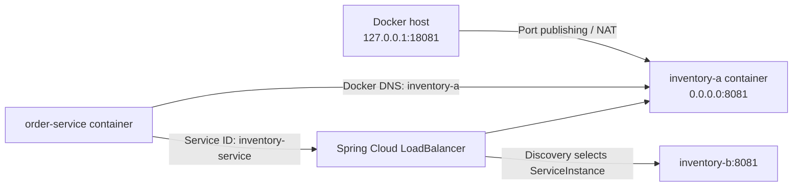
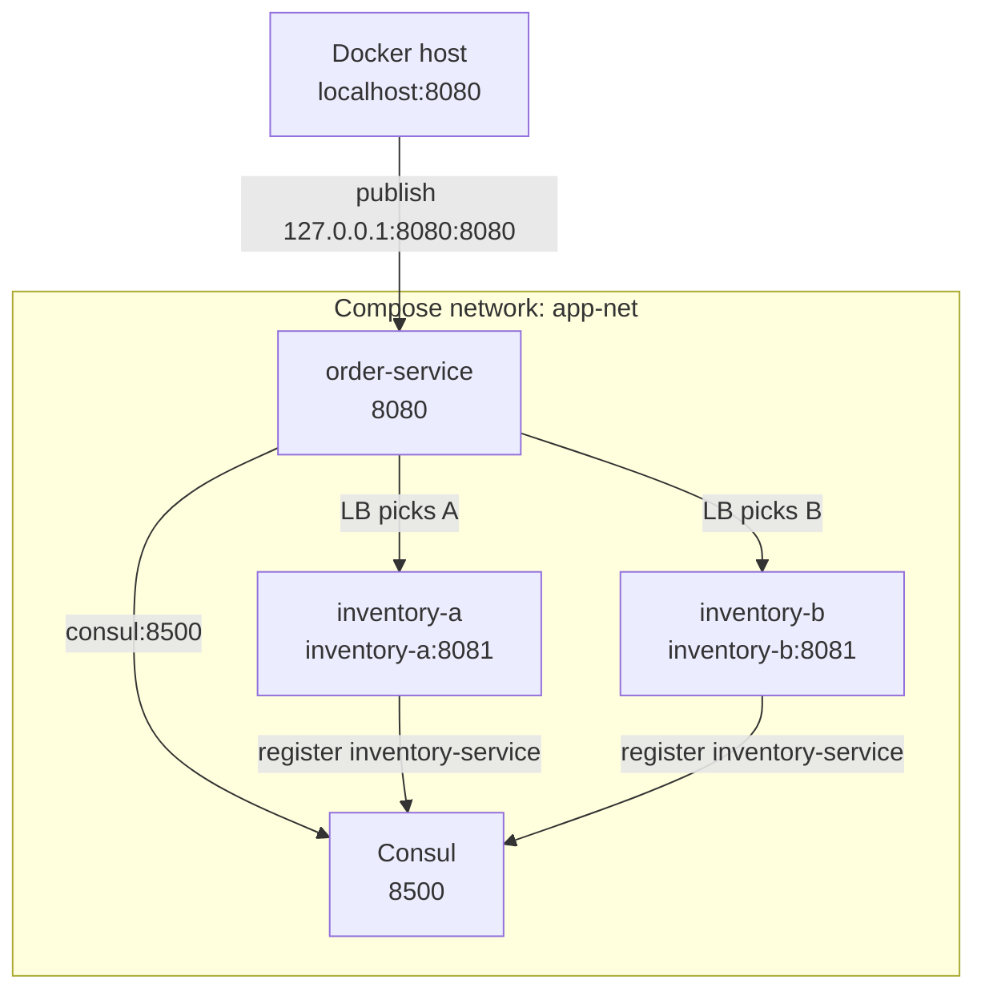

# Container Hostnames, Internal Ports, and Host-Mapped Ports

When running microservices with Docker or Docker Compose, many errors like "Spring Cloud LoadBalancer cannot find service," "Connection refused," or "No instances available" actually stem from **using the wrong container hostname or port**. An application running on the host machine may call `localhost:18081` successfully, while an application running inside an adjacent container must connect to `inventory-a:8081`. If `127.0.0.1:18081` is registered in a service registry for a caller in another container, LoadBalancer may pick a valid `ServiceInstance` yet the HTTP request still goes to the wrong place.

This lesson belongs to the **Deployment** chapter of the `SPRING_CLOUD_SERVICE_COMMUNICATION_LOAD_BALANCING` module. We will distinguish **container hostname, Docker network DNS name, Spring Cloud service ID, application listening port, and Docker host published port**, and then apply them to RestClient/WebClient/OpenFeign, Consul discovery, health checks, Docker Compose, Kubernetes, timeout/retry, and practical testing.

> **Principle:** A `ServiceInstance` address must be **reachable from the network environment of the client using that registry**. For two containers on the same Docker Compose network, the address is typically the internal service/alias name and **container port**; ports published on the Docker host are mainly for clients outside the container network.

## 1. The easiest example to mix up

Suppose a developer machine runs an inventory container serving a Spring Boot application on port `8081`:

```shell
docker run --rm \
  --name inventory-a \
  -p 127.0.0.1:18081:8081 \
  example/inventory-service:dev
```

Three addresses carry **different** meanings:

| Address | Where is it used? | Expected result |
|---|---|---|
| `http://localhost:18081` | On the Docker host | Docker forwards to container, port 8081 |
| `http://inventory-a:8081` | From a container **on the same Docker network that can resolve `inventory-a`** | Connects directly to internal port |
| `http://localhost:18081` | From another container | `localhost` is the **caller container**, usually wrong |
| `http://inventory-a:18081` | From an adjacent container | Wrong if inventory only listens on `8081` |
| `http://0.0.0.0:8081` | Used as a target URL | Wrong semantics: `0.0.0.0` is a **bind** address, not a service hostname |

The `docker run` command above has not created a shared user-defined network; therefore **do not assume** the name `inventory-a` resolves from every container. With Docker Compose, services on the same network are given DNS by service name; later sections use this approach to avoid depending on IPs.

## 2. Four address layers that must stay separate



| Layer | Example | Who manages it? | Role |
|---|---|---|---|
| **Service ID** | `inventory-service` | Spring Cloud/registry | Logical name used to look up multiple `ServiceInstance` entries |
| **Docker DNS name** | `inventory-a` | Docker network/Compose | Resolves internal host to container address |
| **Container port** | `8081` | Application inside container | TCP port the application actually listens on |
| **Host published port** | `18081` | Docker port publishing | Port on host forwarded into container |
| **Bind address** | `0.0.0.0` | Application/OS inside container | Network interface on which the server accepts connections |
| **Container IP** | `172.19.0.5` (illustrative) | Docker network | Address that can change on recreate/scale |
| **External DNS** | `api.example.com` | DNS/ingress | Public endpoint or endpoint accessed from external networks |

A service ID like `inventory-service` is not automatically a DNS hostname that the OS will resolve. When a client is configured with `@LoadBalanced`, Spring Cloud interprets that logical hostname, looks up instances, and constructs the physical address. If you use a plain HTTP client and Docker Compose happens to have a DNS service of the same name, the client might connect via **Docker DNS**, yet that **does not prove** Spring Cloud LoadBalancer selected a `ServiceInstance`.

## 3. "localhost" inside a container always needs scrutiny

Each container in standard bridge networking has its **own network namespace**. Therefore:

```text
Docker host:
  localhost:18081 -> published port of inventory-a

order-service container:
  localhost:8080 -> order-service itself
  localhost:18081 -> order-service itself, not the Docker host
  inventory-a:8081 -> inventory-a over the Docker network

inventory-a container:
  localhost:8081 -> inventory-a itself
  consul:8500 -> Consul container if on the same network
```

Using `localhost` is right when referring to **the very process/container running the command**. It becomes wrong when copying application configuration verbatim from running directly on a laptop into Docker:

```yaml
# Usually WRONG when this config lives inside the order-service container:
spring:
  cloud:
    consul:
      host: localhost
      port: 8500
```

If Consul runs in another container on the same Compose network, the config should be:

```yaml
spring:
  cloud:
    consul:
      host: consul
      port: 8500
```

There is no need to publish port `8500` to the host solely so containers on the same network can call Consul.

### 3.1. host.docker.internal is not the default answer

`host.docker.internal` can be useful when **a container needs to connect to a process on the Docker host**. Support varies across Docker Desktop, Linux Engine, and `host-gateway` configuration. It does not replace service-name DNS between containers.

For microservices on the same Docker Compose network, use `inventory-a:8081`/`consul:8500` and proper discovery rather than routing all traffic through the host gateway just because `localhost` worked on a laptop.

## 4. Containers must listen on a reachable address

A Spring Boot application can be configured with:

```yaml
server:
  address: 0.0.0.0
  port: 8081
```

Or via environment variables:

```yaml
environment:
  SERVER_ADDRESS: "0.0.0.0"
  SERVER_PORT: "8081"
```

`server.port=8081` sets the **port inside the container**. `server.address=0.0.0.0` allows the process to bind on the container's IPv4 interfaces; other containers can connect via the routed bridge address.

If you set:

```yaml
server:
  address: 127.0.0.1
  port: 8081
```

the application listens only on loopback **inside the inventory container**. It may return `200` when tested from inside the container itself, yet the order-service container and Docker port forwarding typically **cannot reach the endpoint through the container interface**.

**Do not use `0.0.0.0` as the registration name in Consul**. That is a bind address, not an address clients should connect to. The registry needs a hostname/IP routable and resolvable from callers.

### 4.1. Distinguish listening from publishing

| Setting | Example | Meaning |
|---|---|---|
| `server.address` | `0.0.0.0` | Interface the server binds to |
| `server.port` | `8081` | Port the process listens on |
| Consul `Address` or discovery hostname | `inventory-a` | Address clients can call |
| Consul `Port` | `8081` | Port clients call in this topology |
| Compose `ports` | `127.0.0.1:18081:8081` | Publishes host 18081 → container 8081 |

Changing `server.port` does not automatically update old mappings. If the app switches from `8081` to `9091` while Compose still publishes `18081:8081`, the host will forward to a port where no process is listening.

## 5. Dockerfile EXPOSE, Compose expose, and Compose ports

These are three configurations with similar names but different meanings.

### 5.1. EXPOSE in Dockerfile

```dockerfile
FROM eclipse-temurin:21-jre
WORKDIR /app
COPY app.jar /app/app.jar
EXPOSE 8081
ENTRYPOINT ["java", "-jar", "/app/app.jar"]
```

`EXPOSE 8081` documents the image's intended port. It **does not** cause Spring Boot to change `server.port` and **does not** publish the port to the host. `docker run -P` can publish declared ports to dynamic host ports; that is a separate behavior.

### 5.2. expose in Docker Compose

```yaml
services:
  inventory-a:
    image: example/inventory-service:dev
    expose:
      - "8081"
```

`expose` documents a container port; **it creates no host port mapping**. On a standard Docker user-defined bridge network, containers on the same network can communicate on the port the application listens on **even without declaring `expose`**. `expose` is neither a firewall nor a security boundary.

### 5.3. ports in Docker Compose

```yaml
services:
  inventory-a:
    image: example/inventory-service:dev
    ports:
      - "127.0.0.1:18081:8081"
```

Syntax:

```text
HOST_IP : HOST_PORT : CONTAINER_PORT
127.0.0.1 : 18081 : 8081
```

When the Docker host receives a request on `127.0.0.1:18081`, Docker forwards it to the container on port `8081`. This is **not** an instruction for Spring Boot to open an extra port 18081 inside the container.

**Security:** If you omit `127.0.0.1` and use `"18081:8081"`, Docker typically publishes on all host interfaces; the port may become reachable from other networks depending on firewalls/routing. Publish only ports required for users/gateways, and enforce TLS, authentication, and network policies.

## 6. Address decision table by caller location

Assume both A and B listen on internal HTTP port `8081`; the host optionally publishes A/B at `18081`/`18082` for debugging.

| Where is the caller running? | Appropriate address | Commonly misconfigured address |
|---|---|---|
| Inside the same inventory-a container | `http://localhost:8081` | `localhost:18081` |
| order-service on the same Compose network | `http://inventory-a:8081` or service ID via LB | `http://localhost:18081` |
| Consul agent on the same Compose network doing HTTP health check | `http://inventory-a:8081/actuator/health` | `http://localhost:8081/actuator/health` |
| Docker host | `http://127.0.0.1:18081` if A publishes | `http://inventory-a:8081` when host lacks that DNS/routing |
| Another machine outside the Docker host | DNS/IP **reachable from that machine** and host-published port, through proper firewall | `127.0.0.1:18081` pointing to the caller machine itself |
| App in Kubernetes in the same namespace | Kubernetes Service DNS or Pod endpoint per architecture | Docker Compose service DNS |
| Spring Cloud LB client | `http://inventory-service/...` with `@LoadBalanced` and matching registry | Hardcoded physical host/port |

When a call fails, **first ask "which network namespace is the caller in?"**, and only then inspect the registry, retries, or round-robin algorithm.

## 7. Docker Compose design for two instances and real discovery

To verify Spring Cloud LoadBalancer, the example uses four components:

- `consul`: service registry running on the same Compose network.
- `inventory-a` and `inventory-b`: two containers of the same inventory app, **sharing internal port `8081`**.
- `order-service`: client calling `inventory-service` via `@LoadBalanced RestClient`.

Both inventory services register **the same Consul service name `inventory-service`** but with distinct `instance-id` and hostnames.



There is no need to publish `8081` of inventory-a or inventory-b to the Docker host because **order-service and Consul share the internal network**.

## 8. Hands-on docker-compose.yml configuration

The example below requires two prebuilt Java application images: `example/order-service:dev` and `example/inventory-service:dev`. These are **illustrative image names**, not public images guaranteed to exist. Order exposes `GET /probe/inventory`, and inventory exposes `GET /whoami` and `/actuator/health` as shown in sections 9–10.

```yaml
services:
  consul:
    image: hashicorp/consul:1.22.7
    command: ["agent", "-dev", "-client=0.0.0.0"]
    healthcheck:
      test: ["CMD", "consul", "info"]
      interval: 5s
      timeout: 3s
      retries: 12
    networks:
      - app-net

  inventory-a:
    image: example/inventory-service:dev
    environment:
      SPRING_APPLICATION_NAME: inventory-service
      SERVER_ADDRESS: "0.0.0.0"
      SERVER_PORT: "8081"
      SPRING_CLOUD_CONSUL_HOST: consul
      SPRING_CLOUD_CONSUL_PORT: "8500"
      SPRING_CLOUD_CONSUL_DISCOVERY_HOSTNAME: inventory-a
      SPRING_CLOUD_CONSUL_DISCOVERY_INSTANCE_ID: inventory-a
      SPRING_CLOUD_CONSUL_DISCOVERY_PORT: "8081"
      SPRING_CLOUD_CONSUL_DISCOVERY_PREFER_IP_ADDRESS: "false"
      SPRING_CLOUD_CONSUL_DISCOVERY_HEALTH_CHECK_PATH: /actuator/health
      SPRING_CLOUD_CONSUL_DISCOVERY_HEALTH_CHECK_INTERVAL: 5s
    expose:
      - "8081"
    depends_on:
      consul:
        condition: service_healthy
    networks:
      - app-net

  inventory-b:
    image: example/inventory-service:dev
    environment:
      SPRING_APPLICATION_NAME: inventory-service
      SERVER_ADDRESS: "0.0.0.0"
      SERVER_PORT: "8081"
      SPRING_CLOUD_CONSUL_HOST: consul
      SPRING_CLOUD_CONSUL_PORT: "8500"
      SPRING_CLOUD_CONSUL_DISCOVERY_HOSTNAME: inventory-b
      SPRING_CLOUD_CONSUL_DISCOVERY_INSTANCE_ID: inventory-b
      SPRING_CLOUD_CONSUL_DISCOVERY_PORT: "8081"
      SPRING_CLOUD_CONSUL_DISCOVERY_PREFER_IP_ADDRESS: "false"
      SPRING_CLOUD_CONSUL_DISCOVERY_HEALTH_CHECK_PATH: /actuator/health
      SPRING_CLOUD_CONSUL_DISCOVERY_HEALTH_CHECK_INTERVAL: 5s
    expose:
      - "8081"
    depends_on:
      consul:
        condition: service_healthy
    networks:
      - app-net

  order-service:
    image: example/order-service:dev
    environment:
      SPRING_APPLICATION_NAME: order-service
      SERVER_ADDRESS: "0.0.0.0"
      SERVER_PORT: "8080"
      SPRING_CLOUD_CONSUL_HOST: consul
      SPRING_CLOUD_CONSUL_PORT: "8500"
      SPRING_CLOUD_CONSUL_DISCOVERY_REGISTER: "false"
      SPRING_CLOUD_CONSUL_DISCOVERY_QUERY_PASSING: "true"
      SPRING_CLOUD_LOADBALANCER_RETRY_ENABLED: "false"
    ports:
      - "127.0.0.1:8080:8080"
    depends_on:
      consul:
        condition: service_healthy
    networks:
      - app-net

networks:
  app-net:
    driver: bridge
```

**Explanation of key choices:**

1. `consul` is the internal DNS name containers use to connect to Consul on port `8500`.
2. Both instances register under the name `inventory-service`, since `SPRING_APPLICATION_NAME` is `inventory-service` for both.
3. `SPRING_CLOUD_CONSUL_DISCOVERY_HOSTNAME` is set to the **DNS name resolvable by clients on the same network**: `inventory-a`/`inventory-b`.
4. `SPRING_CLOUD_CONSUL_DISCOVERY_INSTANCE_ID` values differ so the two registrations do not overwrite each other in the agent.
5. `SPRING_CLOUD_CONSUL_DISCOVERY_PORT` equals **server port 8081**, not a host published port.
6. Neither instance declares `ports` since they do not need to accept traffic from the Docker host.
7. `order-service` publishes `127.0.0.1:8080:8080` to test the API from the **host machine**, without exposing Consul or inventory to the Internet.
8. `query-passing=true` ensures the caller only receives registrations whose Consul health check is in `passing` state under this config.
9. Retry is disabled in the baseline so instance selection measurements are not skewed by multiple HTTP attempts.
10. `depends_on: condition: service_healthy` waits for the **Consul container** to be healthy. It **does not** guarantee inventory-a/B have finished registering and passing health checks; the client still needs to handle startup/eventual consistency.

Consul `agent -dev` is suited for **local labs**; do not use this configuration as-is in production. Image tags should be verified for availability against your environment's registry and CPU architecture; CI should pin organization-vetted image digests.

### 8.1. Why is hostname: not needed?

Docker Compose provides **service name DNS** on the project's network. The `order-service` container can resolve `inventory-a` and `inventory-b` when containers share the network. You do not need to set `hostname: inventory-a` just to get this service-name DNS.

`hostname` mainly sets the container-level OS hostname; `container_name` assigns a fixed container name and makes scaling difficult. **Avoid relying on fixed IPs or `container_name`** as the primary mechanism when deploying multiple replicas.

### 8.2. Why not assign two containers the same host port?

If both declare:

```yaml
ports:
  - "18081:8081"
```

on the same Docker host, Docker cannot bind one TCP host port on the same address to two independent containers. You can publish `18081:8081` for A and `18082:8081` for B, yet **service-to-service traffic on the same network still uses `8081`**.

Real example of a configuration unnecessary for internal traffic:

```yaml
inventory-a:
  ports:
    - "127.0.0.1:18081:8081"

inventory-b:
  ports:
    - "127.0.0.1:18082:8081"
```

Use this only when host-side debugging is required with proper access controls. **Do not register `inventory-a:18081` or `inventory-b:18082`** in Consul for container callers in the setup from section 8.

## 9. inventory-service application: binding and returning an instance marker

The inventory application can expose an endpoint to observe the selected instance:

```java
package com.example.inventory;

import org.springframework.beans.factory.annotation.Value;
import org.springframework.boot.SpringApplication;
import org.springframework.boot.autoconfigure.SpringBootApplication;
import org.springframework.web.bind.annotation.GetMapping;
import org.springframework.web.bind.annotation.RestController;

@SpringBootApplication
@RestController
public class InventoryApplication {

    @Value("${spring.cloud.consul.discovery.instance-id}")
    private String instanceId;

    public static void main(String[] args) {
        SpringApplication.run(InventoryApplication.class, args);
    }

    @GetMapping("/whoami")
    public String whoAmI() {
        return instanceId;
    }
}
```

`instance-id` is supplied as `inventory-a` or `inventory-b` via environment variables in Compose. The controller returns the marker to identify which replica handled the request.

Inventory requires the appropriate dependencies:

```xml
<dependencies>
    <dependency>
        <groupId>org.springframework.boot</groupId>
        <artifactId>spring-boot-starter-web</artifactId>
    </dependency>
    <dependency>
        <groupId>org.springframework.boot</groupId>
        <artifactId>spring-boot-starter-actuator</artifactId>
    </dependency>
    <dependency>
        <groupId>org.springframework.cloud</groupId>
        <artifactId>spring-cloud-starter-consul-discovery</artifactId>
    </dependency>
</dependencies>
```

A Spring Cloud BOM compatible with Spring Boot must be imported. Without Actuator, Consul's default check against `/actuator/health` will get a 404 and may mark the instance `critical`. When separating the management port from the application port, verify the Consul health-check URL, port, and security separately.

### 9.1. Is the health check actually reachable?

In the example:

```text
consul container -> inventory-a:8081/actuator/health
consul container -> inventory-b:8081/actuator/health
```

Consul sits on the same Compose network, so it can resolve those names. The health check catches connectivity issues if the inventory server mistakenly binds `127.0.0.1` or has not opened port 8081. However, a `200` from the health endpoint does not prove every business API is healthy; understand readiness semantics and actual health groups in production deployments.

## 10. order-service application: @LoadBalanced RestClient

The order application needs Spring Web, Spring Cloud LoadBalancer, and Spring Cloud Consul Discovery. Example:

```xml
<dependencies>
    <dependency>
        <groupId>org.springframework.boot</groupId>
        <artifactId>spring-boot-starter-web</artifactId>
    </dependency>
    <dependency>
        <groupId>org.springframework.cloud</groupId>
        <artifactId>spring-cloud-starter-loadbalancer</artifactId>
    </dependency>
    <dependency>
        <groupId>org.springframework.cloud</groupId>
        <artifactId>spring-cloud-starter-consul-discovery</artifactId>
    </dependency>
</dependencies>
```

Create a builder processed by Spring Cloud:

```java
package com.example.order;

import org.springframework.cloud.client.loadbalancer.LoadBalanced;
import org.springframework.context.annotation.Bean;
import org.springframework.context.annotation.Configuration;
import org.springframework.web.client.RestClient;

@Configuration(proxyBeanMethods = false)
class ClientConfiguration {

    @Bean("inventoryLoadBalancedBuilder")
    @LoadBalanced
    RestClient.Builder inventoryLoadBalancedBuilder() {
        return RestClient.builder();
    }
}
```

Gateway:

```java
package com.example.order;

import org.springframework.beans.factory.annotation.Qualifier;
import org.springframework.stereotype.Service;
import org.springframework.web.client.RestClient;

@Service
public class InventoryGateway {

    private final RestClient inventory;

    public InventoryGateway(
            @Qualifier("inventoryLoadBalancedBuilder")
            RestClient.Builder builder) {
        this.inventory = builder.clone()
                .baseUrl("http://inventory-service")
                .build();
    }

    public String selectedInstance() {
        return inventory.get()
                .uri("/whoami")
                .retrieve()
                .body(String.class);
    }
}
```

Entry-point controller:

```java
package com.example.order;

import org.springframework.web.bind.annotation.GetMapping;
import org.springframework.web.bind.annotation.RestController;

@RestController
class DeploymentProbeController {

    private final InventoryGateway inventory;

    DeploymentProbeController(InventoryGateway inventory) {
        this.inventory = inventory;
    }

    @GetMapping("/probe/inventory")
    String inventory() {
        return inventory.selectedInstance();
    }
}
```

Path of a request:

```text
Host: GET http://127.0.0.1:8080/probe/inventory
  |
  | Docker publish 8080:8080
  v
order-service container: GET /probe/inventory
  |
  | @LoadBalanced RestClient
  | GET http://inventory-service/whoami
  v
Spring Cloud ConsulDiscoveryClient:
  ServiceInstance { serviceId=inventory-service,
                    host=inventory-a, port=8081 }
  or
  ServiceInstance { serviceId=inventory-service,
                    host=inventory-b, port=8081 }
  |
  v
HTTP transport: GET http://inventory-a:8081/whoami
             or http://inventory-b:8081/whoami
  |
  v
Response body: inventory-a / inventory-b
```

**Why not write `http://inventory-service:18081`?** Because `18081` was a host-published port used from the Docker host in an earlier example. In this Compose setup, Consul publishes port `8081`. Clients should use the **service ID without hardcoding a physical port**; LoadBalancer takes the real host/port from the chosen `ServiceInstance`.

### 10.1. Note on auto-configuration and instrumentation

Calling `RestClient.builder()` directly inside a bean focuses on illustrating `@LoadBalanced` attachment. In production apps with Spring Boot auto-customizers (observation, tracing, SSL, request factories, connection pooling), use the builder configuration pattern appropriate for your Boot version so those customizations are preserved. Do not instantiate an arbitrary `RestClient` outside the Spring Cloud–intercepted bean and blame discovery when it fails.

## 11. Running and verifying with Docker Compose

After building both application images with the names specified in Compose, run:

```shell
docker compose config
docker compose up -d
docker compose ps
```

`docker compose config` catches syntax/interpolation errors; it does not verify HTTP endpoint availability. `docker compose ps` shows containers and host-published ports.

Inspect logs:

```shell
docker compose logs --tail 100 consul
docker compose logs --tail 100 inventory-a inventory-b
docker compose logs --tail 100 order-service
```

Check the Consul service list via CLI inside the container:

```shell
docker compose exec consul consul catalog services
```

Once inventory A/B are registered and checks transition to `passing`, from the Docker host:

```shell
curl -i http://127.0.0.1:8080/probe/inventory
curl -i http://127.0.0.1:8080/probe/inventory
curl -i http://127.0.0.1:8080/probe/inventory
```

Illustrative response bodies:

```text
inventory-a
inventory-b
inventory-a
```

The actual sequence depends on round-robin state, candidate ordering, other requests, cache, retries, and custom policies; the first request is not guaranteed to hit A. What matters is that **every response belongs to {A, B}** and when both candidates are healthy, sequential requests observe both under the default round-robin policy.

### 11.1. Verifying the target from the right network namespace

If inventory-a is unreachable from order-service, check connectivity **from a container on the same network**, not only from the Docker host. If the application image includes `curl`:

```shell
docker compose exec order-service \
  curl -fsS http://inventory-a:8081/actuator/health
```

Minimal Java images may omit `curl`; do not install debug tools into a production image just to run tests. Use an ephemeral debug container attached to the **same Compose network**, or verify via dedicated HTTP client tests.

Trying:

```shell
docker compose exec order-service \
  curl -fsS http://127.0.0.1:8081/actuator/health
```

will normally fail if order-service has nothing listening on port 8081. That proves `127.0.0.1` inside the container **does not** point to inventory-a.

### 11.2. Why does the first call sometimes return 503?

`depends_on` only orders container startup according to declared conditions. Once order-service is already running, the two inventory instances may still be:

1. Booting the JVM/Spring context.
2. Opening port `8081`.
3. Registering in Consul.
4. Waiting for the first HTTP health check to become `passing`.
5. Becoming visible to the caller's discovery query and LoadBalancer.

During that gap, `inventory-service` may have no eligible candidates yet. Tests should poll with a deadline or explicit readiness gate; production should use startup/readiness checks and bounded retries/idempotency at the right layer, not fixed `Thread.sleep(100)` calls.

## 12. Distinguishing Docker DNS from Spring Cloud LoadBalancer

Suppose Compose defines a service:

```yaml
services:
  inventory-service:
    image: example/inventory-service:dev
    expose:
      - "8081"
```

Containers on the same network can reach `http://inventory-service:8081` via Docker DNS. When scaling this service to multiple replicas (without `container_name` or fixed host ports), Compose can return multiple container addresses in DNS.

**However:**

- DNS resolution/connection behavior of an HTTP client **is not synonymous** with Spring Cloud's `RoundRobinLoadBalancer`.
- A client knowing only a DNS hostname does not automatically build a `ServiceInstanceListSupplier` from every A record.
- Docker DNS does not turn into Consul/Eureka registrations on its own.
- Docker DNS usually does not provide full lifecycle/health metadata/zone/hints to Spring Cloud LoadBalancer.
- DNS caching and HTTP connection reuse can skew traffic even when DNS returns multiple IPs.

If the goal is **server-side/native network load balancing** behind a stable endpoint, Docker/Kubernetes/service proxies can satisfy it without necessarily needing Spring Cloud client-side selection. If the goal is **Spring Cloud LoadBalancer picking each `ServiceInstance`**, you need a `DiscoveryClient` or appropriate supplier returning those instances.

In the section 8 example, Compose intentionally names the two containers `inventory-a`/`inventory-b`, with **no** `inventory-service` DNS service. Thus `http://inventory-service` working through order-service is a solid verification that the client is truly resolving the **service ID from Consul**.

## 13. Scaling: why avoid fixed container_name and host ports?

The Compose pattern with two separate services A/B is easy to follow in labs. When scaling in production, you usually use one service definition with multiple replicas, each instance registering a unique ID and a valid hostname/IP.

Common mistakes:

```yaml
services:
  inventory-service:
    image: example/inventory-service:dev
    container_name: inventory-service
    ports:
      - "18081:8081"
```

If you run:

```shell
docker compose up -d --scale inventory-service=3
```

a fixed `container_name` cannot be shared across three containers, and the same fixed host port `18081` cannot be bound simultaneously by all three on the same host address.

An alternative design:

- Do not set a fixed `container_name` for replicas.
- Do not publish host ports for internal-only microservices.
- Give each instance a **unique** registration identifier.
- Give each instance a host/IP and internal port reachable by callers on the same network.
- Use a discovery mechanism suited to the container/orchestrator environment.
- When recreated, do not rely on the old container IP; discovery/health must reflect the change.

Example of a scalable service without fixed host ports:

```yaml
services:
  inventory-service:
    image: example/inventory-service:dev
    environment:
      SERVER_PORT: "8081"
    expose:
      - "8081"
    networks:
      - app-net

networks:
  app-net:
    driver: bridge
```

This is only a **networking template**, not a complete multi-replica Consul registration setup. If adding Consul, each replica must register a distinct `instance-id` and an address **identifying that specific replica**: for example a platform-injected container IP/hostname routable from callers. **Do not** hardcode every registration to `instance-id=inventory-a` or a shared Compose service DNS hostname if the goal is selecting individual physical replicas.

### 13.1. Dynamic host published ports

Docker Compose supports publishing a container port without fixing the host port, such as:

```yaml
ports:
  - "8081"
```

Docker allocates a dynamic host port for each replica. You can inspect the mapping with:

```shell
docker compose port --index=1 inventory-service 8081
docker compose port --index=2 inventory-service 8081
```

That port lets **callers from the host or permitted networks** reach the replica; it **does not** change `server.port=8081` inside the container. If there is no need for external per-replica access, do not publish all replicas.

## 14. Two topologies and how to register ServiceInstance properly

### 14.1. Topology A — Caller and backend on the same Docker network

```text
order-service container          inventory-a container
       |                               ^
       |---- http://inventory-a:8081 --|
       |
       +---- http://inventory-b:8081 --> inventory-b
```

The Consul registry should publish:

| Instance | Advertised host | Advertised port |
|---|---|---:|
| A | `inventory-a` | 8081 |
| B | `inventory-b` | 8081 |

No host port mappings are needed for A/B. The registry also needs accurate **service name**, health status, and scheme. This is the topology of the Compose example.

### 14.2. Topology B — Caller outside the Docker bridge network

```text
External caller
    |
    +---- host.example:18081 -> inventory-a:8081
    |
    +---- host.example:18082 -> inventory-b:8081
```

If the caller is on another machine and **lacks** a route/DNS to `inventory-a`/`inventory-b`, it cannot use the internal hostnames from topology A.

If you genuinely want direct per-instance external routing, discovery serving external callers must publish **reachable host addresses** and **published ports**:

| Instance | Advertised host | Advertised port |
|---|---|---:|
| A | `host.example` | 18081 |
| B | `host.example` | 18082 |

Appropriate firewalls/TLS must be enabled to avoid exposing internal services unnecessarily. Do not assume a single registry containing `inventory-a:8081` can serve both container clients and external clients simultaneously. You may need **separate registries/views**, a gateway/ingress, or a routing layer tailored to each caller group.

**Never use `127.0.0.1` as the advertised host for a caller on another machine**: the caller's loopback is not the Docker host.

## 15. Kubernetes: map concepts rather than copying Docker ports verbatim

When moving to Kubernetes, the layers are analogous though implemented differently:

| Docker Compose | Conceptual Kubernetes equivalent |
|---|---|
| Container app listens on `8081` | Container process listens on `8081`; `containerPort` is metadata |
| Compose service name DNS | Namespace-scoped Kubernetes Service DNS |
| `ports: HOST:CONTAINER` | As needed: `Service`, `NodePort`, `LoadBalancer`, or Ingress/Gateway |
| Container IP changes | Pod IP can change after rescheduling |
| Consul registration | Kubernetes Endpoints/EndpointSlices or external registry |
| Compose bridge network | Cluster networking/CNI and NetworkPolicy |
| Instance health | Readiness/liveness/startup probes |

Example Deployment where the app container listens on port 8081 and an internal Service exposes port 80:

```yaml
apiVersion: apps/v1
kind: Deployment
metadata:
  name: inventory
spec:
  replicas: 2
  selector:
    matchLabels:
      app: inventory
  template:
    metadata:
      labels:
        app: inventory
    spec:
      containers:
        - name: inventory
          image: example/inventory-service:dev
          ports:
            - containerPort: 8081
          env:
            - name: SERVER_PORT
              value: "8081"
            - name: SERVER_ADDRESS
              value: "0.0.0.0"
---
apiVersion: v1
kind: Service
metadata:
  name: inventory-service
spec:
  type: ClusterIP
  selector:
    app: inventory
  ports:
    - name: http
      port: 80
      targetPort: 8081
```

From an order-service Pod in the same namespace, `http://inventory-service:80` uses **Kubernetes Service DNS/IP and the platform's load distribution**. It **does not automatically** use Spring Cloud LoadBalancer per-Pod. If you want Spring Cloud to pick individual Pods, you need `Spring Cloud Kubernetes DiscoveryClient`/matching supplier, proper RBAC permissions, and a list of `ServiceInstance` entries representing endpoints/Pods reachable by the caller.

**Distinguish the three ports:**

- `containerPort: 8081`: container metadata; the real app must still bind `8081`.
- `Service.port: 80`: port accepted by the **Service virtual IP**.
- `Service.targetPort: 8081`: port on the backend Pod to forward to.

`NodePort`, external `LoadBalancer`, and Ingress/Gateway are needed only for traffic from outside the cluster; they are not the application's `server.port`.

## 16. Hostname, TLS, and security when LoadBalancer changes targets

If a request goes over HTTPS:

```text
https://inventory-service/api/v1/items
         |
         | Spring Cloud LoadBalancer selects instance
         v
https://inventory-a.internal.example:8443
```

HTTP transports normally verify certificates against the actual target host identity used for connection. If the registry advertises an **IP** while the certificate only has a DNS SAN, hostname verification can fail. If registering container hostname `inventory-a`, the certificate must also be issued for the verified TLS name, or TLS should terminate at a gateway/mesh with a clear identity.

Key reminders:

1. Logical service ID, Docker hostname, and TLS SAN are three related concepts that **do not necessarily match**.
2. Registering `0.0.0.0` or `127.0.0.1` for callers in other containers is usually a routing mistake.
3. Never disable hostname verification or use trust-all to "fix" a wrong advertised host.
4. Never expose Consul, Actuator, management APIs, or admin endpoints to the Internet without access control.
5. With mTLS, review client identity when retries switch to another instance; all backends need compatible trust policies.
6. When rotating DNS or certificates during rolling deployments, wait for readiness and trust propagation before adding instances to the pool.

## 17. Impact on timeouts, retries, and connection pooling

A wrongly registered address can produce **errors that look very much like timeouts** yet cannot be fixed by increasing retry counts.

| Misconfiguration | Symptom | Can retry solve the root cause? |
|---|---|---|
| Registry publishes `127.0.0.1` | Client connects to itself, connection refused/timeout | No |
| Registry publishes host port `18081` to container peer | Peer connects to wrong port | No |
| App binds `127.0.0.1:8081` in container | Other containers cannot reach it | No |
| Instance B removed but cache not yet refreshed | May still pick B | Retry can soften symptoms; fix freshness |
| Health endpoint returns critical | Candidate filtered out when health filtering is on | Retry does not make an instance healthy |
| B only serves HTTP but registry marks HTTPS | TLS handshake failure | No |
| Transient slowness on one instance | Read/response timeout | Bounded retry can help when request is safe |
| Pooled connection to old instance reset after recreate | Connection reset on pooled request | Retry may recover; ensure proper connection lifecycle |

**Do not use retries to hide a registry publishing wrong hosts/ports.** Fix advertised addresses, endpoint health, and networking first. Retrying the same instance repeats the error; retrying another instance will also fail if every instance is misregistered.

### 17.1. Connection pools per physical host/port

A `@LoadBalanced WebClient` using Reactor Netty or `RestClient` with pooled HTTP transport normally reuses connections per **actual destination**, not only per logical service ID. When LoadBalancer picks A then B, the transport may use two distinct connection groups.

When a container is recreated:

- The old container IP may disappear.
- Open connections to the old container are severed.
- Docker DNS/Consul may update at different speeds.
- The pool may retain stale connections until an error is detected or idle timeout expires.
- Properly budgeted/idempotent retries can aid recovery, but do not replace health/discovery freshness.

Observe connect timeouts, active/pending pool metrics, instance selection, HTTP status, retries, and final outcome to distinguish topology faults from load issues.

## 18. Automated testing: verifying registry → instance → HTTP response

A deployment test suite should evaluate **each layer** instead of only calling from the Docker host and seeing HTTP 200.

### 18.1. Verification matrix

| Test | Expected evidence |
|---|---|
| Both A/B running and healthy | Consul has two registrations with same service name, distinct IDs |
| Docker DNS | From order-service, `inventory-a:8081` and `inventory-b:8081` resolve/connect |
| Service discovery | Spring `DiscoveryClient.getInstances("inventory-service")` returns proper host/port |
| LoadBalancer | Calling `http://inventory-service/whoami` yields marker A or B |
| Round robin | Multiple sequential calls in controlled context observe both A and B |
| One instance critical | Health query filters out that instance per policy |
| B stopped | Health/deregistration converges; new requests stop picking B |
| Wrong internal port | Connection refused detected even while Consul registration may still exist |
| Wrong published port | Host-side test fails, while internal call path may still work |
| No instances | LB returns appropriate selection failure without guessing IPs or uncontrolled fallbacks |
| Retry off | One logical request is not sent multiple times due to LB retry |
| Scale/recreate | No reliance on old IP; service is rediscovered after convergence |

### 18.2. JUnit smoke test through the host-published API

Suppose Compose is already running in a dedicated **integration test job** and `order-service` publishes port 8080. Java's `HttpClient` can send multiple calls to inspect the marker:

```java
import java.net.URI;
import java.net.http.HttpClient;
import java.net.http.HttpRequest;
import java.net.http.HttpResponse;
import java.util.HashSet;
import java.util.Set;

import org.junit.jupiter.api.Test;

import static org.junit.jupiter.api.Assertions.*;

class ComposeDeploymentSmokeIT {

    @Test
    void callsInventoryInstancesThroughOrderService()
            throws Exception {

        HttpClient http = HttpClient.newHttpClient();
        Set<String> seen = new HashSet<>();

        for (int n = 0; n < 8; n++) {
            HttpRequest request = HttpRequest.newBuilder()
                    .uri(URI.create(
                            "http://127.0.0.1:8080/probe/inventory"))
                    .GET()
                    .build();

            HttpResponse<String> response = http.send(
                    request,
                    HttpResponse.BodyHandlers.ofString());

            assertEquals(200, response.statusCode());

            String instance = response.body().trim();
            assertTrue(
                    Set.of("inventory-a", "inventory-b")
                            .contains(instance));

            seen.add(instance);
        }

        assertEquals(
                Set.of("inventory-a", "inventory-b"),
                seen);
    }
}
```

Preconditions:

- Test runs on the **Docker host** or an environment with a route to published port `8080`.
- The Compose stack is up and **both inventory registrations are passing**.
- The default algorithm is `RoundRobinLoadBalancer`, with no hint/zone filter pinning the client to one instance.
- Calls are sequential, with no retries or background requests distorting the expected distribution.

This is a **post-deployment smoke test**, not a replacement for true service-registry tests or algorithm unit tests. Do not require both markers A/B to appear within eight calls if using Random/sticky policies or when only one instance is eligible.

### 18.3. Checking registrations directly in Spring

An integration test inside order-service can assert:

```java
@Autowired
DiscoveryClient discoveryClient;

@Test
void registeredPortsAreInternalApplicationPorts() {
    var instances =
            discoveryClient.getInstances("inventory-service");

    assertEquals(2, instances.size());

    assertTrue(instances.stream()
            .allMatch(instance ->
                    instance.getPort() == 8081));

    assertEquals(
            Set.of("inventory-a", "inventory-b"),
            instances.stream()
                    .map(ServiceInstance::getHost)
                    .collect(java.util.stream.Collectors.toSet()));
}
```

This check requires a **real Consul with two healthy registrations** and the test app pointing to that registry; it does not fit an isolated unit test using mocks. If your infrastructure advertises IPs instead of hostnames or uses a different Kubernetes/Service port, adapt assertions to match your designed topology — do not force every system onto port 8081.

## 19. Runbook: investigating failures in the right order

If `order-service` reports `ResourceAccessException`, `ConnectException`, `UnknownHostException`, or `503`:

1. **Client URL**: record the logical URI, confirm `http://inventory-service/...` and `@LoadBalanced` builder usage.
2. **Instance list**: query `DiscoveryClient`/Consul, recording service ID, host, port, secure flag, metadata, and health.
3. **Selected address**: record the actual selected instance, separating zero-instance errors from instance-selected-but-unreachable errors.
4. **Network namespace**: check whether the caller runs on the host, a Compose container, a different container network, or a Kubernetes Pod.
5. **DNS**: from the caller's namespace itself, resolve the hostname **published by the registry**.
6. **TCP**: test the right internal port or published port for that topology, without mixing the two.
7. **Bind**: verify Spring Boot listens on `0.0.0.0:8081` or a valid interface.
8. **Health**: test the Consul health check URL from Consul's network namespace, not only from the host.
9. **Scheme/TLS**: compare `http/https`, real port, certificate SAN/truststore.
10. **Cache/Retry/Pool**: only after addresses and endpoints are right, inspect stale caches, connection reuse, and retry budgets.
11. **Final outcome**: use traces/logs to link the logical call, selected instance, HTTP attempts, and final error.

### 19.1. Quick symptom lookup table

| Symptom | Likely cause | How to verify |
|---|---|---|
| Host can call `localhost:18081`, order container cannot call `localhost:18081` | Loopback namespace mix-up | Call `inventory-a:8081` within the same Docker network |
| `UnknownHostException: inventory-a` | Not on same network or DNS alias missing | `docker compose ps` and network membership |
| `UnknownHostException: inventory-service` | Client missing `@LoadBalanced` or service DNS missing | Check HTTP builder and Consul |
| `Connection refused` to `inventory-a:8081` | Server not listening, or bound to loopback / wrong port | Check `server.address`, `server.port`, server logs |
| `No instances available` | Discovery has no eligible candidates | Check Consul registrations/health/filters |
| Consul sees A/B but health is critical | `/actuator/health` unreachable or wrong path/port | Test health endpoint from Consul network |
| A succeeds but B fails | B has wrong hostname/port/TLS/health | Test each instance individually |
| `docker compose up --scale` fails | Fixed `container_name` or fixed host port | Remove unnecessary fixed bindings |
| Host port 18081 busy | Published port collision with another process | Change host port; keep internal port if app still listens on 8081 |
| Docker host succeeds but external machine fails | Published bound to `127.0.0.1` or firewall | Confirm exposure intent and policy before opening |
| External machine fails calling `inventory-a:8081` | Internal hostname unresolvable/unroutable externally | Use gateway/ingress or external advertised address |
| Still calls old IP after recreate | Stale cache/discovery or hardcoded IP | Measure propagation; never register static IPs |
| HTTPS hostname error | SAN does not match host after selection | Check certificate/SNI; do not disable verification |
| Timeouts spike when scaling | Pool, discovery churn, health convergence, or downstream overload | Measure active/pending connections, attempts, latency |

## 20. Observability and measuring deployment impact

Collect the following signals:

| Metric/log | Meaning |
|---|---|
| `serviceId` | Logical name requested by caller |
| `selectedInstanceId` | Replica chosen for the attempt |
| `selectedHost`/`selectedPort` | Physical address the client will connect to |
| `advertisedScheme` | `http` or `https` per registry |
| `discoveredInstanceCount` | Number of replicas returned by registry |
| `eligibleInstanceCount` | Number of replicas after health/zone/metadata filters |
| `connectionFailureCategory` | DNS, connect, TLS, response timeout, pool acquire |
| `retryAttemptCount` | Retry count for the logical call |
| `finalOutcome` | Success, HTTP error, or transport failure |
| `discoveryConvergenceLatency` | Delay from register/deregister until client sees the change |

These field names are **instrumentation examples**, not all built-in Spring Cloud default metrics. With Micrometer, use bounded-cardinality tags such as service ID, outcome category, and zone. Avoid putting dynamic IPs/container IDs, raw URLs, or request IDs into unbounded metric labels; per-request details belong in controlled logs/traces.

### 20.1. When an instance is recreated

Compare before and after:

```text
T0: inventory-a is selected -> HTTP 200
T1: inventory-a container is recreated, IP changes
T2: Consul health changes state / registration is updated
T3: DiscoveryClient + supplier receive new list
T4: LoadBalancer stops picking old endpoint
T5: HTTP requests return to normal
```

If errors occur between T1 and T4, evaluate whether discovery/cache convergence latency and connection pool recovery stay within your target recovery budget. Avoid blaming every error in this window on "round robin picking wrong" or "Docker port mapping bugs."

## 21. Pre-deployment configuration checklist

- [ ] Distinguished **service ID**, Docker DNS hostname, container hostname/IP, and public DNS.
- [ ] Spring Boot binds an accessible interface, such as `0.0.0.0`.
- [ ] `server.port` matches the **container port** the application actually listens on.
- [ ] `HOST_PORT:CONTAINER_PORT` mappings are used only where external access is needed.
- [ ] Containers that need to call each other share a network and resolve service names/aliases properly.
- [ ] Caller container's `localhost` is never used to target another container.
- [ ] `0.0.0.0` is never placed in the registry as an advertised hostname.
- [ ] Consul/Eureka receives the right service ID, instance ID, host/IP, port, and scheme.
- [ ] Health endpoint is actually reachable from the health checker's network.
- [ ] Never assume `EXPOSE` or Compose `expose` creates a host port mapping.
- [ ] Registry/Actuator/admin endpoints are not published unnecessarily.
- [ ] Both inventory instances have distinct IDs; each instance routes to the right host/port.
- [ ] Client uses `@LoadBalanced` builder and logical hostname URI when Spring Cloud selection is needed.
- [ ] Docker DNS round robin is not confused with Spring Cloud `ServiceInstanceListSupplier`.
- [ ] `container_name` and fixed host ports are avoided when scaling multiple replicas.
- [ ] Container IPs are not hardcoded since they can change on recreate.
- [ ] For external callers, advertised addresses are reachable **outside the Docker network**, or traffic goes through a gateway/ingress.
- [ ] HTTPS truststore and SAN match the real hostname after LoadBalancer selection.
- [ ] Timeout/retry, cache/health, and pool settings are verified independently.
- [ ] Have both a smoke test from the Docker host and DNS/TCP checks from the caller network itself.
- [ ] Logs/traces capture service ID, selected instance, host/port, and final error.
- [ ] Rollback, readiness, and draining mechanisms are suited to rolling deployments.

## 22. Self-check questions

**1. Does `ports: ["18081:8081"]` make Spring Boot listen on port 18081?** No. It publishes host port 18081 and forwards to container port 8081. The process must still listen on 8081.

**2. Why does `curl http://localhost:18081` succeed on the host yet fail from the order-service container?** Because `localhost` inside order-service refers to the network namespace of the order-service container itself, not the Docker host.

**3. Why shouldn't `inventory-a:18081` be registered in Consul for callers on the same Compose network?** Because 18081 is the host-published port, whereas the inventory-a container listens on 8081. Internal callers must use `inventory-a:8081`.

**4. Is `ports` required for order-service to call inventory-a on the same Compose network?** No; on the same network with the server listening on the proper interface/port, calls can use the DNS service name and internal port.

**5. Does `EXPOSE 8081` open the port externally?** No. It is primarily metadata; publishing requires `ports` or `docker run -p`.

**6. When calling `http://inventory-service` via `@LoadBalanced RestClient`, who supplies the host/port?** `ServiceInstanceListSupplier`/discovery returns the instance list, LoadBalancer selects one instance, and builds the physical URI for the HTTP client.

**7. If Docker DNS resolves `inventory-service`, does that prove Spring Cloud LoadBalancer is working?** No. That may just be Docker DNS plus a plain HTTP client; you must instrument and verify the `@LoadBalanced` bean/selected instance.

**8. Why must `spring.cloud.consul.discovery.instance-id` differ between two replicas?** So registrations do not overwrite each other in Consul and each replica is identified individually.

**9. With a Kubernetes Service port 80 and targetPort 8081, which port must the app bind?** Port 8081 on the Pod/container; the Kubernetes Service receives traffic on port 80 and forwards to 8081.

**10. Will increasing retries fix a registry publishing `127.0.0.1:8081` to callers in other containers?** No. You must fix the advertised host/port first.

## 23. Summary

When deploying Spring Cloud LoadBalancer in Docker or Kubernetes, **hostnames and ports must be interpreted relative to the caller's network namespace**. `server.port` is the port the app listens on inside the container; Compose `ports` maps **host port → container port** for callers outside that network. `EXPOSE`/`expose` creates no mapping and is not a firewall. `localhost` inside a container points to that container itself, while Docker service/alias names let containers on the same network call each other without publishing ports to the host.

With Spring Cloud LoadBalancer, `inventory-service` is the **logical service ID**, while `inventory-a:8081` or `inventory-b:8081` are `ServiceInstance` addresses published by discovery. In the Consul + Compose example, both replicas register under `inventory-service` with separate hostnames and instance IDs, and the caller uses `@LoadBalanced RestClient` with a logical URI so Spring Cloud performs selection. Host-published ports are only needed for host ingress/debugging, not for internal container-to-container communication.

A sound deployment configuration must align **DNS, bind addresses, instance registration, internal ports, health checks, TLS, and network access permissions**. Only then should you tune caches, retries, timeouts, connection pools, and selection algorithms. Always verify from the **exact caller location**, tracing registry → selected instance → HTTP responder to avoid mistaking topology bugs for load-balancing bugs.

### References

- [Docker Docs — Networking in Compose](https://docs.docker.com/compose/how-tos/networking/) — service-name DNS, container/host ports, recreation, port mappings, and scaling.
- [Docker Docs — Port Publishing and Mapping](https://docs.docker.com/engine/network/port-publishing/) — host/container port syntax, NAT, bind addresses, and security.
- [Docker Docs — Publishing and Exposing Ports](https://docs.docker.com/get-started/docker-concepts/running-containers/publishing-ports/) — `EXPOSE` and `-p`.
- [Spring Cloud Consul — Service Discovery](https://docs.spring.io/spring-cloud-consul/reference/discovery.html) — registration, hostname/port/instance ID, health checks, and `DiscoveryClient`.
- [Spring Cloud Commons — Common Abstractions](https://docs.spring.io/spring-cloud-commons/reference/spring-cloud-commons/common-abstractions.html) — `@LoadBalanced RestClient.Builder` and service IDs.
- [Spring Cloud Commons — Spring Cloud LoadBalancer](https://docs.spring.io/spring-cloud-commons/reference/spring-cloud-commons/loadbalancer.html) — suppliers, caching, retries, and `ServiceInstance` selection.
- [Kubernetes — Service](https://kubernetes.io/docs/concepts/services-networking/service/) — Service port/targetPort, ClusterIP, and routing to Pods.
