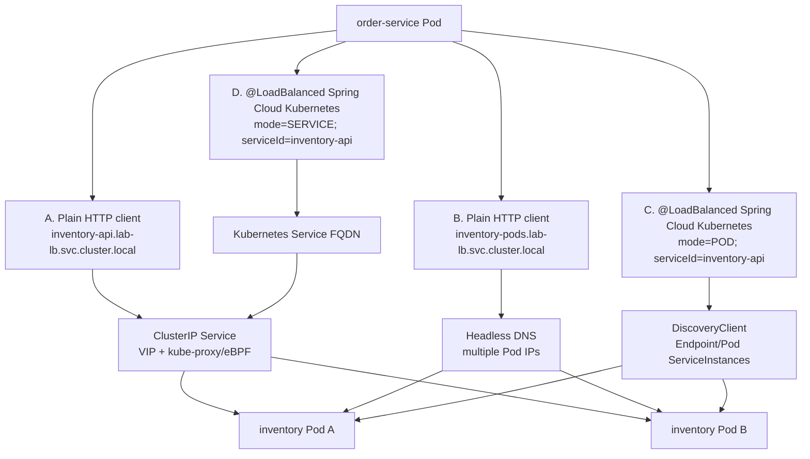
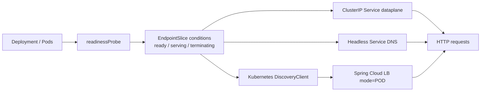
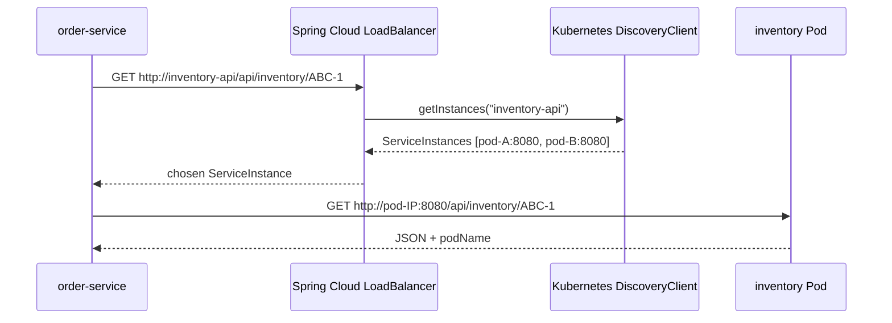

# Kubernetes Services, Headless Services, and Choosing Where Load Balancing Happens

## 1. The deployment problem: who actually picks the Pod receiving a request?

In the **Deployment** chapter of the `SPRING_CLOUD_SERVICE_COMMUNICATION_LOAD_BALANCING` module, `order-service` calls `inventory-service` by service ID. In development environments, Spring Cloud LoadBalancer can read a list of `ServiceInstance` entries from discovery and choose via Round Robin, Random, health checks, or routing policies. When deploying to Kubernetes, another mechanism enters the picture: a **Kubernetes Service** can already provide a stable address and distribute traffic across Pods.

The core question is not "how do I turn on multiple load balancers," but rather:

> For an HTTP request from `order-service`, will **Spring Cloud LoadBalancer**, the **Kubernetes Service dataplane**, the **DNS resolver/HTTP connection pool**, or a **service mesh** pick the Pod receiving the request?

If chosen unclearly, you may stack two LoadBalancer layers back-to-back and mistakenly assume Spring's zone, sticky, or health algorithms are governing the **target Pod** when Spring is actually only picking a single **ClusterIP Service**. Conversely, calling headless DNS does not mean the application automatically gets per-request Round Robin.

### Learning objectives

After this lesson, you will be able to:

1. Explain the difference between a default `Service.type=ClusterIP` and `clusterIP: None` (headless).
2. Trace the path DNS → ClusterIP/VIP → service proxy/eBPF → Pod and the path headless DNS → Pod IP.
3. Distinguish **server-side/network-level load balancing** from Spring Cloud's **client-side load balancing**.
4. Understand the two modes `POD` / `SERVICE` of **Spring Cloud Kubernetes LoadBalancer** and where `ServiceInstance` selection occurs.
5. Decide when to use a plain `RestClient`/`WebClient` to a Kubernetes Service versus `@LoadBalanced` to a set of Pods.
6. Read Deployment, Service, EndpointSlice, and readiness/liveness manifests to determine which Pods can receive traffic.
7. Build a lab comparing ClusterIP, headless DNS, Spring Cloud Kubernetes `POD`/`SERVICE`, keep-alive connections, timeouts/retries, and rolling updates.
8. Verify actual selection via Pod IDs, HTTP attempt counts, traces, and meaningful metrics.
9. Spot pitfalls like double balancing, Service namespaces, TTL/caching, headless Services with no ready endpoints, and zone-based routing.
10. Design safe deployments with least-privilege RBAC, network policies, TLS/mTLS, and rollback procedures.

**Version scope:** Java examples use Spring Boot 3.x or a compatible stack depending on the Spring Cloud BOM; the `spring.cloud.kubernetes.loadbalancer.mode` section is based on current Spring Cloud Kubernetes documentation offering `POD` and `SERVICE` modes (5.0.x; also available in some 3.x Release Trains). **Do not** infer from a file name or version label that your project runs that exact version; always check resolved dependencies.

## 2. Diagram of four easily confused call paths



The diagram depicts the **default intended configuration**. If in path D the chosen Service is **headless** instead of ClusterIP, that FQDN returns Pod IPs and **bypasses any VIP**. If a service mesh is present, sidecar proxies can add another upstream selection layer; do not treat the diagram as a guarantee that a packet flows strictly through kube-proxy on every CNI.

| Call approach | What does caller use? | Who picks the backend? | Data source | Does the caller itself need Kubernetes API/RBAC? |
|---|---|---|---|---|
| **A. ClusterIP** | Plain HTTP client, Service DNS | Kube-proxy/IPVS/iptables or eBPF/service dataplane; optionally mesh | Kubernetes Service + EndpointSlice | **No**, DNS and network suffice if policies permit |
| **B. Headless** | Plain HTTP client, headless DNS | DNS resolution, HTTP client logic, connection pool; **no Service VIP load balancer** | DNS A/AAAA records of Pod endpoints | **No** just to resolve names via DNS |
| **C. Spring `POD`** | `@LoadBalanced` client and `DiscoveryClient` | Spring Cloud LoadBalancer picks a `ServiceInstance` matching a Pod endpoint | Spring Cloud Kubernetes DiscoveryClient/Endpoints | **Usually yes**, depending on Fabric8/Kubernetes client or DiscoveryServer chosen |
| **D. Spring `SERVICE`** | `@LoadBalanced` client | Spring picks a **Kubernetes Service**; Kubernetes still picks the Pod if Service is ClusterIP | Kubernetes Service objects + DNS | **Usually yes** for implementations using the Kubernetes API; depends on deployment |

**Decision rule:** do not use `@LoadBalanced` simply because Kubernetes has a Service. Choose it when you **need application-side selection policies** or Spring Cloud ecosystem integration; if you only need reliable distribution to ready Pods by service name, **ClusterIP + a plain HTTP client** is a simpler starting point.

## 3. Kubernetes ClusterIP Services

When creating a standard Service:

```yaml
apiVersion: v1
kind: Service
metadata:
  name: inventory-api
  namespace: lab-lb
spec:
  type: ClusterIP
  selector:
    app: inventory
  ports:
    - name: http
      port: 80
      targetPort: http
```

Kubernetes assigns the Service a stable **ClusterIP** for the lifetime of the Service. In-cluster DNS normally resolves:

```text
inventory-api.lab-lb.svc.cluster.local
    -> 10.x.y.z  (an illustrative ClusterIP, not a Pod IP)
```

A caller using `http://inventory-api.lab-lb.svc.cluster.local:80` connects to the virtual Service IP. The service dataplane selects a backend from the matching EndpointSlice set and forwards traffic to the Pod IP/targetPort.

### 3.1. Balancing happens at the connection layer, not necessarily per HTTP request

In common kube-proxy implementations, backend selection happens **per new TCP connection**. An HTTP/1.1 keep-alive connection can be reused across many requests and stay pinned to the **same Pod**. HTTP/2 multiplexing can also carry multiple streams over a single connection. Therefore:

- `100` GETs over a small connection pool **do not guarantee** equal request counts across two Pods.
- Spring-side Round Robin does not need to exist for a Kubernetes Service to still distribute at the dataplane layer.
- `sessionAffinity: ClientIP`, `internalTrafficPolicy`, topology-aware routing, meshes, or different CNIs can alter how backends are chosen.
- Do not verify distribution algorithms merely with a loop of `curl` calls without knowing whether the client reuses connections.

**A Kubernetes Service is not an HTTP L7 load balancer by default.** It does not inspect business JSON, JWT scopes, or HTTP 503 statuses to automatically retry a healthy replica. L7 behavior may be handled by Ingress/Gateway API, a service mesh, or the client application.

### 3.2. Strengths and limitations

**Fits well when:** the application only needs to call a stable name and let Kubernetes keep the set of ready endpoints up to date over time. Application code stays simple, with no need to query the Kubernetes API from every app.

**Limitations:** the application does not directly choose Pods based on zone/weight/custom metadata in `ServiceInstanceListSupplier`. When a Pod returns 503 while its readiness remains `Ready`, the service dataplane can keep sending new connections to it. Kubernetes does not understand "inventory business HTTP 503" if the probe does not reflect that failure.

## 4. Headless Services: what does `clusterIP: None` mean?

A headless Service is created using the **special string value** `None`:

```yaml
apiVersion: v1
kind: Service
metadata:
  name: inventory-pods
  namespace: lab-lb
spec:
  clusterIP: None
  selector:
    app: inventory
  ports:
    - name: http
      port: 8080
      targetPort: http
```

With a **headless Service that has a selector**, Kubernetes creates EndpointSlices for matching Pods; cluster DNS can return **multiple A/AAAA records** pointing to the IPs of eligible Pods.

```text
inventory-pods.lab-lb.svc.cluster.local
    -> 10.244.1.21
    -> 10.244.2.15
    -> 10.244.3.09
```

These are example IPs only. A headless Service has **no allocated ClusterIP** and no platform-provided Service VIP load balancing/proxying. DNS helps **discover Pod addresses**, while the client must choose an IP and manage connections.

### 4.1. DNS returning multiple IPs does not turn into Spring Round Robin

Suppose a Java HTTP client calls:

```java
RestClient client = RestClient.create(
        "http://inventory-pods.lab-lb.svc.cluster.local:8080");
```

This is a plain `RestClient`. It **does not** automatically use `RoundRobinLoadBalancer` and **does not** invoke `ServiceInstanceListSupplier` just because DNS returns multiple IPs. The JVM/HTTP library decides when to query DNS, which address to try, how long to keep connections open, and when to re-resolve.

Any assumption like "each request switches Pods," "if A fails it retries B," or "DNS list updates are seen immediately by clients" must be **tested with the real transport and resolver**. DNS caching, connection pooling, keep-alive, stale sockets, and A/AAAA ordering can make actual distribution differ from expectations.

### 4.2. Headless is not required for Spring to select Pods

An easily misunderstood detail:

> Spring Cloud Kubernetes `mode=POD` can use the **Kubernetes DiscoveryClient to look up endpoints of an ordinary ClusterIP Service**. You do not need to switch a Service to headless just to let `@LoadBalanced` select Pods.

Conversely, creating a headless Service **does not automatically enable** Spring Cloud LoadBalancer in `RestClient`/`WebClient`. The two concerns are independent: **how Kubernetes publishes endpoints** and **how the application picks endpoints**.

### 4.3. How does headless fit StatefulSets?

With a StatefulSet specifying `spec.serviceName: inventory-pods` and appropriate hostname/subdomain settings, Pods can get stable addresses of the form:

```text
inventory-0.inventory-pods.lab-lb.svc.cluster.local
inventory-1.inventory-pods.lab-lb.svc.cluster.local
```

This applies when **individual replica identity** is needed, such as primary/replica databases or sharded clusters. **Do not** assume Deployment Pods receive stable names like StatefulSets. Headless supports member discovery/identity; it does not imply all replicas are interchangeable or safe for Random selection on every write.

## 5. EndpointSlice and readiness: from Pods to the eligible list

Kubernetes uses **EndpointSlices** to publish addresses/ports and conditions of endpoints belonging to a Service. For Services with selectors, the relevant controllers sync Pod membership into EndpointSlices.



Key condition fields:

| Condition | Meaning | Practical consequence |
|---|---|---|
| `ready` | Endpoint is considered ready to serve per EndpointSlice rules | Typically used to select endpoints; still depends on policies/proxies |
| `serving` | Endpoint may continue serving, including during parts of termination | Useful for draining/termination |
| `terminating` | Pod is being deleted/shut down; in-flight connections need handling | Proxies normally avoid terminating endpoints, with exceptions when no other backends remain |

**Do not equate `Ready=true` with every HTTP operation succeeding.** A readiness probe checks only what it is configured to check. If a Pod returns HTTP 503 for the inventory API while `/actuator/health/readiness` stays UP, the Service can still include that Pod in its backend pool.

### 5.1. Update propagation latency

When readiness changes or a rollout scales Pods:

```text
Pod state/readiness changes
  -> EndpointSlice is updated
  -> kube-proxy/eBPF or cluster DNS updates target list
  -> Spring Cloud Kubernetes discovery cache/watch (if used) updates
  -> HTTP client connection pool / DNS cache adjusts
```

This is an **asynchronous update chain**, with no guarantee every client observes the exact same state at the exact same instant. An open connection may still be serving a request; right as an endpoint is removed, new requests can occasionally fail during the transition window. Appropriate timeouts, bounded retries, and graceful shutdown are required.

### 5.2. Not every Service has a selector

A headless Service **with a selector** lets Kubernetes create EndpointSlices automatically. For a Service **without a selector**, endpoints may be managed by an operator or another controller; do not blindly assume "Kubernetes always picks up every Pod IP matching labels." Inspect the actual EndpointSlice objects and the service discovery configuration in use.

`publishNotReadyAddresses: true` can publish endpoints before they are Ready, which helps certain stateful cluster bootstrap workflows yet is **dangerous** if consumers mistake it for a list of user-serving backends. Never enable this property just to "fix missing DNS addresses."

## 6. Creating a lab environment with both ClusterIP and headless Services

Goal: two differently named Services sharing **the same selector `app: inventory`**, so you can cleanly compare Service addressing differences without changing the underlying Pods.

### 6.1. Deployment and Service manifests

Example `inventory-k8s.yaml` file learners can create in the lab:

```yaml
apiVersion: v1
kind: Namespace
metadata:
  name: lab-lb
---
apiVersion: apps/v1
kind: Deployment
metadata:
  name: inventory
  namespace: lab-lb
spec:
  replicas: 3
  selector:
    matchLabels:
      app: inventory
  template:
    metadata:
      labels:
        app: inventory
    spec:
      terminationGracePeriodSeconds: 30
      containers:
        - name: inventory
          image: ghcr.io/example/inventory:lab
          imagePullPolicy: IfNotPresent
          ports:
            - name: http
              containerPort: 8080
          env:
            - name: POD_NAME
              valueFrom:
                fieldRef:
                  fieldPath: metadata.name
            - name: MANAGEMENT_ENDPOINT_HEALTH_PROBES_ENABLED
              value: "true"
          readinessProbe:
            httpGet:
              path: /actuator/health/readiness
              port: http
            initialDelaySeconds: 3
            periodSeconds: 5
            timeoutSeconds: 2
            failureThreshold: 2
          livenessProbe:
            httpGet:
              path: /actuator/health/liveness
              port: http
            initialDelaySeconds: 10
            periodSeconds: 10
            timeoutSeconds: 2
          resources:
            requests:
              cpu: 100m
              memory: 128Mi
            limits:
              cpu: 500m
              memory: 512Mi
---
apiVersion: v1
kind: Service
metadata:
  name: inventory-api
  namespace: lab-lb
spec:
  type: ClusterIP
  selector:
    app: inventory
  ports:
    - name: http
      port: 8080
      targetPort: http
---
apiVersion: v1
kind: Service
metadata:
  name: inventory-pods
  namespace: lab-lb
spec:
  clusterIP: None
  selector:
    app: inventory
  ports:
    - name: http
      port: 8080
      targetPort: http
```

**Note:** the image `ghcr.io/example/inventory:lab` is a **placeholder**, not a prebuilt or guaranteed pullable image. Learners must build/push a real Spring Boot image exposing `/api/inventory/{sku}` and Actuator probes, then update the image name. If the image does not exist, Pods sit in `ImagePullBackOff` and DNS/routing tests **cannot prove anything about load balancing**.

Both Services share the same selector, so their backing endpoints are essentially the same three Pods, yet **the path to the Pods differs**: ClusterIP via VIP/dataplane, headless via DNS Pod IPs.

### 6.2. Java endpoint illustrating Pod identification

In the inventory application (Spring MVC), you can create:

```java
@RestController
@RequestMapping("/api/inventory")
class InventoryController {

    @Value("${POD_NAME:local}")
    private String podName;

    @GetMapping("/{sku}")
    Map<String, Object> get(@PathVariable String sku) {
        return Map.of(
                "sku", sku,
                "available", 12,
                "podName", podName);
    }
}
```

`POD_NAME` is injected from the Downward API via the manifest, letting you verify **which Pod actually handled the request** rather than guessing from DNS results or selected instance metadata. The app requires `spring-boot-starter-web` and `spring-boot-starter-actuator`; expose readiness/liveness via Actuator as configured.

### 6.3. Applying manifests and verifying status

```bash
kubectl apply -f inventory-k8s.yaml

kubectl rollout status deployment/inventory -n lab-lb
kubectl get pods -n lab-lb -l app=inventory -o wide
kubectl get svc -n lab-lb
kubectl get endpointslices -n lab-lb \
  -l kubernetes.io/service-name=inventory-api -o wide
kubectl get endpointslices -n lab-lb \
  -l kubernetes.io/service-name=inventory-pods -o wide
```

Do not assume a cluster has `kubectl`/Namespace creation permissions or prebuilt images. The commands above are **hands-on instructions for learners**, not commands executed while authoring this document.

Expected state: `inventory-api` has a ClusterIP, `inventory-pods` has `CLUSTER-IP=None`, and both have ready endpoints pointing to the selected Pods. When multiple EndpointSlices exist, inspect all slices matching the label rather than just the first one.

## 7. Checking DNS and which backend actually receives HTTP

### 7.1. Comparing DNS records

From a debug Pod in the `lab-lb` namespace (the image needs `nslookup`):

```bash
kubectl run -n lab-lb dns-check \
  --image=busybox:1.36 \
  --restart=Never --rm -i -- \
  nslookup inventory-api.lab-lb.svc.cluster.local

kubectl run -n lab-lb dns-headless \
  --image=busybox:1.36 \
  --restart=Never --rm -i -- \
  nslookup inventory-pods.lab-lb.svc.cluster.local
```

**Conceptual** expectation:

- `inventory-api`: DNS returns the **Service ClusterIP**.
- `inventory-pods`: DNS returns the **Pod endpoint addresses** (multiple A/AAAA records when multiple ready Pods and matching IPv4/IPv6 exist).

`nslookup` output may also print the DNS server address, multiple records, or vary in format by image/CoreDNS; **never** hardcode line counts in output to pass a test.

### 7.2. Sending requests and reading `podName`

```bash
kubectl run -n lab-lb curl-probe \
  --image=curlimages/curl:8.12.1 \
  --restart=Never --rm -i -- \
  sh -c 'for i in 1 2 3 4 5 6 7 8; do
    curl -fsS http://inventory-api.lab-lb.svc.cluster.local:8080/api/inventory/ABC-1;
    echo;
  done'
```

The command spawns separate `curl` processes inside a shell for easy visual inspection. It is **not a distribution benchmark** and does not guarantee even traffic split, since selection can depend on connection pooling, source IP, session affinity, topology, and the dataplane.

Try switching the DNS name to headless:

```bash
kubectl run -n lab-lb curl-headless \
  --image=curlimages/curl:8.12.1 \
  --restart=Never --rm -i -- \
  sh -c 'for i in 1 2 3 4 5 6 7 8; do
    curl -fsS http://inventory-pods.lab-lb.svc.cluster.local:8080/api/inventory/ABC-1;
    echo;
  done'
```

If most headless requests hit the same Pod, **do not** conclude DNS or Kubernetes is broken; that may simply reflect resolver/address ordering and client connection selection. Repeat from multiple debug Pods, and inspect DNS answers and HTTP connection behavior before comparing.

## 8. Option A — Kubernetes ClusterIP only, without Spring LB

For internal services that only need to call an equivalent API on any Pod, this is usually the simplest configuration.

```java
@Configuration(proxyBeanMethods = false)
class InventoryClientConfiguration {

    @Bean
    RestClient inventoryHttpClient(RestClient.Builder bootBuilder) {
        return bootBuilder.clone()
                .baseUrl(
                    "http://inventory-api.lab-lb.svc.cluster.local:8080")
                .build();
    }
}
```

`RestClient.Builder` here is the builder **auto-configured by Spring Boot**, not `@LoadBalanced`. If the project declares multiple builders, use proper qualifiers to avoid accidentally injecting a bean with a LoadBalancer interceptor.

```java
@Service
class InventoryGateway {

    private final RestClient inventoryHttpClient;

    InventoryGateway(RestClient inventoryHttpClient) {
        this.inventoryHttpClient = inventoryHttpClient;
    }

    InventoryStock read(String sku) {
        return inventoryHttpClient.get()
                .uri("/api/inventory/{sku}", sku)
                .retrieve()
                .body(InventoryStock.class);
    }
}

record InventoryStock(
        String sku, Integer available, String podName) {}
```

**Call path:** `inventory-api.lab-lb.svc.cluster.local` → DNS returns ClusterIP → Kubernetes dataplane picks a ready Pod → HTTP server returns body.

**No Spring `ReactorLoadBalancer.choose()` runs for this request**. Even if `spring-cloud-starter-loadbalancer` is on the classpath, an HTTP client without a LoadBalancer interceptor/filter will not trigger Spring `ServiceInstance` selection.

**Benefits:** minimal config, no Kubernetes API RBAC needed in `order-service` just to resolve a Service name. If Micrometer/observability is present, use the Boot-configured builder to keep HTTP client spans/metrics; skipping Spring LB **does not** mean losing tracing.

### 8.1. When should you avoid this style?

If you must route by **per-Pod metadata** at the application layer — such as strict canary versions, tenant isolation, custom weights, or controlled zone preferences — a plain ClusterIP alone does not enforce that policy. You can use separate Kubernetes Services/label selectors to **partition backend pools**, or Spring Cloud LoadBalancer `POD` mode with a custom supplier, or appropriate mesh/Gateway policies.

Never use `sessionAffinity: ClientIP` as a substitute for a tenant-partitioning or authorization contract. Affinity is a backend-selection hint, not a security boundary.

## 9. Option B — Headless DNS with a plain HTTP client

```java
RestClient headlessClient = RestClient.create(
        "http://inventory-pods.lab-lb.svc.cluster.local:8080");
```

**Call path:** DNS returns Pod IPs → resolver/HTTP library picks an address → direct TCP to Pod IP:8080, matching the port Spring Boot listens on in the lab.

### 9.1. The headless port-mapping trap

With ClusterIP, setting `port: 80`, `targetPort: 8080` lets clients connect to the Service VIP on port 80 while the dataplane translates to Pod:8080. Headless, however, **has no Service VIP/NAT** to translate port 80 to 8080 for a direct connection to a Pod IP.

That is why **the manifests in section 6 set both Services to `port: 8080` with `targetPort: http` pointing to containerPort 8080**. When calling headless, you must specify port 8080:

```text
http://inventory-pods.lab-lb.svc.cluster.local:8080/api/inventory/ABC-1
```

Learners can intentionally construct a **failure variant**: change only the headless Service to `port: 80` while Pods still listen on 8080, then try connecting to `:80`. When DNS returns valid Pod IPs yet TCP fails on the wrong port, do not blame headless DNS. Restore port 8080 after the experiment. The table below is the **correct default lab config**:

| Service | DNS result | `spec.ports[].port` | Pod actually listening | Client URL |
|---|---|---:|---:|---|
| `inventory-api` ClusterIP | VIP | 8080 | 8080 | `http://inventory-api...:8080` |
| `inventory-pods` headless | Pod IP | 8080 | 8080 | `http://inventory-pods...:8080` |

This matters because a misported headless lab easily misleads learners into thinking "headless DNS is broken" when **DNS already returned the right Pod IPs** and TCP hit a non-listening port.

### 9.2. Headless is still not a Spring policy

Even when DNS returns A/B/C, `RestClient.create(...)` knows nothing about zone/weight/health policies in `ServiceInstanceListSupplier`. Test timeouts, retries, connection reuse, and DNS TTL separately. If you need transparent per-Pod selection and selection metrics, Spring `POD` mode in the next section fits better.

## 10. Option C — Spring Cloud Kubernetes `mode=POD`

Current Spring Cloud Kubernetes documentation provides two LoadBalancer implementations (pick **one** backend client):

```xml
<!-- Choose Fabric8 OR Kubernetes Java Client, NEVER both together. -->
<dependency>
  <groupId>org.springframework.cloud</groupId>
  <artifactId>spring-cloud-starter-kubernetes-fabric8-loadbalancer</artifactId>
</dependency>
```

Or:

```xml
<dependency>
  <groupId>org.springframework.cloud</groupId>
  <artifactId>spring-cloud-starter-kubernetes-client-loadbalancer</artifactId>
</dependency>
```

Pick only one of these two dependencies, using a Spring Cloud BOM compatible with your Spring Boot and Spring Cloud Kubernetes versions. If the project runs outside Kubernetes, configure mock discovery or a test environment instead of expecting the Kubernetes client to work over `localhost`.

### 10.1. Selecting POD mode

```yaml
spring:
  application:
    name: order-service
  cloud:
    kubernetes:
      loadbalancer:
        mode: POD
      discovery:
        namespaces:
          - lab-lb
```

In `POD` mode, the `@LoadBalanced` client calls the logical name `inventory-api`. Spring Cloud Kubernetes uses `DiscoveryClient.getInstances("inventory-api")` to fetch endpoint instances and Spring Cloud LoadBalancer picks one element.



Here **the `inventory-api` Service can still be a ClusterIP**. DiscoveryClient reads the Service's endpoint records; the app sends traffic directly to Pod endpoints. You do not have to use a headless Service to get client-side selection.

### 10.2. Creating a @LoadBalanced RestClient

A pattern for Spring Boot 3.x:

```java
@Configuration(proxyBeanMethods = false)
class LoadBalancedInventoryConfiguration {

    @Bean
    @LoadBalanced
    RestClient.Builder loadBalancedRestClientBuilder(
            RestClientBuilderConfigurer configurer) {
        return configurer.configure(RestClient.builder());
    }

    @Bean
    RestClient inventoryByPod(
            @LoadBalanced RestClient.Builder builder) {
        return builder.clone()
                .baseUrl("http://inventory-api")
                .build();
    }
}
```

`RestClientBuilderConfigurer` belongs to Spring Boot 3.x auto-configuration. It preserves essential customizers when defining your own builder; with Boot 4 or different bean structures, check the real APIs and avoid applying observation twice.

Differences compared to Option A:

- A calls a **real DNS URL** `inventory-api.lab-lb.svc.cluster.local` via a plain client.
- C calls a **logical service ID URL** `http://inventory-api` via a `@LoadBalanced` client.
- DNS and Spring LoadBalancer **are not synonymous**, even when the service ID and DNS name look alike.
- If you accidentally build `RestClient.create("http://inventory-api")` without LoadBalancer, short-name DNS may still resolve to the Service VIP and follow **Option A**, causing a "using Spring LB" test to pass falsely.

### 10.3. Verifying the actual ServiceInstance set

In a lab, you can inject Spring's `DiscoveryClient` to inspect the list:

```java
@Component
class InstanceLogger {

    private final DiscoveryClient discovery;

    InstanceLogger(DiscoveryClient discovery) {
        this.discovery = discovery;
    }

    void logInventoryInstances() {
        for (ServiceInstance si :
                discovery.getInstances("inventory-api")) {
            System.out.printf(
                    "id=%s host=%s port=%d metadata=%s%n",
                    si.getInstanceId(),
                    si.getHost(),
                    si.getPort(),
                    si.getMetadata());
        }
    }
}
```

This code is for a **diagnostic lab**; do not log full sensitive metadata in production. If the output shows only **one VIP** instead of individual Pod IPs, the system is actually running another implementation/mode or discovery is misconfigured. **Never** infer solely from `@LoadBalanced` that the client is definitely picking individual Pods.

## 11. Option D — Spring Cloud Kubernetes `mode=SERVICE`

When configuring:

```yaml
spring:
  cloud:
    kubernetes:
      loadbalancer:
        mode: SERVICE
      discovery:
        namespaces:
          - lab-lb
```

Spring Cloud Kubernetes selects the Kubernetes Service object matching the logical name and namespace, and constructs a target URI such as:

```text
inventory-api.lab-lb.svc.cluster.local:8080
```

With **`inventory-api` of type ClusterIP**, traffic proceeds to the VIP and the Kubernetes service dataplane picks a Pod. Spring Cloud LoadBalancer is only selecting a **Service address**, so you cannot infer from it that Spring-side Round Robin is cycling directly across Pods.

Current documentation for `SERVICE` mode describes lookup by `metadata.name` by default or by labels with dedicated matching rules, and Service port selection by `portName` (defaulting typically to `http`). If a Service has multiple ports without matching names, falling back to "the first port" can be non-deterministic. **Name ports explicitly** in manifests and verify the actual port in the resulting URI.

### 11.1. Two selection layers can occur

```text
Spring LoadBalancer:
    selects Kubernetes Service (inventory-api)
            |
            v
Kubernetes DNS/VIP:
    selects endpoint Pod per dataplane/policy
            |
            v
HTTP connection:
    request reaches inventory Pod
```

Consequently, enabling Spring Round Robin in `SERVICE` mode does not mean HTTP requests reach A/B/C per Spring's Round Robin policy. If there is only **one** Service object named `inventory-api`, Spring does not even have three Pod candidates to split algorithmically.

**Important exception:** if `SERVICE` mode picks a **headless** Service object, its DNS name returns Pod IPs and Pod selection falls to the resolver/HTTP client; there is still **no** VIP for a headless Service. Where selection ultimately happens must be verified with DNS results and network traces, not assumed from the mode name.

### 11.2. When is SERVICE mode useful?

When an app wants certain Spring Cloud integrations while **keeping Kubernetes Services as the target boundary**, or when multiple Service objects must be matched under controlled policies. If every consumer simply calls one existing ClusterIP Service, consider dropping `@LoadBalanced` altogether rather than adding a Service-selection layer that yields no corresponding benefit.

### 11.3. OpenFeign: service ID or fixed URL?

With Spring Cloud OpenFeign, **declaring `url` or not** also determines whether calls pass through Spring Cloud LoadBalancer:

```java
// Feign by service ID; with matching LB/discovery,
// mode=POD or SERVICE determines the candidate set.
@FeignClient(name = "inventory-api")
interface InventoryFeignByDiscovery {
    @GetMapping("/api/inventory/{sku}")
    InventoryStock read(@PathVariable("sku") String sku);
}

// Feign by direct URL; does not rely on LB to resolve host.
// Use only as an ALTERNATIVE configuration; do not register both
// interfaces with the same client name/contextId expecting auto-switching.
@FeignClient(
    name = "inventory-direct",
    url = "http://inventory-api.lab-lb.svc.cluster.local:8080")
interface InventoryFeignDirect {
    @GetMapping("/api/inventory/{sku}")
    InventoryStock read(@PathVariable("sku") String sku);
}
```

- `InventoryFeignByDiscovery`: `inventory-api` is a service ID; with `Spring Cloud LoadBalancer` and Spring Cloud Kubernetes integration active, it resolves per `mode=POD` or `mode=SERVICE`.
- `InventoryFeignDirect`: `url` explicitly points to Kubernetes Service DNS, so Spring performs no `ServiceInstance` selection for that call; if the Service is ClusterIP, Kubernetes picks the Pod.
- Feign has its own timeouts, exception mapping, and retry policy; Spring Cloud OpenFeign defaults to `Retryer.NEVER_RETRY`. Do not assume the client automatically retries another Pod on 503.
- The two interfaces exist solely to **compare two configuration choices**. Real apps should choose one clean contract/bean and verify which Pod actually receives requests, rather than accidentally stacking duplicate client/retry layers.

## 12. Avoiding double balancing and misaligned policy targets

### 12.1. Common misconfiguration patterns

| Configuration | What can happen | Fix |
|---|---|---|
| `@LoadBalanced` client + supplier returns only one ClusterIP URI | Spring "picks" one candidate; K8s picks the Pod | Do not claim Spring distributes pod-level traffic |
| `mode=POD` yet code builds plain `RestClient.create(...)` | Requests go via DNS/service VIP, bypassing LB chooser | Build client from `@LoadBalanced` builder |
| `mode=SERVICE` with zone preference using Pod metadata | Supplier returns Services, not individual Pods | For per-Pod zone policy, use POD mode/other hard filtering |
| Using headless DNS believing Spring Random is enabled | DNS/client pool decides addresses | Separate selection explicitly or instrument properly |
| Spring picks Pod IPs directly while team thinks Kubernetes VIP is used | Session affinity/service traffic policy doesn't apply as expected | Verify actual destination IP and matching policy |
| Both mesh and Spring retries enabled | Two retry/timeout layers multiply attempts | Assign one retry owner, count actual attempts |
| Short hostname `http://inventory-api` also resolves in plain clients | Tests miss missing `@LoadBalanced` annotation | Assert supplier/chooser invocation and destination Pod IP |
| Calling Service FQDN through `@LoadBalanced` without matching service ID | May fail no-instance even though DNS resolves | Use plain client for FQDN or matching service ID |

### 12.2. Is double balancing always wrong?

Not necessarily: an organization may intentionally select **service/cluster/zone** in the application and let Kubernetes select Pods underneath. However, you must clearly answer:

- What candidate set does each layer see?
- At which layer are metadata/zones evaluated?
- At which layer does health filtering occur?
- At which layer are retries performed, and are operations idempotent?
- What is the total timeout/deadline for the logical request?
- Does observability distinguish the **selected Service** from the **actual receiving Pod**?

If you cannot answer those, layering easily invalidates assumptions about distribution, session stickiness, and faulty-instance eviction.

## 13. Readiness, health checks, and rolling updates

### 13.1. Readiness signals traffic eligibility; liveness signals restart

| Probe | Purpose | Common misuse |
|---|---|---|
| `startupProbe` | Protects slow-starting apps from premature liveness/readiness checks | Omitted even when warmup is slow |
| `readinessProbe` | Signals whether the Pod should receive new traffic | Probe returns UP while business API returns 503 |
| `livenessProbe` | Detects processes that need restarting | Tying liveness to DB/remote services, causing restart storms |

In Spring Boot Actuator, `/actuator/health/readiness` and `/actuator/health/liveness` support availability checks when probes are enabled/configured. **Do not tie external dependencies into liveness lightly**; a shared downstream outage could trigger pointless cluster-wide restart loops.

### 13.2. When a Pod is deleted

A typical rollout/scale-down sequence:

```text
Pod receives deletionTimestamp
  -> EndpointSlice ready/terminating changes
  -> service proxy/DNS/discovery stops picking the Pod
  -> app receives SIGTERM, drains within grace period
  -> in-flight connections finish or are closed per config
```

Configure `terminationGracePeriodSeconds`, Spring Boot graceful shutdown, and proper readiness draining. Stopping a Service from picking an endpoint for **new connections** does not move already-open TCP connections to another Pod; HTTP clients must handle broken connections, safe retries, and timeouts.

### 13.3. Do not confuse Pod readiness with HealthCheckServiceInstanceListSupplier

- Kubernetes readiness controls endpoint membership from the Kubernetes side.
- `HealthCheckServiceInstanceListSupplier` (if enabled) issues separate HTTP health probes from Spring Cloud to discovered instances.
- With Spring Cloud Kubernetes POD discovery, readiness already filters endpoints; adding Spring health checks can add load and latency, or trigger its own fallback when all instances appear unhealthy.
- Spring Cloud Commons' health supplier can fall back to **all known instances** when zero healthy instances exist in some versions; do not treat it as a hard fail-closed barrier.

Add a separate health-check layer only with measured benefit and a specific policy; do not turn on every probe type at once just "to be safer."

## 14. DNS, caching, and connection pooling during Pod scaling

Four distinct state caches can coexist:

1. **Kubernetes API/EndpointSlice**: Pod endpoint list and readiness conditions.
2. **DNS/CoreDNS**: Service/headless records with their own TTL.
3. **Spring DiscoveryClient/LoadBalancer supplier cache**: retains instance snapshots per mechanism/version/config.
4. **JVM/HTTP client**: DNS cache, connection pools, persistent sockets, and retry policy.

When Pod A is deleted:

- ClusterIP Service dataplane updates endpoints after receiving signals; old connections may not vanish immediately.
- Headless DNS may omit A in fresh queries, yet clients **caching** A or holding sockets to A may still try it.
- Spring `mode=POD` may hold a stale snapshot briefly and still pick A; check current cache/watch/refresh settings.
- When a network connection breaks, the caller must bound timeouts and retry per business semantics rather than concluding discovery is "permanently broken."

### 14.1. Testing DNS caching properly

Never just run `nslookup` in busybox and conclude the **JVM RestClient** already sees the new list. DNS resolvers in BusyBox, glibc, Netty, and the JVM can cache and sort differently. To prove it:

- Record the **actual handling Pod ID** on the server.
- Record remote/socket addresses where possible.
- Test both with connection reuse and without connection reuse.
- Observe the timestamps when EndpointSlices change, DNS answers change, and client selection changes.
- Do not set global TTL to `0` just to fix one bug if it spikes DNS load and still fails to clear stale HTTP sockets.

### 14.2. Application versions and rolling compatibility

A Service may temporarily point to both v1 and v2 API Pods during a rolling update. Both Kubernetes and Spring LoadBalancer can select either one; **they do not validate JSON contracts**. v2 producers must remain compatible with v1 consumers during the rollout window, or you need strict service ID/selector/version routing to avoid sending requests to an incompatible version.

Sharing a `Service` does not mean sharing an API contract; retries can shift a request onto a Pod running a different version.

## 15. Retries, timeouts, fallbacks, and circuit breakers

When a Pod fails immediately after selection, the caller needs a recovery policy. Yet the mechanics differ between ClusterIP and POD mode.

| Mechanism | ClusterIP + plain HTTP client | Spring `mode=POD` |
|---|---|---|
| Switching Pods between two HTTP attempts | Service dataplane may choose a different endpoint on a new connection | Spring can pick a different `ServiceInstance` if supplier/policy allows |
| Retrying HTTP 503 | **Not automatic** just because a Kubernetes Service exists | **Not automatic** just because of `@LoadBalanced`; depends on retry config/stack |
| Connect/read timeout | Governed by HTTP transport/client | Still governed by HTTP transport/client |
| Health filtering | Kubernetes readiness/EndpointSlice | Kubernetes discovery readiness + optional Spring supplier |
| Circuit breaker | App/mesh must integrate | App/mesh must integrate |
| Domain fallback | Decided by application | Decided by application |
| Selecting by Pod tenant/zone metadata | Not built into plain RestClient | Can build supplier/policy using matching metadata |

### 15.1. Single retry owner and total deadline

```text
logical request: order-service -> inventory-api
  attempt 1: Pod A, connect timeout 300 ms / response timeout 700 ms
  backoff:   100 ms + jitter (if retryable)
  attempt 2: Pod B or Pod A depending on policy and current list
  final:     success or categorized error / valid fallback
```

A `responseTimeout=700 ms` does not cover the entire logical request across multiple attempts, queues, or discovery lookups. Set an end-to-end deadline and skip retrying if remaining budget is insufficient.

For `POST` reservation/payment calls, a timeout **does not prove** the server failed to commit. Retry only with an `Idempotency-Key`/dedup store or guaranteed-safe contract. Never turn an inventory failure into `available=0`; that state is **UNKNOWN**, not out of stock.

### 15.2. Session affinity and sticky behavior

- `sessionAffinity: ClientIP` on a Kubernetes Service can pin a source IP to a backend; behind NAT/mesh/proxies, many users may share one source IP.
- `SameInstancePreferenceServiceInstanceListSupplier` in Spring **prefers** the previous instance without guaranteeing strict session persistence.
- Headless DNS + connection pooling may accidentally "stick" to one Pod, yet that is **not** a session-storage contract.
- If the system needs shared state, use external storage/sessions or appropriate data locking; never ask sticky LB to guarantee consistency.

## 16. Security and RBAC when applications query the Kubernetes API

### 16.1. DNS-only usually needs no API read permissions

A Pod running a plain `RestClient` to `inventory-api.lab-lb.svc.cluster.local` generally needs only network routing and DNS. It does **not** need permission to list Pods, Services, and EndpointSlices in the Kubernetes API just to call a ClusterIP Service.

In contrast, an application using Spring Cloud Kubernetes DiscoveryClient directly via Fabric8/Kubernetes Java Client typically needs read permissions for the target namespace/resources. Grant a **least-privilege ServiceAccount + Role/RoleBinding**, avoiding broad ClusterRoles across all namespaces unless required.

### 16.2. Sample RBAC to understand the principle

```yaml
apiVersion: v1
kind: ServiceAccount
metadata:
  name: order-discovery
  namespace: lab-lb
---
apiVersion: rbac.authorization.k8s.io/v1
kind: Role
metadata:
  name: order-discovery-read
  namespace: lab-lb
rules:
  - apiGroups: [""]
    resources: ["services", "endpoints", "pods"]
    verbs: ["get", "list", "watch"]
  - apiGroups: ["discovery.k8s.io"]
    resources: ["endpointslices"]
    verbs: ["get", "list", "watch"]
---
apiVersion: rbac.authorization.k8s.io/v1
kind: RoleBinding
metadata:
  name: order-discovery-read
  namespace: lab-lb
subjects:
  - kind: ServiceAccount
    name: order-discovery
    namespace: lab-lb
roleRef:
  kind: Role
  name: order-discovery-read
  apiGroup: rbac.authorization.k8s.io
```

This is a **lab RBAC template**, not necessarily the single minimal permission set for every Spring Cloud Kubernetes version, implementation, and namespace strategy. Inspect logs on permission errors; tighten resources/verbs to match actual API operations, and **set `serviceAccountName: order-discovery` on the `order-service` Pod spec** when using this ServiceAccount. When discovering across multiple namespaces, design per-namespace RoleBindings rather than enabling `all-namespaces=true` with global list/watch just for convenience.

### 16.3. NetworkPolicy and mTLS are still needed

- Service IDs, ClusterIPs, and Pod IPs are **not** security identities.
- When `mode=POD` connects directly to Pod IPs, ensure network policies, mesh interception, and security policies still enforce on the real traffic path.
- TLS hostname/SAN must match the target and certificate model. Direct HTTPS to Pod IPs can fail hostname verification if certificates only list Service DNS; **never disable TLS verification**.
- mTLS/service meshes can authenticate workloads, while APIs must still validate bearer tokens/audiences and business authorization where required.
- Never attach bearer tokens to an untrusted discovery URL/Pod IP if the registry or Kubernetes API permissions could be abused.

## 17. Observability: verifying what Spring picked and which Pod handled it

### 17.1. Tracking both selection and HTTP exchange

| Observation | Proves | Does not prove |
|---|---|---|
| `DiscoveryClient.getInstances("inventory-api")` | Endpoint list Spring saw when called | That requests actually hit all endpoints |
| Log `ServiceInstance.getHost()/getInstanceId()` | Which instance Spring selected | Which Pod handled it if traffic later hits a VIP/proxy |
| `podName` body from server | Which Pod actually processed the request | Long-term distribution pattern |
| DNS `nslookup inventory-api` | ClusterIP DNS answer | Whether the real HTTP client uses VIP or bypasses |
| DNS `nslookup inventory-pods` | Pod addresses published by headless DNS | That the client selects IPs via Round Robin |
| EndpointSlice `ready/serving/terminating` | Backend conditions per Kubernetes API | Absence of stale caches or old connections |
| HTTP client spans/`traceparent` | Request correlation across services | Whether LB is doing Pod-level or Service-level selection |
| `loadbalancer.requests.*` | Spring LB lifecycle when instrumentation is enabled | Total requests via Kubernetes VIP when Spring LB is bypassed |

### 17.2. Distinguishing the counters

```text
logical_requests_total
    = requests arriving at order-service
http_attempts_total
    = actual upstream HTTP client attempts sent
pod_requests_total{podName}
    = requests received by each inventory Pod
spring_lb_choose_total
    = times Spring LB actually chose a ServiceInstance
```

These four counts need not be equal. With ClusterIP + plain client, `spring_lb_choose_total` can be 0 even as `pod_requests_total` rises. With retries enabled, HTTP attempts can exceed logical requests. With no instances, `choose` may fail with **zero HTTP attempts** to inventory.

Never put raw `sku`, user IDs, trace IDs, or bearer tokens into **metric labels** due to cardinality/security. Pod IDs can also create high cardinality in large clusters; scope metric usage to operational needs.

## 18. Lab: changing Pod counts and break points

### 18.1. Scaling from 3 to 5 and down to 1

```bash
kubectl scale deployment/inventory -n lab-lb --replicas=5
kubectl rollout status deployment/inventory -n lab-lb
kubectl get pods -n lab-lb -l app=inventory -o wide
kubectl get endpointslices -n lab-lb \
  -l kubernetes.io/service-name=inventory-api -o yaml

kubectl scale deployment/inventory -n lab-lb --replicas=1
kubectl rollout status deployment/inventory -n lab-lb
```

Measure each milestone: Pod Ready time, EndpointSlice change time, DNS answers, and `DiscoveryClient` snapshot time. If requests still hit a deleted Pod right after scale-in, investigate **stale connections/discovery/caching** before blaming the selection policy.

### 18.2. Making a Pod unready or return HTTP errors

In the lab, you can transition one Pod to **NotReady** using a fault-injection hook built into the test app, or in a test environment that permits patching readiness. When a Pod is NotReady:

- ClusterIP Services normally stop considering that Pod a backend for new connections once updated.
- Headless DNS normally omits non-ready Pods from new answers (except under policies publishing not-ready addresses).
- Spring Kubernetes `POD` discovery normally excludes not-ready endpoints by default; `spring.cloud.kubernetes.discovery.include-not-ready-addresses=true` alters this for specialized use cases.
- A Pod can **return HTTP 503 while still Ready**: Kubernetes does not infer business 503s if the readiness probe does not reflect the failure.

Avoid intentionally making a production Pod NotReady or shutting down live user-serving endpoints. All fault injection must run in test namespaces/clusters and be rolled back.

### 18.3. Making all Pods NotReady

Observe:

| Call mode | Possible outcome | What to verify |
|---|---|---|
| ClusterIP | VIP exists yet lacks ready backends; connect fails/times out per dataplane | Service DNS resolves even though no endpoint accepts HTTP |
| Headless DNS | Zero ready Pod addresses per policy; DNS returns empty/no addresses | Do not mistake for a dead DNS server |
| Spring `POD` | DiscoveryClient may return an empty list or stale snapshot depending on cache | No-instance vs. stale attempt |
| Spring `SERVICE` | Service object still exists; continues resolving VIP despite empty backends | Spring picking a Service does not imply ready Pods exist |
| With HealthCheck supplier | May fall back to old list depending on implementation | Verify version-specific behavior; do not assume fail-closed |

This is a **mechanism-based expectation matrix**, not executed measurements. For terminating endpoints, Kubernetes has exceptions and dataplane-dependent behavior; observe your actual cluster.

## 19. Test matrix for choosing an architecture

| ID | Setup | Meaningful assertion |
|---|---|---|
| K01 | ClusterIP with 3 Ready Pods | DNS returns Service IP; HTTP receives `podName` from a Ready Pod |
| K02 | Headless with 3 Ready Pods | DNS returns Pod IPs; no ClusterIP |
| K03 | Plain RestClient → ClusterIP | No Spring LB choose events emitted |
| K04 | Plain RestClient → headless | HTTP hits Pod IP; distribution may depend on DNS/cache |
| K05 | Spring `POD` + `inventory-api` | `DiscoveryClient` sees endpoint ServiceInstances; Spring picks Pod endpoint |
| K06 | Spring `SERVICE` + `inventory-api` | Chosen URI is Service DNS/port; K8s picks Pod |
| K07 | One Pod NotReady | EndpointSlice changes; observe membership and propagation lag |
| K08 | One Pod returns 503 while readiness UP | May still receive requests; client must handle HTTP errors |
| K09 | Scale 3→5 | HTTP results remain valid; measure when 2 new Pods start receiving traffic |
| K10 | Scale 5→1 | Watch old connections, routing stops after drain |
| K11 | All Pods NotReady | Distinguish existing Service, empty headless DNS, and Spring no-instance |
| K12 | Spring POD mode lacking RBAC | Discovery fails/insufficient instances, does not "fall back to DNS" |
| K13 | Wrong port on headless | DNS succeeds yet TCP fails to connect; verify container port |
| K14 | Client uses long keep-alive | Do not expect every HTTP request to switch Pods |
| K15 | One Pod slow, bounded retries | Count actual attempts and total deadline |
| K16 | Canary v1/v2 Pods | Clients receive compatible contracts or strict routing |
| K17 | TLS SAN only has Service FQDN | Direct HTTPS to Pod IP may fail hostname check; do not disable verify |
| K18 | Same service name in multiple namespaces | Routes to right namespace without cross-namespace bleed |
| K19 | NetworkPolicy allows only authorized callers | DNS resolution does not imply connection permission |
| K20 | Service mesh enabled | Observe proxy/mesh policies; do not conclude solely from Spring selector |

**Do not** assert "100 requests must split 33/33/34" across modes: connection reuse, startup timing, policies, and sampling alter distribution. To unit-test pure Round Robin logic, use a fake `ServiceInstanceListSupplier` with a fixed seed and snapshot, isolated from live Kubernetes traffic.

## 20. Checklist for choosing where load balancing happens

Before finalizing configuration, answer:

- [ ] **Do you need a Kubernetes Service VIP?** If yes, `ClusterIP + plain HTTP client` is usually enough.
- [ ] **Do you need awareness of individual Pods/Pod metadata?** If yes, consider Spring Cloud Kubernetes `POD`.
- [ ] **Do you need direct FQDNs for individual Pods/StatefulSets?** If yes, headless DNS works for discovery, though it does not give Round Robin automatically.
- [ ] **Checked logical URL vs. physical DNS?** `http://inventory-api` can behave differently depending on the HTTP client.
- [ ] **Verified the actual mode?** `POD` and `SERVICE` differ in both candidate sets and where Pod selection happens.
- [ ] **Is double balancing occurring?** If yes, what does each layer choose and which metrics prove it?
- [ ] **Are EndpointSlices and readiness accurate?** Do not guess from Pod `Running` status.
- [ ] **Confirmed port/targetPort for headless direct Pod IPs?** No VIP NAT exists to translate ports.
- [ ] **Measured DNS/cache/keep-alive during scale-in/out?** Do not infer from a single `nslookup`.
- [ ] **Are there hard zone/tenant/region constraints?** A preference supplier or plain Service DNS may not suffice.
- [ ] **Is RBAC minimal for Spring DiscoveryClient?** Never grant broad cluster-wide list/watch unnecessarily.
- [ ] **Are TLS/mTLS/network policies/authorization properly enforced?** A Service ID is not a security identity.
- [ ] **Accounted for timeouts and total retry deadlines?** Do not multiply retries between app and mesh.
- [ ] **Are API contracts rolling-compatible?** Kubernetes does not validate JSON semantics.
- [ ] **Confirmed actual handling Pod from server logs/body?** Do not infer solely from selecting a `ServiceInstance`.
- [ ] **Tested zero-ready-endpoints and graceful termination?** Do not assume a Service existing means backends exist.
- [ ] **If using headless, checked DNS client behavior?** Multiple DNS IPs do not equal per-request balancing.

## 21. Review questions and practical exercises

### Exercise 1 — Classify the four paths

Redraw options A/B/C/D. For each, note **the component returning the target list**, **the component choosing the Pod**, and **when selection happens** (DNS resolution, TCP connection, Spring choose, mesh upstream). Explain why `mode=SERVICE` does not prove Spring selects Pods.

### Exercise 2 — Headless port mismatch

A manifest defines a headless Service with `port: 80` while Pods listen only on 8080. DNS returns all three Pod IPs, yet HTTP to `:80` fails. Explain why and update the manifest/headless URL to the right port. Never remove readiness probes just to "get DNS to return more IPs."

### Exercise 3 — Deploy with a shared selector

Create Namespace `lab-lb`, a three-replica Deployment, ClusterIP Service `inventory-api`, and headless Service `inventory-pods` as in section 6 (fixing the headless port per section 9). Demonstrate that the same backing EndpointSlices/Pods produce **different DNS responses**.

### Exercise 4 — POD mode without headless

Keep `inventory-api` as ClusterIP, configure Spring Cloud Kubernetes `POD` and `@LoadBalanced RestClient` calling `http://inventory-api`. Print `DiscoveryClient.getInstances`, compare host/port with Pod endpoints, and record `podName`. If only a single Service VIP appears, trace back the implementation/mode.

### Exercise 5 — Try SERVICE mode

Switch to `spring.cloud.kubernetes.loadbalancer.mode=SERVICE` using the same service ID. Record the selected URI and actual handling `podName`. Explain why Spring chooses only the Service URI while Kubernetes chooses the Pod endpoint.

### Exercise 6 — Rolling updates and readiness lag

Scale to 5 then down to 1. Timestamp when each Pod becomes Ready/Terminating, when EndpointSlices update, when DNS changes, and when the HTTP client stops using old connections. Do not claim any transition is instantaneous.

### Exercise 7 — Failing Pod still marked Ready

Make one replica return HTTP 503 on `/api/inventory` while readiness remains UP. Observe that ClusterIP can still route to that Pod. Try a readiness policy reflecting real failure and measure the delay before the endpoint is removed.

### Exercise 8 — Zones, hard routing, and security

Suppose a tenant may only be served from region-a. Compare separate per-region Kubernetes Service selectors, Spring `mode=POD` + hard region filters, and zone preference with fallback. Explain why a **preference** with fallback is not a data-residency or authorization boundary.

### Exercise 9 — Retries and idempotency

A `POST /reserve` to Pod A times out after committing. Retrying on Pod B with ClusterIP or Spring POD mode can create duplicate reservations. Design an `Idempotency-Key`, shared dedup store, and unknown/pending states; do not try to solve this with sticky Pods.

### Exercise 10 — Verifying RBAC and network policies

Run two caller variants: plain HTTP → ClusterIP without API access, and Spring `POD` with a ServiceAccount allowed to list/read endpoints. Scope the Role to the test namespace; show that lacking Kubernetes API permissions differs from DNS/HTTP still working. Then apply a NetworkPolicy to confirm DNS resolution does not imply connection permission.

## Official references

- [Kubernetes — Service](https://kubernetes.io/docs/concepts/services-networking/service/): ClusterIP, Service proxies, headless Services, selectors, `clusterIP: None`, and DNS.
- [Kubernetes — DNS for Services and Pods](https://kubernetes.io/docs/concepts/services-networking/dns-pod-service/): Service DNS records, headless A/AAAA, and hostname/subdomain.
- [Kubernetes — EndpointSlices](https://kubernetes.io/docs/concepts/services-networking/endpoint-slices/): `ready`, `serving`, `terminating` conditions and endpoint updates.
- [Kubernetes — Configure Liveness, Readiness and Startup Probes](https://kubernetes.io/docs/tasks/configure-pod-container/configure-liveness-readiness-startup-probes/): probes, readiness impact, and lifecycle.
- [Spring Cloud Kubernetes — LoadBalancer for Kubernetes](https://docs.spring.io/spring-cloud-kubernetes/reference/load-balancer.html): Fabric8/Kubernetes client starters, `mode=POD` and `mode=SERVICE`, Service matching/ports.
- [Spring Cloud Kubernetes — DiscoveryClient](https://docs.spring.io/spring-cloud-kubernetes/reference/discovery-client.html): `getInstances`, namespaces, endpoint metadata, `include-not-ready-addresses`.
- [Spring Cloud Kubernetes — Starters](https://docs.spring.io/spring-cloud-kubernetes/reference/getting-started.html): picking one client implementation and not mixing Fabric8 with Kubernetes Java Client.
- [Spring Cloud Commons — Spring Cloud LoadBalancer](https://docs.spring.io/spring-cloud-commons/reference/spring-cloud-commons/loadbalancer.html): `ServiceInstanceListSupplier`, Round Robin/Random, caching/health, retries, observation lifecycle.
- [Spring Framework — REST Clients](https://docs.spring.io/spring-framework/reference/integration/rest-clients.html): `RestClient`, `WebClient`, HTTP client transport, and error handling.
- [Spring Boot — Kubernetes deployment](https://docs.spring.io/spring-boot/reference/deployment/cloud/kubernetes.html): Actuator health probes, graceful shutdown, and Kubernetes deployment.
- [Kubernetes — RBAC Good Practices](https://kubernetes.io/docs/concepts/security/rbac-good-practices/): least privilege for ServiceAccounts and API access.

**Conclusion:** A `ClusterIP Service` provides a stable destination and lets the **Kubernetes dataplane** pick Pods; a `headless Service` publishes Pod IPs via **DNS** without Service-proxy load balancing; Spring Cloud Kubernetes `mode=POD` lets **Spring Cloud LoadBalancer** pick Pod endpoint `ServiceInstance` entries; and `mode=SERVICE` lets Spring pick a **Kubernetes Service**, potentially followed by dataplane Pod selection. Sound design begins by asking **"who chooses the Pod and from which candidate set?"**, and only then placing health, caching, retries, timeouts, security, and observability at the right layer.
