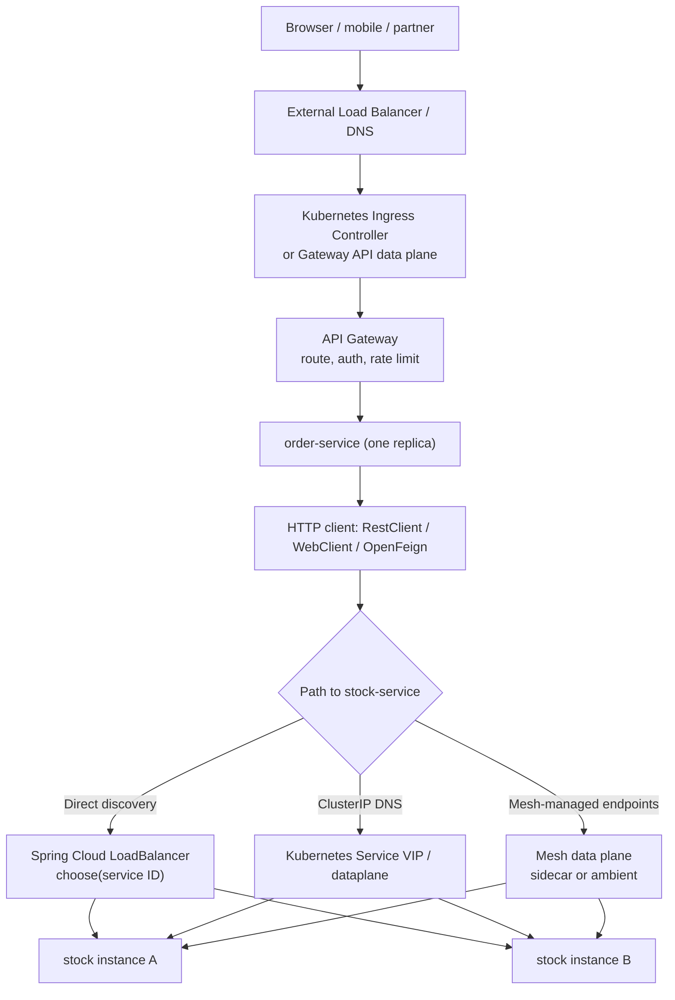
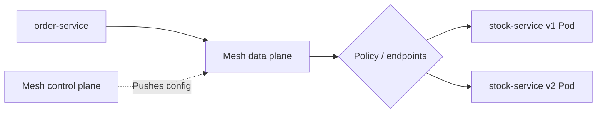
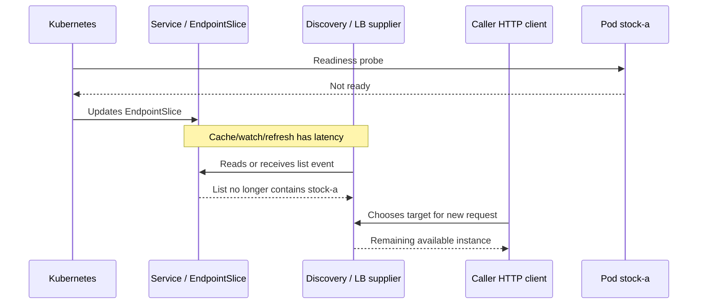

# Gateways, Ingress, Service Meshes, and the Role of Caller-Side LoadBalancer

## 1. Objective and deployment context

A microservice system can contain **multiple load balancers** appearing along the path of a single request while performing different jobs. When a user calls an API through ingress, `api-gateway` forwards to `order-service`; then `order-service` calls `stock-service`. Having ingress load-balance `order-service` **does not automatically decide** which replica of `stock-service` `order-service` will call.

This lesson belongs to the **Deployment** chapter of the `SPRING_CLOUD_SERVICE_COMMUNICATION_LOAD_BALANCING` module. The module scope covers client-side load balancing by service ID, discovery, health checks, and `ServiceInstance` selection policies; integrating `RestClient`, `WebClient`, OpenFeign, retries/timeouts, and error observability. During deployment, you must understand the differences among **Gateway**, **Kubernetes Ingress/Gateway API**, **Kubernetes Service**, **service mesh**, and **caller-side Spring Cloud LoadBalancer** so each capability sits at the right layer.

After this lesson, you will be able to:

1. Trace request flow from the Internet to backends and pinpoint which layer selects the target at each hop.
2. Distinguish **north–south** (external ↔ in-cluster) from **east–west** (service ↔ service) routing.
3. Explain when Spring Cloud LoadBalancer selects `ServiceInstance` entries directly versus when Kubernetes Services or a service mesh handle Pod selection.
4. Configure examples of `Spring Cloud Gateway` with `lb://service-id`, `@LoadBalanced RestClient.Builder`, and a Kubernetes Service.
5. Recognize **double load balancing**, stacked timeouts/retries, discovery lag, readiness, TLS/mTLS, and observability issues.
6. Build a deployment checklist and verify failover using metrics, access logs, and distributed tracing.

> **Overarching principle:** Every network hop must identify **who is responsible for picking the final destination**. Layers can coexist, provided you know which **backend list** each selection uses, which policy applies, and where it is observed.

## 2. End-to-end diagram: target selection across multiple hops



The branches after **Path to stock-service** represent **three selectable architectures**, not a requirement for one request to traverse all three in sequence. In a real cluster, a mesh proxy and Kubernetes Service networking can both sit on the physical path; **where backend selection happens** depends on mesh configuration, DNS/target addresses, and cluster forwarding mechanics.

### 2.1. Distinguishing scopes by question

| Component | Primary problem solved | Decision example | Automatically manages `order-service` → `stock-service` calls? |
| --- | --- | --- | --- |
| External LB (L4/L7) | Brings Internet traffic into the cluster | Picks node/ingress endpoint | Normally **no** |
| Kubernetes Ingress | Routes external HTTP/HTTPS to Services | `api.example.com/orders` → `order-service` | No; handles only traffic entering via ingress |
| Kubernetes Gateway API | Declares listeners and HTTPRoute/TCPRoute for a gateway controller | Host/path/header → Service | Only for traffic passing through that gateway |
| Spring Cloud Gateway | Application-tier gateway | `/api/orders/**` → `lb://order-service` | Can load-balance **inside the gateway itself** for its routes; does not configure `order-service`'s clients |
| Kubernetes Service `ClusterIP` | Stable address and cluster-networking load balancing | VIP:8080 → one of the Pod endpoints | **Yes** if caller calls the Service VIP |
| Spring Cloud LoadBalancer | Picks `ServiceInstance` on the caller side | `stock-service` → `stock-a:8080` | **Yes** if HTTP client integrates LoadBalancer with a suitable instance list |
| Service mesh | Workload-to-workload policies; L4/L7 routing, mTLS, telemetry depending on data plane | Envoy/waypoint picks endpoint or subset | **Potentially yes**, when requests pass through that policy/data plane |

Avoid lumping everything under the word "gateway": **Ingress** is a Kubernetes API resource needing a controller; **Gateway API** also needs a controller; **Spring Cloud Gateway** is a standalone gateway application. They can be deployed together yet have different lifecycles and configuration scopes.

## 3. North–south vs. east–west: ingress does not replace caller LoadBalancer

**North–south** traffic typically flows from external clients to public APIs:

```text
Client -> Cloud Load Balancer -> Ingress/Gateway -> order-service
```

Ingress normally handles host, path, TLS termination, redirects, or forwarding to a Kubernetes Service. Spring Cloud Gateway can add authentication, rate limiting, filters, and `lb://` routes to internal service IDs.

**East–west** traffic covers calls between applications:

```text
order-service -> stock-service -> database
order-service -> payment-service
```

Here `order-service` needs a concrete network target for `stock-service`. That target can come from:

1. **Kubernetes Service DNS**: caller sends to `stock-service.default.svc.cluster.local`; Kubernetes networking and/or mesh picks an endpoint.
2. **Application-tier service discovery**: `DiscoveryClient` or `ReactiveDiscoveryClient` returns `ServiceInstance` entries, Spring Cloud LoadBalancer chooses one, and the client sends directly to the chosen address.
3. **Service mesh**: workload calls the service host, and the proxy/data plane intercepts traffic and applies backend selection, subsets, timeouts, retries, and mTLS when configured.

Thus, adding an Ingress out front **does not eliminate** the need to design east–west calls. Conversely, running Spring Cloud LoadBalancer inside `order-service` **does not make the application reachable from the Internet**.

## 4. Spring Cloud Gateway: a gateway can also be a caller

Spring Cloud Gateway can route to a `lb://order-service` URI. When the route matches, the gateway uses Spring Cloud LoadBalancer integration to pick an instance for **that route's target**, provided LoadBalancer dependencies and a discovery source are present.

Example with **Spring Cloud Gateway Server WebFlux 5.x**:

```yaml
spring:
  application:
    name: api-gateway
  cloud:
    gateway:
      server:
        webflux:
          routes:
            - id: orders
              uri: lb://order-service
              predicates:
                - Path=/api/orders/**
              filters:
                - StripPrefix=1
```

With this setup, `GET /api/orders/42` reaches `order-service` as `/orders/42`. The gateway needs `spring-cloud-starter-loadbalancer` and an instance provider (Eureka, Consul, Spring Cloud Kubernetes, or a suitable instance list config). If discovery returns an empty list, the `lb://` route cannot pick a target; the **exact error status** depends on the gateway and error configuration.

**Version note:** In Spring Cloud Gateway 4.x, configuration examples typically use `spring.cloud.gateway.routes`; in the Server WebFlux 5.x branch, the prefix is `spring.cloud.gateway.server.webflux.routes`. When copying examples, check documentation for your **exact Spring Cloud release train**. Spring Cloud Gateway Server MVC uses different APIs and route filters than WebFlux; do not assume starters and properties are interchangeable.

### 4.1. One gateway is distinct from downstream application callers

If the gateway picks `order-2`, and `order-2` then calls `stock-service`:

```text
Selection 1: Gateway -> order-service -> order-2
Selection 2: order-2 -> stock-service -> stock-a / stock-b
```

The two selections are independent. The gateway may use Round Robin across `order-service` replicas, while `order-service` uses a zone preference policy when calling `stock-service`. You cannot conclude "we already have `lb://order-service` so `order-service` needs no LoadBalancer" if `order-service` uses **direct discovery to stock pods**.

### 4.2. Avoid wrapping two selectors inside the gateway

The gateway already has its own target selection for `lb://` routes and load-balancer filters. Especially in Spring Cloud Gateway **Server MVC**, do not inject a `@LoadBalanced RestClient` into the gateway's internal proxy path: if intercepted a second time, requests can pass through service discovery at the wrong moment and break instance selection.

Use `@LoadBalanced RestClient.Builder` only for **outbound calls explicitly made by your application code**, leaving gateway routes to the `lb()` filter or `lb://` URI. This is an important configuration boundary when integrating a gateway into an existing system.

References: [Spring Cloud Gateway DiscoveryClient route locator](https://docs.spring.io/spring-cloud-gateway/reference/spring-cloud-gateway-server-webflux/the-discoveryclient-route-definition-locator.html) and [Gateway Server MVC LoadBalancer filter](https://docs.spring.io/spring-cloud-gateway/reference/spring-cloud-gateway-server-webmvc/filters/loadbalancer.html).

## 5. Kubernetes Ingress and Gateway API: cluster entry routing

In Kubernetes, `Ingress` is an API for external HTTP/HTTPS routing to Services, typically handling hostnames, paths, and TLS termination. Ingress does nothing without an **Ingress controller**. Kubernetes also provides **Gateway API** with resources such as `Gateway` and `HTTPRoute`, separating listener governance from route governance.

Illustrative `HTTPRoute` directing `api.example.com/orders` traffic to `order-service`; assumes a `Gateway` named `public-gateway` and a Gateway API controller are installed:

```yaml
apiVersion: gateway.networking.k8s.io/v1
kind: HTTPRoute
metadata:
  name: order-route
  namespace: default
spec:
  parentRefs:
    - name: public-gateway
  hostnames:
    - api.example.com
  rules:
    - matches:
        - path:
            type: PathPrefix
            value: /orders
      backendRefs:
        - name: order-service
          port: 8080
```

In this example, `HTTPRoute` performs no rewrite; the backend still receives paths prefixed with `/orders`. Verify that your controller supports the resource, `parentRefs`, namespace, and matching listener; declaring YAML does not guarantee the route is accepted or publicly reachable.

For clusters using Ingress, a conceptually equivalent example:

```yaml
apiVersion: networking.k8s.io/v1
kind: Ingress
metadata:
  name: order-ingress
spec:
  ingressClassName: nginx
  rules:
    - host: api.example.com
      http:
        paths:
          - path: /orders
            pathType: Prefix
            backend:
              service:
                name: order-service
                port:
                  number: 8080
```

`ingressClassName: nginx` is valid only if the cluster has a matching IngressClass/controller. These are **two deployment options**; normally you do not publish duplicate public routes for the same endpoint in the same environment.

Ingress and Gateway API choose the **Service/backend to receive inbound traffic**, yet do not directly govern the `ServiceInstance` list a Java application uses to call `stock-service`. If the app calls through a Kubernetes Service VIP, in-cluster networking resolves that step.

Per current Kubernetes documentation, the project recommends **Gateway API** for new routing development; Ingress remains stable and supported while its API is frozen. Choose according to your cluster's controllers, features, and operational standards.

References: [Kubernetes Ingress](https://kubernetes.io/docs/concepts/services-networking/ingress/) and [Gateway API HTTP routing](https://gateway-api.sigs.k8s.io/guides/user-guides/http-routing/).

## 6. Kubernetes Service: ClusterIP vs. headless

### 6.1. Standard Service (`ClusterIP`) selects endpoints inside the cluster

Example of a Service targeting `stock-service` Pods:

```yaml
apiVersion: v1
kind: Service
metadata:
  name: stock-service
  namespace: default
spec:
  type: ClusterIP
  selector:
    app: stock-service
  ports:
    - name: http
      port: 8080
      targetPort: http
```

Kubernetes creates a stable in-cluster Service address. DNS typically resolves `stock-service.default.svc.cluster.local` to the ClusterIP; kube-proxy or an equivalent dataplane steers connections to an eligible endpoint from `EndpointSlice`. Distribution at this layer has **network-connection/flow** semantics, not Spring Cloud per-HTTP-request Round Robin.

The application can call Service DNS directly using an HTTP client **without Spring Cloud LoadBalancer enabled**:

```java
import org.springframework.stereotype.Service;
import org.springframework.web.client.RestClient;

@Service
public class StockViaKubernetesService {
    private final RestClient client =
            RestClient.builder()
                    .baseUrl("http://stock-service.default.svc.cluster.local:8080")
                    .build();

    public String findStock(String sku) {
        return client.get()
                .uri("/stocks/{sku}", sku)
                .retrieve()
                .body(String.class);
    }
}
```

The code above relies on **Kubernetes Service/networking** to reach a Pod. It does not invoke `ReactorServiceInstanceLoadBalancer`, performs no application-side `choose(Request)` by service ID, and emits no Spring Cloud `loadbalancer.requests.*` meters for this call.

### 6.2. Headless Service provides no load-balancing VIP

Setting `spec.clusterIP: None` creates a **headless Service**. DNS returns the corresponding endpoint addresses, with no ClusterIP-style Service VIP/proxy load balancing.

```yaml
apiVersion: v1
kind: Service
metadata:
  name: stock-headless
spec:
  clusterIP: None
  selector:
    app: stock-service
  ports:
    - port: 8080
      targetPort: http
```

Still, **returning multiple DNS addresses does not mean you have a Spring Cloud LoadBalancer policy**. Address selection depends on the DNS resolver, HTTP transport, connection pooling, and the client stack you use. When deliberate instance-aware policies are required, use proper discovery or a data plane configured for endpoint selection.

### 6.3. Deployment/readiness affects the backend list

Example where a Pod receives traffic only after Spring Boot's readiness endpoint reports ready:

```yaml
apiVersion: apps/v1
kind: Deployment
metadata:
  name: stock-service
spec:
  replicas: 2
  selector:
    matchLabels:
      app: stock-service
  template:
    metadata:
      labels:
        app: stock-service
    spec:
      containers:
        - name: stock-service
          image: registry.example.com/stock-service:1.0.0
          ports:
            - name: http
              containerPort: 8080
          readinessProbe:
            httpGet:
              path: /actuator/health/readiness
              port: http
            periodSeconds: 5
            timeoutSeconds: 2
```

This is an illustrative configuration: the image must exist, the app must enable Actuator/probes, and the readiness endpoint must return an appropriate status. Kubernetes uses readiness to decide whether an endpoint is ready for a Service; **liveness** is for restarting containers when needed and should not be treated as a routing signal instead of readiness.

During rollouts, new Pods enter Service endpoints once ready; Pods losing readiness are removed from endpoints eligible for new traffic. That transition has **propagation latency** and established connections may linger. Never treat a Pod transitioning to `NotReady` as a guarantee that all callers immediately stop sending requests to it.

Reference: [Kubernetes Service](https://kubernetes.io/docs/concepts/services-networking/service/).

## 7. Caller-side Spring Cloud LoadBalancer: when does it truly choose Pods?

In a Spring application, an HTTP client using a service ID and instrumented with Spring Cloud LoadBalancer follows:

```text
@LoadBalanced RestClient / WebClient / OpenFeign
  -> service ID "stock-service"
  -> DiscoveryClient / ReactiveDiscoveryClient
  -> ServiceInstanceListSupplier (cache, health, zone, hint if configured)
  -> ReactorServiceInstanceLoadBalancer.choose(Request)
  -> ServiceInstance host + port
  -> HTTP transport
```

Example `RestClient` configuration:

```java
import org.springframework.cloud.client.loadbalancer.LoadBalanced;
import org.springframework.context.annotation.Bean;
import org.springframework.context.annotation.Configuration;
import org.springframework.web.client.RestClient;

@Configuration(proxyBeanMethods = false)
public class LoadBalancedClientConfiguration {

    @Bean
    @LoadBalanced
    RestClient.Builder loadBalancedBuilder() {
        return RestClient.builder();
    }
}
```

```java
import org.springframework.cloud.client.loadbalancer.LoadBalanced;
import org.springframework.stereotype.Service;
import org.springframework.web.client.RestClient;

@Service
public class StockViaSpringLoadBalancer {
    private final RestClient client;

    public StockViaSpringLoadBalancer(
            @LoadBalanced RestClient.Builder builder) {
        this.client = builder.build();
    }

    public String findStock(String sku) {
        return client.get()
                .uri("http://stock-service/stocks/{sku}", sku)
                .retrieve()
                .body(String.class);
    }
}
```

In this example, **`stock-service` is a service ID**, not a hostname guaranteed to exist in DNS. LoadBalancer integration selects from `ServiceInstanceListSupplier`; the address the client actually calls is the chosen instance's host/port.

Similarly, with OpenFeign:

```java
import org.springframework.cloud.openfeign.FeignClient;
import org.springframework.web.bind.annotation.GetMapping;
import org.springframework.web.bind.annotation.PathVariable;

@FeignClient(name = "stock-service")
public interface StockFeignClient {
    @GetMapping("/stocks/{sku}")
    String getStock(@PathVariable("sku") String sku);
}
```

With `spring-cloud-starter-openfeign`, Spring Cloud LoadBalancer, and matching discovery, the client resolves `stock-service` to instances. If you specify `@FeignClient(url = "https://stock.example.com")`, calls follow the fixed URL and typically **skip** LoadBalancer discovery-based instance selection.

### 7.1. What discovery actually returns is decisive

A `DiscoveryClient` may return:

- **Individual Pod/instance addresses**: Spring Cloud LoadBalancer genuinely chooses among A/B/C.
- **A Kubernetes Service VIP address**: Spring Cloud may pick a single entry representing the Service; Kubernetes networking then picks the Pod.
- **Proxy/service mesh endpoint addresses**: the proxy may perform further backend selection.

Results depend on the **driver/discovery implementation, version, and config**, especially with Spring Cloud Kubernetes. Thus, when deploying, **inspect the actual list** returned by the supplier: where does each `ServiceInstance.getHost()`/`getPort()` point? If it points only to a VIP, a "weighted pod A/B" algorithm in Spring Cloud does not actually control which Pod is picked.

This is why neither "in Kubernetes, Spring Cloud LoadBalancer is redundant" nor "using Spring Cloud definitely bypasses Kubernetes Services" holds for every architecture. Verify the **concrete call path and instance list**.

### 7.2. Customizing LoadBalancer when caller-side policies are required

Spring Cloud LoadBalancer is especially helpful when:

- You need to pick the **exact instance** using caller-side zone metadata, hints, or weights.
- Discovery is not purely inside Kubernetes, e.g., Eureka/Consul registries or hybrid multi-environment infrastructure.
- You want to choose only from a list filtered/cached/health-checked to custom requirements.
- You need a custom `ReactorServiceInstanceLoadBalancer` or per-service-ID policy.

However, when a mesh already manages subset canary routing, a caller directly picking Pods with another policy can skew expected ratios. Avoid stacking two independent weighted algorithms when **one unified distribution policy** is desired.

## 8. Service mesh: policies between workloads

A service mesh provides a **data plane** governing workload-to-workload communication, optionally handling mTLS, identity, telemetry, retries, timeouts, circuit breaking, or traffic splitting.

In **Istio sidecar mode**, each application Pod gets an Envoy proxy on the path; in **ambient mode**, a node-level `ztunnel` handles L4 and an optional **waypoint proxy** handles L7 features. Therefore, do not claim every service mesh puts a sidecar in every Pod, or that ambient `ztunnel` automatically provides full HTTP retries/traffic splitting.



Example with Istio:

| Tier | Typical capabilities | Notes |
| --- | --- | --- |
| Envoy sidecar | L4/L7 proxy, service routing, mTLS, retries/timeouts, telemetry | Only traffic within proxy capture scope is governed |
| Ambient `ztunnel` | L4 secure transport, mTLS, identity, L4 policy | Does not automatically do header-based HTTP routing/retries |
| Ambient waypoint | L7 routing and configured policy/telemetry | Must be installed and attached to workload/service properly |
| Mesh control plane | Distributes config, discovery, policies | Control plane does not directly proxy each request |
| Kubernetes Service | DNS/VIP identity and endpoint membership | Can still coexist alongside the mesh |

Example Istio `VirtualService` describing **90% v1, 10% v2 routing**, applicable only when subsets are defined in a matching `DestinationRule`:

```yaml
apiVersion: networking.istio.io/v1
kind: DestinationRule
metadata:
  name: stock-destination
spec:
  host: stock-service
  subsets:
    - name: v1
      labels:
        version: v1
    - name: v2
      labels:
        version: v2
---
apiVersion: networking.istio.io/v1
kind: VirtualService
metadata:
  name: stock-routing
spec:
  hosts:
    - stock-service
  http:
    - route:
        - destination:
            host: stock-service
            subset: v1
          weight: 90
        - destination:
            host: stock-service
            subset: v2
          weight: 10
```

This illustrates **Istio sidecar/L7 policy**; in ambient mode, `VirtualService` support may differ, and many L7 scenarios require a waypoint with matching Gateway API resources. Check the installed mesh mode and version before applying YAML. If the application picks a v2 Pod IP directly instead of calling the `stock-service` host recognized by the mesh, host/subset routing policies may **not apply as expected**.

References: [Istio data plane modes](https://istio.io/latest/docs/overview/dataplane-modes/) and [Istio traffic management](https://istio.io/latest/docs/concepts/traffic-management/).

## 9. Avoiding unintended nested load balancing

### 9.1. Two target selections are not always wrong

Example:

```text
order-service
  -> Spring Cloud LoadBalancer picks "stock-service" entry
  -> entry is ClusterIP 10.96.x.y
  -> Kubernetes networking picks Pod stock-2
```

If only one Service VIP exists in the list, the Spring Cloud layer has little information to balance between Pod A and B. Enabling Round Robin on the caller does not produce per-Pod Round Robin ratios. To apply per-Pod zones/hints, discovery must return **Pod endpoints with proper metadata**.

Conversely, when discovery returns Pod IPs directly, Spring Cloud can actively choose a Pod. Even then, traffic may still traverse a mesh sidecar or Kubernetes network policy/CNI layer.

### 9.2. Combination patterns and policy ownership

| Architecture | Who should own primary backend selection? | What to verify |
| --- | --- | --- |
| Spring app → Kubernetes `ClusterIP` | Kubernetes networking or mesh if present | Client uses Service DNS/VIP; avoid duplicating Pod-level policies in app |
| Spring app → Eureka instances | Spring Cloud LoadBalancer | Discovery returns real instance hosts/ports |
| Spring app → headless DNS | DNS/transport if no other LB; or configured client-aware LB | Do not assume multiple DNS A records mean per-request balancing |
| Spring app → Istio canary v1/v2 | Mesh L7 when mesh owns traffic splitting | Caller does not deliberately pick Pods with a conflicting algorithm |
| Gateway `lb://order-service` → order replicas | Gateway + Spring Cloud LoadBalancer per route | Gateway route and discovery config |
| Ingress/Gateway API → Kubernetes Service | Controller/gateway dataplane and Kubernetes endpoint routing | IngressClass/GatewayClass, backend Service, EndpointSlice |

A clear architecture records in operational docs: **"At which layer are `stock-service` Pods chosen in this environment?"** When migrating from Eureka to Kubernetes, or from Service DNS to a mesh, update that answer and adjust Java client configuration accordingly.

## 10. Retries, timeouts, circuit breakers: preventing traffic amplification

Suppose a request can be retried in three places:

- Gateway: up to **2 attempts**.
- `order-service` client: up to **3 attempts**.
- Mesh: up to **2 attempts** per HTTP call it receives.

In certain concurrent failure scenarios, downstream deliveries **can reach 2 × 3 × 2 = 12**. This is an illustrative upper bound when nested retry loops execute completely; actual latency and server request counts depend on failure ordering, specific policies, and proxy placement.

You cannot infer attempt counts solely from OpenFeign's `Retryer.NEVER_RETRY`: that is the retry policy **at the Feign layer**, while Spring Cloud LoadBalancer, the gateway, or the mesh may have separate retries depending on classpath/config.

### 10.1. Setting an end-to-end time budget

Suppose an API call must finish within **3 seconds**. Limits that must align:

```text
End-to-end deadline (assumed): 3000 ms
  Gateway timeout:            <= 3000 ms
  Business handler/processing: reserve enough budget for internal work
  Client connectTimeout:       300 ms (per attempt)
  Client readTimeout:          800 ms (per attempt)
  Retry backoff:               bounded
  Mesh per-try timeout:        smaller than remaining budget, if used
```

These numbers are **illustrative**, not universal recommended defaults. `connectTimeout` and `readTimeout` do not automatically create a hard 800 ms deadline for the whole logical call; DNS, pool acquisition, TLS handshakes, backoff, and retries consume additional time. When a gateway deadline is shorter than downstream budgets, the gateway may return an error to the user while the backend is still processing.

### 10.2. Safety rules for retries

1. Assign **which layer owns retries for each request type**; avoid stacked retries across layers.
2. Retry only transient failures, cap attempts, and use appropriate backoff/jitter.
3. For `POST` order creation, payments, or writes, design an **idempotency key** or deduplication before permitting retries.
4. Distinguish no-instance retries from HTTP 503, connection reset, or read timeout retries; a timeout does not prove the server did not process the request.
5. Measure logical calls and **actual HTTP attempts received** independently at gateway, caller, mesh, and downstream.
6. When the mesh already enforces outlier detection/retries, evaluate interactions before enabling Spring Cloud LoadBalancer retries in the Java client.

**mTLS/TLS note:** TLS may terminate at the edge, gateway, or be re-originated to backends; mesh mTLS secures workload-to-workload hops by mesh identity. Never assume "because external Internet traffic uses HTTPS, every internal hop is encrypted." For proxied requests, map TLS termination/origination points and certificate/SNI verification requirements.

## 11. Health checks, readiness, and discovery during rollouts

When `stock-service` scales from 2 to 3 Pods or a Pod is removed, layers do not necessarily update simultaneously:



With a Kubernetes Service VIP, Kubernetes networking relies on updated endpoint membership. With **Pod discovery** in Spring Cloud LoadBalancer, `ServiceInstanceListSupplier` may cache snapshots for a TTL window, leaving the caller seeing a recently removed Pod. With a health-check supplier, probing and refresh add another signal; do not assume a health checker is always needed when discovery already filters unhealthy instances.

Specifically:

- **Readiness** indicates whether a Pod is ready for new traffic.
- **Liveness** indicates when the runtime should restart a container; it cannot replace readiness.
- **Startup probe** protects slow startups so liveness does not restart containers prematurely.
- **Graceful shutdown** and `terminationGracePeriodSeconds` help finish in-flight requests during drain; removing an endpoint does not immediately sever every existing connection.
- **Cache TTL** bounds client-side instance list freshness, not instantaneous synchronization with EndpointSlices.

When testing failover, measure the **actual time from when a Pod loses readiness until new requests stop arriving at that Pod**. Do not just glance at `kubectl get pods` and conclude all traffic has shifted.

## 12. Multi-layer observability: knowing where errors originate

A system with gateways, client LoadBalancers, and meshes needs consistent telemetry:

| Observation point | Signals needed | Question answered |
| --- | --- | --- |
| Ingress/Gateway | Inbound request count, route ID, HTTP status, p95 | Did the client hit the right route? Did the gateway fail? |
| `order-service` | Logical call outcome, downstream service ID, latency | What final outcome did the caller observe? |
| Spring Cloud LoadBalancer | `loadbalancer.requests.active`, `loadbalancer.requests.success`, `loadbalancer.requests.failed`, `loadbalancer.requests.discard` | Did LoadBalancer pick an instance? Were there exceptions at that layer? |
| HTTP transport | HTTP status, connect/read timeouts, connection errors | Were connections opened and responses received? |
| Mesh data plane | Requests, retry attempts, upstream cluster, outlier ejection (if L7) | Which backend did the proxy pick and did it retry? |
| `stock-service` | Access logs, server requests, readiness, instance ID | Which Pod actually received the request and how long did it take? |
| Distributed tracing | Trace ID, per-hop spans, error attributes | Which hops did the call traverse? |

**Do not equate `loadbalancer.requests.success` with HTTP 2xx:** this meter reflects LoadBalancer calls that received a response back at the client layer; HTTP 503 still counts as a response in many cases. To measure business error rates, use separate HTTP or logical-call outcome metrics.

L4 and L7 mesh metrics also differ: in Istio ambient mode, **`ztunnel` alone** does not emit full HTTP request-level metrics/traces like a waypoint/Envoy L7 proxy. Know your data plane mode before designing dashboards.

Avoid Prometheus labels with `orderId`, `sessionId`, `traceId`, or constantly changing Pod addresses on every metric. Group by **service ID, route template, status class, and policy** with bounded cardinality; use logs/traces for detailed IDs.

### 12.1. Common failure symptoms

| Symptom | First place to inspect |
| --- | --- |
| Ingress returns 404 | Host/path rules, was `IngressClass` or `HTTPRoute` accepted by controller? |
| Gateway errors on `lb://` route | Are `spring-cloud-starter-loadbalancer` and discovery instances for the service ID present? |
| Caller reports `No instances available` | `ServiceInstanceListSupplier`, registry/EndpointSlice, cache, zone/health filters |
| Caller connects to old Pod IP | Discovery/cache TTL, watch lag, readiness, connection pool |
| Mesh canary misses 90/10 | Is caller bypassing service hostname to call Pod IPs? Are `DestinationRule`/waypoint/subsets right? |
| Many HTTP 503s yet `loadbalancer.requests.success` rises | Misunderstood LB success definition? Check HTTP client status |
| Downstream requests exceed ingress requests | Gateway, Feign, LoadBalancer, mesh, or caller retries |
| mTLS fails only in one environment | Sidecar/ztunnel capture, `PeerAuthentication`, identity, certificates, ports/protocols |
| p95 degrades after adding a proxy | Measure per-span latency, timeouts, retries, connection pooling, proxy overhead |
| Works locally, fails in Kubernetes | DNS namespace, NetworkPolicy, Service port/targetPort, readiness, scheme |

## 13. Deployment and verification checklist

Assume a cluster with namespace `default`, two `stock-service` replicas, a gateway, and `order-service`. These **read-only** commands verify the actual topology:

```bash
# Service VIP / actual endpoints.
kubectl -n default get service stock-service -o wide
kubectl -n default get endpointslices \
  -l kubernetes.io/service-name=stock-service -o wide

# Pods and readiness at check time.
kubectl -n default get pods -l app=stock-service -o wide

# Run the commands below only if the cluster has those CRDs installed.
kubectl -n default get ingress
kubectl -n default get gateway
kubectl -n default get httproute

# Check caller/gateway logs, adjusted to actual app labels.
kubectl -n default logs deploy/order-service --tail=100
kubectl -n default logs deploy/api-gateway --tail=100
```

Some Gateway API CRDs may not be installed, so `kubectl get gateway/httproute` reporting missing resource types simply means the cluster lacks Gateway API support, not necessarily an `order-service` deployment fault.

Verify in sequence:

1. **Verify ingress routing:** Send a request through the public hostname or test environment. Confirm route matching, gateway returning the right service response, and matching logs/traces.
2. **Identify the east–west target selector:** Does the app call `stock-service` via `ClusterIP`, headless DNS, Spring Cloud discovery, or mesh? Read the Java client configuration and actual `ServiceInstance` list rather than guessing from dependencies.
3. **Verify live endpoints:** Cross-check Service, EndpointSlice, readiness, and the instance list in supplier/cache or mesh cluster membership.
4. **Measure distribution:** Send multiple requests with correlation IDs to an endpoint returning `instanceId` in a test environment. Compare per-Pod stats without demanding strict Round Robin when HTTP keep-alive/mesh/transport policies apply.
5. **Test failover:** In an isolated test environment, make one Pod lose readiness or stop a chosen replica; measure time until new requests move to healthy Pods. Account for graceful shutdown and cache refresh times.
6. **Test retries/timeouts:** Intentionally trigger 503, connection refused, or timeouts on one backend; count logical calls, per-layer retries, and attempts received by servers. Compare against the total deadline.
7. **Verify security:** Confirm TLS termination, workload-to-workload mTLS, and access controls; ensure `Forwarded`/`X-Forwarded-*` headers are trusted only from authorized proxies.
8. **Confirm dashboards/traces:** Ensure service IDs, routes, instance IDs (in traces/logs), no-instance errors, durations, and retry decisions are visible for isolating incidents.

Never perform traffic-disruptive failover tests in production without an approved plan and authorization. In labs or staging, isolate scenarios so results are not mixed with live user traffic.

### 13.1. Acceptance test matrix

| Experiment | Preconditions | What must be proven |
| --- | --- | --- |
| Call via Ingress | Valid rule and Ready backend Pod | Right route, right service |
| Gateway `lb://order-service` | Discovery has two order instances | Gateway selects an order instance |
| Caller uses `ClusterIP` | DNS/Service has EndpointSlices | Caller succeeds even without `@LoadBalanced` |
| Caller uses Spring LB | Supplier directly returns two stock instances | `choose` picks from the right service's list |
| Pod loses readiness | EndpointSlice updates | New requests stop reaching the unready Pod |
| Discovery/cache holds stale IP | Spring LB still sees failed instance | Network errors may occur; measure refresh time |
| No-instance | Zero candidates from supplier | Caller raises clear no-instance error; zero backend requests |
| Mesh canary 90/10 | Matching policy and L7 waypoint/sidecar | Traffic ratio matches design over a sufficiently large window |
| Multi-layer retries | Gateway/client/mesh have own policies | Attempt counts, latency, and idempotency stay controlled |
| TLS/mTLS | Ingress and mesh policies applied | Channel meets security level, hostname, and workload identity |

## 14. Architectural decision: pick the simplest approach that meets requirements

| Deployment context | Reasonable default choice | When to add Spring Cloud LoadBalancer |
| --- | --- | --- |
| All workloads in one Kubernetes cluster calling standard services | Call Kubernetes `ClusterIP` via DNS + readiness; let cluster/mesh handle endpoints | When instance selection needs caller-side metadata unavailable at the networking layer |
| Java microservices with Eureka/Consul or external registries | `@LoadBalanced` HTTP client or OpenFeign by service ID | This is the primary instance selector; configure timeouts, health/caching, and intentional retries |
| Spring Cloud Gateway at the edge | Gateway routes and `lb://` for backend routes | Internal services still need appropriate selection for their own outbound calls |
| Istio/mesh coordinating canary and mTLS | Use service hostname and mesh policy as the source of routing/canary decisions | Add direct instance selection only after evaluating interactions with proxies, identity, and subset policies |
| Per-request caller-side zone/hint policies required | Spring Cloud `ServiceInstanceListSupplier` + `ReactorServiceInstanceLoadBalancer` with instance-aware discovery | When gateway/Kubernetes networking/mesh cannot enforce the policy at the call origin |
| Hybrid systems, multi-cluster, VMs, and Kubernetes | Standardize service naming, endpoint discovery, and routing ownership per environment | When callers need a consistent `service ID → ServiceInstance` model across environments and registry accuracy is verified |

Do not pick a technology simply because "the starter is already on the classpath." What matters is defining the **routing contract**: which endpoints callers see, which layer executes failover, who governs retries, and which metrics prove traffic reached the intended target.

## 15. Self-assessment questions

1. A browser request to `order-service` through Ingress was already load-balanced. Why does that not solve whether `order-service` calls `stock-a` or `stock-b`?
2. With Kubernetes `ClusterIP`, if `order-service` uses a plain `RestClient.builder()` calling `stock-service.default.svc.cluster.local`, who picks the Pod? Is `spring-cloud-starter-loadbalancer` strictly required?
3. When `DiscoveryClient` returns a single `ServiceInstance` holding a Service VIP address, does `RoundRobinLoadBalancer` evenly alternate HTTP requests across individual Pods? Why or why not?
4. Compare `Ingress`, `Gateway API HTTPRoute`, and `Spring Cloud Gateway lb://...` in routing scope and execution location.
5. In Istio ambient mode with `ztunnel` only, should you expect full header-based HTTP retries/traffic splitting like a sidecar? What component is needed for L7?
6. If gateway allows 2 attempts, Feign 3 attempts, and mesh 2 attempts, up to how many downstream deliveries can occur under nested retries? How do you bound it?
7. When a Pod is `NotReady` yet the client still sends requests to the old Pod IP, in what order would you inspect EndpointSlices, supplier cache, proxy, and connection pool?
8. Why does a high `loadbalancer.requests.success` rate not prove low HTTP 5xx rates? Which metrics should be added?
9. When requests traverse multiple proxies, how do you identify which hop terminates TLS and where mTLS is enforced?
10. When migrating from Eureka to Kubernetes Service DNS, which parts of Spring Cloud LoadBalancer code/configuration must be re-evaluated?

## 16. References

- [Spring Cloud Commons – Spring Cloud LoadBalancer](https://docs.spring.io/spring-cloud-commons/reference/spring-cloud-commons/loadbalancer.html): `@LoadBalanced` HTTP clients, discovery, suppliers, retries, health checks, and metrics.
- [Spring Cloud Gateway – DiscoveryClient routes](https://docs.spring.io/spring-cloud-gateway/reference/spring-cloud-gateway-server-webflux/the-discoveryclient-route-definition-locator.html): `lb://service-name` routes and LoadBalancer dependencies.
- [Kubernetes – Service](https://kubernetes.io/docs/concepts/services-networking/service/): `ClusterIP`, `headless Service`, discovery, and EndpointSlices.
- [Kubernetes – Ingress](https://kubernetes.io/docs/concepts/services-networking/ingress/): Ingress resource, controllers, HTTP/HTTPS scope.
- [Kubernetes Gateway API – API overview](https://gateway-api.sigs.k8s.io/docs/concepts/api-overview/): `Gateway`, `HTTPRoute`, and supported protocols.
- [Istio – Sidecar or ambient?](https://istio.io/latest/docs/overview/dataplane-modes/): data plane, `ztunnel`, waypoints, L4/L7.
- [Istio – Traffic Management](https://istio.io/latest/docs/concepts/traffic-management/): traffic routing, `DestinationRule`, retries, timeouts, and load balancing.

**Takeaway:** **Ingress/Gateways** handle hops entering through edge or gateway routes. **Kubernetes Services** and **service meshes** can choose backends at the networking/proxy tier. **Caller-side Spring Cloud LoadBalancer** picks a `ServiceInstance` when an HTTP client uses a service ID with matching discovery. Sound configuration clearly assigns **which layer owns each target selection**, keeps health/timeouts/retries consistent, and verifies real call paths using metrics, logs, and traces.
