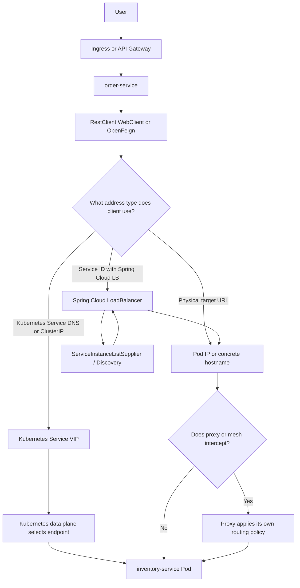
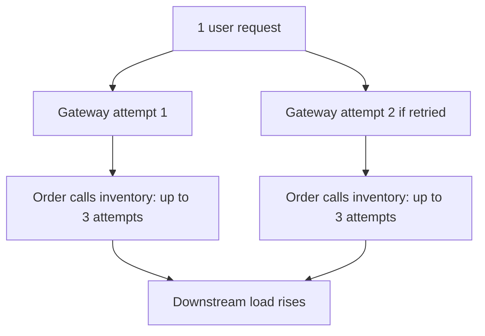

# Avoiding Multi-Layer Load Balancing with Wrong Expectations

When deploying microservices, a user call to a business service often passes through multiple components capable of **routing** or **load balancing**: ingress, API gateway, Spring Cloud LoadBalancer, Kubernetes Service, service mesh, DNS, and HTTP connection pools. Having multiple components present is not inherently wrong. Risk arises when layers **make decisions on the same network hop without aligned ownership**, or when operations teams expect algorithms, health checks, retries, and timeouts in one layer to automatically control all remaining layers.

For example, `order-service` calls `inventory-service` using the logical URL `http://inventory-service/api/stocks/BOOK-001`. If `@LoadBalanced RestClient.Builder` turns the service ID into a specific Pod address, Pod selection can happen on the application side. Yet if the HTTP client connects to the Kubernetes Service **ClusterIP**, the Kubernetes data plane selects the backend endpoint. If a sidecar proxy/service mesh is also present, another routing decision may participate depending on interception and outbound routing config.

This lesson belongs to the **Deployment** chapter of the `SPRING_CLOUD_SERVICE_COMMUNICATION_LOAD_BALANCING` module, aiming to understand `ServiceInstance` selection by service ID, discovery, health checks, and routing policies; integrating RestClient, WebClient, and OpenFeign; and coordinating retries, timeouts, and observability for reliable inter-service communication. The focus here is **explicitly assigning layer ownership for each hop**, rather than chasing the assumption that "more load balancers mean better balancing."

> **Practical principle:** before enabling or disabling a load balancer, determine whether requests go to a **service ID, Pod IP, Service VIP, gateway, or sidecar**; which layer picks the final endpoint; which layer retries; and which observable evidence confirms it.

## 1. Multiple load-balancing layers do not automatically mean bugs

A common architecture has this path:

```text
User
    |
    v
Ingress / API Gateway  --------> picks an order-service replica
    |
    v
order-service
    |
    | RestClient / WebClient / OpenFeign
    v
Spring Cloud LoadBalancer --> picks an inventory-service instance
    |
    v
inventory-service replica
```

In this diagram, ingress load-balances the **user → order-service** hop, while Spring Cloud LoadBalancer load-balances the **order-service → inventory-service** hop. They act on **two distinct backend sets**, so this is not duplicate functionality.

Another path:

```text
order-service
    |
    v
HTTP client calls inventory-service ClusterIP Service
    |
    v
Kubernetes Service data plane --> picks inventory Pod
    |
    v
inventory-service replica
```

When Spring Cloud LoadBalancer does not participate in this hop, the Kubernetes Service already handles endpoint distribution.

What needs clarity is **when Spring Cloud LoadBalancer, Kubernetes Service, and a service mesh all appear on the exact same order → inventory hop**: are they selecting from the same endpoint set? Is the earlier layer's choice overridden by a later layer? Which layer knows the final replica that received the request?

## 2. Distinguishing routing, service discovery, and load balancing

The following terms are often used interchangeably yet are not equivalent:

| Concept | Core question | Example |
| --- | --- | --- |
| Service discovery | Which instances does a service have? | `DiscoveryClient.getInstances("inventory-service")` |
| Client-side load balancing | Which instance does the caller pick? | Spring Cloud `RoundRobinLoadBalancer` |
| Service VIP load balancing | Which backend receives traffic sent to a service address? | Kubernetes Service with ClusterIP |
| Proxy / mesh routing | Which upstream cluster/endpoint does the proxy choose? | Envoy or mesh data plane component |
| DNS resolution | Which address corresponds to a host name? | `inventory-service.default.svc.cluster.local` |
| Connection pooling | Is an existing connection reused? | JDK HTTP Client, Apache HttpClient, Reactor Netty |
| Retry | Is an additional HTTP attempt issued? | Client retry, gateway retry, or mesh retry |

Discovery can refresh lists yet **does not send HTTP requests itself**. Round Robin picks from an instance list yet **does not measure CPU by default**. A Kubernetes Service chooses backends at the network or dataplane layer yet **does not understand full API business outcomes**. A service mesh may offer routes, timeouts, and outlier detection, though those features exist only when enabled and properly configured.

Therefore, never write deployment docs saying merely "LB = on." Record **which LB, where, for which hop, and from what backend list source**.

## 3. Map of layers that may participate in a path



The diagram shows **alternative possible paths**, not every request passing through every block. Specifically:

- Connecting to a **Pod IP** does not necessarily go through Kubernetes Service VIP backend selection.
- Connecting to a **Service VIP** normally goes through Kubernetes data plane endpoint selection; concrete implementations may use iptables, IPVS, eBPF, or another mechanism.
- A service mesh may intercept outbound traffic and make its own routing decisions based on hostname, destination address, policies, and sidecar/ambient mode. Do not conclude Pod IPs definitely bypass the mesh without checking actual mesh config.
- An ingress/gateway at the edge balances an earlier hop and does not necessarily overlap with internal load balancing.

## 4. Is ServiceInstance a Pod endpoint or just a Service VIP?

In Spring Cloud LoadBalancer, `ServiceInstanceListSupplier` builds the candidate set. What matters most is **what each candidate actually represents**.

### 4.1. When the supplier returns Pod endpoints

Example list received by the caller:

```text
serviceId=inventory-service
A = 10.42.1.21:8080
B = 10.42.2.34:8080
C = 10.42.3.19:8080
```

Spring Cloud LoadBalancer selects B. The HTTP transport connects to `10.42.2.34:8080`. Unless a proxy reroutes it, B is the replica receiving the request. No Kubernetes Service VIP **necessarily** participates in picking an endpoint for this hop.

This is **client-side selection to endpoints**, useful when the app genuinely needs per-instance, zone, hint, or custom metadata policies.

### 4.2. When the supplier returns only one Service VIP

Example supplier output:

```text
serviceId=inventory-service
A = inventory-service.default.svc.cluster.local:80
```

Spring Cloud LoadBalancer selects "A", yet A is actually a **virtual service address**, not a specific Pod. The Kubernetes Service is what chooses the real Pod behind it.

In this scenario:

- Spring Cloud's "selected instance A" metric **does not identify the final Pod**.
- Spring Cloud Round Robin over a single-element list **creates no distribution across Pods**.
- If the request reaches the Service VIP and a mesh/proxy enforces its own policy, final distribution must be measured at that layer.
- Retrying to the "next instance" in Spring Cloud may hit **the exact same VIP**, with another layer selecting the backend afterward.

**Do not equate `ServiceInstance` count with Pod count:** `ServiceInstance` is an abstraction; its host/port values reveal which layer truly picks replicas.

## 5. Kubernetes Services are not the same as Spring Cloud Round Robin

A Kubernetes Service provides a stable address for Pods matching a selector (for standard Services). The dataplane and session affinity settings determine which endpoint receives each connection.

Meanwhile, Spring Cloud LoadBalancer picks a `ServiceInstance` from an explicit list at the caller.

| Aspect | Spring Cloud LoadBalancer | Kubernetes Service |
| --- | --- | --- |
| Primary location | Inside the application-side HTTP client | At the service networking / data plane layer |
| Candidate data | `ServiceInstanceListSupplier` | Endpoints/EndpointSlices managed by Kubernetes |
| Logical address | Host in service ID URI | Service DNS / ClusterIP |
| Typical algorithm | Round Robin or custom implementation | Depends on dataplane, affinity, and policies |
| Request-context awareness | Can support hints/zones/retry context | Unaware of Spring HTTP client context |
| Observation point | Lifecycle, supplier, instance selection | Proxy/dataplane/network/server metrics |
| Health management | Per configured discovery/supplier | Readiness and endpoint conditions published by Kubernetes |

Do not claim a Kubernetes Service performs "per-HTTP-request Round Robin." Depending on dataplane and protocol, backends may be selected per **connection/flow**. A reused HTTP connection can carry many requests, especially with keep-alive or HTTP/2, making per-request distribution differ from per-connection distribution.

## 6. Four deployment models and selection ownership

### Model A: Spring Cloud LoadBalancer selects Pods directly

```text
order-service
  -> @LoadBalanced RestClient / WebClient or Feign
  -> Spring Cloud LoadBalancer
  -> supplier returns [Pod-A, Pod-B, Pod-C]
  -> connects to Pod-B:8080
```

Suited when Java-side `ServiceInstance` routing such as hints, metadata, zones, or retry-aware policies is needed and discovery actually supplies Pod endpoints.

Things to verify: discovery freshness, Pod IP changes, readiness, mesh interception, network policies, and instance cache age.

### Model B: Plain HTTP client calls Kubernetes Service

```text
order-service
  -> plain RestClient/WebClient
  -> http://inventory-service.default.svc.cluster.local
  -> Service VIP
  -> Kubernetes data plane selects Pod
```

Suited when Kubernetes Service policies meet requirements and the app does not need Pod selection driven by Spring Cloud request context.

Things to verify: connection reuse, EndpointSlice/readiness, session affinity, DNS, and target Pod observability. Do not add `@LoadBalanced` just so a Kubernetes Service hostname can be resolved.

### Model C: Service mesh owns routing

```text
order-service
  -> HTTP client / service name
  -> mesh sidecar or data plane
  -> proxy applies routes, locality, policies, timeouts per config
  -> inventory-service Pod
```

Suited if an organization uses a mesh to standardize mTLS, routing, traffic splitting, circuit breaking, and observability. Clarify whether the app still chooses Pods or simply passes the service name to the proxy. Never assume a mesh overrides every Spring Cloud decision without checking interception rules.

### Model D: Spring Cloud picks an upstream group; a proxy picks replicas inside that group

```text
Spring Cloud selects group/endpoint A or B
  -> proxy / gateway at the group address
  -> proxy selects a Pod inside that group
```

This model can make sense when **the two layers have distinct responsibilities**, such as picking a region/cluster first and then picking a replica inside that region. Define each layer's criteria clearly and avoid assuming one layer's weights equal the final traffic ratio per Pod.

**No single model is universally best.** The choice depends on routing requirements, service discovery, mesh, TLS, scale, operational complexity, and metric verifiability.

## 7. Two independent selectors do not "add up" policies intuitively

Suppose the app picks an upstream group at 50% group A and 50% group B. Inside group A, a proxy splits across two Pods 90%/10%; inside group B it splits 20%/80%.

If selections are truly independent, traffic is steady, and there are no retries, the expected distribution across the four Pods is:

```text
Group A selected: 50%
  A1: 50% × 90% = 45% of total requests
  A2: 50% × 10% =  5% of total requests

Group B selected: 50%
  B1: 50% × 20% = 10% of total requests
  B2: 50% × 80% = 40% of total requests
```

The upper layer splits evenly **across groups**, yet final traffic is not evenly split **across Pods**.

Similarly, if Spring Cloud picks an endpoint and a mesh later applies outlier detection, retries, or other policies, final Pod ratios can diverge from `LoadBalancerLifecycle` selection frequencies.

These percentages are an **explanatory probability model only**. Connection pooling, affinity, endpoint churn, client distribution, sampling windows, and retries alter real numbers.

## 8. When do two layers on the same hop cause redundant work?

Pay close attention to these combinations:

| Combination | Common misconception | Design direction |
| --- | --- | --- |
| Spring LB picks a fixed ClusterIP, then Kubernetes picks a Pod | Thinking Spring LB balanced traffic across Pods | Let Kubernetes own endpoint selection or feed real Pod endpoints to Spring LB |
| Spring LB picks a Pod, yet mesh routes upstream by service name | Thinking Spring's chosen instance is definitely final | Check outbound routing and define the authoritative layer |
| Gateway retries and app also retries | Thinking "2 retries" means 2 attempts total | Calculate attempts across all layers; set a shared deadline |
| Independent mesh timeout and HTTP client timeout | Thinking the shorter timeout always caps the whole call | Check where each timeout starts, per-attempt vs. total |
| Different health supplier and mesh outlier ejection | Thinking all layers share the same healthy backend view | Inspect eligible backend lists at each layer |
| Sticky sessions on proxy and zone preference on client | Thinking both always pick the same replica | Define precedence among affinity, zone, and fallback |

**Overlapping layers are not immediately an error.** A system may intentionally keep a proxy in the middle for centralized policies. Errors arise when each layer's scope goes undocumented, or measurements from layer A are used to claim outcomes at layer B.

## 9. Common misconceptions about Round Robin

### Misconception 1: "With three replicas, each replica always gets exactly one-third of requests"

False in practice. Round Robin on a single client may alternate selections when the list is stable, yet:

- Multiple `order-service` instances exist, each with independent selection state.
- Suppliers may filter differently by zone, hint, or health.
- Instance lists change during rollouts.
- Connections/transport can fail before requests reach servers.
- Retries generate extra HTTP attempts.
- Mesh/Kubernetes data planes may perform subsequent selection.

**Counting selections does not equal counting server receives**; they are comparable only when both sides share clear definitions and measurement windows.

### Misconception 2: "Two Round Robins in series give even smoother balancing"

No guarantee exists. If the earlier layer sees only one VIP, "Round Robin" there creates virtually zero Pod distribution. If each layer sees different endpoint groups, the final distribution reflects a **two-tier structure**, not global Round Robin.

### Misconception 3: "A dead replica is dropped by every layer immediately"

Incorrect. Registry leases, DNS caches, `ServiceInstanceListSupplier` caches, health probes, Kubernetes readiness, and proxy outlier detection all have **different refresh cycles**. One layer can still pick an old address after another layer has removed it.

### Misconception 4: "Failing over to another replica always makes the request succeed"

Incorrect. Surviving replicas may be overloaded; write requests may not be safe to retry; or a failure in a shared database may cause every Pod to fail identically.

## 10. DNS, Service VIPs, and HTTP connection pools skew expectations

A DNS name resolving to an address does not mean HTTP requests are re-distributed every time.

Example:

```text
RestClient -> inventory-service.default.svc.cluster.local:80
             -> ClusterIP
             -> one TCP connection to Pod B (via dataplane)
             -> many HTTP requests reuse that connection
```

With HTTP/1.1 keep-alive, many sequential requests can ride the same TCP connection. With HTTP/2, many streams share a single connection. If backends are chosen per flow/connection, request counts from one client can pile onto B while other connections distribute elsewhere.

What to measure:

1. Open and reused HTTP connections per origin.
2. Protocol in use (HTTP/1.1 or HTTP/2).
3. Requests/streams per connection.
4. Pods actually receiving requests.
5. Session affinity and service-networking traffic policies.
6. Connection lifetimes when Pods drain/terminate.

Never try to "fix" request distribution by **disabling keep-alive** by default: doing so usually raises TCP/TLS handshake overhead and hurts performance. Tune connection lifetimes/pools only with data proving a bottleneck or balancing need.

## 11. Retries across multiple layers can multiply load exponentially

Suppose API Gateway allows up to **2 attempts** to `order-service`, and inside each attempt `order-service` allows **3 HTTP attempts** to `inventory-service`.

Under failure patterns that trigger every retry loop:

```text
1 external request
    × 2 gateway attempts
    × 3 order-service attempts to inventory-service
    = up to 6 HTTP attempts to inventory-service
```

If the mesh also retries up to 2 attempts per HTTP attempt, downstream deliveries can reach **12 transmissions**, depending on scope and real config. This is a **worst-case nested upper bound**, not the attempt count guaranteed on every request.



During replica loss, uncontrolled retries can trigger a feedback loop:

```text
Instance lost -> less capacity
  -> latency and timeouts rise
  -> multiple layers retry together
  -> attempt RPS surges
  -> surviving instances overload faster
```

### 11.1. Every retry policy must have a single owner

For each service-to-service edge, document:

- Which layer is permitted to retry (business adapter, Spring Cloud LB, gateway, or mesh)?
- Which errors are retryable: transient connects, specific HTTP `5xx`, or `429` honoring `Retry-After`?
- Maximum attempts **including the initial attempt**?
- Does a retry pick a new instance or reuse the same instance?
- Are backoff/jitter and an overall deadline configured?
- Is the HTTP method idempotent or protected by a server-enforced idempotency key?

Do not assume OpenFeign Retryer and Spring Cloud LoadBalancer retries are the same mechanism. Do not assume Reactor `retryWhen(...)` shares attempt counts with a proxy. Test actual attempt counts arriving at the server.

## 12. Cross-layer timeouts: avoiding misaligned nested deadlines

Suppose a business request has only **2,000 ms** end-to-end, yet:

- Gateway allows a **2,000 ms timeout per attempt**.
- `order-service` sets a **1,500 ms read timeout per HTTP attempt**.
- Spring Cloud or the mesh waits for backoff before retrying.
- Connection pool queueing is not included in connect/read timeouts.

Total duration can then exceed 2,000 ms unless there is an **overall deadline** and cancellation/retry suppression once time runs out.

One budgeting pattern:

```text
Business request deadline:       2,000 ms
Elapsed time already spent:        450 ms
Reserve for response handling:     150 ms
Remaining downstream call budget: 1,400 ms

Retry policy may continue only if:
  remainingBudget > backoff + minimum useful attemptBudget
```

Within a single process, measure elapsed time with a monotonic clock. When propagating deadlines across services, define the wire format and how remaining budget shrinks at each hop. Never blindly trust unbounded deadlines supplied by external clients.

HTTP transport timeouts do not replace admission/pool/discovery timeouts; mesh timeouts do not automatically cap caller-side queues. When multiple layers exist, document **when each timer starts** and whether it covers retries/backoff.

## 13. Health checks across layers do not converge simultaneously

Suppose Pod B has just failed:

| Data source | What it may currently see | Consequence |
| --- | --- | --- |
| Kubernetes EndpointSlice | B marked not ready and removed from serving endpoints | Service VIP sends few or no new connections to B |
| Spring Cloud DiscoveryClient | B still in cached list | Spring LB may still pick B |
| HealthCheckServiceInstanceListSupplier | B not yet evicted due to probe interval/stale result | B remains a candidate |
| Mesh outlier detection | B ejected from upstream cluster | Proxy avoids B for ejection window |
| HTTP client connection pool | Existing connections to B still open or fail on reuse | Next few requests suffer transport errors |

No layer in this table **shares perfectly synchronous state** with the others. Observe topology from every layer during incidents.

Define the **source of truth for readiness** and how components consume it; do not assume adding more probes removes bad instances faster. Overly aggressive probing also adds load and can cause flapping if thresholds are poorly tuned.

## 14. Zones, locality, and session affinity can also conflict

Suppose the caller is in `zone-a`. Spring Cloud LoadBalancer prefers same-zone instances, while the mesh enforces another policy preferring endpoints by locality/weight. If the caller sends requests to a **Service VIP or proxy group**, Spring Cloud's same-zone selection may not reflect the final Pod picked by the mesh.

Another issue is sticky sessions:

- A Spring Cloud supplier may use cookies/hints to prefer a prior replica.
- A Kubernetes Service may use client-IP session affinity when configured.
- A proxy may use cookies/hashes to pin a client to a backend.

These three affinity mechanisms **do not automatically share the same key or TTL**. Enabling them together without defining scope can concentrate traffic onto one Pod or break expected failover.

If a workload requires local state, design explicit session handoff, external session storage, or proper draining strategies. Never use session stickiness as an ad-hoc performance fix when the real cause is pooling/connection reuse.

## 15. Securing HTTPS and mTLS across multiple layers

A multi-hop path may look like:

```text
User --HTTPS--> Ingress
Ingress --HTTP or HTTPS--> order-service
order-service --HTTP or HTTPS--> sidecar/proxy
sidecar --mTLS--> inventory-service sidecar
sidecar --HTTP or HTTPS--> inventory application
```

One hop using TLS **does not prove every hop is encrypted**. When Spring Cloud selects a `ServiceInstance`, `isSecure()` and scheme must match the endpoint the HTTP client **actually connects to**; a mesh may terminate/originate TLS per its architecture.

Avoid:

- Switching `https` to `http` to "fix" certificate errors without explicit justification.
- Disabling hostname verification or using trust-all in production.
- Relying on `isSecure() == true` as a substitute for certificate/SAN validation.
- Using headers supplied by external callers as trust anchors for sensitive routing or authorization.
- Logging tokens, cookies, or private keys while debugging TLS.

When choosing the authoritative layer for routing, simultaneously document the **authoritative layer for TLS/mTLS and authorization**. Switching from direct Pod IPs to a proxy can change the hostname expected for certificate verification or SNI.

## 16. Intentional configuration: pick one of two client styles

### 16.1. Spring Cloud LoadBalancer by service ID

For synchronous `RestClient`, declare a builder bean customized by Spring Cloud:

```java
import org.springframework.cloud.client.loadbalancer.LoadBalanced;
import org.springframework.context.annotation.Bean;
import org.springframework.context.annotation.Configuration;
import org.springframework.web.client.RestClient;

@Configuration
class InventoryClientConfiguration {

    @Bean("loadBalancedInventoryBuilder")
    @LoadBalanced
    RestClient.Builder loadBalancedInventoryBuilder() {
        return RestClient.builder();
    }

    @Bean("inventoryLbRestClient")
    RestClient inventoryLbRestClient(
            @org.springframework.beans.factory.annotation.Qualifier(
                    "loadBalancedInventoryBuilder")
            RestClient.Builder builder) {
        return builder
                .baseUrl("http://inventory-service")
                .build();
    }
}
```

Requires a Spring Cloud LoadBalancer dependency compatible with Spring Boot and a `DiscoveryClient`/supplier returning the **intended instances**. If the supplier returns Pod IPs, Spring Cloud selects Pods directly. If the supplier returns only a Service VIP, Spring Cloud's selection metrics cannot be treated as Pod selection.

This configuration pattern **does not automatically enable retries**, create a registry, or guarantee health checks; those policies must be configured and tested separately.

### 16.2. Calling Kubernetes Service directly without Java-side LB

```java
import org.springframework.context.annotation.Bean;
import org.springframework.context.annotation.Configuration;
import org.springframework.web.client.RestClient;

@Configuration
class DirectKubernetesServiceConfiguration {

    @Bean("inventoryKubernetesServiceClient")
    RestClient inventoryKubernetesServiceClient() {
        return RestClient.builder()
                .baseUrl(
                    "http://inventory-service.default.svc.cluster.local")
                .build();
    }
}
```

This client uses standard HTTP transport and DNS resolution. Running inside Kubernetes with proper DNS/networking, the Service hostname resolves to the ClusterIP and the data plane distributes connections to Pods.

`@LoadBalanced` is not required for this goal. If a service mesh exists, the mesh may still intercept outbound traffic per policy; view this as **not using Spring Cloud LoadBalancer**, not a guarantee that only one forwarding hop exists across the entire infrastructure.

### 16.3. Both builders/clients in the same application?

Possible, provided **clear qualifiers or bean names** and intentional choices are used. Never create an unconfigured `RestClient.create()` expecting Spring Cloud interceptors, and never route arbitrary external Internet URLs through a `@LoadBalanced` builder by mistake.

For `WebClient`, distinguish `@LoadBalanced WebClient.Builder` from plain builders the same way. For OpenFeign, `@FeignClient(name = "inventory-service")` normally uses LoadBalancer when no fixed `url` is given and integration is present; adding `url = "http://..."` switches to an explicit target without name-based instance selection.

## 17. Verifying whether multiple selections actually occur on the same hop

You cannot tell just from the dependency list. A project having both Kubernetes and Spring Cloud LoadBalancer does not guarantee requests undergo two selections. Inspect the real call path.

A simple procedure:

1. **Print the logical URL** the application calls, omitting tokens/sensitive query parameters.
2. **Record the instance list** from `DiscoveryClient` and the final supplier.
3. **Record the selected instance** from `LoadBalancerLifecycle` if the call uses Spring Cloud LoadBalancer.
4. **Confirm the effective destination** at the HTTP transport (host/port/scheme).
5. **Cross-check proxy/mesh logs** if interception is active.
6. **Record the actual Pod/server ID** from server-side access logs or a safe test response header.
7. **Compare trace IDs/attempt IDs** across layers.
8. **Repeat when a Pod stops or during rollout** to observe actual fallback.

Example of three logs telling different stories:

```text
caller:
  serviceId=inventory-service lb.selected=inventory-vip:80

mesh:
  upstream_cluster=inventory-service endpoint=10.42.2.34:8080

server:
  pod=inventory-b receivedTraceId=abc123
```

Seeing `lb.selected=inventory-vip:80` and concluding Spring Cloud chose `inventory-b` is **wrong**. Pod B was chosen by the mesh or Kubernetes data plane.

These field names are illustrative; each system's instrumentation may use different names and definitions. Never log raw `Authorization` headers or bodies just to trace paths.

## 18. Three quantities to separate when observing

| Quantity | Measurement point | What it proves |
| --- | --- | --- |
| **LB selection count** | `LoadBalancerLifecycle` / algorithm | A `ServiceInstance` selection took place |
| **Outbound HTTP attempt count** | HTTP client/transport | An actual HTTP execution attempt was initiated; may fail before reaching server |
| **Server receive count** | Pod/proxy access logs/metrics | Endpoint actually received the request within that scope |

For a simple non-retried request, all three may align closely. With connection refused, retries, sidecars, gateways, or meshes, they can diverge.

Add a **business request completion count** metric to distinguish one logical operation from multiple HTTP attempts. Specifically:

- HTTP `200` does not prove a business operation succeeded if the body carries a domain error code.
- `LoadBalancerLifecycle` choosing successfully does not prove the request was sent.
- HTTP server receiving a request does not prove the caller received the response.
- A read timeout does not prove the server failed to write data.

A solid dashboard should include at least logical-call RPS, attempt RPS, selected instance/zone distribution, success/error rates, p95/p99 latency, retry amplification, and eligible replica count.

## 19. Step-by-step rollout when transferring load-balancing ownership

Suppose `order-service` currently uses Spring Cloud LoadBalancer to pick Pod IPs, and operations wants to transfer routing ownership to a Kubernetes Service or mesh.

Do not simply delete `@LoadBalanced` in one place without auditing base URLs, discovery, timeouts, retries, and observability.

A controlled plan:

1. **Document current state:** post-selection host/port, instance set, retry owner, timeout owner, TLS, traces, and metrics.
2. **Define target state:** which hop has its endpoint chosen by Kubernetes/mesh; whether Spring Cloud LB remains anywhere.
3. **Prepare the new client:** non-LB builder with Service DNS URL, or adapter targeting the appropriate proxy.
4. **Verify security contracts:** scheme, truststore/mTLS, SNI, network policies.
5. **Run integration tests:** verify real Pods receive requests without picking the wrong service or zone.
6. **Canary a slice of traffic:** monitor successful throughput, p95/p99, connection pools, and retry amplification.
7. **Chaos test:** stop Pods, drain, roll out, and induce TLS errors; check time-to-converge and fallbacks.
8. **Load test under reduced capacity:** ensure new retry settings do not turn outages into retry storms.
9. **Update dashboards:** stop treating Spring LB selection metrics as Pod distribution once that layer is removed.
10. **Planned rollback:** preserve the ability to revert if the new policy misses SLOs.

During migration, when two paths coexist, scope configuration or feature flags **per client/call path**; avoid app-wide toggles if other downstreams use different routing mechanisms.

## 20. Lab tests to confirm the architecture

You can set up three `inventory-service` replicas returning a test header like `X-Test-Instance: inventory-a` or a non-sensitive `instanceId` body. Use a service ID/Service DNS matching the environment.

| Scenario | What to prove |
| --- | --- |
| Plain RestClient calling Service DNS | Zero Java-side LB callbacks, yet real Pods receive requests |
| `@LoadBalanced RestClient` calling service ID with Pod-IP supplier | Selected instance matches candidate Pod; server receives along expected path |
| Supplier returns a single VIP | Spring LB selects only the VIP; receiving Pod is chosen downstream |
| Service mesh intercepts | Cross-check proxy's selected endpoint against receiving Pod; do not infer from caller |
| Connection reuse enabled | HTTP request distribution may differ from TCP connection counts |
| Stop Pod A | Layers update lists on their own cycles; measure errors and convergence |
| Add Pod D | New Pod receives traffic only once readiness/discovery/dataplane update |
| Retries enabled on both client and proxy | Count real attempts to detect load amplification |
| POST response lost | Verify idempotency; no duplicate writes after retry |
| Certificate error on one Pod | Clear TLS logs and policy does not silently downgrade to HTTP |
| Same-zone vs. cross-zone routing | Verify real locality/zone behavior rather than assuming from config |
| Switch HTTP/1.1 to HTTP/2 | Distinguish connection distribution from request/stream distribution |

Tests should use a fixed arrival rate and run long enough past warm-up. If a load generator sends the next request only after receiving the previous response, send rate drops automatically when backends slow down and masks capacity shortages; state your load model explicitly.

## 21. Illustrative incident: "LB selects evenly yet one Pod is still overloaded"

Suppose `order-service` uses Spring Cloud LoadBalancer and the dashboard shows:

```text
Spring LB selections:
  inventory-service VIP = 100% (one ServiceInstance)

inventory-service server requests:
  Pod A = 70%
  Pod B = 20%
  Pod C = 10%
```

The development team concludes Spring Cloud Round Robin is broken because Pod A gets 70%.

**Better analysis:**

1. Spring LB sees only **one VIP**, so selection counts reveal nothing about per-Pod distribution.
2. Backends are being chosen by the Kubernetes data plane, a proxy, or a mesh.
3. HTTP connection pooling/session affinity may route multiple requests down connections pinned to A.
4. Pods B/C may differ in readiness or have been temporarily ejected by proxy health policies.
5. Proxy retries may have sent extra attempts to server A.
6. Inspect connection counts, request counts, endpoint health, and backend lists **at the layer actually choosing Pods**.

Fixes vary by root cause: tune pool/connection rotation based on metrics, fix readiness, adjust session affinity, tune proxy/mesh policies, or switch to Spring Cloud direct Pod selection if business logic requires client-side policies. Never swap `RoundRobinLoadBalancer` before confirming it actually chooses Pods.

## 22. Pre-production configuration checklist

### 22.1. Routing ownership

- [ ] Mapped the actual request path from caller to replica.
- [ ] Distinguished service ID, Service VIP, DNS hostname, Pod IP, and proxy endpoint.
- [ ] Explicitly documented which layer picks the final Pod for **each hop**.
- [ ] Documented clear rationale if two layers both make decisions for one request.
- [ ] Mapped zone/locality/stickiness rules and precedence when policies conflict.

### 22.2. Reliability and security

- [ ] Know instance sources and convergence times during rollouts/failures.
- [ ] Verified readiness, health checks, caches, and outlier detection.
- [ ] Timeouts have an overall deadline covering wait times and backoff.
- [ ] Maximum retry counts are calculated across all layers, not just one library.
- [ ] Write APIs enforce idempotency or uncertain-outcome handling.
- [ ] TLS/mTLS/hostname verification are valid per hop.
- [ ] Admission control/load shedding exists under degraded capacity; retries do not overload surviving replicas.

### 22.3. Observability and testing

- [ ] Separate metrics exist for selection, HTTP attempts, and server receives with distinct definitions.
- [ ] Traces/instance IDs correlate caller, proxy, and receiving Pod.
- [ ] Track p95/p99, error rates, retries, pools, and downstream resources.
- [ ] Tested Pod loss, rollouts, long-lived connections, and recovery.
- [ ] Tested rollback before switching authoritative layers.
- [ ] Metrics and logs contain no sensitive data or unbounded label cardinality.

## 23. Mistakes to avoid

1. **Treating load-balancing dependency count as Pod distribution guarantee.** Having the dependency does not mean code goes through the integration.
2. **Confusing a Service VIP with a Pod endpoint.** A `ServiceInstance` can represent a virtual service address, not a real replica.
3. **Assuming Kubernetes Services re-select backends on every HTTP request.** Connections can be reused.
4. **Assuming two Round Robins in series balance better.** They may select across different address sets.
5. **Assuming ingress and Spring Cloud LB are always redundant.** They usually operate on different hops.
6. **Using selection logs to claim a Pod received the request.** Confirm at transport/proxy/server.
7. **Enabling retries in multiple layers while checking only one timeout.** Attempts and backoff can multiply load.
8. **Enabling health checks in multiple places assuming they share one state.** Layers converge with different latencies.
9. **Changing algorithms to fix skewed pools/connections.** Measure connection reuse and real backend selection first.
10. **Using `@LoadBalanced` for direct Internet URLs without builder isolation.** Can trigger unintended service ID resolution failures.
11. **Confusing mesh mTLS with HTTPS on every hop.** Verify where TLS terminates and originates.
12. **Ignoring sticky sessions/zones and data correctness during failover.**
13. **Increasing retries during capacity shortages.** Surviving replicas can cascade into overload.
14. **Rolling out routing-layer ownership changes without updating dashboards.** Old metrics may stop representing final targets.
15. **Treating "only one layer" as dogma.** Multiple layers on different hops are often valid design; what to avoid is overlapping or unclear ownership.

## 24. Self-check questions and exercises

1. When ingress selects an `order-service` Pod and Spring Cloud LB selects an `inventory-service` Pod, is this redundant two-layer balancing on the same hop? Why or why not?
2. A supplier returns one `ServiceInstance` whose host is a ClusterIP. Once lifecycle logs that selection, do you know the final Pod?
3. Why does using Kubernetes Service DNS with `RestClient` normally not require `@LoadBalanced`?
4. Does Spring Cloud picking Pod IPs directly automatically prevent a service mesh from intercepting requests?
5. With HTTP keep-alive, why can per-Pod request counts differ from new connection counts?
6. How can two layers picking group A/B and Pods within each group yield a final Pod distribution very different from the upper layer's ratio?
7. Gateway has 2 attempts and the app has 3 attempts per call. In the worst case, how many HTTP attempts can hit downstream?
8. Why can retrying on a different instance still cause duplicates for `POST`?
9. When Spring LB reports even selection yet servers receive skewed traffic, which components should you inspect before changing the algorithm?
10. A Pod is marked unready by Kubernetes yet Spring Cloud still picks it. Which cache/supplier layers should you investigate?
11. Why must Service VIP, Pod IP, and service ID be labeled separately in deployment diagrams?
12. If a mesh uses mTLS while the app speaks plain HTTP locally to its sidecar, can you claim every hop uses HTTPS?
13. When migrating Pod selection from Spring Cloud to a Kubernetes Service, which selection metrics may lose meaning?
14. Which conditions should be verified before concluding two load-balancing layers complement each other rather than causing side effects?

**Conclusion:** Deploying Spring Cloud LoadBalancer properly is not about turning on every available load-balancing layer, but about **knowing where a request is routed and against which backend set**. Ingress balances inbound traffic, Spring Cloud can pick `ServiceInstance` entries on the caller side, Kubernetes Services can pick Pods behind a VIP, and meshes/proxies can enforce their own policies. When each layer's ownership is explicit, retries/timeouts do not stack unexpectedly, observability links selection–attempt–server receive, and tests verify real paths, the system achieves reliable, secure, and diagnosable routing.
