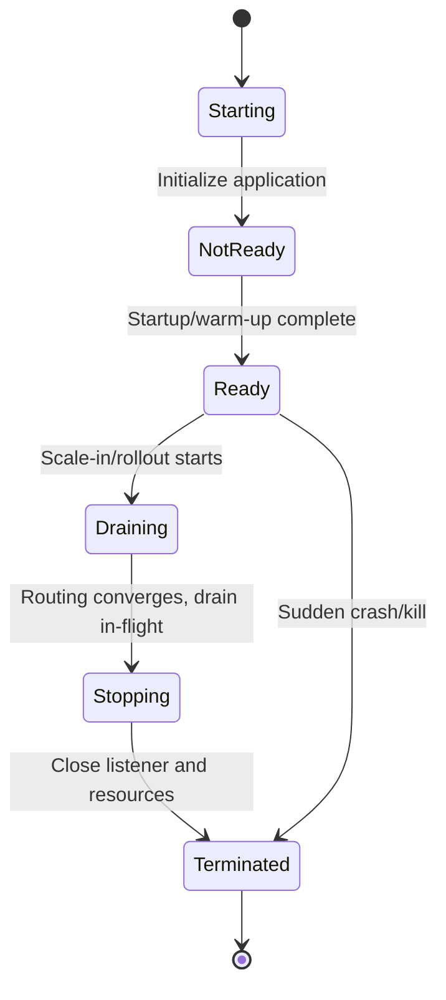
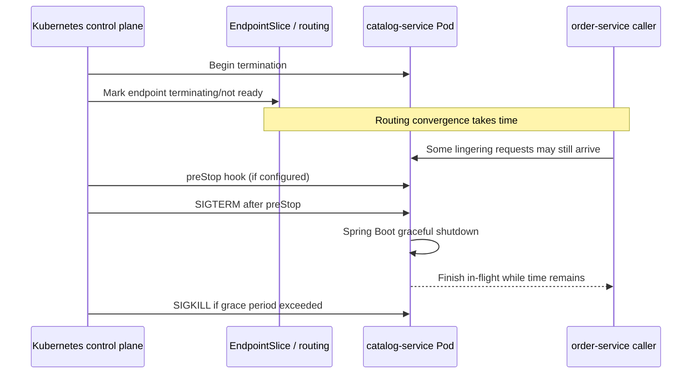
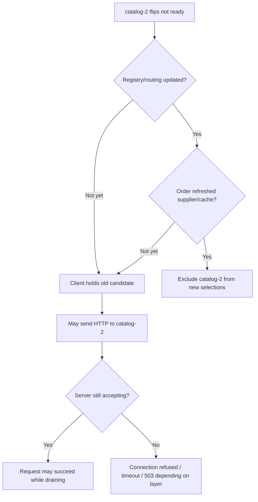

# Readiness, Graceful Shutdown, and Stopping New Incoming Requests

In a multi-replica system, an instance should neither start receiving traffic the instant the Java process boots, nor be abruptly killed while actively processing requests. When `catalog-service` is called by `order-service` through Spring Cloud LoadBalancer, rolling out a new version or scaling down the cluster requires coordinating **readiness**, **stopping new request routing**, **draining in-flight requests**, and **graceful shutdown**.

Spring Cloud LoadBalancer chooses a `ServiceInstance` based on service ID, discovery, and configured suppliers/policies. It cannot determine on its own when a business application has finished warming up, whether an active transaction can be interrupted, or that an instance must exit the candidate pool before terminating its process. That requires coordination across **the application, deployment platform, registry, LoadBalancer, and HTTP client**.

This lesson in the **Deployment** chapter examines those boundaries, shows how to configure Spring Boot Actuator, graceful shutdown, and draining workflows on Kubernetes/Eureka, and provides hands-on labs to measure convergence latency and errors during rollouts.

## 1. Distinguishing liveness, readiness, registration, and request capability

The following four signals can hold different values at the exact same moment:

| Signal | Question answered | Example |
|---|---|---|
| **Liveness** | Is the process in a state that requires restarting? | JVM/server still responsive, not stuck in an unrecoverable fault |
| **Readiness** | Is the instance ready to **accept new requests**? | Startup finished, required warm-up completed, not yet draining |
| **Registry membership** | Is discovery currently **advertising** this instance to clients? | Eureka lease active, Kubernetes EndpointSlice contains endpoint |
| **HTTP reachability & business outcome** | Can clients connect and does the API return valid responses? | TCP connects, endpoint responds within SLA |

An instance can be:

- **Alive yet not ready:** the process is warming up; the app is not ready to take traffic.
- **Registered yet not ready:** the registry is not yet synced with readiness or health checks have not applied.
- **Ready yet API failing:** the probe is too shallow, a database/queue has an isolated outage, or a specific endpoint is broken.
- **Deregistered yet still processing old requests:** normal draining is underway.
- **Dead yet still appearing in registry/caches:** abrupt crash; heartbeat/lease/eviction has not converged.

**Readiness is not a promise that "every request will definitely succeed."** It is a signal telling the routing layer to stop sending new work to an instance when inappropriate. HTTP clients still need timeouts, error classification, and bounded retry policies.

## 2. Instance lifecycle: from startup to termination

Instead of treating shutdown as a single instant event, look at the full lifecycle:



| Phase | Expected readiness | New request routing | In-flight requests |
|---|---|---|---|
| Starting | Not ready | Not sent to new instance | None or not yet served |
| Ready | Ready | May be sent | Processed normally |
| Draining | Refuses new work | Begins removal from routing | Allowed to finish within deadline |
| Stopping | Not ready | Not sent | Waited on / closed per graceful timeout |
| Terminated | Unreachable | No longer a candidate after convergence | Completed or severed at timeout |

The **danger window** lies between when an instance begins draining and when all callers/gateways stop choosing it. This interval is governed by health probes, service discovery, DNS/EndpointSlices, caches, and connection reuse.

Not every environment follows the exact chronological order in the diagram: Kubernetes may mark an endpoint terminating before the app receives `SIGTERM`, while Spring Boot normally flips readiness while closing the application context. Always inspect the event sequence of your **actual target platform** rather than assuming one universal order.

## 3. Readiness in Spring Boot Actuator

Spring Boot models `ApplicationAvailability` with two state enums:

- `LivenessState.CORRECT` / `BROKEN` representing liveness.
- `ReadinessState.ACCEPTING_TRAFFIC` / `REFUSING_TRAFFIC` representing readiness.

Actuator can expose corresponding health groups at:

```text
GET /actuator/health/liveness
GET /actuator/health/readiness
```

Illustrative `catalog-service` configuration:

```yaml
spring:
  application:
    name: catalog-service
  lifecycle:
    timeout-per-shutdown-phase: 30s

management:
  endpoint:
    health:
      probes:
        enabled: true
        add-additional-paths: true

server:
  shutdown: graceful
```

In this example, `management.endpoint.health.probes.enabled` enables probes even in environments where Kubernetes is not auto-detected; when running Spring Boot on Kubernetes, probes may be auto-enabled per platform conditions. In supported Spring Boot versions, `add-additional-paths` also exposes `/livez` and `/readyz` on the **main server port**.

You can verify with:

```powershell
Invoke-WebRequest "http://localhost:8080/readyz"
Invoke-WebRequest "http://localhost:8080/livez"
```

**Verify your Spring Boot version:** Actuator configuration and paths change if the app customizes base paths, management server port, security, or health groups. Not seeing `/readyz` does not automatically mean readiness is broken; the endpoint may simply not be exposed under your config.

### 3.1. Why probe on the same port that serves business traffic?

If Actuator runs on a **separate management port**, the health endpoint may still respond cleanly even if the main HTTP connector has stopped accepting requests. That creates a false positive for readiness.

In Kubernetes, prefer probing on the application's actual serving port whenever possible, such as `/readyz` on the main server port. If a separate management port must be used, design additional paths/health checks that verify the real listener rather than merely probing the management port.

### 3.2. Which dependencies belong in readiness?

By design, the readiness group does not need to include every dependency's health indicator. Including a database, Redis, or a third-party API in readiness can make sense **if the app genuinely cannot serve any essential traffic when that dependency fails**. However, overly broad dependencies can knock every replica out simultaneously when a shared service has an outage.

Principles:

1. **Liveness** should not depend directly on external networks/databases; a DB outage must not trigger cluster-wide restarts of healthy JVMs.
2. **Readiness** should reflect only the minimum condition required for an instance to safely take new traffic.
3. If the API can still serve partial traffic when a dependency fails, consider **degraded mode**, circuit breakers, or feature-level routing rather than marking every instance not ready.
4. Check the difference between aggregate `/actuator/health` and `/actuator/health/readiness`. The two endpoints need not share the same status.

For example, when extending the readiness group to include an internal health contributor named `criticalWarmup`, preserve `readinessState`:

```yaml
management:
  endpoint:
    health:
      group:
        readiness:
          include: readinessState,criticalWarmup
```

The configuration above works only when the `criticalWarmup` contributor is registered with that exact name. Do not add a nonexistent indicator into a lab config file and expect the app to start cleanly.

## 4. Controlling readiness when starting drain

Spring Boot updates availability state automatically during startup/shutdown. When operations need an **active drain phase prior to shutdown**, the app can also publish an event switching readiness to `REFUSING_TRAFFIC`.

Example of an internal service holding drain state:

```java
package com.example.catalog.lifecycle;

import java.util.concurrent.atomic.AtomicBoolean;

import org.springframework.boot.availability.AvailabilityChangeEvent;
import org.springframework.boot.availability.ReadinessState;
import org.springframework.context.ApplicationEventPublisher;
import org.springframework.stereotype.Component;

@Component
public class DrainCoordinator {

    private final ApplicationEventPublisher events;
    private final AtomicBoolean draining =
            new AtomicBoolean(false);

    public DrainCoordinator(ApplicationEventPublisher events) {
        this.events = events;
    }

    public void beginDrain() {
        if (draining.compareAndSet(false, true)) {
            AvailabilityChangeEvent.publish(
                    events, ReadinessState.REFUSING_TRAFFIC);
        }
    }

    public boolean isDraining() {
        return draining.get();
    }
}
```

Meaning: when an **authorized** operational component calls `beginDrain()`, readiness switches to refusing incoming traffic. This mechanism does not automatically shut down the HTTP server or delete every service discovery record. The orchestrator/LoadBalancer must **observe and react** to that signal.

**Never expose an unauthenticated HTTP endpoint allowing anyone to invoke `beginDrain()`.** If an admin mechanism is needed to initiate drain, protect it with authentication, authorization, network policies, and auditing; an internal lifecycle hook or controlled operator may be safer.

A self-managed application sequence could be:

```text
beginDrain()
  → readiness reports refusing new requests
  → wait a bounded window for routing/discovery convergence
  → wait for in-flight requests to finish
  → close application context / HTTP listener
```

If you flip readiness and **shut down the server immediately**, clients holding stale candidate lists will still send new requests to the closed instance. Having a readiness API does not automatically create a convergence wait window.

## 5. Spring Boot graceful shutdown configuration

Spring Boot supports graceful shutdown for supported embedded HTTP servers. Typical configuration:

```yaml
server:
  shutdown: graceful

spring:
  lifecycle:
    timeout-per-shutdown-phase: 30s
```

When the application shuts down via its normal lifecycle, Spring Boot coordinates stopping acceptance of new requests and allowing active requests to finish within a bounded time.

Distinguish:

- **Stop accepting new requests:** the server restricts/refuses new HTTP work according to the container's mechanics.
- **Draining in-flight:** running requests get a chance to complete before the process exits.
- **Release resources:** lifecycle-managed beans, connection pools, and resources close according to Spring context phases/order.
- **Deadline:** `timeout-per-shutdown-phase` is a budget **per shutdown phase**, not a guarantee that the entire process exits in exactly 30 seconds in all scenarios.

Servers such as Tomcat, Jetty, Reactor Netty, and Undertow differ in how they reject new connections/requests during shutdown and how they handle keep-alive, open connections, and streams. Do not assume identical TCP-level behavior across all connectors.

### 5.1. Graceful shutdown does not cover every scenario

You cannot rely on graceful shutdown when:

- The process receives `SIGKILL` or is OOM-killed.
- The machine/VM/node loses power or network connectivity.
- The orchestrator's termination grace period expires before the app finishes draining.
- A request runs longer than the deadline or a worker thread hangs.
- Discovery/gateways keep sending new traffic because convergence has not occurred.

Hence, graceful shutdown is **one layer of defense**, not a standalone guarantee of "zero downtime."

## 6. Stopping new requests is different from aborting active requests

An instance transitioning from `Ready` to `Draining` may still be processing:

- Fast requests finishing in tens of milliseconds.
- Requests calling databases/external APIs taking several seconds.
- Large data uploads/downloads.
- SSE/WebSockets or streaming responses that can stay open very long.
- Write transactions that have committed yet have not returned a response.

When defining drain policies, distinguish:

| Request group | Common handling approach |
|---|---|
| Requests not yet routed to the instance | Stop sending new requests; steer to remaining ready instances |
| Requests already picked by LoadBalancer before connection open | May fail if server closed listener; needs timeout/retry policy |
| Requests already accepted and executing | Allow completion within graceful timeout if possible |
| Requests exceeding deadline | May be aborted; must account for idempotency and business state |
| Long-lived streams/connections | Need dedicated reconnect and drain policies; do not assume streams end on their own |
| Requests arriving during stale-routing window | Either finish processing or reject cleanly per admission policy |

**Immediately rejecting all new requests with HTTP 503** the instant readiness flips is not always the best way to minimize errors. While routing has not yet converged, clients still picking the old instance will receive more 503s. Often a better strategy is **reporting not-ready, waiting for routing to stop sending traffic, and only then closing the listener**. If fail-fast in the app is required, clearly define when it activates and how callers handle 503.

For write requests, pay special attention to the case where the server **already committed** yet the client timed out or lost the response. Retrying without an idempotency key can cause duplicate writes even when deployment itself did not corrupt internal data.

## 7. Kubernetes: readiness, Service, and EndpointSlice

When running on Kubernetes, `readinessProbe` determines whether a Pod is marked ready to receive traffic through a Service. Controllers/control plane update endpoint state, while propagation to kube-proxy, ingress controllers, or external load balancers incurs latency.

When a Pod enters termination, EndpointSlice records reflect terminating state; terminating endpoints normally have `ready=false` so standard routing paths stop selecting them. However:

- Some paths have existing open connections or hold older endpoint lists.
- Gateways/ingress/external load balancers have their own refresh intervals and drain windows.
- In-flight requests may still be running.
- EndpointSlice updating does not mean every Spring Cloud LoadBalancer client has updated its snapshot immediately.



The diagram shows the main step sequence, not a promise that all network components converge before `SIGTERM`. In standard termination, the `terminationGracePeriodSeconds` clock **already starts** before `preStop` completes; `preStop` **consumes the same budget** as graceful shutdown. Budget headroom for runtime and network variance.

### 7.1. Kube Service DNS does not mean Spring Cloud LoadBalancer

A Kubernetes Service can route via DNS/virtual IP and cluster load balancing **even when the app does not use Spring Cloud LoadBalancer**.

Conversely, `@LoadBalanced WebClient/RestClient` only works when a suitable `ServiceInstanceListSupplier`/discovery is present, such as Spring Cloud Kubernetes integration or another instance source. Clarify whether the app is using:

1. A Kubernetes Service as its load-balanced target address, or
2. Spring Cloud LoadBalancer choosing a specific `ServiceInstance` from discovery.

If two routing layers are configured, know whether each layer sees **Pod IPs** or a **Service virtual IP**, and where readiness/EndpointSlices apply. Do not infer from `http://catalog-service` succeeding that Spring Cloud LoadBalancer is directly selecting Pods.

## 8. Example Kubernetes Deployment with readiness and graceful shutdown

Illustrative example (replace the image with a real artifact and verify your Spring Boot version):

```yaml
apiVersion: v1
kind: Service
metadata:
  name: catalog-service
spec:
  selector:
    app: catalog-service
  ports:
    - name: http
      port: 8080
      targetPort: http
---
apiVersion: apps/v1
kind: Deployment
metadata:
  name: catalog-service
spec:
  replicas: 3
  strategy:
    type: RollingUpdate
    rollingUpdate:
      maxSurge: 1
      maxUnavailable: 0
  selector:
    matchLabels:
      app: catalog-service
  template:
    metadata:
      labels:
        app: catalog-service
    spec:
      terminationGracePeriodSeconds: 50
      containers:
        - name: catalog
          image: example.invalid/catalog-service:1.0.0
          ports:
            - name: http
              containerPort: 8080
          env:
            - name: SERVER_PORT
              value: "8080"
            - name: SERVER_SHUTDOWN
              value: graceful
            - name: SPRING_LIFECYCLE_TIMEOUT_PER_SHUTDOWN_PHASE
              value: "30s"
            - name: MANAGEMENT_ENDPOINT_HEALTH_PROBES_ENABLED
              value: "true"
            - name: MANAGEMENT_ENDPOINT_HEALTH_PROBES_ADD_ADDITIONAL_PATHS
              value: "true"
          startupProbe:
            httpGet:
              path: /livez
              port: http
            periodSeconds: 2
            failureThreshold: 30
          readinessProbe:
            httpGet:
              path: /readyz
              port: http
            periodSeconds: 2
            timeoutSeconds: 1
            failureThreshold: 2
            successThreshold: 1
          livenessProbe:
            httpGet:
              path: /livez
              port: http
            periodSeconds: 10
            timeoutSeconds: 1
            failureThreshold: 3
          lifecycle:
            preStop:
              exec:
                command: ["/bin/sh", "-c", "sleep 10"]
```

**Notes on the numbers**:

- `terminationGracePeriodSeconds: 50` allocates an overall budget larger than 10s `preStop` plus 30s graceful shutdown, leaving headroom for variance. There is no formula saying "10+30=40 is always enough"; measure real shutdown times.
- `preStop: sleep 10` is solely an **illustrative experiment** creating a gap for routing convergence before `SIGTERM`. `sleep` itself **does not alter Spring Boot's internal readiness state**; Kubernetes marking the endpoint terminating is a separate mechanism. This does not guarantee all ingress/clients stopped sending traffic.
- If the container uses a `distroless` image lacking `/bin/sh`, the hook above will not run as intended; use a hook or drain mechanism compatible with the actual image.
- `maxUnavailable: 0` and `maxSurge: 1` help rollouts keep ready replicas available when possible, yet **do not guarantee zero network errors or absolute zero-downtime**. If the new version never becomes ready, the rollout can stall.
- `example.invalid/catalog-service:1.0.0` is a **placeholder**, not a pullable image. Replace it with an image from an authorized registry.
- The readiness probe runs on the **main HTTP port**, reducing the risk of a management port looking healthy while the API port is failing.

### 8.1. When is preStop logic more active than sleep needed?

For apps with custom drain workflows, `preStop` can invoke a **secured admin action** to flip readiness and wait out convergence before allowing `SIGTERM` to hit the process. Never open an unauthenticated drain endpoint or let arbitrary Pods/tenants alter each other's serving status.

Before adding complex hooks, measure whether EndpointSlice termination and default graceful shutdown already meet your SLOs. Multiple independent drain layers with mismatched timers can cause the process to get `SIGKILL`ed while in-flight requests are still running.

## 9. Eureka: deregistration is not the same as readiness

If a system does not run on Kubernetes or uses Eureka as the instance source for Spring Cloud LoadBalancer, the lifecycle differs.

Example Eureka client:

```yaml
spring:
  application:
    name: catalog-service

eureka:
  client:
    service-url:
      defaultZone: http://localhost:8761/eureka/
    healthcheck:
      enabled: true
  instance:
    prefer-ip-address: true
```

In matching Spring Cloud Netflix versions, `eureka.client.healthcheck.enabled` integrates application health into the status advertised to Eureka. However, **do not conclude** it automatically applies `/actuator/health/readiness` semantics or performs full draining before shutdown: how health/status maps depends on the Eureka client, Spring Boot Actuator, and configuration.

Specifically:

- **Eureka status UP** does not necessarily equal `ReadinessState.ACCEPTING_TRAFFIC`.
- Deregistering on normal context close takes time to reach the registry and fetching clients.
- When a process dies abruptly, heartbeats stop and the registry relies on leases/eviction, which can be delayed by self-preservation.
- A client may retain a **stale registry snapshot** even after Eureka server has updated.
- Spring Cloud LoadBalancer may have its **own candidate cache** downstream of the Eureka client.

For strict drain requirements, establish a tested operational procedure to stop advertising/mark the instance ineligible before closing the listener, or use `HealthCheckServiceInstanceListSupplier` on the caller. Both have convergence delays and do not replace graceful handling of in-flight requests.

## 10. Why can LoadBalancer still pick a draining instance?

Suppose `catalog-2` transitions readiness to not ready at `T0`. Before `T0`, Order cached:

```text
catalog-service:
  catalog-1: ready
  catalog-2: ready
  catalog-3: ready
```

For a brief window after `T0`, Order may still select `catalog-2` when:

1. Discovery client has not yet fetched the new state.
2. `ServiceInstanceListSupplier` is serving an older snapshot.
3. LoadBalancer cache has not hit TTL or refreshed.
4. Health-aware supplier has not executed its next probe.
5. Retries or sticky routing still carry the old instance reference.
6. Another client in the cluster has its own refresh cycle.



**Note on caching:** disabling Spring Cloud LoadBalancer caching does not disable Eureka's client cache or eliminate EndpointSlice/ingress propagation lag. Increasing refresh frequency shrinks one lag component at the cost of higher registry load; identify bottlenecks with metrics.

### 10.1. Does HealthCheckServiceInstanceListSupplier help?

When **explicitly configured**, a health-check supplier can probe instances and filter out failing ones. However:

- It is not enabled automatically merely because Catalog has Actuator.
- Probe endpoints/intervals/timeouts must match the app and network policies.
- Health checking also has a refresh window; it does not guarantee instant detection.
- It filters lists **on the caller side**, without necessarily modifying the Eureka server or Pod endpoints.
- Do not confuse a simple health probe with ability to complete every business request.

Thus, server readiness, registry membership, and LoadBalancer health filtering **complement one another**, rather than being the same mechanism.

## 11. HTTP client behavior during the drain window

During the transition window, `RestClient`, `WebClient`, and OpenFeign can all pick an instance still in their snapshot and hit transport failures.

| Client | Common style | Risks to watch |
|---|---|---|
| `RestClient` / `RestTemplate` | Blocking | Threads blocked waiting on connect/read timeouts, stale addresses |
| `WebClient` | Reactive, typically non-blocking I/O | In-flight requests, connection pools, cancellation, event loop |
| OpenFeign | Declarative interface, typically blocking | `ErrorDecoder`/`FeignException`, retryer, and transport timeouts |

Example RestClient calling a service ID:

```java
@LoadBalanced
@Bean
RestClient.Builder loadBalancedRestClientBuilder() {
    return RestClient.builder();
}
```

```java
ProductResponse product = restClient.get()
        .uri("http://catalog-service/api/products/{id}", id)
        .retrieve()
        .body(ProductResponse.class);
```

Here `restClient` must be built from the `@LoadBalanced` builder; `ProductResponse` is the application DTO. If the chosen instance has already closed its listener, the call may fail **before receiving any HTTP response**; do not misinterpret that as a product HTTP `404`.

### 11.1. Retries during rollouts: re-selecting without guaranteeing a different instance

Retries can reduce surface errors for safe reads, yet can also:

- Repeat the same instance if discovery/cache is still stale.
- Pick another instance only when policy and request context allow.
- Amplify request volume onto surviving instances right after scale-in.
- Stretch a logical request past its deadline.
- Duplicate side-effecting operations if the server already committed and the response was lost.

Hence, enforce clear timeouts, bounded retries, appropriate backoff/jitter, and **idempotency** for writes. Never enable unbounded retries to mask an unsynchronized drain process.

## 12. Designing an end-to-end time budget

A request during draining can face multiple delays at once:

```text
T_request =
  time waiting for slot/connection
  + time choosing instance
  + connect
  + waiting for response/body
  + (retry attempts + backoff if any)
```

This is a **cost breakdown**, not a guarantee that steps happen strictly sequentially without overlap. With `WebClient` and HTTP/2, connection and stream semantics also differ from HTTP/1.1.

In deployment, we also have:

```text
T_termination_budget >=
  T_preStop
  + T_time_for_application_shutdown
  + safety_margin
```

Do not mechanically add default constants. Readiness/EndpointSlice propagation lag, remaining in-flight times, and shutdown phases fluctuate. **Base budgets on p99/p99.9 request durations and real rollout tests**, especially when long operations exist.

Hypothetical example:

| Component | Illustrative budget |
|---|---:|
| Wait for propagation in preStop | 10 seconds |
| Spring graceful shutdown per phase | 30 seconds |
| Headroom for runtime/termination | 10 seconds |
| Termination grace period | 50 seconds |

These numbers are solely for reading the manifest in section 8; they are not universal defaults for every system.

## 13. Long requests, WebSockets, SSE, and reused connections

Not every connection finishes quickly. A streaming HTTP request may run for minutes; a WebSocket may stay open for hours.

In those cases, simply setting a 30-second graceful timeout means:

- The server must close unfinished streams once the deadline expires.
- Clients must reconnect and resume streams by offset/event ID if the protocol supports it.
- Sessions or subscriptions must transition state cleanly and release resources.
- Keep-alive/connection pools can keep open connections alive even after an endpoint leaves routing.
- HTTP/2 can multiplex many streams over one connection; drain behavior depends on connector and implementation.

Explicitly define **connection draining** policies, max stream lifetimes, reconnect behavior, and ordering/idempotency guarantees. Do not assume setting readiness to false automatically closes existing connections or drains every stream cleanly.

## 14. Deployment runbook: add new replicas, then drain old ones

A rolling deployment procedure can follow:

1. **Build and preflight:** maintain HTTP contract compatibility between old and new versions, verify service ID/discovery config.
2. **Start new replicas:** process is `Starting`; probe is not yet `Ready`, so no traffic is routed.
3. **Warm-up:** connect DBs, prime essential caches, load minimal state; keep liveness decoupled from all external dependencies.
4. **Ready:** Actuator and platform record the instance as eligible; after propagation, LoadBalancer/gateway can select it.
5. **Observe:** check error rates, latency, request volume, and readiness per replica/release before advancing.
6. **Start draining old replicas:** mark not ready or terminating in the platform; stop assigning new work once routing converges.
7. **Wait for convergence and in-flight completion:** ensure sufficient termination budget without cutting requests prematurely.
8. **Graceful shutdown:** stop listeners and close resources.
9. **Verify:** old instances are no longer selected; new requests succeed across remaining replicas.
10. **Rollback if needed:** if new replicas fail readiness or error rates climb, halt draining old capacity and revert per rollout policy.

**Do not confuse a rollout with a simple scale-in:** when old and new versions run side-by-side, API compatibility, session affinity, data schemas, event formats, and shared databases all matter. A proper drain workflow cannot save a new version that breaks API contracts.

### 14.1. Deployment strategy and capacity

With Kubernetes:

```yaml
strategy:
  type: RollingUpdate
  rollingUpdate:
    maxSurge: 1
    maxUnavailable: 0
```

This configuration helps retain ready replicas while adding new ones, though if new replicas never become ready the rollout stalls. Beyond replica counts, account for CPU, database connections, downstream concurrency, and rate limits: removing an instance lowers total capacity and can overload surviving replicas even when all readiness checks report `UP`.

## 15. Which signals confirm a drain succeeded?

A dashboard showing only Ready Pod count is insufficient. Track distinct milestones:

| Milestone | Question | Data source |
|---|---|---|
| D0 | When did rollout/termination begin? | Deployment/pod events, operator logs |
| D1 | When did the instance report not ready? | `/readyz` or Availability events |
| D2 | When did registry/EndpointSlice stop treating it as ready? | Eureka/Kubernetes |
| D3 | When did callers stop seeing it in candidate lists? | DiscoveryClient/supplier debug |
| D4 | When did LoadBalancer last select this instance? | Client spans/logs or selection events |
| D5 | When did the last in-flight request finish? | Server in-flight metrics/tracing |
| D6 | When did the HTTP listener/process stop? | Spring shutdown logs, Pod events |

**Milestones need not follow a single strict order** across distributed systems and concurrent requests. For example, a request chosen before D2 may finish after D2; D4 may still occur after readiness turns false due to stale caches.

Suggested metrics:

- `ready_pods`/`available_replicas` by deployment.
- In-flight requests on Catalog, p95/p99 latency, and open connection counts.
- HTTP success/4xx/5xx, timeouts, connection resets/refused by logical downstream.
- LoadBalancer zero-instance selection errors and total retry attempts.
- Intervals D1→D3/D4, D4→D5, and D0→D6 per rollout.

Do not attach `traceId`, request ID, raw URLs, or every ephemeral instance ID as labels on **every metric**, as cardinality can explode. Use service ID/operation/status families for aggregate metrics and put selected instances into **sampled structured logs/spans** when investigating specific requests.

## 16. Lab A — Checking readiness before and after app startup

Prepare a `catalog-service` with Spring Boot Actuator, port `8080`, and the probe configuration from section 3. Start the process and test:

```powershell
Invoke-WebRequest "http://localhost:8080/livez"
Invoke-WebRequest "http://localhost:8080/readyz"
Invoke-WebRequest "http://localhost:8080/actuator/health/readiness"
```

Observe:

- Before the app starts listening, connections fail; **do not** interpret an unreachable port as `REFUSING_TRAFFIC` readiness state, since the HTTP server has not opened yet.
- Once startup completes, readiness transitions to accepting traffic and endpoints return corresponding healthy statuses.
- When readiness is flipped to `REFUSING_TRAFFIC` by a management mechanism, probes typically return unhealthy status (e.g., HTTP 503) while the process remains alive.
- If using a separate management port or Spring Security, verify paths and access permissions accordingly.

Never use a failed `GET /readyz` to automatically restart a process; readiness is primarily a signal to **stop new routing**, whereas restarts belong to liveness/other conditions.

## 17. Lab B — Rolling update under continuous load

In a **test cluster** running the manifest from section 8 with a real image and Order connected properly, check baseline state:

```powershell
kubectl get deployment catalog-service
kubectl get pods -l app=catalog-service -o wide
kubectl get endpointslice -l kubernetes.io/service-name=catalog-service
```

Start a bounded load generator against Order's endpoint. For instance, if Order is port-forwarded on `localhost:8090`:

```powershell
$endpoint = "http://localhost:8090/api/orders/check/42"
while ($true) {
    $sw = [System.Diagnostics.Stopwatch]::StartNew()
    try {
        $result = Invoke-RestMethod -Uri $endpoint -TimeoutSec 4
        "{0:o} OK {1} {2}ms" -f (Get-Date),
            $result.servedBy, $sw.ElapsedMilliseconds
    }
    catch {
        "{0:o} ERROR {1} {2}ms" -f (Get-Date),
            $_.Exception.GetType().Name, $sw.ElapsedMilliseconds
    }
    Start-Sleep -Milliseconds 100
}
```

`order-service` and `/api/orders/check/42` are **hypothetical lab components** that must exist before running the script. `Ctrl+C` stops the loop. Never run infinite loops against production or send traffic to environments outside your authorization.

In another terminal, trigger a controlled rollout:

```powershell
kubectl rollout restart deployment/catalog-service
kubectl rollout status deployment/catalog-service
kubectl get pods -l app=catalog-service -w
```

Open one more terminal to watch EndpointSlices:

```powershell
kubectl get endpointslice -l kubernetes.io/service-name=catalog-service -w
```

Note timestamps when new Pods turn `Ready`, old Pods turn `Terminating`, and lingering errors or calls still hit old instances. `kubectl get ... -w` shows object updates, not whether every ingress/proxy or Spring Cloud LoadBalancer client has converged; combine it with HTTP logs/traces.

Compare one rollout **with `preStop` sleep** and one **without** (in the lab) if you need to demonstrate propagation delay. Keep replica count, workload, retries, timeouts, and code version identical in the comparison so causes are not mixed.

## 18. Lab C — Distinguishing graceful stop from abrupt termination

In a test environment, compare two scenarios:

**Scenario 1: Normal rolling termination.** The Pod is marked terminating, `preStop` runs if configured, kubelet sends SIGTERM, the app shuts down gracefully, and the process exits.

**Scenario 2: Controlled abrupt crash/kill.** The process is terminated before normal draining and deregistration execute. Run this only on authorized lab workloads; never run it on production or shared Pods.

| Condition | Graceful termination | Abrupt stop |
|---|---|---|
| Report not ready/terminating | Usually has opportunity | May have none |
| Wait for routing convergence | Configurable | Virtually none |
| In-flight requests | Given chance to finish | Easily severed |
| Registry/discovery | Usually updates/deregisters cleanly | May stay stale until heartbeat/lease expires |
| Observed errors | Can still occur in transition window | Typically higher |
| Root-cause clarity | Clearer timeline | Needs logs/traces to distinguish |

The goal is not to prove graceful shutdown never errors, but to **measure** how much it reduces aborted requests, transport errors, and stale-instance selections.

## 19. Scenarios to test automatically

A rigorous test suite separates **state unit tests**, **HTTP integration tests**, and **real rollout tests**.

| Scenario | Input or action | What to verify |
|---|---|---|
| Startup incomplete | Instance warming up | Readiness does not admit traffic |
| Startup complete | App transitions to `ACCEPTING_TRAFFIC` | Readiness succeeds |
| Begin drain | Invoke authorized drain mechanism | Readiness flips to refusing; liveness stays healthy |
| In-flight request | Controlled slow request | Given opportunity to finish before deadline |
| New request after routing converges | Instance removed | Draining instance no longer selected |
| Stale client snapshot | Supplier still holds old instance | Errors categorized cleanly; retries stay bounded |
| Zero ready instances | Empty candidate list | No HTTP sent to bogus hosts; proper dependency error reported |
| Scale-out | Add new replica under load | New instance receives traffic only after readiness conditions pass |
| Scale-in | Remove one replica under load | Measure D1–D6, error count, final request |
| Crash | Forced termination | Identify stale window and recovery |
| Long streaming | SSE/WebSocket/long requests | Clear reconnect or termination policy |
| Write retry | Simulated timeout after commit | No duplicate records created when idempotency key is used |

With `WebClient`, `StepVerifier` fits reactive pipelines and cancellation; `StepVerifier.withVirtualTime` fits Reactor `timeout`/`Retry.backoff`. **Never use virtual time to simulate real DNS, TCP, Kubernetes EndpointSlice, or Eureka lease convergence.**

For a custom `ServiceInstanceListSupplier`, immutable snapshots or fake discovery can assert that once an instance is marked removed, selections from the **updated snapshot** never pick it again. That still does not prove real-world registry/ingress convergence latency.

## 20. Common deployment failures

| Symptom | Common root cause | Fix |
|---|---|---|
| Pod alive yet receives no requests | Readiness false, warm-up incomplete, wrong probe path/port | Check readiness endpoint and Pod events |
| Pod has `Ready=true` yet HTTP fails | Probe too shallow or on different port from API | Probe main port; check API/dependencies |
| Instance not ready yet caller still picks it | Stale discovery/cache, health filter not refreshed | Measure D1–D4, inspect each refresh layer |
| `server.shutdown=graceful` yet still connection refused | Listener closed before waiting for routing convergence | Adjust termination workflow and grace budget |
| Pod gets SIGKILL while requests remain | Grace period too short or preStop consumes too much time | Measure in-flight times and shutdown phases |
| Rollout stalls | New instance fails readiness with `maxUnavailable=0` | Check startup/warm-up, image, probes, and resource limits |
| Whole cluster unready when DB slows | Readiness depends too broadly on DB | Evaluate degraded mode and dependency policy |
| Mass restarts when DB fails | Liveness depends on external DB | Decouple liveness from external dependencies |
| p95 climbs after scale-in | Capacity lost; retries amplify load | Ensure headroom, lower concurrency/retries |
| HTTP 503 with unclear origin | Server, gateway, or no-instance can all return 503 | Trace originating layer and selected instance |
| Still hits old instance despite TTL change | Multiple cache/fetch/ingress layers exist | Diagnose registry→supplier→HTTP chain |
| Long streams cut off | Drain deadline ignores long-lived connections | Design dedicated reconnect/connection draining |

## 21. Pre-rollout production checklist

**Application:**

- [ ] `/readyz` and `/livez` have distinct meanings; readiness is not confused with liveness.
- [ ] Probes hit a path/port representative of the business HTTP server.
- [ ] Graceful shutdown is enabled with timeouts suited to p99 requests/streams.
- [ ] No unauthenticated endpoints allow changing readiness/drain state.
- [ ] Idempotency protection exists for retried write operations.
- [ ] In-flight requests, errors, and shutdown states are observable.

**Discovery and LoadBalancer:**

- [ ] Real instance source is known (Eureka, Kubernetes discovery, DNS Service, or static supplier).
- [ ] Registry refresh lag, caching, health filtering, and instance selection rules are understood.
- [ ] Callers enforce timeout/retry budgets without infinite retries during scale-in.
- [ ] Selected instance can be identified for any failed request.
- [ ] Never assume a still-registered `ServiceInstance` is ready.

**Deployment platform:**

- [ ] Readiness/liveness/startup probes are properly tuned.
- [ ] Rolling updates do not drop too much capacity while new instances warm up.
- [ ] Termination grace period covers `preStop`, propagation, graceful phases, and headroom.
- [ ] Drain workflows exist for SSE/WebSockets or long requests.
- [ ] Tested rolling termination, abrupt failure, and rollback under load.
- [ ] Dashboards/D0–D6 timelines exist for incident analysis.

## 22. Key takeaways

**Readiness answers "should new requests be sent here?"; graceful shutdown answers "can already-accepted requests finish cleanly?"; and stopping new traffic requires discovery, ingress/Service, and LoadBalancer to actually converge.** These three mechanisms complement rather than replace each other.

With Spring Cloud LoadBalancer, safe scale-in requires transitioning an instance to not ready, letting callers stop choosing it, allowing time for in-flight requests, and then closing the server. `ServiceInstanceListSupplier` may still hold an older snapshot; `RestClient`, `WebClient`, and OpenFeign still need timeouts, bounded retries, and transport error handling. Practicing rollouts under load and measuring readiness, candidate lists, final request completion, and graceful deadlines is how you verify real-world system stability.
