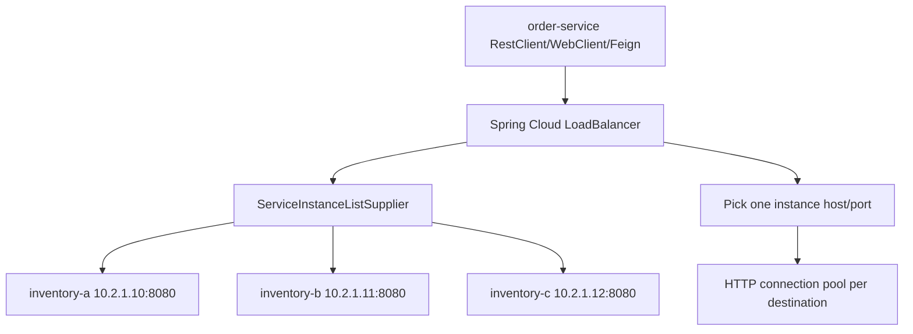
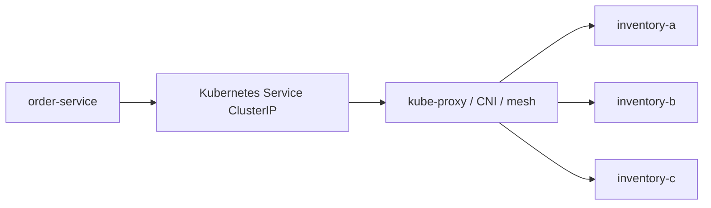
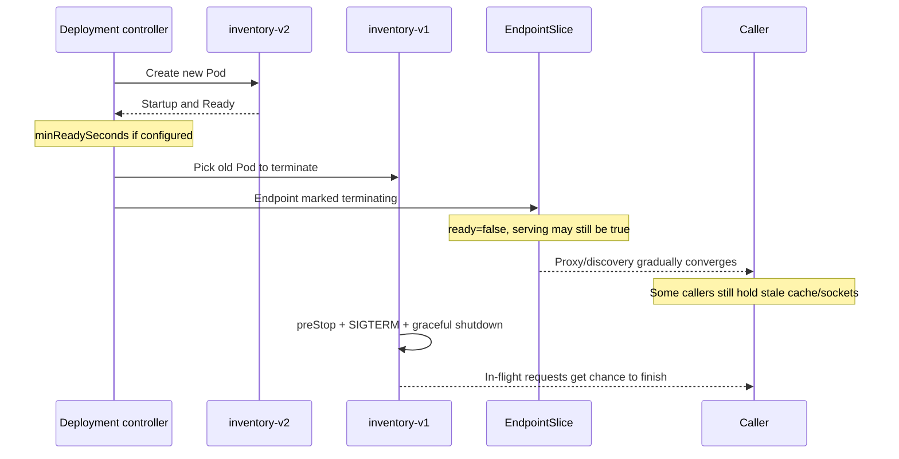
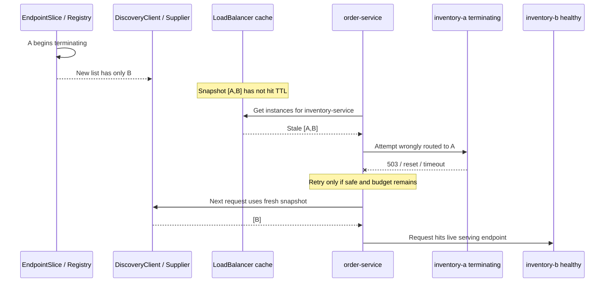
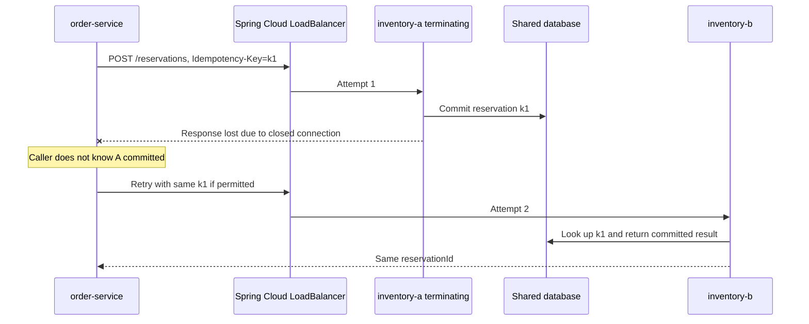

# Rolling Updates, Scale-Down, and In-Flight Requests

In Spring Cloud LoadBalancer, a call to `http://inventory-service/api/items/42` is handled by picking a `ServiceInstance` by service ID, after which the HTTP client connects to the real host/port. When Kubernetes deploys a new version (**rolling update**) or reduces replica counts (**scale-down**), the endpoint list changes while older requests and keep-alive connections may still be active. Without a drain plan, callers can suffer HTTP 503/504, `Connection reset`, stale discovery, or even duplicate execution of a business command after retries.

This lesson belongs to the **Deployment** chapter of the **Spring Cloud Service Communication Load Balancing** module. The topic is **Rolling updates, scale-down, and in-flight requests**: coordinating Spring Boot graceful shutdown with Kubernetes readiness/EndpointSlices, bounding retries and timeouts, managing connections for `RestClient`, `WebClient`, and OpenFeign, along with testing and observability. The principles also apply to VMs and other service registries even though the examples use Kubernetes.

## 1. Lesson objectives

After this lesson, you should be able to:

1. Distinguish rolling updates from scale-down, readiness from liveness, and graceful shutdown from abrupt process termination.
2. Understand that a `Terminating` Pod can still be finishing HTTP requests while its EndpointSlice signals that it should not receive new traffic.
3. Identify whether routing decisions are made by Spring Cloud LoadBalancer picking Pod IPs or by a Kubernetes Service/mesh picking Pods.
4. Coordinate `maxSurge`, `maxUnavailable`, `terminationGracePeriodSeconds`, `preStop`, and Spring Boot shutdown timeouts.
5. Shrink the window of selecting stale instances from discovery/caches or stale connections from HTTP pools.
6. Choose safe retry and idempotency policies when requests are interrupted mid-rollout.
7. Contain scale-down impact on capacity/p99 without triggering retry storms into the few remaining replicas.
8. Write hands-on tests measuring in-flight requests, instance selection, transport failures, and business side effects.

A rollout completing in the control plane **is not enough** to prove zero dropped requests. Correct behavior must be measured via logs, traces, outbound attempts, backend received requests, and business outcomes.

## 2. Identifying who performs load balancing

### 2.1. Spring Cloud LoadBalancer selects Pod IPs directly

If the caller's discovery source returns three Pod instances, LoadBalancer selects a `ServiceInstance` for each HTTP exchange:



In this architecture, the discovery source, cache, and health supplier directly determine how fast the caller **stops selecting old Pods** after they leave endpoints.

### 2.2. HTTP client calls Kubernetes ClusterIP

If the caller calls Service hostname `inventory-service.default.svc.cluster.local` and TCP connections go to the Kubernetes Service IP, the kube-proxy/eBPF dataplane or service mesh typically chooses the backend Pod.



In this model Spring Cloud LoadBalancer **does not need** to know Pod IPs; if a client attaches an LB supplier seeing only the ClusterIP as one virtual endpoint, Java round-robin does not govern which exact Pod receives requests. Never confuse Spring Cloud routing with load balancing performed by Kubernetes Services or meshes.

| Question | Spring Cloud LB picking Pod IPs | Via Service ClusterIP |
|---|---|---|
| Where is the Pod list? | DiscoveryClient/supplier/cache in Java | EndpointSlices and dataplane |
| What must update when a Pod is removed? | Caller's instance list source | Service endpoints/routing state |
| Which target do sockets hold? | Usually real Pod `host:port` | May hold routes/conntrack to old backends |
| Which logs/metrics to inspect? | LB selected instance + HTTP pool + server | EndpointSlice/proxy/mesh + HTTP pool + server |
| Can stale routes occur? | Yes | Yes |

**Step 0 when troubleshooting:** verify whether the HTTP client has a `@LoadBalanced` bean, whether the supplier returns Pod IPs or a Service IP, whether a sidecar/proxy is present, and which hops requests traverse.

## 3. Rolling updates and the Available concept

A Deployment with `strategy.type=RollingUpdate` replaces old Pods with new Pods according to two parameters:

| Parameter | Role | Example |
|---|---|---|
| `replicas` | Desired Pod count | 3 |
| `maxSurge` | Extra Pods allowed during rolling update | 1 |
| `maxUnavailable` | Pods allowed to be unavailable during rolling update | 0 |
| `minReadySeconds` | Time a Pod must stay Ready before counting as Available | 5 |
| `progressDeadlineSeconds` | Deadline for the Deployment to show progress | 300 |

Kubernetes defaults to `25%` for both `maxSurge` and `maxUnavailable`. With percentages, `maxSurge` rounds **up** and `maxUnavailable` rounds **down**. With `replicas=3`, `maxSurge=1`, `maxUnavailable=0`, the controller can create a new replica to keep Available Pods steady before removing an old replica, **provided** the cluster has resources and readiness probes are accurate.



**This is a conceptual timeline.** In Kubernetes, EndpointSlice updates and shutdown signals happen asynchronously, with no barrier guaranteeing every client forgets the old Pod before its listener closes.

### 3.1. What maxSurge/maxUnavailable do not guarantee

- They do not guarantee **every HTTP request** succeeds while endpoint propagation lags.
- They do not guarantee old and new versions are compatible on APIs, schemas, upload state, or cursors.
- They do not directly cap how many **Terminating** Pods are still consuming CPU/RAM at a given instant.
- They apply to **Deployment rolling updates**, not as a general blocker against HPA scale-downs.
- When CPU/RAM/node capacity is tight, new Pods can sit in `Pending`, stalling the rollout despite valid counts.

## 4. What steps occur when a Pod terminates?

When a controller deletes a Pod during a rolling update or scale-down:

1. The API server sets `deletionTimestamp` and the grace period. The Pod transitions to `Terminating`.
2. EndpointSlices are updated to reflect the terminating endpoint.
3. Kubelet starts termination; `preStop` executes before TERM if declared and grace period is non-zero.
4. The runtime sends `SIGTERM` to the container's main process (details depend on runtime/entrypoint).
5. The Spring application context closes cleanly; the HTTP server stops accepting new requests and waits for active ones within its budget.
6. When the grace period expires, any remaining process may receive `SIGKILL` and be forcibly killed.

`preStop` **consumes** time out of `terminationGracePeriodSeconds`; do not treat a 10-second hook as **added on top of** 60 seconds for the JVM. Kubernetes offers a tiny extension if a hook is still running near the end, yet never rely on that to finish business requests.

### 4.1. EndpointSlice has three key conditions

| Condition | Meaning |
|---|---|
| `terminating` | Endpoint belongs to a Pod being deleted |
| `ready` | Usually indicates ability to serve **and not terminating** |
| `serving` | Endpoint can still serve/drain even while terminating |

When a Pod is Terminating, `ready=false` is normal so standard consumers stop routing new traffic to it. `serving` can remain true until the app stops serving. Kubernetes service proxies typically skip terminating endpoints, though documentation permits traffic to endpoints that are both `serving` and `terminating` **when every remaining endpoint is terminating**. Exceptions exist around Service `publishNotReadyAddresses`, so never treat a single flag as absolute proof.

### 4.2. Readiness is not liveness

**Readiness:** should it accept new business traffic?

**Liveness:** does the process need to be restarted?

A slow database may warrant adjusting readiness per policy, yet should not fail liveness by default. If every Pod restarts simultaneously over a slow dependency, the cluster loses capacity and risks a restart storm. To drain cleanly, rely on readiness/EndpointSlices and graceful shutdown rather than forcing liveness probes to fail so Kubernetes kills the Pod.

## 5. What kinds of requests are in flight when a Pod is removed?

| Workload | Problem during termination | Primary solution |
|---|---|---|
| Short `GET`/`POST` | TCP reset or response lost before caller receives it | Graceful shutdown + deadlines + idempotency |
| Slow 5–30s API | Pod runs out of grace before completion | Measure p99, cap concurrency, adequate grace or async |
| Large download | Partial file transfer lost | `Range`/`If-Range`/`ETag` and checksums |
| Large upload | Unreplayable body, partial object | Upload ID, chunks/checksums, and shared staging |
| SSE/WebSocket | Streams can stay open for hours | Reconnect + event ID/offset/replay |
| Async export/job | Process dies mid-job | Job ID, durable state, checkpoint/resume |
| Message consumer | Message read but not yet acked/committed | Stop polling, drain batch, ack per contract |
| Committed transaction | Response lost; retry could commit again | Server-side idempotency/dedup |

Embedded HTTP server graceful shutdown cannot finish an **unbounded** stream or a job outliving Pod grace. Those workflows must be **resumable on another replica** via shared state.

## 6. Spring Boot graceful shutdown

Recent Spring Boot versions support graceful shutdown for embedded Tomcat, Jetty, and Reactor Netty; current docs note it is **enabled by default**, whereas some Boot 3.x setups require explicit configuration. To state intent clearly and test per version, declare:

```yaml
server:
  port: 8080
  shutdown: graceful

spring:
  lifecycle:
    timeout-per-shutdown-phase: 40s

management:
  endpoint:
    health:
      probes:
        enabled: true
        add-additional-paths: true
```

- `server.shutdown: graceful`: avoids abruptly tearing down the HTTP server when the Spring context closes.
- `spring.lifecycle.timeout-per-shutdown-phase: 40s`: budget **per `SmartLifecycle` phase** during shutdown; **not** a guarantee that total process exit takes under 40 seconds.
- `management.endpoint.health.probes.enabled`: enables readiness/liveness probes.
- `add-additional-paths: true`: exposes `/readyz` and `/livez` on the **main server port**, helpful when the management port differs from the app port.

If the HTTP server already closed its listener while a separate management port still returns 200, probes on the management port alone misrepresent the main port's serving state. Probe the traffic-serving port whenever feasible.

### 6.1. Why must SIGTERM reach the JVM?

If container PID 1 is a shell script that does not forward signals, the Java process may never receive TERM on time. Kubernetes will still expire the grace period and kill the container even with `server.shutdown=graceful` configured. Use an exec-form entrypoint and verify actual signal delivery during deployment.

### 6.2. `@PreDestroy` is not the whole drain solution

`@PreDestroy` suits resource cleanup, yet never put `Thread.sleep(30_000)` there assuming all requests are protected. That callback can stall closing other beans while eating up grace period. For Kafka consumers/schedulers, use `SmartLifecycle`, bounded draining, and explicit checkpointing; HTTP graceful shutdown does not automatically drain all background tasks.

## 7. Sample Deployment manifest

Below is an illustrative lab manifest; replace image, resources, and probes per environment:

```yaml
apiVersion: apps/v1
kind: Deployment
metadata:
  name: inventory-service
spec:
  replicas: 3
  minReadySeconds: 5
  progressDeadlineSeconds: 300
  strategy:
    type: RollingUpdate
    rollingUpdate:
      maxSurge: 1
      maxUnavailable: 0
  selector:
    matchLabels:
      app: inventory-service
  template:
    metadata:
      labels:
        app: inventory-service
    spec:
      terminationGracePeriodSeconds: 60
      containers:
        - name: inventory
          image: registry.example.com/inventory-service:v2
          imagePullPolicy: IfNotPresent
          ports:
            - name: http
              containerPort: 8080
          resources:
            requests:
              cpu: "250m"
              memory: "512Mi"
            limits:
              memory: "1Gi"
          startupProbe:
            httpGet:
              path: /livez
              port: http
            periodSeconds: 5
            failureThreshold: 30
          readinessProbe:
            httpGet:
              path: /readyz
              port: http
            periodSeconds: 5
            timeoutSeconds: 2
            failureThreshold: 2
          livenessProbe:
            httpGet:
              path: /livez
              port: http
            periodSeconds: 10
            timeoutSeconds: 2
            failureThreshold: 3
          lifecycle:
            preStop:
              exec:
                command: ["/bin/sh", "-c", "sleep 8"]
---
apiVersion: v1
kind: Service
metadata:
  name: inventory-service
spec:
  selector:
    app: inventory-service
  ports:
    - name: http
      port: 80
      targetPort: http
  type: ClusterIP
```

**Understanding the example properly:**

1. `/livez` and `/readyz` must exist on port `8080` via Spring Boot Actuator additional paths. Otherwise readiness fails and rollout stalls.
2. `preStop sleep 8` is **one option to leave a propagation buffer for endpoints/discovery**, not a mandatory formula. On distroless images lacking `/bin/sh`/`sleep`, this `exec` hook fails; use a compatible mechanism or omit the hook.
3. Those 8 seconds of sleep count **inside** the 60-second grace period, leaving roughly 52 theoretical seconds for TERM + shutdown + overhead. Measure before finalizing.
4. `maxUnavailable=0` and `maxSurge=1` require the cluster to have room for an extra Pod during rollout.
5. Spring Boot graceful shutdown may reject new requests immediately upon SIGTERM; `preStop` is sometimes used to shrink the stale-endpoint window beforehand, yet never guarantees every client stops sending on time.
6. This is a lab manifest only: production needs security contexts, pod topology spread, alerts, storage, and network policies.

## 8. Transitioning readiness to refusing traffic

Spring Boot provides `AvailabilityChangeEvent` when an app must flip readiness to `REFUSING_TRAFFIC` during a **proactive pre-shutdown drain**:

```java
import org.springframework.boot.availability.AvailabilityChangeEvent;
import org.springframework.boot.availability.ReadinessState;
import org.springframework.context.ApplicationContext;
import org.springframework.stereotype.Component;

@Component
class ReadinessDrainControl {

    private final ApplicationContext context;

    ReadinessDrainControl(ApplicationContext context) {
        this.context = context;
    }

    void stopAcceptingNewWork() {
        AvailabilityChangeEvent.publish(
                context,
                ReadinessState.REFUSING_TRAFFIC);
    }
}
```

This is an **internal control point**, not a public HTTP endpoint. If exposing a drain API, protect it with authentication/authorization and network controls. When a Kubernetes Pod already has `deletionTimestamp`, EndpointSlices mark the endpoint terminating/`ready=false` automatically; adding a custom drain API is not mandatory for every app.

When self-draining before termination, wait for **infrastructure/callers to converge** before closing the HTTP listener. Flipping readiness instantly in the JVM does not update every caller's cache/discovery instantly.

## 9. Scale-down differs from rolling update

Scaling down from 5 replicas to 2 creates no replacement Pods; the remaining Pods take higher traffic.

Suppose total load is 500 requests/second split evenly across Pods:

\[
\lambda_{\text{before, per Pod}} \approx \frac{500}{5}=100\ \text{req/s}
\]

\[
\lambda_{\text{after, per Pod}} \approx \frac{500}{2}=250\ \text{req/s}
\]

If each Pod only meets its SLO up to 150 req/s, scaling down to two Pods can spike p99 or cause timeouts even when termination drained cleanly. These numbers are illustrative; determine limits from load tests, request mix, CPU/DB pools, and real distribution.

By Little's Law, average concurrent requests are approximately:

\[
L = \lambda W
\]

When wait/service time `W` rises while arrival rate `λ` stays flat, concurrency `L` climbs; connection pools and thread pools can saturate, triggering cascading failures.

### 9.1. HPA and PodDisruptionBudget

- If an HPA manages the Deployment, `kubectl scale` may be reconciled back by HPA metrics later; isolate tests or note HPA behavior.
- HPA scale-down stabilization windows/policies prevent rapid Pod thrashing; they **do not** automatically guarantee in-flight requests finish.
- PodDisruptionBudgets primarily constrain voluntary disruptions using the **Eviction API** (such as node drains). Do not treat PDBs as a substitute for `maxUnavailable`, HPA capacity policies, or graceful shutdown; Deployment rollouts and scaling have distinct semantics.

## 10. Time budget for draining

A budgeting model:

\[
T_{\text{grace}} \gtrsim T_{\text{preStop}}
+ T_{\text{inflight}}
+ T_{\text{shutdown}}
+ T_{\text{margin}}
\]

Test design example:

| Component | Assumption |
|---|---:|
| preStop buffer | 8s |
| Longest protected in-flight request | 40s |
| Cleanup + safety margin | 12s |
| Pod termination grace period | 60s |

This is **not a guarantee** for every operation under 60 seconds: `spring.lifecycle.timeout-per-shutdown-phase` applies per phase, and multiple phases plus overhead may exist. For multi-minute downloads/jobs, use **resume/checkpoints/async jobs** rather than keeping a Pod Terminating for minutes.

### 10.1. Caller-side and server-side deadlines

If `WebClient` times out after 2 seconds while the backend keeps running for 30 seconds, the caller gave up yet the backend may **have committed side effects**. Propagate cancellation where applicable and enforce idempotency keys for side-effecting commands.

If a caller sets a 60-second total deadline while Pod grace is only 15 seconds, a request starting right before shutdown can easily be severed. Operation contracts and grace/timeout/retry budgets must be designed **together**.

## 11. Convergence window of discovery and Spring Cloud LoadBalancer

Once an old Pod starts terminating, Kubernetes and external discovery update endpoints; however, **callers do not necessarily see the new list right away**. When Spring Cloud LoadBalancer selects Pod IPs directly, a new request can still pick the removed Pod due to a stale supplier/cache.



Each step adds latency: EndpointSlice watches, discovery SDKs, `ServiceInstanceListSupplier`, caches, and client selection. Shrinking just **one** timeout will not suffice if an upstream data source remains stale.

### 11.1. ServiceInstance cache vs. HTTP connection cache

| Mechanism | Data stored | When stale |
|---|---|---|
| Registry/EndpointSlice | Endpoint set and conditions | Caller/discovery may not yet know Pod was removed |
| LoadBalancer cache | `List<ServiceInstance>` | Java LB may keep selecting old Pod |
| Health supplier | Healthy instance snapshot | Probe/refetch schedule has not caught up |
| HTTP connection pool | TCP/TLS connections to `host:port` | Socket closes or stale route persists |
| Proxy/mesh/conntrack | Network-layer routing/connection state | Connections to old Pod may remain pinned |

Instance list TTL is **not** TCP socket idle timeout. Once LB stops picking A, an idle connection to A may still hold resources until evicted, yet that **does not mean** the HTTP client will route new LB requests to A. Conversely, while LB still picks A from a stale list, either new or pooled connections can fail.

### 11.2. Tuning TTL with verification

```yaml
spring:
  cloud:
    loadbalancer:
      cache:
        enabled: true
        ttl: 15s
```

`15s` is a **hands-on value**, not a universal production default. Shorter TTL shrinks LB-cache staleness at the cost of more discovery lookups; longer TTL lowers lookup overhead while holding removed Pods longer. When the discovery client already caches or watches efficiently, consider avoiding **double caching**; whenever tuning caches, measure both lookup rate and stale-routing error rate.

### 11.3. HealthCheckServiceInstanceListSupplier does not replace discovery convergence

`HealthCheckServiceInstanceListSupplier` actively probes instances and filters unresponsive endpoints. It helps with `SimpleDiscoveryClient` or static lists, yet is not mandatory for every registry that already publishes only healthy instances.

Per Spring Cloud Commons docs:

- When **zero instances pass the probe**, the default health supplier can **return the entire source list** instead of an empty list. Do not assume fail-closed behavior from it.
- If the delegate fails to emit fresh snapshots when endpoints change, consider `spring.cloud.loadbalancer.health-check.refetch-instances=true` with an appropriate interval.
- A `200` from `/actuator/health` does not prove every business API meets p99.
- Health supplier/caching/filter ordering affects instance selection; never assemble custom decorator chains without inspecting architecture and request context.

During rollouts, first verify **how the instance list itself refreshes** before adding more health probes that add load.

## 12. Existing keep-alive connections during shutdown

Even after discovery drops Pod A, the HTTP client may still hold **an established connection** at the transport layer.

### 12.1. HTTP/1.1 and HTTP/2

- With HTTP/1.1 keep-alive, clients reuse sockets across sequential HTTP requests. A shutting-down server may stop accepting new requests on an old socket, close it, or return errors depending on implementation and timing.
- With HTTP/2, many streams share one TCP connection; GOAWAY and stream draining have different semantics from HTTP/1.1. Never equate open connection counts with in-flight request counts.
- With meshes/ClusterIP, an open connection can keep routing to an old Pod via proxy/conntrack **even after EndpointSlices update**.

Spring Boot graceful shutdown on Tomcat/Jetty/Reactor Netty attempts to stop taking new work and let active requests complete, yet socket-closing and persistent-connection behavior **depend on the web server and transport**.

### 12.2. Idle eviction does not replace readiness

In `WebClient` + Reactor Netty, `ConnectionProvider.maxIdleTime`, `maxLifeTime`, and `evictInBackground` clean up idle/aged connections. In `RestClient` backed by Apache HttpClient 5, idle/expired connection eviction and `validateAfterInactivity` apply. OpenFeign depends on its HTTP client (Apache, OkHttp, etc.).

These settings help avoid reusing stale sockets, yet **cannot** remove a drained Pod from discovery or force active connections to finish on time. Never raise `maxConnections` blindly to "fix" rollout errors; extra sockets can overwhelm a dying backend or the remaining two replicas.

### 12.3. SSE, WebSockets, downloads, and uploads need recovery contracts

A connection can stay open for minutes or hours, outlasting any reasonable grace period:

| Workflow | Contract enabling continuation on another replica |
|---|---|
| SSE | `Last-Event-ID` or cursor, shared event log, replay/dedup |
| WebSocket | Reconnect + durable session state, close reason/sequence |
| Download | Versioned object, `ETag`, `Range`/`If-Range`, checksum |
| Multipart upload | Upload ID, part number/hash, shared storage, and idempotent finalize |
| Long-running export | `202 Accepted`, job ID, status/polling, checkpoint, and cleanup |

This is an **API/application responsibility**, not an automatic LoadBalancer feature. Sticky sessions reduce switching while instances are healthy, yet cannot save a process removed by scale-in.

## 13. Retrying properly when a replica is removed

While A is terminating, an attempt can fail before or after HTTP reaches the server. Spring Cloud LoadBalancer supports retries via the corresponding integrations:

| Retry type | Behavior when A is removed | Risk |
|---|---|---|
| Same-instance retry | Retries A | Repeats failure if listener already closed |
| Next-instance retry | Asks LB to pick another instance | Can reach B if list converged and B is eligible |
| Reactor `retryWhen` | Resubscribes publisher | Does not guarantee a different IP or LB budget |
| Feign Retryer | Policy at Feign layer | Can stack with LB/gateway retries |
| Gateway/mesh retry | Creates extra attempts outside caller | Retry amplification; hard to count from Java logs alone |

`RetryAwareServiceInstanceListSupplier` tries to avoid the previous instance when alternatives exist. Yet **next-instance** cannot conjure a new target B when scale-down leaves only one replica, or when tenant/zone/version filters leave only A.

### 13.1. Deadlines + retry budget

Suppose two attempts take up to 1.5 seconds each, plus 200 ms backoff:

\[
T_{\text{logical}} \approx T_1 + T_{\text{backoff}} + T_2 + T_{\text{overhead}}
\]

Total duration approaches 3.2 seconds or more. If the caller has a 2-second deadline, **do not** exhaust all attempts only to time out overall. When only two Pods remain and both are overloaded, retries further inflate p99 and backend load.

An illustrative conservative retry config intended only for GETs:

```yaml
spring:
  cloud:
    loadbalancer:
      retry:
        enabled: true
        max-retries-on-same-service-instance: 0
        max-retries-on-next-service-instance: 1
        retry-on-all-operations: false
        retry-on-all-exceptions: false
        retryable-status-codes:
          - 503
```

These properties **do not guarantee** retries are active on every client: blocking `RestTemplate` needs Spring Retry integration/classpath, reactive `WebClient` uses its own retry path, `RestClient` depends on version/wiring, and OpenFeign has its own retryer. Verify via request journals and telemetry rather than assuming from YAML.

### 13.2. POST committed yet response lost



When A commits a transaction yet the caller sees only a reset/timeout, retrying to B **can cause a double commit** unless the server enforces idempotency keys in shared storage. Keys need tenant/operation scoping, payload fingerprinting, concurrent-request handling, and retention. Sending a header without server-side enforcement is **not enough**.

For operations that cannot guarantee safe replay, return an "unknown" error/status and **query the outcome by operation ID** rather than retrying automatically.

### 13.3. Preventing retry storms during scale-down

Suppose 5 Pods drop to 2 Pods with no drop in request rate. If clients retry once on every timeout, attempt volume can nearly double right when downstream capacity dropped. Combine:

- Tight deadlines and retry budgets; never retry arbitrary 4xx or `CallNotPermittedException`.
- Jittered backoff, honoring `Retry-After` where defined by contract.
- Bulkheads/concurrency caps per downstream to avoid unbounded queues.
- Circuit breakers on failure/slow-call rates with bounded `HALF_OPEN` recovery.
- Load shedding / **honest** degraded responses aligned with business rules.
- HPA/capacity planning so scale-down is never overly aggressive.

## 14. Old/new versions coexisting: avoiding incompatible contracts

A rolling update can run both v1 and v2 under `inventory-service`, so consecutive HTTP requests can hit **different versions**.

Common pitfalls:

- v2 writes a new required DB field that v1 cannot read.
- Pagination cursors produced by v2 cannot be decoded by v1.
- Idempotency keys stored by v2 under a new schema are invisible to v1.
- Upload/job/session state lives only in v1 RAM.
- A `DROP COLUMN` migration runs while old Pods are still serving.
- DTO or status-code changes break old callers once traffic shifts.

A safer strategy is **expand → deploy → migrate/backfill → contract**:

1. Expand schemas/contracts in a backward-compatible way.
2. Deploy v2 able to read v1 data and write data v1 still understands during the mixed phase.
3. Shift traffic, backfill, and monitor errors.
4. Drop old schemas/fields only after no running processes/callers depend on them and rollout is verified safe.

If versions must be strictly isolated, use metadata/version-aware policies or separate service IDs; never assume round-robin picks the right version for a request.

## 15. Observing rollouts and in-flight requests

To evaluate safety, gather telemetry from **Kubernetes**, **caller/LoadBalancer**, and **backend business** layers.

| Layer | Signals to watch | Question answered |
|---|---|---|
| Deployment | Desired, Ready, Available, updated/terminating Pods, rollout events | Did new Pods become Ready before old Pods were removed? |
| EndpointSlice | `ready`, `serving`, `terminating` + addresses | When did endpoint A stop being a normal target? |
| Discovery/LB | Candidates, selected instance, cache age, retry attempts | Did callers keep picking A after removal? |
| HTTP transport | Pool active/idle/pending, connection refused/reset, read timeouts | Stale socket or slow backend? |
| Backend server | Active requests, p95/p99 latency, statuses, shutdown timestamp | Was A killed while still serving requests? |
| Business state | Idempotency hits, commits, job completions | Any duplicate or lost side effects? |
| Capacity | CPU, memory, DB pool wait, concurrency, and queues | Did scale-down overload remaining Pods? |

### 15.1. Micrometer for LoadBalancer

With `MeterRegistry` present and enabled:

```yaml
spring:
  cloud:
    loadbalancer:
      stats:
        micrometer:
          enabled: true
        include-path: false
```

Meters such as `loadbalancer.requests.success`, `failed`, `discard`, and `active` expose selection lifecycle stats. **`loadbalancer.requests.success` does not automatically mean HTTP 2xx**: it reflects that a response was returned to the HTTP client, even if the backend returned an error. Combine with `http.client.requests`, server metrics/statuses, and business outcomes.

Never put request IDs/Pod UIDs/user IDs on **all metric tags**; their cardinality explodes. Keep per-request investigation fields in controlled traces/logs.

### 15.2. Counting three distinct request types

A request may try connecting to Pod A after removal and fail **before the HTTP server receives anything**:

| Metric | Example |
|---|---:|
| Logical business requests | 1 |
| Outbound HTTP attempts | 2 |
| Backend received requests | 1 |

Thus, backend HTTP access logs alone cannot reveal how many times callers tried hitting old Pods; add LoadBalancer lifecycle and transport observations.

### 15.3. Timeline to prove propagation

Emit synchronized timestamps:

```text
T0  rollout/scale-down begins
T1  inventory-v2 Ready
T2  inventory-v1 gets deletionTimestamp
T3  EndpointSlice marks v1 terminating=true / ready=false
T4  Discovery client sees list without v1
T5  LB cache drops v1
T6  Last HTTP request on v1 finishes
T7  v1 JVM exits
```

These are **milestones to measure**, not a rigid sequence every deployment always follows. Some events occur concurrently. The T3–T5 gap explains stale routing; T2–T7 measures real drain/cleanup duration.

## 16. Lab 1: rolling update in Kubernetes

Use a lab cluster such as kind/minikube/k3d and an `inventory-service` image with Actuator probes plus a test endpoint returning instance ID and version. Never run fault-injection or scale-to-zero on production.

### 16.1. Setup and observation

1. Deploy v1 with three replicas; enable graceful shutdown and readiness.
2. Set `maxSurge=1` and `maxUnavailable=0`; ensure cluster capacity for a fourth Pod.
3. Run a load generator sending short GETs and ~8-second slow GETs with `X-Lab-Request-Id`.
4. Log instance/version, start/end timestamps, and response statuses.
5. Identify which path callers use: LB selecting Pod IPs vs. kube-proxy choosing backends behind ClusterIP.

Illustrative commands:

```bash
kubectl apply -f inventory-deployment.yaml
kubectl get deployment inventory-service
kubectl get pods -l app=inventory-service -o wide
kubectl get endpointslices \
  -l kubernetes.io/service-name=inventory-service -o yaml
```

These commands are **lab examples**; none were executed while writing this lesson. If using another namespace, pass `-n <namespace>` accordingly.

### 16.2. Generating in-flight traffic

```http
GET /api/slow?delayMs=8000 HTTP/1.1
Host: inventory-service
X-Lab-Request-Id: rolling-lab-001
```

`/api/slow` should exist only in test environments, never exposed to the public Internet. If implemented with Spring MVC `Thread.sleep` to simulate slow backends, never copy that blocking call onto a WebFlux event loop.

### 16.3. Trigger rollout

```bash
kubectl set image deployment/inventory-service \
  inventory=registry.example.com/inventory-service:v2

kubectl rollout status deployment/inventory-service
kubectl get pods -l app=inventory-service -w
```

Observe:
- v2 Pods moving from Pending/Running to Ready/Available.
- v1 Pods entering Terminating, EndpointSlice `ready=false`.
- Do callers still send requests to v1 after endpoint removal?
- Do GETs that reached v1 before SIGTERM complete or get reset?
- Do active connections, HTTP 503/504, timeouts, or retry counts spike?
- Does the cluster have enough CPU/RAM for surge plus Terminating Pods still holding resources?

`kubectl rollout status` finishing **does not** prove every HTTP request during the transition succeeded; cross-check access logs/traces and business results.

### 16.4. When a rollout stalls, do not just raise grace

If v2 fails to become Ready, inspect rollout events, image/config, startup errors, and scheduler capacity:

```bash
kubectl describe deployment inventory-service
kubectl get pods -l app=inventory-service
kubectl describe pod <pod-name>
kubectl logs <pod-name> -c inventory
kubectl rollout history deployment/inventory-service
```

Replace `<pod-name>` with the actual Pod name. If you must roll back per release policy:

```bash
kubectl rollout undo deployment/inventory-service
```

A rollback still replaces Pods, so the same readiness, graceful shutdown, and API compatibility rules apply.

## 17. Lab 2: scale-down from five to two replicas

Start from five Pods under measured load:

```bash
kubectl scale deployment/inventory-service --replicas=5
kubectl rollout status deployment/inventory-service
kubectl get pods -l app=inventory-service -o wide
```

Keep both short and long GET streams running, then:

```bash
kubectl scale deployment/inventory-service --replicas=2
kubectl get pods -l app=inventory-service -w
```

If the Deployment has an HPA, isolate the test or note that HPA may reset desired replicas.

### 17.1. Questions to answer

1. Which three Pods entered Terminating; why did the controller pick them?
2. How many requests were in flight on each Pod when termination began?
3. Did already-accepted requests finish within the grace period?
4. Do the remaining two Pods meet p95/p99 and error-rate SLOs?
5. Was there a spike in `loadbalancer.requests.failed`/transport errors from callers picking old Pods?
6. How much did retry attempts per logical request rise?
7. Did any POST commit twice or did any job lose state?
8. Did any old sockets/long streams need reconnect/resume?

### 17.2. Experiment matrix

| Variant | Change | Goal |
|---|---|---|
| A | `terminationGracePeriodSeconds=5`, 8s request | Observe forced-kill risk |
| B | Grace 60s, Boot graceful 40s | Observe in-flight completion |
| C | Long LB cache TTL | Measure stale-candidate window |
| D | Only one replica | Verify next-instance retry cannot invent a new target |
| E | Scale to 0 replicas | Observe no endpoints/no instance; **expected outage** |
| F | HPA stabilization enabled | Measure avoiding scale-down thrashing |
| G | Open SSE/download | Test reconnect/resume after termination |

Never run scale-to-zero or intentional kills in namespaces serving real users. Change one variable per variant and hold workload comparably steady to draw clean conclusions.

## 18. Lab 3: POST commits then response is lost

Use a reservation creation API backed by shared storage/idempotency:

```http
POST /api/reservations HTTP/1.1
Host: inventory-service
Idempotency-Key: lab-req-001
Content-Type: application/json

{"sku":"SKU-42","quantity":1}
```

Steps:

1. Send POST to Pod A and let A commit to the database.
2. Simulate connection drop after commit but before response, coinciding with rollout/scale-down.
3. Caller retries per contract; the next attempt may reach Pod B.
4. B checks the idempotency key in shared storage and returns the same reservation ID.
5. Assert the database holds **only one** reservation for that logical key.
6. Retry with the same key and a different payload; the backend must reject with conflict per contract.

**Never use a request journal alone as proof of exactly-once side effects.** Journals count HTTP requests hitting servers; uniqueness must be verified in the transaction/shared store. Without server-side dedup, **never enable automatic retries on unsafe POSTs**.

## 19. Deployment troubleshooting table

| Symptom | Possible cause | Check / fix |
|---|---|---|
| v2 Pod Ready yet HTTP 503 rises | Readiness ignores real app path, version mismatch, or stale proxy | Check app-port probes, EndpointSlices, contract |
| Old Pod killed mid-request | Insufficient grace, long preStop, SIGTERM not reaching JVM | Pod events, PID 1 entrypoint, Spring shutdown logs |
| LB keeps picking Terminating Pod | Stale registry or LB cache | Measure discovery/watch source, TTL, and supplier chain |
| LB stops picking A yet idle sockets remain | HTTP pool has not evicted | Tune `maxIdleTime`/eviction; confirm no new traffic hits A |
| `Connection reset` during scale-down | Server/proxy closed connection before response | Separate stale sockets from in-flight requests; tune drain/timeouts |
| Scale-down spikes p99 sharply | Remaining Pods lack capacity, retry amplification | Load test, HPA policy, bulkheads, cap retries |
| New Pod stuck Pending stalls rollout | Insufficient CPU/RAM/quota, node scheduling | `kubectl describe pod`, capacity, requests/limits |
| Mass liveness failures when DB slows | Liveness depends on external dependency | Separate readiness from liveness; prevent restart storms |
| `preStop sleep` fails to run | Distroless image lacks shell | Remove hook or use a compatible handler |
| POST creates duplicate records on retry | Response lost after commit, missing shared idempotency | Server dedup + concurrency tests |
| Old/new coexist yet cursors/APIs break | Version/schema incompatibility | Expand–migrate–contract or version-aware routing |
| `maxUnavailable=0` yet HPA still scales down | Rolling update policy differs from scaling semantics | Check HPA/controller and scaling policies |
| SSE/WebSockets drop on rollout | No reconnect/replay contract | Event ID/session checkpoint and client reconnect |
| `/actuator/health` is UP yet app port refuses | Separate management port or shallow probe | Use additional probe paths on the main app port |

## 20. Release and operations checklist

- [ ] Know whether clients select Pod IPs directly or connect through a Kubernetes Service/mesh.
- [ ] Ready/Live/Startup probes hit the right path/port and liveness does not run heavy DB checks.
- [ ] RollingUpdate `maxSurge`/`maxUnavailable` fit capacity and SLOs.
- [ ] Grace period covers `preStop`, in-flight deadlines, shutdown phases, and margin.
- [ ] SIGTERM reaches the JVM; never rely on SIGKILL/restart to close the server.
- [ ] Spring Boot graceful shutdown is verified for your exact web server and version.
- [ ] HTTP streaming, uploads, and long-running jobs have resume/checkpoint/shared state.
- [ ] Measured EndpointSlice `ready`/`serving`/`terminating` and convergence latency.
- [ ] Discovery cache/LB supplier and TCP connection pools are observed **separately**.
- [ ] Same/next retry policy and attempt/deadline caps exist for instance removal.
- [ ] POST retries occur only when the backend enforces idempotency/dedup.
- [ ] Old/new versions remain schema/token/cursor-compatible during rollouts.
- [ ] HPA/scale-down stabilization does not overload remaining Pods.
- [ ] Per-Pod/operation metrics cover p99, in-flight, errors, retry amplification, and business outcomes.
- [ ] Tested rolling updates with an active 8s request, 5→2 scale-down, and post-commit faults.
- [ ] Have a rollback plan and stalled-rollout detection.
- [ ] Never deploy fault-injection endpoints or log raw tokens/PII in production.

## 21. Self-check questions

**1. With `maxSurge=1` and `maxUnavailable=0`, are 100% of HTTP requests guaranteed error-free during rollout?**

No. Those parameters constrain Available Pod counts during rolling updates; they do not eliminate endpoint propagation lag, stale sockets, or version incompatibilities.

**2. Is an endpoint with `terminating=true, ready=false, serving=true` dead yet?**

Not necessarily. It is being removed from normal traffic yet may still serve/drain in-flight requests.

**3. Do `preStop sleep 10s` and `grace 60s` give Spring an extra 60s after SIGTERM?**

No. `preStop` consumes time **within the same 60s**; the JVM gets only the remaining time including shutdown overhead.

**4. Once LB cache drops Pod A while the pool still holds an idle socket to A, will new requests definitely hit A?**

No. If LB stops selecting A on the Pod-IP path, A's idle socket may linger briefly without necessarily being picked. Inspect network topology/conntrack if traffic goes through ClusterIP or a proxy.

**5. Does next-instance retry always switch to a different IP when scaled down to one replica?**

No. With no other instance available, retry may hit A again or stop per policy.

**6. If a POST commits and the response is lost during shutdown, is retrying to Pod B safe?**

Only if the API enforces idempotency in shared state or supports querying the outcome to prevent duplicate side effects.

**7. Does a PDB replace graceful shutdown and HPA scale-down policies?**

No. PDBs restrict certain voluntary disruptions via the Eviction API; graceful shutdown and capacity planning are separate responsibilities.

## 22. Summary

Rolling updates and scale-downs are **time-spanning endpoint transitions**, not an instant change where editing `replicas` keeps every request safe. Spring Cloud LoadBalancer selects from the **`ServiceInstance` list the caller currently sees**; if discovery/caches are stale or old connections persist, requests can still hit a draining Pod. Spring Boot graceful shutdown lets active requests complete **within a bounded window**; it cannot replace resume protocols for long streams or idempotency for commands committed before a lost response.

The reliable rollout sequence is **accurate readiness → endpoint/discovery updates → stop accepting new work → drain old requests within grace → bounded, business-safe retries → verify via metrics/traces/business state → proceed or roll back**. For scale-downs specifically, verify the remaining Pods' capacity rather than checking only that the scale command succeeded.

## References

- [Kubernetes — Deployments](https://kubernetes.io/docs/concepts/workloads/controllers/deployment/): rolling updates, `maxSurge`, `maxUnavailable`, and availability.
- [Kubernetes — Update a Deployment Without Downtime](https://kubernetes.io/docs/tasks/run-application/update-deployment-rolling/): tracking rollouts, failed rollouts, and rollbacks.
- [Kubernetes — Termination of Pods](https://kubernetes.io/docs/concepts/workloads/pods/pod-termination/): `preStop`, signals, grace periods, and Pod shutdown.
- [Kubernetes — EndpointSlices](https://kubernetes.io/docs/concepts/services-networking/endpoint-slices/): `ready`, `serving`, and `terminating`.
- [Kubernetes — Termination Flow of Pods and Endpoints](https://kubernetes.io/docs/tutorials/services/pods-and-endpoint-termination-flow/): observing endpoints during termination.
- [Kubernetes — Horizontal Pod Autoscaling](https://kubernetes.io/docs/tasks/run-application/horizontal-pod-autoscale/): scale-down stabilization and capacity.
- [Kubernetes — Pod Disruptions](https://kubernetes.io/docs/concepts/workloads/pods/disruptions/): scope of `PodDisruptionBudget`.
- [Spring Boot — Graceful Shutdown](https://docs.spring.io/spring-boot/reference/web/graceful-shutdown.html): graceful shutdown and lifecycle timeouts.
- [Spring Boot — Kubernetes Probes](https://docs.spring.io/spring-boot/reference/actuator/endpoints.html#actuator.endpoints.kubernetes-probes): readiness/liveness, additional paths on the main port.
- [Spring Cloud Commons — Spring Cloud LoadBalancer](https://docs.spring.io/spring-cloud-commons/reference/spring-cloud-commons/loadbalancer.html): selecting `ServiceInstance`, caching, health checks, retries, and metrics.
- [Spring Cloud Commons — Configuration Properties](https://docs.spring.io/spring-cloud-commons/reference/configprops.html): TTL/refetch/retry properties.
