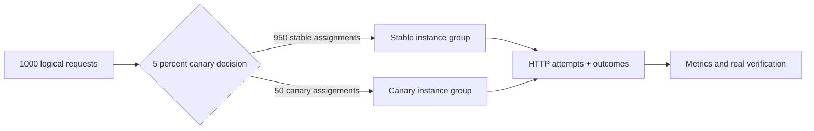
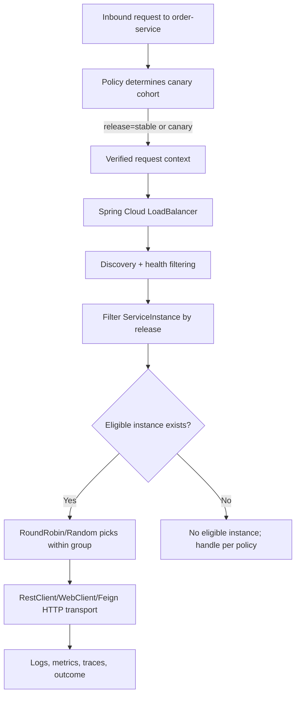
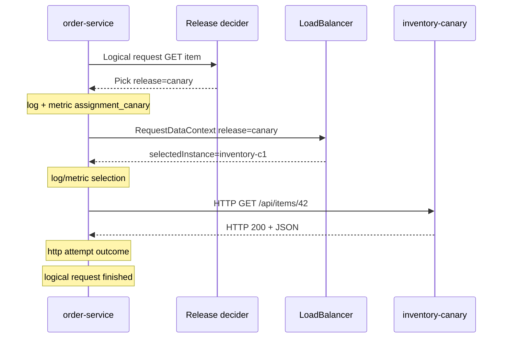

# Canary Deployment and Distribution Verification Before Scaling Up

In a multi-microservice system, rolling out a new version everywhere at once spreads blast radius across all users the moment a bug appears. **Canary deployment** solves this by sending a small slice of traffic through the new version, comparing it against the stable version, and **expanding gradually once evidence confirms** the canary meets requirements.

For example, `order-service` calls `inventory-service` using the logical URI `http://inventory-service`. In production there are eight stable inventory replicas and two new-version replicas. If Spring Cloud LoadBalancer defaults to distributing evenly across all ten `ServiceInstance` entries, the new version may receive **roughly 20% of selections**, not 5% simply because we call the rollout a "5% canary." Target percentages must be defined at the **traffic decision layer**, enforced consistently, and measured back from real requests.

This lesson belongs to the **Deployment** chapter of the `SPRING_CLOUD_SERVICE_COMMUNICATION_LOAD_BALANCING` module. We will apply client-side load balancing by service ID, discovery, health checks, routing, `RestClient`, `WebClient`, OpenFeign, retries/timeouts, and observability to design a verifiable canary workflow with explicit stop thresholds and rollback plans.

## 1. Learning objectives and completion criteria

After this lesson, you should be able to:

1. Distinguish **replica ratio**, **logical request assignment ratio**, **instance selection ratio**, **HTTP attempt ratio**, and **successful request ratio**.
2. Identify which layer governs the canary: ingress/gateway, service mesh, or **caller-side Spring Cloud LoadBalancer**, avoiding accidentally applying the same policy across multiple layers.
3. Label `ServiceInstance` entries as stable/canary via trusted metadata and filter candidates by **request context**.
4. Start with a small canary, measuring error rate, latency, saturation, and traffic distribution before raising the percentage.
5. Distinguish valid fallbacks from fallbacks that **hide canary errors**, while preserving hard zone/region/tenant constraints during retries or rollbacks.
6. Build a runbook for rollout, observation, promote/hold/rollback decisions, and post-rollback verification.

**Practical criteria:** create a stable group and a canary group under the same service ID, send requests through a LoadBalancer-integrated client, record which branch each request was assigned to, check how many requests the **actual servers** received, and base expand/rollback decisions on logs, metrics, and traces.

## 2. Canary is traffic control, not merely running extra Pods

Three questions must stay separate:

| Aspect | Question | Example |
|---|---|---|
| **Deployment capacity** | How many replicas of each version are running? | Stable 8, canary 2. |
| **Traffic assignment** | How many logical requests are *deliberately assigned* to canary? | Target canary 5%. |
| **Observed delivery** | How many HTTP attempts actually reach canary? | May deviate from 5% due to retries, timeouts, caching, sampling, and pre-HTTP errors. |

If the instance list has eight stable and two canary instances, an algorithm splitting selections evenly across ten instances will send canary roughly `2 / 10 = 20%` of requests given enough samples and all instances eligible. **That is not a 5% canary traffic split.**

Conversely, if 5% of logical requests are assigned to canary yet retries happen only on canary and each failed request retries three times, the **share of HTTP attempts** hitting canary can exceed 5%. If you compute ratios only from **successful responses**, canary errors make the canary share appear lower than the traffic actually sent to the new version.



These numbers are simple expectations over a 1,000-request window with random 5% assignment, **not a guarantee** of exact 950/50 on every run. With fixed cohorts by tenant/user, **request-volume** ratios can also diverge from user ratios if one cohort generates more requests.

## 3. Choose the canary control layer before configuring

Canaries can be controlled at different points:

| Decision layer | What can it do? | When appropriate | Risks |
|---|---|---|---|
| **Ingress/API Gateway** | Pick stable/canary before requests enter deeper into the system. | Inbound external traffic wanting centralized control. | Misses internal service-to-service calls that bypass the gateway. |
| **Service mesh/sidecar** | Route/weight by destination subset, headers, policies. | Infrastructure already runs a mesh with unified traffic policies. | Adds a proxy layer; must separate mesh selections from app-level LB. |
| **Spring Cloud LoadBalancer** | Caller picks stable/canary `ServiceInstance` via request context or weights. | Direct internal calls by service ID needing caller-side control. | Each caller has separate config/caches; no automatic cluster-wide quota. |
| **Separate service IDs** | Call `inventory-stable` or `inventory-canary` via internal routing/gateway. | Need strict release isolation or simpler candidate sources. | Must maintain contracts, auth, and policies for two IDs; never hardcode fixed endpoints. |

**Never simultaneously assume the gateway splits 5%, the mesh splits 5%, and the caller splits 5% and think they add up to 15%.** Depending on order and scope, splits may be independent or conditional, producing unexpected outcomes. Designate **one traffic assignment owner** and measure at that point.

### Especially when deploying on Kubernetes

A standard Kubernetes `Service` points to endpoints matched by its selector, and cluster networking distributes traffic to those endpoints. **Stable/canary replica counts are not an exact canary percentage mechanism**, and using a Kubernetes Service VIP does not automatically expose each Pod as a `ServiceInstance` to Spring Cloud LoadBalancer.

If the caller connects to a **stable Service VIP/DNS**, the transport sees one logical target and Pod selection happens inside Kubernetes networking. If you want **client-side** LoadBalancer selection by per-replica metadata, the discovery integration must genuinely supply Pods/endpoints as `ServiceInstance` entries (e.g., an appropriate Spring Cloud Kubernetes setup). Verify topology before adding a custom supplier; do not just add `@LoadBalanced` and assume you control individual Pods.

## 4. Canary architecture via Spring Cloud LoadBalancer

Suppose the caller retrieves an instance list from discovery:

| Instance | Release | Zone | Healthy | Example address |
|---|---|---|---|---|
| `inventory-s1` | `stable` | `zone-a` | Yes | `10.10.1.11:8080` |
| `inventory-s2` | `stable` | `zone-b` | Yes | `10.10.2.12:8080` |
| `inventory-s3` | `stable` | `zone-a` | Yes | `10.10.1.13:8080` |
| `inventory-c1` | `canary` | `zone-a` | Yes | `10.10.1.21:8080` |
| `inventory-c2` | `canary` | `zone-b` | Yes | `10.10.2.22:8080` |

The `release=stable/canary` and `zone=...` metadata in this table are **application/deployment conventions**, not mandatory built-in metadata guaranteed by every discovery provider. In real systems, metadata must be stamped by trusted deployment/registry tooling and verified at rollout.



**Two distinct steps:**

1. **Assignment:** does a logical request belong to stable or canary? This decision needs an owner, target ratio, and stickiness policy.
2. **Instance selection:** within the permitted group, which concrete `ServiceInstance` does LoadBalancer choose? That is the supplier/algorithm's responsibility.

If a request is assigned to canary yet no healthy canary replica exists, silently falling back to stable may reduce user-facing errors under some soft policies. However, it also **hides canary failures** and shrinks observable samples. If fallback is permitted, count `canary_assigned`, `canary_fallback`, and `stable_delivered` separately. If the canary is bound by hard region/tenant security constraints, **never fall back across constraints**.

## 5. Preparing a safe deployment before sending traffic

Canaries make sense only when both versions **can coexist over an overlap window**. Verify:

- **Backward/forward compatibility:** clients and servers tolerate old/new API shapes, new error codes, and unknown enum values.
- **Schema/database:** use *expand → migrate → contract*; never drop columns or make schema changes that break stable before canary is promoted.
- **Feature flags:** decouple new feature activation from artifact deployment so behavior can be rolled back without tearing down the entire deployment.
- **Idempotency:** retried/replayed writes do not create duplicate side effects, especially when requests time out after server commit.
- **Auth and routing:** canary serves only permitted tenants/regions/zones, with secrets, configs, and permissions matching stable.
- **Readiness/startup:** replicas join the eligible pool only when genuinely able to serve business requests; liveness does not replace readiness.
- **Capacity:** both stable and canary have adequate CPU/memory, connection pools, downstream quotas, DB pools, and bulkheads.
- **Observability:** logs/metrics/tracing are enabled **before** sending traffic to canary so baseline data is intact.
- **Rollback:** keep enough stable capacity throughout the rollout; know the exact step to drop canary traffic to 0 and how to verify it.

**Starting at 0% canary traffic** is useful for running startup/readiness smoke tests directly on the test network; it does not mean the canary has passed live user-traffic verification.

## 6. Standing up two versions under the same service ID

In a learning environment, you can run:

```text
inventory-stable-a  release=stable  port=8081
inventory-stable-b  release=stable  port=8082
inventory-canary-a  release=canary  port=8083
order-service                         port=8090
```

Each inventory replica returns `instanceId` and `release` on a lab-only endpoint:

```json
{
  "itemId": "42",
  "stock": 17,
  "instanceId": "inventory-canary-a",
  "release": "canary"
}
```

In production, do not expose Pod IDs, hostnames, or internal metadata to public users. Use server logs/traces or access-controlled debug endpoints to verify which replica actually handled requests.

### Kubernetes labels alone do not create traffic percentages

Suppose a stable Deployment has labels `app=inventory`, `release=stable`, and a canary Deployment has `app=inventory`, `release=canary`. If a Service selector filters only `app=inventory`, it can point to **both versions**:

```yaml
apiVersion: v1
kind: Service
metadata:
  name: inventory
spec:
  selector:
    app: inventory
  ports:
    - name: http
      port: 8080
      targetPort: 8080
```

This example illustrates that **a Service selector does not express a 5% canary**. A complete setup needs two Deployments, health probes, resource requests, and a clear routing owner. If routing by revision via ingress/mesh, you typically need stable and canary services/subsets with matching labels. If using Spring Cloud LoadBalancer directly, discovery must attach trustworthy `release` metadata to each `ServiceInstance`.

## 7. How to choose the canary split: per-request or per-cohort?

| Strategy | How it works | Pros | Limitations |
|---|---|---|---|
| **Random per logical request** | Each logical call is assigned canary with probability e.g. 5%. | Easy to adjust; fits independent GETs. | One user may bounce across revisions between requests; statistical variance. |
| **Sticky by user/tenant/cohort** | Hash verified identity with fixed salt and compare against bucket threshold. | A subject stays on the same revision throughout rollout. | 5% of users need not equal 5% of RPS; large tenants skew volume. |
| **Allowlist set** | Only internal/beta/test tenants enter canary. | Very safe early on; easy to analyze. | Not representative of full live traffic. |
| **Weighted per instance** | Each instance has a weight for the selection algorithm. | Useful for balancing load across machines of different capacity. | Does not preserve **per-release** ratios when replica counts change. |

**The safest option for many stateful/session workflows** is usually a sticky cohort keyed by verified identity. Random per-request selection can serve the same user alternating responses from stable and canary, causing confusion when data, caches, or feature flags differ.

Illustrative simple formula:

```text
bucket = stableHash(verifiedAccountId + rolloutSalt) modulo 10000
targetRelease = (bucket < canaryBasisPoints) ? canary : stable

canaryBasisPoints = 500 corresponds to 5%
```

`stableHash` in this example must be consistent across caller instances, with a controlled salt/seed. Never take a client-supplied `X-Account-ID` header and treat it as a verified identity. When preventing users from gaming cohort selection or leaking info, use a keyed hash/policy; cohort hashing is not an authorization mechanism.

## 8. Code sample: deciding 5% canary at the service layer

To illustrate the basic flow, use `ThreadLocalRandom` for **side-effect-free GETs**, making the decision once at the start of the logical call. This is not sticky-cohort routing:

```java
import java.util.concurrent.ThreadLocalRandom;
import org.springframework.beans.factory.annotation.Value;
import org.springframework.stereotype.Component;

@Component
public class InventoryReleaseDecider {

    private final int canaryBasisPoints;

    public InventoryReleaseDecider(
            @Value("${routing.inventory.canary-basis-points:0}")
            int canaryBasisPoints) {
        if (canaryBasisPoints < 0 || canaryBasisPoints > 10_000) {
            throw new IllegalArgumentException(
                "canary-basis-points must be in [0, 10000]");
        }
        this.canaryBasisPoints = canaryBasisPoints;
    }

    public String decideForNewLogicalRequest() {
        int bucket = ThreadLocalRandom.current().nextInt(10_000);
        return bucket < canaryBasisPoints ? "canary" : "stable";
    }
}
```

Configuration:

```yaml
routing:
  inventory:
    canary-basis-points: 500 # target 5% of logical requests
```

Notes:

- The config value is read at bean creation in this example. Editing the YAML file does not **hot reload** all caller processes automatically; you need a designed dynamic config/refresh mechanism or controlled rolling restart.
- If four `order-service` instances exist, **all** must run the same rollout policy for consistency. During updates, monitor the brief period when policies are out of sync.
- For sticky cohorts, swap random selection for a decision based on **verified identity** and a stable hash, keeping selection consistent across the whole workflow.
- The canary decision should stay pinned for the entire logical request across retries. If every attempt re-rolls randomly, a canary error could be "masked" by stable and skew ratios.

## 9. Passing the verified decision to RestClient

Use a `RestClient` built from `@LoadBalanced RestClient.Builder` and a logical service ID:

```java
import org.springframework.cloud.client.loadbalancer.LoadBalanced;
import org.springframework.context.annotation.Bean;
import org.springframework.context.annotation.Configuration;
import org.springframework.web.client.RestClient;

@Configuration
class InventoryHttpClientConfiguration {

    @Bean
    @LoadBalanced
    RestClient.Builder loadBalancedRestClientBuilder() {
        return RestClient.builder();
    }

    @Bean
    RestClient inventoryRestClient(
            @LoadBalanced RestClient.Builder builder) {
        return builder.clone()
            .baseUrl("http://inventory-service")
            .build();
    }
}
```

A calling method:

```java
import org.springframework.stereotype.Service;
import org.springframework.web.client.RestClient;

@Service
class InventoryGateway {

    private final RestClient inventoryRestClient;
    private final InventoryReleaseDecider releaseDecider;

    InventoryGateway(
            RestClient inventoryRestClient,
            InventoryReleaseDecider releaseDecider) {
        this.inventoryRestClient = inventoryRestClient;
        this.releaseDecider = releaseDecider;
    }

    ItemDto getItem(String itemId) {
        // Choose version ONCE for this logical call.
        String release =
            releaseDecider.decideForNewLogicalRequest();

        return inventoryRestClient.get()
            .uri("/api/items/{id}", itemId)
            .headers(headers -> headers.set(
                "X-Internal-LB-Release", release))
            .retrieve()
            .body(ItemDto.class);
    }
}
```

`ItemDto` is the application DTO. `X-Internal-LB-Release` here is an **illustrative mechanism to pass the routing decision from trusted caller code into the LoadBalancer context**; the header may also travel upstream. Never put secrets, access tokens, or PII into this header. If an external request arrives carrying the same header name, the caller/gateway must **strip or overwrite** it so users cannot self-select canary at will.

For any retry wrapper, retain the chosen `release` value and send the same header on every attempt; never call `decideForNewLogicalRequest()` again inside a retry loop. To measure assignment ratios accurately, record metrics/logs **as soon as the release decision is made**, not only after HTTP returns 200.

## 10. Code sample: filtering ServiceInstances by release

We can wrap a `ServiceInstanceListSupplier` with a supplier that inspects `RequestDataContext`. In this example, **any request lacking a valid canary context defaults to seeing only stable**. That prevents canary from receiving accidental traffic from HTTP adapters that fail to propagate request context.

```java
import java.util.List;
import org.springframework.cloud.client.ServiceInstance;
import org.springframework.cloud.client.loadbalancer.Request;
import org.springframework.cloud.client.loadbalancer.RequestDataContext;
import org.springframework.cloud.loadbalancer.core.DelegatingServiceInstanceListSupplier;
import org.springframework.cloud.loadbalancer.core.ServiceInstanceListSupplier;
import reactor.core.publisher.Flux;

public final class ReleaseAwareServiceInstanceListSupplier
        extends DelegatingServiceInstanceListSupplier {

    public ReleaseAwareServiceInstanceListSupplier(
            ServiceInstanceListSupplier delegate) {
        super(delegate);
    }

    @Override
    public Flux<List<ServiceInstance>> get() {
        // No Request context -> stable ONLY, never leak canary.
        return delegate.get().map(instances ->
            selectRelease(instances, "stable"));
    }

    @Override
    public Flux<List<ServiceInstance>> get(Request request) {
        String release = requestedRelease(request);
        return delegate.get(request).map(instances ->
            selectRelease(instances, release));
    }

    private static String requestedRelease(Request request) {
        if (request == null ||
                !(request.getContext()
                    instanceof RequestDataContext dataContext)) {
            return "stable";
        }

        String raw = dataContext.getClientRequest()
            .getHeaders()
            .getFirst("X-Internal-LB-Release");

        return "canary".equals(raw) ? "canary" : "stable";
    }

    private static List<ServiceInstance> selectRelease(
            List<ServiceInstance> instances, String release) {
        return instances.stream()
            .filter(instance -> release.equals(
                instance.getMetadata().get("release")))
            .toList();
    }
}
```

Example uses Java 17+ and assumes discovery supplies `release=stable` or `release=canary` metadata. This class is the **candidate selection policy**, not the 5% calculation itself; the 5% decision lives in `InventoryReleaseDecider`. SPIs, request context shapes, and integrations can vary across Spring Cloud BOMs — test against your real project version.

**Why not fall back when no canary exists?** For rollout measurement, when zero healthy canaries remain, the candidate list for canary-assigned requests becomes empty. That is a crucial signal to **halt scaling/roll back**. A policy falling back to stable can also be acceptable if the business contract allows it, provided it is **explicitly designed, metered separately, and never violates hard region/tenant constraints**. Never quietly put `return instances` into an empty canary branch and report that canary is still healthy.

### Dedicated configuration for inventory-service

```java
import org.springframework.cloud.loadbalancer.annotation.LoadBalancerClient;
import org.springframework.boot.autoconfigure.SpringBootApplication;

@SpringBootApplication
@LoadBalancerClient(
    name = "inventory-service",
    configuration = InventoryLoadBalancerConfiguration.class)
class OrderApplication {
}
```

```java
import org.springframework.cloud.loadbalancer.core.ServiceInstanceListSupplier;
import org.springframework.context.ConfigurableApplicationContext;
import org.springframework.context.annotation.Bean;

// Place outside component scanning of the main SpringBootApplication.
public class InventoryLoadBalancerConfiguration {

    @Bean
    ServiceInstanceListSupplier inventorySupplier(
            ConfigurableApplicationContext context) {
        ServiceInstanceListSupplier discovery =
            ServiceInstanceListSupplier.builder()
                .withDiscoveryClient()
                .build(context);

        return new ReleaseAwareServiceInstanceListSupplier(discovery);
    }
}
```

This illustrates a **per-service-ID configuration boundary**. In production, the builder typically chains caching/health suppliers per version while ensuring the request-aware filter is not mis-cached. **Cache the shared discovery list first, then filter per request afterward**; if you cache a release-filtered list keyed only by service ID, stable requests can see canary lists or vice versa.

Place LoadBalancer configuration classes **outside the main application's component scan** so beans/policies do not leak across every service ID. If source metadata lacks `release` labels, this example selects zero instances: that is a signal to fix deployment/discovery, not an excuse to open the filter to all instances.

## 11. Warning: per-instance weighting differs from per-version ratios

Some Spring Cloud LoadBalancer setups support **weighted instance selection** or suppliers using weight metadata, depending on release/algorithm. Distinguish:

```text
stable: 8 replicas, each replica weight = 1
canary: 2 replicas, each replica weight = 1
-> total stable weight = 8, canary = 2
-> expected canary ~20% of selections
```

To target ~5% canary, the **total weight of the entire canary group** must represent roughly 5% of total weight when selecting by weights. If you scale canary from two to four replicas without adjusting group total weight, selection share rises unexpectedly. Some implementations do not interpret weights this way; verify actual semantics.

Therefore, **splitting stable/canary per request first and then picking an instance within the group** is usually much easier to reason about when targeting a fixed release share. Either way, measure `eligible_instances`, `selection_counts`, and `HTTP attempts` rather than just reading YAML weights.

## 12. Keeping behavior consistent across WebClient and OpenFeign

### WebClient

```java
@Bean
@LoadBalanced
WebClient.Builder loadBalancedWebClientBuilder() {
    return WebClient.builder();
}

@Bean
WebClient inventoryWebClient(
        @LoadBalanced WebClient.Builder builder) {
    return builder.clone()
        .baseUrl("http://inventory-service")
        .build();
}
```

Attach the verified per-request decision:

```java
Mono<ItemDto> findItem(
        WebClient client,
        String itemId,
        String chosenRelease) {
    return client.get()
        .uri("/api/items/{id}", itemId)
        .headers(h -> h.set(
            "X-Internal-LB-Release", chosenRelease))
        .retrieve()
        .bodyToMono(ItemDto.class);
}
```

**Reactor lifecycle note:** when adding `retryWhen(...)`, operator ordering can re-subscribe the request. Compute and hold `chosenRelease` stable at the **logical request** scope so scheduler switches do not accidentally change it. `Reactor Context` is not automatically `RequestDataContext`; verify the filter/adapter propagates context to LoadBalancer **before** instance selection.

### OpenFeign

```java
@FeignClient(
    name = "inventory-service",
    contextId = "inventoryRead")
interface InventoryReadClient {
    @GetMapping("/api/items/{id}")
    ItemDto findItem(
        @PathVariable("id") String id,
        @RequestHeader("X-Internal-LB-Release") String release);
}
```

Invoke the method with `chosenRelease` determined by the service layer. Never put a fixed URL in `@FeignClient(url = ...)` when the goal is selecting `ServiceInstance` entries by service ID. Feign client contexts, `Retryer`/timeouts, and underlying HTTP engines can make attempt counts differ from `RestClient`. Test each adapter to confirm `RequestDataContext` carries the header your custom supplier needs; **never assume** all three clients share the exact same pipeline.

## 13. Placing health, readiness, and warm-up properly

A canary can boot yet not truly be ready:

- The JVM is running, yet database connections are not ready.
- Caches and JIT compilation are still cold, spiking latency on the first few requests.
- `/actuator/health` reports `UP` yet critical APIs fail smoke tests.
- Discovery holds newly added or dead instances in cache for a window.
- Caller HTTP connection pools lack idle sockets to new canary endpoints, causing "cold connections" and initial TLS handshakes.

**Liveness, readiness, and caller-side health checks address different layers.** Health `UP` does not prove canary data correctness or absence of regressions. Before raising traffic:

1. Wait for canary replica readiness.
2. Run direct smoke tests against canary over permitted internal paths.
3. Confirm canary appears in discovery **with accurate `release` metadata**.
4. Confirm a canary request by service ID routes through LoadBalancer to the right instance.
5. Admit a small warm-up slice while watching handshakes, pending pool acquires, and p95/p99.

Do not "fix" cold-start spikes merely by raising concurrent call limits indefinitely. Expanding pools/bulkheads does not create extra CPU/DB capacity inside canary.

## 14. Designing metrics to verify distribution

Measuring a canary must distinguish phases:

| Metric/event | Unit counted | Meaning |
|---|---|---|
| `canary_assignment_total{release}` | Logical calls assigned | How many requests is the splitter assigning to stable vs. canary? |
| `loadbalancer_selection_total{release,outcome}` | Instance selections | Were instances of the requested release successfully picked? |
| `outbound_http_attempts_total{release,outcome}` | Real HTTP attempts | How much are retries amplifying load onto canary? |
| `outbound_logical_calls_total{release,outcome}` | Completed logical requests | Success/error rates by release. |
| `outbound_logical_latency` | Logical call duration | Compare p50/p95/p99 once sample size suffices. |
| `upstream_http_server_requests{release,status}` | HTTP requests received by servers | How many calls and status codes did canary actually serve? |
| `fallback_total{from,to,reason}` | Permitted fallbacks | Is stable masking canary failures? |
| `eligible_instances{release,zone}` | Gauge/post-filter candidate count | Are healthy eligible replicas present in each group? |

These names are **application-designed or illustrative metric names**, not guaranteed built-ins across Spring Cloud/Micrometer/Actuator. When using Micrometer, record metrics at **the exact layer owning the event**. For instance, a counter placed at the gateway before `RestClient.get()` counts one invocation even if the transport below retries three HTTP attempts.

Never use `userId`, `traceId`, raw URIs, ephemeral `instanceId`s, or bearer tokens as metric labels. Labels like `release`, `outcome`, `operation template`, and `status class` keep cardinality bounded. Trace per-instance details in sampled, access-controlled logs and traces.

### Simple cross-check formulas

```text
assignment_canary_ratio =
  canary assignments / (stable assignments + canary assignments)

delivered_canary_ratio =
  HTTP attempts to canary /
  total HTTP attempts to inventory

canary_error_rate =
  canary-assigned logical calls ending in error /
  total completed canary-assigned logical calls
```

**These three ratios need not be equal.** When clients retry, when canary is assigned with zero eligible instances, or when conditional fallbacks trigger, sample counts across stages differ. Specify whether metrics are measured at caller or upstream, whether denominators include canceled/timed-out requests, and the sampling window.

## 15. A 5% split does not mean exactly 5 out of 100 requests

Assume independent random assignment per logical request with `p = 0.05`. Over `N` requests, canary count has expected value `N × p` and approximate standard deviation:

```text
sigma_count = sqrt(N × p × (1 - p))
```

| Logical requests | Expected canary count | Approx. standard deviation | Interpretation |
|---:|---:|---:|---|
| 100 | 5 | 2.18 requests | Observing 2 or 8 canary calls does not prove the split is broken. |
| 1,000 | 50 | 6.89 requests | Observed ratio fluctuates around 5%; gather enough samples. |
| 10,000 | 500 | 21.79 requests | Ratio stabilizes further, still never exact. |

This is merely a simple random model for independent logical requests; **sticky cohorts, tenant traffic, retries, caches, queues, and sampling** skew distributions further. Never judge a canary split's accuracy from a 20-request window.

When rolling out by cohort, measure both **assigned entities** and **actual RPS/attempts**. A single large tenant entering canary can generate 30% of traffic while representing just 1% of tenants.

## 16. Phased progressive delivery workflow

Illustrative canary schedule:

| Phase | Target canary | Actions | Promotion gate |
|---|---:|---|---|
| **P0 — Prepare** | 0% | Deploy canary, readiness, smoke tests, verify discovery/metadata. | Zero functional/security blockers; telemetry live. |
| **P1 — Internal sample** | Allowlist or 1% | Send live requests restricted to safe subjects. | Contracts, error classes, traces, and routing accurate. |
| **P2 — Probe** | 5% | Compare canary vs. stable over sufficient time and sample size. | No guardrail violations. |
| **P3 — Expand** | 10–25% | Step up gradually; watch saturation, DB/connection pools, retries. | Capacity and SLOs stay within bounds. |
| **P4 — Broad expand** | 50% | Validate diverse traffic, tail latency, zone/tenant policies. | Canary stays healthy under significant load. |
| **P5 — Promote** | 100% | Shift fully once criteria pass; keep observing. | Zero blockers; plan exists for residual traffic. |
| **P6 — Complete** | 100% new version | Drain and retire old stable safely; update release labels. | Zero unplanned traffic/connections on old version. |

**Percentages and step sizes are illustrative**; production schedules depend on traffic volume, risk profile, and domain behavior. Do not scale up just because "10 minutes elapsed" if canary handled only a handful of unrepresentative requests. Conversely, if severe data-integrity or security errors appear, **halt/roll back immediately** without waiting for statistical significance.

### Follow the same checklist at every phase

1. **Pin baseline:** capture stable and canary metrics before raising the percentage; record release version, config hash, topology, and time window.
2. **Change one variable:** update the routing owner to the new ratio and verify all callers adopt the config.
3. **Verify assignment:** check canary assignment logs/metrics, not just replica counts.
4. **Verify delivery:** cross-check selected `ServiceInstance`, upstream access logs/traces, and HTTP attempts.
5. **Observe quality:** error rates, p95/p99 latency, timeouts, connection pools, CPU, memory, DB, retry amplification, saturation.
6. **Decide:** promote/hold/rollback against defined guardrails, recording approver and evidence.
7. **Post-decision:** save a result snapshot and keep the path back to stable intact.

**Never update canary percentages manually across different callers in random order without tracking sync state.** With asynchronous config refresh, one caller may apply 5% while another runs 25% during convergence. Track by caller version/config and evaluate cluster-wide ratios only after propagation completes.

## 17. Guardrails to lock down before starting a canary

No single "universal safe threshold" fits every service. An **illustrative** guardrail set for a hypothetical environment:

| Signal | Example HOLD condition | Example ROLLBACK condition | Notes |
|---|---|---|---|
| HTTP 5xx from canary | Clear rise vs. stable after enough samples. | Repeated errors exceeding error budget. | Separate upstream 5xx from gateway-synthesized statuses. |
| Logical error rate | Exceeds test threshold over baseline. | Fails SLO or critical business errors. | Compare identical operations/cohorts. |
| p95/p99 latency | Canary operationally higher than baseline. | Tail latency breaches deadline/SLO persistently. | Do not compare cohorts with different workloads directly. |
| Timeouts/connection resets | Spike appears after release. | Causes user errors and keeps climbing. | Check cold starts/draining before blaming code. |
| CPU/memory/DB pool | Approaches limit and keeps rising. | OOM, pool exhaustion, impacts stable. | Watch all replicas, sidecars, and shared DBs. |
| Retry amplification | HTTP attempts/logical request jump abnormally. | Retry storm overloads downstream. | Retries can mask new-version bugs in final success rates. |
| Security/data integrity | Suspected policy breach. | **Stop immediately; rollback/fail closed.** | Never wait for larger sample sizes. |

Finalize thresholds **before raising traffic**, together with observation windows, minimum sample sizes, alert sensitivity, and decision owners. If canary serves only "easy" traffic or a single zone, comparing its error rate against all of stable misleads; compare matched routes, tenant tiers, payload sizes, and permitted zones.

### A comparison example where you should not jump to conclusions

```text
Stable:
  10,000 GETs, 20 5xx errors  -> 0.2%
Canary:
  100 GETs, 1 5xx error       -> 1.0%
```

Canary shows a higher observed error rate, yet a single error out of 100 calls is insufficient to prove a small regression on its own; inspect error types, traces, time windows, workload mix, and severity. If that single error is a data corruption or security flaw, of course act immediately without waiting for statistics.

## 18. Observing at the right layers: assignment, selection, HTTP response

Flow and telemetry diagram:



To record `selectedInstanceId` accurately, instrument Spring Cloud LoadBalancer's lifecycle/Observation API for your release train rather than assuming any HTTP interceptor always sees the rewritten URI. `RestClient` can receive `200` and still fail decoding; `HTTP response received` and `logical request success` are distinct events.

Sample structured log:

```json
{
  "event": "outbound_logical_finished",
  "callerService": "order-service",
  "targetService": "inventory-service",
  "operation": "GET /api/items/{id}",
  "assignedRelease": "canary",
  "selectedInstanceId": "inventory-c1",
  "outcome": "success",
  "httpStatus": 200,
  "attempts": 1,
  "durationMs": 44,
  "traceId": "4bf92f3577b34da6a3ce929d0e0e4736"
}
```

Values are illustrative. When no instance is selected, `selectedInstanceId` must be null/omitted; when no real HTTP response arrived, never fabricate `httpStatus=503` just to populate the field. Across retries, keep the same logical ID and assigned release, recording each attempt number and per-attempt selected instance.

## 19. Retries, circuit breakers, and fallbacks during rollout

Canaries often surface bugs under load. Precisely then, **retries** can compound risk:

```text
1 logical request
  -> canary attempt #1 fails
  -> canary attempt #2 retry
  -> canary attempt #3 retry

Result: 1 canary assignment, 3 HTTP attempts hitting canary
```

If you count only final responses, the rollout looks healthier than it is; if you count only attempts, canary share looks larger than logical assignments. Measure both.

Principles:

- **Bound retries:** explicit max attempts, backoff, jitter, and overall deadline; never retry infinitely.
- **Idempotency:** never retry side-effecting POST/PUT/PATCH without safety policies and dedup.
- **Preserve initial release decision:** no layer's retry may silently switch stable/canary without recording an authorized fallback.
- **Circuit breakers:** canary and stable should have independent observability/trip states when isolating per-release faults; never let canary failures trip a shared circuit that unnecessarily blocks stable.
- **Bulkheads:** cap in-flight concurrency for the canary pool when canary has small capacity; do not assign 5% and let retries flood canary with hundreds of concurrent requests.
- **Timeouts:** tight timeouts can reveal a slow canary; remember a timeout does not prove upstream failed to finish.
- **Hard routing constraints:** never move canary or stable into disallowed regions/tenants just to escape errors.

**Fallbacks need their own label**, such as `canary_assigned_but_stable_delivered`. Rising fallback rates must be treated as a canary hold/rollback signal, never reported as "canary achieved 100% success."

## 20. Connection costs when adding canary replicas

When callers pick `ServiceInstance` entries directly, adding target replicas increases **per-route connection pools**, idle sockets, TLS handshakes, and health probes across callers. For example:

```text
8 caller processes × 2 canary replicas × 1 idle connection/route
= 16 hypothetical idle sockets if every caller touches both canary replicas
```

This is a learning assumption, not a guaranteed exact socket count. Actual numbers depend on the HTTP engine, HTTP/1.1 vs. HTTP/2, connection reuse, max idle times, route identity, and how often canary is selected.

When expanding canary from 1% to 25%, monitor:

1. New/closed connections, active/idle connections, pending acquires.
2. HTTP response latency and connect/TLS handshakes.
3. Thread pools, active bulkhead permits, queue depths.
4. Total downstream DB connections and cache load.
5. CPU/memory separately for canary and stable, not only cluster totals.

If errors spike right as new replicas enter and subside after warm-up, separate cold-connection/cache effects from code regressions; **never invoke warm-up as an excuse to ignore data integrity or security failures**.

## 21. Lab exercise: verifying distribution with mock servers

For reproducible results, use **WireMock or MockWebServer** to spin up independent stub servers:

```text
stable-a  -> localhost:18081 -> returns release=stable, instanceId=stable-a
stable-b  -> localhost:18082 -> returns release=stable, instanceId=stable-b
canary-a  -> localhost:18083 -> returns release=canary, instanceId=canary-a
canary-b  -> localhost:18084 -> returns release=canary, instanceId=canary-b
```

In tests, a `ServiceInstanceListSupplier` supplies four `DefaultServiceInstance` entries with `serviceId=inventory-service`, each stub's host/port, and matching `release` metadata. Wrap it with `ReleaseAwareServiceInstanceListSupplier` to verify filtering. Test static/dynamic port sources cleanly; never point `RestClient.baseUrl` directly at `localhost:18083` when testing LoadBalancer.

### Mandatory test matrix

| Input/policy | Eligible list | Allowed HTTP servers | Assertion |
|---|---|---|---|
| Missing release context | Stable A/B | A/B only | Zero requests hit canary. |
| Trusted `release=stable` | Stable A/B | A/B only | Canary requests = 0. |
| Trusted `release=canary` | Canary A/B | Canary A/B only | Stable requests = 0 when fallback is off. |
| Only one healthy canary | Canary A | Canary A only | Does not route to removed canary B. |
| Zero eligible canaries | Empty canary list | Zero servers for canary-assigned calls | Selection failure or rollback policy; no silent fallback. |
| Tenant hard region EU | EU instances of requested release | Zero non-EU replicas | Policy respected across retries/failover. |
| Canary returns HTTP `503` | Canary still selected | Canary server returns real 503 | Distinguish upstream 503 from no-instance. |
| Canary not listening | `ServiceInstance` still cached | No valid HTTP response | Distinguish transport error from upstream 503. |
| Bounded retries enabled | Same release assignment | Multiple attempts possible | Count logical calls vs. attempts separately. |

### Verifying the 5% assignment ratio

Run a large enough sample window, such as **10,000 logical GETs** in a test environment with random assignment; **never run 10,000-request load tests against production**. Collect:

- `assignedStable` and `assignedCanary` at the caller.
- `ServiceInstance` selection counts by release and zero-candidate errors.
- Request counts on each stable/canary HTTP stub.
- Logical outcomes, HTTP statuses, timeouts, and retry counts.

Compare `assignedCanary/(assignedStable+assignedCanary)` against the 5% target. Do not demand exactly 500/10,000; random sampling has variance. If **selected/delivered** ratios diverge sharply from **assigned**, or requests hit the wrong release, investigate filters, metadata, caches, retries, and fallbacks.

## 22. Multi-phase rollout exercise

Execute these steps in a safe staging/canary environment:

| Phase | Tasks | Evidence to archive |
|---|---|---|
| **Baseline** | Run stable 100%, collect metrics over a matching load window. | Stable errors/latency, throughput, CPU, connection pools. |
| **P0** | Start canary at 0% traffic. | Readiness, smoke tests, accurate discovery metadata. |
| **P1** | Route 1%/allowlist to canary. | Assignments, selected release, upstream request counts, traces, JSON contract. |
| **P2** | Raise to 5%, observe sufficient samples. | Per-release errors/latency, retries, p95/p99, canary saturation. |
| **P3** | Raise to 10–25% if gates PASS. | Guardrails, config propagation, capacity. |
| **P4** | Raise to 50%, observe diverse cohorts/zones. | No quality degradation; hard policies intact. |
| **Promote** | Raise canary to 100%, keeping stable on standby per policy. | Zero unplanned fallbacks; data contracts stable. |
| **Cleanup** | Drain/decommission old stable safely. | Zero active requests/connections remaining; rollback plan updated. |

At each step, ask: **"Is the requested percentage actually happening at the right measurement point?"** before asking "does canary have bugs?" A canary with zero requests and zero errors **is not** a verified canary.

## 23. Runbook when you must HOLD or ROLLBACK

A clear runbook prevents improvised reactions during incidents:

### HOLD — pause increasing traffic

When warning signs appear without full clarity:

1. Hold the current percentage; **do not increase** it.
2. Pin the measurement window, version/config hashes, caller count, and canary replica count.
3. Compare identical operations/cohorts/zones between stable and canary.
4. Isolate whether failures happen at selection, HTTP transport, response status, decoding, or business logic.
5. On any integrity/security flaw, **move straight to rollback/fail closed**.

### ROLLBACK — reduce/remove canary traffic

1. Update the **actual routing assignment owner** to 0% canary or disable the feature flag. Never scale canary replicas to 0 while routing still assigns requests to canary, or you will cause no-instance failures.
2. Confirm the policy reached all callers/gateways/meshes; verify `canary_assignment_total` and `selection_total` drop to target.
3. Wait for in-flight requests, connection draining, and active queues per contract deadlines. Never delete instances while active requests still need graceful shutdown.
4. Compare post-rollback metrics and logs: HTTP errors, timeouts, p95/p99, retries, CPU/DB/circuit states.
5. Confirm **zero new HTTP attempts** hit canary outside known smoke/test probes.
6. Save evidence snapshots, incident notes, rolled-back config/versions, and prerequisites before the next canary attempt.

**Traffic rollback does not automatically undo written data or database migrations.** If canary wrote incompatible data, run a dedicated data remediation plan; that is why schema compatibility must be checked in preflight.

### PROMOTE — switch fully to the new version

1. Confirm canary passed all guardrails across representative load levels and cohorts.
2. Update revision labels/identifiers during promotion so filters never accidentally exclude all "new stable" instances. If default policy looks for `release=stable`, explicitly design the **label-transition step (stable ← new version)**.
3. Monitor caller/registry/cache convergence so zero no-instance errors happen during updates.
4. Keep the old version available long enough per rollback policy, then execute verified draining/decommissioning.

## 24. Common deployment mistakes

| Mistake | Consequence | Fix |
|---|---|---|
| Running 1 canary / 9 stable replicas and assuming 10% traffic. | Actual share depends on algorithm, weights, eligible set. | Designate a traffic assignment owner and measure real requests. |
| Reading only successful canary responses. | A high-error canary "disappears" from counts. | Count assignments, selections, attempts, and outcomes separately. |
| Using instance weights without summing per release during scaling. | Adding replicas unexpectedly shifts canary share. | Control group total weights or filter by release first. |
| Letting raw user headers choose canary/region. | Users control routing and can bypass policies. | Authenticate identity, strip external headers, decide in trusted layer. |
| Attaching the release header after LoadBalancer selection. | Supplier misses context; all traffic hits stable or wrong set. | Test filter/interceptor order and `RequestDataContext`. |
| Caching filtered canary lists keyed solely by service ID. | Stable and canary requests share wrong candidate lists. | Cache shared discovery candidates; filter per request afterward. |
| Silently falling back to stable when canary is missing. | Hides canary outages; skews ratio and health reporting. | Make fallbacks explicit and separate assigned/delivered metrics. |
| Retrying all 503s, timeouts, or 4xxs. | Retry storms amplify canary load despite small target %. | Enforce retry budgets, backoff/jitter, deadlines, idempotency. |
| Scaling down canary before assignment drops to 0. | Canary-bound calls hit no-instance/transport failures. | Change policy, verify convergence, then drain. |
| Comparing canary p99 from 10 samples to stable from 1M samples. | Baseless statistical conclusions. | Require minimum sample sizes/windows and matched workload mix. |
| Checking only readiness `UP`. | Misses API, contract, and data-integrity bugs. | Run smoke/contract tests, traces, and business metrics. |
| Using `localhost` inside containers as replica addresses. | Callers connect to themselves. | Use real DNS/network/discovery and verify topology. |
| Running two canary splitters unknowingly. | Real ratios mismatch configuration. | Assign one traffic owner and document every route policy. |
| Turning off canary and assuming rollback is done. | Lingering retries, in-flight calls, DB changes, stale connections remain. | Verify delivery drops to 0, drain, verify data compatibility, and audit. |

## 25. Pre-expansion acceptance checklist

- Identified the **traffic assignment owner**: gateway, mesh, or Spring Cloud LoadBalancer, with no conflicting splits elsewhere.
- Clear `stable`/`canary` release labels are reliably attached to each `ServiceInstance`; metadata, service ID, host/port, and health are verified.
- Understood that replica count **differs** from request ratio; verified real release-based weights/selection algorithms.
- Defined **soft/hard** policies; zero fallbacks cross mandatory tenant/region/zone boundaries.
- Never trust headers from external callers to steer releases; routing decisions happen inside an authenticated trust boundary.
- `RestClient`, `WebClient`, and OpenFeign call by service ID through matching LB integrations; no fixed URLs bypass canary policy.
- Verified `RequestDataContext`/filter ordering and missing-context fallback; defaults safely without leaking traffic to canary.
- Canary health/readiness and smoke tests PASS, and contracts/schemas coexist safely with stable.
- Logs/metrics cover **assignment, selection, attempts, outcomes, fallback**, with traces linking caller and downstream.
- Adequate sample sizes and matched operation/cohort/zone comparisons; statistical variance at low ratios is understood.
- Clear guardrails exist for 5xx, timeouts, p95/p99, saturation, retry amplification, and data integrity.
- Every percentage increase has an owner, timestamp, config version/hash, and post-convergence check.
- Independent, well-tuned retries/bulkheads/timeouts/circuit breakers prevent excessive amplification.
- HOLD/ROLLBACK/PROMOTE plans exist; never delete replicas mid-request or roll back DBs blindly.
- Verified at 0% canary that **zero new production requests** hit canary after rollback.
- Multi-source evidence report completed before declaring the rollout successful.

## 26. Rollout decision report template

```text
Release: inventory-service v2.4.0 (canary)
Stable: inventory-service v2.3.8
Traffic owner: order-service Spring Cloud LoadBalancer
Policy version/config hash: record deployed value
Stage: 5% canary assignments
Observation window: 15 minutes, sample counts per operation

Assignment ratio:
  target 5%, observed ...%, canary assignments ...
Selection:
  canary selected ..., no eligible ..., fallback ...
HTTP delivery:
  canary attempts ..., HTTP status distribution ...
Quality:
  stable error rate ..., canary error rate ...
  stable p95/p99 ..., canary p95/p99 ...
  retry attempts per logical request ...
Resources:
  CPU/memory/connection pool/bulkhead/DB saturation ...
Security/data:
  hard routing and data integrity checks ...

Decision: PROMOTE / HOLD / ROLLBACK
Evidence: metrics dashboard, trace IDs, redacted log samples
Owner: rollout owner
Next action: concrete criteria for the next step
```

Never fill in fake numbers and present them as test results. This is a **blank template** designed to ensure every traffic increase has clear evidence and accountability.

**Key takeaway:** a canary is not verified by running Pod counts or a few passing requests. In Spring Cloud LoadBalancer, separate **deciding the version for a logical request** from **selecting a `ServiceInstance`**, preserve safe routing rules as discovery/health/retries change, and measure **assigned**, **selected**, **actually sent HTTP attempts**, and final outcomes. Expand only when logs, metrics, traces, guardrails, and capacity all align. When signals indicate serious failures, the right action is a **controlled hold/rollback**, never raising the percentage to "test more" in production.
