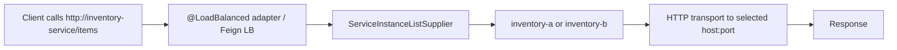
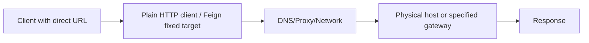
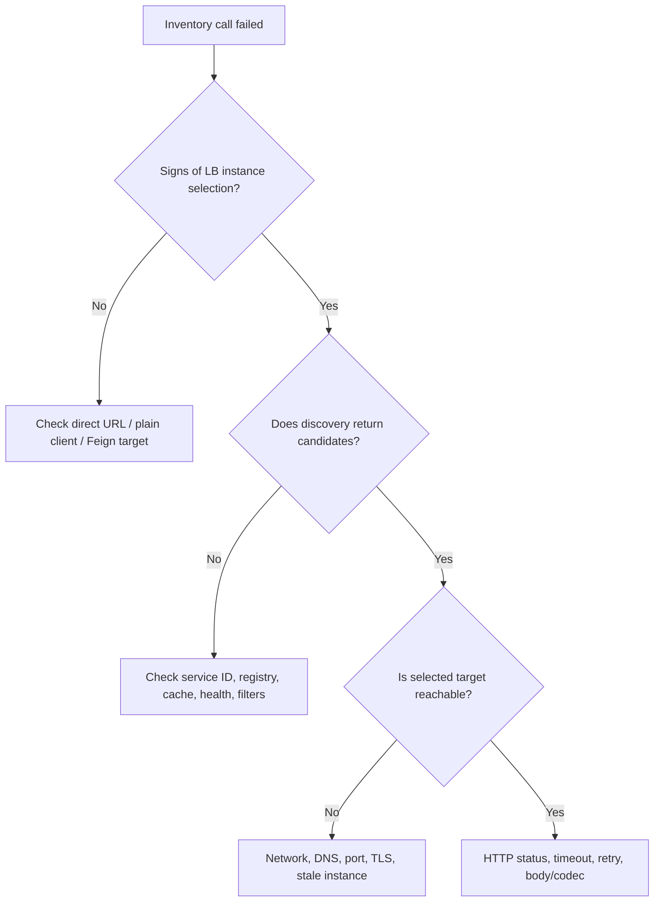

# Direct URLs bypassing LoadBalancer

In a Spring Cloud system, there are situations where `inventory-service` has two registered replicas and discovery returns both, yet every request still goes to `inventory-a`. When replica A stops, the client receives `Connection refused` even though B is healthy. The cause can simply be that the application **configured a fixed physical URL** and is not actually using Spring Cloud LoadBalancer for that call.

This lesson belongs to the **Troubleshooting** chapter of the `SPRING_CLOUD_SERVICE_COMMUNICATION_LOAD_BALANCING` module. Its goal is to determine **when a direct URL bypasses LoadBalancer and when it does not**, distinguish OpenFeign behavior from RestClient, WebClient, RestTemplate, and HTTP Interfaces, and build a two-`ServiceInstance` test proving whether requests go through discovery or are sent straight to one server.

One very easy misconception to clear up immediately:

> **Having a full URL `http://host:port` does not automatically cause every client to bypass LoadBalancer.** With **OpenFeign**, specifying a `url` on a named Feign client selects a direct target and skips load balancing by `name`. With **RestClient/WebClient/RestTemplate**, the deciding factor is **whether the HTTP client has `@LoadBalanced` integration attached**. Once attached, the host in the URL is typically treated as a **service ID to look up**; passing a physical IP/hostname to that client can trigger `No instances available` instead of calling it directly.

## 1. Real-world problem: service ID exists, yet only A receives requests

Suppose `order-service` wants to call:

```text
Logical service ID: inventory-service

Service discovery:
  inventory-a -> 10.20.0.11:8081
  inventory-b -> 10.20.0.12:8081

Caller expected:
  request 1 -> picks A or B
  request 2 -> picks A or B
  ...
```

The operations team observes:

```text
Consul/Eureka:
  inventory-a: UP
  inventory-b: UP

order-service:
  GET inventory-a:8081/api/v1/stock  -> 200
  GET inventory-a:8081/api/v1/stock  -> 200
  GET inventory-a:8081/api/v1/stock  -> 200

inventory-b:
  HTTP requests observed: 0
```

Do not rush to blame `RoundRobinLoadBalancer`. The code might be using:

```java
@FeignClient(
        name = "inventory-service",
        url = "http://inventory-a:8081")
interface InventoryClient {
    @GetMapping("/api/v1/stock/{sku}")
    StockView findStock(@PathVariable String sku);
}
```

Here `name` is still `inventory-service`, but `url` specifies a **direct HTTP target**. According to Spring Cloud OpenFeign documentation, requests using this URL **do not go through instance selection by service ID**.

A similar example with a client lacking LoadBalancer integration:

```java
RestClient directClient =
        RestClient.create("http://inventory-a:8081");
```

Both can return HTTP 200 while A is up. **A successful response does not prove Spring Cloud LoadBalancer ran.**

## 2. Separate four concepts that are often conflated

| Concept | Example | Responsibility |
|---|---|---|
| **Service ID** | `inventory-service` | Logical key used by LoadBalancer to request an instance list |
| **Instance host/port** | `inventory-a:8081` or `10.20.0.11:8081` | Physical endpoint the HTTP transport can connect to |
| **HTTP client integration** | `@LoadBalanced RestClient.Builder`, `@LoadBalanced WebClient.Builder`, Feign LB | Resolves a service ID into a `ServiceInstance` |
| **Direct URL / target** | `https://api.example.com/v1` | HTTP client connects directly via DNS/URL without client-side discovery unless an LB adapter is attached |

Ideal path when using Spring Cloud LoadBalancer:



Direct path:



**Bypassing Spring Cloud LoadBalancer does not necessarily mean bypassing all forms of load balancing.** A direct URL pointing to Nginx, an API gateway, a Kubernetes Service, or multi-record DNS can still be load-balanced by **another layer**. However, the client no longer applies Spring Cloud's `ServiceInstanceListSupplier`, health/zone/hint/weighted policies, or per-instance selection retries for that request.

## 3. Quick reference table by client type

| Call style | Uses Spring Cloud LB? | Notes |
|---|---|---|
| `@FeignClient(name="inventory-service")`, no `url` in annotation/property | **Yes**, when Feign LB integration is configured | `name` is used as the service ID |
| `@FeignClient(name="inventory-service", url="http://inventory-a:8081")` | **No**, direct target | `name` does not force discovery usage |
| Feign without annotation `url` but with `spring.cloud.openfeign.client.config.inventory-service.url` | **No**, direct target | Config URL takes precedence as the target |
| `RestClient.create("http://inventory-a:8081")` | **No**, by default | Plain client unless an LB interceptor is added manually |
| Manually created `RestClient.builder()`, not LB-configured | **No**, by default | Host is passed to HTTP transport/DNS |
| `@LoadBalanced RestClient.Builder` + `http://inventory-service` | **Yes** | Logical host must match service ID |
| `@LoadBalanced RestClient.Builder` + `http://inventory-a:8081` | **Usually still tries LB** | May look up service ID `inventory-a` and report no-instance |
| `WebClient.create("http://inventory-a:8081")` | **No**, by default | No LB exchange filter unless configured |
| `@LoadBalanced WebClient.Builder` + `http://inventory-service` | **Yes** | Reactive LB exchange filter selects an instance |
| `new RestTemplate()` + physical IP/host | **No**, by default | No `LoadBalancerInterceptor` |
| `@LoadBalanced RestTemplate` + `http://inventory-service` | **Yes** | Client-side service selection |
| HTTP Interface via plain RestClient/WebClient adapter | **No** | `@HttpExchange` annotation does not create LB by itself |
| HTTP Interface via LB-configured client adapter | **Yes** | Depends on the underlying adapter |
| Spring Cloud LB 5.x HTTP Service Client group with explicit HTTP(S) base-url | **Maybe not** | Under documented auto-config, a non-`lb://` base URL prevents adding LB integration |

**Scope:** The conclusions above apply to standard configurations as documented by Spring Cloud. If an application adds a custom `Client`, interceptor, proxy, or exchange filter, inspect the **actual runtime**; looking at a single annotation is not enough to know the full path.

## 4. OpenFeign: four URL cases to distinguish

This is the case with the clearest rules in the official Spring Cloud OpenFeign documentation.

### 4.1. Right setup: specify name, omit URL

```java
import org.springframework.cloud.openfeign.FeignClient;
import org.springframework.web.bind.annotation.GetMapping;
import org.springframework.web.bind.annotation.PathVariable;

@FeignClient(name = "inventory-service")
public interface InventoryFeignClient {

    @GetMapping("/api/v1/stock/{sku}")
    StockView findStock(@PathVariable("sku") String sku);
}
```

Application enabling Feign clients:

```java
@SpringBootApplication
@EnableFeignClients
public class OrderApplication {

    public static void main(String[] args) {
        SpringApplication.run(OrderApplication.class, args);
    }
}
```

Requirements:

- `spring-cloud-starter-openfeign` is present.
- Spring Cloud LoadBalancer integration is present (typically via `spring-cloud-starter-loadbalancer`).
- A discovery source or `ServiceInstanceListSupplier` provides `inventory-service`.
- **No `url` in the annotation.**
- **No `spring.cloud.openfeign.client.config.inventory-service.url` from any active configuration source.**

When all conditions are met, the named Feign client is load-balanced. `@EnableFeignClients` only scans interfaces; it **cannot fix** a hardcoded URL or an empty registry.

### 4.2. Wrong LB target: direct URL right in the annotation

```java
@FeignClient(
        name = "inventory-service",
        url = "http://inventory-a:8081")
public interface InventoryFeignClient {

    @GetMapping("/api/v1/stock/{sku}")
    StockView findStock(@PathVariable("sku") String sku);
}
```

Feign builds the client targeting `inventory-a:8081`. Even when the registry returns A/B and the LB starter is present, the annotation URL makes calls direct instead of selecting an instance by `name`.

If A stops, B remains healthy yet calls fail. Increasing Spring Cloud LoadBalancer's `max-retries-on-next-service-instance` **will not solve it** because requests never enter LoadBalancer's A/B selection mechanism.

### 4.3. URL in application.yml also makes Feign call directly

An interface that looks right:

```java
@FeignClient(name = "inventory-service")
public interface InventoryFeignClient {

    @GetMapping("/api/v1/stock/{sku}")
    StockView findStock(@PathVariable("sku") String sku);
}
```

Yet the configuration:

```yaml
spring:
  cloud:
    openfeign:
      client:
        config:
          inventory-service:
            url: "http://inventory-a:8081"
```

still supplies a fixed target. Per OpenFeign documentation, this is also **not load-balanced**. Therefore, searching only for `url=` in source code is insufficient; you must check **effective properties** across active profiles, config servers, environment variables, and startup arguments.

### 4.4. Both annotation URL and property URL are present

```java
@FeignClient(
        name = "inventory-service",
        url = "http://inventory-a:8081")
interface InventoryFeignClient {
    // ...
}
```

```yaml
spring:
  cloud:
    openfeign:
      client:
        config:
          inventory-service:
            url: "http://inventory-b:8081"
```

According to Spring Cloud OpenFeign's “Supported Ways To Provide URL To A Feign Client” table, **the annotation URL is used**, while the config URL has no effect for that target. Both remain **direct targets**, not a way to create a two-instance list. Changing the property to B does not change the annotation or make Feign round-robin between A/B.

| Annotation `url` | Property `client.config.<client>.url` | Typical target behavior |
|---|---|---|
| Empty | Empty | Load-balanced by `name` |
| Has URL A | Empty | Direct to A |
| Empty | Has URL A | Direct to A |
| Has URL A | Has URL B | Direct to A per annotation |

### 4.5. Placeholders and environment overrides

```java
@FeignClient(
        name = "inventory-service",
        url = "${inventory.http.base-url}")
interface InventoryFeignClient {
    // ...
}
```

Suppose runtime provides:

```yaml
inventory:
  http:
    base-url: "http://inventory-a:8081"
```

Placeholders do not change the nature of the configuration: once resolved, Feign has a **direct URL**. Do not inspect only the default YAML file; a local profile might define a test URL that accidentally carries over into production.

In systems using Spring Cloud Config/Kubernetes ConfigMaps/Helm values, environment variables or startup flags can override the URL. The **effective runtime URL** is the source of truth to verify.

### 4.6. When is a direct URL the right choice?

Not every direct URL is a mistake:

- Calling a **third-party API** that already has stable DNS/TLS/ingress.
- Calling an **API gateway** that manages its own routing.
- A test that intentionally wants to **pin target** A to verify a specific server bug.
- A designed migration/canary with a fixed target, monitoring, and rollback.
- An administrative endpoint not exposed via service discovery.

Problems arise when **the requirement is client-side load balancing by service ID**, yet a direct config is deployed unnoticed. Document intent clearly and use bean/config names that distinguish direct clients from load-balanced clients.

## 5. RestClient: “direct URL” and “no LB interceptor” are two different things

With Spring Cloud Commons, a RestClient that uses LoadBalancer needs a Spring-managed builder annotated with `@LoadBalanced`.

### 5.1. Plain RestClient: connects by real URL

```java
RestClient directClient =
        RestClient.create("http://inventory-a:8081");

String body = directClient.get()
        .uri("/whoami")
        .retrieve()
        .body(String.class);
```

`RestClient.create` here does not automatically add Spring Cloud LoadBalancer. The HTTP transport uses the physical hostname/port with DNS, proxy, TLS, and pooling as configured. Even if `spring-cloud-starter-loadbalancer` is in the project, this direct client **does not become load-balanced by default**.

### 5.2. Correct: @LoadBalanced RestClient.Builder and service ID

```java
package com.example.order.config;

import org.springframework.cloud.client.loadbalancer.LoadBalanced;
import org.springframework.context.annotation.Bean;
import org.springframework.context.annotation.Configuration;
import org.springframework.web.client.RestClient;

@Configuration(proxyBeanMethods = false)
public class InventoryRestClientConfiguration {

    @Bean("loadBalancedRestClientBuilder")
    @LoadBalanced
    RestClient.Builder loadBalancedRestClientBuilder() {
        return RestClient.builder();
    }
}
```

Inject this builder:

```java
package com.example.order.inventory;

import org.springframework.beans.factory.annotation.Qualifier;
import org.springframework.stereotype.Service;
import org.springframework.web.client.RestClient;

@Service
public class InventoryGateway {

    private final RestClient inventory;

    public InventoryGateway(
            @Qualifier("loadBalancedRestClientBuilder")
            RestClient.Builder builder) {

        this.inventory = builder.clone()
                .baseUrl("http://inventory-service")
                .build();
    }

    public String whoAmI() {
        return inventory.get()
                .uri("/whoami")
                .retrieve()
                .body(String.class);
    }
}
```

The logical URL `inventory-service` passes through the interceptor/load-balancer adapter to select an instance and rewrite to a real host/port. `@Qualifier` on the constructor must select **the exact `@LoadBalanced` builder**; if two builders exist and the app accidentally injects the plain builder, requests may use direct DNS or fail hostname resolution.

### 5.3. A misconception that leads to misdiagnosis

Suppose someone changes the code to:

```java
RestClient client = loadBalancedBuilder.clone()
        .baseUrl("http://inventory-a:8081")
        .build();
```

Do not claim this client “bypassed LB because the URL is physical.” If `loadBalancedBuilder` **actually retains the LB interceptor**, the interceptor can extract `inventory-a` from the URI, treat **inventory-a as a service ID**, and look it up in discovery.

If the registry only contains service ID `inventory-service`, you may see:

```text
No servers available for service: inventory-a
```

or a response/exception indicating no instance exists. **This is a request that still went through LoadBalancer using the wrong service ID**, completely different from a direct URL bypass. How to fix:

- Want load balancing: use `http://inventory-service` with the LB builder.
- Want to call A directly: use a **separate plain RestClient builder/client**, not the LB-annotated builder.
- Do not “temporarily” disable or strip the interceptor on a shared builder to get past errors.

### 5.4. Define two clearly named builders by purpose

```java
@Configuration(proxyBeanMethods = false)
class HttpClientBuilders {

    @Bean("serviceDiscoveryBuilder")
    @LoadBalanced
    RestClient.Builder serviceDiscoveryBuilder() {
        return RestClient.builder();
    }

    @Bean("directHttpBuilder")
    RestClient.Builder directHttpBuilder() {
        return RestClient.builder();
    }
}
```

Usage:

```java
@Service
class InventoryClients {

    private final RestClient balanced;
    private final RestClient direct;

    InventoryClients(
            @Qualifier("serviceDiscoveryBuilder")
            RestClient.Builder balancedBuilder,
            @Qualifier("directHttpBuilder")
            RestClient.Builder directBuilder) {

        this.balanced = balancedBuilder.clone()
                .baseUrl("http://inventory-service")
                .build();

        this.direct = directBuilder.clone()
                .baseUrl("http://inventory-a:8081")
                .build();
    }
}
```

In real applications, prefer Spring Boot-managed builders/customizers so you do not lose observability, SSL bundles, proxy settings, timeouts, and the HTTP request factory. The example above separates the two paths as a **scoping principle**, not as a default prescription for every Boot version's customizations.

## 6. WebClient: inspect ExchangeFilterFunction and builder

WebClient behaves similarly at its core: **the configured builder** determines whether Spring Cloud LoadBalancer is active.

### 6.1. Plain WebClient with a fixed target

```java
WebClient direct = WebClient.create(
        "http://inventory-a:8081");

Mono<String> result = direct.get()
        .uri("/whoami")
        .retrieve()
        .bodyToMono(String.class);
```

There is no default LB filter on this manually created client. The reactive publisher is lazy: the request is only sent when subscribed to / composed into a pipeline.

### 6.2. Load-balanced WebClient

```java
@Configuration(proxyBeanMethods = false)
class ReactiveClientsConfiguration {

    @Bean("loadBalancedWebClientBuilder")
    @LoadBalanced
    WebClient.Builder loadBalancedWebClientBuilder() {
        return WebClient.builder();
    }
}
```

```java
Mono<String> result = loadBalancedWebClientBuilder
        .clone()
        .baseUrl("http://inventory-service")
        .build()
        .get()
        .uri("/whoami")
        .retrieve()
        .bodyToMono(String.class);
```

Here `loadBalancedWebClientBuilder` is the Spring-injected bean; not a fresh `WebClient.builder()` created inside a method without configuration.

### 6.3. Absolute URL in an LB WebClient

```java
WebClient webClient = loadBalancedBuilder
        .clone()
        .build();

Mono<String> result = webClient.get()
        .uri("http://inventory-a:8081/whoami")
        .retrieve()
        .bodyToMono(String.class);
```

Even with an absolute URI, if the client retains `ReactorLoadBalancerExchangeFilterFunction`, the filter still processes the hostname as a service ID. The request can fail when no registration named `inventory-a` exists. **Do not infer a bypass purely from the URL string.** Inspect the filter chain, selected instance, and LB logs/metrics.

### 6.4. Be careful when copying or mutating a builder

`WebClient.mutate()` can preserve filters and connectors from the original client. If you clone a load-balanced WebClient and change `baseUrl` to a third-party URL, the client may continue treating the third-party host as a service ID.

Safety rules:

- Give each client type its own bean/builder with a name reflecting its purpose.
- Only allow service-ID URLs on LB-integrated clients.
- Only allow physical/external URLs on direct clients, unless intentionally designing a specialized extension.
- With WebClient, do not apply unlimited `retryWhen` to mask a “missing service ID” error.

## 7. RestTemplate: the same traps apply

A plain RestTemplate:

```java
RestTemplate direct = new RestTemplate();

String body = direct.getForObject(
        "http://inventory-a:8081/whoami",
        String.class);
```

calls the direct target via DNS/transport. By contrast, a `@LoadBalanced` RestTemplate bean:

```java
@Bean("loadBalancedRestTemplate")
@LoadBalanced
RestTemplate loadBalancedRestTemplate() {
    return new RestTemplate();
}
```

treats the host in the logical URI as a service ID:

```java
String body = loadBalancedRestTemplate.getForObject(
        "http://inventory-service/whoami",
        String.class);
```

A common mistake is injecting the wrong bean:

```java
@Autowired
RestTemplate restTemplate; // Not guaranteed to be the @LoadBalanced bean
```

If multiple RestTemplates or a `@Primary` plain client exist, unqualified injection may call directly without the author realizing it. Use `@Qualifier`/`@LoadBalanced` matching the actual configuration, and do not call `new RestTemplate()` directly inside business services when discovery is required.

### 7.1. Custom RequestInterceptors can also alter the path

Even on a properly configured client, a custom interceptor, filter, or gateway adapter can rewrite the URI host to a physical target or swap the request factory. When an upgrade seems to make LoadBalancer “stop working,” compare bean construction and the interceptor chain before and after the change.

## 8. HTTP Interfaces and group-based auto-configuration

`@HttpExchange` and `@GetExchange` are **HTTP contracts**, not assertions that the caller uses a client-side LoadBalancer. At runtime they typically run over an adapter backed by RestClient/WebClient.

### 8.1. HTTP Interface with a manually built adapter

```java
@HttpExchange("/api/v1")
interface InventoryHttpApi {

    @GetExchange("/stock/{sku}")
    StockView stock(@PathVariable("sku") String sku);
}
```

If the adapter wraps a **plain RestClient** with a physical base URL, calls go direct. If the adapter wraps a **load-balanced RestClient** with base URL `http://inventory-service`, calls use service discovery.

The decision lives in **the client backing the adapter**, not on the `@GetExchange` annotation.

### 8.2. Spring Cloud LoadBalancer 5.x: watch out for HTTP Service Client group base-url

Since **5.0.0**, Spring Cloud LoadBalancer includes auto-configuration for Spring HTTP Service Client groups. Per Spring Cloud Commons 5.x documentation:

- When the group `base-url` is **omitted**, the framework can derive a URL from the service ID (group name) and attach LoadBalancer integration.
- When the group `base-url` uses the `lb://` scheme, the framework attaches the corresponding LoadBalancer integration.
- When the group `base-url` is a standard HTTP(S) scheme URL, **LoadBalancer integration is not added to the group by this auto-config mechanism**, even if the hostname looks like a service ID.

Example (only for applications using **HTTP Service Client groups auto-configuration** in those versions):

```yaml
spring:
  http:
    serviceclient:
      inventory-service:
        base-url: "http://inventory-service"
```

Under that documented group auto-config mechanism, this is an ordinary HTTP URL, so LB integration is **not automatically added**. This differs from **creating your own `@LoadBalanced RestClient.Builder`** as in Section 5.

A variant per 5.x documentation:

```yaml
spring:
  http:
    serviceclient:
      inventory-service:
        base-url: "lb://inventory-service"
```

is used to opt into load balancing for that group. **Do not copy `lb://` configuration onto a plain RestClient/WebClient assuming the transport understands that scheme**; it only applies when the corresponding auto-configuration handles it.

If the application runs Spring Cloud 4.x, do not assume the 5.x group auto-configuration feature exists; check the release train and how HTTP Interfaces are actually constructed.

## 9. Signs that a request is bypassing Spring Cloud LoadBalancer

| Symptom | Could it be a direct URL? | What else to cross-check |
|---|---|---|
| Discovery returns A/B, yet only A gets requests | Yes | Sticky routing, supplier left with only A, pooling, Feign URL |
| When A dies, all calls fail despite healthy B | Very likely | Fixed target URL, stale health/cache, retry config |
| Removing all registrations still calls A | Strong signal | Direct call, gateway/cache/fallback? |
| No LB instance selection events seen | Possibly | Are LB stats enabled/instrumented? |
| RestClient/WebClient absolute URL yields `No instances available for inventory-a` | **Opposite: LB may still be active** | LB filter treats `inventory-a` as service ID |
| Feign annotation has both `name` and `url` | **Yes** per docs | Annotation URL is a direct target |
| Feign annotation lacks `url` yet `client.config.*.url` is set | **Yes** per docs | Effective runtime properties |
| `http://inventory-service` still works without LB | Possibly | Docker/Kubernetes DNS shares the hostname |
| HTTP client throws `UnknownHostException: inventory-service` | Possibly plain client | DNS, missing LB adapter, or wrong bean |
| HTTP client reports no-instance even though real DNS hostname exists | LB may be looking up the host as a service ID | Inspect builder/filters |
| OpenFeign says no load-balancing client available | Not necessarily a direct URL | Missing starter/integration, not a wrong hostname |
| No LB metrics visible | Inconclusive | Metrics not enabled or no traffic occurred |

**No single symptom proves a bypass.** A reliable diagnosis confirms **the effective target**, **HTTP client bean/integration**, **instance selection events**, and **which server actually receives requests**.

## 10. Diagnostic workflow during a real incident

Suppose `order-service` starts failing when `inventory-a` stops. Proceed in this order.

### Step 1 — Identify the exact HTTP client type

Record:

```text
clientType: OpenFeign / RestClient / WebClient / RestTemplate / HTTP Interface
caller: order-service
dependency: inventory-service
logicalOperation: GET /api/v1/stock/{sku}
environment: staging
```

Ask: which Feign interface, RestClient bean, or WebClient makes the call? Does a custom gateway class instantiate a separate client?

### Step 2 — Check the effective URL, not just the URL in source code

For Feign, check:

- `@FeignClient(name=..., url=...)`.
- `spring.cloud.openfeign.client.config.<clientName>.url`.
- Profile configs, Spring Cloud Config, ConfigMap/Secret, startup options.
- What any placeholders resolve to.
- Whether a `contextId` different from `name` causes property lookups under another client key.
- Whether a custom Feign client builder or factory sets a direct target.

For RestClient/WebClient/RestTemplate, check where the bean is defined, whether `@LoadBalanced` is present, which bean is injected, and the actual URL passed to `baseUrl(...)`/`uri(...)`.

### Step 3 — Compare discovery against the selected instance

Check the registry or call `DiscoveryClient.getInstances("inventory-service")`. Example:

```text
serviceId=inventory-service
instances:
  - inventory-a:8081
  - inventory-b:8081
```

Seeing two instances in the list is necessary, but not proof the caller is using it. If no instances exist, separate the **discovery** incident from a **direct target** incident before editing code.

### Step 4 — Gather evidence from the server side

To see which instance actually receives requests, have each server return a header:

```http
HTTP/1.1 200 OK
X-Instance-Id: inventory-b
Content-Type: text/plain

inventory-b
```

Send requests with a correlation ID and cross-check server logs. Do not rely solely on DNS lookups from a developer laptop: the client runs inside a container or Pod with its own network namespace.

### Step 5 — Confirm the LoadBalancer lifecycle

When Micrometer/LoadBalancer metrics are available, inspect `loadbalancer.requests.active`, `success`, `failed`, and `discard` under properly configured stats. **LB success does not mean HTTP 2xx**; it can be a forwarded HTTP error response.

If you only see HTTP transport metrics and no LB stats, either the caller is bypassing LB, **or** LB stats are disabled / no meter has been recorded yet. Inspect the request path/interceptors to conclude.

### Step 6 — Run a bypass-isolation test

In an isolated test environment:

1. Registry has A/B.
2. Call via service ID and verify both replicas can receive requests.
3. Stop or deregister A and wait for discovery/health/cache convergence.
4. Call again.
5. If the client still tries connecting to A while the registry only has B, check direct URLs, stale caches, and the supplier chain.
6. If all registrations are removed yet a client still calls A successfully, check whether it uses a direct URL or another routing layer.

Do not perform fault injection or shut down instances in production without a plan and operational authorization.

## 11. Testing with two HTTP stubs and SimpleDiscoveryClient

To demonstrate the difference between **direct** and **load-balanced** without depending on Eureka/Consul, use:

- Two real HTTP servers on loopback with dynamic ports.
- `SimpleDiscoveryClient` publishing A/B under the same `inventory-service`.
- One `@LoadBalanced RestClient.Builder`.
- One plain `RestClient.Builder`.
- Servers returning body `inventory-a`/`inventory-b` and counting received requests.
- JUnit asserting that the direct client always hits A while the load-balanced client reaches both A and B.

This is an **HTTP client and selection integration test**, not a real registry integration test. Testing real discovery requires Eureka/Consul/Testcontainers in a separate suite.

### 11.1. Maven dependencies

Use a compatible Spring Boot/Spring Cloud BOM; for example:

```xml
<dependencies>
    <dependency>
        <groupId>org.springframework.boot</groupId>
        <artifactId>spring-boot-starter-web</artifactId>
    </dependency>
    <dependency>
        <groupId>org.springframework.cloud</groupId>
        <artifactId>spring-cloud-starter-loadbalancer</artifactId>
    </dependency>
    <dependency>
        <groupId>org.springframework.boot</groupId>
        <artifactId>spring-boot-starter-test</artifactId>
        <scope>test</scope>
    </dependency>
</dependencies>
```

The example uses Java 17+ and the JDK `jdk.httpserver` module. If the project uses Java module descriptors, ensure access to `com.sun.net.httpserver`.

### 11.2. Test application configuration

```java
package com.example.lb.troubleshooting;

import org.springframework.boot.SpringBootConfiguration;
import org.springframework.boot.autoconfigure.EnableAutoConfiguration;
import org.springframework.cloud.client.loadbalancer.LoadBalanced;
import org.springframework.context.annotation.Bean;
import org.springframework.web.client.RestClient;

@SpringBootConfiguration
@EnableAutoConfiguration
class DirectUrlTestApplication {

    @Bean("balancedBuilder")
    @LoadBalanced
    RestClient.Builder balancedBuilder() {
        return RestClient.builder();
    }

    @Bean("directBuilder")
    RestClient.Builder directBuilder() {
        return RestClient.builder();
    }
}
```

Do not annotate `directBuilder` with `@LoadBalanced`. Tests will inject both with `@Qualifier` to avoid ambiguity over which bean is used.

### 11.3. Two HTTP stubs, each returning its own marker

```java
package com.example.lb.troubleshooting;

import java.io.IOException;
import java.io.OutputStream;
import java.io.UncheckedIOException;
import java.net.InetSocketAddress;
import java.nio.charset.StandardCharsets;
import java.util.concurrent.atomic.AtomicInteger;

import com.sun.net.httpserver.HttpServer;

final class InstanceHttpStub implements AutoCloseable {

    private final HttpServer server;
    private final AtomicInteger received = new AtomicInteger();

    private InstanceHttpStub(String name) throws IOException {
        server = HttpServer.create(
                new InetSocketAddress("127.0.0.1", 0), 0);

        server.createContext("/whoami", exchange -> {
            received.incrementAndGet();

            byte[] body = name.getBytes(StandardCharsets.UTF_8);
            exchange.getResponseHeaders().set(
                    "X-Instance-Id", name);

            exchange.sendResponseHeaders(200, body.length);
            try (OutputStream output =
                         exchange.getResponseBody()) {
                output.write(body);
            }
        });

        server.start();
    }

    static InstanceHttpStub start(String name) {
        try {
            return new InstanceHttpStub(name);
        } catch (IOException error) {
            throw new UncheckedIOException(error);
        }
    }

    String baseUrl() {
        return "http://127.0.0.1:"
                + server.getAddress().getPort();
    }

    int received() {
        return received.get();
    }

    @Override
    public void close() {
        server.stop(0);
    }
}
```

Both servers serve `/whoami`, each on its own port and with its own body. The server-side counter verifies **where actual requests landed**, rather than relying on client logs.

### 11.4. JUnit Spring Boot test proving both paths

```java
package com.example.lb.troubleshooting;

import java.util.ArrayList;
import java.util.List;
import java.util.Set;

import org.junit.jupiter.api.AfterAll;
import org.junit.jupiter.api.Test;

import org.springframework.beans.factory.annotation.Autowired;
import org.springframework.beans.factory.annotation.Qualifier;
import org.springframework.boot.test.context.SpringBootTest;
import org.springframework.test.context.DynamicPropertyRegistry;
import org.springframework.test.context.DynamicPropertySource;
import org.springframework.web.client.RestClient;

import static org.junit.jupiter.api.Assertions.*;

@SpringBootTest(
        classes = DirectUrlTestApplication.class,
        webEnvironment = SpringBootTest.WebEnvironment.NONE,
        properties = {
                "spring.cloud.loadbalancer.cache.enabled=false",
                "spring.cloud.loadbalancer.retry.enabled=false"
        })
class DirectUrlBypassIT {

    private static final InstanceHttpStub A =
            InstanceHttpStub.start("inventory-a");
    private static final InstanceHttpStub B =
            InstanceHttpStub.start("inventory-b");

    @DynamicPropertySource
    static void registerInstances(DynamicPropertyRegistry registry) {
        registry.add(
                "spring.cloud.discovery.client.simple.instances."
                        + "inventory-service[0].uri",
                A::baseUrl);

        registry.add(
                "spring.cloud.discovery.client.simple.instances."
                        + "inventory-service[1].uri",
                B::baseUrl);
    }

    @Autowired
    @Qualifier("balancedBuilder")
    RestClient.Builder balancedBuilder;

    @Autowired
    @Qualifier("directBuilder")
    RestClient.Builder directBuilder;

    @Test
    void directUrlAlwaysTargetsA() {
        RestClient direct = directBuilder.clone()
                .baseUrl(A.baseUrl())
                .build();

        int beforeA = A.received();
        int beforeB = B.received();

        for (int i = 0; i < 5; i++) {
            assertEquals("inventory-a", direct.get()
                    .uri("/whoami")
                    .retrieve()
                    .body(String.class));
        }

        assertEquals(beforeA + 5, A.received());
        assertEquals(beforeB, B.received());
    }

    @Test
    void serviceIdRoutesToMultipleInstances() {
        RestClient balanced = balancedBuilder.clone()
                .baseUrl("http://inventory-service")
                .build();

        List<String> responders = new ArrayList<>();

        for (int i = 0; i < 8; i++) {
            responders.add(balanced.get()
                    .uri("/whoami")
                    .retrieve()
                    .body(String.class));
        }

        assertTrue(responders.stream()
                .allMatch(Set.of(
                        "inventory-a", "inventory-b")::contains));

        assertTrue(responders.contains("inventory-a"));
        assertTrue(responders.contains("inventory-b"));
    }

    @Test
    void unknownServiceNameDoesNotFallBackToA() {
        RestClient balanced = balancedBuilder.clone().build();

        int beforeA = A.received();
        int beforeB = B.received();

        assertThrows(RuntimeException.class,
                () -> balanced.get()
                        .uri("http://service-not-registered/whoami")
                        .retrieve()
                        .body(String.class));

        assertEquals(beforeA, A.received());
        assertEquals(beforeB, B.received());
    }

    @AfterAll
    static void shutdown() {
        A.close();
        B.close();
    }
}
```

### 11.5. Conclusions from the three tests

| Test | Evidence |
|---|---|
| `directUrlAlwaysTargetsA` | Plain RestClient uses the physical URL; only A receives requests |
| `serviceIdRoutesToMultipleInstances` | `@LoadBalanced RestClient` uses the logical name and actually picks A/B |
| `unknownServiceNameDoesNotFallBackToA` | When a service ID is missing, the client does not fall back to a known physical instance |

With default `RoundRobinLoadBalancer` and two stable instances, eight sequential requests in a controlled test environment suffice to observe both. If the environment enables random/sticky/zone/hint policies or background traffic, adjust assertions to match the actual policy instead of demanding strict A-B-A-B order.

`assertThrows(RuntimeException.class)` deliberately avoids pinning a specific exception class, as each integration/release train may represent no-instance via an exception or a client-handled HTTP 503. In this test, `RestClient.retrieve()` on error statuses typically throws a runtime exception; choose a specific assertion suited to the runtime under verification.

### 11.6. Additional case to test: passing a physical URL to the LB builder

Add a separate test (which may vary by release train and interceptor customization) with:

```java
RestClient balanced = balancedBuilder.clone().build();

balanced.get()
        .uri("http://127.0.0.1:18081/whoami")
        .retrieve()
        .body(String.class);
```

If the LB interceptor is active, host `127.0.0.1` may be treated as a service ID and selection fails to find an instance. **Do not treat that failure as proof the URL went direct and TCP failed.** Check LoadBalancer logs/traces for the requested service ID, and do not hard-code port `18081` when test server ports are dynamic.

## 12. Direct testing for Feign URL overrides

To prove OpenFeign skips LoadBalancer when `url` is present:

1. Set up a test registry returning A and B.
2. Create a Feign client `@FeignClient(name="inventory-service", url="http://127.0.0.1:<portA>")` via test properties/annotation resolution.
3. Call `whoami()` multiple times.
4. Verify A receives all requests and B receives none.
5. Deregister A while **leaving HTTP A open**. Direct Feign can still call A successfully: proof it does not consult the registry.
6. Remove the URL from annotation/properties, rebuild the context, and verify load-balanced Feign selects from discovery.

Run **two separate contexts or two Feign interfaces with distinct configurations**, rather than assuming an already initialized Feign bean switches targets immediately upon a runtime property edit. If using a refresh feature, verify support and version semantics; refreshing a URL does not convert a direct target into service-ID load balancing.

### 12.1. Do not use “two different responders” as the sole criterion

When Feign has a direct URL pointing to **a gateway**:

```text
Feign -> https://inventory-gateway.example.com
                 ├─ inventory-a
                 └─ inventory-b
```

The caller may see responses from both A and B yet still **not use Spring Cloud LoadBalancer** on the Feign client. Inspect both the routing layer and the Feign target configuration, not merely which backend replied.

## 13. Restore proper load-balanced behavior for Feign

If the goal is selecting A/B via discovery, replace:

```java
// Wrong when wanting Spring Cloud LoadBalancer to select instances:
@FeignClient(
        name = "inventory-service",
        url = "http://inventory-a:8081")
interface InventoryFeignClient {
    // ...
}
```

with:

```java
// Right when wanting Spring Cloud LoadBalancer to select instances:
@FeignClient(name = "inventory-service")
interface InventoryFeignClient {
    // ...
}
```

And **remove** the property:

```yaml
# Remove/omit this direct URL property for a client needing LB.
spring:
  cloud:
    openfeign:
      client:
        config:
          inventory-service:
            # url: "http://inventory-a:8081"
            connectTimeout: 2000
            readTimeout: 5000
```

In real YAML, `connectTimeout`/`readTimeout` are millisecond examples per Spring Cloud OpenFeign and must match the application's actual timeout budget.

Additional conditions to verify:

- `spring-cloud-starter-openfeign` and `spring-cloud-starter-loadbalancer`.
- `@EnableFeignClients` or equivalent Feign client scanning configuration.
- Discovery/`ServiceInstanceListSupplier` provides both A and B under the exact name `inventory-service`.
- The client does not inadvertently configure a custom `Feign.Builder`/`Client` that drops the LB adapter.
- No other URL property from a profile or config server overrides it.
- Instrumentation is present to observe which instance actually receives requests.

Do not add `url="http://inventory-service"` to `@FeignClient` to “switch from IP to service ID”: an absolute `url` whose hostname looks like a service ID is still handled by Feign on the **direct URL** path, per OpenFeign's configuration table.

## 14. Restore RestClient/WebClient/RestTemplate properly

### 14.1. RestClient

Keep two separate beans:

```java
@Bean("inventoryServiceIdBuilder")
@LoadBalanced
RestClient.Builder inventoryServiceIdBuilder() {
    return RestClient.builder();
}

@Bean("thirdPartyDirectBuilder")
RestClient.Builder thirdPartyDirectBuilder() {
    return RestClient.builder();
}
```

In the business gateway calling inventory:

```java
RestClient inventory = inventoryServiceIdBuilder
        .clone()
        .baseUrl("http://inventory-service")
        .build();
```

In the gateway calling a third party:

```java
RestClient paymentsExternal = thirdPartyDirectBuilder
        .clone()
        .baseUrl("https://payment-provider.example.com")
        .build();
```

Do not reuse one `@LoadBalanced` builder for every URL in the system. In production, use Spring Boot-configured builders/customizers to retain TLS/observation/timeouts.

### 14.2. WebClient

A `@LoadBalanced WebClient.Builder` bean for service IDs, and a plain builder bean for direct external destinations:

```java
@Bean("discoveredWebClientBuilder")
@LoadBalanced
WebClient.Builder discoveredWebClientBuilder() {
    return WebClient.builder();
}

@Bean("directWebClientBuilder")
WebClient.Builder directWebClientBuilder() {
    return WebClient.builder();
}
```

Do not take a `WebClient` built from a load-balanced builder and call `mutate()` to change its base URL to a third-party URL unless you are certain filters were intentionally removed. Building from the direct builder is clearer.

### 14.3. RestTemplate

Maintain two separate beans and use `@Qualifier` in constructors. When injecting `RestOperations`, verify the exact object is LB-marked rather than accidentally binding a `@Primary` direct bean.

### 14.4. HTTP Interfaces

Inspect both the adapter and the version's group auto-config. When a 5.x group has an explicit HTTP(S) base URL, update it to a documented LB-supported group config if service-ID selection is desired. For manually built proxies, configure the adapter using a load-balanced RestClient/WebClient.

## 15. Errors that must be classified differently

| Signal | Common interpretation | How to verify |
|---|---|---|
| `UnknownHostException: inventory-service` | Plain HTTP client tried DNS on logical service ID | Check LB builder and DNS environment |
| `No instances available for inventory-service` | LB ran but found no candidates | Registry, supplier, health/zone/cache |
| `No instances available for inventory-a` | LB may be mistaking physical host for service ID | Inspect URL on the LB client |
| `Connection refused inventory-a:8081` | Direct URL A is dead, or LB picked dead A | Verify selected instance/lifecycle and target config |
| `Read timed out` | Slow backend or unsuitable direct target | HTTP client timeout, selected target, and retries |
| `SSLHandshakeException` | Truststore/SAN/scheme mismatch with TLS destination | Check final host and TLS configuration |
| `FeignException$ServiceUnavailable` | Backend/gateway or LB may produce 503 | Identify origin of HTTP 503 and whether an instance was picked |
| HTTP 200 but no LB metrics seen | Might be direct, or meters disabled | Runtime Feign client/builder/filters |
| B never selected despite being healthy | Might be direct A, or sticky/zone/hint policy | Candidate list after filtering and effective URL |
| Retry does not fail over to B | Might be direct target, another retry layer, or single candidate | Feign URL, retry config, supplier chain |

### 15.1. “No instance” and “bypass” are two different remediation paths



Do not raise retries as the first step. First verify **whether the request uses LoadBalancer**, and if so, **which instance LoadBalancer selected**.

## 16. Combined impact on retries, health checks, zones, and hints when bypassing

A direct URL strips the application of Spring Cloud LoadBalancer's per-service policies:

| Feature | Load-balanced by service ID | Direct target |
|---|---|---|
| Discovery updates A/B | Uses list from supplier | Does not fetch that list automatically |
| Health filtering | Can exclude B/A before selection | Target is fixed |
| Retry next-instance | Can fail over A → B when supported by policy/client | No Spring Cloud LB step to pick B |
| Zone preference | Can prefer same-zone replicas | Direct target does not change by zone |
| Hints/metadata | Can filter candidates | Does not use supplier/hint policies |
| Weighted/random/round robin | Applied to candidate list | No selection via these algorithms |
| LoadBalancer selection stats | Available when instrumentation is enabled | Not recorded on the direct path |
| Circuit breaker | Can be used with either | May still exist outside LB |
| HTTP transport retry | May still exist | Can still retry the same target |
| TLS, proxy, DNS, connection pool | Still present | Still present |

**A direct URL does not disable all retries or circuit breakers.** A Feign `Retryer`, Resilience4j, HTTP transport, or gateway can still retry/fail over. However, that **does not mean** Spring Cloud LoadBalancer selected the next `ServiceInstance`. When counting attempts, distinguish which layer is retrying.

### 16.1. Bypassing can hide health/discovery defects

A direct URL to A still returns 200 even when `DiscoveryClient.getInstances("inventory-service")` is empty. In test environments, this is one way to detect a direct path.

Conversely, if LoadBalancer returns no-instance while calling A directly succeeds, do not immediately replace LB with a direct URL: fix **registry/discovery/health** so the application can route safely as instances scale or restart.

## 17. Impact of the deployment environment

A URL that works on a laptop is not necessarily valid inside Docker/Kubernetes:

```text
Developer host:
  http://localhost:18081 -> published port for inventory-a

order-service container:
  http://localhost:18081 -> order-service container itself
  http://inventory-a:8081 -> inventory-a if on the same Docker network
  http://inventory-service -> service ID needing LB or custom Docker DNS
```

If a direct Feign URL is `http://localhost:18081`, containerizing `order-service` causes the client to connect to **the caller's own localhost** instead of `inventory-a`.

With Kubernetes:

- `http://inventory-service.namespace.svc.cluster.local` on a plain HTTP client goes through a **Kubernetes Service** and is distributed to Pods by the platform.
- That does not prove Spring Cloud LoadBalancer is selecting individual Pods.
- If a `@LoadBalanced RestClient` uses this long DNS hostname, Spring Cloud may treat it as an **unregistered service ID** and report no-instance.
- With `Spring Cloud Kubernetes DiscoveryClient`, inspect the service ID/namespace and the format of instances returned by the supplier.

Do not confuse **platform DNS/service proxying** with **client-side Spring Cloud LoadBalancer** when evaluating direct URL behavior.

## 18. Observe the request path with logs and metrics

A helpful log entry (**custom-designed format**):

```text
event=dependency.request
caller=order-service
clientType=OpenFeign
dependency=inventory-service
targetMode=DIRECT
effectiveTarget=http://inventory-a:8081
retryLayer=feign
finalOutcome=CONNECTION_REFUSED
```

A request going through LB might log:

```text
event=loadbalancer.selection
caller=order-service
serviceId=inventory-service
selectedInstanceId=inventory-b
selectedHost=inventory-b
selectedPort=8081
attempt=1
```

**Do not mistake these fields for mandatory default Spring Cloud logs**; the application may need custom observation/filters/tracing to capture them. Never log Authorization headers, tokens, query strings containing secrets, or full sensitive bodies.

Metrics worth checking (when Micrometer integration is enabled and requests have occurred):

- `http.client.requests`: HTTP client errors/status and latency.
- `loadbalancer.requests.success`: LB lifecycle completed with a response; **does not imply HTTP 2xx**.
- `loadbalancer.requests.failed`: LB lifecycle ended with an exception.
- `loadbalancer.requests.discard`: no instance available to select.
- Custom metric `app.dependency.target.mode` or trace field `targetMode=direct|service_id` when stable classification is needed.

On direct targets, LB meters will not increment; however, **missing meters alone do not prove a bypass** because stats may be disabled or only recorded for specific integrations.

### 18.1. Do not put high-cardinality physical URLs into metric labels

If you need to count direct requests, use stable labels such as `dependency=inventory-service` and `mode=direct`. Do not put arbitrary URLs, dynamic IPs, order IDs, or correlation IDs into metric tags. Per-request details belong in redacted traces/logs.

## 19. Configuration diagnosis checklist table

| Question | If “yes” | Action |
|---|---|---|
| Feign annotation has `url`? | Direct target | Remove `url` if LB is desired |
| Feign has `client.config.<name>.url` property? | Direct target if annotation has no URL | Remove property or apply right profile |
| Client created via `RestClient.create`/`WebClient.create`? | Usually plain client | Use `@LoadBalanced` builder if service ID needed |
| Builder annotated with `@LoadBalanced`? | LB can be applied | Verify the right bean is injected |
| Logical URL host matches service ID? | Valid selection input | Inspect instance list |
| URL on LB builder is physical IP/hostname? | LB may look up wrong service ID | Use service ID or switch to plain builder |
| Docker/Kubernetes DNS matches service ID name? | Plain client can reach it | Do not treat HTTP 200 as proof of LB |
| Direct gateway URL configured? | LB may live at gateway rather than client | Identify the true load-balancing layer |
| Custom retry/circuit breaker present? | May mask failures or pick another target | Identify the retry layer |
| HTTP Interface group auto-config 5.x has explicit HTTP URL? | LB integration may not be added | Check group `base-url`/`lb://` |
| LB metrics missing? | Inconclusive on bypass | Check stats enabled and runtime path |
| A removed from registry yet direct A returns 200? | Strong evidence of direct call or other routing | Verify target config and A logs |

## 20. Remediation runbook by true objective

### 20.1. Want load balancing via Spring Cloud

1. Identify the exact service ID, e.g., `inventory-service`.
2. Verify the registry/supplier has at least one eligible `ServiceInstance` for that name.
3. For **OpenFeign**, remove `url` from both the annotation **and** effective property URLs.
4. For **RestClient/WebClient/RestTemplate**, use a `@LoadBalanced` bean/builder.
5. Use a logical URI whose hostname is the service ID; do not hard-code one instance's host/port.
6. Confirm the Spring Cloud LoadBalancer starter/integration is present.
7. Send requests and observe both the selected instance and the HTTP responder.
8. Test single-instance failure and recovery after discovery converges.
9. Review retries, timeouts, idempotency, caching, and health checks once routing is right.
10. Verify HTTPS, SAN/truststore, and transport pooling for physical targets post-selection.

### 20.2. Want intentional direct requests

1. Use a plain HTTP client or Feign with an explicit URL.
2. Document clearly that the URL targets a gateway/third-party/single endpoint without expecting LB selection.
3. Configure DNS/TLS/timeouts/authentication appropriately for the direct destination.
4. Do not expect `RetryAwareServiceInstanceListSupplier` or per-service LB zone/hint policies.
5. Ensure failover is managed by the gateway/platform or application logic.
6. Test behavior when the direct target goes down.
7. Do not use a load-balanced builder hoping it will “auto-skip” because the host looks like an IP.

### 20.3. Want a gradual migration from direct to discovery

For migrations:

- Build an adapter/gateway keeping the API contract unchanged.
- Separate clear config keys like `inventory.target.mode=direct|service-id` if rolling out gradually, **creating two properly typed clients** rather than changing URIs on the same LB builder.
- Canary a small slice of traffic via service ID, monitoring status codes, latency, retries, and instance distribution.
- Verify service registry, health checks, zones, and TLS before scaling traffic.
- Remove fixed URL overrides from configuration once migration completes.
- Maintain a clear rollback path to the direct target/gateway if needed, with defined scope and operational ownership.

## 21. Post-fix regression tests

| Case | PASS criteria |
|---|---|
| Feign without URL | Uses service ID; LB client constructed properly |
| Feign direct annotation URL | Targets A only; does not claim LB |
| Feign direct property URL | Fixed target; test detects config override |
| RestClient balanced builder | Selects from A/B set by service ID |
| RestClient plain builder | Direct URL to A ignores discovery changes |
| Balanced WebClient | Selects from supplier and request is subscribed |
| Plain WebClient | Direct DNS/URL target, no LB filter |
| RestTemplate balanced/plain | Behavior matches actual wired bean |
| HTTP Interface adapter | Inherits behavior of backing RestClient/WebClient |
| HTTP Service Client group 5.x | `base-url`/scheme tested for exact version |
| No-instance | Does not silently hit an unregistered physical server |
| A removed, B healthy | LB shifts to B after convergence; direct A does not switch automatically |
| Docker/Kubernetes | Host/port reachable **from the caller** |
| Metrics | HTTP status, LB selection, and logical outcome not conflated |
| Retry | Feign/gateway retries not miscounted as LB next-instance |

### 21.1. Do not “turn tests green” by faking the registry

If a fixed URL causes the client to only call A, do not alter `SimpleDiscoveryClient` to advertise only A just to make tests pass. That **masks what needs testing**, namely multi-replica capability. Tests should keep both A and B in the registry and show the direct client ignores that list.

### 21.2. Do not force Random to alternate

If the policy is `RandomLoadBalancer` or sticky routing, 5 requests can legitimately hit only A. In that case assert the **policy bean and selected `ServiceInstance`**, or use a deterministic algorithm in tests to distinguish from a direct target. Do not rely solely on short-run A/B frequency.

## 22. Diagnostic checklist

- [ ] I know whether the actual HTTP client is OpenFeign, RestClient, WebClient, RestTemplate, or HTTP Interface.
- [ ] Checked `@FeignClient(url=...)` and effective `spring.cloud.openfeign.client.config.*.url`.
- [ ] Did not confuse Feign `name` with mandatory LoadBalancer usage when `url` is set.
- [ ] Checked `@LoadBalanced` on the bean/builder, not just pom.xml dependencies.
- [ ] Verified the gateway injects the intended client (balanced or plain).
- [ ] Verified the logical hostname matches the service ID in discovery.
- [ ] Did not assume an absolute URL on an LB client is treated as a direct URL.
- [ ] Did not pass a physical IP in a balanced client's URI unless backed by a verified custom policy.
- [ ] Distinguished Docker/Kubernetes DNS from Spring Cloud client-side selection.
- [ ] Confirmed the registry returns candidates and suppliers do not filter all of them out.
- [ ] Recorded selected instance/HTTP responder, not just HTTP 200 status.
- [ ] Have a test where direct URL stays pinned to A with two servers A/B.
- [ ] Have a test where balanced service ID reaches both A and B under a deterministic policy.
- [ ] Have a test where an unknown service ID does not fall back to A's IP.
- [ ] Verified no-instance, network failure, and timeout at their proper layers.
- [ ] Understand that Feign/transport/gateway retries are not the same as LB next-instance.
- [ ] For HTTP Interfaces, checked the adapter or version-specific group auto-config.
- [ ] Did not accidentally strip TLS, proxy, connection pool, timeouts, or observability when fixing builders.
- [ ] Did not place raw URLs/trace IDs into high-cardinality metric tags.
- [ ] Have a canary, observability, and rollback plan when migrating from direct to service discovery.

## 23. Summary

**A direct URL can bypass Spring Cloud LoadBalancer**, though not all HTTP clients follow the exact same rules. With **Spring Cloud OpenFeign**, `@FeignClient(name="inventory-service", url="http://inventory-a:8081")` or `spring.cloud.openfeign.client.config.inventory-service.url` creates a **direct target**; only specifying `name` without a URL override goes through service-ID load balancing when integration is configured.

With **RestClient, WebClient, and RestTemplate**, the key is **whether the client/builder has `@LoadBalanced`**. Plain clients connect by URL/DNS; LoadBalancer-enabled clients keep treating the hostname as a service ID. Thus, passing a physical URL to a balanced builder can trigger a **no-instance error for that physical hostname** rather than proving a bypass. For HTTP Interfaces, inspect the underlying adapter; Spring Cloud 5.x HTTP Service Client groups also apply their own `base-url` rules.

A grounded diagnostic workflow is **check effective URL and bean/integration → cross-check discovery → observe selected instance → verify which real HTTP server receives the request**. Once the path is clear, address registry, health, timeout, retry, or connectivity issues directly. Never use a fixed target to hide discovery bugs, and never use retries as a substitute for proper `ServiceInstance` selection.

### References

- [Spring Cloud OpenFeign — Supported Ways To Provide URL To A Feign Client](https://docs.spring.io/spring-cloud-openfeign/reference/spring-cloud-openfeign.html) — table of the four annotation/property URL combinations and load balancing.
- [Spring Cloud Commons — Common Abstractions](https://docs.spring.io/spring-cloud-commons/reference/spring-cloud-commons/common-abstractions.html) — `@LoadBalanced RestTemplate`, `RestClient.Builder`, and `WebClient.Builder`, including plain builder support.
- [Spring Cloud Commons — Spring Cloud LoadBalancer](https://docs.spring.io/spring-cloud-commons/reference/spring-cloud-commons/loadbalancer.html) — instance selection, suppliers, retries, and HTTP Service Client group auto-config since 5.0.
- [Spring Framework — REST Clients](https://docs.spring.io/spring-framework/reference/integration/rest-clients.html) — RestClient/WebClient/HTTP Interface and adapter mechanics.
- [Spring Cloud Commons — Configuration Properties](https://docs.spring.io/spring-cloud-commons/reference/configprops.html) — LoadBalancer customization and metrics.
