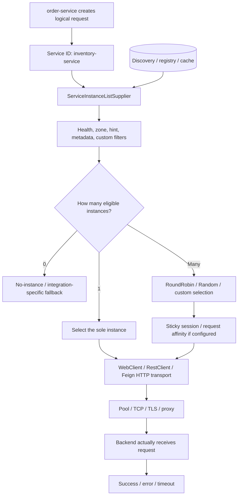
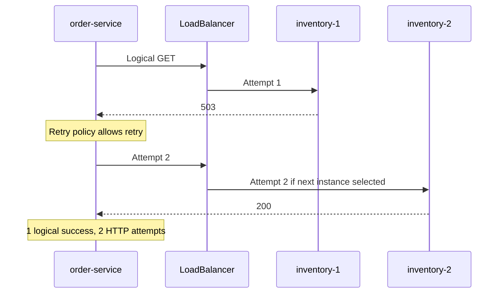
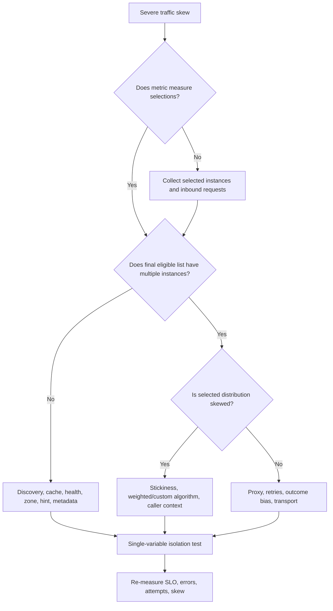

# Requests piling onto one replica: checking cache, sticky sessions, and algorithm

In a system using **Spring Cloud LoadBalancer**, `order-service` calls `http://inventory-service/api/products/P-1001` and expects requests to be selected across multiple `ServiceInstance` replicas. Yet the dashboard shows `inventory-1` receiving nearly all traffic while `inventory-2` and `inventory-3` receive very few or no requests. A common knee-jerk reaction is switching the algorithm from round robin to random, clearing connection pools, or scaling out replicas. Those changes may do nothing if the real root cause is **a cached instance list holding only one element, health/zone filters excluding the other instances, sticky sessions pinning the client to one destination, or metrics measuring the wrong layer**.

This lesson belongs to the **Troubleshooting** chapter of the Spring Cloud LoadBalancer module. We will investigate the **requests piling onto one replica** symptom, distinguish intentional behavior from bugs, verify the discovery → cache → supplier/filter → algorithm → HTTP transport chain, and build a reproducible lab along with a remediation decision table for `RestClient`, `WebClient`, and `OpenFeign`.

**Core principle:** Do not conclude LoadBalancer picked wrong purely from an HTTP responses dashboard. First measure **how many instances each caller sees, which instance was selected, which backend actually received the request, and whether any affinity mechanism sits in between**.

## 1. “Piling onto one replica” can mean several things

| Observed symptom | Necessarily a LoadBalancer bug? | What to distinguish |
|---|---|---|
| 95% of request count hits `inventory-1` | Not certain. | Was 1 actually picked more often, or did a gateway/proxy route to 1 after logical selection? |
| **Concurrent in-flight** requests pile up on `inventory-1` | Not certain. | Instance 1 processes slowly, holding connections open longer despite near-even selection counts. |
| Only **successful** responses come from `inventory-1` | Not certain. | Instances 2/3 may have received requests that timed out or returned errors. |
| All requests from **one user** go to one instance | Could be intentional. | Cookie/session affinity, tenant/shard routing, request hashing. |
| Every request from **one caller pod** goes to one instance while other callers look normal | Likely a local config issue. | Caller-specific cache, child context, discovery/zone metadata, or sticky key differences. |
| One instance gets more requests in a small sample | Could be normal variance. | Random selection does not guarantee exact splits over a few calls. |
| An instance still receives requests after registry removal | Likely stale data. | Cache/discovery refresh, DNS/proxy, or already in-flight requests. |

### Three ratios that must not be equated

```text
Selection ratio       = selections(instance-i) / total selections
Inbound request ratio = inbound HTTP requests(instance-i) / total inbound requests
Success ratio         = successful responses(instance-i) / total successful responses
```

When retries, network errors, socket reuse, proxies, circuit breakers, and timeouts come into play, these three ratios can diverge sharply. For instance, `inventory-2` is selected 50 times but 40 time out, while `inventory-1` succeeds on all 50: a dashboard counting only successes makes `inventory-1` look like it receives most of the traffic.

**Evidence of true load skew requires:** a significantly skewed `selectedInstance` distribution on the caller over an adequate sample window, **alongside** inbound request counts on the corresponding backends or proxies confirming that skew.

## 2. Visualize the request path before hunting for causes



This diagram is a diagnostic model. **The exact ordering of suppliers, filters, and sticky handling depends on configuration and the Spring Cloud release train**; do not treat the boxes as a fixed order across all projects.

### Every layer can produce a “single target” effect

1. **Discovery:** the registry returns only one `ServiceInstance`, while the remaining instances are not registered/ready yet.
2. **Cache:** an older single-element list is still being served; or multiple cache layers have different TTL/refresh cycles.
3. **Supplier/filter:** health, zone, hint, metadata, subset, or custom routing filters out ineligible instances.
4. **Selection:** a custom algorithm always picks index 0, random is mis-seeded/misused, or round robin has unexpected state.
5. **Affinity:** cookies, headers, tenant IDs, sharding, or service mesh session persistence pin a group of requests to one destination.
6. **Transport/proxy:** logical selections differ, yet actual requests pass through a shared upstream proxy that routes them to one instance.
7. **Measurement:** counting only successful responses or a single trace sample leads to a false conclusion.

There does not have to be just one cause. For example, a stale cache leaves only one instance; then the caller retries three attempts against that same instance, magnifying traffic concentration.

## 3. First step: verify replica counts at every layer

Before tuning the algorithm, build a comparison table at the **same point in time**:

| Checkpoint | Question | Data to collect |
|---|---|---|
| Deployment/registry | How many instances are truly Ready/registered? | Pod/instance ID, address/port, readiness, registration timestamp. |
| **Each caller's** discovery client | How many instances does caller A/B/C see? | Visible host:port/service ID list; version/timestamp. |
| Final `ServiceInstanceListSupplier` | After health/zone/custom filters, which targets remain? | Eligible count, excluded targets, and exclusion reasons. |
| LoadBalancer selector | Which instance did each logical attempt pick? | `serviceId`, `instanceId`, attempt, caller ID, timestamp. |
| Proxy/service mesh if any | Which upstream endpoint actually received the request? | Access logs, upstream host, route/cluster. |
| Backend | Which instance received and completed the request? | Inbound request count, HTTP status, duration, correlation ID. |

### How to interpret the three fundamental cases

**Case A — Registry has three, supplier leaves one:** The issue lies **before the selection algorithm**. Round robin cannot split traffic across three targets when handed only one element.

**Case B — Supplier has three, selector always picks one:** Investigate policies, stickiness/affinity, custom selectors, request context, counters/child contexts, and versions.

**Case C — Selector picks all three, backend sees only one:** Investigate proxies/sidecars, URL overrides, HTTP client ignoring the chosen instance, retries, misleading metrics, or requests failing before reaching backends.

Note that service discovery and Spring Cloud LoadBalancer are **client-side**; if a dashboard tracks a Kubernetes ingress or hardware load balancer, it does not necessarily observe the same layer as the Java caller's LoadBalancer algorithm.

## 4. ServiceInstance list cache: effects and common misconceptions

Spring Cloud LoadBalancer can cache the **list of `ServiceInstance` objects** supplied for a service ID. Caching avoids querying discovery on every call, but it can cause callers to see topology changes **later** than the registry when instances are added or removed.

### Caching the list does not mean caching the chosen instance

Suppose the cache holds:

```text
inventory-service -> [inventory-1, inventory-2, inventory-3]
```

If a round-robin selector runs over this list with no other affinity or filter, **list caching alone does not force every request onto inventory-1**. It only holds the candidate set; round robin still cycles through elements in the list.

However, if the cache holds:

```text
inventory-service -> [inventory-1]
```

then whether the selector is round robin or random, it **has only one choice**. This is a critical distinction between “cache is enabled” and “the cache holds an incomplete/stale list.”

### Caches that are easy to confuse

| State/cache type | Where does it belong? | What does staleness usually cause? |
|---|---|---|
| **LoadBalancer instance-list cache** | `ServiceInstanceListSupplier`/LoadBalancer cache if configured. | Caller keeps using an old list, missing newly scaled-up instances or retaining dead ones. |
| **DiscoveryClient/registry cache** | Eureka/Consul/Kubernetes client integration or discovery provider. | Source list is already stale **before** LB cache receives it. |
| **Health-check supplier state** | Probe results or point-in-time eligible list. | Healthy/new instances are temporarily excluded due to probe failures or refresh cadence. |
| **DNS resolver cache** | JVM/HTTP connector/OS/DNS. | A dynamic hostname keeps resolving to an old IP; does not imply `ServiceInstance` caching. |
| **HTTP connection pool** | Reactor Netty/Apache HC5/OkHttp. | Holds open/idle sockets; **not the ServiceInstance chooser**. |
| **Proxy/mesh affinity/cache** | Envoy/ingress/infrastructure load balancer. | All requests go to one upstream even though the Java caller selected multiple targets. |

**Principle:** Do not “disable every cache” before knowing which cache actually holds bad data. Triggering unbounded discovery queries or DNS lookups can overload the registry/resolver without fixing sticky configs.

### Configuring LoadBalancer cache for testing

In some Spring Cloud release trains, the following properties apply:

```yaml
spring:
  cloud:
    loadbalancer:
      cache:
        enabled: true
        ttl: 15s
        capacity: 256
```

These values are **for lab illustration only**. Check the configuration metadata/docs for your running version because syntax, TTL units, and enforcement can vary. Do not set an ultra-short TTL in production solely to fix skew before confirming the actual cache responsible.

### Testing the cache hypothesis

1. Record the registry's actual instance set and the caller's **final supplier set** at the same time.
2. Scale up / add a lab instance, wait for discovery propagation, and watch when the caller sees it.
3. After recording a baseline, **temporarily disable only the LoadBalancer cache in a test environment** and repeat the exact measurement.
4. If the new list appears immediately and distribution evens out, LB caching may be part of the cause; if only one instance still appears, inspect the upstream discovery/health/supplier layers.
5. Restore configuration and tune TTL/refresh based on real topology needs rather than leaving cache disabled as a default band-aid.

**An expired cache TTL does not guarantee an immediate fresh list:** registry propagation, discovery client refresh, supplier filters, and registry connectivity also contribute. Some discovery clients maintain their own caches; stacking multiple caches compounds staleness.

## 5. Sticky sessions and request affinity: concentration can be intentional

**Sticky** means requests sharing a common key are preferentially routed to the same destination for a period of time. That key can be a cookie, session ID, tenant, user, order/shard key, or custom header.

### Forms of affinity to recognize

| Mechanism | Symptom | What to verify |
|---|---|---|
| **Cookie-based sticky session** | Repeated requests from the same client/browser always hit one instance. | Cookie name/structure, expiration, path/domain, and where the cookie is issued. |
| **Header/request affinity** | Requests with the same tenant/user/request key always hit one instance. | Which header does the filter/custom supplier/route policy read? |
| **Hash/shard routing** | Small keyspace distributes unevenly across instances. | Hash function, partition count, key→instance mapping, hot keys. |
| **Gateway/ingress session affinity** | Java caller picks logical targets yet proxy pins upstream. | Cookie/header/route config at gateway/mesh, not just Spring config. |
| **Connection-level persistence** | A long-lived connection keeps traffic on one backend behind a proxy. | Proxy upstream selection, HTTP/2 stream routing, connection reuse. |

Spring Cloud LoadBalancer can support sticky sessions via suppliers/request contexts in appropriate versions/integrations. **Do not assume stickiness is enabled by default**, do not assume every HTTP client forwards cookies, and do not guess cookie placement in requests/responses without checking the actual class/filter.

### Single-user test pitfall

If you use a single browser session or k6 holding one cookie jar, every request may carry **the same affinity key**. Sending 100 requests from one user to the same instance can be **exact sticky compliance**, and proves nothing about load balancing across 100 independent users.

A proper experiment runs two checks:

1. **Keep the cookie/affinity key constant** across multiple requests: measure target concentration for *one session*.
2. **Vary cookies/affinity keys across independent sessions**: measure distribution across *multiple sessions*.

If (1) sticks to one instance while (2) spreads across replicas, affinity is likely working as designed. If all distinct keys still pick instance 1, inspect the eligible list, custom hashing, and proxies/selectors.

### Never remove stickiness in production without understanding state semantics

A system may hold session state in instance memory or enforce tenant/shard routing. Abruptly disabling stickiness can drop sessions, corrupt state, or route requests to instances lacking the right partition. The durable fix is shared state or explicit routing contracts with a migration and test plan.

## 6. RoundRobin, Random, and custom selectors: the right questions to ask

### RoundRobin

`RoundRobinLoadBalancer` generally cycles sequentially over the current instance list. However, the following factors prevent dashboard distribution from **looking like A-B-C-A-B-C**:

- Each caller process keeps its own state/counter; with multiple caller pods, selection sequences are not synchronized across pods.
- LoadBalancer maintains per-service-ID child contexts, and different clients do not necessarily share a counter in every configuration.
- The instance list changes, is filtered per request, or is reordered.
- Concurrent requests finish in a different order than they were selected.
- Retries generate extra attempts, and failed responses skew success counts.
- Sticky/hint/zone/metadata/custom suppliers restrict candidates per request.

**Conclusion:** Round robin does not promise that 6 requests observed in *completion order* will always be A-B-C-A-B-C. To test the algorithm, inspect the **actual selection order in a deterministic context**, not response log order from servers with differing latencies.

### Random

Random selection **does not guarantee** 10 requests will split roughly 3-3-4 across three instances. Over small samples, one instance receiving the majority can be normal probabilistic variance. Over larger samples with uniform candidates, expected ratios converge; even then, check stickiness, supplier filters, and traffic mix.

### Custom selection / weighted routing

A custom algorithm may intentionally select instances based on weights, zones, versions, locality, tenants, sharding, or fewest active requests. If one instance carries a higher weight, **uneven request counts are not necessarily a bug**.

Common implementation pitfalls:

```java
// Logical bug: picks the first element for every request.
ServiceInstance chosen = instances.get(0);
```

Or:

```java
// Bug if the list changes and the index is not managed safely.
int index = cachedIndex; // suppose it stays stuck at index 0
ServiceInstance chosen = instances.get(index);
```

These two snippets are anti-patterns, **not how to implement a LoadBalancer**. For custom code, inspect bounds checks, state concurrency, event-loop blocking, fallback conditions, metadata handling, and how instance list updates over time are handled.

### Decisive test

If the supplier returns a **fixed set of three healthy instances**, all stickiness/affinity is disabled in the lab, no proxy sits in between, and the client issues sequential synchronous requests, standard round robin should hit all three endpoints. If it still picks only one, investigate the **final algorithm bean** and custom code.

## 7. Health checks, zones, and metadata: why does the registry have three yet eligible has one?

One of the highest-probability causes of traffic concentration is **`ServiceInstanceListSupplier` decorators filtering the list before the algorithm runs**.

### Health filtering

Suppose the registry reports:

```text
inventory-1: UP, readiness = UP
inventory-2: UP, but /actuator/health/readiness returns 401
inventory-3: UP, but health probe times out
```

If the health-check supplier removes instances failing probes, the eligible list drops to `inventory-1` alone, even though the registry dashboard displays three **registered** replicas.

Common health-check failures:

- Probe hits the wrong path, port, or HTTP/HTTPS scheme.
- Health endpoint requires OAuth2/mTLS, which the probe lacks credentials for.
- Invalid TLS certificate/SAN or probe truststore missing the CA.
- Health timeout too short for cold/starting instances.
- Readiness reflects downstream dependencies like DB/Redis being unavailable, so the pod is registered yet marked not ready to serve.
- Custom health-check supplier refreshes the list on an unintended cadence.

**Do not infer solely from registry status:** verify the **HTTP status code and latency of the health probe along the exact caller network path**, then inspect the final supplier list. When zero healthy instances remain, whether fallback returns the original list or an empty list depends on version/configuration; do not assume Spring Cloud LoadBalancer always behaves one way.

### Zone / locality preference

Example:

```text
Caller order-1 in zone=az-a
  inventory-1 metadata zone=az-a
  inventory-2 metadata zone=az-b
  inventory-3 metadata zone=az-b
```

A local-zone preference policy can steer nearly all of `order-1`'s traffic to `inventory-1`. This may be **intentional behavior to reduce network latency and cross-zone charges**. Verify:

1. Where is the zone sourced from: caller environment, discovery metadata, Kubernetes labels, or custom config?
2. Does the algorithm enforce **hard filtering** or **soft preference/fallback**?
3. When the local instance is overloaded, is cross-zone spillover allowed?
4. Do distribution ratios differ between callers in different zones?

Do not disable locality immediately just to achieve a cluster-wide 33/33/33 split; evaluate SLAs, cross-zone traffic, and failure domains.

### Hints, versions, tenants, and canaries

A request carrying hint `version=stable` can exclude canary instances from candidates. Likewise, custom suppliers may filter on metadata such as `tenant=gold`, `region=vn-south`, `protocol=https`, or API compatibility.

| Registry | Request context/filter | Actual eligible |
|---|---|---|
| A(stable), B(canary), C(stable) | Stable only | A, C |
| A(zone-a), B(zone-b), C(zone-b) | Strict local zone-a | A |
| A(tenant-x), B(tenant-y), C(tenant-y) | Tenant-x | A |
| A(healthy), B(unhealthy), C(unhealthy) | Health filter | Possibly A only, per policy |

These are **illustrative cases**, not an assertion that every supplier enforces hard filtering for zones or tenants. Inspect the actual provider and filter for each configuration.

## 8. Supplier chain order determines what data the selector sees

Spring Cloud LoadBalancer can chain `ServiceInstanceListSupplier` decorators to fetch from discovery and apply caching, health checks, zone preference, and hint/sticky/custom filters. In custom chains, **where caching sits relative to filters** alters what gets cached and invalidation semantics.

### Two distinct hypotheses

```text
Hypothesis 1:
Discovery -> Cache(all 3) -> Filter(request-specific) -> [1 eligible]

Hypothesis 2:
Discovery -> Filter(one eligible) -> Cache(filtered list) -> [1 cached]
```

In Hypothesis 1, the cache correctly holds all three instances, while a per-request filter keeps only one. In Hypothesis 2, the cache stores an already-filtered list and serves stale/wrong results if cache key or request context semantics were misdesigned.

Do not treat these two chains as standard configuration code; they are **analytical models**. In actual implementations:

- Read the exact bean/supplier ordering configured in the application context.
- Identify which suppliers depend on request context vs. only on service ID.
- Verify cache keys incorporate necessary request attributes **if** you write custom per-tenant/per-hint caching or suppliers.
- Ensure suppliers do not unexpectedly block the event loop with synchronous HTTP health calls.
- When building custom chains, follow your release train's guidance to avoid nested caches or misplaced filter layers.

**Security risk:** Do not trust user-supplied metadata/cookies/tenant IDs to pick privileged instances unless the server authenticates and authorizes them. Tenant routing is only safe when the identity/tenant context is trustworthy.

## 9. Retries can concentrate traffic after errors

Retries are a common reason **HTTP attempts** diverge from **logical operations**.



**Two common confusing cases:**

1. **Same-instance retry:** `inventory-1` errors out yet receives multiple attempts from a single logical call. Request counters on `inventory-1` spike while the caller thinks only one operation occurred.
2. **Next-instance retry:** a degraded instance receives failed first attempts, while a healthy instance receives successful second attempts. Dashboards showing only successes skew heavily toward the healthy instance.

When debugging, temporarily **disable retry layers intentionally in the lab** (Spring Cloud LoadBalancer, Spring Retry, Reactor `retryWhen`, Feign `Retryer`/business policies) to observe baseline selection. Do not disable production retries without a rollback plan.

Some Spring Cloud LoadBalancer retry properties look like:

```yaml
spring:
  cloud:
    loadbalancer:
      retry:
        enabled: false
```

Property effect depends on dependencies, version, and active blocking/reactive integration. In addition, HTTP transports/proxies may perform their own retries or routing. Therefore, **counting actual inbound HTTP attempts on the backend** remains essential verification.

### Do not forget idempotency and deadlines

For read-only GETs, bounded retries can make sense. For state-mutating POSTs, a caller-side timeout **does not guarantee** the backend did not already execute side effects. When retrying for load recovery, use idempotency keys/operation IDs and server-side deduplication if operations may be replayed.

If instance 1 stays slow and pushes retries onto instance 2, both can saturate. Combine attempt budgets, jittered backoff, overall deadlines, and circuit breakers/bulkheads; do not fix skew by raising retries without bound.

## 10. Connection pools, keep-alive, and proxies: understand their true role

A common but inaccurate explanation is: “The HTTP client uses a connection pool, so it always calls one instance.” In client-side Spring Cloud LoadBalancer, **when each request executes through LoadBalancer**, the pool generally **does not pick the instance in place of the selector**. The client picks a logical/remote destination first, and the HTTP transport then allocates/reuses an appropriate socket for it.

However, several special setups can create concentration effects:

| Scenario | Does the pool actually cause stickiness? | How to verify |
|---|---|---|
| WebClient Reactor Netty picks A/B/C, pooling per remote | Usually **no**: pool reuses sockets for the already-selected remote. | Compare selected instance vs. remote address in client metrics. |
| Java client connects to a **shared proxy** rather than backends directly | The proxy may pin upstream per connection/session. | Inspect proxy upstream access logs and route/cluster config. |
| Ingress/mesh sets `sessionAffinity` or sticky cookies | Affinity may happen **at the proxy layer**, independent of Spring's algorithm. | Test with/without cookies; check mesh/ingress config. |
| HTTP/2 multiplexing over one TCP socket to a reverse proxy | Multiple streams share the proxy connection; upstream routing depends on proxy. | Inspect HTTP/2 streams and backend routing at the proxy. |
| Client uses a fixed URL or Feign `url` override | Bypasses service-ID selection entirely. | Inspect effective URL and bean/delegate. |

With Kubernetes in particular:

- If the Java caller hits a Kubernetes Service DNS/IP and bypasses Java LoadBalancer for that call, distribution is handled by kube-proxy/mesh/ingress.
- If `SimpleDiscoveryClient`/Kubernetes DiscoveryClient supplies **individual pod IPs**, Java LoadBalancer selects specific pods.
- If discovery supplies **a single Kubernetes Service ClusterIP**, the Java selector sees one entry while kube-proxy/mesh distributes underneath. In that case, a single entry in Java does not prove traffic lands on only one pod.

To conclude accurately, inspect **remote TCP destinations**, proxy upstream destinations, and actual inbound requests on each backend.

## 11. Observing without disrupting production

A diagnostic dashboard should track both **selection** and **outcome**. Gather signals across four layers:

| Layer | Recommended metrics/logs | Meaning |
|---|---|---|
| Caller / logical request | Operation count, success/error, retry count, p95/p99. | What do users/callers actually experience? |
| Discovery / supplier | Candidate count pre/post-filter, list age, empty-list count, refresh errors. | How many valid targets is the algorithm given? |
| LoadBalancer selection | `serviceId`, `selectedInstance`, request/attempt ID, caller identity. | Which target did the selector actually pick? |
| HTTP/proxy/backend | Actual remote IP:port, inbound requests, status, latency, active/pending pool. | Did the logical choice become an HTTP request to that backend? |

**Illustrative** structured log example:

```text
traceId=tr-202
caller=order-2
serviceId=inventory-service
eligibleCount=3
selectionPolicy=roundRobin
selectedInstance=inventory-3
attempt=1
httpRemote=10.22.1.13:8080
outcome=HTTP_200
```

These fields do not all appear automatically just by enabling Spring Cloud LoadBalancer. Custom observations, interceptors/filters, event listeners, or dedicated instrumentation may be required. When recording metrics, bound `instanceId` cardinality (especially for ephemeral pod IDs) and avoid raw user IDs, session IDs, bearer tokens, or PII-bearing URLs as labels.

### Metrics that are insufficient on their own

- `http.server.requests` on the backend only counts requests the backend **received**; it excludes attempts that timed out acquiring a pool connection on the caller.
- `http.client.requests` may measure logical calls or individual attempts depending on instrumentation layer; know the meter semantics.
- `reactor.netty.connection.provider.active.connections` counts active connections per pool, **not selected requests**.
- An HTTP `200` status does not reveal which instance the selector picked if a proxy performed another routing hop.
- Low tracing sample rates can miss most failures, making trace distributions diverge from reality.

### Correlate three IDs

Use **trace/correlation ID** for the logical operation, **attempt index** for retries, and **instance ID/remote endpoint** for the selected target. That lets you reconstruct:

```text
logical operation #42
  attempt 1: selected inventory-2, HTTP timeout
  attempt 2: selected inventory-1, HTTP 200
  final business outcome: SUCCESS
```

Do not infer selection order from **response completion order**; slower instances finish later and invert log ordering.

## 12. Build a lab with three inventory-service replicas

To reproduce and test hypotheses without depending on a production registry or infrastructure, set up:

```text
                       ┌── inventory-1 localhost:8081
test client → order-service localhost:8080
                 │     ├── inventory-2 localhost:8082
                 └─ LB └── inventory-3 localhost:8083
```

Each inventory instance returns JSON with `instance` and `requestId`. `order-service` uses a `@LoadBalanced WebClient.Builder` to call `http://inventory-service`. In the baseline lab, **do not enable stickiness, retries, proxies, or custom health filtering** so fewer variables interact simultaneously.

### Prerequisites

- Java 17+, Maven, and a compatible Spring Boot/Spring Cloud pair. When using Spring Framework 6.1+ and Spring Cloud LoadBalancer, choose the release train per your project's compatibility matrix; do not mix arbitrary old/new versions.
- `inventory-service` project: `spring-boot-starter-webflux` and (optionally) `spring-boot-starter-actuator`.
- `order-service` project: `spring-boot-starter-webflux`, `spring-cloud-starter-loadbalancer`, and (optionally) `spring-boot-starter-actuator`.
- Projects must have matching Spring Boot/Cloud dependency management and run on separate ports.
- `curl`/Postman or `k6` to send requests, plus access to logs/metrics of the three instances.

A **learner-created** directory layout, not auto-generated files:

```text
lb-skew-lab/
├── inventory-service/
│   ├── pom.xml
│   └── src/main/...
├── order-service/
│   ├── pom.xml
│   └── src/main/...
└── route-test.js
```

### Backend: each replica identifies itself

`inventory-service/src/main/resources/application.yml`:

```yaml
spring:
  application:
    name: inventory-service
server:
  port: ${SERVER_PORT:8081}
lab:
  instance-id: ${LAB_INSTANCE_ID:inventory-1}
  response-delay-ms: ${LAB_RESPONSE_DELAY_MS:0}
management:
  endpoints:
    web:
      exposure:
        include: health,info,metrics
```

Java example in the inventory project:

```java
package lab.inventory;

import java.time.Duration;
import java.util.concurrent.atomic.AtomicLong;
import org.springframework.beans.factory.annotation.Value;
import org.springframework.boot.SpringApplication;
import org.springframework.boot.autoconfigure.SpringBootApplication;
import org.springframework.web.bind.annotation.GetMapping;
import org.springframework.web.bind.annotation.RequestHeader;
import org.springframework.web.bind.annotation.RestController;
import reactor.core.publisher.Mono;

@SpringBootApplication
public class InventoryApplication {
    public static void main(String[] args) {
        SpringApplication.run(InventoryApplication.class, args);
    }
}

@RestController
class InventoryDebugController {
    private final String instanceId;
    private final long delayMs;
    private final AtomicLong inbound = new AtomicLong();

    InventoryDebugController(
            @Value("${lab.instance-id}") String instanceId,
            @Value("${lab.response-delay-ms:0}") long delayMs) {
        this.instanceId = instanceId;
        this.delayMs = Math.max(0, Math.min(delayMs, 5000));
    }

    @GetMapping("/debug/instance")
    Mono<InstanceReply> instance(
            @RequestHeader(value = "X-Debug-Request-Id",
                           defaultValue = "manual") String requestId) {
        long count = inbound.incrementAndGet();
        return Mono.delay(Duration.ofMillis(delayMs))
                .map(x -> new InstanceReply(instanceId, requestId, count));
    }

    @GetMapping("/debug/count")
    InstanceCount count() {
        return new InstanceCount(instanceId, inbound.get());
    }
}

record InstanceReply(String instance, String requestId, long receivedCount) {}
record InstanceCount(String instance, long received) {}
```

**Why increment the counter at the start of the handler?** If the response is slow and the caller times out, the counter still shows the handler was invoked. This counter does **not** count TCP attempts that never reached the HTTP handler or requests blocked at a proxy. Nor is it production metrics; real projects use cardinality-controlled instrumentation.

### Start three independent backends

Example on PowerShell using three terminals:

```powershell
# Terminal A: inventory-service/
$env:SERVER_PORT = "8081"
$env:LAB_INSTANCE_ID = "inventory-1"
$env:LAB_RESPONSE_DELAY_MS = "0"
mvn spring-boot:run
```

```powershell
# Terminal B: inventory-service/
$env:SERVER_PORT = "8082"
$env:LAB_INSTANCE_ID = "inventory-2"
$env:LAB_RESPONSE_DELAY_MS = "0"
mvn spring-boot:run
```

```powershell
# Terminal C: inventory-service/
$env:SERVER_PORT = "8083"
$env:LAB_INSTANCE_ID = "inventory-3"
$env:LAB_RESPONSE_DELAY_MS = "0"
mvn spring-boot:run
```

On macOS/Linux, use the corresponding environment variable syntax. If using Docker, do not configure `localhost:8081` inside one container to reach another; use container-network-reachable hostnames/ports.

Test each backend directly:

```bash
curl "http://localhost:8081/debug/instance"
curl "http://localhost:8082/debug/instance"
curl "http://localhost:8083/debug/instance"
```

Verify each JSON response returns a distinct `instance` and its corresponding `/debug/count` increases. If all three return `inventory-1`, you cloned process/config settings improperly; **you cannot use those responses to conclude LoadBalancer is skewing traffic**.

## 13. WebClient caller via service ID: reproducible baseline

`order-service/src/main/resources/application.yml`:

```yaml
spring:
  application:
    name: order-service
  cloud:
    discovery:
      client:
        simple:
          instances:
            inventory-service:
              - uri: http://localhost:8081
              - uri: http://localhost:8082
              - uri: http://localhost:8083
    loadbalancer:
      retry:
        enabled: false
      cache:
        enabled: false

server:
  port: 8080
management:
  endpoints:
    web:
      exposure:
        include: health,info,metrics
```

Disabling the LoadBalancer cache here is a **choice to reduce variables in the lab**, not a production recommendation. Do not use this configuration to assume startup/discovery in a real registry yields all three instances instantaneously.

Java code for the caller project:

```java
package lab.order;

import org.springframework.boot.SpringApplication;
import org.springframework.boot.autoconfigure.SpringBootApplication;
import org.springframework.cloud.client.loadbalancer.LoadBalanced;
import org.springframework.context.annotation.Bean;
import org.springframework.context.annotation.Configuration;
import org.springframework.stereotype.Service;
import org.springframework.web.bind.annotation.GetMapping;
import org.springframework.web.bind.annotation.RequestHeader;
import org.springframework.web.bind.annotation.RestController;
import org.springframework.web.reactive.function.client.WebClient;
import reactor.core.publisher.Mono;

@SpringBootApplication
public class OrderApplication {
    public static void main(String[] args) {
        SpringApplication.run(OrderApplication.class, args);
    }
}

@Configuration(proxyBeanMethods = false)
class HttpClientConfiguration {
    @Bean
    @LoadBalanced
    WebClient.Builder inventoryLoadBalancedBuilder() {
        return WebClient.builder();
    }
}

@Service
class InventoryGateway {
    private final WebClient client;

    InventoryGateway(@LoadBalanced WebClient.Builder builder) {
        this.client = builder
                .baseUrl("http://inventory-service")
                .build();
    }

    Mono<InstanceReply> whichInstance(String requestId) {
        return client.get()
                .uri("/debug/instance")
                .header("X-Debug-Request-Id", requestId)
                .retrieve()
                .bodyToMono(InstanceReply.class);
    }
}

@RestController
class RouteController {
    private final InventoryGateway gateway;

    RouteController(InventoryGateway gateway) {
        this.gateway = gateway;
    }

    @GetMapping("/debug/route")
    Mono<InstanceReply> route(
            @RequestHeader(value = "X-Debug-Request-Id",
                           defaultValue = "manual") String requestId) {
        return gateway.whichInstance(requestId);
    }
}

record InstanceReply(String instance, String requestId, long receivedCount) {}
```

This is **lab-specific illustrative code**: `WebClient.builder()` does not necessarily preserve all Spring Boot customizations (observation, SSL, custom codecs). When applying to a real app, verify the Boot-managed builder/HTTP connector and any `LoadBalancerClientFactory` child-context beans if customizations exist.

Start `order-service` on port 8080 and call:

```bash
curl -H "X-Debug-Request-Id: demo-1" \
  "http://localhost:8080/debug/route"
```

Call it repeatedly to observe the returned `instance` changing. Calling only once reveals nothing about distribution. **Do not change `baseUrl` to `localhost:8081`** while debugging: that bypasses Spring Cloud LoadBalancer and masks the real issue.

### Formulate a clear hypothesis

With three healthy backends, a static list of three URIs, no stickiness/retries/custom algorithm, and sequential requests, default round robin typically cycles across all three endpoints. If you do not observe that:

1. Verify whether `@LoadBalanced WebClient.Builder` injected the right bean.
2. Verify the Spring Cloud LoadBalancer starter and WebClient integration are on the classpath.
3. Verify all three URIs are reachable from the **caller process**.
4. Verify no URL overrides, proxies, or custom supplier/filter configs exist.
5. Check exceptions/statuses for non-`200` requests and inbound counters.

**Do not rush to switch to random:** if the list has one element or the code calls a fixed URL, random will not distribute traffic either.

## 14. Measure distribution using a load tool and backend counters

Create `route-test.js` in your lab directory:

```javascript
import http from 'k6/http';
import { check } from 'k6';
import { Counter } from 'k6/metrics';

const selected = new Counter('lab_success_by_instance');
const failed = new Counter('lab_failed');

export const options = {
  scenarios: {
    concurrent_requests: {
      executor: 'constant-vus',
      vus: Number(__ENV.VUS || 10),
      duration: __ENV.DURATION || '30s',
    },
  },
};

export default function () {
  const id = 'lab-' + __VU + '-' + __ITER;
  const url = (__ENV.BASE_URL || 'http://localhost:8080')
      + '/debug/route';

  const response = http.get(url, {
    timeout: '5s',
    headers: { 'X-Debug-Request-Id': id },
  });

  if (response.status === 200) {
    const body = response.json();
    const ok = check(body, {
      'instance and id match': x =>
        ['inventory-1', 'inventory-2', 'inventory-3'].includes(x.instance)
        && x.requestId === id,
    });
    if (ok) selected.add(1, { instance: body.instance });
  } else {
    failed.add(1, { status: String(response.status) });
  }
}
```

Run the test:

```bash
k6 run -e VUS=10 -e DURATION=30s route-test.js
```

Notes:

- `lab_success_by_instance` counts **successful responses**, **not LB selections** during failures.
- `constant-vus` is concurrency-driven, not a fixed arrival rate. If a backend slows down, request throughput drops accordingly.
- k6 calls a single `order-service` instance. Production runs multiple caller replicas; inspect per-caller and cluster-wide.
- In the lab, inspect inbound counters on all three backends:

```bash
curl "http://localhost:8081/debug/count"
curl "http://localhost:8082/debug/count"
curl "http://localhost:8083/debug/count"
```

Read counter values **before and after** each run and compute the delta rather than raw totals, since warm-up/manual checks ran earlier. If k6 finishes with many errors, successful response counts will differ from inbound counter deltas.

### Sample results table, ready for your measurements

| Run | Instance 1 inbound delta | Instance 2 inbound delta | Instance 3 inbound delta | Success count | Error count | Notes |
|---|---:|---:|---:|---:|---:|---|
| Baseline, 1 caller, 3 targets | Measure | Measure | Measure | Measure | Measure | Assess distribution |
| Only 1 URI in supplier | Measure | Measure | Measure | Measure | Measure | Verify list-size effect |
| Sticky 1 session (with policy enabled) | Measure | Measure | Measure | Measure | Measure | Verify affinity |
| Multiple session keys | Measure | Measure | Measure | Measure | Measure | Verify hash/bias |
| Backend 2 slow | Measure | Measure | Measure | Measure | Measure | Compare inbound vs. success |

Metrics must be measured by the learner; never fabricate benchmark numbers or treat an exact equal split as mandatory under concurrent load.

## 15. Reproducing a single-instance supplier

When suspecting discovery/cache data, first construct a scenario with **genuinely only one candidate**, to see how every algorithm shares the same constraint.

### Steps

1. Stop `order-service` in the lab.
2. Edit `order-service/application.yml` so **only** `inventory-1` remains in the list:

```yaml
spring:
  cloud:
    discovery:
      client:
        simple:
          instances:
            inventory-service:
              - uri: http://localhost:8081
```

3. Restart the caller while keeping all three backends running.
4. Send multiple requests to `http://localhost:8080/debug/route` and inspect `instance` and inbound counters.
5. Restore all three URIs, restart the caller, and measure the baseline.

**Grounded prediction:** When the supplier holds only one `ServiceInstance`, round robin/random cannot pick the other backends even though they are listening on 8082/8083. That reflects a **narrowed candidate set**, not a selector bug.

### Do not call this test “stale cache”

`SimpleDiscoveryClient` reads **static configuration**. If you edit the YAML file on disk without refreshing/restarting the application context, do not expect the instance list to update automatically. “New URI not visible” here is **static config behavior**, not proof that Spring Cloud LoadBalancer's cache is broken.

To test stale caching properly:

- Use a real discovery provider in tests, or a `ServiceInstanceListSupplier`/mock discovery whose **source data changes while the caller stays alive**.
- Record when the source gains all three instances, when the caller's supplier starts returning three, and when the cache refreshes.
- Compare LoadBalancer cache enabled vs. disabled **in an isolated environment**, keeping health/filter/selector policies identical.
- If disabling cache still leaves only one instance, inspect the discovery provider or health filtering instead of lowering TTL further.

## 16. Sticky session and hot-key scenario

The lab in Section 13 **does not enable stickiness**. Consequently, simply sending `Cookie: session=abc` or `X-Tenant: A` **does not automatically activate stickiness in Spring Cloud LoadBalancer**.

To test stickiness, you need an actual sticky configuration (a version-appropriate sticky supplier/filter or a session-affinity proxy/ingress) and to know the exact key used.

### Matrix for distinguishing stickiness from a buggy selector

| Case | Request data | Behavior consistent with stickiness | When to suspect a bug? |
|---|---|---|---|
| S1 | 100 calls with one cookie | May hit the same instance. | Cookie is assumed unused yet traffic pins to one due to unexpected config. |
| S2 | 100 distinct sessions/cookies | Should observe multiple targets **if policy hashes/spreads across buckets**. | All distinct keys still hit one target despite multi-element final list and no such policy. |
| S3 | Clear cookie / change session ID | May switch instances. | Never switches and stays on one; check another route key or proxy affinity. |
| S4 | Two caller pods, same session | Depends on shared hashing/state and policy. | Callers unexpectedly behave differently; check child contexts. |
| S5 | One tenant accounts for 90% RPS | One shard/instance may run hot. | Global request count balance does not equal tenant weight balance. |

Do not expect “100 session IDs must split evenly 33/33/34” if the hash policy operates over few keys or unequal weights/zones. With consistent hashing, distribution depends on keyspace, partition count, and mapping; a few “hot” keys can dominate traffic even when hashing works properly.

### Using browser/curl tests properly

To test cookie affinity on **a system with stickiness explicitly enabled**, try:

```bash
# Same cookie, multiple times
curl -H "Cookie: sc-test-session=A" "http://localhost:8080/debug/route"
curl -H "Cookie: sc-test-session=A" "http://localhost:8080/debug/route"

# Different cookie
curl -H "Cookie: sc-test-session=B" "http://localhost:8080/debug/route"
```

`sc-test-session` is an **assumed cookie name**; this check only verifies affinity when a component along the path is configured to **actually read that cookie name**. Do not assume Spring Cloud LoadBalancer understands this cookie automatically, or relays it in WebClient by itself. When stickiness comes from downstream response cookies, inspect `Set-Cookie`, path/domain, expiry, and whether callers/browsers send the cookie back.

### Adjusting stickiness safely

If the issue is heavy requests from one large tenant concentrating on one instance, consider per-tenant concurrency limits, finer sharding, moving state to a shared store, or weighted/partition-aware routing. Do not abruptly turn off affinity for stateful workloads, as it can invalidate sessions or corrupt data.

## 17. Algorithm scenario: separate the algorithm from its inputs

A decisive experiment splits into three groups:

**Group 1 — Fixed candidate list and no stickiness:** three stable instances, sequential requests, one caller process. Observe actual selections via logs/response IDs. With standard round robin on fixed inputs, **every target should have a chance to be picked**.

**Group 2 — Keep list, swap algorithm:** compare round robin against random or a custom selector in a **separate test context**, keeping traffic and the three instances constant. If random also picks only one, check supplier/affinity/proxy first. If only the custom selector sticks to index 0, inspect its logic.

**Group 3 — Keep algorithm, enable filters:** deliberately add zone/hint/health filters. If the post-filter list shrinks to one, always picking one is the expected outcome. Only evaluate the algorithm once disabling filters restores three candidates.

### Responsibility attribution table

| Source list | Final eligible | Selected distribution | Backend inbound | Priority hypothesis |
|---:|---:|---|---|---|
| 1 | 1 | One instance | One instance | Registry/source list insufficient. |
| 3 | 1 | One instance | One instance | Health/zone/hint/custom filter. |
| 3 | 3 | One instance | One instance | Stickiness, custom selection, request context, state, or algorithm bug. |
| 3 | 3 | Three instances | One instance | Proxy/transport/URL override/measurement bias. |
| 3 | 3 | Three instances | Three instances, yet only-success skewed | Uneven timeouts/errors/latency. |

**Important:** In Spring Cloud LoadBalancer, algorithms and suppliers can live in per-service-ID child contexts. If the application customizes beans for `inventory-service`, do not inspect only the main application context and conclude no custom selector exists. Check the exact service ID, bean selection, and active auto-configuration.

## 18. Slow backend scenario: success counts can skew even when selection is balanced

Keep all three instances in the supplier with **retries disabled**, but make `inventory-2` slower.

In the `inventory-2` terminal:

```powershell
$env:SERVER_PORT = "8082"
$env:LAB_INSTANCE_ID = "inventory-2"
$env:LAB_RESPONSE_DELAY_MS = "2500"
mvn spring-boot:run
```

To reproduce timeouts, you must **set an HTTP response/overall timeout on the caller** to cut off slow requests; the `InventoryGateway` code in Section 13 **does not yet have a timeout**. You can add a limit in the pipeline:

```java
// Only in the timeout test variant; requires importing java.time.Duration.
Mono<InstanceReply> result = client.get()
        .uri("/debug/instance")
        .header("X-Debug-Request-Id", requestId)
        .retrieve()
        .bodyToMono(InstanceReply.class)
        .timeout(Duration.ofMillis(800));
```

This is a **replacement for the return expression** in `InventoryGateway.whichInstance`, not a snippet to paste anywhere. With an 800 ms limit while `inventory-2` delays 2500 ms:

- The caller can select `inventory-2` many times yet time out before a successful response arrives.
- Backend `inventory-2` still received the HTTP requests; its inbound counter still increments.
- k6 only tags instances on valid `200` responses, so `inventory-2`'s success count stays low.
- Looking only at `lab_success_by_instance` falsely suggests LoadBalancer skipped `inventory-2`.

**Practice:** measure each backend's `/debug/count` delta before and after load while also counting HTTP `200`s and errors on the caller. If inbound counts are roughly balanced while successes are skewed, the issue is **outcome/latency**, not necessarily the selector. Then remove the delay or raise the timeout **in the lab** to verify the hypothesis.

Do not “even out” a production dashboard by increasing response timeouts: a slow backend causes pending pools, retries, and p99 latency to climb. Fix why the backend is slow—CPU, DB pool, locks, I/O, or upstream dependencies.

## 19. When health/zone drops targets: fix at the source

Do not apply one blanket fix to every situation:

| Verified root cause | Change to consider | What NOT to do |
|---|---|---|
| New instance not registered/ready yet | Fix startup/readiness/registration and propagation delay; re-measure supplier. | Switch round robin to random. |
| Health endpoint returns `401`/`403` | Configure proper probe authentication/network or an appropriate readiness endpoint. | Disable API security globally so health checks pass. |
| Health probe times out | Verify path/port/scheme, TLS, and why probe is slow; adjust with verification. | Set infinite timeouts or ignore real readiness. |
| Zone filter leaves one local instance | Evaluate hard vs. soft locality, cross-zone fallback, and capacity. | Disable locality without assessing cross-zone cost/SLO. |
| Custom hint/version filter too strict | Fix request metadata, fallback policy, and canary routing. | Strip all tenant/version validation. |
| Discovery cache stale | Check registry refresh, supplier chain, and TTL at the right layer. | Blindly set all cache TTLs to 0 in production. |
| Custom selector stuck at index 0 | Fix algorithm, add concurrency/boundary tests, roll back broken custom rule. | Add connections, raise timeouts, or add backend replicas. |
| Unexpected proxy/mesh stickiness | Adjust proxy routing/session policy after verifying stateful needs. | Only tweak Spring LoadBalancer beans. |
| Only successful-request metrics skewed | Add attempt/inbound/selection metrics and analyze errors. | Change algorithm to “fix” a misleading dashboard. |

Only change configuration once you have pinned down **the source list, eligible set, selected instance, and actual backend**. In production, prepare canary/rollback steps and monitor p95/p99, error rates, and retry amplification after applying changes.

## 20. The same issue across RestClient, WebClient, and OpenFeign

HTTP clients differ in API yet share the **same diagnostic principles**: verify the logical URL goes through Spring Cloud LoadBalancer, check candidate lists, instance selection, HTTP transport, and responses.

### RestClient

With a compatible Spring Framework 6.1+/Spring Boot setup, a minimal configuration:

```java
import org.springframework.cloud.client.loadbalancer.LoadBalanced;
import org.springframework.context.annotation.Bean;
import org.springframework.context.annotation.Configuration;
import org.springframework.web.client.RestClient;

@Configuration(proxyBeanMethods = false)
class RestClientConfiguration {
    @Bean
    @LoadBalanced
    RestClient.Builder inventoryRestClientBuilder() {
        return RestClient.builder();
    }
}
```

Gateway uses **that exact `@LoadBalanced` bean**:

```java
RestClient client = inventoryRestClientBuilder
        .baseUrl("http://inventory-service")
        .build();

InstanceReply reply = client.get()
        .uri("/debug/instance")
        .retrieve()
        .body(InstanceReply.class);
```

`inventoryRestClientBuilder` is the builder bean injected into the gateway, and `InstanceReply` is the lab DTO. With a blocking client, each request holds the caller thread until a response arrives; connection pooling and timeouts depend on the `ClientHttpRequestFactory` in use. **Connection reuse is not proof of stickiness** when LoadBalancer resolves the URL properly on each call; compare selected instances against remote addresses.

**Common bug:** a service injects a default un-annotated `RestClient.Builder` instead of `@LoadBalanced` and calls `http://inventory-service`. It may throw a DNS error or hit external DNS/service routing rather than Spring Cloud LoadBalancer as intended.

### WebClient

WebClient relies on LoadBalancer's filter and an HTTP connector. Check:

- Does the builder have `@LoadBalanced` and is the filter actually attached?
- Is `baseUrl("http://inventory-service")` used rather than a fixed URL?
- How does Reactor Netty's `ConnectionProvider` pool per remote, and is a shared proxy configured?
- Does code use `retryWhen` or `flatMap` concurrency generating multiple attempts to one destination?
- Is anything blocking the event loop, causing one instance to time out more often despite balanced selection?

In reactive pipelines, constructing a `Mono` does not send a request; **subscription** triggers I/O. When logging selections, instrument the execution path rather than logging during bean initialization.

### OpenFeign

Example:

```java
import org.springframework.cloud.openfeign.FeignClient;
import org.springframework.web.bind.annotation.GetMapping;

@FeignClient(name = "inventory-service")
public interface InventoryFeignClient {
    @GetMapping("/debug/instance")
    InstanceReply whichInstance();
}
```

When no fixed `url` is configured and LoadBalancer integration is present, Feign can use `FeignBlockingLoadBalancerClient` to pick an instance. Verify:

- Does `@FeignClient` specify `url`, `spring.cloud.openfeign.client.config.<name>.url`, or a custom target override?
- Is the underlying Feign HTTP `Client` HC5, OkHttp, or another transport, and does it carry the right LoadBalancer wrapper?
- Are custom `RequestInterceptor`, `Retryer`, `Capability`, or custom load-balancing configs altering behavior?
- Does an HTTP/HTTPS proxy sit behind the Feign delegate?

A Feign client with only `name` generally selects by service ID; one with a fixed URL can bypass discovery/selection. **Bean/interface naming alone does not prove LoadBalancer is active.**

### Shared error matrix

| Symptom | RestClient | WebClient | OpenFeign | What to measure |
|---|---|---|---|---|
| Service ID fails to resolve | Missing LB builder/interceptor or empty discovery. | Missing LB builder/filter or empty discovery. | Missing LB wrapper, URL override, or empty discovery. | Bean/URL/candidate list. |
| One instance picked repeatedly | Shared supplier/affinity/selector issue. | Shared supplier/affinity/selector issue. | Shared supplier/affinity/selector issue. | Eligible set and selections. |
| Actual target differs from selected instance | HTTP request factory/proxy. | Connector/proxy. | Feign delegate/proxy. | Actual remote, proxy upstream. |
| Post-selection failure | Blocking connect/read timeout. | Reactive pool/Netty timeout. | Feign connect/read/transport exception. | Attempts, backend inbound, status/cause. |
| Skewed success count | Per-instance errors/timeouts. | Per-instance errors/timeouts. | Per-instance errors/timeouts. | Inbound vs. successful responses. |

### Legacy systems using RestTemplate

A `@LoadBalanced RestTemplate` can use `LoadBalancerInterceptor`. Although this lesson emphasizes the three modern clients, the exact same troubleshooting flow applies to RestTemplate: verify the annotated bean, interception, `ServiceInstance` list, remote selection, and `ClientHttpRequestFactory`. Never assume every `RestTemplate` has client-side load balancing enabled by default.

## 21. First-15-minutes incident runbook: from symptom to evidence

When dashboards alert that one instance is absorbing most requests, run **read-only checks first** before editing configuration:

### Minutes 0–3: confirm scope

1. Record service ID, environment, time window, caller replica count, and backend replica count.
2. Confirm whether the metric tracks **inbound**, **completed**, **successful**, or **selected** requests.
3. Compare total request count, p95/p99, error/timeout rates, and retry rates across instances.
4. Determine whether only one endpoint/tenant/session is concentrated or all traffic is affected.

### Minutes 3–7: compare candidates against selections

1. Cross-check registry/ready instances against **discovery results on each caller**.
2. Inspect the list after health/zone/hint/custom filters.
3. Count selected instances per caller pod/service ID/attempt.
4. Check whether retries, sticky cookies/headers, weighted routing, or canary/zone policies are active.

### Minutes 7–11: cross-check network and backends

1. Compare selected instances against remote HTTP destinations and proxy upstreams.
2. Check inbound request counts even on backends returning errors.
3. Identify slow-responding instances and per-remote pending connection pools.
4. If data is stale, record source list refresh/cache age alongside scale-up/down timestamps.

### Minutes 11–15: form a hypothesis and act safely

1. Pick **one** root-cause branch backed by evidence: source/cache, filter/health, stickiness, selector, or proxy/metrics.
2. Run a low-risk comparison in lab/canary, **changing only one variable**.
3. If the incident is severe, prioritize structured load shedding/rollback; never blindly disable security, health checks, or stateful stickiness.
4. Document what was observed, what remains unknown, what changed, and rollback criteria.



## 22. Quick diagnosis table by symptom

| Symptom | Priority hypothesis | Verification test | Conditional fix |
|---|---|---|---|
| Only old pod selected after scale-up | Stale cache/discovery propagation. | Registry vs. supplier over time; cache age; toggle one cache in lab. | Tune refresh/TTL, fix registry or supplier. |
| Registry 3, final list 1 | Health/zone/hint filter. | Log filter reasons, probe status, metadata. | Fix probe/filter config or fallback policy. |
| Only requests with cookies stay on A | Sticky session. | Same cookie vs. multiple distinct cookies. | Keep if intended; fix affinity policy if unintended. |
| All tenants hit A despite list of 3 | Buggy custom selector or proxy. | Selected-instance logs and proxy upstream. | Fix index/hash/policy or proxy. |
| One caller pod picks A, others balance | Caller-local config/state/cache. | Compare child contexts, discovery views, env/zone, and versions. | Sync config; fix skewed cache/metadata. |
| Backend A receives 80%, LB selections look balanced | Upstream proxy affinity or wrong metric source. | Compare selected vs. actual remote and inbound. | Fix the skewing layer; do not randomly change LB algorithm. |
| Only A's successes are high, B/C inbound still high | B/C timing out/5xx or running slow. | Compare per-backend inbound/status/latency. | Fix backend/per-instance issue, retries/deadlines. |
| k6 single user always hits A, multi-user balances | Session/key affinity. | Vary cookies/sessions and measure key distribution. | May be valid behavior. |
| Switching to random still hits only A | Candidates only A, or stickiness/proxy runs post-selector. | Record eligible count and selected-instance. | Fix source/affinity/proxy first. |
| Different URIs yet TCP hits one IP | Proxy/DNS/mesh or discovery URIs resolve to same remote. | Remote TCP endpoint, DNS, proxy upstream logs. | Fix topology/routing; do not assume pool is the selector. |
| Drained instance still gets requests briefly | Cache, in-flight calls, proxy/DNS/pool lifecycle. | Registry timestamp, cache refresh, socket state, attempts. | Implement graceful draining and refresh, not just socket closure. |
| Health endpoint `401` concentrates traffic | Probe lacks credentials or hits wrong endpoint. | Health check request/response and supplier filtering. | Configure dedicated probe auth/network, do not open entire API. |
| Instance A p99 is high while request counts are even | Instance A processes slower, holding more in-flight requests. | Handler/DB spans, active connections, and queues. | Fix backend bottleneck rather than forcing equal active counts. |

Do not treat this table as an automated diagnosis: symptoms can stem from multiple interacting causes. In particular, **retries, timeouts, and circuit breakers** create gaps between request counts, selection counts, accepted counts, and completed counts.

## 23. Automated tests worth having before deployment

Tests can verify algorithm/supplier behavior and catch regressions when adding health checks or stickiness:

### Eligible set test

Mock the registry returning A/B/C, then deliberately configure metadata so filters exclude B/C. Assert the **post-filter** list matches policy rather than only asserting three instances in the mock registry. Add a separate test where health probes return `401`/timeout to verify unhealthy/fallback behavior on your exact version.

### Algorithm test on a stable list

Using a fixed `ServiceInstanceListSupplier` and selector inside a test context, trigger enough sequential selections. Assert every candidate is picked according to the expected policy. Do not rely on **response completion** order across concurrent backends.

### Stickiness / affinity test

When a real sticky policy is present, send the same session key repeatedly and multiple independent session keys; assert the *affinity contract* without assuming all sessions must split strictly evenly. Test behavior when the cookie's target instance becomes ineligible.

### Cache refresh test

Use a discovery provider/supplier whose backing data mutates while the caller remains running: A → A/B/C → B/C; verify update timing across cache expiration and removal of deregistered instances. Using static `SimpleDiscoveryClient` and restarting the application context between changes **does not prove TTL/refresh behavior**.

### Real HTTP integration test

Run three `MockWebServer`s or small backends on dynamic ports, register them under the service ID, send requests through a `@LoadBalanced` client, and assert:

- Actual HTTP requests reach the expected backends.
- Headers/correlation IDs are preserved per contract.
- Selected instances and inbound counters match when no proxy or retries exist.
- A slow/`503` backend is not misclassified as the algorithm skipping that instance.

### Per-caller test

If production runs multiple `order-service` replicas, spin up multiple caller test contexts with differing configs/zones. Observe local state/counters; do not assume round robin is a cluster-wide counter shared across all JVMs.

**Important:** These tests require harnesses matching your release train. `MockRestServiceServer` can check RestClient/RestTemplate request construction, but it does not prove TCP behavior or LoadBalancer target selection; integration tests need real HTTP servers or reliable instrumentation.

## 24. Misconceptions to eliminate

**“Three Ready pods means round robin will definitely split evenly.”** Not necessarily: Spring Cloud LoadBalancer might see fewer than three candidates due to discovery/caching/health/zone rules, or a policy may intentionally prefer one target.

**“Enabling cache causes stickiness.”** Generally false. Caching `[A, B, C]` does not pin which element is chosen. Skew happens via caching only when the cached list omits targets or a custom cache/supplier misuses request-specific state.

**“One TCP connection means one instance, so keep-alive must be disabled.”** HTTP pooling does not replace instance selection by default; in proxy/mesh setups there may be separate connection-level affinity. Verify actual remote routing.

**“Switching round robin to random will fix the skew.”** Not if the list has one item, stickiness is active, or a proxy re-routes requests downstream. Random also only balances in expectation over large samples.

**“All successful responses came from A, so B/C were never selected.”** False if B/C received requests that timed out or returned 5xx. Inspect inbound attempts and selected-instance metrics.

**“Disabling cache for a few seconds changed nothing, so discovery isn't the problem.”** Insufficient: discovery clients have their own caches, health/metadata suppliers still filter, or static providers were not updated.

**“Just scaling up replicas will balance traffic.”** Not if new replicas are not ready/registered, are excluded by zone filters, or selectors still read a stale list.

**“Round robin must appear as A-B-C-A-B-C in response logs.”** Not with concurrent requests, varying latencies, multiple caller contexts, retries, or changing lists. Log **at selection time**.

**“Concentrated load is always a bug.”** It can be intentional sticky sessions, hot tenants/shards, or locality routing. An incident occurs when actual distribution **violates capacity/SLOs or breaks contracts**, not merely when percentages are unequal.

## 25. Investigation and fix verification checklist

- [ ] Identified the exact service ID, caller instances, and backend replicas within the same observation window.
- [ ] Distinguished **selected** counts, **inbound** HTTP counts, **successful** response counts, and **in-flight** requests.
- [ ] Checked registry/Ready state, discovery results on each caller, and final `ServiceInstanceListSupplier` output.
- [ ] Checked LoadBalancer cache, discovery-provider cache, TTL/refresh, versions, and instance update sources.
- [ ] Did not conclude stale caching from editing static `SimpleDiscoveryClient` YAML without restarting.
- [ ] Checked health probes, readiness, `401/403`, TLS/port/path/timeouts, and supplier filtering.
- [ ] Checked zone preferences, hints, version/canary, tenant metadata, request context, and missing-candidate fallbacks.
- [ ] Checked for sticky sessions/cookies, affinity headers, consistent hashing, shard/hot keys, or weighted policies.
- [ ] Tested with **one cookie** and **many session keys** to tell valid affinity apart from broken selection.
- [ ] Verified the actual algorithm: `RoundRobinLoadBalancer`, `RandomLoadBalancer`, or custom selection in the right service child context.
- [ ] Did not infer selection order from response completion order under concurrency, timeouts, and retries.
- [ ] Verified RestClient/WebClient inject the `@LoadBalanced` builder and OpenFeign has no URL override/bypass.
- [ ] Cross-checked selected instances against HTTP remote addresses, proxy/mesh upstreams, and inbound counters.
- [ ] Distinguished Kubernetes Service IPs from pod IPs and identified which layer performs load balancing.
- [ ] Checked retries across HTTP transport, LoadBalancer, and business layers; counted actual attempts, not just logical operations.
- [ ] Compared status codes, p95/p99, active/pending queues/pools, and backend capacity per instance.
- [ ] Separated slow/timing-out instances from selection bugs before changing algorithms.
- [ ] Checked graceful draining behavior when instances are removed from discovery.
- [ ] Changed only one policy at a time in lab/canary, then re-measured eligible set, selections, inbound, successful responses, and SLOs.
- [ ] Did not disable mTLS, authorization, readiness, or stateful stickiness just to make a dashboard look even.
- [ ] Did not place bearer tokens, real session cookies, user IDs, or sensitive data into metric labels or logs.
- [ ] Documented changes, before/after evidence, blast radius, rollback steps, and remaining risks.

## 26. Summary

When requests pile onto one replica, verify three core root-cause groups in order:

1. **Cache/discovery/supplier:** How many `ServiceInstance` replicas does the caller actually see? Did stale lists, health/zone/hint filters, or a wrong service ID narrow candidates to one?
2. **Stickiness/affinity:** Is a cookie, session, tenant, hot key, hash, or proxy route intentionally sending correlated requests to the same target? Single-session concentration is completely different from global skew.
3. **Algorithm/selection:** When the eligible list holds multiple targets with no affinity, is the active algorithm round robin, random, or custom? Is there per-caller/per-service-ID state or an index selection bug?

Then inspect **HTTP transport, proxies, retries, and bias from counting only successful responses**. Spring Cloud LoadBalancer governs instance selection on the Java caller side, but it cannot fix stale registries, cure slow backends, replace TLS/health policies, or control downstream proxies on its own.

**Incident resolution rule:** **measure eligible list → measure selected instance → measure backend inbound → correlate outcomes**, and only then fix the exact skewing layer. That prevents blindly disabling caches/stickiness or swapping algorithms, keeping `RestClient`, `WebClient`, and `OpenFeign` calls stable even as service instances change.
