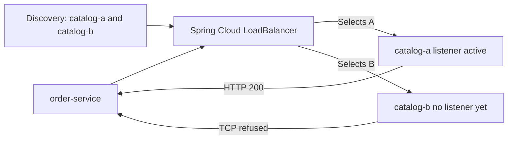
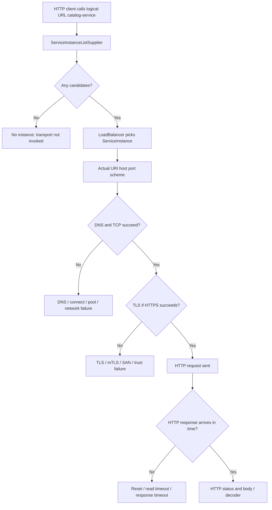
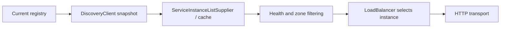

# Connection failures even though discovery reports the replica exists

A common microservices incident: `order-service` calls `http://catalog-service/api/products/P42` via Spring Cloud LoadBalancer, the registry still shows two `catalog-service` replicas, yet some requests fail with `Connection refused`, `Connect timed out`, or TLS errors. Operators see an “UP” record and assume LoadBalancer picked the wrong algorithm. In reality, **an instance still listed in discovery does not guarantee it is listening on the advertised host/port or reachable from the calling application**.

In the `SPRING_CLOUD_SERVICE_COMMUNICATION_LOAD_BALANCING` module, Spring Cloud LoadBalancer selects a `ServiceInstance` using service ID, discovery, and health/zone/routing policies. Only after selection do `RestClient`, `WebClient`, or OpenFeign pass through DNS, TCP, TLS, and HTTP transport. This lesson belongs to the **Troubleshooting** chapter and helps separate pre-selection errors, connection errors, and post-receipt server errors so you fix the true cause instead of merely raising timeouts or retries.

## 1. Scenario: two instances are registered, one is unreachable

Suppose discovery returns:

```text
Service ID: catalog-service
  catalog-a: 10.40.2.11:8081  (registered)
  catalog-b: 10.40.2.12:8081  (registered)

Reality:
  catalog-a: listener open, returns HTTP 200
  catalog-b: just restarted, port 8081 not listening yet
```

`order-service` uses `RoundRobinLoadBalancer`. Some requests to A succeed while the rest to B fail. The registry lease has not expired or the consumer still holds a stale snapshot, so B remains visible.



The first conclusion is not “round robin is broken” but: **LoadBalancer picked an endpoint from its list, yet that endpoint cannot serve requests**. Verify the registry record, consumer snapshot, selected endpoint, and network state at the exact time requests failed.

## 2. Four concepts that must not be equated

| Layer | What is proven | What is **not** yet proven |
|---|---|---|
| Registration | The registry holds metadata for a replica | The process is alive or the port is open |
| Discovery | The consumer retrieved a list of `ServiceInstance` objects | The list is fresh or reachable from the consumer |
| Selection | LoadBalancer returned an instance per policy | DNS/TCP/TLS will succeed |
| Connectivity | Can reach host:port and complete handshake if TLS is used | The API exists, auth is valid, or business logic succeeds |
| Readiness | Probes pass configured readiness conditions | All APIs and dependencies cannot fail |

A `ServiceInstance` typically carries `serviceId`, `instanceId`, `host`, `port`, `uri`, `isSecure()`, and metadata. That is configuration/discovery data, not an open socket. Specifically:

- `isSecure() == true` does not prove the server certificate is valid.
- A health endpoint returning `200` does not prove business endpoints are fast or healthy.
- An entry remaining in the registry can be stale data from heartbeats/leases or caches.
- A host reachable from an operator's workstation is not guaranteed to be reachable from a consumer pod/container.

## 3. Identify the failing phase of an HTTP request



| Caller symptom | First suspected phase | Was an HTTP response received from target? |
|---|---|---|
| No instance / no server available | Discovery, supplier, selection | No |
| `UnknownHostException` | DNS of physical hostname or missing LoadBalancer | No |
| `Connection refused` | TCP connect rejected, wrong port/listener | No |
| Connect timeout | Routing, firewall, CNI/network policy, unresponsive target | No |
| Pool acquire timeout | Waiting for an HTTP client connection | Not yet sent on a leased connection |
| `SSLHandshakeException` | TLS/mTLS, CA, SAN, certificate, protocol | Typically before reaching HTTP handler |
| `Connection reset` | Peer/proxy closed connection | Request may have reached the server |
| Read/response timeout | Timed out waiting for response | Server may already have executed the action |
| HTTP `404`, `401`, `403`, or `503` | An HTTP endpoint/proxy actually returned a status | Yes |
| JSON decode error after `200` | Contract, body, converter | Yes |

**Critical warning for write operations:** a reset or read timeout does not guarantee the server has not processed the request. Before retrying a payment/inventory-reservation `POST`, use idempotency keys and check state before repeating side effects.

## 4. Standard diagnostic workflow

When an error alert arrives, do not start by tweaking retries or timeouts. Proceed in order:

1. **Capture a sample failing request:** timestamp, service ID, method/path template, correlation ID, HTTP client, exception root cause, and duration.
2. **Verify the actual logical URL:** does it go through LoadBalancer via `http://catalog-service`, or is a fixed `url`/proxy configured?
3. **Inspect candidate list from the consumer process:** which addresses are in `DiscoveryClient` and `ServiceInstanceListSupplier`?
4. **Identify the selected instance:** ID, host, port, scheme, `isSecure`, zone, and actual URI.
5. **Test from the consumer's exact environment:** DNS, TCP port, TLS, and HTTP endpoint phase by phase.
6. **Inspect the corresponding server:** process, listener, readiness, container/pod network, and inbound request logs.
7. **Compare discovery/cache update timing:** is the record stale or carrying an old port/IP after a restart/rollout?
8. **Check resilience policies:** are timeouts, retries, health checks, or bulkheads/circuit breakers masking or multiplying errors?

Do not infer which instance was picked solely from round-robin ordering in logs. Concurrency, retries, zones, caching, and candidate changes make selection order differ from response order. Observe actual outcomes per attempt.

## 5. Inspect the instance list from the right consumer

Example diagnostic component for test/internal environments only:

```java
package com.example.orders.diagnostics;

import java.util.List;
import org.springframework.cloud.client.ServiceInstance;
import org.springframework.cloud.client.discovery.DiscoveryClient;
import org.springframework.stereotype.Component;

@Component
public class CatalogDiscoveryDiagnostic {

    private final DiscoveryClient discoveryClient;

    public CatalogDiscoveryDiagnostic(DiscoveryClient discoveryClient) {
        this.discoveryClient = discoveryClient;
    }

    public List<String> snapshot() {
        return discoveryClient.getInstances("catalog-service")
                .stream()
                .map(this::describe)
                .toList();
    }

    private String describe(ServiceInstance instance) {
        return "instanceId=" + instance.getInstanceId()
                + " serviceId=" + instance.getServiceId()
                + " host=" + instance.getHost()
                + " port=" + instance.getPort()
                + " secure=" + instance.isSecure()
                + " uri=" + instance.getUri();
    }
}
```

This is a snapshot from `DiscoveryClient`. **Do not assume** it matches the final list LoadBalancer chooses from, since `ServiceInstanceListSupplier` may apply caching, health filtering, zone preference, request hints, or other policies. For selection-related issues, instrument the supplier chain and selected instance according to your release train.

Do not expose this diagnostic component as a public API: topology, IPs, internal ports, and instance metadata require access control. When using `ReactiveDiscoveryClient`, read the publisher via reactive pipelines; never call `.block()` on a Reactor event loop for diagnostics.

## 6. Registry has the right service ID but wrong host/port

Common registration mistakes:

- Server runs on `server.port=8082` while the registry advertises `8081`.
- Server binds only to `127.0.0.1` while callers connect to a network IP.
- Registry advertises a hostname/private IP with no route from the consumer.
- Docker container listens on internal port `8080`, yet discovery stores the host-published port `18080` even though callers are inside the Docker network.
- A rolling deployment changes Pod IPs; the consumer still holds old IPs.
- A proxy/sidecar has its own listener, yet the registry points directly to an unreachable app port.
- A new instance registers before its process actually opens the port or passes readiness.

```text
catalog-b process:  listens 0.0.0.0:8082
registry record:   catalog-b.internal:8081
consumer connects: catalog-b.internal:8081

→ Discovery record exists, yet no listener exists on the selected endpoint.
```

Verify all three sides independently:

| Side | Question |
|---|---|
| Server | Which `IP:port` is the app listening on? Is it bound to loopback only? |
| Registry/supplier | Which endpoint is actually advertised and selected? |
| Consumer | From the consumer's network namespace and policies, is that endpoint reachable? |

On Linux you can run `ss -lnt` on the server host/container; on Windows, `Get-NetTCPConnection -State Listen`. An open listener alone does not prove firewalls or NetworkPolicies allow the consumer to connect.

## 7. Bad DNS, bad TCP, and missing LoadBalancer configuration

Distinguish two paths:

```text
With @LoadBalanced builder:
  http://catalog-service
    → ServiceInstanceListSupplier
    → selects catalog-b.internal:8081
    → DNS/TCP to catalog-b.internal:8081

Without @LoadBalanced builder:
  http://catalog-service
    → HTTP transport attempts DNS lookup for "catalog-service"
    → likely UnknownHostException
```

In the second case, having `catalog-service` in the registry does not help because the client **is not using discovery**. Having the LoadBalancer starter on the classpath does not automatically turn every newly created `RestClient.builder()` or `WebClient.builder()` into a load-balanced client.

Commands to test from the **consumer's network namespace**:

```bash
# Test only the real target hostname, not the logical service ID.
getent hosts catalog-b.internal

# Use a safe test endpoint; observe TCP vs. HTTP behavior.
curl -v --connect-timeout 2 --max-time 5 \
  http://catalog-b.internal:8081/whoami
```

On Windows PowerShell:

```powershell
Test-NetConnection -ComputerName catalog-b.internal -Port 8081
```

`Connection refused` typically indicates fast rejection at the TCP/listener or policy level. `Connect timed out` suggests dropped packets, routing/firewall issues, or an unresponsive host; inspect the network path. `UnknownHostException` indicates hostname resolution failure, which can also be a sign the HTTP client completely **bypassed** LoadBalancer.

Minimal container images may lack `curl` or `getent`. Use a debug pod/container authorized by your organization; **do not use results from your laptop as proof of workload networking**.

## 8. Containers and Kubernetes: why `localhost` easily misleads

In Docker/Kubernetes, `localhost` inside `order-service` is localhost **of that exact container/pod**, not a catalog server running elsewhere. Containers inside the same Kubernetes Pod share a network namespace, whereas Pod A and Pod B do not.

An example static discovery list valid for **three processes on one local machine**, yet broken when catalog runs in two separate containers:

```yaml
spring:
  cloud:
    discovery:
      client:
        simple:
          instances:
            catalog-service:
              - uri: http://localhost:8081
              - uri: http://localhost:8082
```

Within a Docker network where `catalog-a` and `catalog-b` hostnames are configured and resolvable from the consumer, the app can use:

```yaml
spring:
  cloud:
    discovery:
      client:
        simple:
          instances:
            catalog-service:
              - uri: http://catalog-a:8080
              - uri: http://catalog-b:8080
```

Hostnames in the second YAML are **examples only**, not names Docker creates automatically in every deployment. On Kubernetes, inspect:

```bash
kubectl -n demo get pods -o wide
kubectl -n demo get services
kubectl -n demo get endpointslices -l kubernetes.io/service-name=catalog-service
```

Verify `Service.targetPort`, Pod IPs, EndpointSlice addresses, readiness, and NetworkPolicies. `Pod Running` does not mean `Ready` or that the listener is reachable. Pod IPs also change across restarts.

In particular, a URL targeting a Kubernetes `Service`/ClusterIP may be routed by kube-proxy/CNI rather than Spring Cloud LoadBalancer selecting individual Pods. Know whether the client consumes a list of **pod endpoints** or **one service VIP/DNS** to avoid confusing two load-balancing layers.

## 9. Wrong HTTP/HTTPS scheme or TLS certificates

One replica may listen for **HTTPS** on port `8443` while the consumer uses `http://...`. Or the registry records `secure=false` even though the server requires TLS. Post-LoadBalancer scheme handling must be checked against `ServiceInstance.isSecure()`, the initial URI, and your actual integration/version behavior.

| Error | Causes to investigate |
|---|---|
| Connection closes immediately on send | Plaintext HTTP sent to an HTTPS listener, or proxy reset |
| `NotSslRecordException` or similar | TLS transport received non-TLS bytes |
| `SSLHandshakeException` | Untrusted CA, expired cert, SAN mismatch, TLS version/cipher, mTLS client cert |
| `Connection refused` on 8443 | No HTTPS listener on that port or policy rejection |
| HTTP `401/403` | TLS/HTTP succeeded far enough for server to reply; check auth, do not treat as TCP failure |

If the registry advertises `catalog-b.internal` while the certificate only has SAN `catalog-service.internal`, hostname verification fails when the client validates `catalog-b.internal`. When connecting by IP, the certificate needs a matching IP SAN.

**Never use `curl -k`, `trustAll`, or disable hostname verification to “fix” TLS.** Fix the CA, SAN, hostname, `isSecure`, or TLS termination properly.

To isolate DNS in a lab while keeping TLS hostname verification intact:

```bash
curl -v --connect-timeout 2 --max-time 5 \
  --resolve catalog-b.internal.example:8443:10.40.2.12 \
  https://catalog-b.internal.example:8443/whoami
```

`--resolve` bypasses DNS lookup for that hostname in the command; it **does not prove DNS is healthy**. If the server requires mTLS, a valid client certificate and private key per policy are also needed; never bypass server verification.


## 10. Stale registry/LoadBalancer cache or health checks not reflecting endpoint state

A subtle source of failures is **multiple state layers not updating at the same time**:



Common scenarios:

1. An instance died, yet its registry lease/heartbeat has not expired.
2. An instance deregistered, yet the discovery client still returns an earlier snapshot.
3. LoadBalancer's supplier caches or replays the list without refreshing yet.
4. A new Pod has a different IP after rollout while some consumers still use the old Pod IP.
5. Periodic health checks have not detected the outage yet; readiness may report inaccurately.
6. Different consumers hold snapshots from different timestamps, so only some consumers fail.

**Do not check only the registry TTL and conclude the entire system is up to date.** Distinguish registry data age, discovery client age, supplier cache age, and health-check status. Measure refresh timestamps, instance counts pre/post-filtering, and the actual selected instance ID.

`HealthCheckServiceInstanceListSupplier` filters instances via probes, with caveats: health is a periodic snapshot, and `/actuator/health` returning 200 does not prove the product-lookup API works well. Depending on policy and version, the supplier can also **fall back to returning the delegate list when zero instances pass health checks** (fail-open). Never assume adding health checks completely prevents ever picking a broken endpoint.

### Readiness, liveness, and draining

| Replica state | May registry still list it? | Connection behavior |
|---|---|---|
| Starting up, port not bound yet | Yes if registered early | TCP refused |
| Listener open, DB not ready yet | Yes | TCP works; business endpoint may return 503 |
| Shutting down / draining | Yes during propagation lag | Some requests reset/time out |
| Process crashed abruptly | Yes until lease/cache expires | Connect fails |
| Liveness UP, readiness DOWN | Depends on discovery/route integration | Should not receive new requests |
| Health UP yet business endpoint very slow | Yes | Slow HTTP response or timeout |

Ensure **registration occurs only after readiness**, and **stop accepting new requests / drain before closing the listener**, using your registry or orchestration mechanisms. Liveness probes decide process restarts, not routing readiness.

## 11. Fix the HTTP client properly: service IDs must go through LoadBalancer

A plain HTTP client treats `http://catalog-service` as a DNS hostname. Having Spring Cloud LoadBalancer in dependencies **is not enough**; you must use an integrated builder/proxy.

### Synchronous RestClient

Example for Spring Framework 6.1+ and compatible Spring Cloud:

```java
package com.example.orders.config;

import org.springframework.cloud.client.loadbalancer.LoadBalanced;
import org.springframework.context.annotation.Bean;
import org.springframework.context.annotation.Configuration;
import org.springframework.web.client.RestClient;

@Configuration(proxyBeanMethods = false)
public class CatalogClientConfiguration {

    @Bean
    @LoadBalanced
    RestClient.Builder loadBalancedRestClientBuilder() {
        return RestClient.builder();
    }
}
```

```java
package com.example.orders.catalog;

import org.springframework.cloud.client.loadbalancer.LoadBalanced;
import org.springframework.stereotype.Component;
import org.springframework.web.client.RestClient;

@Component
public class CatalogClient {
    private final RestClient restClient;

    public CatalogClient(@LoadBalanced RestClient.Builder builder) {
        restClient = builder.clone()
                .baseUrl("http://catalog-service")
                .build();
    }

    public ProductDto find(String id) {
        return restClient.get()
                .uri("/api/products/{id}", id)
                .retrieve()
                .body(ProductDto.class);
    }
}
```

`ProductDto` is an application DTO. If code inside a service method calls `RestClient.builder().build()` anew, that client **does not inherit** the LoadBalancer interceptor from the bean above. When multiple builders exist, use explicit `@Qualifier` annotations to avoid injecting a non-load-balanced client.

### Reactive WebClient

```java
@Bean
@LoadBalanced
WebClient.Builder loadBalancedWebClientBuilder() {
    return WebClient.builder();
}
```

```java
public CatalogReactiveClient(@LoadBalanced WebClient.Builder builder) {
    webClient = builder.clone()
            .baseUrl("http://catalog-service")
            .build();
}
```

`@LoadBalanced WebClient.Builder` lets Spring Cloud attach the proper exchange filter. Return `Mono<ProductDto>` from calls instead of calling `.block()` on an event loop, and remember connection errors can still happen if the selected instance has a bad host/port.

### OpenFeign

```java
@FeignClient(name = "catalog-service", path = "/api/products")
public interface CatalogFeignClient {
    @GetMapping("/{id}")
    ProductDto get(@PathVariable("id") String id);
}
```

Enable scanning with `@EnableFeignClients` and compatible OpenFeign and LoadBalancer starters. Adding `url="http://localhost:8081"` on the annotation or configuring a fixed URL bypasses discovery and pins calls to one endpoint; when it dies, other healthy replicas in the registry will not help.

For HTTP Interfaces (`HttpServiceProxyFactory`), `RestClientAdapter` or `WebClientAdapter` must likewise be built from a **load-balanced** HTTP client. The `@HttpExchange` annotation alone does not enable discovery.

## 12. Classify exceptions by HTTP client instead of a generic catch

| Client | Common exception types | Interpretation to verify |
|---|---|---|
| `RestClient` | `ResourceAccessException`, `RestClientException` subtypes | Inspect root cause, request factory, connect/read timeouts |
| `WebClient` | `WebClientRequestException` | I/O, DNS, connect, TLS, or connection error—not strictly DNS |
| `WebClient` | `WebClientResponseException` | Received HTTP error status; read status safely |
| OpenFeign | `RetryableException` | May stem from I/O or retry policy; does not imply safe retry |
| OpenFeign | `FeignException` and subtypes | May contain HTTP status/response; check method and error source |
| Root causes | `ConnectException`, `UnknownHostException`, `SSLHandshakeException`, `SocketTimeoutException` | Maps to exact phase; do not equate with outer wrapper |

WebClient example separating transport errors from HTTP response errors:

```java
Mono<ProductDto> result = webClient.get()
        .uri("http://catalog-service/api/products/{id}", id)
        .retrieve()
        .bodyToMono(ProductDto.class)
        .doOnError(error -> {
            if (error instanceof WebClientRequestException transport) {
                Throwable cause = transport.getCause();
                log.warn("catalog transport failure: cause={}",
                        cause == null
                            ? "unknown"
                            : cause.getClass().getSimpleName());
            } else if (error instanceof WebClientResponseException response) {
                log.warn("catalog HTTP response status={}",
                        response.getStatusCode().value());
            }
        });
```

This snippet assumes a declared logger and DTO, plus imports for `WebClientRequestException` and `WebClientResponseException`. Logs are kept brief to avoid printing tokens and sensitive bodies. Recording the selected instance may require dedicated LoadBalancer lifecycle/tracing; URIs inside exceptions on some integrations may still reflect the logical URL, which is **insufficient** to confirm the real instance.

With OpenFeign, if the server returns `404`, `ErrorDecoder` normally handles the HTTP status; if TCP connect never succeeded, the decoder has no server response to read. When a circuit breaker is OPEN, the caller may also receive an exception **without ever sending an HTTP attempt**.

## 13. Fix the exact layer matching the timeout

| Timeout | Where does it occur? | What to inspect |
|---|---|---|
| Discovery/selection | Waiting on supplier or `ServiceInstance` choice | Registry latency, snapshot, scheduler, health |
| Connection pool acquisition | Waiting for an available connection | Pool leased/available/pending, per-route limits |
| DNS lookup | Resolving the selected hostname | DNS records, search domains, cache/resolver |
| Connect | Opening TCP socket to host/port | Listener, firewall, routes, NetworkPolicy |
| TLS handshake | CA, SAN, TLS/mTLS negotiation | Certificates, protocols/ciphers, trust material |
| Read/response | Slow server/proxy processing, delayed reply | Downstream logs, DB, queues, network |
| Overall deadline | Entire logical request including retries/backoff | Remaining budget before each attempt |

A long `readTimeout` will not cure `Connection refused`. Raising `connectTimeout` will not cure a `ServiceInstanceListSupplier` returning `[]`. Adding retries when pools are exhausted grows queues and slows down every request.

Enforce an **overall request budget**: if you start with 1,000 ms and spend 700 ms on selection, pool wait, and the first attempt, the next attempt must not get another full 1,000 ms. With WebClient, place `Mono.timeout(remaining)` outside the retry chain; with blocking clients, coordinate HTTP transport timeouts and cancel work where possible. **Caller timeouts do not guarantee server-side effects were cancelled.**

## 14. Retries only mask symptoms if the endpoint stays broken

If A is healthy while B has the wrong port, retrying onto A may let some logical requests succeed. However, that does not fix B in the registry; the system still wastes time on failed attempts and generates extra load.

| Root cause | Retry onto another instance? | Recommended policy |
|---|---|---|
| B just died, A is healthy | Possible | Bound attempts; use health/removal to avoid picking B |
| Every instance has a bad hostname | Not helpful | Fix registration/DNS |
| TLS CA/SAN wrong on all instances | No | Fix PKI/scheme |
| Client pool exhausted | Usually harmful | Concurrency limits, pool tuning, shorter connection hold times |
| 503 due to server overload | Conditional | Backoff/jitter, `Retry-After`, and retry budgets |
| POST/PUT after read timeout | Depends on idempotency | Never retry blindly; check transaction state |
| Very stale registry snapshot | May keep picking stale endpoint | Refresh source/supplier; set appropriate TTL |

Even when network errors affect only one replica, **unbounded retries** multiply attempts across Gateway, application, LoadBalancer, and HTTP transport. Pick one retry owner, bound attempt counts, and respect deadlines. Do not equate same-instance retry with next-instance retry; if only one valid instance exists, raising retry counts does not conjure a new healthy replica.

Circuit breakers and bulkheads limit blast radius from failing dependencies, but they do not fix DNS, ports, TLS, or bad registry records. When a breaker is OPEN, requests are rejected pre-connection; record `failureStage=short_circuit` instead of calling it a TCP timeout.

## 15. Observability: know which instance and which phase failed

A dashboard showing only `http.client.duration=800ms` and `publicStatus=503` is rarely enough. Useful fields to include:

| Signal | Question answered |
|---|---|
| `traceId` / `correlationId` | Which hops belong to the same request? |
| `serviceId` | Which logical service name was called? |
| `instanceId`, selected host/port | Are errors concentrated on one replica? |
| `attemptNumber`, `retryOwner` | How many extra attempts did the request spawn? |
| `failureStage` = selection/dns/pool/connect/tls/response/decode | At which step did it fail? |
| `supplierSnapshotAge`, instance count | Is the list stale or filtered empty? |
| Upstream HTTP status (if any) | Did server/proxy return 404/503? |
| Connect/TLS/response duration | Is connecting slow or server processing slow? |
| Pool pending/leased | Is connection pooling saturated? |
| Deadline remaining | Did calls continue after budget expired? |

Correlate client logs with access logs on the **exact selected instance**. If the client gets connection refused and the server sees no request, the fault occurred before the HTTP handler. If the server logged processing a POST while the caller timed out reading, **do not assume the action did not happen**.

Micrometer/Actuator, Reactor Netty, and Apache HttpClient can emit transport metrics with proper dependencies and instrumentation. `LoadBalancerLifecycle` provides before/after callbacks on request phases, though you should not assume every lifecycle duration measures **pure instance selection** time. Verify the hooks for your exact release train.

Keep metric tags bounded in cardinality; `traceId`, raw URLs containing product IDs, tokens, dynamic instance IDs, or IPs belong in access-controlled traces/logs rather than time-series labels.


## 16. Lab exercise: two replicas, one unreachable

**Goal:** demonstrate that `SimpleDiscoveryClient` still lists a stopped or mis-ported replica, and distinguish TCP errors from no-instance, DNS, TLS, and HTTP 503.

### Server preparation

Run two `catalog-service` Spring Boot apps on the same machine: replica A on port `8081` and replica B on `8082`. Each process exposes a simple endpoint:

```java
package com.example.catalog;

import java.util.Map;
import org.springframework.core.env.Environment;
import org.springframework.web.bind.annotation.GetMapping;
import org.springframework.web.bind.annotation.RestController;

@RestController
public class IdentityController {
    private final String instanceId;

    public IdentityController(Environment environment) {
        this.instanceId =
                environment.getProperty("catalog.instance-id", "unknown");
    }

    @GetMapping("/whoami")
    public Map<String, String> whoAmI() {
        return Map.of("instanceId", instanceId);
    }
}
```

Configure each process with `catalog.instance-id=catalog-a`/`server.port=8081` and `catalog.instance-id=catalog-b`/`server.port=8082` respectively. In the **consumer**, configure a static list:

```yaml
spring:
  cloud:
    discovery:
      client:
        simple:
          instances:
            catalog-service:
              - uri: http://localhost:8081
              - uri: http://localhost:8082
```

`localhost` is only valid when the consumer and both servers share the same host/network namespace. In containers, use hostnames/ports reachable **from the consumer**.

Create a `@LoadBalanced RestClient.Builder` or `@LoadBalanced WebClient.Builder` as in Section 11, and call repeatedly:

```java
String result = restClient.get()
        .uri("http://catalog-service/whoami")
        .retrieve()
        .body(String.class);
```

To observe the fault source clearly, initially **disable automatic retries and health filtering** on the test path. Enable them one by one afterward to evaluate their effects.

### Controlled test cases

| Case | Action | Evidence to collect |
|---|---|---|
| **A — Baseline** | Both A and B running normally | Both instances selected; HTTP 200 responses |
| **B — B stopped** | Stop B while keeping YAML discovery unchanged | B still listed; selecting B yields TCP refused |
| **C — Wrong port** | Run B on 8082 but register 18082 | B healthy on 8082 yet selected URI is wrong |
| **D — No instance** | Call service ID `catalog-missing` | Fails at selection; zero connections to A/B |
| **E — Server returns 503** | Add `/unavailable` endpoint returning 503 | Client receives a real HTTP response |
| **F — Bad DNS** | Register an unresolvable hostname | Root cause like `UnknownHostException` |
| **G — Bad scheme/cert** | Send HTTPS to HTTP port, or SAN mismatch | Protocol/TLS error; do not disable verification |

Example endpoint E in a test controller:

```java
@GetMapping("/unavailable")
public ResponseEntity<String> unavailable() {
    return ResponseEntity.status(503)
            .body("Temporarily unavailable");
}
```

Import `ResponseEntity`; this code is for test environments only. When the server returns 503, **TCP/HTTP progressed far enough to receive a response**, unlike cases B and D.

### Detailed expectations for case B

1. `DiscoveryClient` or the static supplier still lists `localhost:8082`.
2. LoadBalancer can select B using its advertised host/port.
3. Since B has no open listener, the client hits a connect error.
4. B's HTTP access log contains no entry for TCP-refused calls.
5. Selections picking A still succeed.
6. Enabling health filtering/retries afterward changes the error rate, but **does not fix the bad record or stopped process**.

Do not use response ordering as sole proof of round robin, since concurrency, retries, and supplier filters alter ordering. Log `attemptNumber`, chosen instance, and root cause in logs/traces.

## 17. Error differentiation matrix

| Scenario | Discovery entry exists? | Instance selected? | HTTP response from target? | Failure stage |
|---|---|---|---|---|
| A and B healthy | Yes | Yes | Yes | `success` |
| B stopped, static registry | Yes | B may be selected | No when refused | `connect` |
| B wrong port | Yes | Yes | No if no listener | `connect` |
| Service ID missing | No candidates | No | No | `selection` |
| Server returns 503 | Yes | Yes | **Yes** | `response` |
| Host unresolvable | Yes | Yes | No | `dns` |
| TLS hostname mismatch | Yes | Yes | No valid HTTP response | `tls` |
| Client pool full | Yes | Yes | May not be sent | `pool` |

These are **expected results for the lab setup**, not guaranteed outputs across every HTTP client/version. If you see different behavior, check proxy, health, retry, circuit breaker, and actual routing layers before concluding.

Once the baseline is done, test enabling next-instance retry and periodic health checks. Measure when the failing instance is excluded, when cache snapshots refresh, and attempts per replica. Finally bring B back up and verify both A and B serve traffic steadily.

## 18. Production runbook

### Phase 1 — Mitigate impact while preserving evidence

- Save traces/logs for several failed logical requests including instance, stage, and root cause.
- If only one replica is unreachable, use standard operational controls to mark it not-ready or deregister/drain it; avoid blindly shutting down the whole service.
- Keep retries and deadlines bounded; prevent Gateway, app, and LoadBalancer from multiplying attempts together.
- Do not disable TLS verification or widen firewalls just for a “quick test.”
- For side-effecting POST/PUT/PATCH calls, retain idempotency keys and reconcile state when responses are lost.

### Phase 2 — Isolate

- Compare registry endpoints against actual server listeners.
- Inspect consumer snapshots and chosen instances rather than looking only at dashboards.
- Test DNS, TCP, and TLS from the consumer's exact network namespace.
- Correlate restart/rollout timestamps against heartbeats, cache TTL, readiness, and health refreshes.
- Inspect HTTP connection pools, sidecars/service meshes, and network policies if the fault remains unclear.

### Phase 3 — Recover

- Fix the exact host, port, URI/scheme, certificate, network policy, or builder configuration.
- Verify startup registers instances only once ready, and shutdown drains properly.
- Confirm caches/suppliers drop stale endpoints and pick up new ones.
- Monitor p95/p99, connect/TLS errors, retries, selected instance counts, and HTTP 5xx rates.
- Add matching regression tests in staging.

**One successful request does not confirm recovery.** If that request happened to hit A, B might still be broken. Observe sufficient attempts across all valid replicas.

## 19. Quick diagnostic decision tree

```text
Request to catalog-service failed
|
+-- Did LoadBalancer return a ServiceInstance?
|     |
|     +-- No  -> service ID, discovery/supplier,
|     |          health/zone/cache, empty list
|     |
|     +-- Yes -> record instanceId, host, port, scheme
|                 |
|                 +-- Host fails to resolve?
|                 |      -> DNS, wrong registration, builder missing @LoadBalanced
|                 |
|                 +-- TCP refused?
|                 |      -> port, listener, bind, stale instance
|                 |
|                 +-- Connect timeout?
|                 |      -> route, firewall, NetworkPolicy, CNI
|                 |
|                 +-- TLS handshake failure?
|                 |      -> CA, SAN, client cert, scheme, proxy
|                 |
|                 +-- HTTP 4xx/5xx response received?
|                 |      -> server/proxy, auth, API contract
|                 |
|                 +-- Timed out waiting for response?
|                        -> server, DB, network, read timeout
|
+-- Retries or circuit breaker involved?
      -> verify whether real HTTP attempts were sent
```

A single logical request can involve multiple attempts and multiple distinct causes. Do not record only the final error if attempt 1 got connection refused and attempt 2 returned 503; keep the whole sequence for diagnosis.

## 20. Anti-patterns and fixes

| Mistake | Consequence | Replacement |
|---|---|---|
| Assuming a registry entry guarantees reachability | Ignores host/port, listener, network | Test actual endpoints from consumer |
| Calling every public 503 a no-instance error | Hides server-generated HTTP 503s | Separate selection from response |
| Switching round robin to random on wrong port | Does not fix discovery data | Fix endpoint registration |
| Raising read timeout on TCP refused | Fixes the wrong phase | Inspect listener and port |
| Using `localhost` across separate containers | Connects back to the consumer itself | Use valid internal DNS/ports |
| Running `curl` only from the server host | Does not reflect caller's network path | Test from consumer/debug namespace |
| Disabling hostname verification | Breaks TLS server authentication | Fix CA/SAN/hostname |
| Unbounded retries on all errors | Amplifies load, cascading timeouts | Single retry owner and shared deadline |
| Checking only registry TTL, ignoring LB cache | Consumers keep using stale entries | Observe every snapshot layer |
| Health UP means every API is healthy | Probe may be shallow or lagging | Readiness and business monitoring |
| Catching everything with `catch Exception` | Obscures where failure happened | Classify by failure stage |
| Omitting chosen instance from logs | Cannot pinpoint failing replica | Trace/log instance safely |
| Retrying POST after read timeout with new key | Risks duplicate writes | Idempotency and state reconciliation |

## 21. Checklist before closing the incident

1. Confirmed the HTTP client actually routes through Spring Cloud LoadBalancer?
2. Inspected the instance list from the **consumer**, not only the registry dashboard?
3. Captured instance ID, host, port, URI, and scheme of failing attempts?
4. Verified server listeners match registered endpoints after rollout/restart?
5. Tested DNS, TCP, and TLS from the consumer's exact environment?
6. Distinguished no-instance, unknown host, refused, connect timeout, pool timeout, TLS, and HTTP statuses?
7. Checked Docker/Kubernetes internal ports, Pod IPs, EndpointSlices, NetworkPolicies, and sidecars?
8. Verified heartbeat, lease, cache/refetch, and health refresh intervals?
9. Confirmed readiness/liveness and shutdown draining protect unready startup/teardown windows?
10. Ruled out accidental fixed URLs, wrong builders, or non-load-balanced HTTP Interfaces?
11. Checked pool saturation and per-phase timeouts before tuning numbers?
12. Ensured retries are bounded, single-layered, and safe for mutating calls?
13. Confirmed TLS certificates have valid SANs and trust chains for actual hostnames?
14. Captured selected instance, attempt, and failure stage in tracing/metrics for correlation?
15. Reproduced wrong port, stopped B, no-instance, bad DNS/TLS, and upstream 503 in staging?
16. Verified after remediation that all eligible instances serve steadily rather than a single lucky success?

**Conclusion:** **An entry remaining in discovery only proves selection metadata exists, not that the target is reachable.** To troubleshoot effectively, trace **service ID → consumer snapshot → selected ServiceInstance → URI/host/port → DNS/TCP/TLS → HTTP response**. By testing from the consumer's network, classifying errors by phase, fixing registration/readiness/cache data, and bounding timeouts/retries, your system will contain failures instead of repeatedly hammering unreachable replicas.
