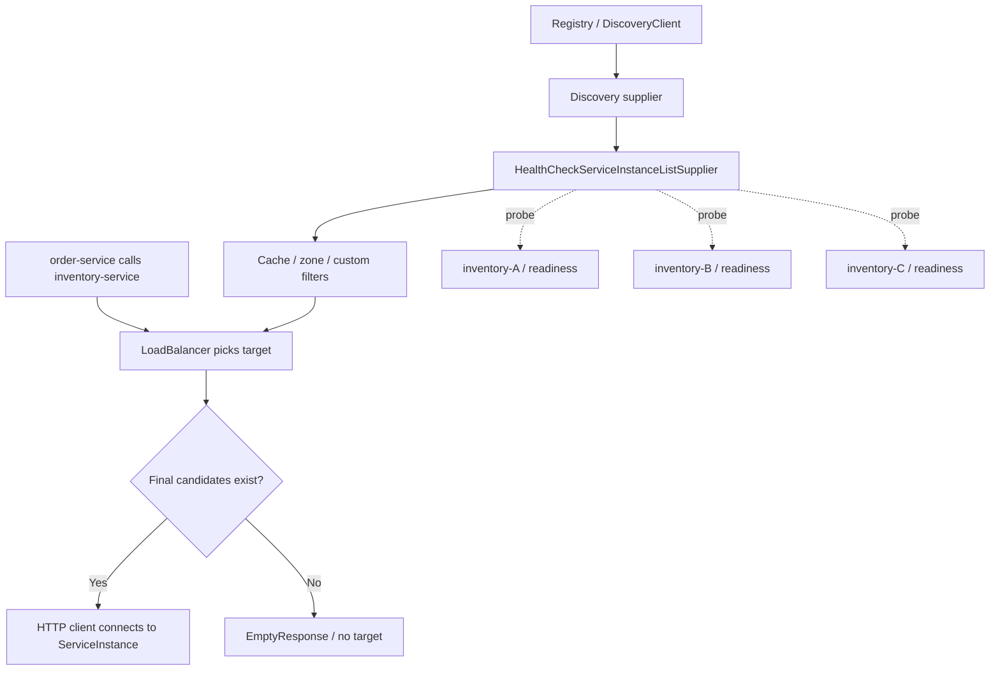
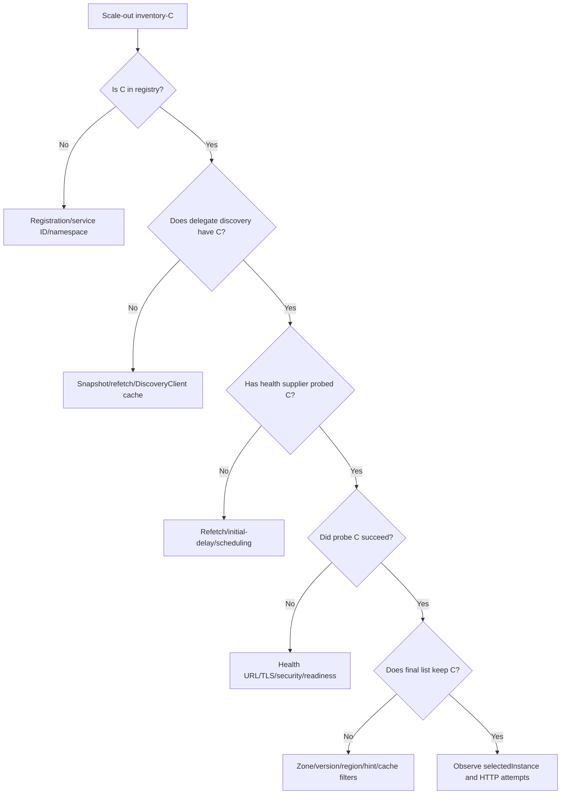

# Health checks dropping all replicas or failing to discover new replicas

In microservices using Spring Cloud LoadBalancer, a tricky diagnostic situation occurs when **the registry still lists `inventory-service` replicas yet the client reports no healthy instances**, or **replica C was just scaled out yet the client continues calling only A/B**. Sometimes requests still reach replicas whose health probes failed; other times every request returns HTTP 503 even though providers are running. These phenomena can have **completely different root causes**.

For the `SPRING_CLOUD_SERVICE_COMMUNICATION_LOAD_BALANCING` module, Spring Cloud LoadBalancer selects a `ServiceInstance` by service ID through a `ServiceInstanceListSupplier` chain combining discovery, health checks, caching, zones, and custom policies; `RestClient`, `WebClient`, or OpenFeign then establishes the connection. This lesson focuses on **diagnosing the instance list source**, understanding how `HealthCheckServiceInstanceListSupplier` works, distinguishing failed health probes from empty discovery, pinpointing why new instances fail to appear, and testing controlled recovery.

> **Core takeaway:** with the common behavior of `HealthCheckServiceInstanceListSupplier` in Spring Cloud Commons, if the **delegate still has instances** yet **none pass health probes**, the supplier can **fall back to returning the source list** rather than always returning `[]`. Therefore, “all probes DOWN” does not automatically mean “LoadBalancer has zero targets.” Determine your exact supplier chain and version before assuming fail-open or fail-closed behavior.

## 1. Three lists to distinguish before changing configuration

Name three distinct data sets:

1. **Discovered:** instances currently provided by the registry/`DiscoveryClient` for the service ID.
2. **Health-eligible:** instances whose probe results are accepted when the health supplier evaluates them.
3. **LoadBalancer-visible:** the final list emerging from the supplier chain (health, cache, zone, filters, retry-aware supplier...) seen by the selection algorithm.



The `Cache`/`Health`/`Zone` order in the diagram is **illustrative**. In a real system, delegate ordering and whether the health layer caches/replays results directly impact new-replica discovery. Never infer bean order from the diagram without inspecting actual configuration.

| Observation | Can conclude | Cannot conclude yet |
|---|---|---|
| Registry returns `[A,B,C]` | Registry knows three instances | LoadBalancer sees C or C is healthy |
| Health probe to C returns 200 | C answers an endpoint from the prober | Client refetched to add C to its list |
| Final supplier returns `[A,B]` | C is not included in that snapshot | C was removed from the registry |
| All probes return 503 | No instance passed the latest probe check | Supplier definitely returns `[]` |
| HTTP client receives 503 | The call failed | Whether 503 came from provider, gateway, or LoadBalancer |
| A request still hits A after A goes DOWN | Possibly cache/fallback/race | Health checks never ran |

To diagnose, first gather **counts and instance IDs at every layer**, and only then decide whether to adjust intervals, paths, or algorithms.

## 2. The two issues in the title are actually two different groups

### 2.1. “Health checks drop all replicas”

Typical causes:

- Both A/B are **genuinely not ready** (critical dependency failed, startup incomplete, shutting down).
- The health checker hits the **wrong path or port**; the provider serves business HTTP traffic, yet `/actuator/health` does not exist on the application port.
- Health endpoints return **401/403** due to Spring Security, a gateway, or a service mesh.
- Probes use `http` while the endpoint requires `https`, or mTLS certificates/truststores do not match.
- The container/Pod is reachable via another internal address, yet the **advertised `ServiceInstance.host:port` is unreachable** from where the client runs.
- Probe timeouts are too short, intervals are too aggressive, instances are overloaded, or jitter occurs.
- The health endpoint reports DOWN due to a dependency **not needed by all operations**, causing widespread false negatives.

Do not assume every 404/503 on a business endpoint reflects health probe results: readiness should be checked **independently**, using the exact probe URL and transport.

### 2.2. “New replica is not discovered”

Typical causes:

- Replica C has **not registered yet** or registered under a **different service ID**.
- The discovery source has C, yet the **supplier holds the initial snapshot** and neither refetches nor receives update streams.
- A caching layer's TTL/refresh policy prevents C from reaching LoadBalancer's active list yet.
- The health supplier only knows A/B and has **never probed C**; probing A/B more frequently will not conjure C.
- C entered the health supplier yet fails probes, leaving only A/B in the eligible set.
- Zone/region/version/metadata filters or request hints drop C after health checks.
- C is selected, returns an HTTP error, and retries fail over to A/B, so looking only at **final responses** makes it look like C was never picked.

**Diagnostic goals differ:** the first group asks why probes evaluate wrongly or all replicas are unready; the second traces **which layer drops C**: registration → refetch → health → filter → selection → transport.

## 3. Quick decision table by symptom

| Symptom | First check | Initial direction |
|---|---|---|
| Registry has no instances | `service ID`, namespace, registration/TTL | Fix registration and service identity |
| Registry has A/B yet final supplier is empty | Probes, filtering policies, supplier fallback | Inspect chain and exclusion reasons |
| Every probe returns 401/403 | Health endpoint security rules, auth context | Grant controlled access for internal probes |
| Every probe returns 404 | Wrong health path or management port | Verify Actuator endpoints and ports |
| Every probe times out | Advertised address, DNS/TCP/TLS, deadline | Call directly from the caller's network |
| A/B still selected despite all probes failing | Source fallback, cache, or race | Verify all-unhealthy policy |
| C appears in registry but not in supplier | Refetch/stream updates, cache, child context | Refresh instance source and measure snapshots |
| C in supplier yet never receives HTTP calls | Health/zone filter, algorithm, retries | Observe post-filter lists and chosen IDs |
| Dead replica still called after scale-in | Stale registry/cache/health, graceful shutdown | Check refresh and deregistration |
| Business GET 404 marks “health DOWN” | Misusing business responses for readiness | Separate health probes from domain errors |

An effective tactic is verifying **one specific provider** by `instance ID + host + port + health URL` instead of looking only at aggregate “UP/DOWN” status. When dozens of instances fail simultaneously right after a config change, investigate **shared probe misconfiguration** before concluding the whole fleet died.

## 4. HealthCheckServiceInstanceListSupplier mechanics and common pitfalls

`HealthCheckServiceInstanceListSupplier` checks the health of `ServiceInstance` items from its delegate and supplies a list for client load balancing. Several design details must be distinguished:

1. **Instance source:** the delegate (`DiscoveryClient`/reactive discovery/custom config) defines **which instances exist from the client's perspective**.
2. **Probing:** the supplier sends health requests to each instance on the configured path, governed by the HTTP client, probe schedule, and response results.
3. **Checked list:** instances deemed healthy are included in the output per supplier policy.
4. **When zero instances are healthy:** some default implementations fall back to **the non-empty delegate list** to avoid total service outage when all probes suffer false negatives.
5. **When the delegate itself is empty:** there are no source addresses to fall back to; the selection algorithm receives an empty list / no target.

```text
Delegate discovery = [A, B]
Health check       = [A]             -> visible is typically [A]

Delegate discovery = [A, B]
Health check       = []              -> visible may be [A, B] (fallback)

Delegate discovery = []
Health check       = []              -> visible = []
```

**Do not treat `HealthCheckServiceInstanceListSupplier` as a strict blocklist** if security/compliance mandates never calling unready instances. Verify your version's actual behavior and build an explicit fail-closed policy if needed. Conversely, do not strip default fallback just because one probe failed: doing so can turn a shared DNS/Actuator hiccup into a full service outage.

### 4.1. Visible set is not raw probe output

Suppose the health supplier emits `[A,B]` even though probe logs for A and B both show 503. That can be **all-unhealthy fallback**. If a metric labels that list `healthyInstanceCount=2`, dashboards become misleading.

Separate:

- `discoveredCount=2`: discovery source still has two instances.
- `probeHealthyCount=0`: current probe round passed zero instances.
- `loadBalancerVisibleCount=2`: list selected after fallback.
- `healthFallbackActivated=true`: if custom instrumentation exposes this signal.

These are **illustrative instrumentation fields**, not built-in Spring Cloud metric names emitted everywhere. If the supplier does not expose pre-fallback probe outcomes, instrument before the merge step; do not infer `probeHealthyCount` solely from the final list.

### 4.2. `get()` does not mean every request fires a fresh probe

The health layer can manage a scheduled stream of results shared/cached across requests. **Do not assume** every `RoundRobinLoadBalancer.choose()` triggers a round of `GET /actuator/health` calls to all instances. Probe interval, initial delay, repeat, refetch, and caching all govern when data updates.

When testing these properties, inspect the **actual supplier chain registered in the service ID's child context**, not merely whether `application.yml` defines a property.

## 5. Which readiness endpoint should be probed?

For Spring Boot applications with Actuator, the standard readiness endpoint is:

```text
GET /actuator/health/readiness
```

To enable it in a lab or outside Kubernetes when needed:

```yaml
management:
  endpoint:
    health:
      probes:
        enabled: true
```

On compatible Spring Boot versions, readiness reflects `ReadinessState` (such as `ACCEPTING_TRAFFIC`, `REFUSING_TRAFFIC`) and the configured readiness health group indicators. If probes are not enabled or Actuator is exposed on a different port/base path, that URL may not exist or may not live on the application port.

### 5.1. Liveness is not readiness

| Probe | What does it ask? | Use for instance selection? |
|---|---|---|
| **Liveness** | Is the process alive or does it need restarting? | Usually not the right sole signal for receiving traffic |
| **Readiness** | Is it ready to accept new requests? | Usually appropriate for routing/health suppliers |
| **Business GET** | Does a resource exist or what does business logic return? | Should not treat HTTP 404/409 as DOWN |
| **Dependency diagnostic** | Are DB/queue/cache working? | Include in readiness only when truly critical to serving |

If a read-only feature still works when a message queue is unavailable, forcing readiness DOWN because of the queue can pull the entire read tier out of rotation. The right rule depends on architecture: **check only essential dependencies** for the traffic class readiness protects, avoiding unnecessary health cascades.

### 5.2. Management ports and additional paths

Suppose a provider serves APIs on `:8080`, while Actuator runs on `management.server.port: 9090`. A LoadBalancer health supplier calling `http://provider:8080/actuator/health/readiness` by default gets 404, **even though readiness on port 9090 returns 200**.

Possible fixes:

- Expose a protected readiness endpoint on the **application port** for client probes that accurately reflects app readiness.
- On supported Spring Boot versions, consider `management.endpoint.health.probes.add-additional-paths=true` to expose `/readyz`/`/livez` on the main port and configure the probe path accordingly.
- If deployment mandates a separate management port, use a health checker supporting **trusted configured management host/port** rather than appending paths to the service port; verify exact supplier capabilities.

**Never expose all Actuator endpoints publicly or disable authentication app-wide** just to fix probe HTTP 401/403s. Grant access only to necessary probe endpoints across the proper network/trust boundary without leaking health details, secrets, or environment config.

## 6. Verify path, port, scheme, and reachability **from the caller**

An app successfully curling its own `http://localhost:8080/actuator/health/readiness` **does not prove** `order-service` in another host/Pod/container can probe that instance. Health suppliers run client-side, so the **advertised `ServiceInstance` address must be reachable from where the client runs**.

### 6.1. Least-effort verification checklist

1. Extract **`instanceId`, `host`, `port`, scheme**, and service ID from discovery as seen by the caller.
2. From the caller's own network namespace, resolve the hostname to an IP address.
3. Call the **exact health URL built by the supplier** and record HTTP status, connect time, and any TLS/redirects.
4. On HTTP 404, inspect Actuator exposure, base path, readiness probes, and management port.
5. On HTTP 401/403, inspect auth policies for the health endpoint/mesh.
6. On TLS errors, inspect scheme, CA, mTLS, SNI, and certificate SANs; never disable hostname verification.
7. On timeouts, compare probe timeout against connect/response latency; inspect firewalls/NetworkPolicies and actual ports.
8. If the probe legitimately returns 503, inspect readiness state/dependencies rather than faking a 200.

Example check from a caller container/VM with `curl`:

```bash
curl --silent --show-error --include --max-time 5 \
  'http://inventory-a:8080/actuator/health/readiness'

curl --verbose --connect-timeout 2 --max-time 5 \
  'http://inventory-b:8080/actuator/health/readiness'
```

When the client is inside Docker, `localhost` refers to the **client** container, not the provider container. In Kubernetes, separate Pods do not share loopback (except containers within the same Pod). If running distroless images without `curl`, use an authorized **debug Pod/container with matching network policies and trust config**; do not turn missing CLI tools into an application bug.

With TLS:

```bash
curl --verbose --connect-timeout 2 --max-time 5 \
  'https://inventory-a.internal.example:8443/actuator/health/readiness'
```

Do not use `curl -k` as a certificate workaround. It masks wrong hostnames or truststores; the real Java app still validates the peer. If mTLS is required, use a valid test-issued client certificate and CA without putting secrets into docs or logs.

### 6.2. Interpret statuses accurately

| Probe result | First possibility to inspect |
|---|---|
| HTTP 200 and body `{"status":"UP"}` | Probe endpoint responds validly; check filters/refresh if instance is still missing |
| HTTP 503 and `OUT_OF_SERVICE`/`DOWN` | Provider is actively unready; inspect readiness contributors |
| HTTP 404 | Wrong port/base path/Actuator exposure, or endpoint disabled |
| HTTP 401/403 | Endpoint/mesh/gateway auth policy; do not assume app is DOWN |
| HTTP 301/302 | Redirect/proxy/HTTP→HTTPS: fix canonical URL; do not assume probes follow redirects |
| Connect refused | `ServiceInstance` has wrong port or provider is not listening yet |
| DNS failure | Advertised host cannot resolve from caller |
| TLS handshake failure | Wrong scheme/trust/SAN/mTLS, not missing discovery |
| Read timeout | Response missed deadline; likely overload or network issue |

Some libraries treat **any HTTP 2xx** as a healthy probe without deeply parsing the JSON body; exact behavior depends on implementation/version. Check your probe's contract: **do not automatically assume every HTTP checker treats a JSON body containing “DOWN” as unhealthy if the status code is still 200**.

## 7. Enabling the health-check supplier properly in Spring Cloud LoadBalancer

Setting `spring.cloud.loadbalancer.health-check.path` in YAML only configures metadata **for a health supplier if one is active**; it does not automatically make every `ServiceInstanceListSupplier` health-aware.

Illustrative blocking client example with compatible Spring Boot and Spring Cloud Commons/LoadBalancer:

```java
import org.springframework.cloud.loadbalancer.core.ServiceInstanceListSupplier;
import org.springframework.context.ConfigurableApplicationContext;
import org.springframework.context.annotation.Bean;
import org.springframework.context.annotation.Configuration;

@Configuration(proxyBeanMethods = false)
public class InventoryLoadBalancerConfiguration {

    @Bean
    ServiceInstanceListSupplier inventoryInstanceSupplier(
            ConfigurableApplicationContext context) {

        return ServiceInstanceListSupplier.builder()
                .withBlockingDiscoveryClient()
                .withBlockingHealthChecks()
                .build(context);
    }
}
```

And register it per service ID:

```java
import org.springframework.boot.autoconfigure.SpringBootApplication;
import org.springframework.cloud.loadbalancer.annotation.LoadBalancerClient;

@SpringBootApplication
@LoadBalancerClient(
        name = "inventory-service",
        configuration = InventoryLoadBalancerConfiguration.class)
public class OrderApplication {
}
```

Place `InventoryLoadBalancerConfiguration` **outside the main application's normal component scan**, while still referencing it via `@LoadBalancerClient`. If a child-context bean gets scanned into the parent context, a policy meant only for `inventory-service` can accidentally affect other service IDs.

Example `application-lab.yml`:

```yaml
spring:
  cloud:
    loadbalancer:
      health-check:
        path:
          inventory-service: /actuator/health/readiness
        initial-delay: 2s
        interval: 10s
        repeat-health-check: true
        refetch-instances: true
        refetch-instances-interval: 15s
      cache:
        enabled: false
```

Values like `2s`/`10s`/`15s` illustrate lab behavior only, **not production defaults**. Use compatible Spring Boot/Spring Cloud BOMs, `spring-cloud-starter-loadbalancer`, your discovery client, and Spring Boot Actuator on providers. If your project uses `ReactiveDiscoveryClient` or reactive `WebClient`, use `withDiscoveryClient()`/`withHealthChecks()` matching your HTTP stack and verify version details.

**Supplier ordering warning:** the health checker should sit immediately after the discovery source (especially if discovery performs network calls) and before filters that mutate candidates per request. Do not wrap health with an arbitrary outer cache, or enable built-in caching plus a second cache layer without tracking combined TTLs. The health supplier already manages its own caching/replay; misplaced caching makes tests or production slow to see new instances.

### 7.1. Key properties explained

| Property | Meaning during troubleshooting |
|---|---|
| `spring.cloud.loadbalancer.health-check.path.[SERVICE_ID]` | Probe path for a specific service ID |
| `initial-delay` | Delay before the first health check |
| `interval` | Periodic interval between health probes |
| `repeat-health-check` | Whether probes keep running periodically |
| `refetch-instances` | Whether to actively re-fetch the instance list from the delegate |
| `refetch-instances-interval` | Frequency for refreshing the source list when refetch is enabled |
| `spring.cloud.loadbalancer.cache.enabled` | Whether built-in LoadBalancer caching is enabled at its layer |

The actual effect of each property depends on **whether the supplier is registered**, whether the `DiscoveryClient` pushes updates, how cache/refetch are wired, and your release train version. **Do not tune `interval` when C is not yet in the delegate**: probing A/B faster will not make the registry invent C.

### 7.2. Do not run health checks on every single request

Health checking is a periodic background signal; calling it synchronously on every request risks a **probe storm** and turns health endpoints into bottlenecks. Fix scheduler/cache configuration instead of issuing a manual `GET /ready` before every business GET.

In environments where Kubernetes Services/EndpointSlices already manage readiness, evaluate the **real** value of extra client-side probing: multiple health layers can disagree on update timing or fallback behavior. Your design must define **which layer owns the usable-instance decision**.

## 8. Why was C scaled out yet the client still cannot see it?

Suppose the registry already lists `[A,B,C]`, yet responses from `order-service` only show `servedBy=A` or `B`. Trace across four layers:



### 8.1. C has not entered the registry

Check:

- Provider C registered the **exact service ID** (check `inventory` vs. `inventory-service`, namespaces, casing, and registry prefixes).
- C registered valid host/port/scheme and maintains a valid heartbeat/lease.
- The registry used by provider C is the **same cluster/tenant/namespace** queried by `order-service`.
- Current deployment has admission/registration lag or registry eventual consistency.
- Whether C passed readiness before or after instance metadata was published.

If using `SimpleDiscoveryClient` with a list in `application.yml`, that list is inherently **static configuration**: starting more OS processes will not automatically add C. To test scale-out, update config/restart context or use a dynamic supplier/discovery source.

### 8.2. Registry has C, yet delegate does not

Check in order:

1. Does `DiscoveryClient.getInstances("inventory-service")` return C on a **fresh call**?
2. Does `DiscoveryClientServiceInstanceListSupplier` or its reactive counterpart emit updated snapshots when the registry changes?
3. Is `refetch-instances` enabled on the health supplier when periodic source polling is needed?
4. Is there an outer cache on the delegate/source with a TTL or an unconsumed push stream?
5. Was the supplier bean created for the **exact service ID child context** or a different context?

**Enabling `refetch-instances=true` is a mechanism**, not instant magic: it needs a sensible refetch interval, an underlying discovery source returning fresh data, and an active client consuming emissions. If reactive discovery already pushes fresh snapshots, avoid redundant polling that adds unnecessary load.

### 8.3. Delegate has C, yet health has not admitted C

When C has just started:

- `readiness=DOWN` during warm-up (expected).
- The first probe has not fired yet.
- Probes hit the wrong URL/port or are blocked by TLS/auth/network.
- A cache still holds the healthy list from the previous cycle.
- Provider C is ready, yet probe results have not propagated downstream.

Wait for a **concrete observable condition** within a reasonable window—such as “final supplier contains C”—instead of relying on `Thread.sleep(500)` and calling failures bugs.

### 8.4. Health includes C, yet selection policy skips C

If a `zone=zone-a` filter prefers A/B, C in `zone-b` may never be selected until zone-a runs out of candidates. With `WeightedServiceInstanceListSupplier`, C having a small weight means it gets picked rarely; not seeing C in 10 requests **does not prove** C was excluded.

Do not enforce brittle expectations like “adding C must make C serve within the first three calls.” Instead:

- Assert **C appears in the eligible list** after refresh.
- For algorithms with deterministic guarantees in unit tests, verify against the algorithm's specification.
- To verify distribution, use a large enough sample size and probabilistic bounds to avoid flaky tests.
- Log `selectedInstanceId` pre-HTTP and `servedBy` post-HTTP to catch **C was selected, yet the request failed**.

## 9. Caching and refetch schedules: do not blindly tweak one number

Inspect at least four independent mechanisms:

| Mechanism | Question |
|---|---|
| Registry discovery cache | Has `DiscoveryClient` read fresh data from the registry? |
| `CachingServiceInstanceListSupplier` | Is the list held back by a TTL? |
| `HealthCheckServiceInstanceListSupplier` | Does it know C exists and probe C properly? |
| Custom supplier/request filter | Does it keep its own snapshot or per-request/zone cache? |

Example:

```text
t=00s  registry = [A,B]
t=02s  health view = [A,B]
t=05s  C registers: registry = [A,B,C]
t=07s  discovery client sees C
t=15s  health refetch reloads [A,B,C]
t=17s  health probe for C succeeds
t=17s+ LoadBalancer can see C if filters permit
```

These timestamps merely illustrate **multi-layer propagation delay**, not a guaranteed default Spring Cloud timeline. If caching is misplaced, visibility lags by another TTL; if the source neither pushes nor refetches, C may never appear no matter how many HTTP retries occur.

### 9.1. When should cache be disabled in tests?

When unit-testing filtering policies or `ServiceInstanceListSupplier` update flows, disable configured caching and use a source capable of publishing atomic snapshots to test updates directly.

When **testing caching itself**, keep caching enabled, define TTL/refresh, test eventual visibility, and use bounded deadlines rather than hard sleeps. When using Caffeine, `spring.cloud.loadbalancer.cache.caffeine.spec` can affect other TTL settings; verify the effective configuration instead of looking only at `spring.cloud.loadbalancer.cache.ttl`.

### 9.2. Beware of double caching

Do not assume `withCaching()` belongs in every pipeline. Because `HealthCheckServiceInstanceListSupplier` already stores its own results, wrapping an extra outer cache after health checks can delay instance recovery. Conversely, omitting caching in front of a slow network discovery API increases load and latency.

The goal is to **map out your real supplier chain**, mark every cache location, TTL, and emission source, and tune the actual bottleneck. Changing multiple intervals at once makes it impossible to tell which adjustment fixed the problem.

## 10. Debug the exact service ID and child context

Spring Cloud LoadBalancer maintains a **per-service-ID child context**. This matters because:

- `inventory-service` may have health checks configured while `payment-service` does not.
- A `@LoadBalancerClient(configuration=...)` class applies only to the declared name.
- A supplier configuration accidentally component-scanned into the **parent context** affects all service IDs unintentionally.
- An app may define two `RestClient.Builder` beans while a gateway injects the **non-`@LoadBalanced` builder**, causing direct DNS calls that bypass the supplier entirely.

Never rely solely on `@Bean` method names or YAML keys to guess which supplier a client uses; inspect the actual bean inside the target child context.

### 10.1. Reading both lists in a test environment

A diagnostic controller **enabled only under the lab profile** can inspect both `DiscoveryClient` and the final supplier:

```java
import java.time.Duration;
import java.util.List;
import java.util.Map;

import org.springframework.cloud.client.ServiceInstance;
import org.springframework.cloud.client.discovery.DiscoveryClient;
import org.springframework.cloud.loadbalancer.core.ServiceInstanceListSupplier;
import org.springframework.cloud.loadbalancer.support.LoadBalancerClientFactory;
import org.springframework.context.annotation.Profile;
import org.springframework.web.bind.annotation.GetMapping;
import org.springframework.web.bind.annotation.RestController;

@Profile("lab")
@RestController
class InventoryLbDiagnosticController {

    private final DiscoveryClient discoveryClient;
    private final LoadBalancerClientFactory factory;

    InventoryLbDiagnosticController(
            DiscoveryClient discoveryClient,
            LoadBalancerClientFactory factory) {
        this.discoveryClient = discoveryClient;
        this.factory = factory;
    }

    @GetMapping("/internal/lab/inventory-candidates")
    Map<String, Object> inspect() {
        String serviceId = "inventory-service";

        List<ServiceInstance> discovered =
                discoveryClient.getInstances(serviceId);

        ServiceInstanceListSupplier supplier = factory.getInstance(
                serviceId, ServiceInstanceListSupplier.class);

        List<ServiceInstance> visible = supplier == null
                ? List.of()
                : supplier.get()
                        .next()
                        .blockOptional(Duration.ofSeconds(2))
                        .orElseGet(List::of);

        return Map.of(
                "serviceId", serviceId,
                "discovered", summarize(discovered),
                "loadBalancerVisible", summarize(visible));
    }

    private static List<String> summarize(
            List<ServiceInstance> instances) {
        return instances.stream()
                .map(value -> value.getServiceId() + "/" +
                        value.getHost() + ":" + value.getPort())
                .toList();
    }
}
```

**Limitations of this example:**

- This is a debug API—**never deploy it publicly in production**; even internal host/port/instance lists are sensitive topology metadata.
- `blockOptional(...)` is shown only for a **blocking lab controller**. Never call `block()` on a Reactor Netty event loop / WebFlux handler thread.
- `factory.getInstance(...)` can return `null` if no matching supplier is configured; the example prints an empty list, whereas investigation should record **missing bean** separately rather than treating discovery as empty.
- `supplier.get().next()` captures **one post-filter list emission**, not raw pre-fallback health probe outcomes. Seeing `probeHealthyCount` requires instrumentation at the probe layer.
- Reactive discovery sources and blocking `DiscoveryClient` can have distinct update mechanics/caches; do not assume all sources share one cache.

Query the lab endpoint before and after C registers:

```bash
curl -sS 'http://localhost:8080/internal/lab/inventory-candidates'
```

If `discovered` already includes C while `loadBalancerVisible` omits C, investigate health/cache/filters. If `discovered` is also missing C, fix the registry/config or `DiscoveryClient` lag before tweaking health probes. **Do not use the final visible list alone to conclude C failed to register.**

### 10.2. Avoid turning debug endpoints into health endpoints

Do not mechanically drop `factory.getInstance(...)`/`get().next().block(...)` into `order-service`'s `/actuator/health/readiness`. If every readiness probe calls downstream and triggers extra refreshes/probes, dependency loops can cascade multiple services into DOWN together.

Diagnostics and readiness serve **different purposes**: diagnostics uncover root causes; readiness must stay lightweight and reflect serving capability per designed policy.

## 11. When all probes are DOWN: choose fail-open or fail-closed intentionally

Suppose A/B remain in the registry yet all health probes fail:

```text
discovered  = [A, B]
probeHealthy = []
```

Two strategies are commonly considered:

| Policy | Action when all probes fail | Pros | Risks |
|---|---|---|---|
| **Fail-open** | Continue allowing A/B from the source set | Reduces outages from false negatives/misconfigured probes | May route to genuinely broken instances |
| **Fail-closed** | Admit zero instances into selection | Protects strict readiness/safety requirements | Mass probe failures cause full outage even if business endpoints still work |

**Default health supplier fallback behavior is not a universal switch for every service.** When custom semantics are needed, implement a clearly tested list-source/health policy instead of assuming an unsupported YAML “fail-open” flag exists.

### 11.1. When fail-open makes sense

For example, a low-sensitivity catalog read tier may still serve partially even if a diagnostic dependency briefly stops responding or a rollout misconfigures the health path. Letting some traffic through **with tight deadlines and circuit breakers** can be preferable to failing every caller.

Still, measure:

- How many instances failed probes?
- How many real HTTP calls to those instances succeed vs. fail?
- Are retries against dead backends causing a retry storm?
- Once the probe is fixed, how fast does it recover?

Never use fail-open to sweep long-term broken health endpoints under the rug.

### 11.2. When fail-closed is mandatory

If a safety rule requires **never routing to unverified instances**—such as wrong tenant boundaries, mismatched version contracts, incomplete data recovery, or restricted sensitive-data handling—falling back to all discovered instances is unacceptable.

In that case:

1. Define **hard constraints** and authoritative state sources rather than trusting easily spoofed metadata strings.
2. Design health filtering so failed-probe instances are never automatically re-admitted to the eligible set.
3. Ensure `[]` maps cleanly to a **no valid target** error without inventing a default address.
4. Test all-unhealthy, cache/refetch, and your actual Spring Cloud version.
5. Distinguish fail-closed policy rejections from an empty `DiscoveryClient` in telemetry.

**Never patch Spring Cloud internals or fake HTTP 200 responses** to force a policy. If a custom supplier is needed, keep filtering and fail-closed logic clean and consistent across service IDs.

### 11.3. Retries and circuit breakers do not replace health checks

Circuit breakers measure **call outcomes**, can be scoped per service ID/operation, and follow `CLOSED → OPEN → HALF_OPEN`. A breaker does not automatically know A failed its health probe if it only tracks aggregate service failures. Conversely, health checks evaluate instance readiness and do not replace 404/409 domain handling or retry budgets.

When a breaker is OPEN, do not loop retries merely because the health supplier still offers A/B. Bounded GET retries on connect failures can be reasonable, whereas an already-sent, timed-out POST may have committed; failing over to another instance **does not make mutating writes safe** without true idempotency keys and deduplication.

## 12. Two-instance lab: reproduce failed probes and observe recovery

To avoid touching production, run two `inventory-service` provider replicas and an `order-service` client. Each provider serves one business endpoint and one **simulated** health endpoint whose toggle endpoint is strictly for testing.

### 12.1. Spring Boot provider with a dedicated health endpoint

In a lab Spring Boot Web app:

```java
import java.util.Map;
import java.util.concurrent.atomic.AtomicBoolean;

import org.springframework.beans.factory.annotation.Value;
import org.springframework.http.ResponseEntity;
import org.springframework.web.bind.annotation.GetMapping;
import org.springframework.web.bind.annotation.PathVariable;
import org.springframework.web.bind.annotation.PostMapping;
import org.springframework.web.bind.annotation.RestController;

record ItemDto(String id, String servedBy) {
}

@RestController
class InventoryLabController {

    private final int port;
    private final AtomicBoolean ready = new AtomicBoolean(true);

    InventoryLabController(@Value("${server.port}") int port) {
        this.port = port;
    }

    @GetMapping("/api/v1/items/{id}")
    ItemDto getItem(@PathVariable String id) {
        return new ItemDto(id, "inventory-" + port);
    }

    @GetMapping("/internal/ready")
    ResponseEntity<Map<String, String>> ready() {
        if (ready.get()) {
            return ResponseEntity.ok(Map.of("status", "UP"));
        }
        return ResponseEntity.status(503)
                .body(Map.of("status", "DOWN"));
    }

    @PostMapping("/internal/lab/ready/{value}")
    ResponseEntity<Void> setReady(@PathVariable boolean value) {
        ready.set(value);
        return ResponseEntity.noContent().build();
    }
}
```

**Use this controller only in an isolated lab**: `POST /internal/lab/ready/{value}` mutates readiness without authentication and **must never be shipped as-is to production**. In real apps, use Actuator readiness with controlled lifecycle/dependency state rather than toggling readiness via a public HTTP endpoint.

Start two processes on different ports:

```bash
# Terminal A
java -jar inventory-service.jar --server.port=8091

# Terminal B
java -jar inventory-service.jar --server.port=8092
```

Verify directly:

```bash
curl -i http://localhost:8091/internal/ready
curl -i http://localhost:8092/internal/ready
curl -i http://localhost:8091/api/v1/items/42
```

Initially, readiness on A and B returns 200, and business GET returns 200 with the matching `servedBy`.

### 12.2. Client registers two replicas in SimpleDiscoveryClient

In `order-service` on the **same machine**:

```yaml
# application-lab.yml
server:
  port: 8080

spring:
  cloud:
    discovery:
      client:
        simple:
          instances:
            inventory-service:
              - uri: http://localhost:8091
              - uri: http://localhost:8092
    loadbalancer:
      health-check:
        path:
          inventory-service: /internal/ready
        initial-delay: 1s
        interval: 2s
        repeat-health-check: true
      cache:
        enabled: false
```

`SimpleDiscoveryClient` is a **static list** in the lab; it will not automatically discover a replica C started on port 8093. In Docker/Kubernetes, client `localhost` **never** points to providers in other containers/Pods: replace URIs with host/ports reachable inside the caller's network.

### 12.3. Wire the health supplier properly for the lab

Use `InventoryLoadBalancerConfiguration` from Section 7 and `@LoadBalancerClient(name="inventory-service", configuration=...)`. To call with a blocking HTTP client:

```java
import org.springframework.cloud.client.loadbalancer.LoadBalanced;
import org.springframework.context.annotation.Bean;
import org.springframework.context.annotation.Configuration;
import org.springframework.web.client.RestClient;

@Configuration
class LabHttpClientConfiguration {

    @Bean
    @LoadBalanced
    RestClient.Builder loadBalancedRestClientBuilder() {
        return RestClient.builder();
    }
}
```

```java
import org.springframework.beans.factory.annotation.Qualifier;
import org.springframework.stereotype.Service;
import org.springframework.web.client.RestClient;

@Service
class InventoryGateway {

    private final RestClient client;

    InventoryGateway(
            @Qualifier("loadBalancedRestClientBuilder")
            RestClient.Builder builder) {
        this.client = builder
                .baseUrl("http://inventory-service")
                .build();
    }

    ItemDto get(String id) {
        return client.get()
                .uri("/api/v1/items/{id}", id)
                .retrieve()
                .body(ItemDto.class);
    }
}
```

Create a proxy controller:

```java
import org.springframework.web.bind.annotation.GetMapping;
import org.springframework.web.bind.annotation.PathVariable;
import org.springframework.web.bind.annotation.RestController;

@RestController
class InventoryProxyController {

    private final InventoryGateway gateway;

    InventoryProxyController(InventoryGateway gateway) {
        this.gateway = gateway;
    }

    @GetMapping("/test/items/{id}")
    ItemDto item(@PathVariable String id) {
        return gateway.get(id);
    }
}
```

The client requires `spring-cloud-starter-loadbalancer`, the HTTP starter, and a compatible Spring Cloud BOM. When the health supplier and `@LoadBalanced` bean are wired right, GET calls route to A/B URIs per the visible list. Using `RestClient.create("http://inventory-service")` without LoadBalancer only triggers DNS failures; that is **not a test of the health supplier**.

### 12.4. Scenario 1 — A is unready, B stays healthy

In the lab, flip A to not-ready:

```bash
curl -i -X POST 'http://localhost:8091/internal/lab/ready/false'

# Direct probes confirm A returns 503 while B stays 200.
curl -i 'http://localhost:8091/internal/ready'
curl -i 'http://localhost:8092/internal/ready'
```

After one or a few probe cycles, the health view typically retains only B. Call the proxy:

```bash
curl -i 'http://localhost:8080/test/items/42'
curl -i 'http://localhost:8080/test/items/42'
curl -i 'http://localhost:8080/test/items/42'
```

Expected: **once the health view updates**, requests hit only `inventory-8092`. Do not expect an instant switch on the very first call after the POST, because probe/check caching updates asynchronously. If A still receives traffic after a reasonable wait, inspect the active supplier bean, refetch/interval settings, health path, and caches.

### 12.5. Scenario 2 — Both A and B are unready

Continue:

```bash
curl -i -X POST 'http://localhost:8092/internal/lab/ready/false'
curl -i 'http://localhost:8091/internal/ready'
curl -i 'http://localhost:8092/internal/ready'
```

Here **both readiness endpoints return 503**, yet the demo business endpoints `/api/v1/items/42` still return 200. If your version's health supplier performs **all-unhealthy fallback to the source list**, the proxy can keep selecting A/B and succeeding. This demonstrates why “all probes failed” and “zero selectable instances” are **not synonymous**.

If your application enforces a custom fail-closed policy, the valid outcome for **that policy** is zero selected instances, usually yielding a synthetic no-instance/503 error. In either case, document the **actual supplier behavior** rather than claiming a framework bug from one HTTP status.

### 12.6. Scenario 3 — Readiness recovery

```bash
curl -i -X POST 'http://localhost:8091/internal/lab/ready/true'
curl -i -X POST 'http://localhost:8092/internal/lab/ready/true'
```

Wait for the health view to replay the `[A, B]` snapshot; call the proxy repeatedly and verify both instances serve requests. **Do not infer from HTTP 200 alone** that both A and B were probed; under fallback, lab business endpoints still return 200 even before readiness recovers.

### 12.7. Scenario 4 — Zero instances in discovery

In a **separate lab profile**, configure `inventory-service` with an empty list or call an unregistered service ID. When the delegate is genuinely empty, there is no A/B to fall back to. With standard client integration, expect `selectedInstance=null` and zero requests reaching providers; HTTP adapters throw an exception or synthesize 503.

Do not simulate empty discovery by “stopping A/B while leaving static URIs configured.” In that case the supplier still selects A/B and hits **connect refused**, meaning failure happens **after** target selection.

## 13. New replica lab: separate “registering C” from “probing C”

To test real scale-out, do not rely on static `SimpleDiscoveryClient` and merely start server C. Static sources do not discover new processes. Choose one of two approaches:

1. **Real integration:** use a registry/discovery integration where C can register or a mock registry API emitting fresh snapshots; test refetch and health in the same client context.
2. **Unit fixture:** use a `ServiceInstanceListSupplier` capable of publishing snapshots to prove downstream code sees C; this tests the list source, **not Spring Cloud's refetch/health scheduler**.

### 13.1. Dynamic list source for unit tests

Example strictly for `src/test/java`:

```java
import java.util.List;
import java.util.concurrent.atomic.AtomicReference;

import org.springframework.cloud.client.ServiceInstance;
import org.springframework.cloud.client.loadbalancer.Request;
import org.springframework.cloud.loadbalancer.core.ServiceInstanceListSupplier;

import reactor.core.publisher.Flux;

final class MutableInstanceSource implements ServiceInstanceListSupplier {

    private final String serviceId;
    private final AtomicReference<List<ServiceInstance>> snapshot =
            new AtomicReference<>(List.of());

    MutableInstanceSource(String serviceId) {
        this.serviceId = serviceId;
    }

    void publish(List<ServiceInstance> next) {
        // Swap the whole snapshot rather than mutating a list being read.
        snapshot.set(List.copyOf(next));
    }

    @Override
    public String getServiceId() {
        return serviceId;
    }

    @Override
    public Flux<List<ServiceInstance>> get() {
        return Flux.defer(() -> Flux.just(snapshot.get()));
    }

    @SuppressWarnings("rawtypes")
    @Override
    public Flux<List<ServiceInstance>> get(Request request) {
        return get();
    }
}
```

`publish` uses `AtomicReference` and `List.copyOf` so consumers never observe partially mutated lists. `Flux.defer` ensures the snapshot is read at subscription time; each new call sees the latest state in this fixture.

Source test:

```java
import static org.junit.jupiter.api.Assertions.assertEquals;

import java.time.Duration;
import java.util.List;
import java.util.stream.Collectors;

import org.junit.jupiter.api.Test;
import org.springframework.cloud.client.DefaultServiceInstance;
import org.springframework.cloud.client.ServiceInstance;

class MutableInstanceSourceTest {

    private static ServiceInstance instance(String id, int port) {
        return new DefaultServiceInstance(
                id, "inventory-service", "127.0.0.1", port, false);
    }

    private static List<String> ids(MutableInstanceSource source) {
        List<ServiceInstance> list = source.get()
                .blockFirst(Duration.ofSeconds(1));
        return list == null ? List.of()
                : list.stream()
                    .map(ServiceInstance::getInstanceId)
                    .collect(Collectors.toList());
    }

    @Test
    void newlyPublishedInstanceAppearsOnNextSubscription() {
        var a = instance("A", 8091);
        var b = instance("B", 8092);
        var c = instance("C", 8093);

        MutableInstanceSource source =
                new MutableInstanceSource("inventory-service");

        source.publish(List.of(a, b));
        assertEquals(List.of("A", "B"), ids(source));

        source.publish(List.of(a, b, c));
        assertEquals(List.of("A", "B", "C"), ids(source));
    }

    @Test
    void emptyDiscoveryStaysEmpty() {
        MutableInstanceSource source =
                new MutableInstanceSource("inventory-service");
        assertEquals(List.of(), ids(source));
    }
}
```

**Test scope:** this proves dynamic list publication in a fixture, not that `HealthCheckServiceInstanceListSupplier` refetches on `refetch-instances-interval` or that the Spring Boot context wired the right supplier. To test real scheduling, write an integration test placing a dynamic source before the health supplier and wait for C to enter the **final view**.

### 13.2. Checkpoint-driven integration test for scale-out

Scenario with a dynamic registry/stub:

```text
Phase 1:
  Registry           = [A, B]
  Health view        = [A, B] after startup window
  LoadBalancer view  = [A, B]

Phase 2:
  Start C; C readiness = 200
  Registry publishes  = [A, B, C]
  Wait for delegate to see C
  Wait for health probe to run against C
  Wait for LoadBalancer-visible list to contain C

Phase 3:
  Send new requests via service ID
  Verify no instance outside the valid set is picked
  If using steady Round Robin without priority filters,
    verify C can be selected over a sufficiently large batch
```

Each checkpoint needs a **test timeout** instead of a fixed sleep replacing result observation. On failure, print **discovery IDs, health-probe statuses, visible IDs, and selected instance** to see where C was dropped.

### 13.3. If C enters the view yet receives no traffic

Remember `RoundRobinLoadBalancer` can have a non-fixed starting index, concurrent selections, retries, or hint/zone filters. Asserting “C must handle the very first request” is flaky. First assert `visibleIds.contains("C")`. Then, if policy requires C to receive traffic, verify over an **appropriately sized request batch** and separate selection metrics from HTTP 200 counts.

Never use side-effecting write operations to run a thousand-request distribution check. Use an idempotent lab GET endpoint or server stubs returning `servedBy`.

## 14. Testing eventual consistency instead of Thread.sleep

With health/refetch, changes do not take effect the instant you flip `ready=false` or register C. In tests, use Awaitility (optional test dependency) to wait for an observable condition:

```java
import static org.awaitility.Awaitility.await;
import static org.junit.jupiter.api.Assertions.assertEquals;
import static org.junit.jupiter.api.Assertions.assertNotNull;

import java.time.Duration;
import java.util.List;
import java.util.Set;
import java.util.stream.Collectors;

await()
        .atMost(Duration.ofSeconds(8))
        .pollInterval(Duration.ofMillis(100))
        .untilAsserted(() -> {
            List<ServiceInstance> visible = supplier.get()
                    .next()
                    .blockOptional(Duration.ofSeconds(1))
                    .orElse(null);

            assertNotNull(visible, "Supplier has not emitted a list");
            Set<String> ids = visible.stream()
                    .map(ServiceInstance::getInstanceId)
                    .collect(Collectors.toSet());

            assertEquals(Set.of("A", "B", "C"), ids);
        });
```

This snippet is an **illustrative integration test body**: the `supplier` variable must come from the configured child context. It does not spin up the registry, HTTP servers, or health supplier; those belong to your test fixture.

When testing **all-unhealthy fallback**, explicitly verify **probes actually saw 0 healthy** alongside the **post-fallback list** per version policy; `visibleIds` may still be A/B. Do not name a post-fallback list `healthyIds` if it no longer represents healthy instances.

**Timeout bounds:** `atMost(8s)` must cover `initial-delay`, `refetch-instances-interval`, `interval`, and cache TTL in the test profile; do not bump it arbitrarily in CI to hide that C is never refetched. Always shut down HTTP servers/executors/schedulers after tests to avoid interfering with parallel tests.

## 15. Regression test matrix and acceptance criteria

A test asserting only HTTP 200 at the end does not prove health/refetch works. Record **what changed at the source**, **when the condition became true**, and **which instance was actually selected**:

| Scenario | Input/setup | Key assertion | Do not infer |
|---|---|---|---|
| A/B both UP | Registry `[A,B]`, probes 200 | Visible contains A/B after health refresh | First request always hits A |
| A DOWN, B UP | A probe 503, B probe 200 | Picks B after refresh, avoids A | Changes immediately after `sleep(100)` |
| A/B both DOWN | Registry `[A,B]`, both probes 503 | Result matches verified all-unhealthy policy | Must always be `[]` by default |
| Empty discovery | Delegate `[]` | Zero selected instances; zero HTTP attempts to providers | Provider returned 503 |
| Wrong health path | All providers return 404 on health URL | Pinpoints probe 404 even when API returns 200 | Business 404 means instance DOWN |
| Wrong management port | API port 8080, readiness port 9090 | Probe URL/port is root cause | Increasing retries fixes wrong port |
| Health blocked by auth | Probes return 401/403 | Identifies security rule and recovers after proper fix | Disable auth on all Actuator endpoints |
| New C registered | Registry `[A,B] → [A,B,C]` | Delegate → probe → final view eventually includes C | C must receive the first request |
| C only in different zone | C healthy but different zone | Health view has C; filter/algorithm explains non-selection | C failed discovery |
| Registry removed A | Source `[B]` | Stops selecting A after refresh | In-flight requests already targeting A auto-switch |
| C selected but port dead | Eligible C, TCP fails | Selection succeeded; separate transport error | Health list must be empty |
| Large cache TTL | Source updated, final view stale | Visibility delay bounded by TTL | Tuning probe interval alone suffices |
| Circuit breaker OPEN | Downstream recovered | Breaker recovers via half-open checks separately | Probe 200 means breaker is CLOSED |

### 15.1. Separate logical requests from HTTP attempts

Retries can make one logical GET call A then B. If a test inspects only `servedBy=B`, it may look like A was skipped even though A was selected and timed out connecting. In retry tests, record:

```text
logicalRequest = 1
attempt[1].selected = A
attempt[1].outcome = CONNECT_TIMEOUT
attempt[2].selected = B
attempt[2].outcome = HTTP_200
finalOutcome = SUCCESS
```

These fields are **pseudocode for telemetry/assertions**, not a built-in event schema. For POST or mutating operations, **never use retries as a distribution test tool** without idempotency keys and deduplication preventing duplicate side effects.

### 15.2. Evaluate both new state and old state

When C appears, beyond asserting C becomes visible, also assert:

- A/B remain eligible and continue receiving traffic per policy?
- While C is not ready yet, do A/B still serve traffic?
- When A scales in, does the final visible list stop containing A after refresh?
- Are requests that already selected A **before deregistration** handled properly by timeouts/retries/graceful shutdown?

These are two sides of the same problem: **discovering new instances** and **evicting old instances**. A system can update smoothly in one direction while retaining stale snapshots in the other.

## 16. Observability: measure causes instead of merely counting servers

Meaningful telemetry separates **discovery source**, **probe results**, **visible list**, **instance selection**, and **HTTP transport**:

| Suggested field | Meaning |
|---|---|
| `serviceId` | Logical service name such as `inventory-service` |
| `discoveredCount` | Instance count at discovery source |
| `discoveredIds` (bounded log) | Instance IDs when debugging an incident |
| `probeTarget` / `probePath` | Health URL being probed by host/port/path |
| `probeStatusClass` | 2xx, 3xx, 4xx, 5xx, or network error |
| `probeDuration` / `probeTimeout` | Probe duration and configured deadline |
| `probeHealthyCount` | Raw probe-passing instance count (if instrumented) |
| `loadBalancerVisibleCount` | Final candidate count |
| `allUnhealthyFallback` | Whether source-list fallback triggered (if instrumented) |
| `registryRefreshAge` / `lastRefetchAt` | Time since last source list reload |
| `cacheAge` / `cacheHit` | Whether an older snapshot is being served |
| `selectedInstanceId` / `selectedHostPort` | Real chosen target pre-HTTP |
| `retryAttempt` / `responseOrigin` | Distinguish attempts and 503 origin (provider/gateway/LB) |
| `traceId` / `spanId` | Link client → provider → registry/proxy |

These names are **instrumentation suggestions**, not default metrics/attributes present across all Spring Cloud versions. Use Micrometer/Observation and `LoadBalancerLifecycle`/logging to measure instance selection; probing sources may need separate instrumentation since post-fallback lists **no longer reveal true healthy instance counts**.

### 16.1. Never log sensitive information

In diagnostic logs:

- Service IDs, error classes, statuses, and instance counts are generally safe.
- Internal hostnames/IPs, zones, and metadata require access control and bounded log retention.
- Never log Bearer tokens, cookies, personal tenant details, or health bodies containing secrets.
- Never use `traceId`, request IDs, or full user-data URLs as unbounded-cardinality metric labels.
- Under autoscaling, `instanceId` cardinality grows quickly; manage per-instance metric cardinality carefully.

### 16.2. Controlled debug logging

In a **short-lived diagnostic profile**, you can enable loggers:

```yaml
logging:
  level:
    org.springframework.cloud.loadbalancer: DEBUG
    org.springframework.cloud.client.discovery: DEBUG
```

Exact log levels and messages depend on release train/implementation; not every decision or probe URL is guaranteed to be logged automatically. When logs lack detail, instrument the supplier chain or test probes directly rather than leaving `TRACE` on indefinitely. Avoid broad debug logging under heavy production traffic due to load and metadata exposure risks.

### 16.3. Distinguish HTTP 503 origins

```text
Case A — instance selection failed:
  discoveredCount = 0  or final eligible = 0
  selectedInstance = none
  providerRequestCount = 0
  clientResponse = synthetic 503 (adapter-dependent)

Case B — instance selected, provider returned 503:
  selectedInstance = inventory-A
  providerRequestCount = 1
  upstreamHttpStatus = 503
  responseOrigin = provider

Case C — instance selected, yet connection failed:
  selectedInstance = inventory-A
  providerRequestCount = 0
  transportFailure = connect_refused/timeout
```

Never write diagnostic logic like `if (httpStatus == 503) discoveryBroken=true`. Identical status codes come from different layers; **whether a `ServiceInstance` was selected** and **whether the provider received the request** are the decisive separators.

## 17. Remediation runbooks by symptom

### Scenario A — All probes suddenly return 404/401/403

1. Verify the **real endpoint** directly from the caller's network: method, scheme, hostname, port, path.
2. Check recent changes to Spring Boot Actuator, management port, Spring Security, ingress/mesh, and certificates.
3. If 404, fix `health-check.path.inventory-service` or expose readiness on the application port; **do not repurpose a business GET** as a health probe.
4. If 401/403, grant health-checker access **within the right trust boundary**; do not make all Actuator endpoints public.
5. Watch subsequent probe results and the visible list. Verify whether all-unhealthy fallback is active.
6. Add a regression test so future deploys cannot break the path or auth again.

### Scenario B — Both A and B are genuinely unready

1. Check `/actuator/health/readiness` and health contributors; determine which operations can still run.
2. Identify the shared cause: DB, queue, rate limit, readiness dependency, or capacity/resources.
3. Decide fail-open vs. fail-closed policy **from business and security requirements**, not desired HTTP status codes.
4. Bound retry budgets, circuit breakers, and read fallbacks if contracts allow.
5. Never fake `status=UP` to turn dashboards green; fix the real dependency/lifecycle or adjust readiness policy deliberately.
6. After recovery, monitor both probe statuses and HTTP attempt success rates.

### Scenario C — C is registered yet the client knows only A/B

1. Capture a registry checkpoint containing C, including service ID and host/port.
2. Check whether `DiscoveryClient` on **`order-service` itself** sees C.
3. Check `refetch-instances` and the health supplier's refresh schedule; do not merely shorten probe intervals.
4. Inspect cache/discovery TTLs and the supplier chain to eliminate misordered double caching.
5. Once the delegate has C, test C's readiness probe URL.
6. Once C is healthy, inspect zone/region/version/metadata filters and selected instances.
7. Set an eventual assertion/alert for registration → visibility latency instead of relying on ad-hoc GET counts.

### Scenario D — Client continues calling a scaled-in instance

1. Confirm A was deregistered/removed from EndpointSlices/discovery per lifecycle.
2. Check registry TTL/heartbeat/lease and active snapshot caches.
3. Confirm health/refetch actually emits the updated list; if old lists remain cached, fix that exact layer.
4. Combine graceful shutdown and readiness to shrink the window of picking terminating targets.
5. If retrying connect failures, bound attempts/deadlines; never blindly retry writes.
6. Use staging rolling-update tests to measure time from termination until new calls to A cease.

### Scenario E — C is in the visible list yet never selected

1. Inspect the active algorithm: Round Robin, weighted, zone preference, request hints, retry-aware supplier.
2. Check whether C sits outside **hard constraints**; never bypass region/version/security just to send load to C.
3. Distinguish **selections of C** from **successful responses from C**.
4. If C has a very low weight, increase sample size or unit-test the algorithm rather than judging from a few calls.
5. If C is selected yet connections fail, investigate DNS/TLS/firewalls/ports and advertised addresses.

**There is no single silver bullet for every symptom.** Raising `health-check.interval`, enabling refetch, or disabling caching should happen only after pinpointing the lagging layer; loosening healthy/region policies arbitrarily can worsen outages.

## 18. Common misconceptions when fixing health checks

| Misconception | Consequence | How to check/fix |
|---|---|---|
| “Registry has C, so LoadBalancer definitely knows C” | Overlooks delegate snapshots/caches/health refetch | Measure C at every layer |
| “All probes DOWN guarantees an empty list” | Tests fail unexpectedly under supplier fallback | Verify your version's all-unhealthy behavior |
| “Setting `health-check.path` means probing is active” | Health supplier may not even be wired | Check bean/supplier chain for that service ID |
| “Probe 404 means the provider is dead” | Actuator path/port may simply be wrong | Test endpoint directly from caller |
| “Probe 401/403 means disable Spring Security” | Exposes internal endpoints | Grant health access only per trust boundary |
| “Business 404/409 means instance is unhealthy” | Drops healthy backends serving valid domain responses | Separate domain errors from readiness |
| “C gets no traffic so C isn't in discovery” | Could be zone/weight filters or transport errors | Measure discovered, eligible, selected separately |
| “Increasing probe frequency discovers new instances” | Probes A/B harder without ever refetching C | Check `refetch-instances` and discovery source |
| “Disabling all caches is the production fix” | Hammers registry/APIs with excessive lookups | Identify cache layers, TTLs, and consistency goals |
| “Every request must run a health probe” | Probe storms, higher latency, cascading failures | Use bounded health streams/schedulers |
| “Retry every request on no-instance” | Retry storms over an empty snapshot | Enforce deadlines, backoff, stop conditions |
| “WebClient/Feign 503 always came from provider” | Misdiagnoses synthetic 503s | Inspect selected instance and provider traces |
| “After `ready=true`, changes must appear immediately” | Flaky tests due to schedulers/refetch/caches | Await observable condition with deadline |
| “Reading the final list tells healthy count” | Fallback skews the metric | Instrument raw probes separately from visible list |
| “Any `@LoadBalanced` client change fixes it” | May inject bare builder/client | Verify adapter and service ID |
| “Pod Running means ready” | Routes to instances still booting | Use explicit readiness/lifecycle |
| “Fix only provider A” when all fail after one deploy | Shared path/cert/security bug repeats | Check shared probe changes first |
| “Fail-open is always better than fail-closed” | Risks crossing data/contract boundaries | Choose policy from hard constraints |
| “Probe UP means circuit breaker is CLOSED” | Client still keeps its own breaker state | Check half-open/successes and breaker scope |

## 19. Checklist before concluding the fix is complete

- [ ] Identified the exact **service ID** and confirmed the active supplier in the right LoadBalancer child context.
- [ ] Separated **registry/discovery**, **probe-healthy**, and **LoadBalancer-visible**.
- [ ] Verified the **all-unhealthy fallback** behavior of `HealthCheckServiceInstanceListSupplier` in your running version.
- [ ] Proved `ServiceInstance.host:port` is reachable from the client's exact namespace.
- [ ] Confirmed health URL scheme, path, port, security, and TLS/mTLS.
- [ ] Avoided treating business 404/409 statuses as health failures solely for being non-2xx.
- [ ] Verified Actuator readiness is truly enabled and its health contributors match serving traffic.
- [ ] Avoided layering redundant client health checks where Kubernetes Services already manage readiness appropriately.
- [ ] Verified `HealthCheckServiceInstanceListSupplier` is actually in the supplier chain; YAML properties alone do not enable it.
- [ ] Confirmed `refetch-instances` and the discovery source update snapshots on schedule or via streams.
- [ ] Checked cache TTLs and eliminated double caching outside health that delays visibility.
- [ ] If new C is missing, pinpointed whether C is lost at **registration / delegate / probe / filter / selection**.
- [ ] If old A is still called, checked deregistration, caching, readiness, and graceful shutdown.
- [ ] Separated empty-selection, connection failure, provider HTTP 503, and synthetic LoadBalancer 503.
- [ ] Tested **A DOWN / B UP**, **all DOWN**, **recovery**, and **empty discovery** in the lab.
- [ ] Tested C scale-out using a **dynamic source**, not merely starting extra processes under static SimpleDiscoveryClient.
- [ ] Tests await observable conditions with timeouts rather than relying primarily on `Thread.sleep`.
- [ ] Documented fail-open/fail-closed policy, hard constraints, and retry budgets per service.
- [ ] Telemetry separates discovered count, probe outcomes, visible count, selected instance, and HTTP attempts.
- [ ] Post-fix, requests succeed on newly eligible instances and lingering attempts to removed instances stop.
- [ ] Runbooks clearly explain how to roll back probe/interval/cache/registry changes if production is impacted.

## 20. Summary

**“Health checks dropping all replicas” and “failing to discover new replicas” are not one single bug.** In the first case, separate genuinely unready instances from wrong probe paths, ports, security, TLS, or networking; then confirm whether the health supplier fails open or closed. In the second case, admitting C requires traversing **registration → discovery/refetch → health probe → filter/cache → LoadBalancer selection**; simply probing A/B faster will not help if C is not in the data source yet.

In Spring Cloud LoadBalancer, durable troubleshooting starts by **knowing which list is empty or stale and at which step**. A registered `ServiceInstance` does not guarantee the client sees or can reach it; a 200 health probe does not guarantee a breaker has closed; and an HTTP 503 does not prove a provider returned the error. By collecting layer-by-layer signals, using readiness purposefully, keeping refetch/cache consistent, and running controlled all-down/scale-out tests, your system will avoid dropping healthy replicas or missing new ones.

### References

- [Spring Cloud Commons — Spring Cloud LoadBalancer](https://docs.spring.io/spring-cloud-commons/reference/spring-cloud-commons/loadbalancer.html): `HealthCheckServiceInstanceListSupplier`, `ServiceInstanceListSupplier` chains, caching, health checks, and refetching.
- [Spring Cloud Commons — Configuration Properties](https://docs.spring.io/spring-cloud-commons/reference/configprops.html): `health-check.path`, `interval`, `refetch-instances`, and cache properties.
- [Spring Cloud Commons — Common Abstractions](https://docs.spring.io/spring-cloud-commons/reference/spring-cloud-commons/common-abstractions.html): `DiscoveryClient`, `SimpleDiscoveryClient`, and service instance resolution.
- [Spring Boot Actuator — Health](https://docs.spring.io/spring-boot/reference/actuator/endpoints.html#actuator.endpoints.health): health endpoints, status mapping, and readiness/liveness probes.
- [Spring Cloud Commons source — HealthCheckServiceInstanceListSupplier](https://github.com/spring-cloud/spring-cloud-commons/blob/main/spring-cloud-loadbalancer/src/main/java/org/springframework/cloud/loadbalancer/core/HealthCheckServiceInstanceListSupplier.java): probing mechanics and supplier behavior in the active codebase.
- [Spring Cloud OpenFeign](https://docs.spring.io/spring-cloud-openfeign/reference/spring-cloud-openfeign.html): service-ID HTTP clients and related error/retry mechanisms.
- [Awaitility](https://github.com/awaitility/awaitility): bounded asynchronous condition polling in integration tests.
