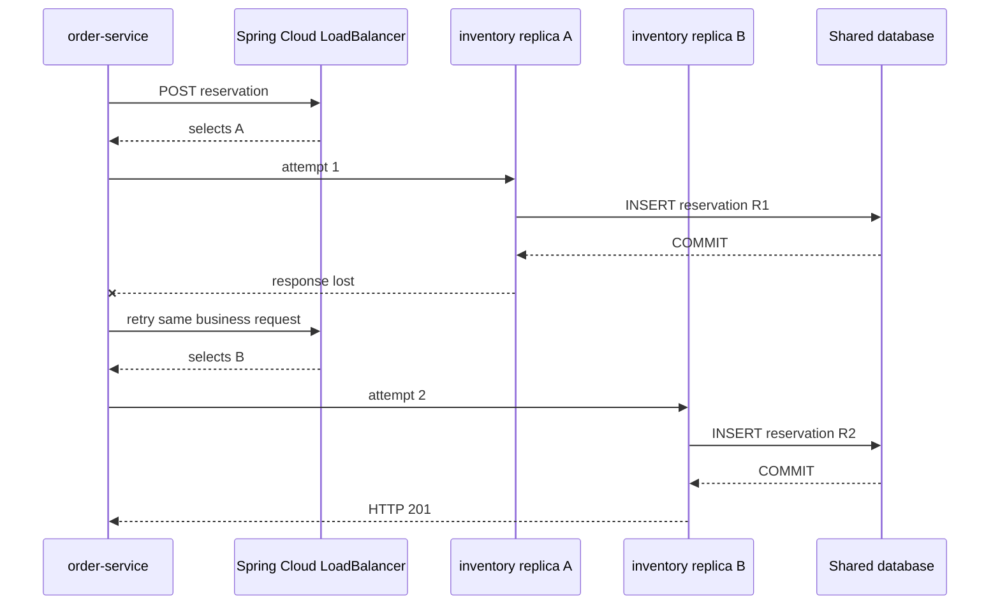
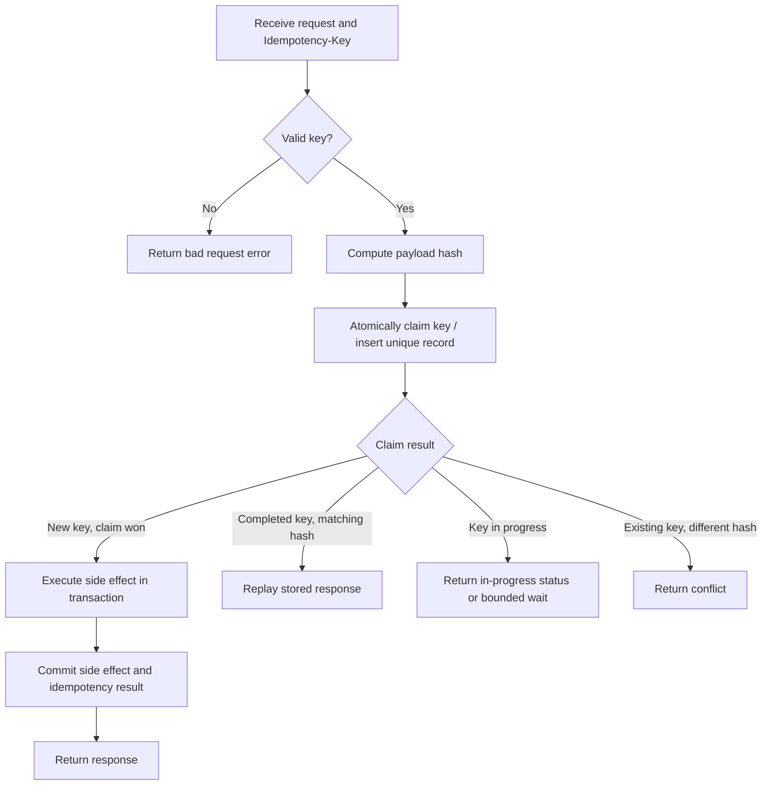

# Excessive retries causing duplicate requests and load amplification

In microservices, retries give a call another chance to succeed when a replica temporarily fails to respond. However, when multiple layers retry simultaneously, or a caller retries after the server already executed the operation yet lost the response, a single business request can produce **multiple HTTP attempts and multiple side effects**. Typical consequences include duplicate reservations/orders, inventory deducted multiple times, elevated database load, and surviving replicas being driven into overload.

For example, `order-service` calls `inventory-service` to reserve two items. The first request reaches replica A, which commits the transaction, yet the response times out on the return path. Uncertain whether the action completed, the caller retries. LoadBalancer routes the retry to replica B; if B does not recognize it as the same business operation, B creates a second reservation. Picking a different replica **does not turn the retry into a valid new operation**, because replicas typically serve the same API and share underlying data.

This lesson belongs to the **Troubleshooting** chapter of the `SPRING_CLOUD_SERVICE_COMMUNICATION_LOAD_BALANCING` module. It focuses on identifying retry amplification, understanding ambiguous outcomes after timeouts, protecting write operations with idempotency, coordinating retries across HTTP clients/Spring Cloud LoadBalancer/gateways/service meshes, and building a verifiable investigation workflow.

> Core principle: **the retry policy decides whether to try again; LoadBalancer selects the instance for the next attempt; server-side idempotency protects side effects from duplicate execution.** These three responsibilities complement one another and cannot substitute for each other.

## 1. Recognize the failure through a timeline

Suppose a user places order order-7841 and the system needs to reserve two units of BOOK-001. The caller sends:

```http
POST /api/reservations HTTP/1.1
Host: inventory-service
Content-Type: application/json

{
  "orderId": "order-7841",
  "sku": "BOOK-001",
  "quantity": 2
}
```

The timeline can unfold like this:

```text
t=0 ms      order-service sends attempt 1 to inventory replica A
t=80 ms     A receives the request and begins processing
t=140 ms    A inserts the reservation and commits the database transaction
t=150 ms    A sends HTTP 201 response
t=160 ms    Connection resets; caller never receives the response
t=900 ms    Caller hits read timeout and treats attempt 1 as failed
t=920 ms    Retry policy permits attempt 2
t=940 ms    LoadBalancer selects replica B
t=1,020 ms  B receives the second POST and creates a second reservation
t=1,080 ms  Caller receives HTTP 201 from B
```

From the caller's perspective, attempt 1 failed and attempt 2 succeeded. From the business perspective, **two reservations** may now exist. This is an *ambiguous outcome*: the caller cannot be sure whether the server already executed the operation.

| Observation | What can be concluded | What cannot be concluded yet |
| --- | --- | --- |
| Caller hits read timeout | Response did not arrive within the deadline | Server has not processed the request |
| LoadBalancer picks B on retry | Next attempt was routed to B | A did not commit data |
| Attempt 2 returns HTTP 201 | B returned a successful response | Only one reservation exists |
| Caller logs show one final response | Caller completed the call | Only one HTTP attempt or one side effect occurred |

**A timeout is a waiting limit on the caller, not a rollback command on the server.** Once a request leaves the caller, the server may continue executing even if the caller cancels or closes the connection.

## 2. Distinguish business request, logical call, and HTTP attempt

Many incidents begin because a dashboard displays a single “request count” without stating which layer is being counted.

| Concept | Meaning | Example |
| --- | --- | --- |
| Business request | A business intent from a user or upstream | Create reservation for order-7841 |
| Logical downstream call | One code invocation of the adapter/client to inventory-service | inventoryClient.reserve(...) |
| HTTP attempt | One transport execution of a request to an endpoint | POST to replica A, then POST to B |
| Server receive | A request actually received by an application instance | A receives attempt 1; B receives attempt 2 |
| Side effect | Change in business state or persisted data | Two reservation records or double inventory deduction |

One business request may emit multiple logical calls if code invokes downstream services several times. One logical call may emit multiple HTTP attempts due to retries. An HTTP attempt may fail before reaching a server. A server receive may commit a side effect even if the caller never gets a response.

Track separate metrics and logs per scope. For instance, if one business request triggers one logical call and three attempts:

```text
business_requests_total       += 1
downstream_logical_calls      += 1
http_client_attempts_total    += 3
inventory_server_receives     += 2 or 3 depending on which attempts reach servers
```

Never use ServiceInstance selection counts to represent server receives. Never use final response counts to represent server-side execution counts.

## 3. Why do retries amplify load?

Retries exist to survive transient failures. Yet every retry is an extra attempt consuming resources: connections, threads/event loops, CPU, serialization, network, databases, and logging.

Suppose 1,000 business requests/sec arrive, each initially issuing one attempt. If 20% of requests retry once:

```text
Attempt rate = 1,000 × (1 + 0.20)
             = 1,200 HTTP attempts/sec
Retry amplification = 1,200 / 1,000
                    = 1.20
```

Downstream receives or handles 1,200 attempts/sec instead of 1,000. If 20% of those retries fail and retry again, attempt rates climb further.

In general terms:

```text
Attempt rate = Business request rate × Average attempts per business request

Amplification factor =
    Total HTTP attempts / Business requests
```

When multiple layers retry independently, maximum attempts multiply across layers. Suppose each layer allows three attempts (one initial + two retries):

```text
Gateway:             up to 3 attempts to order-service
order-service:       up to 3 attempts per inventory call
Service mesh:        up to 2 attempts per mesh-handled request

Illustrative upper bound:
3 × 3 × 2 = 18 transmissions reaching downstream
```

Actual counts depend on each layer's retry scope, whether the failure triggers retries, deadlines, and whether lower layers spawn fresh requests. Still, multiplication shows why you must audit the **entire retry chain**, not just a single YAML file.

## 4. Common root causes

| Root cause | Manifestation | Risk |
| --- | --- | --- |
| Read timeout after server commit | Caller retries even though server finished | Duplicate side effects |
| Retries enabled at multiple layers | Attempt rate exceeds business RPS by multiples | Load amplification |
| Immediate retry without backoff | Many clients retry simultaneously | Retry storm |
| No overall deadline | Requests keep retrying after useful time has elapsed | Consumes resources and inflates tail latency |
| Retrying business/validation errors | Retrying 400, 404, or validation errors | Wastes load on unrecoverable failures |
| Missing idempotency key | Server treats every attempt as a brand-new request | Duplicate writes |
| Non-atomic idempotency store | Two replicas process the same key concurrently | Race condition, double side effects |
| Idempotency key not preserved | Each attempt generates a new key | Server fails to recognize retries |
| Key expires too early | Late retry arrives after dedupe record is purged | Operation may execute again |
| Switching instances sharing a database | New replica does not know prior attempt succeeded | Cross-instance duplicates |

Retrying onto another replica only changes the network destination. When replicas share a database or write to a common downstream system, **idempotency must be enforced where the shared side effect is controlled**.

## 5. A timeout does not prove the request was not executed

Failures at different points carry different degrees of ambiguity:

| Failure point | Likelihood server received request | How to handle |
| --- | --- | --- |
| No ServiceInstance found | Not sent to any server on that attempt | Return missing-target error; retry only if list may update and deadline remains |
| DNS lookup failed | Typically never reached application server | Fix DNS/registry; avoid tight retry loops |
| Connection refused before connecting | Typically no HTTP request received by server | May try another instance if transient and operation is safe |
| TLS handshake failed | Typically no complete application HTTP request | Fix certificates/trust; never retry config errors indefinitely |
| Connection reset mid-send | Server may have received part or all of request | Outcome can be ambiguous |
| Read/response timeout after sending | Server may be processing or already committed | Do not assume safe to retry |
| HTTP response 500 | Server replied, yet side effects before error may remain | Requires business contract and idempotency |
| HTTP response 503 | Response states temporary unavailability | Retry only per policy, deadline, and semantics |
| HTTP response 429 | Rate limited | Respect Retry-After; do not swap replicas to evade service-wide quotas |

Notably, POST is not automatically non-idempotent in every API, nor is PUT automatically safe if implementations trigger non-idempotent side effects. Check the **actual business contract**, not just the HTTP verb.

## 6. Separate retryable errors from non-retryable errors

A retry policy needs an explicit allowlist/condition rather than “retry every exception.”

| Error or response | Typical handling considerations |
| --- | --- |
| Connection refused to one replica | Can try another replica with bounds |
| Connect timeout | Conditionally retryable; check network/topology |
| Connection reset after sending | Outcome may be ambiguous; requires idempotency |
| Read timeout | Do not assume uncommitted; retry only safe or idempotent operations |
| HTTP 429 | Honor Retry-After and deadline; rate limits may apply service-wide |
| HTTP 502, 503, 504 | Bounded retry if operation is safe and failure appears transient |
| HTTP 400, 401, 403, 404, 422 | Normally do not auto-retry; fix request/auth/contract |
| TLS certificate/hostname error | Fix certificate config; do not loop indefinitely |

These are general guidelines. An API may define specific statuses—for instance, 409 conflict resolvable by a different workflow. Follow published error codes and contracts.

**Do not immediately retry 429 onto another replica to bypass limits.** If quotas apply per service or per tenant, switching Pods will not grant permission.

## 7. Where do retries live in Spring Cloud?

In a Spring Cloud application, retries can exist in several places:

- **Spring Cloud LoadBalancer:** retry integration can retry and pick another ServiceInstance depending on client/integration and config.
- **OpenFeign:** Feign's Retryer controls Feign-layer retries; Spring Cloud OpenFeign commonly defaults to Retryer.NEVER_RETRY in popular versions.
- **WebClient/Reactor:** `retry` / `retryWhen` operators re-subscribe to the pipeline and emit new HTTP attempts.
- **RestClient:** retries may be added at the adapter/service layer, via decorators, or resilience libraries; never assume RestClient retries errors automatically.
- **API Gateway / service mesh:** proxies may retry by route, status, or reset/timeout.
- **Business workflow / message consumer:** business layers may reissue commands or process message redeliveries.

These mechanisms do not necessarily share attempt counters, deadlines, or idempotency contexts. Specifically, RetryAwareServiceInstanceListSupplier helps avoid re-picking the previous instance when alternatives exist, yet **does not prevent duplicate side effects** and does not decide whether an operation is safe to retry.

### 7.1. Build a retry ownership table

Before fixing an incident, document every call edge:

| Layer | Retries enabled? | Max attempts | Retryable errors | Deadline owner |
| --- | --- | ---: | --- | --- |
| Gateway → order | Yes/no | Verified number | Specific status/reset | Gateway or request context |
| order → inventory (HTTP client) | Yes/no | Verified number | Specific exception/status | Order service |
| Spring Cloud LoadBalancer | Yes/no | Same/next instance | Integration-dependent | Caller |
| Service mesh | Yes/no | Route value | Proxy policy | Mesh/request |
| Business workflow | Yes/no | Redelivery count | Business state | Workflow |

Never leave a row marked “retries enabled” without verified max attempts, error conditions, and a deadline owner. If two layers truly both need retries, prove total attempts and side effects stay within bounds.

## 8. Why switching replicas does not prevent duplicates

Suppose A and B both serve inventory-service and both write to the shared database inventory_db.



LoadBalancer did its job right: picking an instance per attempt. Yet the database does not know R1 and R2 came from the same business request. Without server-side idempotency, both commit.

RetryAwareServiceInstanceListSupplier helps avoid picking the recently failed replica when another exists. It cannot know what the database committed and cannot turn a second write into the first write.

**Duplicate protection must live on the server or system owning the side effect**, such as unique constraints, idempotency records, transactions, inbox/outbox patterns, or equivalent deduplication.

## 9. Idempotency keys: preserve the same identifier across all attempts

An API can require callers to send a stable key per business operation:

```http
POST /api/reservations HTTP/1.1
Host: inventory-service
Content-Type: application/json
Idempotency-Key: order-7841-reserve-BOOK-001

{
  "orderId": "order-7841",
  "sku": "BOOK-001",
  "quantity": 2
}
```

When retrying, the caller **must resend the exact same key** for that business operation. Never generate a fresh UUID inside each HTTP attempt.

Design keys with appropriate scope:

- Unique within the required tenant/customer or principal.
- Tied to one specific operation, never shared across unrelated requests.
- Retained long enough to span retries, redeliveries, and recovery procedures.
- Free of raw secrets or direct personal identifiable information.
- Paired with a payload fingerprint/hash to catch key reuse with a different body.
- Claimed atomically so two replicas cannot concurrently execute the side effect.

Illustrative key:

```text
order-7841-reserve-BOOK-001
```

In production, callers can generate a random identifier once when creating the command and persist it alongside the command. Keys can be UUIDs/opaque tokens rather than concatenating business IDs directly as shown here.

## 10. How the server stores idempotency results

A conceptual deduplication table structure:

```sql
CREATE TABLE idempotency_record (
    tenant_id       VARCHAR(100) NOT NULL,
    idempotency_key VARCHAR(200) NOT NULL,
    operation       VARCHAR(100) NOT NULL,
    payload_hash    VARCHAR(128) NOT NULL,
    state           VARCHAR(20) NOT NULL,
    response_status INTEGER,
    response_body   TEXT,
    created_at      TIMESTAMP NOT NULL,
    expires_at      TIMESTAMP NOT NULL,
    PRIMARY KEY (tenant_id, idempotency_key, operation)
);
```

Column purposes:

| Column | Purpose |
| --- | --- |
| tenant_id | Prevents key collisions across tenant boundaries |
| idempotency_key | Identifies the retried operation |
| operation | Distinguishes endpoint/operation type |
| payload_hash | Detects key reuse with altered payload |
| state | Separates in-progress, completed, or recoverable states |
| response_status/body | Replays stored outcome per contract |
| expires_at | Dedupe record retention policy |

**Unique constraints/primary keys are essential to prevent races across replicas.** If A and B receive the same key nearly simultaneously, only one is allowed to create the new record. The other must read the existing state or wait/return an in-progress status per contract.

Never rely on checking with SELECT followed by INSERT without an atomic constraint: two concurrent transactions can both read “not found” and both execute the side effect.

### 10.1. Idempotency handling flow



This is a conceptual model. How atomicity is guaranteed between the idempotency record and the side effect depends on your datastore and architecture. If the side effect lives in an external system, a single local database transaction cannot span both. You may need transactional outbox, consumer inbox/dedup, workflow state machines, or matching protocols.

### 10.2. Same key with a different payload

Suppose the caller first sends:

```json
{"sku":"BOOK-001","quantity":2}
```

Then accidentally retries the same key with payload:

```json
{"sku":"BOOK-001","quantity":5}
```

The server must detect the differing payload hash and return a conflict error per contract. Never silently replay the first request's outcome as if payloads matched, and never execute a new side effect under an already-used key.

## 11. Idempotent controller and service example

The controller merely illustrates the contract and passes the key into the service:

```java
import org.springframework.http.ResponseEntity;
import org.springframework.web.bind.annotation.*;

@RestController
@RequestMapping("/api/reservations")
class ReservationController {

    private final ReservationService service;

    ReservationController(ReservationService service) {
        this.service = service;
    }

    @PostMapping
    ResponseEntity<ReservationResponse> reserve(
            @RequestHeader("Idempotency-Key") String key,
            @RequestBody ReservationRequest request) {

        ReservationResponse result = service.reserve(key, request);
        return ResponseEntity.status(result.httpStatus()).body(result);
    }
}
```

ReservationRequest, ReservationResponse, and ReservationService are application-defined types. To be truly safe, the service must use atomic claims/unique constraints and persist results alongside side effects in an appropriate transaction. Reading the header in the controller above **does not provide idempotency by itself**.

Service pseudocode:

```java
ReservationResponse reserve(String key, ReservationRequest request) {
    String hash = hashCanonicalPayload(request);

    Claim claim = idempotencyStore.claimAtomically(
            tenantId(), key, "reserve", hash);

    if (claim.isPayloadConflict()) {
        throw new IdempotencyKeyReuseException();
    }

    if (claim.isCompleted()) {
        return claim.savedResponse();
    }

    if (claim.isInProgress()) {
        throw new ReservationStillProcessingException();
    }

    // Execute side effect and persist response per transaction/idempotency design.
    return reservationTransaction.executeOnce(claim, request);
}
```

This is pseudocode illustrating logic branches, not ready-to-compile implementation. Crucially, claimAtomically must be genuinely atomic across replicas, and executeOnce must include recovery if a process crashes after claiming before finishing.

### 11.1. Handling IN_PROGRESS state

A server may crash between recording IN_PROGRESS and finishing the side effect. Design for:

- Leases/owner tokens or time-bounded locks.
- Rules for reclaiming work after a worker dies.
- Distinguishing uncommitted operations from committed operations whose response save failed.
- Business status query endpoints so callers can verify outcomes.
- Retention/cleanup that avoids deleting records still needed for retries or reconciliation.

Never hold IN_PROGRESS indefinitely. Never immediately delete a record just because the caller timed out, since the server may already have executed the operation.

## 12. Callers must preserve the idempotency key across retries

A gateway/adapter should receive or create the key at the **business request boundary**, then reuse it across all attempts. Example RestClient method:

```java
import org.springframework.cloud.client.loadbalancer.LoadBalanced;
import org.springframework.stereotype.Component;
import org.springframework.web.client.RestClient;

@Component
class InventoryReservationClient {

    private final RestClient client;

    InventoryReservationClient(
            @LoadBalanced RestClient.Builder builder) {
        this.client = builder
                .baseUrl("http://inventory-service")
                .build();
    }

    ReservationResponse reserve(
            String idempotencyKey,
            ReservationRequest request) {

        return client.post()
                .uri("/api/reservations")
                .header("Idempotency-Key", idempotencyKey)
                .body(request)
                .retrieve()
                .body(ReservationResponse.class);
    }
}
```

This code shows the key passed in from the caller on each invocation. If retries happen inside a lower layer, the request factory/retry mechanism must preserve that header. If retries happen at the business layer, invoke this method again with the **same** idempotencyKey.

Never generate the key inside a method that might be re-invoked for retries; creating a new key on every call makes the server treat each attempt as a separate operation.

For WebClient, apply the same rule: create the key once before building the pipeline, attach it as a header, and keep it unchanged across publisher resubscriptions. For OpenFeign, accept the key as a RequestHeader parameter or use an interceptor with explicit context; avoid ThreadLocals that fail to propagate across reactive/asynchronous boundaries.

## 13. Multi-layer retries: choose one primary owner

Every retry does not have to live in the exact same library, but **each call edge needs one clear policy owner**.

| Layer | Recommended role | What to avoid |
| --- | --- | --- |
| API Gateway | Bounded retry for pre-dispatch connection errors or proven-safe operations | Blindly retrying POST after ambiguous timeouts |
| Business adapter | Decisions based on business semantics, idempotency keys, and deadlines | Retrying unboundedly while downstream HTTP client also retries |
| Spring Cloud LoadBalancer | Selecting a suitable instance for an allowed attempt | Treating picking another instance as duplicate protection |
| HTTP transport | Connect/read timeouts, connection management | Hidden, unobservable retries |
| Service mesh | Centralized network policy when explicitly required | Retrying operations without sharing idempotency context |
| Consumer/workflow | Redeliveries with deduplication and durable state | Spawning fresh operations on message redelivery |

Spring Cloud LoadBalancer offers retry properties governing retries on the same and next service instance. Exact property names and behaviors depend on version and HTTP client integration; check your dependency/BOM and write tests. Configuring max-retries-on-next-service-instance does not mean callers are protected against duplicate side effects.

Spring Cloud OpenFeign commonly defaults to Retryer.NEVER_RETRY, unlike some core Feign defaults. Do not turn on Feign retries merely hoping LoadBalancer will pick another replica; verify which integration owns attempt generation.

## 14. Illustrative configuration and what to verify

Example of a bounded LoadBalancer retry configuration:

```yaml
spring:
  cloud:
    loadbalancer:
      retry:
        enabled: true
        max-retries-on-same-service-instance: 0
        max-retries-on-next-service-instance: 1
        retry-on-all-operations: false
        avoid-previous-instance: true
```

This is an **illustrative configuration**, not a universal safe policy for every endpoint. Verify:

1. Whether your Spring Cloud version and active integration support these properties.
2. Whether required blocking/reactive retry dependencies are present.
3. Which errors/statuses actually trigger retries.
4. How retry-on-all-operations is interpreted in that version and which HTTP methods are allowed.
5. Total effective attempts when combined with Feign, Reactor, gateway, or mesh retries.
6. Whether overall deadlines and backoff are bounded.
7. Whether idempotency keys reach the server intact.

For mutating calls, retry-on-all-operations: false does not by itself prove POST is never retried anywhere in the system. Other layers can hold separate policies.

### 14.1. Why avoiding the same instance does not prevent duplicates

If attempt 1 on A committed yet the caller timed out, attempt 2 on B can still execute the same side effect. Switching instances helps avoid a failing replica, but does not undo data committed on A.

Thus, avoiding the previous instance is a **target-selection** policy. Idempotency is an **exactly-once observable effect** policy. Never substitute one for the other.

## 15. Backoff, jitter, and overall deadlines

When retrying, callers should wait a controlled interval so many clients do not pile back onto downstream simultaneously.

A capped exponential backoff model:

```text
baseDelay(k) = min(maxBackoff, initialBackoff × 2^(k - 1))
actualDelay  = random(0, baseDelay(k))  // e.g., full jitter
```

Example with initialBackoff=100ms, maxBackoff=800ms:

| Retry # | Max base delay |
| ---: | ---: |
| 1 | 100 ms |
| 2 | 200 ms |
| 3 | 400 ms |
| 4 | 800 ms |
| 5 onward | 800 ms |

Jitter spreads retry timestamps across callers. Still, backoff must never exceed the overall deadline.

Suppose the business deadline is 2,000 ms, attempt 1 consumed 900 ms, and 1,100 ms remain. If the next attempt needs up to 900 ms and backoff could reach 300 ms, there is not enough budget left for a retry. The caller should stop or issue a smaller-budget attempt only if worthwhile.

```text
remaining = deadline - now

Only start a retry if:
remaining > backoff + minimumUsefulAttemptBudget + responseReserve
```

Per-attempt HTTP timeouts differ from the overall deadline. If each attempt has a 1-second read timeout across three attempts plus backoff waits, total elapsed time exceeds 3 seconds. Place an overall deadline spanning the entire retry chain, accounting for admission/pool wait if applicable.

## 16. WebClient: retries must preserve request identity

With Reactor, `retryWhen` resubscribes to the publisher. Example illustrating a safe GET request:

```java
import java.time.Duration;

import org.springframework.web.reactive.function.client.WebClientRequestException;
import org.springframework.web.reactive.function.client.WebClientResponseException;
import reactor.core.publisher.Mono;
import reactor.util.retry.Retry;

Mono<StockResponse> stock =
        webClient.get()
                .uri("/api/stocks/{sku}", sku)
                .retrieve()
                .bodyToMono(StockResponse.class)
                .retryWhen(
                        Retry.backoff(2, Duration.ofMillis(100))
                                .maxBackoff(Duration.ofMillis(400))
                                .jitter(0.5)
                                .filter(error ->
                                        error instanceof WebClientRequestException
                                        || (error instanceof WebClientResponseException response
                                            && response.getStatusCode()
                                                    .is5xxServerError()))
                )
                .timeout(Duration.ofMillis(2000));
```

Here `Retry.backoff(2, ...)` allows at most **two retries** after the initial attempt. Placing `timeout` after `retryWhen` bounds total duration per subscription. The filter is illustrative; production code must classify errors carefully, inspect status codes, honor `Retry-After`, respect semantics, and enforce deadlines.

For a POST with an idempotency key, generate the key prior to constructing the publisher and keep it constant:

```java
String key = command.idempotencyKey();

Mono<ReservationResponse> reservation =
        webClient.post()
                .uri("/api/reservations")
                .header("Idempotency-Key", key)
                .bodyValue(command.request())
                .retrieve()
                .bodyToMono(ReservationResponse.class);
```

If retries are added, every subscription must emit the exact same key and payload. Never create a new key inside `defer` per attempt. Also inspect Spring Cloud LoadBalancer or mesh retries to avoid publisher retries multiplying with lower-layer retries.

## 17. RestClient and OpenFeign: inspect the right retry layers

RestClient is synchronous; retries may live in services/adapters, resilience decorators, or matching integrations. Wrapping a call in a try/catch loop does not automatically add deadlines, backoff, or idempotency. Keep the key and command outside the retry loop.

OpenFeign uses declarative interfaces, yet retry behavior depends on Retryer, ErrorDecoder, and Spring Cloud LoadBalancer integration. In common Spring Cloud OpenFeign versions, the default retryer is NEVER_RETRY; custom configs can change this. Never infer attempt counts purely from `@FeignClient`.

Per-client checklist:

| Client | What to check |
| --- | --- |
| RestClient | Are retry wrappers/decorators present? How many HTTP requests are sent? |
| WebClient | Are `retry`, `retryWhen`, retry filters, or resubscriptions present? |
| OpenFeign | Retryer bean, ErrorDecoder, client config, and fixed URLs? |
| Spring Cloud LoadBalancer | Retry enabled, same/next instance, request context, and policy? |
| Gateway/mesh | Route retries, per-try timeouts, retry conditions, total timeout? |

Do not reuse one metric name for both logical calls and HTTP attempts. If an adapter wraps a Timer around the entire method, that timer records once even when multiple HTTP attempts occur inside.

## 18. Observability: correlate business requests with every attempt

Investigating duplicates requires a consistent business request identifier end to end. Useful log fields include:

| Field | Meaning |
| --- | --- |
| traceId | Links spans/logs across a call chain |
| businessRequestId | Identifies the business intent |
| idempotencyKeyHash | Identifies the key without logging raw sensitive keys |
| attemptIndex | Attempt number within the logical call |
| serviceId | Logical downstream target |
| selectedInstance | Replica picked by LoadBalancer |
| httpStatus / exceptionType | Transport/HTTP outcome |
| retryReason | Why the next attempt was spawned |
| serverOperationId | Server-side operation identifier |
| dedupOutcome | NEW, REPLAYED, IN_PROGRESS, CONFLICT per internal contract |

Example timeline logs:

```text
traceId=7c2a businessRequestId=order-7841-reserve
attempt=1 serviceId=inventory-service selected=A
result=READ_TIMEOUT durationMs=900

traceId=7c2a businessRequestId=order-7841-reserve
attempt=2 serviceId=inventory-service selected=B
idempotencyKeyHash=9f... dedupOutcome=REPLAYED
httpStatus=201 durationMs=45

traceId=7c2a businessRequestId=order-7841-reserve
businessOutcome=SUCCESS attempts=2
```

If attempt 2 receives the stored response replayed from attempt 1, `dedupOutcome=REPLAYED` proves idempotency worked. These are suggested log fields, not default fields emitted automatically by Spring Cloud.

### 18.1. Recommended metrics

Low-cardinality, well-defined metrics:

- `business_requests_total{operation,outcome}`
- `http_client_attempts_total{service_id,method,outcome}`
- `retry_attempts_total{service_id,reason}`
- `idempotency_requests_total{operation,outcome}`
- `duplicate_side_effect_prevented_total{operation}`
- `downstream_inflight{service_id}`
- `downstream_duration_seconds` histogram by service ID and method template.

Never place raw idempotency keys, order IDs, user IDs, trace IDs, SKUs, or dynamic URIs into metric labels. Those belong in sampled structured logs/traces with appropriate retention policies.

An amplification indicator:

```promql
sum(rate(http_client_attempts_total{service_id="inventory-service"}[5m]))
/
sum(rate(business_requests_total{operation="reserve"}[5m]))
```

This query is meaningful only if numerator and denominator measure **the exact same business flow**, time window, and compatible metric labels. If one business request legitimately calls inventory multiple times by design, this ratio does not reflect retries alone; add `logical_downstream_calls_total` to separate planned calls from retry-induced attempts.

## 19. Incident response workflow for duplicate requests

When spotting abnormal spikes in reservations or side effects, proceed in order:

1. **Protect data:** identify affected workflows and temporarily curb write retries if duplicates are still being created.
2. **Preserve evidence:** save trace IDs, business request IDs, server operation IDs, attempt timelines, and related transactions.
3. **Measure scope:** count business requests, logical calls, HTTP attempts, server receives, and actual side effects.
4. **Identify retry layers:** gateway, service code, HTTP client, LoadBalancer, mesh, or message redelivery.
5. **Correlate timeout timing:** did the server commit before or after the caller's deadline expired?
6. **Audit idempotency:** does a key exist, persist across retries, have a unique constraint, and replay stored responses?
7. **Check for races:** did two replicas claim one key simultaneously? Does the database enforce a real unique constraint?
8. **Shed excess load:** bound attempts, backoff, concurrency, and admission; avoid shifting retry storms onto surviving replicas.
9. **Reconcile side effects:** use business IDs and transaction logs to locate duplicate records; fix data only via controlled business procedures.
10. **Deploy safeguards:** idempotency, overall deadlines, single retry ownership, metrics, and ambiguous-failure tests.
11. **Monitor post-fix:** watch attempt/business ratio, duplicate-prevented counters, error rates, p95/p99, and side-effect counts.
12. **Verify rollout:** ensure every replica and caller version enforces the idempotency contract before re-enabling retries.

Never delete apparent duplicates mechanically based solely on matching payloads. Two legitimate requests can have identical payloads while representing distinct business intents. Verify business request identity and reconciliation rules before altering data.

## 20. Example scenarios and reasoning

### Scenario A: timeout yet server logs show a commit

Caller sees attempt 1 time out. Server A inserts reservation R100 and commits before the timeout. Caller retries onto B, and B inserts R101.

**Conclusion:** the bug stems from the caller not knowing attempt 1's outcome combined with missing server-side deduplication. Introduce a shared idempotency key across A/B; do not merely raise timeouts or replace Round Robin.

### Scenario B: both gateway and service retry

Gateway allows up to 2 attempts, and order-service allows up to 3 attempts. One request can spawn up to 6 downstream attempts in a nested scenario.

**Conclusion:** establish single retry ownership, disable retries on one layer, or enforce explicit total attempt/deadline bounds. Do not tweak `max-retries-on-next-service-instance` alone.

### Scenario C: GET retries amplify load without duplicate writes

A safe GET API slows down; callers retry repeatedly, each reading identical data. Zero duplicate side effects occur, yet database read QPS spikes, pools saturate, and other APIs slow down.

**Conclusion:** idempotency does not solve read amplification. Reduce retries, add backoff/jitter, enforce deadlines, add appropriate caching, bulkheads, and capacity planning.

### Scenario D: same idempotency key with a different payload

Caller resends the old key with quantity changed from 2 to 5.

**Conclusion:** the server must detect the differing payload hash and return a conflict per contract. Never execute the new request or return the old response as though payloads were identical.

### Scenario E: replica A dies before receiving the request

Caller receives connection refused, LoadBalancer picks B, and B succeeds. The server shows no evidence attempt A ever received the request.

**Conclusion:** this is where retries are genuinely helpful. Even so, keep the exact same idempotency key on writes because callers cannot always distinguish pre-send from post-send failures cleanly.

## 21. Fault injection testing to prove zero duplicate side effects

A test asserting only that the caller received HTTP 201 after a retry is insufficient. Verify **the final side-effect count**.

| Test case | How to inject fault | Expectation |
| --- | --- | --- |
| Response lost after commit | Server commits DB, then test proxy drops response | Retry with same key replays saved result; only one reservation |
| Two replicas receive same key concurrently | Send identical request/key concurrently to A and B | One claim wins; zero double side effects |
| Retry switches instances | Attempt 1 hits A; attempt 2 hits B | Shared dedup works across replicas |
| Same key, different payload | Resend key with different quantity | Conflict; no new side effect |
| Server dies mid-claim | Kill process right after creating IN_PROGRESS | Lease/recovery moves operation to safe resolvable state |
| Key expired | Send retry past retention window | Behavior matches contract; retention covers valid retry/redelivery window |
| HTTP 503 pre-execution | Server rejects request before side effects | Bounded retry can succeed |
| HTTP 500 post-commit | Server commits then fails building response | Retry creates no duplicate |
| Multi-layer retries | Enable gateway + client + mesh policies in test | Verify total attempt count and deadline |
| Deadline exhausted | Deliberately delay server past budget | Caller stops retrying; business state remains queryable |

### 21.1. Lost-response test pattern

An integration test can use two mock/real servers A/B and a test database:

1. Send POST with key K-123 to A.
2. A inserts the reservation and commits.
3. A test proxy closes the connection before the response reaches the caller.
4. Caller retries the same key onto B.
5. B reads the shared idempotency record and replays the saved response.
6. Query the database to confirm only one reservation exists for that operation key.
7. Assert attempt count is 2, side-effect count is 1, and dedup replay count is 1.

The test must simulate **losing the response after commit**, not merely killing the server before processing. Those two scenarios have completely different implications for retry safety.

## 22. Idempotency implementation mistakes to avoid

1. **Generating a new key per attempt:** server treats every retry as a new operation.
2. **Storing keys only in one replica's memory:** retrying onto B cannot see A's state.
3. **Missing unique constraint:** two replicas can insert duplicate records concurrently.
4. **Claiming the key and running the side effect in unrelated transactions:** crashing in between leaves orphaned or duplicate state.
5. **Skipping payload hash checks:** reusing a key with a different request gets mishandled.
6. **Failing to store/replay responses:** caller cannot receive a consistent response on retry.
7. **Expiring keys too early:** valid delayed retries or redeliveries execute again.
8. **Leaving IN_PROGRESS forever:** stuck operations cannot recover.
9. **Trusting arbitrary client-supplied headers:** keys may collide or be abused across tenants/users.
10. **Using idempotency as a substitute for authorization:** matching keys do not grant access rights.
11. **Assuming HTTP PUT never has extra side effects:** handlers may emit emails, events, or duplicate audit logs.
12. **Ignoring external non-transactional systems:** sending messages or calling payment providers needs separate outbox/dedup/idempotency.

## 23. Operational and configuration mistakes to avoid

1. **Retrying every exception:** certificate, validation, or permission failures will not heal via retries.
2. **Retrying POST after read timeouts without idempotency:** risks duplicate side effects.
3. **Enabling retries at gateway, Feign, LoadBalancer, and mesh simultaneously:** multiplies attempts.
4. **Omitting an overall deadline:** requests outlive SLAs despite per-attempt timeouts.
5. **Omitting backoff/jitter:** synchronized retries overload downstream.
6. **Retrying 429 onto another replica:** fails to respect shared service/tenant quotas.
7. **Mistaking retry-aware suppliers for deduplication:** suppliers only inform instance selection.
8. **Counting one logical call as one HTTP request:** dashboards underreport real load.
9. **Inspecting only final responses:** hides commits that happened before lost responses.
10. **Not tracking server receives/DB commits:** obscures which attempt caused the side effect.
11. **Blindly raising timeouts to dodge errors:** holds requests longer, exhausting pools and raising concurrency.
12. **Disabling retries globally during an incident without classifying:** removes recovery from safe connection failures.
13. **Cleaning up duplicates without reconciliation:** risks deleting two legitimate business requests.
14. **Skipping concurrent duplicate tests:** sequential tests miss cross-replica race conditions.

## 24. Checklist before enabling retries on a write API

- [ ] Stable business request ID or idempotency key exists.
- [ ] Callers preserve the exact key across all retries and redeliveries.
- [ ] Servers store keys in a datastore shared across all replicas.
- [ ] Unique constraints or atomic claims prevent races.
- [ ] Same key with differing payloads is detected and handled per contract.
- [ ] Side effects and idempotency state have a sound transaction/recovery design.
- [ ] Completed outcomes can be replayed to callers.
- [ ] IN_PROGRESS states, leases, and process crashes are handled.
- [ ] Retention spans the full valid retry/redelivery window.
- [ ] Retries apply only to recoverable error classes.
- [ ] Maximum attempts are calculated across gateway/client/LoadBalancer/mesh combined.
- [ ] Backoff/jitter and overall deadlines are enforced.
- [ ] Metrics track business requests, HTTP attempts, and prevented duplicates.
- [ ] Tests cover lost responses post-commit and concurrent calls across two replicas.
- [ ] Runbook exists for duplicate side effects or retry storms.

## 25. Self-check questions

1. Why does a read timeout fail to prove the server did not execute the operation?
2. How do business requests, logical downstream calls, and HTTP attempts differ?
3. If the gateway allows 3 attempts and the service allows 3 attempts per call, what is the simple upper bound on downstream attempts?
4. Why can retrying onto a different ServiceInstance still create duplicates?
5. How does RetryAwareServiceInstanceListSupplier differ from idempotency?
6. Which errors should generally not be retried automatically?
7. Why should 429 responses not be retried onto another replica by default?
8. At which layer must an idempotency key be created and held so all attempts share one key?
9. Why is checking with SELECT then inserting without a unique constraint unsafe?
10. What must happen when the same key is resent with a different payload hash?
11. Why must IN_PROGRESS states and process crashes be handled?
12. Does Spring Cloud OpenFeign's `Retryer.NEVER_RETRY` tell you anything about gateway or service mesh retries?
13. Which metrics distinguish retry amplification from multiple legitimate logical calls?
14. How do you test the scenario where the server commits yet the response drops on the return path?
15. When should you stop retrying and query business state instead of re-sending a write operation?

**Conclusion:** excessive retries both amplify load and duplicate side effects, especially when callers time out after servers commit. Reliable inter-service communication requires separating business requests from HTTP attempts, assigning one clear retry owner, bounding attempts with deadlines and backoff, and protecting write APIs with server-side atomic idempotency. Spring Cloud LoadBalancer helps pick a ServiceInstance for the next attempt; it cannot tell whether an earlier attempt already persisted data. Only by combining routing, retry policies, idempotency, and observability can systems recover from network failures while keeping data accurate and load under control.
