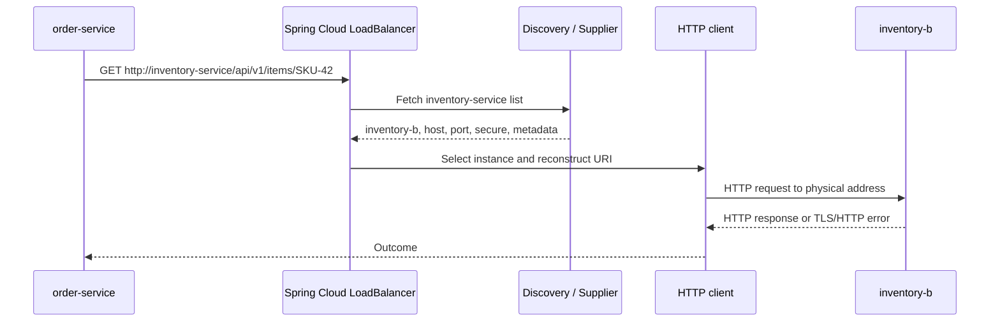

# URI, TLS, token, or header failures after target address replacement

## Objectives

An HTTP client in `order-service` may call a logical address:

```text
http://inventory-service/api/v1/items/SKU-42?include=warehouse
```

Spring Cloud LoadBalancer picks a `ServiceInstance`, such as `inventory-b` at `10.20.1.12:8443`, and the HTTP client sends the request to that physical address. After the target address is replaced, requests can start failing even though business code did not change: wrong URI path, TLS rejecting the certificate, tokens no longer valid for the resource server, or headers/`Host`/cookies missing or out of context.

This lesson helps you diagnose failures that appear **after the logical hostname is replaced with an instance's host/port** in Spring Cloud LoadBalancer. You will:

- Distinguish logical URLs, LoadBalancer-reconstructed URIs, and actual network destinations.
- Inspect scheme, host, port, path, query, encoding, base path, and redirects.
- Diagnose TLS handshakes, SNI, SANs, trust chains, mTLS, and instance secure flags.
- Separate token errors caused by issuer, audience, scope, expiry, token relay, and resource server policies.
- Inspect `Host`, `Authorization`, `Cookie`, `Forwarded`, correlation/trace headers, and request signatures.
- Identify differences between calling via service ID vs. calling a fixed URL.
- Use logs, curl, SimpleDiscoveryClient, and an HTTP test server to reproduce failures.
- Establish a remediation workflow without exposing tokens, cookies, or sensitive data.

> Scope: Spring Cloud LoadBalancer selects a `ServiceInstance` for client-side load balancing. TLS, OAuth2, header forwarding, and HTTP transport also depend on Spring Boot, Spring Security, HTTP clients, proxies/service meshes, and actual infrastructure. Examples below are diagnostic patterns; verify exact APIs against your project's Spring Boot/Cloud Release Train.

## 1. Understand the URI path before fixing bugs

A call by service ID typically takes three address forms:

| Stage | Example | Who decides? |
|---|---|---|
| Logical URL | `http://inventory-service/api/v1/items/SKU-42` | Caller code |
| Selected instance | `inventory-b = 10.20.1.12:8443` | Discovery + suppliers + LoadBalancer |
| Physical URI after reconstruction | e.g., `https://10.20.1.12:8443/api/v1/items/SKU-42` | LoadBalancer integration + HTTP client |



**LoadBalancer selecting an instance does not mean the request will succeed at the backend.** Selection can succeed while DNS, TCP, TLS, authentication, path routing, or proxies still fail.

### 1.1. Record diagnostic details per attempt

On failure, record non-sensitive details:

- Service ID: `inventory-service`.
- Selected instance ID and host/port.
- Scheme after reconstruction: `http` or `https`.
- HTTP method, URI template, and normalized path.
- HTTP status or root-cause error class: DNS, connect, TLS, 401, 403, 404, 421, 502...
- HTTP client/transport name: RestClient, WebClient/Reactor Netty, OpenFeign/HC5...
- Attempt index if retries occurred.
- Correlation ID / trace ID to correlate logs.

Never log raw `Authorization`, `Cookie`, API keys, JWTs, or full query strings if they contain secrets.

## 2. URI errors: right host, wrong path/query

### 2.1. Inspect path and base path

The caller sends:

```text
http://inventory-service/api/v1/items/SKU-42
```

Selected instance:

```text
http://10.20.1.12:8080
```

The URI after replacing the host usually preserves path and query:

```text
http://10.20.1.12:8080/api/v1/items/SKU-42
```

However, a new backend/proxy might expose a different path, such as `/inventory/api/v1/items/SKU-42`. In that case, a 404 stems from **base path or gateway rewrite**, not LoadBalancer picking the wrong instance.

Check in sequence:

1. Does the backend actually expose that exact method and path?
2. Does a gateway or ingress add a prefix or rewrite the path?
3. Did the client set a `baseUrl` containing a prefix and then append that prefix a second time?
4. Is there a 301/302/307/308 redirect to a different absolute URL?
5. Are query parameters preserved after URI template expansion?
6. Are path variables encoded properly—especially spaces, Unicode, `/`, `%`, and `?`?

### 2.2. Checking URI construction with RestClient

```java
import org.springframework.cloud.client.loadbalancer.LoadBalanced;
import org.springframework.stereotype.Component;
import org.springframework.web.client.RestClient;

@Component
class InventoryGateway {

    private final RestClient client;

    InventoryGateway(@LoadBalanced RestClient.Builder builder) {
        this.client = builder
                .baseUrl("http://inventory-service")
                .build();
    }

    String findItem(String sku) {
        return client.get()
                .uri(uriBuilder -> uriBuilder
                        .path("/api/v1/items/{sku}")
                        .queryParam("include", "warehouse")
                        .build(sku))
                .retrieve()
                .body(String.class);
    }
}
```

This snippet uses the logical URL `inventory-service`; the builder must actually carry `@LoadBalanced`. Replacing it with `RestClient.create()` or a non-LoadBalanced builder causes the hostname to be treated as an ordinary DNS host rather than a service ID.

### 2.3. Avoid concatenating URLs as strings

Avoid manual string concatenation:

```java
String url = baseUrl + "/" + path + "?sku=" + sku;
```

It risks double slashes, missing encoding, dropped query params, or mishandled special characters. Prefer the client's `uriBuilder`/URI templates.

When debugging, compare these values:

| Value | What to verify |
|---|---|
| Logical URL | Does the host match the intended service ID? |
| Instance URI | Do host/port/scheme match discovery data? |
| Path | Do prefix and API version match the backend? |
| Query | Were params dropped or double-encoded? |
| Redirect `Location` | Does it point to an old hostname, localhost, or internal domain? |
| Effective URI | Which destination did the HTTP client actually connect to? |

### 2.4. Redirects can pull requests off the service ID

A backend or proxy may return:

```http
HTTP/1.1 302 Found
Location: https://old-inventory.example.internal/api/v1/items/SKU-42
```

Depending on transport and configuration, the HTTP client may follow redirects automatically. The follow-up request can:

- Bypass LoadBalancer because the redirect URL uses an absolute hostname.
- Hit an old decommissioned host.
- Drop headers depending on redirect policy.
- Strip `Authorization` when the origin changes (usually a deliberate security safeguard).
- Hit TLS or DNS errors at the redirect target.

When observing 3xx responses, inspect `Location` and the transport's redirect policy. Never blindly enable cross-origin `Authorization` forwarding; if the redirect is legitimate, use explicit hostname and credential policies.

## 3. Host header, authority, and virtual hosting

HTTP requests carry a target URL alongside host/authority metadata. With HTTP/1.1, servers typically route virtual hosts by the `Host` header; HTTP/2 uses the `:authority` pseudo-header. If the URI changed to a new host while the caller still forces an old `Host` header, proxies/backends may pick the wrong virtual host or return 400/404/421.

Failure example:

```http
GET /api/v1/items/SKU-42 HTTP/1.1
Host: inventory-service
```

while the actual TCP/TLS connection goes to `10.20.1.12:8443` and the server expects authority `inventory.internal.example`.

### 3.1. Do not set Host manually without a specific requirement

Normally the HTTP client derives `Host`/authority from the final URI. If code or an interceptor sets it manually:

```java
headers.set("Host", "inventory-service");
```

that value may become invalid once LoadBalancer replaces host/port. Remove manual `Host` headers unless virtual hosting strictly requires a specific value; if required, test directly against the proxy/server.

### 3.2. Distinguish Host, SNI, and certificate SAN

Three related but distinct values:

- **HTTP Host/authority:** used by the HTTP server to route the request.
- **TLS SNI:** the server name sent by the client in the TLS handshake so the server selects the right certificate/virtual host.
- **Certificate SAN:** the DNS names/IPs the certificate is authorized to represent.

For example, the caller connects to IP `10.20.1.12` while the certificate only contains SAN `DNS:inventory.internal.example`. If the HTTP client validates TLS against the IP, hostname verification fails. Simply setting `Host: inventory.internal.example` **does not fix** SNI or certificate hostname verification.

The right fix is using a hostname matching the SAN and configuring DNS/service discovery or a proxy so that hostname resolves to the instance—or issuing a certificate with SANs matching what the client verifies. Never disable hostname verification to dodge errors.

## 4. TLS: scheme, SNI, SAN, trust chain, and mTLS

After target address replacement, TLS can fail because the original service ID is no longer the hostname used by the HTTP client for the handshake.

### 4.1. Check scheme and ServiceInstance secure flag

An instance may report:

| Field | Example | Effect |
|---|---|---|
| `host` | `inventory.internal.example` | Network target and potential certificate verification hostname |
| `port` | `8443` | Backend port |
| `isSecure()` | `true` | Signals secure transport in the `ServiceInstance` model |
| Logical URI | `http://inventory-service` | Caller's initial scheme |

Do not guess the final scheme from the port number. Port 8443 does not guarantee HTTPS is active; port 8080 does not guarantee plaintext HTTP. Inspect the actual URI reconstructed by LoadBalancer and your transport config.

If discovery registers the `secure` flag incorrectly, the client may send plaintext HTTP to a TLS port or HTTPS to a plaintext port, causing errors such as:

- `Connection reset` or `Empty reply from server`.
- TLS handshake errors when the server expects HTTP.
- Server logs reporting invalid HTTP requests on a TLS listener.
- HTTP parser errors complaining about non-HTTP TLS bytes.

### 4.2. Trust chain

`PKIX path building failed`, `unable to find valid certification path`, or similar errors indicate the caller does not trust the CA that issued the certificate.

Check:

1. Is the backend certificate still within its validity period?
2. Does the server send the complete intermediate certificate chain?
3. Was the internal CA added to the truststore of the exact JVM/container?
4. Does the HTTP client use a custom truststore separate from the JVM default?
5. Are certificate chains consistent across all instances after a rollout?

Never use a trust-all manager or disable certificate verification in production.

### 4.3. SNI and SAN

If the certificate was issued for `inventory.internal.example` while service discovery returns an IP, the HTTP client may handshake against a mismatched name. Verify:

- The DNS name the client uses for the TLS handshake.
- Actual SNI sent.
- SAN entries on the certificate.
- Transport hostname verification rules.
- Whether a proxy performs TLS termination/re-encryption.

Local testing can use `curl --resolve` to keep the certificate hostname while mapping to a test IP:

```bash
curl -v \
  --resolve inventory.internal.example:8443:127.0.0.1 \
  --cacert ./dev-ca.pem \
  "https://inventory.internal.example:8443/health"
```

This requires a valid certificate for `inventory.internal.example` and CA `dev-ca.pem`. It isolates DNS from TLS hostname/trust errors; it is not a replacement for production service discovery.

### 4.4. Mutual TLS (mTLS)

If the backend requires a client certificate, besides a truststore you also need a **keystore/client identity**:

- The caller must hold a certificate and private key trusted by the backend.
- The backend must trust the CA that signed the client certificate.
- The certificate identity must map to an authorized principal/permission.
- If backends/zones enforce trust policies, all instances must be configured consistently.

A new instance may be healthy at the TCP layer yet reject TLS due to a missing or expired client certificate. That is a TLS-layer handshake/authentication error, not LoadBalancer picking the wrong instance.

### 4.5. HTTP/2 and ALPN

When a transport negotiates HTTP/2 over TLS, ALPN must pick a protocol supported by both sides. If a backend/proxy supports only HTTP/1.1, a client configured for HTTP/2-only fails; a client supporting both may fall back depending on implementation.

Verify the actual HTTP protocol negotiated at each hop rather than assuming from server flags or HTTP client library names.

## 5. Tokens: a new URL does not mean a new token

An access token is typically issued for a specific **resource/audience**, issuer, client, and scope. Changing the physical host does not inherently invalidate a token—nor does it guarantee a token is valid for every host.

Common failures:

| Response/log | Causes to check |
|---|---|
| HTTP 401 | Missing/expired token, bad signature/issuer, wrong audience, stripped `Authorization` header |
| HTTP 403 | Token authenticated yet lacks required scope/authority/role or denied by policy |
| HTTP 407 | Proxy requires proxy authentication; not the backend OAuth token |
| TLS handshake fails before HTTP 401 | Certificate/mTLS error occurred prior to HTTP authentication |
| Token valid at Gateway yet rejected by backend | Gateway authenticated without relaying/exchanging appropriately, or backend has its own resource policy |

### 5.1. Audience and issuer

Example access token claims:

```json
{
  "iss": "https://identity.example.internal",
  "aud": ["inventory-api"],
  "scope": "inventory.read",
  "exp": 1890000000
}
```

Backend resource servers validate issuer, audience, and scope per contract. If the target changes from the inventory API to the pricing API while still sending a token with `aud=inventory-api`, rejection is **expected policy enforcement**.

Conversely, when switching from one instance IP to another within the same logical `inventory-service`, tokens should generally bind to the **service's stable resource identity**, independent of pod IP, unless your identity architecture specifies otherwise.

Never dynamically rewrite audience to the instance host/IP whenever LoadBalancer picks a backend. That couples tokens to topology and breaks during scaling and rollouts.

### 5.2. User token forwarding vs. service-to-service tokens

Distinguish two models:

- **Token relay:** the caller forwards the authenticated user's access token downstream when downstream requires user-scoped authorization.
- **Client credentials / token exchange:** the caller acquires a service-level token or exchanges a token scoped for the downstream audience.

Never forward every `Authorization` header blindly to every dependency. A token meant for an API Gateway is not necessarily valid for the inventory service; a user token may carry claims other services should not receive.

With Spring Cloud Gateway, `TokenRelay` forwards access tokens per OAuth2 client configuration. Internal service-to-service calls via `RestClient`/`WebClient`/Feign need their own token policy; Gateway `TokenRelay` does not apply automatically to calls that do not traverse the Gateway.

### 5.3. Inspecting tokens safely

- Check HTTP status, error codes, and necessary claims in an authorized environment.
- Use offline JWT decoding tools in a secure environment; decoding does not verify the signature.
- Verify issuer, audience, expiry, not-before, and scopes/roles.
- Check clock skew between the issuer and resource server.
- Verify whether the token relay/interceptor runs after URL reconstruction.
- Never paste real JWTs into logs, tickets, chat, or CI output.
- Never log the entire `Authorization` header to “compare tokens before and after.”

## 6. Headers after target address replacement

There are many kinds of HTTP headers, and not every header should pass unchanged when a request targets a new instance.

| Header | Risk when host/route changes | How to handle |
|---|---|---|
| `Host` / `:authority` | Mismatches new target if hardcoded | Let transport derive from URI unless virtual hosting demands otherwise |
| `Authorization` | Wrong audience, stripped by interceptor, or unsafe relay | Enforce per-downstream token policy; never forward globally |
| `Cookie` | Cookie `Domain`/`Path` only valid on old origin | Send cookies only when origin and contract match |
| `Forwarded`, `X-Forwarded-Host`, `X-Forwarded-Proto` | Proxy may trust forged client-supplied host/scheme | Only trusted proxies generate/overwrite; strip untrusted values |
| `X-Correlation-ID` | Dropped or overwritten by an interceptor | Standardize propagation; validate at ingress |
| `traceparent`, `tracestate`, `baggage` | Broken traces or metadata leaks via baggage | Use tracing instrumentation; bound baggage |
| `Content-Type` | Body misparsed after hitting new route | Verify contract and message converters |
| `Accept` | Backend lacks requested representation | Align supported media types |
| `Idempotency-Key` | Lost during retries/forwarding | Preserve across retries of the same operation when server deduplicates |
| `If-Match` / `ETag` | Cache/version semantics diverge across instances | Ensure shared state or consistent routing |
| Signature headers | Signature covers host/path/date yet URI changed | Sign canonical request matching real target; never reuse stale signatures |

### 6.1. Forwarded and X-Forwarded-* headers

`Forwarded`, `X-Forwarded-Host`, `X-Forwarded-Proto`, and `X-Forwarded-For` describe proxy/original-request metadata. They **do not become trustworthy** merely by being present.

If an external Internet request injects:

```http
X-Forwarded-Host: admin.internal.example
X-Forwarded-Proto: https
```

a backend with an overly permissive trusted-proxy policy may generate links, redirects, or security decisions using the forged host/scheme. Trusted ingress must strip/overwrite client-supplied headers and trust only designated proxy hops.

LoadBalancer swapping the physical destination on an outbound call does not mean you should overwrite `Forwarded` with the instance IP. Forwarded headers represent **proxy hops**, not service discovery.

### 6.2. Cookies and domain/path

If a backend returns:

```http
Set-Cookie: SESSION=...; Domain=old.example.internal; Path=/legacy; Secure; HttpOnly
```

while the client calls a new domain, the cookie may not be sent on subsequent requests because `Domain`/`Path` do not match. Behind a reverse proxy/gateway, apply cookie rewriting only if truly needed and review `SameSite`/`Secure`/`HttpOnly`. Never forward a user's cookie to an unrelated service simply because both run in the same cluster.

### 6.3. Request signatures and canonical host

Some systems sign requests over method, path, query, `Host`, timestamp, or body hash. Signing before URI rewriting can sign the logical host `inventory-service` while the backend/proxy validates a physical host or a different canonical host.

Never “fix” this by disabling signature verification. Identify **which component signs**, **which verifies**, and the shared canonical request format. If the gateway verifies signatures, preserve the logical host and verify at the gateway boundary; if the backend verifies, define an explicit canonical host/forwarded policy.

## 7. Differences between service ID and fixed URL

| Declaration | Selects instance via LoadBalancer? | Notes |
|---|---|---|
| `@FeignClient(name="inventory-service")` without `url` | Yes, when LoadBalancer integration/dependency is enabled | Discovery, suppliers, and retries by service ID |
| `@LoadBalanced RestClient.Builder` + `http://inventory-service` | Yes | Logical URL rewritten per selected instance |
| `@LoadBalanced WebClient.Builder` + `http://inventory-service` | Yes | Requires compatible filter/connector |
| `@FeignClient(name="inventory-service", url="https://host.example")` | Skips instance selection for that client | HTTP transport still handles TLS/metrics, but URL is fixed |
| `RestClient.create("https://host.example")` | No | DNS/HTTP client resolves hostname directly |
| `WebClient.builder().baseUrl("https://host.example")` without LB filter | No | No service ID resolution |

With a fixed URL, certificate, token, header, or redirect errors can still happen, but you should not investigate discovery/`ServiceInstanceListSupplier` as the primary cause.

## 8. Configuring service instances and SimpleDiscoveryClient to reproduce

In local environments, you can register instances explicitly:

```yaml
spring:
  cloud:
    discovery:
      client:
        simple:
          instances:
            inventory-service:
              - uri: http://localhost:8081
              - uri: http://localhost:8082
```

This illustrates plaintext HTTP. It does not start backend servers on 8081/8082; you must run your apps or mock servers on those ports.

If backends use HTTPS, register HTTPS URIs aligned with your certificates and trust policy:

```yaml
spring:
  cloud:
    discovery:
      client:
        simple:
          instances:
            inventory-service:
              - uri: https://inventory-a.test.internal:8443
              - uri: https://inventory-b.test.internal:8443
```

Never swap a hostname for an IP unless the certificate carries an IP SAN. Nor does an `https` scheme in the URI prove the caller has the right truststore, client certificate, or ALPN settings.

### 8.1. Test each instance directly before going through LoadBalancer

Call each backend directly using the expected hostname and certificate to isolate faults:

```bash
curl -v --cacert ./dev-ca.pem \
  "https://inventory-a.test.internal:8443/health"

curl -v --cacert ./dev-ca.pem \
  "https://inventory-b.test.internal:8443/health"
```

If direct calls fail TLS on both, fix certificates/trust/network before touching LoadBalancer. If direct calls succeed yet calls via service ID fail, compare final URI, scheme, host, port, headers, and HTTP client config post-selection.

### 8.2. Inspecting the selected ServiceInstance

In tests or diagnostic components, you can capture non-sensitive metadata of the selected instance:

```java
import org.springframework.cloud.client.ServiceInstance;
import org.springframework.cloud.client.loadbalancer.Response;
import org.springframework.cloud.loadbalancer.core.ReactorLoadBalancer;
import reactor.core.publisher.Mono;

Mono<ServiceInstance> chooseInstance(
        ReactorLoadBalancer<ServiceInstance> loadBalancer) {
    return loadBalancer.choose()
            .flatMap(response -> response.hasServer()
                    ? Mono.just(response.getServer())
                    : Mono.empty());
}
```

This is a reactive illustrative snippet; how `ReactorLoadBalancer` is injected depends on context/service ID, and you should never expose a public debug endpoint leaking internal hosts. Prefer restricted-access logs/traces with network details masked per policy.

## 9. RestClient, WebClient, and OpenFeign: client-specific checkpoints

### 9.1. RestClient

For RestClient, verify:

- Does the builder have `@LoadBalanced`, and is the right bean injected?
- Does a custom request factory/HTTP client override defaults?
- Does an interceptor set a wrong `Host` or `Authorization` header?
- Does the URI template produce the right path and query?
- Does the underlying client's TLS config trust the right CA and verify hostnames properly?

Example preserving logical URL:

```java
@Bean
@LoadBalanced
RestClient.Builder inventoryRestClientBuilder() {
    return RestClient.builder();
}
```

In Spring Boot apps with customizers/observation, use the Boot-configured builder integrated with `@LoadBalanced` per your release train; avoid replacing the whole builder and accidentally dropping tracing, TLS, or HTTP metrics.

### 9.2. WebClient

Check:

- Does `WebClient.Builder` carry `@LoadBalanced`?
- Does a custom `ReactorClientHttpConnector`/`HttpClient` alter TLS or proxy settings?
- Do filters mutate the request URI or headers?
- Does the reactive context preserve correlation and authorization policies properly?
- Does a retry filter replay requests after a token expired or with a non-replayable body?

Example:

```java
@Bean
@LoadBalanced
WebClient.Builder inventoryWebClientBuilder() {
    return WebClient.builder();
}
```

When adding custom filters, inspect the request **after the entire filter chain** in tests; a later filter can overwrite headers set by an earlier filter.

### 9.3. OpenFeign

For Feign, verify:

- Does `@FeignClient(name="inventory-service")` lack a fixed URL?
- Is `spring-cloud-starter-loadbalancer` on the classpath?
- Does the active Feign client use `FeignBlockingLoadBalancerClient` or the proper integration?
- Which `RequestInterceptor` beans add/overwrite `Authorization`, `Host`, correlation, or tenant headers?
- Do `ErrorDecoder` or `Retryer` beans alter how 401/403/503 responses are handled?
- Does the underlying HC5/OkHttp transport have its own TLS truststore, proxy, and redirect policies?

Never register a global `RequestInterceptor` that blindly forwards all inbound headers across all Feign clients. Scope configuration per `contextId`/client and allowlist only required headers.

## 10. Diagnostic table by symptom

| Symptom | First check | Common causes |
|---|---|---|
| 404 after switching instances | Path, base path, gateway rewrite | New backend exposes a different prefix or API version |
| 400 or 421 | Host/authority, virtual host | Stale `Host` header or mismatched proxy route |
| Repeated 301/302 | Location, scheme, hostname | Backend redirects to old domain or HTTPS/HTTP mismatch |
| Unknown host | Host after instance selection | Instance/proxy DNS cannot resolve |
| Connection refused | Host/port and readiness | Wrong port, listener not started, stale instance |
| Connection reset / empty reply | HTTP vs. HTTPS, proxy protocol | Sending HTTP to a TLS listener or vice versa |
| PKIX path building failed | Trust chain | CA/intermediate certificate not trusted |
| No subject alternative names | Hostname/IP vs. SAN | Certificate lacks SAN matching the verified hostname |
| TLS handshake failure | SNI, protocol, cipher, mTLS | Server requires client cert or rejects protocol |
| HTTP 401 | Authorization header, issuer/aud/exp | Missing, expired, wrong-resource, or stripped token |
| HTTP 403 | Scope/role/tenant policy | Authenticated yet lacks permission |
| HTTP 407 | Proxy configuration | Proxy demands separate proxy auth |
| Backend misses correlation ID | Interceptor/filter propagation | Header dropped or missing from allowlist |
| Cookie not sent | Domain/Path/SameSite/Secure | Cookie scoped only to old origin |
| Invalid signature | Canonical Host/path/query/body | Request signed before URI rewrite |
| Only one instance fails | Compare instance metadata/certs/config | Partial rollout; one pod has wrong cert or route |
| Failure happens only on retries | Target attempt, token refresh, body replay | Retry hits another instance with different config or unreplayable body |
| Fails only through Gateway | Forwarded headers, route rewrite, TLS termination | Gateway altered host/scheme/headers |

## 11. Layer-by-layer investigation workflow

Follow this sequence to avoid fixing the wrong layer:

1. **Identify call style:** logical service-ID URL via LoadBalancer or fixed URL?
2. **Record selected instance:** service ID, instance ID, host, port, secure flag, and metadata.
3. **Compare URIs:** scheme, authority, path, query, and encoding before and after rewrite.
4. **Call backend directly:** use the exact hostname, TLS, and valid credentials to separate discovery from network/security.
5. **Check TCP/DNS:** does the hostname resolve? Is the port listening? Do network policies/firewalls permit it?
6. **Check TLS:** SNI, SAN, trust chain, expiry, mTLS, ALPN.
7. **Check HTTP routing:** Host/authority, prefix, redirects, forwarded headers, virtual hosting.
8. **Check authentication:** was the token sent? Are issuer/audience/scope/expiry valid? Which resource server rejected it?
9. **Check headers/cookies:** allowlists, cookie domain/path, correlation/trace, signatures, and content negotiation.
10. **Check retries:** which attempt failed, did it switch instances, and are tokens/bodies safely replayable?
11. **Compare across instances:** is one pod broken or all of them? Are certs/configs/image versions uniform?
12. **Verify post-fix:** test both logical URLs via LoadBalancer and direct calls per instance before canary/production rollout.

## 12. Hands-on practice: reproduce failures after target change

Goal: use two local instances to separate URI, header, and HTTPS errors. Run locally/in tests without real production tokens.

### Step 1. Create two backends with distinct behavior

Each backend exposes:

```java
import java.util.Map;
import org.springframework.beans.factory.annotation.Value;
import org.springframework.web.bind.annotation.GetMapping;
import org.springframework.web.bind.annotation.RequestHeader;
import org.springframework.web.bind.annotation.RestController;

@RestController
class DiagnosticController {

    private final String instanceId;

    DiagnosticController(
            @Value("${demo.instance-id:unknown}") String instanceId) {
        this.instanceId = instanceId;
    }

    @GetMapping("/api/v1/diagnostic")
    Map<String, String> diagnostic(
            @RequestHeader(value = "X-Correlation-ID", required = false)
            String correlationId,
            @RequestHeader(value = "Host", required = false)
            String host) {
        return Map.of(
                "instanceId", instanceId,
                "host", host == null ? "missing" : host,
                "correlationId",
                correlationId == null ? "missing" : correlationId
        );
    }
}
```

This endpoint is strictly for testing; never expose internal Host/headers on public production APIs. In real systems, write diagnostics to controlled logs rather than returning them to users.

Run two backends:

```text
Backend A: --server.port=8081 --demo.instance-id=inventory-a
Backend B: --server.port=8082 --demo.instance-id=inventory-b
```

### Step 2. Register both instances via SimpleDiscoveryClient

```yaml
spring:
  cloud:
    discovery:
      client:
        simple:
          instances:
            inventory-service:
              - uri: http://localhost:8081
              - uri: http://localhost:8082
```

The caller must use a `@LoadBalanced RestClient.Builder` or `@LoadBalanced WebClient.Builder` and the logical URL `http://inventory-service`.

### Step 3. Call via service ID and verify

```bash
curl -i "http://localhost:8080/demo/inventory"
```

On the caller, invoke:

```java
return client.get()
        .uri("http://inventory-service/api/v1/diagnostic")
        .header("X-Correlation-ID", "diag-2026-001")
        .retrieve()
        .body(String.class);
```

Check the response:

- `instanceId` should be A or B.
- `correlationId` should stay preserved per policy.
- `Host`/authority should match the server receiving the request.
- Path should be `/api/v1/diagnostic`.

### Step 4. Deliberately trigger a Host error

In a test environment, add an interceptor setting the old `Host` and call via LoadBalancer. Observe virtual-host/server logs. Then remove the manual header so the transport derives `Host` from the reconstructed URI.

Never apply this intentional fault to production; the aim is demonstrating how manual headers break when the physical host changes.

### Step 5. Deliberately trigger a path error

Configure backend B to map only `/inventory/api/v1/diagnostic` while the caller still calls `/api/v1/diagnostic`. When LoadBalancer picks B, requests return 404. Inspect backend routes and align on either a shared contract path or explicit rewrite rules.

Do not “fix” it by retrying every 404 onto instance A: a 404 indicates a contract mismatch, and silent fallback masks version incompatibilities.

### Step 6. Isolate TLS failures

If you have test certificates/CA:

1. Run an HTTPS backend with a certificate carrying SAN `inventory.test.internal`.
2. Call directly with `curl --resolve` and `--cacert` to verify TLS.
3. Register the instance with the hostname matching the certificate.
4. Switch to an IP lacking an IP SAN to observe hostname verification failing.
5. Restore the matching hostname/SAN; never disable certificate validation.

### Step 7. Isolate token failures

Use mock test tokens issued by a test identity provider:

- Token with `aud=inventory-api` and scope `inventory.read` → read succeeds.
- Token with a different audience → backend returns 401 per resource server policy.
- Token with right audience but missing scope → backend returns 403.
- Strip `Authorization` header in an interceptor → backend returns 401.

Never use real JWTs or production tokens in lab exercises.

## 13. Automated tests for failure cases

### 13.1. Verify logical URI and path

Use an HTTP test server or WireMock/MockWebServer to capture incoming requests:

```text
Expected:
  method = GET
  path = /api/v1/items/SKU-42
  query = include=warehouse
  target instance = inventory-a or inventory-b
```

Assertions should check URI templates, paths, and queries. Never assert only HTTP 200 because mock servers can return 200 for any path, hiding rewrite bugs.

### 13.2. Verify header allowlist

Write tests covering:

| Header | Expected |
|---|---|
| `X-Correlation-ID` | Sent if policy allows |
| `traceparent` | Injected by tracing instrumentation |
| `Authorization` | Sent only when downstream token policy permits |
| `Cookie` | Not auto-forwarded across distinct origins |
| `Host` | Built from URI/transport unless explicit virtual-host policy applies |
| `X-Forwarded-Host` | Only generated/overwritten by trusted proxies |

Tests must assert both headers **that must appear** and headers **forbidden from appearing**. Test sensitive headers using synthetic values and never log secrets.

### 13.3. Verify TLS

Tests should distinguish:

- Trusted CA + valid SAN → handshake succeeds.
- Untrusted CA → trust failure.
- SAN mismatching hostname → hostname verification failure.
- Backend requires mTLS, client lacks cert → handshake fails.
- Client has valid cert → handshake succeeds if backend trusts CA and permits identity.

Do not mock away the entire TLS layer when testing certificate/hostname validation. Use a real TLS test server with test certificates generated for that purpose.

### 13.4. Verify retries and side effects

When the first attempt fails after the backend may already have processed it:

- Verify `Idempotency-Key` stays unchanged across attempts if required by contract.
- Count actual backend side effects.
- Do not blindly retry 401/403/404.
- Correlate target attempts with each service ID's token audience.
- Separate HTTP responses from the backend from pre-HTTP connect/TLS failures.

## 14. Common mistakes from rushed fixes

| Bad fix | Why it is dangerous | Right fix |
|---|---|---|
| Disabling TLS hostname verification | Opens the door to MITM and spoofed hosts | Issue proper SANs, valid hostnames, and trusted CAs |
| Trusting all certificates | Accepts untrusted certificates | Manage truststores/CAs properly |
| Sending every `Authorization` header to every service | Leaks tokens or sends wrong audiences | Per-dependency token relay/exchange |
| Overwriting `Host` with service ID | Breaks virtual hosts/authority | Let transport build `Host` or use explicit policy |
| Retrying every 404/401/403 | Masks contract/auth errors and adds load | Retry only transient errors on safe operations |
| Forwarding all `X-Forwarded-*` from Internet | Host/scheme spoofing | Strip and reset at trusted proxies |
| Hardcoding IPs in business code | Bypasses discovery/LoadBalancer and breaks TLS | Keep service IDs; let LB pick instances |
| Adding path prefix in both caller and Gateway | Double prefix / 404 | Assign one owner for path rewriting |
| Disabling redirects blindly | Alters auth flows or breaks requests | Inspect `Location`, origin, and credential policies |
| Logging all request headers | Exposes JWTs, cookies, API keys | Allowlist logged fields and redact secrets |
| Disabling cert validation on a single instance | Inconsistent security posture and gaps | Standardize certificates/configs across all instances |
| Retrying onto stable when canary fails contract | Hides version bugs and corrupts data | Keep variant boundaries, contract tests, and fail policies |

## 15. Production diagnostic checklist

- [ ] Confirmed whether URL uses a service ID through LoadBalancer or a fixed URL.
- [ ] Recorded selected service ID, instance ID, host/port, and secure flag.
- [ ] Compared logical URI against final URI: scheme, host, port, path, query, encoding.
- [ ] Checked base path, prefix, rewrites, and redirect `Location`.
- [ ] Avoided setting `Host`/authority manually without a virtual-host requirement.
- [ ] Distinguished `Host`, TLS SNI, and certificate SANs.
- [ ] Checked trust chains, expiry, CAs, mTLS, and ALPN.
- [ ] Verified HTTP/HTTPS scheme against the real backend listener rather than guessing from port.
- [ ] Checked whether `Authorization` header is sent without logging its value.
- [ ] Verified issuer, audience, expiry, scope/role, and token relay/exchange.
- [ ] Blocked forwarding tokens/cookies across origins unless policy permits.
- [ ] Confirmed forwarded headers originate solely from trusted proxies.
- [ ] Checked correlation/trace headers and signature canonicalization.
- [ ] Compared config across all instances, especially newly rolled-out pods.
- [ ] Separated no-instance, DNS, connection refused, TLS failure, and HTTP statuses.
- [ ] Audited every retry attempt; preserved idempotency keys where contracted.
- [ ] Maintain both logical-URL tests via LoadBalancer and direct per-instance tests.
- [ ] Maintain TLS tests with real test certificates/SANs/truststores.
- [ ] Redacted secrets across logs, traces, metrics, and CI outputs.

## Conclusion

When Spring Cloud LoadBalancer replaces a target address, failures can arise at many layers: **URI reconstruction**, virtual hosting, TLS/SNI/SAN, trust chains/mTLS, token audience/scope, header/cookie forwarding, or proxy rewrites. Never blame every failure on “LoadBalancer picked the wrong instance.” Start by recording the actual selected instance and URI, then inspect DNS/TCP, TLS, HTTP routing, and authentication in order.

Keep logical URLs keyed by service ID, let the transport construct appropriate `Host`/authority headers, issue certificates matching real hostnames, scope tokens to stable resource identities, and propagate only necessary headers. Combining direct per-instance tests with LoadBalancer tests, tracking every retry attempt, and refusing to disable security checks as shortcuts will keep your system sound across scaling, rollouts, and backend address changes.

## References

- [Spring Cloud Commons — Spring Cloud LoadBalancer and ServiceInstance](https://docs.spring.io/spring-cloud-commons/reference/spring-cloud-commons/loadbalancer.html)
- [Spring Cloud Commons — RestClient, RestTemplate, and WebClient LoadBalancer integration](https://docs.spring.io/spring-cloud-commons/reference/spring-cloud-commons/common-abstractions.html)
- [Spring Cloud OpenFeign — Client configuration and LoadBalancer integration](https://docs.spring.io/spring-cloud-openfeign/reference/spring-cloud-openfeign.html)
- [Spring Security — OAuth2 Resource Server JWT](https://docs.spring.io/spring-security/reference/servlet/oauth2/resource-server/jwt.html)
- [Spring Cloud Gateway — TokenRelay GatewayFilter](https://docs.spring.io/spring-cloud-gateway/reference/spring-cloud-gateway-server-webflux/gatewayfilter-factories/tokenrelay-factory.html)
- [Spring Framework — URI building and encoding](https://docs.spring.io/spring-framework/reference/web/webmvc/mvc-uri-building.html)
- [RFC 9110 — HTTP Semantics: Host, redirects and status codes](https://www.rfc-editor.org/rfc/rfc9110.html)
- [RFC 9113 — HTTP/2 authority and protocol](https://www.rfc-editor.org/rfc/rfc9113.html)
- [RFC 8446 — TLS 1.3](https://www.rfc-editor.org/rfc/rfc8446.html)
- [RFC 8705 — OAuth 2.0 Mutual-TLS Client Authentication](https://www.rfc-editor.org/rfc/rfc8705.html)
