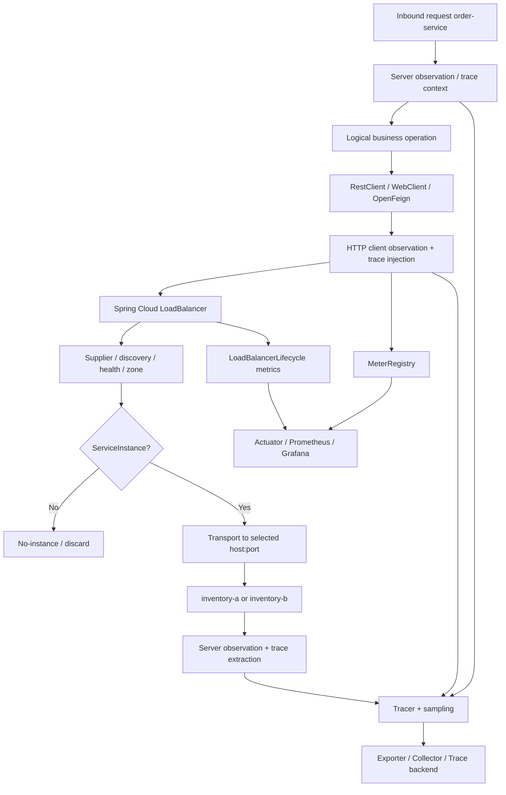
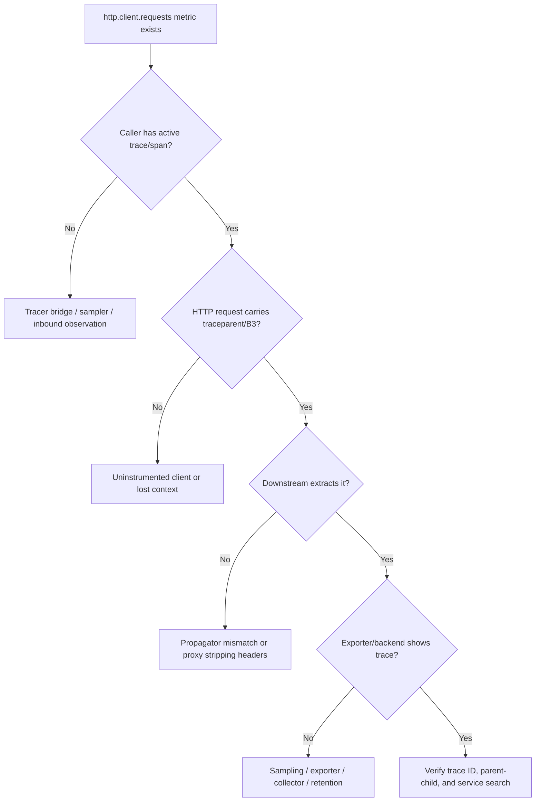

# Missing traces or metrics along load-balanced call paths

A request from `order-service` calling `inventory-service` via Spring Cloud LoadBalancer can succeed, yet dashboards show no `http.client.requests`, no `loadbalancer.requests.success`, or traces appear only on the receiving service without the calling service's span. Other systems have complete metrics yet find no traces in Jaeger/Tempo/Zipkin; still others print a trace ID in logs while the `traceparent` HTTP header never reaches downstream.

These symptoms **do not share a single cause**. In Spring Cloud architecture, `ServiceInstance` selection, HTTP client instrumentation, Micrometer Observation, trace context propagation, tracing exporters, Prometheus scraping, and trace backends are **distinct layers**. Adding `@LoadBalanced` does not automatically give an HTTP client observation; enabling Actuator does not automatically export traces.

This lesson belongs to the **Troubleshooting** chapter of the `SPRING_CLOUD_SERVICE_COMMUNICATION_LOAD_BALANCING` module. The goal is to pinpoint where telemetry drops along RestClient, WebClient, RestTemplate, OpenFeign, or HTTP Interface call paths; verify with HTTP stubs and `MeterRegistry`; separate absent meters from zero-valued metrics; verify sampling/propagation; and apply a runbook to restore observability without exploding cardinality or exposing sensitive data.

> **Diagnostic principle:** Before modifying trace exporters or Grafana, confirm **which client**, **which builder/adapter**, **which service ID** the request went through, and **where observations were confirmed to be created**. Traces, metrics, and logs correlate with one another rather than replacing each other.

## 1. Typical symptoms and first checks

| Manifestation | First suspicion | Evidence to distinguish |
|---|---|---|
| API returns 200 yet `http.client.requests` is missing | Manually created client, missing `ObservationRegistry`, filtered meter | Inspect builder bean and `/actuator/metrics` after a request |
| `http.client.requests` exists yet `loadbalancer.requests.*` is missing | LB stats disabled, direct target, bypassed LB, meter unrecorded | Check `@LoadBalanced`/Feign target and `stats.micrometer.enabled` |
| `loadbalancer.requests.success` increments despite HTTP 503 | Not necessarily an instrumentation bug | LB “success” only means a response was relayed, not HTTP 2xx |
| HTTP client metrics exist yet traces are absent | Missing tracer/exporter, sampling, backend, or propagation | Check active trace on caller, exporter, and collector |
| Caller has one trace ID, downstream has a different one | Missing context inject/extract or mismatched propagation format | Inspect `traceparent`/`b3` headers on both sides |
| Trace disappears across `@Async` or `CompletableFuture` | Observation context not propagated to new thread | Check executor, task decorator, and context snapshot |
| Trace disappears between Reactor operators | Context not propagated or detached subscription | Check Reactor Context, separate `subscribe()`, and propagation mode |
| Traces appear sporadically | Sampling < 100%, tail sampling, or backend retention | Check probability/sampler/collector; do not assume random loss |
| `/actuator/prometheus` has data yet Grafana is blank | Prometheus not scraping, wrong labels/PromQL, wrong dashboard filter | Check `up`, targets, and query raw metric name |
| `/actuator/metrics` lacks LB meters right at startup | Meters register lazily | Send real requests and re-check |
| Feign client A has traces, client B does not | `feign-micrometer`, per-client flag, or custom Feign builder | Inspect `MicrometerObservationCapability` on exact Feign context |
| No-instance failure has no server span | Zero servers were ever called | Look for `loadbalancer.requests.discard` and client-side errors |
| HTTP request has traces yet no dedicated “pick instance” span | Framework does not emit such a span by default | Separate LB lifecycle metrics from HTTP client/server spans |

**Which layer dropped the signal?** That is the central question. Never use an empty Grafana chart to conclude “Spring Cloud LoadBalancer isn't running.”

## 2. Call-path diagram and where observability can be lost

Suppose:

```text
order-service -> GET http://inventory-service/api/v1/items/SKU-001

Discovery:
  inventory-a -> http://inventory-a:8081
  inventory-b -> http://inventory-b:8081
```



Questions to answer in order:

1. Did the request actually execute? With WebClient, publishers run only when subscribed.
2. Does the client use the logical name `inventory-service` or a fixed physical URL?
3. Is the client configured with **both LoadBalancer and ObservationRegistry**?
4. Is `MicrometerStatsLoadBalancerLifecycle` registered and recording?
5. Is a tracer implementation present and does sampling keep the trace?
6. Are propagation headers injected into the HTTP request and extracted downstream?
7. Did spans export through the collector or get dropped/rejected?
8. Are metrics scraped with the expected names, labels, and time range?

### 2.1. Separate “not created” from “not displayed”

```text
A. Observation never created
   -> Neither http.client.requests nor client spans exist

B. Observation created + MeterRegistry has counts
   -> Actuator shows them, Prometheus/Grafana blank: scrape/query/export issue

C. HTTP observation created yet traces never export
   -> Tracer bridge, sampling, exporter/backend issue

D. Traces export yet parent-child breaks
   -> W3C/B3 propagation or thread/reactive context issue

E. LoadBalancer metrics missing while HTTP metrics exist
   -> LB stats config, direct target, or lifecycle/version issue

F. No backend span because of no-instance
   -> LB could not pick an endpoint; not a propagation bug
```

## 3. Understand Metrics, Observation, Span, and Log accurately

| Concept | Unit / source | What it proves |
|---|---|---|
| `Observation` | Micrometer Observation API | An operation was observed and can emit metrics/spans |
| `MeterRegistry` | Micrometer Core | In-process counters, timers, gauges—even before scraping |
| `http.client.requests` | Spring Framework HTTP client observation | HTTP client calls are instrumented and measured |
| `http.server.requests` | Spring Framework server observation | Server endpoints are instrumented |
| `loadbalancer.requests.*` | Spring Cloud `MicrometerStatsLoadBalancerLifecycle` | Selection/relay request lifecycle through Spring Cloud LB |
| Span | Micrometer Tracing + tracer implementation | One unit of work in a distributed trace when sampled/recorded |
| Trace context | W3C `traceparent` or B3 | Connects spans into one trace across the network |
| Exporter | OTLP/Zipkin/etc. | Ships spans to a collector/backend |
| Prometheus scrape | Registry → HTTP endpoint → Prometheus | Turns process meters into stored/queryable time series |
| Structured log | Logging framework/MDC | Can attach trace ID, span ID, and detailed errors |

An **HTTP 500 can still count as a response** in the LoadBalancer lifecycle; `loadbalancer.requests.success` is not the HTTP 2xx rate. Conversely, `http.client.requests` may count retry attempts or exchanges while a business-level logical request has one final outcome. Never subtract these metrics or compute SLOs without verifying exact boundaries.

### 3.1. Having no separate span per instance selection can be normal

Spring Cloud LoadBalancer provides `LoadBalancerLifecycle` for lifecycle hooks and statistics, yet documentation does not guarantee every `choose` call emits a dedicated tracing span named “loadbalancer.choose”. A completely valid trace may look like:

```text
order-service: HTTP SERVER /orders/123
  └─ order-service: HTTP CLIENT /api/v1/items/{sku}
        └─ inventory-service: HTTP SERVER /api/v1/items/{sku}
```

Not seeing an instance-selection span **is not enough to conclude** HTTP requests bypassed LB. To know the selected instance, add dedicated lifecycle logs/observations or inspect target attributes in traces where backend policies permit, keeping cardinality bounded.

## 4. Preflight: baseline observability dependencies and config

Examples below target **Spring Boot 3.2–3.5** with a compatible Spring Cloud release train, as `RestClient.Builder` and Micrometer Observation are built into this line. **Spring Boot 4.x changes package names for certain helpers and how tracing/exporters are declared**; never copy imports/profiles verbatim across major versions.

Minimum Maven dependencies to **expose HTTP and LB metrics via Actuator/Prometheus**:

```xml
<dependencies>
    <dependency>
        <groupId>org.springframework.boot</groupId>
        <artifactId>spring-boot-starter-web</artifactId>
    </dependency>
    <dependency>
        <groupId>org.springframework.boot</groupId>
        <artifactId>spring-boot-starter-actuator</artifactId>
    </dependency>
    <dependency>
        <groupId>io.micrometer</groupId>
        <artifactId>micrometer-registry-prometheus</artifactId>
    </dependency>
    <dependency>
        <groupId>org.springframework.cloud</groupId>
        <artifactId>spring-cloud-starter-loadbalancer</artifactId>
    </dependency>
</dependencies>
```

For WebClient, add `spring-boot-starter-webflux`. For OpenFeign, add `spring-cloud-starter-openfeign` and confirm `feign-micrometer` is actually on the classpath.

**Metrics dependencies alone do not provide distributed tracing.** To export traces, add a Micrometer Tracing bridge + tracer implementation + matching exporter and a running collector/backend.

### 4.1. Actuator and LB statistics

```yaml
management:
  endpoints:
    web:
      exposure:
        include: health,info,metrics,prometheus

spring:
  cloud:
    loadbalancer:
      stats:
        micrometer:
          enabled: true
        include-path: false
```

`spring.cloud.loadbalancer.stats.micrometer.enabled=true` paired with `MeterRegistry` lets the framework register `MicrometerStatsLoadBalancerLifecycle` when matching auto-configuration runs. `include-path=false` prevents dynamic paths from turning into high-cardinality metric tags.

**Do not forget Actuator security**: `/actuator/metrics` and `/actuator/prometheus` can reveal service names, URI templates, errors, and system topology. Expose them only to trusted monitoring networks with proper authentication, authorization, and network policies.

### 4.2. Tracing config for diagnostic windows

Only in controlled local/test/staging environments:

```yaml
management:
  tracing:
    sampling:
      probability: 1.0

spring:
  reactor:
    context-propagation: auto
```

`probability: 1.0` requests 100% sampling for short tests, yet **does not create a tracer/exporter by itself**. Never keep 100% sampling on high-traffic production if cost, privacy, or backend capacity forbids it. `spring.reactor.context-propagation=auto` restores context across reactive pipelines per Reactor/Spring Boot mechanics, yet cannot fix an uninstrumented HTTP client.

### 4.3. Tracing dependencies vary by Spring Boot version

**Boot 3.5 — OpenTelemetry/OTLP example:**

```xml
<dependency>
    <groupId>io.micrometer</groupId>
    <artifactId>micrometer-tracing-bridge-otel</artifactId>
</dependency>
<dependency>
    <groupId>io.opentelemetry</groupId>
    <artifactId>opentelemetry-exporter-otlp</artifactId>
</dependency>
```

Paired with Actuator and endpoint config **for Boot 3.x**:

```properties
management.otlp.tracing.endpoint=http://otel-collector:4318/v1/traces
```

**Boot 4.x — example per current documentation:**

```xml
<dependency>
    <groupId>org.springframework.boot</groupId>
    <artifactId>spring-boot-starter-opentelemetry</artifactId>
</dependency>
```

The Boot 4.x line uses `management.opentelemetry.tracing.export.otlp.*` or general `management.opentelemetry.otlp.*` depending on the case. **Do not assume Boot 3.x and Boot 4.x property keys are identical.** Check your BOM/auto-config and effective application properties.

Brave/Zipkin setups also have their own dependencies and exporters. This lesson aims to **diagnose the flow properly**, not force a Jaeger/Tempo shop to switch backends just to get traces.

## 5. Inspect metrics along the chain: process → Actuator → Prometheus → Grafana

Proceed step by step instead of jumping straight to dashboards:

1. Send at least one call from the **exact HTTP client** suspected of missing metrics.
2. Confirm the request got a response or exception and appears in caller logs.
3. List meters via `/actuator/metrics`.
4. Read `/actuator/metrics/http.client.requests`.
5. Read `/actuator/metrics/loadbalancer.requests.success` and `...discard` after triggering matching conditions.
6. Check `/actuator/prometheus` for corresponding time series.
7. Check Prometheus Targets to confirm the scrape target has `up=1`.
8. Query the raw metric name in Prometheus without applying Grafana filters prematurely.
9. Inspect recording rules, relabeling configs, retention, and dashboard time ranges.

Local check example **only when endpoints are authorized**:

```shell
curl -fsS http://127.0.0.1:8080/actuator/metrics
curl -fsS http://127.0.0.1:8080/actuator/metrics/http.client.requests
curl -fsS http://127.0.0.1:8080/actuator/prometheus
```

Note: `/actuator/metrics` reads meters by **Micrometer** name, whereas `/actuator/prometheus` follows **Prometheus** naming conventions. Dotted names convert to snake_case with meter-type suffixes. Timer example:

```text
Micrometer:
  http.client.requests

Prometheus (typical):
  http_client_requests_seconds_count
  http_client_requests_seconds_sum
  http_client_requests_seconds_bucket (only if histograms are configured)

Spring Cloud LoadBalancer:
  loadbalancer.requests.discard

Prometheus (typical):
  loadbalancer_requests_discard_total
```

**Do not assume `_bucket` series will appear** unless histograms are enabled. Prometheus names/tags can vary across versions, registry filters, and semantic conventions; treat the scraped exposition as authoritative.

### 5.1. “Missing meter” and “zero-valued meter” are not the same

Spring Cloud LoadBalancer records `loadbalancer.requests.*` on lifecycle events. Meters may register only after **matching data is recorded**. Thus, `discard` being absent right after startup does not mean anything is broken: no-instance may simply never have happened yet.

Distinguish:

- **No meter:** uninstrumented, unrecorded, filtered out, or event has not occurred yet.
- **Counter at 0:** meter exists yet has not incremented.
- **Missing in Prometheus:** scrape failing, wrong labels/name/time range, target down, or dropped by relabeling.
- **Missing in Grafana:** wrong dashboard variable or query, even though Prometheus holds the series.

## 6. Four Spring Cloud LoadBalancer meters to check

Per Spring Cloud Commons documentation, `MicrometerStatsLoadBalancerLifecycle` registers:

| Micrometer name | Type | Meaning |
|---|---|---|
| `loadbalancer.requests.active` | Gauge | Active load-balanced requests, tagged with instance where available |
| `loadbalancer.requests.success` | Timer | Requests ending with a **response relayed** to the client |
| `loadbalancer.requests.failed` | Timer | Requests ending with an exception in the corresponding lifecycle |
| `loadbalancer.requests.discard` | Counter | Requests that failed to obtain a `ServiceInstance` |

`success` **does not mean HTTP 2xx**. A `503` returned by the backend counts as a completed response from LB's viewpoint, even if `RestClient.retrieve()` throws an exception for that status. Never treat `success/(success+failed)` as the business “HTTP success rate.”

### 6.1. Diagnosing when only one of the four meters exists

Example:

```text
loadbalancer.requests.success   -> has data
loadbalancer.requests.failed    -> absent
loadbalancer.requests.discard   -> absent
```

Not necessarily a bug. Failed or discard events may simply not have occurred yet. Create **controlled test cases**:

- HTTP 200 from A/B: success timer increments.
- Post-selection transport failure: failed timer increments depending on integration.
- Service ID with zero candidates: verify discard counter.
- Server-returned HTTP 503: cross-check `http.client.requests` with `status=503` rather than expecting LB failed.

Some blocking integrations may omit detailed request/response tags because `BlockingLoadBalancerClient` does not know generic HTTP response types at the lifecycle layer. **Missing a specific tag does not mean the whole meter is lost.**

### 6.2. If HTTP metrics exist yet LB metrics are absent

Check:

1. Is `spring.cloud.loadbalancer.stats.micrometer.enabled` actually `true` at runtime?
2. Has `MeterRegistry` been created?
3. Is the HTTP client actually going through Spring Cloud LB?
4. Does Feign have a direct `url` override?
5. Do RestClient/WebClient use the `@LoadBalanced` bean rather than a plain builder?
6. Has any request actually gone through selection yet?
7. Was the meter excluded by `management.metrics.enable.*`, a `MeterFilter`, or registry exporter filters?
8. Does a custom `LoadBalancerLifecycle` alter lifecycle behavior?

**A client calling a direct URL** still records `http.client.requests` via HTTP observation, yet emits zero LB stats because it never selects a `ServiceInstance` via Spring Cloud.

## 7. Most common bug: @LoadBalanced present without ObservationRegistry

Spring Cloud LoadBalancer and Micrometer Observation serve two different jobs.

Simple example **not yet guaranteeing observation**:

```java
@Bean
@LoadBalanced
RestClient.Builder loadBalancedBuilder() {
    return RestClient.builder();
}
```

Spring Cloud attaches the LoadBalancer interceptor to this bean, yet it **does not automatically receive all customizers Spring Boot gives its auto-configured builder**. Calling `RestClient.builder()` manually can leave HTTP client observation as a no-op.

Per Spring Cloud Commons documentation, for **Spring Boot 3.2–3.5**, use Boot's `RestClientBuilderConfigurer` to preserve customizers—including observability.

### 7.1. Fix RestClient using RestClientBuilderConfigurer

```java
package com.example.order.config;

import org.springframework.beans.factory.annotation.Qualifier;
import org.springframework.boot.autoconfigure.web.client.RestClientBuilderConfigurer;
import org.springframework.cloud.client.loadbalancer.LoadBalanced;
import org.springframework.context.annotation.Bean;
import org.springframework.context.annotation.Configuration;
import org.springframework.web.client.RestClient;

@Configuration(proxyBeanMethods = false)
public class ObservedRestClientConfiguration {

    @Bean("loadBalancedRestClientBuilder")
    @LoadBalanced
    RestClient.Builder loadBalancedRestClientBuilder(
            RestClientBuilderConfigurer configurer) {

        return configurer.configure(RestClient.builder());
    }

    @Bean
    RestClient inventoryRestClient(
            @Qualifier("loadBalancedRestClientBuilder")
            RestClient.Builder builder) {

        return builder.clone()
                .baseUrl("http://inventory-service")
                .build();
    }
}
```

Key takeaways:

- `RestClientBuilderConfigurer` applies Spring Boot's customizations to the builder, including Observation and Boot-supported HTTP client settings.
- `@LoadBalanced` lets Spring Cloud attach the interceptor handling service IDs.
- `inventory-service` is a **logical** hostname, not a Pod IP.
- The client is built from the **exact injected builder**.
- `clone()` avoids mutating the base URL of a builder shared with other clients.

**Version caveat:** Boot 4.x moves this class to package `org.springframework.boot.restclient.autoconfigure.RestClientBuilderConfigurer`. Never copy Boot 3 imports into Boot 4 and blame LoadBalancer for a missing bean.

### 7.2. If ObservationRegistry must be configured manually

In principle, Spring Framework RestClient provides:

```java
RestClient client = RestClient.builder()
        .observationRegistry(observationRegistry)
        .baseUrl("https://api.example.com")
        .build();
```

However, this is **manual client instrumentation** and does not add the LB interceptor. For LB, you still need a `@LoadBalanced` builder or matching adapter. Inside Spring Boot apps, prefer the **Boot-configured builder** so you never drop TLS/timeouts/proxies/connection pooling/tracing.

### 7.3. RestTemplate has the same trap

`new RestTemplate()` has no observation by itself. Spring Boot configures `RestTemplateBuilder`, while Spring Cloud adds `@LoadBalanced`. When multiple RestTemplates exist, know which bean is injected; a `@Primary` plain client can silently intercept injections.

## 8. WebClient: LB filter present yet traces still missing

A WebClient may be configured as:

```java
@Bean("loadBalancedWebClientBuilder")
@LoadBalanced
WebClient.Builder loadBalancedWebClientBuilder() {
    return WebClient.builder();
}
```

Spring Cloud wires the reactive LB exchange filter when conditions hold. However, a manually instantiated builder may miss Boot's `ObservationRegistry` and customizers.

Matching the Spring Framework API directly:

```java
package com.example.order.config;

import io.micrometer.observation.ObservationRegistry;
import org.springframework.cloud.client.loadbalancer.LoadBalanced;
import org.springframework.context.annotation.Bean;
import org.springframework.context.annotation.Configuration;
import org.springframework.web.reactive.function.client.WebClient;

@Configuration(proxyBeanMethods = false)
class ObservedWebClientConfiguration {

    @Bean("observedLoadBalancedWebClientBuilder")
    @LoadBalanced
    WebClient.Builder observedLoadBalancedWebClientBuilder(
            ObservationRegistry observations) {

        return WebClient.builder()
                .observationRegistry(observations);
    }
}
```

This example **explicitly attaches ObservationRegistry**. In production, ensure Spring Boot's WebClient customizers—such as TLS, proxies, connectors, codecs, tracing, observation conventions, and connection pools—are also applied. Use `WebClientCustomizer` or Boot's documented builder configuration instead of creating a bare builder and overwriting settings.

### 8.1. Check which client actually sends requests

```java
WebClient client = observedBuilder.clone()
        .baseUrl("http://inventory-service")
        .build();

Mono<StockView> result = client.get()
        .uri("/api/v1/items/{sku}", sku)
        .retrieve()
        .bodyToMono(StockView.class);
```

`Mono` is a **lazy** publisher. Until something subscribes or composes the returned publisher, no request is sent and no HTTP span/metric exists. Wait for terminal signals/cancellation in tests rather than asserting meters before execution.

### 8.2. Using mutate() can preserve or alter config unexpectedly

If code contains:

```java
WebClient revised = oldClient.mutate()
        .baseUrl("https://external.example.com")
        .build();
```

`mutate()` preserves existing filters/connectors/observation settings. It does not automatically turn a load-balanced client into a plain client or vice versa. Inspect the exchange filter chain and bean source instead of guessing from `baseUrl`.

## 9. OpenFeign: check MicrometerObservationCapability and per-client flags

Per Spring Cloud OpenFeign documentation, `MicrometerObservationCapability` is registered when:

1. `feign-micrometer` is on the classpath.
2. An `ObservationRegistry` bean exists.
3. Feign's Micrometer feature flags permit it.

Extra dependency example:

```xml
<dependency>
    <groupId>io.github.openfeign</groupId>
    <artifactId>feign-micrometer</artifactId>
</dependency>
```

A client:

```java
@FeignClient(name = "inventory-service")
public interface InventoryFeignClient {
    @GetMapping("/api/v1/items/{sku}")
    StockView get(@PathVariable("sku") String sku);
}
```

Global flag:

```yaml
spring:
  cloud:
    openfeign:
      micrometer:
        enabled: true
```

Per-client flag (`feignName` must match the actual configuration key/context):

```yaml
spring:
  cloud:
    openfeign:
      client:
        config:
          inventory-service:
            micrometer:
              enabled: true
```

**Precedence warning:** `spring.cloud.openfeign.micrometer.enabled=false` disables Micrometer for **all** Feign clients regardless of per-client flags. Per docs, to configure per client, do not set global to false; control individual per-client flags instead.

### 9.1. MicrometerCapability vs. MicrometerObservationCapability

- `MicrometerObservationCapability` makes Feign **observable via ObservationRegistry**, producing both metrics and traces when a bridge/tracer exists.
- `MicrometerCapability` in metrics-only mode records metrics to `MeterRegistry` without guaranteeing distributed tracing.
- Never register **both** if they measure the same HTTP call, to avoid double counting.

When a Feign client emits metrics without traces, check whether it uses metrics-only `MicrometerCapability` vs. `MicrometerObservationCapability`, alongside exporters, sampling, and propagation.

### 9.2. Feign name does not guarantee LoadBalancer

```java
@FeignClient(
        name = "inventory-service",
        url = "http://inventory-a:8081")
interface DirectInventoryFeignClient {
    // ...
}
```

This client can emit Feign metrics and client spans, yet **skips Spring Cloud LoadBalancer by service ID** because of the fixed target URL. Missing LB stats here matches the **actual path**, not a Micrometer bug.

## 10. HTTP Interfaces: inspect the backing client adapter, not just @HttpExchange

With `HttpServiceProxyFactory`, the interface declares the contract:

```java
@HttpExchange("/api/v1")
interface InventoryApi {
    @GetExchange("/items/{sku}")
    StockView find(@PathVariable String sku);
}
```

If the proxy wraps a RestClient/WebClient **already wired with ObservationRegistry and LB integration**, HTTP calls emit matching metrics/traces. If the adapter wraps a plain client, `@HttpExchange` alone grants neither instrumentation nor service-ID selection.

Runbook: identify which `RestClientAdapter`/`WebClientAdapter` was used, which builder configured the client, and what target URL / group base URL is active. For Spring Cloud 5.x HTTP Service Client groups, check `lb://` and explicit HTTP(S) base URL rules for your exact version—do not assume every HTTP Interface goes through LoadBalancer automatically.

## 11. Traces created yet never exported: sampling and exporters

Having metrics does not guarantee having traces. Micrometer Observation emits metrics even when no tracing bridge or exporter is present.

Layers involved:

```text
Observation created
      |
      v
Tracing observation handler / tracer bridge
      |
      v
Sampler decides sampled / not sampled
      |
      v
Span recorded and ended
      |
      v
OTLP / Zipkin exporter
      |
      v
Collector ingestion / processors / filters
      |
      v
Trace backend (Tempo / Jaeger / Zipkin)
      |
      v
Trace search / retention / permissions
```

### 11.1. Low sampling is not a random LoadBalancer bug

Spring Boot defaults to probabilistic sampling below 100% (Spring Boot docs reference `0.1`). Sending only a few requests may produce zero visible traces even when the system works fine. Beyond head sampling, collectors/backends may apply tail sampling, drop policies, or retention limits.

To diagnose in **traffic-bounded staging**, set `management.tracing.sampling.probability=1.0` and send a batch of requests with a correlation ID. Once evidence is captured, revert sampling to your operational budget.

Never leave 100% sampling enabled long-term in production just to “fill dashboards” if cost, privacy, or backend capacity forbids it.

### 11.2. Spans exist in process yet backend is empty

Check:

- Are a real tracer implementation and matching exporter on the classpath?
- Does the OTLP/Zipkin endpoint match protocol, scheme, host, port, and path?
- Is a proxy/firewall/service mesh blocking traffic to the collector?
- Are TLS truststores/mTLS/client auth to the collector configured right?
- Does the exporter log `UNAVAILABLE`, `403`, `429`, rejected spans, or queue-full errors?
- Are collector receivers, processors, and exporters active, and what are drop counts?
- Has the trace backend ingested them, and are retention and tenant/permission/search scopes right?
- Could time ranges or clock skew between services push traces outside the search window?

Do not confuse the HTTP OTLP trace endpoint `4318/v1/traces` with metrics endpoints or gRPC port `4317`. Addresses/ports here are typical OTLP defaults and must match your real collector config.

### 11.3. Trace exists yet searching by service name misses it

A span may be exported with an unexpected `service.name` due to `spring.application.name`/OpenTelemetry resource attributes or exporter settings. Search by **trace ID** from logs first, then inspect resource attributes and service names. Never assume every observed field attaches automatically to trace spans.

## 12. Propagation: traceparent, B3, and parent-child relationships

To connect a trace:

```text
Trace ID = shared identifier across services
Span ID  = unique per span
Parent   = caller span acting as parent to callee span
```

W3C Trace Context uses:

```http
traceparent: 00-4bf92f3577b34da6a3ce929d0e0e4736-00f067aa0ba902b7-01
```

Hex values here are illustrative. Never hand-craft a “valid-looking” `traceparent` header and assume propagation works. The header must be injected by the instrumented HTTP client/tracer from an active context, and extracted downstream with a matching propagator.

B3 uses `b3` or `X-B3-*` headers. If the caller injects only W3C while downstream extracts only B3, downstream starts a **brand-new trace**. That is a **protocol/context compatibility** mismatch, not a discovery or LoadBalancer bug.

### 12.1. Proper observation order when debugging propagation

1. Verify whether the caller has an active trace/span.
2. Verify whether HTTP client observation creates an outbound client span.
3. On a **test-environment server stub**, record presence/absence of `traceparent`/`b3` (avoid logging all headers in production).
4. Verify whether downstream configures a matching tracer/propagator extractor.
5. Compare caller and server trace IDs; they must match when propagated.
6. Verify parent-child chains, sampling flags, and exporters.
7. When a gateway/sidecar sits in between, verify whether it preserves/forwards headers or starts a fresh trace.

**Never write an interceptor that overwrites `traceparent` with a random ID**, as that breaks parent-child chains and invalidates headers. To debug, use redacted loggers or inspect headers at a test server.

## 13. Common bug: context lost across threads or reactive schedulers

### 13.1. @Async and thread pools

Micrometer tracing context can bind to `ThreadLocal` within a scope. When execution hops threads without propagating context, logs on the new thread lose the trace ID, or HTTP clients start fresh root spans.

Spring Boot 3.x provides `ContextPropagatingTaskDecorator`:

```java
import org.springframework.context.annotation.Bean;
import org.springframework.context.annotation.Configuration;
import org.springframework.core.task.support.ContextPropagatingTaskDecorator;

@Configuration(proxyBeanMethods = false)
class AsyncContextConfiguration {

    @Bean
    ContextPropagatingTaskDecorator contextPropagatingTaskDecorator() {
        return new ContextPropagatingTaskDecorator();
    }
}
```

With **Boot 3.x auto-configured task executors**, Boot applies this bean automatically. If your app constructs a `ThreadPoolTaskExecutor` manually, you must **attach the task decorator directly to that executor**:

```java
ThreadPoolTaskExecutor executor = new ThreadPoolTaskExecutor();
executor.setTaskDecorator(new ContextPropagatingTaskDecorator());
executor.setCorePoolSize(4);
executor.setMaxPoolSize(8);
executor.initialize();
```

This snippet illustrates the mechanism; in real apps manage executors as lifecycle-managed beans rather than creating new ones per request.

**Boot 4.x** introduces properties for task-execution context propagation on auto-configured executors; consult version docs instead of relying blindly on a Boot 3.x custom bean.

### 13.2. Reactor Context differs from ThreadLocal

In WebFlux/Reactor, execution hops threads across `publishOn`/`subscribeOn` and I/O callbacks. Manual `ThreadLocal`/SLF4J MDC entries do not automatically follow Reactor streams.

Per Spring Boot docs:

```yaml
spring:
  reactor:
    context-propagation: auto
```

This mode uses the context propagation library and Reactor hooks to restore context where appropriate. It carries performance overhead; test your reactive pipelines and measure under realistic load.

### 13.3. Detached subscribe() breaks traces

Anti-pattern:

```java
public Mono<Void> saveOrder(Order order) {
    webClient.post()
            .uri("/events")
            .bodyValue(order)
            .retrieve()
            .bodyToMono(Void.class)
            .subscribe(); // Fire-and-forget detached from caller lifecycle

    return repository.save(order).then();
}
```

Beyond losing propagation, this detaches callbacks, errors, cancellation, and transactions from the logical operation. When `subscribe()` starts a separate subscription after the parent context ends, the outbound span may become a stray root span or disappear.

Prefer **composing publishers**:

```java
public Mono<Void> saveOrder(Order order) {
    return repository.save(order)
            .then(webClient.post()
                    .uri("/events")
                    .bodyValue(order)
                    .retrieve()
                    .bodyToMono(Void.class));
}
```

`repository.save(order)` is assumed to return a reactive publisher like `Mono<?>`. If true fire-and-forget semantics are needed, use a queue/event broker and **explicitly propagate trace context via message headers**, rather than calling `subscribe()` casually for concurrency.

## 14. Retry metrics and traces do not share the same denominator

Example:

```text
Logical request: GET inventory-service/SKU-001

Attempt 1 -> inventory-a -> TCP connect timeout
Attempt 2 -> inventory-b -> HTTP 200
Final outcome -> SUCCESS
```

Depending on integration:

- `http.client.requests` may observe one or multiple exchanges/attempts.
- `loadbalancer.requests.success/failed` records per LB request lifecycle; do not assume 1:1 with business requests.
- Distributed traces may show one client span per attempt or one higher-level span wrapping multiple retries depending on instrumentation placement.
- Business SLOs must track **final logical-call outcomes** and total elapsed time including retries/backoff.

If a dashboard shows `http_client_requests_seconds_count` at twice the user endpoint request rate, do not jump to “duplicate metrics.” Retries may genuinely be generating extra HTTP attempts. Check stub server counters and active retry layers.

### 14.1. When metrics exist yet downstream spans are absent

If LoadBalancer fails to pick an instance, zero real HTTP requests hit the backend, so **zero downstream server spans is expected**. If a request dies at TCP connect or TLS handshake, downstream also produces no server span even though the caller emitted a client span.

To locate the failure, measure:

- `loadbalancer.requests.discard` for no-instance.
- HTTP client observations with exception/outcome.
- Transport connect/TLS/pool metrics if supported by the HTTP connector.
- Caller traces/logs identifying the failure and selected instance if any.
- Server metrics only when the server actually received the request.

## 15. Scenario: missing metrics from using the wrong HTTP client bean

Suppose the code is:

```java
@Service
class InventoryGateway {

    private final RestClient inventory;

    InventoryGateway() {
        this.inventory = RestClient.create(
                "http://inventory-service");
    }

    StockView get(String sku) {
        return inventory.get()
                .uri("/api/v1/items/{sku}", sku)
                .retrieve()
                .body(StockView.class);
    }
}
```

Problems:

1. `RestClient.create(...)` has no Spring Cloud LoadBalancer integration by default.
2. Skipping the Boot-configured builder means likely zero HTTP observation/propagation.
3. If DNS does not resolve `inventory-service`, calls fail with `UnknownHostException`.
4. If Docker/Kubernetes DNS resolves that name, calls **still succeed** while bypassing client-side Spring Cloud LoadBalancer.
5. Seeing HTTP 200 proves neither tracing nor load balancing.

Fix:

- Inject the `@LoadBalanced RestClient.Builder` configured by `RestClientBuilderConfigurer`.
- Use the target **service ID** as base URL.
- Preserve TLS, timeout, proxy, and observation customizers.
- Verify HTTP metrics, LB metrics, and trace headers/collector output after a request when tracing is configured.

## 16. Integration test: prove HTTP metrics and LB metrics both record

The following test intentionally uses **SimpleDiscoveryClient** and two dynamic-port JDK `HttpServer` instances. It verifies instrumentation and service-ID routing, **not** real registries like Eureka/Consul. Use **Spring Boot 3.2–3.5** and a compatible Spring Cloud BOM.

Maven test needs Spring Boot Test, Spring Web, Actuator, Micrometer (optionally Prometheus registry), and Spring Cloud LoadBalancer.

### 16.1. Test application config — preserving Boot observability

```java
package com.example.order.observability;

import org.springframework.boot.SpringBootConfiguration;
import org.springframework.boot.autoconfigure.EnableAutoConfiguration;
import org.springframework.boot.autoconfigure.web.client.RestClientBuilderConfigurer;
import org.springframework.cloud.client.loadbalancer.LoadBalanced;
import org.springframework.context.annotation.Bean;
import org.springframework.web.client.RestClient;

@SpringBootConfiguration
@EnableAutoConfiguration
class ObservedLbTestApplication {

    @Bean("observedLoadBalancedBuilder")
    @LoadBalanced
    RestClient.Builder observedLoadBalancedBuilder(
            RestClientBuilderConfigurer configurer) {

        return configurer.configure(RestClient.builder());
    }
}
```

### 16.2. Two HTTP servers returning markers

```java
package com.example.order.observability;

import java.io.IOException;
import java.io.OutputStream;
import java.io.UncheckedIOException;
import java.net.InetSocketAddress;
import java.nio.charset.StandardCharsets;
import java.util.concurrent.atomic.AtomicInteger;

import com.sun.net.httpserver.HttpServer;

final class InstanceServer implements AutoCloseable {

    private final HttpServer server;
    private final AtomicInteger requests = new AtomicInteger();

    private InstanceServer(String marker) throws IOException {
        server = HttpServer.create(
                new InetSocketAddress("127.0.0.1", 0), 0);

        server.createContext("/whoami", exchange -> {
            requests.incrementAndGet();
            byte[] body = marker.getBytes(
                    StandardCharsets.UTF_8);

            exchange.sendResponseHeaders(200, body.length);
            try (OutputStream output =
                         exchange.getResponseBody()) {
                output.write(body);
            }
        });

        server.start();
    }

    static InstanceServer start(String marker) {
        try {
            return new InstanceServer(marker);
        } catch (IOException ex) {
            throw new UncheckedIOException(ex);
        }
    }

    String uri() {
        return "http://127.0.0.1:"
                + server.getAddress().getPort();
    }

    int requests() {
        return requests.get();
    }

    @Override
    public void close() {
        server.stop(0);
    }
}
```

### 16.3. JUnit reading MeterRegistry on the caller

```java
package com.example.order.observability;

import java.util.Set;

import io.micrometer.core.instrument.MeterRegistry;
import io.micrometer.core.instrument.Timer;

import org.junit.jupiter.api.AfterAll;
import org.junit.jupiter.api.Test;
import org.springframework.beans.factory.annotation.Autowired;
import org.springframework.beans.factory.annotation.Qualifier;
import org.springframework.boot.test.context.SpringBootTest;
import org.springframework.test.context.DynamicPropertyRegistry;
import org.springframework.test.context.DynamicPropertySource;
import org.springframework.web.client.RestClient;

import static org.junit.jupiter.api.Assertions.*;

@SpringBootTest(
    classes = ObservedLbTestApplication.class,
    webEnvironment = SpringBootTest.WebEnvironment.NONE,
    properties = {
        "spring.cloud.loadbalancer.stats.micrometer.enabled=true",
        "spring.cloud.loadbalancer.stats.include-path=false",
        "spring.cloud.loadbalancer.cache.enabled=false",
        "spring.cloud.loadbalancer.retry.enabled=false"
    })
class ObservedLoadBalancedRestClientIT {

    private static final InstanceServer A =
            InstanceServer.start("inventory-a");
    private static final InstanceServer B =
            InstanceServer.start("inventory-b");

    @DynamicPropertySource
    static void instances(DynamicPropertyRegistry registry) {
        registry.add(
                "spring.cloud.discovery.client.simple.instances."
                        + "inventory-service[0].uri",
                A::uri);
        registry.add(
                "spring.cloud.discovery.client.simple.instances."
                        + "inventory-service[1].uri",
                B::uri);
    }

    @Autowired
    MeterRegistry metrics;

    @Autowired
    @Qualifier("observedLoadBalancedBuilder")
    RestClient.Builder builder;

    @Test
    void recordsHttpObservationAndLoadBalancerLifecycle() {
        RestClient client = builder.clone()
                .baseUrl("http://inventory-service")
                .build();

        for (int n = 0; n < 6; n++) {
            String result = client.get()
                    .uri("/whoami")
                    .retrieve()
                    .body(String.class);

            assertTrue(Set.of(
                    "inventory-a", "inventory-b")
                    .contains(result));
        }

        long httpCount = metrics.find(
                "http.client.requests")
                .timers().stream()
                .mapToLong(Timer::count)
                .sum();

        long lbSuccessCount = metrics.find(
                "loadbalancer.requests.success")
                .timers().stream()
                .mapToLong(Timer::count)
                .sum();

        assertTrue(httpCount >= 6,
                "HTTP client observation was not recorded");
        assertTrue(lbSuccessCount >= 6,
                "LB lifecycle meter was not recorded");
        assertTrue(A.requests() + B.requests() >= 6,
                "No actual HTTP traffic reached the stubs");
    }

    @Test
    void missingServiceProducesNoDownstreamHttpRequest() {
        RestClient client = builder.clone().build();

        int beforeA = A.requests();
        int beforeB = B.requests();

        assertThrows(RuntimeException.class,
                () -> client.get()
                        .uri("http://unknown-service/whoami")
                        .retrieve()
                        .body(String.class));

        assertEquals(beforeA, A.requests());
        assertEquals(beforeB, B.requests());

        // Discard counter can be asserted further per runtime/version.
        // Zero server spans exist when no instance received requests.
    }

    @AfterAll
    static void stopServers() {
        A.close();
        B.close();
    }
}
```

**Limitations and interpretation:**

- The test requires Actuator/Micrometer auto-configuration to actually run. If no registry is created, the test should fail clearly rather than faking “metrics exist.”
- Using `SimpleDiscoveryClient`, the test knows two URIs without exercising Eureka/Consul APIs.
- `>= 6` allows for other calls in the same context. In fully isolated tests, compute before/after deltas for stricter accuracy.
- Do not assert `A,B,A,B` ordering; default RoundRobin initial state/selection can vary.
- `loadbalancer.requests.success` is an **LB completion meter**, not proof of system-wide HTTP 2xx status.
- This test only proves **HTTP observations and LB lifecycle metrics record**; it does not prove traces export to a backend. Write separate tracing tests for that.

### 16.4. Why @SpringBootTest instead of mocking RestClient?

`MockRestServiceServer` or Mockito can return responses **without traversing the network, discovery, or LoadBalancer**. Such unit tests check method contracts, yet provide zero end-to-end proof of HTTP metrics, LB selection, and trace propagation. Two real HTTP servers verify requests actually hit physical endpoints.

## 17. Test trace propagation with a controlled receiver

Once Section 16's test records metrics, add tracing dependencies and create a **real HTTP stub** capturing these headers:

```text
traceparent
tracestate
b3
X-B3-TraceId
X-B3-SpanId
```

Scenario:

1. Create an inbound HTTP request handled by Spring server instrumentation, or open a valid parent span via Micrometer Tracer.
2. Inside that scope/span, call `@LoadBalanced RestClient` to `inventory-service`.
3. The server stub records `traceparent` (if W3C is used) or B3 headers per config.
4. Extract the trace ID using a matching tracer/propagator on the server side; compare with the caller's trace ID.
5. Assert trace IDs match while span IDs differ across created spans.
6. Stop the exporter/collector in another test: HTTP requests still succeed while the backend receives zero traces.
7. Lower sampling to a small probability in a separate test and confirm traces may not export even as metrics keep incrementing.

Example simple receiver capturing the header **in tests only**:

```java
server.createContext("/inspect-trace", exchange -> {
    String traceparent = exchange.getRequestHeaders()
            .getFirst("traceparent");

    lastSeenTraceparent.set(traceparent);

    byte[] body = "OK".getBytes(
            java.nio.charset.StandardCharsets.UTF_8);
    exchange.sendResponseHeaders(200, body.length);
    try (OutputStream out = exchange.getResponseBody()) {
        out.write(body);
    }
});
```

`lastSeenTraceparent` is an `AtomicReference<String>` owned by the test class. This example only verifies **the header was sent**. It does **not** verify samplers/exporters/backends and is not a safe way to log all tracing headers in production.

**Never hand-write `traceparent` in test requests.** The goal is proving HTTP client instrumentation actually injects from an active tracing context.

## 18. Fault test matrix: inject the right fault to observe the right signal

| Scenario | HTTP client metric | LB lifecycle metric | Downstream server span | How to diagnose |
|---|---|---|---|---|
| A returns 200 | Yes, if instrumented | Usually records success | Yes if backend instrumented/sampled | Normal path |
| A returns 503 | May record `status=503` | May count as LB success (response) | Possibly | Check status; do not misread LB success |
| B TCP connection refused | Exception/outcome per client | May record failed | Zero HTTP server spans | Network/instance |
| Service ID has zero candidates | May record client-side error observation | `discard` if lifecycle active | Zero | Registry/supplier, not propagation |
| Plain direct-URL client to A | HTTP metric if observation enabled | **Zero LB selection stats** | Possibly | Target mode |
| Manual client missing ObservationRegistry | HTTP metric typically missing | LB metrics still present if LB + stats active | Downstream may still be instrumented | Client builder |
| Feign missing `feign-micrometer` | Feign metrics/spans may be missing | LB metrics still present if Feign uses LB + stats | Downstream depends on instrumentation | Feign capability |
| HTTP succeeds yet sampling 0 | Metrics still increment | LB stats still present | Server span not exported | Sampling |
| Collector unavailable | Metrics intact | LB metrics intact | Spans created yet export fails | Exporter/collector |
| `@Async` drops propagation | Caller HTTP metric may exist | LB stats may exist | Trace gets different ID or missing parent | Context |
| Wrong Grafana query | Process metrics intact | Process LB metrics intact | Unrelated | PromQL/labels |
| Scrape target down | Process metrics intact | Process LB metrics intact | Tracing may be independent | Prometheus target |

No row guarantees every HTTP library emits the **exact same number of spans or timer records**. Know where observation, retries, and circuit breakers sit.

## 19. Runbook A: missing http.client.requests while API returns 200

**Step 1 — Confirm real traffic.** For WebClient, wait for subscription/completion; for Feign/RestClient, note timestamp and called endpoint.

**Step 2 — Check process meters.** Check `/actuator/metrics/http.client.requests`. If missing there, do not look at Grafana yet.

**Step 3 — Inspect client construction.** Search for `RestClient.create()`, `RestClient.builder()`, `WebClient.create()`, `WebClient.builder()`, `new RestTemplate()`, or custom Feign builders.

**Step 4 — Inspect ObservationRegistry.** Does the active HTTP client hold a non-`NOOP` registry? Is it using the auto-configured builder/customizer?

**Step 5 — Check filters and options.** Was the meter renamed via `management.observations.http.client.requests.name`, observation disabled, denied by `MeterFilter`, or shifted to another naming convention?

**Step 6 — Verify call path.** Does the client pass through `@LoadBalanced`, or a direct URL/gateway? That explains LB stats, yet **does not explain missing HTTP metrics** if HTTP observation is enabled.

**Step 7 — Remediate.** RestClient uses `RestClientBuilderConfigurer`; WebClient attaches `ObservationRegistry` while keeping Boot customizers; Feign checks `feign-micrometer`/capability.

**Step 8 — Retest.** Send a real HTTP call, inspect `MeterRegistry` first, then Prometheus/Grafana.

## 20. Runbook B: HTTP metrics exist, LB metrics missing

1. Confirm `spring-cloud-starter-loadbalancer` is present and the **client actually routes through LB**, not merely that the dependency exists.
2. Confirm the URL uses the logical service ID `inventory-service`, not a direct IP.
3. For Feign, check whether `@FeignClient(url=...)` or effective `client.config.<name>.url` bypasses LB.
4. For RestClient/WebClient, verify the `@LoadBalanced` builder bean is truly injected; a physical URL on an LB builder may still treat that host as a service ID.
5. Enable `spring.cloud.loadbalancer.stats.micrometer.enabled=true` and verify `MeterRegistry` exists.
6. Confirm requests completed or triggered a no-instance event; meters register lazily.
7. Verify `MicrometerStatsLoadBalancerLifecycle` in compatible config/auto-config.
8. Inspect meters at `/actuator/metrics/loadbalancer.requests.*` before writing PromQL.
9. Check custom lifecycles or meter filters aren't dropping meters.
10. Cross-check results with HTTP stubs and selected instance IDs.

**Never use `loadbalancer.requests.success` as an HTTP error indicator.** To inspect HTTP 5xx/timeouts, read HTTP client observations and proper failure categories.

## 21. Runbook C: metrics exist, trace breaks between order-service and inventory-service



Practical checklist:

1. Identify the caller's active span/trace ID from correlated logs.
2. Confirm downstream includes HTTP server observation/tracer dependencies.
3. On a test receiver, verify whether W3C/B3 headers arrive.
4. Compare propagation formats produced vs. consumed on each side.
5. Check `@Async` executor task decorators or Reactor context mode.
6. Eliminate unintended detached `subscribe()`/thread spawns from the main path.
7. Set 100% sampling **only in staging test runs**.
8. Check exporter/collector and search by trace ID, not only service name.
9. Ensure gateways do not strip tracing headers in proxy configs.
10. Close with evidence showing **matching trace ID** on caller and callee, valid span hierarchy, and successful export.

## 22. Read PromQL carefully: real metric names and labels

Once Prometheus scrapes data, reference queries:

### 22.1. HTTP client observations per second

```promql
sum(rate(http_client_requests_seconds_count{
  job="order-service"
}[5m]))
```

This query only works if the metric exported under that exact name and the `job` label matches the target. If a dashboard filters on `client_name` while the exposition uses a different label or omits it, dashboards show “No data” even though metrics exist.

### 22.2. LoadBalancer success observations/sec

```promql
sum(rate(loadbalancer_requests_success_seconds_count{
  job="order-service"
}[5m]))
```

This is the **LB lifecycle completion rate**, not the HTTP 2xx rate. Prometheus names here illustrate standard naming conventions; check your actual exposition first if the series is missing.

### 22.3. No-instance discards over five minutes

```promql
sum(increase(loadbalancer_requests_discard_total{
  job="order-service"
}[5m]))
```

If `discard` was never recorded, the series may not exist at all rather than reading 0. To alert on missing telemetry, monitor scrape/meter presence separately.

### 22.4. Check whether the target is being scraped

```promql
up{job="order-service"}
```

`up=1` proves Prometheus scrapes the target successfully; it **does not prove** every HTTP client is instrumented. `up=0` or missing series means fix the collection pipeline before blaming app code.

### 22.5. Never use trace ID as a metric label

Labels like `traceId`, `requestId`, raw `uri` with dynamic paths, ephemeral IP/port, or user IDs cause huge cardinality. Keep trace IDs in logs/traces; for metrics use `serviceId`, endpoint template, method, outcome/status class, and bounded error categories.

## 23. Remediation decision matrix

| Evidence | Where to fix | What NOT to do |
|---|---|---|
| Manual RestClient, `http.client.requests` absent | Boot-configured builder / `ObservationRegistry` | Only enable `@LoadBalanced` and assume tracing works |
| WebClient has LB filter yet zero HTTP metrics | `ObservationRegistry` / customizers | Enlarge connection pool to “make metrics appear” |
| Feign A has traces, B does not | `feign-micrometer` / capability / per-client flags | Switch `RandomLoadBalancer` to round robin |
| HTTP metrics exist, LB meters absent due to Feign direct URL | Routing intent and Feign target config | Manually emit fake LB metrics for direct calls |
| LB meters absent, stats disabled | `stats.micrometer.enabled` + registry | Treat empty `/actuator/prometheus` as a discovery failure |
| LB `discard` rising | Service ID, discovery, health/filters | Hand-edit `traceparent` to “create backend spans” |
| Trace ID changes after `@Async` | Task decorator / context snapshot | Copy SLF4J MDC while ignoring tracing context |
| Trace ID changes after Reactor pipeline | Reactor Context / automatic propagation | Force raw `ThreadLocal` on event loops |
| Trace headers present yet backend misses them | Extractor / sampling / exporter / collector | Disable TLS verification to the collector |
| Actuator has data, Grafana does not | Scrape / PromQL / labels / time range | Delete and rewrite the HTTP client |
| Metrics/traces spike after retries | Instrumentation boundaries / double counting | Count two attempts as two users |
| Backend sees traces for only 10% of requests | Sampling policy | Conclude 90% of requests bypassed LoadBalancer |

## 24. Mistakes when “fixing observability” that cause harm

**1. Enabling full HTTP body debug logging.** Risks leaking tokens, PII, and internal payloads while spiking memory/I/O. Log only redacted metadata with appropriate sampling.

**2. Disabling sampling limits and leaving 100% on forever.** Overloading the trace backend drops even more spans. Use time-bounded test windows and restore SLO budgets.

**3. Injecting arbitrary UUIDs as trace IDs into request headers.** Trace/span IDs must be managed by the tracer/propagator. Manual overwrites break parent-child chains.

**4. Creating a new `MeterRegistry` inside each gateway service.** Metrics get recorded into registries unscraped by Actuator/Prometheus or duplicated. Use the Spring-managed registry.

**5. Checking a metric at boot time and assuming it is permanently missing.** Many meters register lazily only after requests finish or corresponding events occur.

**6. Treating `loadbalancer.requests.success` as HTTP 200.** Lifecycle “response relayed” differs from HTTP status or business success.

**7. Using HTTP 200 to prove LB ran.** Direct gateways and DNS can also return 200. Verify selected instances and bean filters.

**8. Enabling both `MicrometerCapability` and `MicrometerObservationCapability` on one Feign client.** Can double-count calls and skew request rates.

**9. Checking only the trace backend.** If the caller never created an observation, tweaking exporters will not manufacture client spans; debug from the process outward.

**10. Putting `traceId` in Prometheus labels.** Every request spawns a new time series, driving up cost and degrading monitoring infrastructure.

**11. Ignoring Actuator access errors.** `403`/`404` does not prove meters are absent; check auth, management port/context path, and endpoint exposure.

**12. Turning an instrumentation issue into a routing change.** Switching LB algorithms, caching/health, or retries just because traces look empty increases production risk.

## 25. Checklist before concluding the issue is resolved

- [ ] Identified the exact HTTP client, builder/Feign configuration, and active route.
- [ ] Separated logical service IDs from physical `ServiceInstance` host/ports.
- [ ] Client uses `@LoadBalanced` when Spring Cloud client-side selection is intended.
- [ ] Client actually has `ObservationRegistry` or `MicrometerObservationCapability`.
- [ ] Spring Boot builder/customizers were not bypassed when constructing new beans.
- [ ] `http.client.requests` appears in `MeterRegistry` after real HTTP calls.
- [ ] `spring.cloud.loadbalancer.stats.micrometer.enabled` is active.
- [ ] `loadbalancer.requests.*` appears once corresponding events occur.
- [ ] Did not treat LB success as HTTP 2xx.
- [ ] Feign has no unintended direct URL override; Micrometer feature flags match intent.
- [ ] Compatible tracing bridge, tracer implementation, and exporter versions are present.
- [ ] Sampling verified via controlled tests and restored to production policy.
- [ ] `traceparent`/B3 headers injected by the tracer, never hand-crafted.
- [ ] Caller and callee share the same trace ID across parent-child relationships.
- [ ] Context propagates across `@Async`/thread pools/Reactor where required.
- [ ] No unintended detached `subscribe()` calls dropping traces/errors.
- [ ] Exporter/collector/backend free of network/TLS/auth/drop errors.
- [ ] `/actuator/metrics` and `/actuator/prometheus` verified directly on the live process.
- [ ] Prometheus target shows `up=1` and Grafana queries match real labels/metric names.
- [ ] Two-HTTP-stub test proves LB instance selection and HTTP metric recording together.
- [ ] No-instance test separates `discard` from missing downstream spans.
- [ ] Logs/metric tags contain no tokens, PII, raw dynamic URIs, or high-cardinality trace IDs.
- [ ] Rollback plan ready for tracing/metrics config changes after canary.
- [ ] After upgrading Spring Boot/Spring Cloud BOMs, re-verified imports, properties, and series names.

## 26. Summary

**Missing traces or metrics along load-balanced call paths** must be diagnosed layer by layer. Spring Cloud LoadBalancer selects a `ServiceInstance`; Micrometer Observation measures HTTP exchanges; `MicrometerStatsLoadBalancerLifecycle` records lifecycle metrics; tracing bridges and samplers emit spans; exporters ship them to collectors/backends; and Prometheus/Grafana run a separate scrape/query pipeline.

For **RestClient/WebClient**, the most frequent mistake is using a manually created builder or the wrong bean so `ObservationRegistry` is never applied even though `@LoadBalanced` works. For **OpenFeign**, inspect `feign-micrometer`, `MicrometerObservationCapability`, and feature flags. When metrics exist yet traces break, check sampling, W3C/B3 propagation, Reactor/`@Async` context propagation, and exporters/backends rather than changing load-balancing algorithms.

Use two real HTTP stubs, `MeterRegistry`, trace headers at a test receiver, `/actuator/metrics`, and `/actuator/prometheus` to verify the full evidence chain: **logical request → HTTP client observation → LB instance selection → network attempt → downstream response → trace propagation/export → metrics scrape**. Only once each step is verified can dashboards be trusted when diagnosing timeouts, no-instance errors, health filtering, and retries in production.

### References

- [Spring Cloud Commons — Spring Cloud LoadBalancer Statistics](https://docs.spring.io/spring-cloud-commons/reference/spring-cloud-commons/loadbalancer.html) — `MicrometerStatsLoadBalancerLifecycle`, active/success/failed/discard, enablement conditions, and `include-path`.
- [Spring Cloud Commons — Common Abstractions](https://docs.spring.io/spring-cloud-commons/reference/spring-cloud-commons/common-abstractions.html) — `@LoadBalanced RestClient.Builder`, `RestClientBuilderConfigurer`, and HTTP clients.
- [Spring Boot — Actuator Metrics](https://docs.spring.io/spring-boot/reference/actuator/metrics.html) — HTTP client observations, auto-configured builders, and `http.client.requests`.
- [Spring Boot — Tracing](https://docs.spring.io/spring-boot/reference/actuator/tracing.html) — sampling, OTLP/Zipkin, and propagation.
- [Spring Boot — Observability](https://docs.spring.io/spring-boot/reference/actuator/observability.html) — Micrometer Observation, Reactor context propagation, and `@Async`.
- [Spring Framework — Observability Support](https://docs.spring.io/spring-framework/reference/integration/observability.html) — HTTP client/server observations and tags.
- [Spring Cloud OpenFeign — Micrometer Support](https://docs.spring.io/spring-cloud-openfeign/reference/spring-cloud-openfeign.html) — `feign-micrometer`, observation capability, and config flags.
- [Project Reactor — Context Propagation](https://projectreactor.io/docs/core/release/reference/advanced-contextPropagation.html) — `Reactor Context`, automatic mode, and thread-local restoration.
- [Spring Boot — Actuator Endpoints](https://docs.spring.io/spring-boot/reference/actuator/endpoints.html) — exposure/access and `/actuator/prometheus`.
