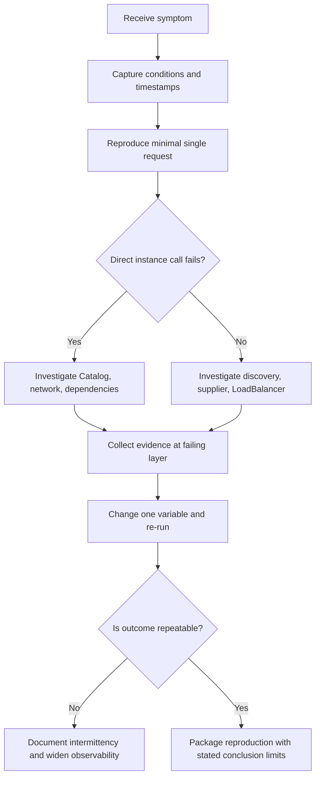
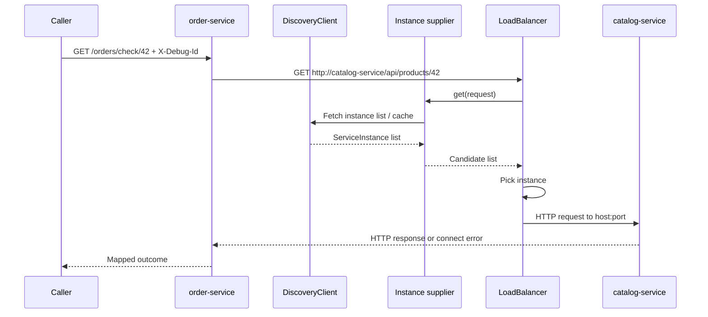

# Minimal bug reproduction and evidence collection workflow

When an inter-service call through Spring Cloud LoadBalancer fails, messages such as `503 Service Unavailable`, `No servers available for service: catalog-service`, or `Read timed out` only describe **a symptom at one layer**. They are insufficient to conclude whether the root cause lies in Eureka, the `ServiceInstance` list, instance selection policy, the HTTP client, or the target service.

A reliable diagnostic workflow must produce **a small, repeatable scenario**, hold unrelated variables constant, and collect evidence at every boundary. Solid evidence answers: which request failed, which instances the caller saw, what LoadBalancer picked, whether a connection opened, whether the server received the request, and when the failure occurred.

This lesson belongs to the **Troubleshooting** chapter of the Spring Cloud LoadBalancer module. It builds a minimal Eureka–Catalog–Order lab, compares direct calls against service-ID calls, reproduces common failures, captures logs/traces/metrics, and packages an evidence bundle someone else can re-run.

## 1. Principle: from symptom to evidence

A bug is reproducible only when someone else can re-run the exact conditions and observe the same class of outcome.

1. **One change at a time:** adjust discovery, caching, health checks, timeouts, or retries individually; never change everything at once.
2. **One sample request first:** start with a single request before scaling up volume or concurrency.
3. **Include timestamps:** record when the caller sent the request, when the registry changed, when an instance was selected, and when the response/error arrived.
4. **Compare the right paths:** call an instance directly and call via service ID to separate backend bugs from discovery/LoadBalancer issues.
5. **Preserve raw evidence:** save HTTP status, exception, root cause, relevant logs, and secret-redacted configuration.
6. **Do not over-infer:** an instance in the registry does not prove it is ready; HTTP 503 does not prove the backend received the request; a timeout does not prove the server never processed it.
7. **State unknowns explicitly:** if selection logs are missing, record “selected host not observed” rather than guessing.



## 2. Decompose the request path

When `order-service` calls `catalog-service`, a request crosses these boundaries:



| Layer | Question | Evidence |
|---|---|---|
| API caller | Which request, when, with what parameters? | Request ID, method/path, timestamp |
| Order application | Did it hit the right method and build the right service ID? | Application logs, sanitized config |
| Discovery | Which service ID and instances does the caller see? | Registry view, `DiscoveryClient` snapshot |
| Supplier chain | Did health/zone/hint/cache filter candidates? | Candidate list pre/post-filter |
| LoadBalancer | Which instance was selected, or no server? | Selection log/trace/observation |
| HTTP client | Did it open a connection, time out, or get a response? | Exception root cause, client metrics |
| Catalog | Did the server receive the request and how far did it get? | Access logs, correlation ID, server metrics |

Not every version/integration logs all of these points automatically. If selection logs are absent, add instrumentation in a test environment; **never pretend aggregate metrics identified the exact instance for a failed request**.

## 3. Lock scope and conditions before reproducing

Capture an environment snapshot before editing code:

| Item | Value to record |
|---|---|
| Applications | Order caller and Catalog callee |
| Spring Boot | Actual version from build |
| Spring Cloud BOM | Actual release train |
| HTTP client | RestClient, WebClient, or OpenFeign |
| Discovery | Eureka, Consul, Kubernetes, or static supplier |
| Service ID | `catalog-service` |
| Instance ID/host/port | Replicas visible to the caller |
| Supplier chain | Discovery, cache, health, zone, hint, custom filters |
| LoadBalancer policy | Round-robin, random, or custom |
| Timeout/retry | Effective values, including per-service overrides |
| Environment | Local, container, Kubernetes, or staging |
| Timestamp | Timezone and offset timestamp |

Never guess versions from dependency names. If sharing a dependency tree, include Spring Boot, Spring Cloud LoadBalancer, discovery clients, and HTTP connectors. A bug may surface only under one specific version pair or HTTP connector.

Before reproducing, confirm Order calls the right service ID; Catalog's direct endpoint works or is intentionally broken; each instance has a unique ID; process clocks are reasonably synchronized; debug log levels and Actuator endpoints are enabled within test scope; and no load generators or background jobs pollute the baseline.

## 4. Build a minimal Eureka–Catalog–Order reproduction

The lab contains three applications:

```text
loadbalancer-repro/
|-- eureka-server/
|-- catalog-service/
|-- order-service/
```

| Application | Example port | Role |
|---|---:|---|
| Eureka Server | `8761` | Service registry |
| Catalog 1 | `8081` | First backend instance |
| Catalog 2 | `8082` | Second backend instance |
| Order | `8090` | Caller using LoadBalancer |

Use compatible Spring Boot and Spring Cloud BOMs. Base dependencies:

- Eureka Server: `spring-cloud-starter-netflix-eureka-server`.
- Catalog: `spring-boot-starter-web`, `spring-boot-starter-actuator`, and `spring-cloud-starter-netflix-eureka-client`.
- Order: `spring-boot-starter-web`, `spring-boot-starter-actuator`, `spring-cloud-starter-netflix-eureka-client`, and `spring-cloud-starter-loadbalancer`.

The lab uses blocking `RestClient` to minimize moving parts. If the bug only happens with WebClient or OpenFeign, swap in that exact client in a dedicated reproduction.

### 4.1. Eureka Server

```java
@SpringBootApplication
@EnableEurekaServer
public class EurekaServerApplication {
    public static void main(String[] args) {
        SpringApplication.run(EurekaServerApplication.class, args);
    }
}
```

`application.yml`:

```yaml
server:
  port: 8761

spring:
  application:
    name: eureka-server

eureka:
  client:
    register-with-eureka: false
    fetch-registry: false
```

### 4.2. Catalog returns which instance processed the request

DTO:

```java
public record DiagnosticResponse(
        String instanceId,
        String requestId,
        String service,
        long timestampEpochMs) { }
```

Test controller:

```java
@RestController
@RequestMapping("/diagnostics")
public class CatalogDiagnosticController {

    private final String instanceId;

    public CatalogDiagnosticController(
            @Value("${eureka.instance.instance-id}") String instanceId) {
        this.instanceId = instanceId;
    }

    @GetMapping("/instance")
    public DiagnosticResponse instance(
            @RequestHeader(value = "X-Debug-Id", required = false)
            String requestId) {
        return new DiagnosticResponse(
                instanceId, requestId, "catalog-service",
                System.currentTimeMillis());
    }
}
```

`X-Debug-Id` is a caller-generated test ID, not an authentication token. Never use IDs containing personal data or secrets. In production, rely on standard tracing context when distributed tracing is available.

Catalog `application.yml`:

```yaml
server:
  port: 8081

spring:
  application:
    name: catalog-service

eureka:
  client:
    service-url:
      defaultZone: http://localhost:8761/eureka/
  instance:
    instance-id: catalog-local
    prefer-ip-address: true

management:
  endpoints:
    web:
      exposure:
        include: health,info,metrics
```

Each process must override `server.port` and `eureka.instance.instance-id`: `catalog-1` on `8081`, `catalog-2` on `8082`. Duplicate instance IDs can cause the registry to report the wrong replica count.

### 4.3. Order uses LoadBalancer-integrated RestClient

Bean:

```java
@Configuration(proxyBeanMethods = false)
public class CatalogHttpConfiguration {

    @Bean
    @LoadBalanced
    RestClient.Builder loadBalancedRestClientBuilder() {
        SimpleClientHttpRequestFactory factory =
                new SimpleClientHttpRequestFactory();
        factory.setConnectTimeout(1_000);
        factory.setReadTimeout(3_000);

        return RestClient.builder().requestFactory(factory);
    }
}
```

Service client:

```java
@Component
public class CatalogDiagnosticClient {

    private final RestClient restClient;

    public CatalogDiagnosticClient(
            @Qualifier("loadBalancedRestClientBuilder")
            RestClient.Builder builder) {
        this.restClient = builder
                .baseUrl("http://catalog-service")
                .build();
    }

    public DiagnosticResponse inspect(String requestId) {
        return restClient.get()
                .uri("/diagnostics/instance")
                .header("X-Debug-Id", requestId)
                .retrieve()
                .body(DiagnosticResponse.class);
    }
}
```

Order endpoint generating IDs for reproduction:

```java
@RestController
@RequestMapping("/debug")
public class OrderDiagnosticController {

    private final CatalogDiagnosticClient catalog;

    public OrderDiagnosticController(CatalogDiagnosticClient catalog) {
        this.catalog = catalog;
    }

    @GetMapping("/catalog")
    public DiagnosticResponse inspect() {
        String requestId = UUID.randomUUID().toString();
        return catalog.inspect(requestId);
    }
}
```

Place imports, packages, and DTOs appropriately in your project. Examples focus on the diagnostic flow; do not deploy this debug endpoint in production. Keep diagnostic endpoints restricted to test environments rather than becoming public admin APIs.

Order `application.yml`:

```yaml
server:
  port: 8090

spring:
  application:
    name: order-service
  cloud:
    loadbalancer:
      cache:
        enabled: false

eureka:
  client:
    service-url:
      defaultZone: http://localhost:8761/eureka/
    registry-fetch-interval-seconds: 5

management:
  endpoints:
    web:
      exposure:
        include: health,info,metrics
```

Disabling the LoadBalancer cache and lowering the registry fetch interval are solely to make the lab easier to observe; **it does not disable the Eureka client's cache** and does not guarantee discovery updates in exactly five seconds. In production, tune configs to match traffic load and convergence goals.

## 5. Establish a repeatable baseline

Start in order: Eureka Server, Catalog 1, Catalog 2, then Order. Call each Catalog directly:

```powershell
Invoke-RestMethod "http://localhost:8081/diagnostics/instance"
Invoke-RestMethod "http://localhost:8082/diagnostics/instance"
```

Once both return their expected instance IDs, call through Order:

```powershell
Invoke-RestMethod "http://localhost:8090/debug/catalog"
Invoke-RestMethod "http://localhost:8090/debug/catalog"
Invoke-RestMethod "http://localhost:8090/debug/catalog"
```

Expected response: `instanceId` is one of the two IDs, `service` is `catalog-service`, and `requestId` is non-empty. Two consecutive requests do not strictly have to hit different instances: seed, policy, cache, caller count, and version can all influence ordering.

Record the baseline:

| Item | Result to save |
|---|---|
| Eureka | Instance IDs, hosts, ports, and statuses |
| Direct HTTP | Status/body from each Catalog |
| Order → service ID | Status, latency, and returned instance ID |
| Candidate list | When observable, the list the caller actually sees |
| Configuration | Cache, supplier, health, timeout, retry, policy |
| Logs | Timestamped startup, registration, selection, and response logs |

## 6. Compare direct calls against service-ID calls

```powershell
# Call each backend directly
Invoke-RestMethod "http://localhost:8081/diagnostics/instance"
Invoke-RestMethod "http://localhost:8082/diagnostics/instance"

# Call via Order and Spring Cloud LoadBalancer
Invoke-RestMethod "http://localhost:8090/debug/catalog"
```

| Direct Catalog | Via service ID | Priority investigation direction |
|---|---|---|
| Succeeds | Succeeds | Basic baseline works |
| Fails | Fails | Catalog, port, network, dependencies, or request |
| Succeeds | Fails | Discovery, service ID, supplier, LoadBalancer, client integration |
| One instance good, one broken | Intermittently succeeds/fails | Instance-specific config/readiness |
| Both succeed yet wrong response | Wrong contract/data | Controller, DTO, version, serialization |

A direct call tests only **that specific host:port**, not the remaining instance, registry, or LoadBalancer. When direct calls succeed on both yet service-ID calls fail, collect the candidate list and exception before blaming the selection algorithm.

## 7. Reproduce bugs hypothesis by hypothesis

Run only **one experiment at a time**, log start/end timestamps, and restore the baseline before the next experiment.

| Code | Experiment | Expected symptom | Evidence |
|---|---|---|---|
| R1 | Wrong service ID | Cannot find instances | Request service ID, registry |
| R2 | Zero instances | No-server/exception or mapped error | Registry, candidate list, root cause |
| R3 | Sudden instance stop | Failures from stale snapshot | Selected instance, stop time, cache |
| R4 | Slow backend response | Read timeout/deadline | Direct latency, client timeout, server logs |
| R5 | Intentional backend 503 | HTTP error from server | Server access log and status |
| R6 | Health filter drops instances | Empty/narrowed candidate list | Health probes and pre/post-filter lists |
| R7 | Hint/zone mismatch | No candidates or fallback | Request context, metadata, supplier |
| R8 | Retries enabled | One logical request spawns multiple attempts | Attempt count, instance per attempt |
| R9 | Stale cache | Client keeps seeing changed instances | Registry and candidate lists over time |

### 7.1. Wrong service ID

In a test profile, change the logical URL to `http://catalog-typo/...` while Eureka only registers `catalog-service`. Record the service ID the client actually sent, the service IDs in the registry, the root exception, and the HTTP error-mapping layer.

Do not infer from “no servers” that Eureka is broken; a typoed service ID produces the same symptom.

### 7.2. Zero instances

Shut down both Catalog instances cleanly or use a profile with zero registered instances. Send one request through Order and record: whether Eureka still shows old entries; whether `DiscoveryClient` in Order returns an empty list or stale snapshot; which supplier/filters applied; whether LoadBalancer returned `EmptyResponse` or threw an error; and how the HTTP integration mapped the exception/status.

Do not assume a single fixed HTTP status across all clients/versions. This is a **no available target** failure, not a product endpoint returning 404.

### 7.3. Dead instance still in snapshot

Start both instances, verify the baseline, then abruptly kill the `catalog-2` process in the lab. Keep calling Order at a low rate.

Record when the process died, when Eureka evicted the entry, when Order stopped seeing that candidate, and the final error. Eureka has heartbeats/leases/eviction and self-preservation; LoadBalancer or suppliers may maintain separate caches. **Never use one run to claim a universal TTL.**

### 7.4. Distinguish timeouts from HTTP 503

For timeouts, create a controlled slow backend or lower the test client's read timeout. Confirm whether direct calls are also slow or only service-ID calls. For HTTP 503, have Catalog intentionally return 503 and inspect access logs.

Record when the request entered Catalog, the response, exception root cause, and retry count. HTTP 503 is a real HTTP response status when received from HTTP transport. Timeouts/connection refused are transport failures and do not necessarily carry a status from Catalog. Order's gateway or exception handler may map transport failures to 502/503 for the outer caller; distinguish external status codes from internal causes.

## 8. Log enough to correlate caller and callee

A useful log line can include:

```text
timestamp
application
environment
trace_id / request_id
service_id
operation
selected_instance_id (if known)
remote_host / remote_port (if allowed)
attempt
duration_ms
outcome
http_status (if any)
exception_type
root_cause_type
```

Not every field is available at every layer. If LoadBalancer did not log the selected instance, never guess a value for `selected_instance_id`. Log `unknown` and add instrumentation in a test environment.

Catalog should log incoming requests with the same ID:

```java
@Slf4j
@RestController
@RequestMapping("/diagnostics")
public class CatalogDiagnosticController {

    @Value("${eureka.instance.instance-id}")
    private String instanceId;

    @GetMapping("/instance")
    public DiagnosticResponse instance(
            @RequestHeader(
                value = "X-Debug-Id",
                required = false) String requestId) {

        log.info(
                "catalog_request requestId={} instanceId={} timestamp={}",
                requestId, instanceId, Instant.now());

        return new DiagnosticResponse(
                instanceId, requestId, "catalog-service",
                System.currentTimeMillis());
    }
}
```

This is an illustrative lab log; add imports for Lombok, `java.time`, and the DTO if using verbatim. Without Lombok, declare a standard SLF4J logger. In production, use standard tracing context rather than inventing ad-hoc cross-service headers.

### 8.1. Never write secrets into logs

Never log raw `Authorization`, cookies, access tokens, session IDs, sensitive payloads, or URLs with secret query parameters. Before sharing a reproduction, replace tokens with `<REDACTED>`, use dummy IDs, mask hostnames/IPs if policy requires, and keep timestamps, service IDs, logical ports, and error types needed.

## 9. Enable targeted logging

Raise log levels in a reproduction profile:

```yaml
logging:
  level:
    org.springframework.cloud.client.discovery: DEBUG
    org.springframework.cloud.loadbalancer: DEBUG
    org.springframework.web.client: DEBUG
    com.netflix.discovery: INFO
```

Logger names and log volume depend on version. `DEBUG` across the full HTTP stack can emit substantial data, including headers/URLs; enable only in controlled environments and review before sharing. Never turn on body/token logging in production just to chase a routing bug.

Collect startup logs from Order/Catalog, discovery registration/fetch logs, LoadBalancer/supplier logs around the request ID or timestamp, Catalog access logs, and full exception stack traces on Order—preserving the deepest `Caused by` line.

`ResourceAccessException` may wrap `ConnectException` or `SocketTimeoutException`; the root cause separates connection refusal from response timeout.

## 10. Collect metrics and observations

Actuator can list active meters:

```powershell
Invoke-RestMethod "http://localhost:8090/actuator/metrics"
Invoke-RestMethod "http://localhost:8090/actuator/health"
```

If a Prometheus registry is configured, check `GET /actuator/prometheus`. Metric names for HTTP clients, LoadBalancer, retries, and connection pools depend on Spring Boot/Spring Cloud, HTTP connector, and Observation conventions. **Never assume a single metric name exists across all versions.** Start by listing Actuator metrics, then query a real observed meter.

| Group | Signals |
|---|---|
| HTTP client | Request count, latency, status/outcome, transport errors |
| LoadBalancer | Selections, no-instance discards, selection duration if instrumented |
| Discovery | Instance count per service ID, refresh/cache age |
| Catalog | In-flight requests, latency, 4xx/5xx, saturation |
| Resilience | Retry attempts, timeouts, circuit breaker state |
| JVM/runtime | Threads, heap, CPU, GC, connection pools |

Never put `traceId`, user IDs, raw URLs, or exception messages into metric labels; high-cardinality values belong in logs/traces. Metrics show aggregate trends; traces investigate individual requests.

## 11. Collect traces and identify the selected instance

When using Micrometer Observation/Tracing or OpenTelemetry, verify trace context propagates over HTTP to Catalog. A trace may show:

```text
order-service inbound span
  └─ catalog-service HTTP client span
       attributes:
         server/service target = catalog-service
         http.request.method = GET
         http.response.status_code = 200 (if received)
       events/logs:
         request_id = ...
         selected_instance_id = catalog-2 (if instrumented)
  └─ catalog-service server span
       request_id = ...
       served_by = catalog-2
```

Attribute names depend on instrumentation/version. When no dedicated selection span exists, log the instance ID in structured logs at the appropriate point. Never fabricate spans as evidence; clearly separate real spans, supplemental events, and response-inferred fields.

For requests failing before reaching the server, having no server span is expected. Client-side spans/logs should capture remote address and exception root cause where the connector exposes them.

## 12. Analyze common indicators

| Indicator | What is known | What cannot be concluded yet | Next evidence needed |
|---|---|---|---|
| `No servers available for service` | No eligible server at selection time | Whether Eureka died or service ID/filters broke | Registry, `DiscoveryClient`, supplier |
| HTTP 503 in Catalog access log | Backend received request and returned 503 | Whether LB picked wrong or business logic failed | Request ID, instance, dependencies |
| HTTP 503 yet Catalog access log empty | Failure likely happened pre-backend | Not yet proof of no-instance | Order exception, gateway, selection logs |
| `Connection refused` | Connect attempted with no open listener | Does not prove registry already updated | Remote host/port, lifecycle, snapshot |
| `Read timed out` | Client waited past read timeout | Whether server stayed idle or committed | Server logs, duration, timeout settings |
| Direct OK, service ID fails | Direct backend works right now | Unclear whether discovery or LB broke | Candidate list, service ID, supplier |
| One instance fails, another works | Instance-specific failure | Does not prove distribution algorithm is broken | Direct test per instance, config/version |
| Intermittent failures after rollout | Likely stale/readiness window | Insufficient to blame cache TTL alone | Timeline registry→caller→selection→HTTP |

The status observed by callers is not necessarily the status returned by Catalog. Order's exception handlers, gateways, or reverse proxies can remap transport errors to other status codes. Always find the first layer originating the error.

## 13. Controlled timeout reproduction

Add a slow endpoint strictly inside the lab profile:

```java
@GetMapping("/slow")
public DiagnosticResponse slow(
        @RequestHeader(
            value = "X-Debug-Id",
            required = false) String requestId)
        throws InterruptedException {

    Thread.sleep(2_000);

    return new DiagnosticResponse(
            instanceId, requestId, "catalog-service",
            System.currentTimeMillis());
}
```

This illustrates a blocking Spring MVC handler; never use `Thread.sleep` inside reactive event loops or production. Set the client read timeout below two seconds, then call both directly and via service ID.

Record effective connect/read timeouts, when the request entered Catalog, when Catalog finished replying, the root exception on Order, retry counts, and whether the server kept executing after the caller timed out.

**A client-side timeout does not automatically cancel server-side business work.** The server may have committed before replying late; retries can duplicate side effects. Use read-only GETs in the lab; for writes, require idempotency keys and business-state checks.

## 14. Separate no-instance from stale-instance

### 14.1. No-instance

Goal: prove the candidate list was empty at selection time:

- Record the service ID requested by the caller.
- Snapshot the registry view.
- Snapshot `DiscoveryClient.getInstances(serviceId)` from Order itself if possible.
- Record applied suppliers/filters.
- Record `Response.hasServer()` or the thrown exception.
- Zero HTTP requests reaching Catalog is expected when no server was selected.

### 14.2. Stale-instance

Goal: prove the client still saw or picked a dead address:

- Record instance ID, host/port before stopping.
- Record the process stop timestamp.
- Track when the registry evicted the instance.
- Track when Order's `DiscoveryClient`/supplier updated.
- If captured, record the host/port selected for failing requests.
- Correlate connection refused/timeouts against when errors stopped.

A post-incident Eureka screenshot does not prove what the client saw **at the moment requests failed**. You need timestamped logs or a time-series observation trail.

## 15. Reproduce filters/hints/zones leaving zero candidates

Suppose the registry holds two instances yet requests match no policy:

```text
Registry:
  catalog-1 (zone=az-a, hint=stable)
  catalog-2 (zone=az-b, hint=stable)

Request:
  zone=az-c
  hint=canary

Candidates after policy:
  []
```

Here, claiming “Eureka has no instances” is wrong: the registry has instances, yet **no candidate satisfies active policies**.

Collect each `ServiceInstance`'s metadata, request context/hint/cookie/zone, supplier chain ordering, and the list after each filter. Confirm whether fallback is fail-closed or returns the initial list. Never put raw sensitive headers or metadata into logs; record only normalized policy values.

## 16. Collect effective configuration and dependencies

YAML files in Git are not necessarily the final runtime configuration. Profiles, environment variables, CLI args, config servers, and per-service properties can override them.

| Group | Examples to verify |
|---|---|
| Service identity | `spring.application.name`, LoadBalancer service ID |
| Discovery | Registry URL, fetch intervals, heartbeats/leases |
| LoadBalancer | Cache, supplier chain, algorithm, per-service config |
| Health | Probe path, interval, timeout, health mapping |
| Zone/hint | Metadata keys, request hints, fallback |
| HTTP client | Connect/read/response timeouts, pools |
| Retry | Enabled, max attempts, retryable errors/statuses, backoff |
| Runtime | Active profiles, port, hostname/IP, JVM options |
| Security | TLS/mTLS, proxies, truststores (never collect private keys/secrets) |

Inspect the dependency tree in a Maven project:

```powershell
mvn dependency:tree
```

When sharing output, filter to Spring Boot, Spring Cloud, Eureka, Reactor, and HTTP connectors. Do not paste the entire tree if huge; keep enough version and dependency edges to reproduce.

Never dump `/actuator/env` publicly; it can expose sensitive config. When inspecting runtime properties, pick specific keys and mask secrets before sharing.

## 17. Iterative minimal reproduction workflow

1. **Freeze baseline:** versions, profile, service ID, instance IDs, supplier chain, cache, timeouts/retries.
2. **Verify backends:** call each instance directly; record status, latency, and ID.
3. **Verify discovery:** capture lists from both registry and caller—not just a dashboard.
4. **One service-ID call:** attach a debug/trace ID and save matching logs.
5. **Repeat a few times:** confirm repeatability without high concurrency yet.
6. **Reproduce one hypothesis:** no-instance, stale, timeout, 503, or filter/hint.
7. **Gather evidence at every layer:** timestamps, candidate lists, selections, remote addresses, server access logs.
8. **Restore baseline:** return processes/config to initial state and confirm calls succeed.
9. **Change exactly one factor:** e.g., only cache or only timeout; re-run the same scenario.
10. **Compare:** document what changed, what stayed constant, new outcomes, and conclusion limits.

Never wipe logs or immediately restart all components on error; that destroys evidence. If a restart is required for recovery, save logs, timestamps, and snapshots beforehand whenever possible.

## 18. Evidence bundle to hand off to teammates

An evidence package can include:

```text
incident/
  README-reproduction.md
  versions.txt
  effective-config-redacted.yml
  registry-before.txt
  registry-during.txt
  registry-after.txt
  request-samples.csv
  order-service.log
  catalog-service-1.log
  catalog-service-2.log
  exception-root-cause.txt
  metrics-snapshot.txt
  trace-links.txt
```

Not every incident needs every file. The README must state goal, prerequisites, reproduction steps, expected vs. actual outcomes, repeatability, evidence files, tested changes, and observation limits.

### 18.1. Sample reproduction README

```markdown
# Reproduction: Order fails calling catalog-service

## Environment
- Spring Boot: <version>
- Spring Cloud BOM: <release train>
- Discovery: Eureka
- HTTP client: RestClient
- Service ID: catalog-service
- Active profile: <profile>

## Topology
- catalog-1: <host:port>
- catalog-2: <host:port>
- order-service: <host:port>

## Steps
1. Start Eureka.
2. Start catalog-1 and catalog-2 with unique instance IDs.
3. Wait until Order sees both candidates.
4. Send one request with X-Debug-Id=<redacted-id>.
5. Stop catalog-2 using <exact controlled action>.
6. Repeat the same request and record timestamps.

## Expected
A new request should use a currently eligible instance.

## Actual
- HTTP status / exception:
- Root cause:
- Selected host (if observed):
- Request reached Catalog: yes/no/unknown

## Evidence
- registry-before.txt
- registry-during.txt
- order-service.log
- catalog-service-*.log
- request-samples.csv

## Limits
State what was not observed. Do not infer a selected instance without evidence.
```

The template uses placeholders; fill in secret-redacted values. Never put credentials, private keys, tokens, or real customer data inside an evidence bundle.

## 19. Common premature conclusions

| Premature conclusion | Why evidence is insufficient | How to prove |
|---|---|---|
| “Eureka is down because there are no servers” | Typoed service ID or strict supplier filters also yield no-server | Compare registry, `DiscoveryClient`, and candidate list |
| “Round-robin picked wrong” | Snapshot may still hold a deregistered instance | Capture snapshot and selection at request time |
| “503 means Catalog returned 503” | Order or gateway may remap transport failures | Check Catalog access logs and response origin |
| “Timeout means server never received request” | Server may already have processed/committed | Match request ID on server and client |
| “Dashboard shows two instances so caller sees two” | Clients fetch/cache independently | Capture the list from the caller itself |
| “Disabling cache fixed the bug” | Only one cache layer may have been bypassed | Measure registry fetch, supplier cache, and routing |
| “Retries fixed the error” | Retries may mask stale routing or amplify load | Count attempts, instance per attempt, final errors |
| “Direct URL works so LB is definitely broken” | Direct test hits only one host/port | Compare candidate list, service ID, integration |
| “No server logs means request wasn't sent” | Logs may be sampled or missing instrumentation | Inspect access logs, traces, client evidence |

## 20. Takeaways

Effective Spring Cloud LoadBalancer troubleshooting starts with **a minimal repeatable request**, a stable baseline, and a side-by-side comparison of direct calls vs. service-ID calls. From there, collect evidence layer by layer across discovery, the supplier chain, instance selection, the HTTP client, and the backend. Every conclusion should cite the exact log, metric, trace, or response supporting it.

Never treat a single status code, Eureka screenshot, or exception line as the full root cause. Record timestamps, service IDs, instance IDs when known, root causes, active timeout/retry settings, and the caller's candidate list. When an evidence bundle captures both reproduction steps and observation limits, anyone else can re-run it, verify hypotheses, and fix the right layer without guessing.
