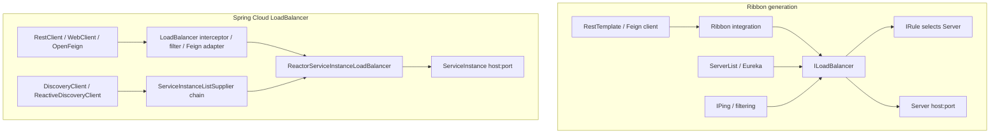
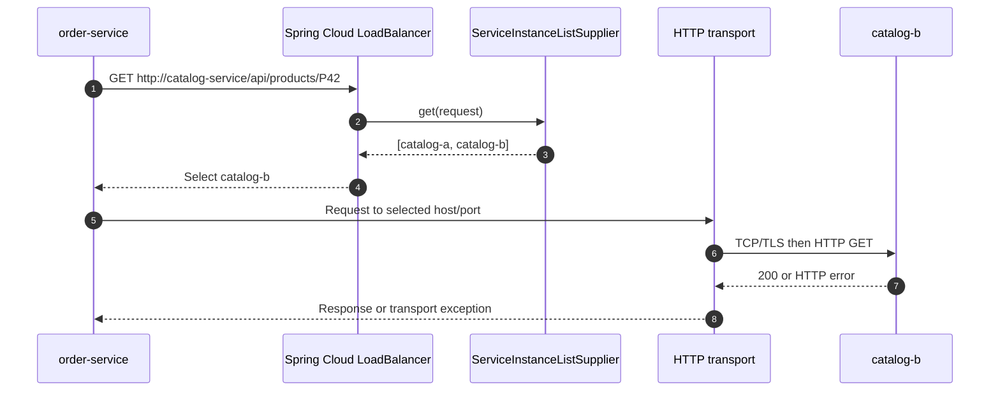
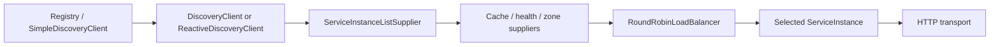

# Distinguishing Legacy Ribbon from Spring Cloud LoadBalancer

In a microservices system, `order-service` can call `http://catalog-service/api/products/P42` instead of hard-coding the address of a specific replica. Discovery discovers the `catalog-service` replicas, the client-side load balancer selects one replica, and the HTTP client sends the request to the chosen host/port. This idea appears in both **Netflix Ribbon** in the past and modern **Spring Cloud LoadBalancer**. However, solving the same instance-selection problem **does not mean their APIs, policies, caches, retries, timeouts, and customization mechanisms are equivalent property-for-property**.

This lesson belongs to the **Compatibility and Upgrades** chapter of the `SPRING_CLOUD_SERVICE_COMMUNICATION_LOAD_BALANCING` module. The goal is to recognize Ribbon traces in legacy source code and configuration, understand the architectural changes, migrate practical usage scenarios to Spring Cloud LoadBalancer, and verify call paths via `RestTemplate`, `RestClient`, `WebClient`, and OpenFeign. This is an educational/migration guide organized by **capability group**; exact dependency, class, and property names must be checked against the Spring Boot and Spring Cloud release train your project uses.

## 1. Why Do We Need to Distinguish the Two Generations?

Netflix Ribbon is the client-side load balancing library from the Netflix OSS ecosystem, previously integrated by Spring Cloud Netflix to support calling services by name. Ribbon moved into maintenance mode, and modern Spring Cloud release trains **no longer use Ribbon as a supported load-balancing solution**. Spring Cloud LoadBalancer is the replacement solution provided by Spring Cloud for Spring applications.

Key points when upgrading:

- **Do not just swap the dependency** and expect all legacy Ribbon configuration to be understood automatically.
- **Do not confuse the discovery library with the load-balancing library**: Eureka, Consul, Kubernetes discovery, or a static instance list is the address source; LoadBalancer decides which address is selected.
- **Do not confuse the HTTP client with LoadBalancer**: `RestClient`, `WebClient`, and Feign send HTTP; Spring Cloud LoadBalancer selects a `ServiceInstance` before the transport runs.
- **Do not confuse migrating from Ribbon to LoadBalancer with upgrading the entire stack**: replacing Hystrix, migrating from `javax.*` to `jakarta.*`, or changing Java/Boot or the HTTP transport are separate items, even if they happen in the same upgrade program.

A legacy project may contain `IRule`, `IPing`, `ServerList` classes, `ribbon.*` properties, and the `@RibbonClient` annotation. In a modern project, the corresponding concepts usually reside in `ReactorServiceInstanceLoadBalancer`, `ServiceInstanceListSupplier`, `LoadBalancerClientFactory`, and `@LoadBalancerClient`.

## 2. Architectural Framework: Solving the Same Problem, Different Contracts



Conceptual comparison table:

| Aspect | Legacy Netflix Ribbon | Spring Cloud LoadBalancer |
|---|---|---|
| Target selection layer | `ILoadBalancer` and `IRule`, such as `RoundRobinRule` | `ReactorServiceInstanceLoadBalancer`, such as `RoundRobinLoadBalancer` |
| Replica object | Ribbon `Server` | Spring Cloud `ServiceInstance` |
| List source | `ServerList` and registry integration | `ServiceInstanceListSupplier` sourced from `DiscoveryClient`/`ReactiveDiscoveryClient` or a custom source |
| Availability probing | `IPing`, certain filtering policies | Health-check/decorator supplier, readiness, and an appropriate registry |
| Programming API | Centered on Ribbon/Netflix types | Reactor `Mono<Response<ServiceInstance>>` and supplier chains |
| Selection by service ID | Named Ribbon client/context | LoadBalancer named client via `LoadBalancerClientFactory` |
| Policy customization | `IRule`, `ServerList`, `@RibbonClient` | Custom load balancer/supplier, `@LoadBalancerClient` |
| Reactive support | Core not designed around Reactor | Native integration with Reactor/WebClient |
| Blocking HTTP client | `RestTemplate` or Feign via Ribbon integration | `RestTemplate`, `RestClient`, or Feign via Spring Cloud LoadBalancer |
| Retry | Ribbon same/next-server retry depending on integration | Spring Cloud LoadBalancer retry depending on stack and configuration |
| Cache/health/zone | Ribbon-specific components and properties | Supplier decorators/cache/health/zone with different semantics |
| Lifecycle/observability | Ribbon-integration-specific logs/metrics | `LoadBalancerLifecycle`/Micrometer/Observation depending on release train |

**Do not look for a one-to-one equivalent for every component.** For example, `IPing` and `HealthCheckServiceInstanceListSupplier` both relate to availability evaluation, yet their pipeline position, probe timing, and behavior when no healthy instance remains can differ. Similarly, Ribbon's `ZoneAvoidanceRule` is not fully equivalent to a zone-preference supplier paired with `RoundRobinLoadBalancer`.

## 3. Terminology and Responsibilities: Server vs. ServiceInstance

In Ribbon, many policies operate on `com.netflix.loadbalancer.Server`, which typically represents a host/port and status managed by Ribbon components.

In Spring Cloud LoadBalancer, the central object is `org.springframework.cloud.client.ServiceInstance`:

```java
import org.springframework.cloud.client.ServiceInstance;

void inspect(ServiceInstance instance) {
    String serviceId = instance.getServiceId();
    String instanceId = instance.getInstanceId();
    String host = instance.getHost();
    int port = instance.getPort();
    boolean https = instance.isSecure();
    java.net.URI uri = instance.getUri();
    java.util.Map<String, String> metadata = instance.getMetadata();
}
```

`ServiceInstance` passes information published by discovery to the selection algorithm. It does **not** prove that connecting to `host:port` will succeed: the instance may be dead, its IP may have changed, its port may be wrong, its TLS certificate may mismatch, or readiness may not be met.

When migrating a legacy policy that reads information from `Server`, identify each data source:

| Information needed by policy | Legacy Ribbon typically gets it from | With Spring Cloud LoadBalancer, look in |
|---|---|---|
| Host/port | `Server` | `ServiceInstance.getHost()/getPort()` |
| Service name | Named client/registry | `ServiceInstance.getServiceId()` and the context's service ID |
| Zone | Server metadata, client zone config, rule | `ServiceInstance.getMetadata()` or zone supplier mechanism |
| Health status | Ping/ServerList filtering | Discovery/readiness/health-check supplier |
| Weight/capacity | Custom policy/metadata | Metadata + controlled supplier/custom choose |
| Session affinity | Custom strategy | Request hints/sticky session supplier depending on stack |

Do not store all of this information in a `ThreadLocal` that is not propagated when using Reactor. Request-scoped hints or context must follow supported Spring Cloud/Reactive mechanisms.

## 4. Dependency Landscape: What to Remove, What to Keep?

In a legacy project, you might see the following dependency:

```xml
<!-- Legacy project identification example: DO NOT add to modern projects -->
<dependency>
    <groupId>org.springframework.cloud</groupId>
    <artifactId>spring-cloud-starter-netflix-ribbon</artifactId>
</dependency>
```

Or Ribbon may be pulled in **transitively** from a starter in an older Spring Cloud stack. Do not only search directly for `ribbon` in `pom.xml`: inspect the actual version's dependency graph when performing the migration.

For a modern Spring Boot/Spring Cloud project, a replacement option is:

```xml
<dependency>
    <groupId>org.springframework.cloud</groupId>
    <artifactId>spring-cloud-starter-loadbalancer</artifactId>
</dependency>
```

If using `WebClient`, you need a compatible WebFlux stack; if using `RestClient`, Spring Framework 6.1+ and an appropriate Spring Boot release. OpenFeign needs its corresponding starter. **The Spring Cloud LoadBalancer dependency does not automatically enable HTTP discovery on every client**: you still need the adapter/interceptor/filter and a configured instance source.

### Do Not Arbitrarily Mix Versions

Spring Boot and Spring Cloud must belong to **published compatible versions/release trains**. Replacing a Ribbon starter with `spring-cloud-starter-loadbalancer` in a Spring Boot application that is too old, without upgrading the related dependency set, can cause classpath conflicts or API incompatibilities.

A responsible plan:

1. Identify the Java runtime, Spring Boot version, Spring Cloud release train, and existing HTTP clients.
2. Check the compatibility matrix/BOM for the **exact version being deployed**, rather than copying a version from an old blog post.
3. Choose a supported combination and let the BOM manage Spring Cloud versions instead of pinning individual versions piecemeal.
4. Verify the dependency graph has no unwanted Ribbon artifacts or mixed Spring Cloud versions.
5. Upgrade one call path at a time with tests and metrics rather than changing all timeouts, retries, and circuit breakers at once.

Keeping Eureka in the system **does not mean** you must keep Ribbon: Eureka is service discovery, while LoadBalancer is selection. Conversely, removing Ribbon does not replace the work of configuring the Eureka/Consul/Kubernetes registry.

## 5. Journey of an HTTP Request: Before and After

Suppose in both systems, the caller writes a logical URL:

```http
GET /api/products/P42 HTTP/1.1
Host: catalog-service
```

### With Legacy Ribbon

```text
Logical URI http://catalog-service/api/products/P42
  → Ribbon client for name catalog-service
  → ServerList / Eureka provides Server list
  → IRule selects a Server, e.g., catalog-b:8082
  → interceptor/Feign client rewrites host:port
  → HTTP transport performs connection and request
```

### With Spring Cloud LoadBalancer

```text
Logical URI http://catalog-service/api/products/P42
  → @LoadBalanced RestClient / WebClient filter / Feign LB
  → ServiceInstanceListSupplier provides snapshot of ServiceInstances
  → ReactorServiceInstanceLoadBalancer selects catalog-b:8082
  → adapter rewrites URI to match ServiceInstance
  → HTTP transport connects, sends request, and receives response
```



Similarity: the client does not need to hard-code the address of `catalog-b` in business logic. Difference: the list source, lifecycle, customization API, default policy, and retry/health configuration **are different**. It is not just a class rename in code.

## 6. Algorithms: RoundRobin Is Not Every Ribbon Policy

An upgrade lesson commonly seen:

```java
// Legacy Ribbon: illustrating old policy type.
import com.netflix.loadbalancer.IRule;
import com.netflix.loadbalancer.RoundRobinRule;

IRule rule = new RoundRobinRule();
```

In Spring Cloud LoadBalancer, the default implementation is typically `RoundRobinLoadBalancer`, while `RandomLoadBalancer` is another option. They select from the `ServiceInstance` list provided by the supplier.

| Requirement | Legacy Ribbon | Spring Cloud LoadBalancer |
|---|---|---|
| Round-robin selection | `RoundRobinRule` | `RoundRobinLoadBalancer` |
| Random selection | `RandomRule` | `RandomLoadBalancer` |
| Avoid unhealthy instances | `IPing`/availability-aware rule | Registry/readiness/health-check supplier |
| Zone preference | `ZoneAvoidanceRule` and zone configuration | Zone preference/filter supplier per release train |
| Keep instance per session | Custom rule/filter | Sticky session/cookie/hint supplier if supported |
| Custom weights | Ribbon rule/ServerList metadata | Custom supplier/`ReactorServiceInstanceLoadBalancer` and metadata |

**Do not treat ZoneAvoidanceRule = ZonePreferenceServiceInstanceListSupplier**. The policy names sound similar, but Ribbon could combine server availability/load statistics and other thresholds, whereas zone preference in Spring Cloud may prioritize instances in the zone and then fall back. To preserve the old behavior, you must test load distribution and failure behavior when a zone goes down.

## 7. Separating the Instance Source from the Selection Algorithm

A testable upgrade architecture separates three stages:

- **Discovery:** a registry or static list returns data about available instances.
- **Candidate selection/filtering:** `ServiceInstanceListSupplier` can cache, check health, or prioritize by zone/metadata/hints.
- **Final selection:** `ReactorServiceInstanceLoadBalancer` selects one instance from the resulting list.



This separation is helpful when replacing a complex Ribbon `ServerList`. Instead of having a custom `IRule` query the registry, check HTTP health, and pick a server all in the same method, you can let the supplier refresh the list in a controlled way while the LoadBalancer quickly selects one `ServiceInstance`.

Several important caveats:

1. **Supplier/decorator ordering affects semantics**: caching before or after filtering by zone, hint, or request can cause unintended data reuse.
2. **Health checks have lag**: a probe returning 200 does not guarantee every business endpoint is healthy; some health suppliers can fall back to the delegate list when no healthy instance remains.
3. **No instances**: a request can fail before transport; this differs from selecting an instance and getting TCP refused.
4. **Reactive is only the API**: a supplier calling a blocking `DiscoveryClient` or calling `.block()` inside `choose()` can still block the event loop.
5. **Stale snapshots**: the registry has removed an endpoint, but the client cache still holds it; you need refresh mechanisms and observability.

A custom algorithm does not replace readiness policies, timeouts, and registry operations.

## 8. Distinguishing Client-Side Load Balancing from Service Discovery

Some migration projects follow the wrong sequence: removing Ribbon and then hard-coding a URL to a single replica or keeping only `DiscoveryClient`. Neither is sufficient to recreate client-side load balancing:

```text
Discovery only:
  catalog-service → [catalog-a:8081, catalog-b:8082]
  (application still needs to decide which one to call)

Load balancing:
  [catalog-a:8081, catalog-b:8082]
       ↓ select by policy
  catalog-b:8082
       ↓ TCP/HTTP
  HTTP result
```

If the application targets a Kubernetes Service VIP, there may be **another load-balancing layer** underneath (kube-proxy/CNI/mesh) instead of Spring Cloud selecting individual pod instances. When testing request counts per replica, you must know whether you are verifying **routing by Spring Cloud** or **routing by network infrastructure**. Both can coexist, but their mechanisms and observability differ.

## 9. RestTemplate: The Annotation Can Stay, but the Implementation Changes

A legacy project may use:

```java
@Bean
@LoadBalanced
RestTemplate restTemplate() {
    return new RestTemplate();
}
```

At the application level, `@LoadBalanced` still means: URLs using a service ID are resolved into requests to an instance via Spring Cloud integration. However, **the underlying implementation** switches from Ribbon to Spring Cloud LoadBalancer depending on the chosen stack/version.

Therefore, it is not strictly necessary to rewrite all `RestTemplate` code just to remove Ribbon. First:

1. Ensure the new version has the appropriate LoadBalancer starter and client-side interceptor.
2. Verify the `RestTemplate` bean being called is the one **annotated with** `@LoadBalanced`, not an arbitrary `new RestTemplate()`.
3. Verify discovery actually has instances and instance selection succeeds.
4. Review the **underlying** exceptions, timeouts, connection pool, and retries; they do not automatically retain Ribbon behavior.
5. Add tests for when a replica is down and when the candidate list is empty.

`RestTemplate` can still be used in blocking applications, though modern Spring Framework offers `RestClient` with a fluent API for new projects. **Replacing Ribbon and migrating RestTemplate to RestClient are two independent decisions**; to reduce risk, upgrade incrementally rather than making every change at once.

## 10. Legacy Ribbon Configurations Must Not Be Copied Verbatim

You may see `application.yml` in a legacy project like this:

```yaml
# Legacy Ribbon example for IDENTIFICATION, do not copy into new configuration.
catalog-service:
  ribbon:
    NFLoadBalancerRuleClassName: com.netflix.loadbalancer.RoundRobinRule
    ConnectTimeout: 1000
    ReadTimeout: 2500
    MaxAutoRetries: 1
    MaxAutoRetriesNextServer: 1
    OkToRetryOnAllOperations: false
```

These properties belong to the legacy Ribbon configuration model. In a modern stack, do not assume they take effect. Translate the **intent** of each property rather than just replacing a string prefix:

| Intent to preserve | Legacy Ribbon | When migrating to Spring Cloud LoadBalancer |
|---|---|---|
| Round-robin selection | `NFLoadBalancerRuleClassName` | Use default `RoundRobinLoadBalancer` or corresponding bean |
| Static server list | `listOfServers`/ServerList | `SimpleDiscoveryClient` or per-service-ID supplier |
| TCP connect timeout | `ConnectTimeout` | Configure the **HTTP transport** of RestClient/WebClient/Feign |
| Response wait timeout | `ReadTimeout` | Configure transport response/read timeout for the exact version |
| Retry on same instance | `MaxAutoRetries` | Check `spring.cloud.loadbalancer.retry.*` policy / actual retry owner |
| Retry on next instance | `MaxAutoRetriesNextServer` | Spring Cloud LoadBalancer next-instance policy when supported |
| Retry all HTTP operations | `OkToRetryOnAllOperations` | Whitelist by method/idempotency and appropriate retry policy |
| Health/availability | `IPing`/availability filter | Readiness/discovery/`HealthCheckServiceInstanceListSupplier` |
| Zone affinity | Ribbon zone rule/properties | Dedicated zone preference supplier/policy |
| Stats/selection decisions | Ribbon statistics | Micrometer/tracing and Spring Cloud custom observability |

**Two dangerous migration mistakes:** (1) leaving legacy Ribbon properties in YAML and assuming the application still uses those timeouts/retries; (2) enabling retry at the Gateway, application, LoadBalancer, and HTTP transport simultaneously, causing **retry amplification**.

Example of a Spring Cloud LoadBalancer property used to disable retry at this layer, when supported by the release train:

```yaml
spring:
  cloud:
    loadbalancer:
      retry:
        enabled: false
```

The property above **does not disable** `WebClient.retryWhen`, Feign `Retryer`, gateway retry, or transport retry. To enable retry in Spring Cloud LoadBalancer, check the enablement conditions/dependencies and same/next-instance limits for the specific version, along with HTTP method/status semantics. You cannot take Ribbon's `MaxAutoRetries=1` and `MaxAutoRetriesNextServer=1` and assume the new version issues the exact same number of attempts.


## 11. Upgrading Blocking Call Paths: RestTemplate and RestClient

In legacy applications, `RestTemplate` can be kept when migrating from Ribbon to Spring Cloud LoadBalancer, because the high-level meaning of `@LoadBalanced` remains **resolving a logical URL containing a service ID into a real endpoint**. However, the bean and HTTP transport must be properly integrated with the new LoadBalancer.

A familiar `RestTemplate` bean example:

```java
@Bean
@LoadBalanced
RestTemplate loadBalancedRestTemplate() {
    return new RestTemplate();
}
```

Points to verify when keeping this call style:

- The project has the appropriate Spring Cloud LoadBalancer starter and the interceptor is attached to the bean.
- Business code uses the injected `RestTemplate` bean and does **not** instantiate `new RestTemplate()` elsewhere.
- A `ServiceInstance` source exists and LoadBalancer can select an endpoint.
- The HTTP transport, timeouts, and connection pool have new configuration; old Ribbon properties do not carry over automatically.
- Call retry/error mapping does not change unintentionally.

When the project is already on Spring Framework 6.1+ and wants to use the newer API for blocking HTTP, you can choose `RestClient`.

### Typical Maven Dependencies

```xml
<dependencies>
    <dependency>
        <groupId>org.springframework.boot</groupId>
        <artifactId>spring-boot-starter-web</artifactId>
    </dependency>
    <dependency>
        <groupId>org.springframework.cloud</groupId>
        <artifactId>spring-cloud-starter-loadbalancer</artifactId>
    </dependency>
</dependencies>
```

This snippet assumes the project already uses compatible Spring Boot dependency management and Spring Cloud BOM.

### @LoadBalanced RestClient.Builder Bean

```java
package com.example.orders.config;

import org.springframework.cloud.client.loadbalancer.LoadBalanced;
import org.springframework.context.annotation.Bean;
import org.springframework.context.annotation.Configuration;
import org.springframework.web.client.RestClient;

@Configuration(proxyBeanMethods = false)
public class CatalogRestClientConfiguration {

    @Bean
    @LoadBalanced
    RestClient.Builder loadBalancedRestClientBuilder() {
        return RestClient.builder();
    }
}
```

```java
package com.example.orders.catalog;

import org.springframework.cloud.client.loadbalancer.LoadBalanced;
import org.springframework.stereotype.Component;
import org.springframework.web.client.RestClient;

@Component
public final class CatalogClient {
    private final RestClient client;

    public CatalogClient(@LoadBalanced RestClient.Builder builder) {
        this.client = builder.clone()
                .baseUrl("http://catalog-service")
                .build();
    }

    public ProductDto find(String id) {
        return client.get()
                .uri("/api/products/{id}", id)
                .retrieve()
                .body(ProductDto.class);
    }
}
```

`ProductDto` is an application-defined DTO. The URL `http://catalog-service` is a **logical service ID** handled by LoadBalancer, not a fixed IP address. If the project has multiple builders, use appropriate qualifiers and test which bean is actually invoked. When a developer creates a new `RestClient.builder().build()` inside a method, that client **does not automatically inherit** the LoadBalancer interceptor from the configured bean.

### Static Discovery Data for Labs

```yaml
spring:
  cloud:
    discovery:
      client:
        simple:
          instances:
            catalog-service:
              - uri: http://localhost:8081
              - uri: http://localhost:8082
```

`SimpleDiscoveryClient` is useful in labs without deploying a registry. It does not automatically remove dead instances from YAML; add an appropriate health/supplier setup if you want to simulate failed instance detection. `localhost` is only valid when the consumer and replicas share the same machine/network namespace; in Docker/Kubernetes, replace it with a hostname/port actually reachable by the consumer.

## 12. WebClient: Moving from Blocking Selection to a Reactive Pipeline

With Spring WebFlux, `WebClient` uses Reactor, while Spring Cloud LoadBalancer provides reactive selection APIs:

```java
package com.example.orders.config;

import org.springframework.cloud.client.loadbalancer.LoadBalanced;
import org.springframework.context.annotation.Bean;
import org.springframework.context.annotation.Configuration;
import org.springframework.web.reactive.function.client.WebClient;

@Configuration(proxyBeanMethods = false)
public class WebClientConfiguration {

    @Bean
    @LoadBalanced
    WebClient.Builder loadBalancedWebClientBuilder() {
        return WebClient.builder();
    }
}
```

```java
package com.example.orders.catalog;

import org.springframework.cloud.client.loadbalancer.LoadBalanced;
import org.springframework.stereotype.Component;
import org.springframework.web.reactive.function.client.WebClient;
import reactor.core.publisher.Mono;

@Component
public final class ReactiveCatalogClient {
    private final WebClient client;

    public ReactiveCatalogClient(@LoadBalanced WebClient.Builder builder) {
        this.client = builder.clone()
                .baseUrl("http://catalog-service")
                .build();
    }

    public Mono<ProductDto> find(String id) {
        return client.get()
                .uri("/api/products/{id}", id)
                .retrieve()
                .bodyToMono(ProductDto.class);
    }
}
```

The appropriate WebFlux/HTTP connector dependency must be present; the LoadBalancer starter **does not replace** the HTTP client dependency. When integration lacks the LoadBalancer exchange filter, `catalog-service` may be treated as a regular DNS hostname and `WebClient` throws `UnknownHostException` even though the registry has records.

A dangerous migration mistake is writing a custom `ReactorServiceInstanceLoadBalancer.choose()` returning `Mono` while calling `.block()`, `Thread.sleep()`, or a blocking `DiscoveryClient` on the event loop inside it. A reactive signature does not turn synchronous I/O into non-blocking I/O. Leverage built-in suppliers/caches; if you must integrate a blocking SDK, isolate it with `Mono.fromCallable(...)` and a bounded `boundedElastic` scheduler, and reduce call frequency via prefetching/caching.

In a WebClient pipeline, `retryWhen(...)` can re-subscribe to the publisher and create new requests. Separate the **logical request** from each **attempt**, cap retries, and enforce an overall deadline spanning attempts and backoff.

## 13. OpenFeign: The Interface Can Stay, the Underlying Client Must Be Checked

A Feign interface using a service ID can retain its familiar form:

```java
package com.example.orders.catalog;

import org.springframework.cloud.openfeign.FeignClient;
import org.springframework.web.bind.annotation.GetMapping;
import org.springframework.web.bind.annotation.PathVariable;

@FeignClient(name = "catalog-service")
public interface CatalogFeignClient {

    @GetMapping("/api/products/{id}")
    ProductDto find(@PathVariable("id") String id);
}
```

You need `spring-cloud-starter-openfeign`, `@EnableFeignClients` or equivalent scanning, and LoadBalancer integration matching the release train. Do not look only at the annotation and assume every request goes through discovery.

| Configuration | What to watch out for |
|---|---|
| `@FeignClient(name="catalog-service")` | Can use the service ID via LoadBalancer if integrated properly |
| `@FeignClient(name="catalog-service", url="http://localhost:8081")` | A fixed URL typically bypasses discovery and instance selection |
| Custom Feign `Retryer` from a Ribbon project | Can cause total attempts to differ from expectations |
| Changing Apache/OkHttp/other transport | Timeouts, connection pooling, TLS, and automatic retries differ |
| Custom `ErrorDecoder` | Can alter how `404/503` and error bodies are handled |
| Legacy project's circuit breaker/fallback | Must be migrated separately; not automatically replaced by LoadBalancer |

Spring Cloud OpenFeign in many modern versions provides `Retryer.NEVER_RETRY` by default at the Feign layer; however, that **does not prove** Gateway, Spring Cloud LoadBalancer, or the transport is not adding retries. Measure actual downstream requests and designate a single retry owner for the call path.

Similarly, removing Ribbon does not replace Hystrix or fallback design. If the legacy project used Hystrix, evaluate supported circuit breaker technologies such as Spring Cloud CircuitBreaker/Resilience4j and preserve business fallback policies rather than treating them as part of `RoundRobinLoadBalancer`.

## 14. Customizing per Service ID: @RibbonClient to @LoadBalancerClient

In a legacy application, you may encounter:

```java
// Legacy Ribbon identification illustration, do not use in modern projects.
@RibbonClient(
        name = "catalog-service",
        configuration = CatalogRibbonConfiguration.class)
public class LegacyRibbonClientConfiguration {
}
```

With `CatalogRibbonConfiguration` providing an `IRule` or `ServerList` bean. In Spring Cloud LoadBalancer, this must be migrated to the corresponding instance-selection policy and supplier.

Example of explicit round robin for a single service ID:

```java
package com.example.cataloglbconfig;

import org.springframework.cloud.loadbalancer.core.ReactorServiceInstanceLoadBalancer;
import org.springframework.cloud.loadbalancer.core.RoundRobinLoadBalancer;
import org.springframework.cloud.loadbalancer.core.ServiceInstanceListSupplier;
import org.springframework.cloud.loadbalancer.support.LoadBalancerClientFactory;
import org.springframework.context.annotation.Bean;
import org.springframework.context.annotation.Configuration;
import org.springframework.core.env.Environment;

@Configuration(proxyBeanMethods = false)
public class CatalogLoadBalancerConfiguration {

    @Bean
    ReactorServiceInstanceLoadBalancer catalogLoadBalancer(
            Environment environment,
            LoadBalancerClientFactory factory) {

        String serviceId = environment.getProperty(
                LoadBalancerClientFactory.PROPERTY_NAME);

        return new RoundRobinLoadBalancer(
                factory.getLazyProvider(
                        serviceId, ServiceInstanceListSupplier.class),
                serviceId);
    }
}
```

Enabling it on the consumer:

```java
package com.example.orders;

import com.example.cataloglbconfig.CatalogLoadBalancerConfiguration;
import org.springframework.boot.SpringApplication;
import org.springframework.boot.autoconfigure.SpringBootApplication;
import org.springframework.cloud.loadbalancer.annotation.LoadBalancerClient;

@SpringBootApplication
@LoadBalancerClient(
        name = "catalog-service",
        configuration = CatalogLoadBalancerConfiguration.class)
public class OrderApplication {

    public static void main(String[] args) {
        SpringApplication.run(OrderApplication.class, args);
    }
}
```

In release trains with these APIs, `LoadBalancerClientFactory` creates a context per service ID. **Place `CatalogLoadBalancerConfiguration` outside the main application's component-scan package** if you only want the configuration to apply to `catalog-service`; a bean accidentally scanned into the parent context can have unintended effects beyond its intended scope.

If the framework default is already round robin, you do not need to write the bean above. The primary value of the example is how to configure **per-service** behavior: when migrating an `IRule` with zone/weight/sticky behavior, you can use `ServiceInstanceListSupplier` for candidate filtering and a custom `ReactorServiceInstanceLoadBalancer` when a different algorithm is genuinely required.

## 15. Zone, Health, and Weight Policies: No One-to-One Equivalent

For example, the Ribbon era used `ZoneAvoidanceRule` combining zone information and server load status. Switching to plain `RoundRobinLoadBalancer` risks changing cross-zone traffic ratios even when every request still returns `200`.

Write a **behavioral contract** before searching for replacement classes:

| Input scenario | Decision to define | What to measure after migration |
|---|---|---|
| Local zone has healthy A/B, remote has C | Prefer local? | Request ratio to A/B/C |
| Local zone has no healthy instances | Fall back to remote or fail closed? | Success rate and latency |
| Zone metadata is missing | Pick arbitrarily or fall back to original list? | Selected instances and warnings |
| One replica should only receive 10% of requests | Weighted distribution per policy | Distribution over sufficiently many samples |
| A client requires sticky session | Keep same instance via cookie/hint? | Stickiness and failover |
| No instances remain after health filtering | Empty response or reuse original list? | Behavior aligned with safety/SLO |

`ZoneAvoidanceRule`, `ZonePreferenceServiceInstanceListSupplier`, weighted suppliers, and sticky-session policies **are not synonyms**. You may need to combine multiple suppliers/decorators in the proper order and test the fallback branches. Misplaced caching can also save a list filtered for one request/zone and reuse it for another request.

Sound migration practice is:

1. Write tests for input `ServiceInstance` lists, metadata, policy, and outcome.
2. Exercise scenarios with missing local zone, all unhealthy, empty registry, and newly deregistered instances.
3. Prefer built-in suppliers/filters before writing a custom algorithm.
4. Add only minimal custom logic, avoiding blocking I/O or health probes inside `choose()`.
5. Use traces/metrics to verify actual routing, not just that the bean class was instantiated.

## 16. Health, Cache, and Readiness Do Not Automatically Inherit Ribbon Config

Spring Cloud LoadBalancer can receive instance snapshots via discovery and a supplier chain:

```text
Registry / SimpleDiscoveryClient
    ↓ DiscoveryClient or ReactiveDiscoveryClient
    ↓ ServiceInstanceListSupplier / cache
    ↓ Health / zone / hint filtering
    ↓ ReactorServiceInstanceLoadBalancer.choose
    ↓ HTTP transport
```

Common issues when migrating:

- Ribbon previously had `IPing` or server-list filtering; after removing Ribbon, a stopped instance can remain in the list if a health supplier/readiness setup is not properly configured.
- The registry has removed the instance, but the discovery client/supplier cache still holds the stale endpoint.
- The `/actuator/health` probe succeeds, yet the business endpoint still times out.
- Health checks only update periodically; failure detection time is not zero.
- Some health suppliers can fall back to the delegate list when all instances are marked unhealthy (fail-open); verify the behavior of the version you are using.

Do not confuse **discovery has an instance** with **connectivity**. LoadBalancer selecting a `ServiceInstance` does not open a TCP connection in advance to guarantee availability; DNS, TCP, TLS, and HTTP can fail after selection. To reduce incidents, ensure proper readiness/deregistration, appropriate TTL/caching, timeouts, and bounded retries.

## 17. Timeouts: Configure at the Actual HTTP Layer

The Ribbon era commonly had `ConnectTimeout` and `ReadTimeout`. After migration, configure both on the **actual HTTP transport** being used rather than copying them into `spring.cloud.loadbalancer.*` and assuming they take effect.

| Timing category | Modern layer to inspect | Typical failure |
|---|---|---|
| Selection/discovery | Supplier/LoadBalancer/deadline | Cannot select an instance in time |
| Pool acquisition | HTTP connection manager | Waiting on leased/pending pool |
| TCP connect | RestClient/Feign/Reactor Netty transport | Connect timeout/refused |
| TLS handshake | SSL context/connector | Handshake timeout, trust/SAN failure |
| Response/read | HTTP transport | Slow server response |
| Total logical request including retry/backoff | Orchestration layer | Deadline exceeded before completion |

Example of a simple request factory:

```java
import org.springframework.http.client.SimpleClientHttpRequestFactory;
import org.springframework.web.client.RestClient;

SimpleClientHttpRequestFactory factory =
        new SimpleClientHttpRequestFactory();
factory.setConnectTimeout(300);
factory.setReadTimeout(800);

RestClient client = RestClient.builder()
        .requestFactory(factory)
        .build();
```

This snippet only illustrates **how to define transport timeouts for RestClient**. To call by service ID, attach the request factory to the actual `@LoadBalanced` builder used by the application. `SimpleClientHttpRequestFactory` does not create an Apache HttpClient 5 connection pool; high-load production services can use `HttpComponentsClientHttpRequestFactory` with a pool, request timeout/lease timeout, and lifecycle management.

Do not increase `readTimeout` when `ServiceInstanceListSupplier` returns an empty list; likewise, do not increase retries when a TLS CA/SAN error prevents handshake on every replica.


## 18. Retry: Verify by Attempt Count, Not Property Name

A legacy policy might allow retrying on the same server and then moving to another server. Upon upgrading, however, retry counts and retry conditions can change depending on `RestTemplate`, `RestClient`, `WebClient`, OpenFeign, LoadBalancer integration, and the HTTP transport.

Suppose three layers each allow up to two attempts:

```text
Gateway: max 2 attempts
  order-service: max 2 attempts
    Spring Cloud LoadBalancer: max 2 attempts

Theoretical limit with nested retries:
    2 × 2 × 2 = 8 attempts at the lower layer
```

This is an illustrative upper bound; not every request will actually issue eight attempts. Even so, a "retry one more time" setting at each layer **can amplify load right when downstream is failing**.

Procedure for migrating retry configuration:

1. Inventory retries across the Gateway, application-level annotations/operators, Feign `Retryer`, Spring Cloud LoadBalancer, and the HTTP transport.
2. Designate **one retry owner** per call path and a cap on total attempts.
3. Classify errors: a connect failure caused by a newly terminated replica can be retried on another replica, whereas service-wide DNS misconfiguration or bad TLS trust gains nothing from repeated retries.
4. Bound the overall deadline covering discovery, pool wait, TCP/TLS, response, retries, and backoff.
5. Add exponential backoff/jitter or honor `Retry-After` when the API contract permits.
6. For `POST`/write requests, only retry when there is an idempotency/deduplication contract and a way to verify whether side effects already occurred.
7. Measure **actual attempts** at both the client and downstream server, rather than only reading YAML.

Example of Spring Cloud LoadBalancer retry intent, applicable when the version/starter supports this mechanism:

```yaml
spring:
  cloud:
    loadbalancer:
      retry:
        enabled: true
        max-retries-on-same-service-instance: 0
        max-retries-on-next-service-instance: 1
        retry-on-all-operations: false
```

Do not treat the properties above as an exact translation of `MaxAutoRetries` and `MaxAutoRetriesNextServer`. You must verify eligible HTTP methods, exceptions/statuses, required dependencies, and whether the adapters actually use that retry mechanism. An outer `WebClient.retryWhen` can create additional subscriptions, so total attempts still differ from the LoadBalancer cap.

## 19. Observing Actual Behavior Before and After Migration

After swapping the stack, metrics should be tracked at **consistent boundaries**:

| Observation | Purpose |
|---|---|
| Logical request latency p50/p95/p99 | How long do users and callers wait? |
| Attempts per logical request | Are retries multiplying load? |
| Service ID and chosen instance ID | Has the replica/zone distribution ratio changed? |
| No-instance count | Are there discovery outages or overly aggressive filtering? |
| LB selection duration | Are the instance source/supplier and selection slow? |
| Connection pool acquisition | Is the pool bottlenecked after switching HTTP transport? |
| TCP/TLS/response latency | Do failures occur after selection? |
| HTTP `4xx/5xx` and transport exceptions | Has the error contract changed? |
| Cache age and health outcome | Are calls hitting stale/unhealthy instances? |
| Circuit breaker/bulkhead state | Does it fail fast instead of continuously issuing attempts? |

**A meter named load-balancer request does not necessarily measure only instance selection time.** For instance, a lifecycle callback might span the entire HTTP request, depending on the Spring Cloud release train and hooks used. To isolate selection, measure from selection start until `Response<ServiceInstance>` is returned, excluding pool/TCP/TLS/server response.

Control metric cardinality: service ID/route template/outcome are usually much easier to bound than `traceId`, raw URLs containing product IDs, ephemeral instance IPs, or user IDs. Per-request detail belongs in distributed traces and access-controlled logs.

Do not compare old Ribbon metric names with new Spring Cloud metric names as if they shared identical semantics. It is better to define normalized metrics aligned to request boundaries and measure before/after under equivalent load conditions.

## 20. Phased Upgrade Plan

A safe migration plan can be divided into six steps:

### Step 1 — Legacy Inventory

Search the codebase and configuration (when working on a real project) for these traces:

```text
Ribbon client dependencies
com.netflix.loadbalancer.IRule
com.netflix.loadbalancer.IPing
com.netflix.loadbalancer.ServerList
@RibbonClient
ribbon.*
NFLoadBalancerRuleClassName
MaxAutoRetries
MaxAutoRetriesNextServer
ConnectTimeout / ReadTimeout in Ribbon config
Custom Feign Client / Retryer
Hystrix or custom fallback
```

In this lesson, the list above is an **inventory checklist**, not a claim that the current project contains them. Also check transitive dependencies and configuration contexts to avoid still running legacy policies unintentionally.

### Step 2 — Choose a Supported Dependency Combination

Lock in Java, Spring Boot, the Spring Cloud release train, the discovery implementation, and the HTTP clients. Use the proper BOM and do not mix mismatched dependency sets. Confirm the Spring Cloud LoadBalancer starter and the Web/Feign starters actually in use.

### Step 3 — Lock Down the Behavioral Contract

Document legacy policies: load distribution, zone, health, failover, timeout, retry, exceptions, and fallbacks. For example, "GET product max two attempts within 900 ms, prefer local zone, and do not send to unready instances." The limits in that sentence are **design examples**, not Spring Cloud defaults.

### Step 4 — Switch Clients One by One

Keep `RestTemplate` if you need to minimize scope; migrate to `RestClient` or `WebClient` when the project has specific API/architecture goals. OpenFeign keeps its interface contract by service ID, while checking `url` overrides, transport, and `Retryer`.

### Step 5 — Replace Custom Rules with New Policies

Try built-in suppliers/LoadBalancers before writing custom beans. Register via `@LoadBalancerClient(name=...)` to avoid affecting every service. Ensure custom configuration is not component-scanned into the parent context.

### Step 6 — Verify and Roll Out

Run contract tests, fault injection, and metric measurements. Once criteria pass, roll out in small groups/canary with rollback capability. Rollback must account for **configuration and data compatibility**, not just reverting a single dependency once Boot/Cloud versions have changed.

## 21. Lab Exercise: One Service ID, Two Replicas

**Objective:** observe the Spring Cloud LoadBalancer path and the behaviors that must be compared against legacy Ribbon: round robin, no instances, one replica stopped, retry, and timeout.

### 21.1. Prepare Two Providers

Run two local `catalog-service` processes:

- `catalog-a` on `localhost:8081`.
- `catalog-b` on `localhost:8082`.

Each instance exposes a `GET /whoami` endpoint returning the instance name. Example Spring MVC controller:

```java
package com.example.catalog;

import java.util.Map;
import org.springframework.core.env.Environment;
import org.springframework.web.bind.annotation.GetMapping;
import org.springframework.web.bind.annotation.RestController;

@RestController
public class WhoAmIController {

    private final String instanceId;

    public WhoAmIController(Environment environment) {
        this.instanceId =
                environment.getProperty("catalog.instance-id", "unknown");
    }

    @GetMapping("/whoami")
    public Map<String, String> whoAmI() {
        return Map.of("instanceId", instanceId);
    }
}
```

Run instance A with `server.port=8081`, `catalog.instance-id=catalog-a`; run B with `server.port=8082`, `catalog.instance-id=catalog-b`.

### 21.2. Configure the Consumer

In `order-service`, use `SimpleDiscoveryClient` as in section 11. Create a `@LoadBalanced RestClient.Builder` or `@LoadBalanced WebClient.Builder` bean and call `http://catalog-service/whoami` using the chosen client type.

```java
String instance = restClient.get()
        .uri("http://catalog-service/whoami")
        .retrieve()
        .body(String.class);
```

Ensure `restClient` is a bean created from a **load-balanced builder**. Call it multiple times and record the response instance ID, selected host/port in tracing, HTTP attempt count, and latency. Do not expect responses to always follow an A-B-A-B order if concurrency, supplier filtering, or retry is active.

### 21.3. Core Test Cases

| Case | Change | Expected observation |
|---|---|---|
| A — Baseline | Both instances healthy | LoadBalancer selects A/B, requests return 200 |
| B — B stopped | Stop `catalog-b`, keep static discovery | B remains in snapshot; connect refused may occur |
| C — No instances | Call `http://catalog-missing/whoami` | Failure in discovery/selection before HTTP |
| D — Wrong HTTP client | Use non-`@LoadBalanced` builder to call service ID | DNS error for `catalog-service` may occur, not load balancing |
| E — Bounded retry | Fail one instance and enable suitable retry | HTTP attempt count and chosen instance must be measured |
| F — Zone/health policy | Provide metadata or filter instances by policy | Routing behavior must match new contract, not just default round robin |

**Lesson from Case B:** legacy Ribbon having ping/availability filtering does not guarantee the new LoadBalancer automatically removes B from a static list. Add health filtering intentionally if required, then measure the detection cycle and behavior when all instances are unhealthy.

**Lesson from Cases C and D:** the same user-facing failure ("cannot call catalog") can occur **before instance selection** or from **not using LoadBalancer**. The two causes require different fixes.

### 21.4. Result Recording Sheet

| Logical ID | Client | Chosen instance | Attempts | Duration | Outcome |
|---|---|---|---:|---|---|
| `req-1` | RestClient LB | catalog-a | 1 | Measured actual | HTTP 200 |
| `req-2` | RestClient LB | catalog-b | 1 | Measured actual | HTTP 200/transport error per case |
| `req-3` | WebClient LB | None | 0 requests to server | Measured actual | No-instance |
| `req-4` | Plain client | No instance selected | 0 requests to server | Measured actual | DNS error if service ID has no DNS |

These rows describe the recording structure and conditional expectations, not guaranteed output across every runtime. When transport-layer retry is active, one application attempt can produce additional network attempts; correlate both client and server logs.

### 21.5. How to Know the Upgrade Succeeded

Set verifiable criteria:

- Every service-ID call path goes through the intended LoadBalancer adapter/builder.
- No Ribbon dependencies/configurations remain implicitly active on production paths.
- Traffic distribution, zone fallback, and health policies satisfy the defined contract.
- Attempt caps and deadlines are not breached by stacked retries.
- Errors from discovery, TCP/TLS, HTTP, and timeouts are properly classified.
- Connection pools/transports operate stably under load and restarts/scaling.
- Tracing includes service ID, selected instance, and attempts without creating unbounded metric cardinality.
- Canary rollout keeps latency/error budgets within acceptable thresholds; a viable rollback path exists.

## 22. Post-Upgrade Anti-Patterns

| Anti-pattern | Consequence | Alternative |
|---|---|---|
| Only adding LoadBalancer starter while keeping all `ribbon.*` | Old properties may no longer have effect | Translate each property's intent to new components |
| Trying to keep `IRule` by changing imports | API and instance model differ | Write supplier/LoadBalancer to the new contract |
| Assuming `ZoneAvoidanceRule` equals `RoundRobinLoadBalancer` | Loss of zone/load-aware routing | Write policy tests and use appropriate suppliers |
| Confusing Eureka removal with Ribbon removal | Losing needed service discovery | Separate discovery from client-side selection |
| Non-`@LoadBalanced` `RestClient`/`WebClient` bean | Service ID treated as DNS hostname | Inject LB-enabled builder and test |
| Fixed `@FeignClient(url=...)` | Bypasses discovery and LB | Use service ID when selection is needed |
| Copying Ribbon `ConnectTimeout` into LB retry config | Timeout may not be applied | Configure the actual transport |
| Enabling retries at multiple layers | Attempts multiply during outages | Single retry owner, idempotency, deadline |
| Calling blocking registry inside reactive `choose` | Blocks the event loop | Reactive supplier or cache/offload |
| Testing only one healthy instance | Misses next-instance/health bugs | Fault injection with two replicas, zero instances |
| Comparing same metric name to claim equal performance | Timer boundaries differ | Standardize measurement boundaries |
| Per-service config component-scanned into parent context | Catalog policy affects other services | Place config outside scan path and inspect context |
| Bundling Ribbon migration with every other change without a baseline | Cannot tell which component caused errors | Phase changes and measure before/after |

## 23. Pre-Release Checklist

1. Have you identified a supported compatible combination of Spring Boot, Spring Cloud release train, Java, and BOM?
2. Have you inventoried and removed Ribbon dependencies, classes, annotations, and properties that no longer apply?
3. Have you separated the discovery source from the LoadBalancer policy and the HTTP client transport?
4. Do all HTTP clients go through a `@LoadBalanced` builder/interceptor/filter or Feign LB as expected?
5. Are there any fixed URLs in Feign/RestClient/WebClient that bypass discovery?
6. Have custom `IRule`, `IPing`, and `ServerList` implementations been migrated to supplier/LoadBalancer/health policies by **behavior** rather than by name?
7. Does `@LoadBalancerClient` configuration target the right service ID and avoid being scanned into the parent context?
8. Have health/readiness, cache/TTL, and zone fallback been tested when an instance dies or shifts zones?
9. Are connect, pool acquisition, TLS, and response/read timeouts set on the actual HTTP transport in use?
10. Do retries have a single owner, finite total attempts, backoff/deadline, and idempotency for write requests?
11. Are no-instance, connect refused, timeout, TLS, and HTTP 503 errors clearly distinguished?
12. Have traffic split, p95/p99 latency, attempts/request, and pool saturation been measured before/after the upgrade?
13. Have you tested concurrently with a failing replica, empty discovery, stale cache, health filtering, and custom zones?
14. Is there a suitable canary/rollback plan when Boot/Cloud upgrades alter many dependencies?
15. Has configuration documentation been updated to stop recommending unsupported Ribbon properties?

**Conclusion:** Legacy Ribbon and Spring Cloud LoadBalancer both solve the problem of **selecting a replica for requests to a service ID**, but they differ in API, instance-supplying components, reactive model, customization, health, caching, and how retries/timeouts are configured. When upgrading, do not swap class names or dependencies mechanically: migrate the **behavioral contract**, verify HTTP clients use the right LoadBalancer, clearly separate discovery–selection–transport responsibilities, and re-measure fault handling under load. That way the application can run Spring Cloud LoadBalancer reliably with RestClient, WebClient, and OpenFeign without carrying over obsolete Ribbon assumptions.


