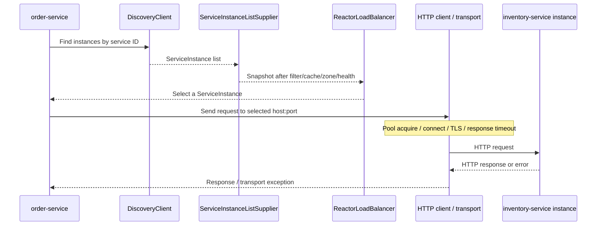

# Migrating Target Selection and Timeout Configuration to the Right Components

## 1. The Problem When Upgrading Communication Configuration

In the **Compatibility and Upgrades** chapter of the `SPRING_CLOUD_SERVICE_COMMUNICATION_LOAD_BALANCING` module, an application may need to migrate from legacy Ribbon configuration or hand-built HTTP clients to Spring Cloud LoadBalancer. Two configuration groups that are frequently mixed up are **target selection** and **timeouts**.

- **Target selection:** which service ID is called, where the `ServiceInstance` list comes from, and which instance is chosen via Round Robin, Random, zone, hint, or health.
- **Timeouts:** how long to wait for a connection from the pool, how long to establish the TCP connection, how long to wait for a response, and how long the entire logical request is allowed to run.

These two groups are related, yet they belong to different components. Spring Cloud LoadBalancer picks an instance from the candidate set provided by the supplier. The HTTP client/transport decides the time bounds of connections and responses. Retries may live in LoadBalancer integration, Feign, a Reactor pipeline, or another application layer.

If configuration is migrated to the wrong place, we can run into situations like:

- Putting `connectTimeout` under the `spring.cloud.loadbalancer` namespace and expecting TCP connections to be bounded automatically.
- Replacing `NFLoadBalancerRuleClassName` with a nonexistent property or placing the configuration class in the wrong context.
- Calling `http://inventory-service` with a non-`@LoadBalanced` client while assuming Spring picked a Pod.
- Configuring retries in both LoadBalancer and the HTTP client so one logical request issues more attempts than expected.
- Setting read timeout lower than valid downstream processing time, causing the caller to stop waiting while the server keeps processing.
- Configuring timeouts properly on OpenFeign while actual requests go through a different WebClient or RestClient.

### Learning Objectives

After this lesson, you will be able to:

1. Distinguish `DiscoveryClient`, `ServiceInstanceListSupplier`, `ReactorLoadBalancer`, and HTTP transport.
2. Migrate target selection policies to `@LoadBalancerClient`/suppliers for the right service ID.
3. Place connect, pool-acquire, response/read, and end-to-end timeouts on the right HTTP client.
4. Distinguish LoadBalancer, Feign, Reactor, and business-layer retries.
5. Organize dedicated configuration for `inventory-service` without accidentally applying it globally.
6. Translate each legacy Ribbon intent to its corresponding component without mechanically copying property names.
7. Test service ID, the instance actually receiving requests, timeouts, HTTP attempt counts, and overall deadlines.
8. Detect dead, overridden, or unread configuration in the client actually in use.

## 2. Call Flow and Where Each Decision Happens



| Responsibility | Owning component | Example | Not responsible for |
|---|---|---|---|
| Finding service ID and instances | DiscoveryClient/registry/Kubernetes client | Eureka, Consul, Kubernetes DiscoveryClient | Final selection algorithm |
| Filtering instance set | ServiceInstanceListSupplier | zone, hint, health, cache, custom filter | TCP connect/read timeout |
| Selecting an instance | ReactorLoadBalancer | Round Robin, Random, custom chooser | HTTP response timeout |
| Connecting to host:port | HTTP transport | JDK HttpClient, Reactor Netty, Apache HttpClient | Discovery metadata |
| Bounding response wait | HTTP client/transport | read/response timeout | Instance selection policy |
| Bounding total request | API/application boundary | Reactor `timeout`, deadline propagation | A single TCP timeout |
| Retry | One designated retry owner | LoadBalancer, Feign, Reactor | Should not be enabled redundantly without control |

**Rule of thumb:** discovery answers "which instances exist?", supplier answers "which instances are eligible?", LoadBalancer answers "which instance to pick?", and transport answers "how long at most to wait for connection/response?".

### 2.1. Do Not Collapse All Timeouts into One Value

An HTTP request can pass through multiple stages:

1. Waiting for a slot in the connection pool.
2. Resolving DNS or fetching addresses from service discovery.
3. Establishing the TCP connection.
4. TLS handshake when using HTTPS.
5. Sending the request and waiting for response headers/body.
6. Retrying/backing off if the error is eligible.
7. Deserializing and processing the result in the calling service.

A `readTimeout=700ms` does not necessarily cover all the steps above. A `connectTimeout=300ms` is not an overall deadline either. Read the specific transport's API to know which stages each timeout covers.

## 3. Classifying Configuration Namespaces Before Moving

| Namespace/configuration | Typical meaning | Should contain |
|---|---|---|
| `spring.cloud.loadbalancer.*` | LoadBalancer behavior | cache, LB retries, stats, eager loading, supplier/selection |
| `@LoadBalancerClient` | Per-service-ID child context config | chooser, supplier chain, custom policy |
| `spring.cloud.kubernetes.*` / Eureka / Consul | Discovery and endpoint metadata | namespace, registry endpoint, discovery options |
| RestClient request factory | Blocking HTTP transport | connect/read timeouts, TLS, connection behavior |
| WebClient connector | Reactive HTTP transport | pool acquire, TCP connect, response timeout |
| `spring.cloud.openfeign.client.config.*` | HTTP client config per Feign client | connectTimeout, readTimeout, encoder/decoder, retry integration |
| WebClient/Reactor pipeline | Logical publisher | end-to-end `timeout`, retry/backoff |
| Gateway/business service | Business deadline and fallback | request deadline, idempotency, status mapping |

**There is no single global Spring Cloud LoadBalancer timeout property that replaces timeouts across every HTTP client.** LoadBalancer does not own the sockets or connection pools used by RestClient/WebClient/Feign. If a specific starter provides a timeout property, verify which transport/integration it belongs to before setting it.

### 3.1. What Configuration Does Not Belong Where?

- Do not put `connectTimeout`/`readTimeout` under `spring.cloud.loadbalancer` unless docs for a specific property confirm it belongs to that namespace.
- Do not put Round Robin/zone policies under `spring.cloud.openfeign.client.config` as if Feign supplied the Pod list.
- Do not put legacy `listOfServers` addresses inside HTTP timeout settings; the endpoint list belongs to discovery/supplier.
- Do not treat the receiving service's `server.connection-timeout` as the calling service's outbound timeout.
- Do not set `spring.mvc.async.request-timeout` thinking it controls WebClient's connect timeout.
- Do not use a gateway timeout in place of downstream transport timeouts; the gateway bounds a different boundary.

## 4. Migrating Target Selection Config to Spring Cloud LoadBalancer

### 4.1. Using Service IDs with LoadBalancer-Integrated HTTP Clients

A URL like:

```text
http://inventory-service/api/inventory/ABC-1
```

is a **logical service ID** when used by an HTTP client with LoadBalancer integration, such as a `RestClient.Builder` or `WebClient.Builder` bean annotated with `@LoadBalanced`.

If used by a plain HTTP client, the same string may be handed to the DNS resolver as hostname `inventory-service`. Spring does not automatically infer that you want to call DiscoveryClient.

### 4.2. Per-Service Configuration with @LoadBalancerClient

Example using dedicated Round Robin for `inventory-service`:

```java
@SpringBootApplication
@LoadBalancerClient(
        name = "inventory-service",
        configuration = InventoryLoadBalancerConfiguration.class)
public class OrderApplication {

    public static void main(String[] args) {
        SpringApplication.run(OrderApplication.class, args);
    }
}
```

Chooser configuration:

```java
@Configuration(proxyBeanMethods = false)
class InventoryLoadBalancerConfiguration {

    @Bean
    ReactorLoadBalancer<ServiceInstance> inventoryLoadBalancer(
            Environment environment,
            LoadBalancerClientFactory clientFactory) {

        String serviceId = environment.getProperty(
                LoadBalancerClientFactory.PROPERTY_NAME);

        return new RoundRobinLoadBalancer(
                clientFactory.getLazyProvider(
                        serviceId, ServiceInstanceListSupplier.class),
                serviceId);
    }
}
```

Key imports belong to Spring Cloud Commons: `ReactorLoadBalancer`, `RoundRobinLoadBalancer`, `LoadBalancerClientFactory`, `ServiceInstanceListSupplier`, and `ServiceInstance`. A dedicated child context configuration is created for service ID `inventory-service`.

**Note:** `InventoryLoadBalancerConfiguration` should not be picked up by the root application context's component scan as global configuration. Place it outside `OrderApplication`'s scan package or structure packages according to the Spring Cloud guide for your version. If scanned globally, the chooser may apply unintentionally.

Chooser constructors/APIs and how suppliers are injected can change across Spring Cloud Release Trains. Check your active version before upgrading; do not copy code from a different major version without compiling and testing.

### 4.3. Customizing the Candidate List with Suppliers

If the goal is zone preference, illustrative supplier chain configuration:

```java
@Configuration(proxyBeanMethods = false)
class InventoryLoadBalancerConfiguration {

    @Bean
    ServiceInstanceListSupplier inventorySupplier(
            ConfigurableApplicationContext context) {

        return ServiceInstanceListSupplier.builder()
                .withDiscoveryClient()
                .withZonePreference()
                .build(context);
    }

    @Bean
    ReactorLoadBalancer<ServiceInstance> inventoryLoadBalancer(
            Environment environment,
            LoadBalancerClientFactory clientFactory) {

        String serviceId = environment.getProperty(
                LoadBalancerClientFactory.PROPERTY_NAME);

        return new RoundRobinLoadBalancer(
                clientFactory.getLazyProvider(
                        serviceId, ServiceInstanceListSupplier.class),
                serviceId);
    }
}
```

This is illustrative configuration for an environment with a suitable `DiscoveryClient`. If default suppliers already exist from discovery/cache/health, do not stack another chain on top without understanding the delegate order. Identify which supplier is at the head and which delegates it calls.

| Requirement | Component to consider |
|---|---|
| Round robin over candidate set | `RoundRobinLoadBalancer` |
| Random selection | `RandomLoadBalancer` |
| Zone preference | `ZonePreferenceServiceInstanceListSupplier` |
| Hint-based filtering | `HintBasedServiceInstanceListSupplier` |
| Health checking | `HealthCheckServiceInstanceListSupplier` |
| Custom weight/metadata selection | Custom supplier/chooser with a clear contract |
| Fetch list from registry | DiscoveryClient-backed supplier |

The supplier determines the **candidate set**; the chooser selects **an element** from that set. If the supplier returns only one instance, no algorithm can distribute traffic to another instance.

### 4.4. Per-Service Does Not Mean Every Setting Lives in the Child Context

`@LoadBalancerClient(name="inventory-service", configuration=...)` configures the **LoadBalancer child context** for that service ID. An HTTP client transport may be shared across multiple service IDs; an HTTP client bean's timeouts apply to calls made with that bean.

If different downstreams need different timeouts, create separate HTTP client/gateway beans with clear names/qualifiers, or use per-client configuration from a library like OpenFeign. Do not assume `@LoadBalancerClient` automatically creates a separate `RestClient` or applies timeouts to sockets.

## 5. Setting Timeouts Properly for RestClient

`RestClient` is Spring Framework's blocking API. Timeouts are configured via the `ClientHttpRequestFactory`/HTTP transport used by `RestClient`.

### 5.1. LoadBalanced Builder and Request Factory with Timeouts

Spring Boot 3.x example using `SimpleClientHttpRequestFactory`:

```java
@Configuration(proxyBeanMethods = false)
class InventoryRestClientConfiguration {

    @Bean
    @LoadBalanced
    RestClient.Builder loadBalancedRestClientBuilder(
            RestClientBuilderConfigurer configurer) {
        return configurer.configure(RestClient.builder());
    }

    @Bean
    RestClient inventoryRestClient(
            @LoadBalanced RestClient.Builder builder) {

        SimpleClientHttpRequestFactory requestFactory =
                new SimpleClientHttpRequestFactory();

        requestFactory.setConnectTimeout(
                Duration.ofMillis(300));
        requestFactory.setReadTimeout(
                Duration.ofMillis(700));

        return builder.clone()
                .baseUrl("http://inventory-service")
                .requestFactory(requestFactory)
                .build();
    }
}
```

In this example:

- `@LoadBalanced` integrates service-ID resolution with Spring Cloud LoadBalancer.
- `RestClientBuilderConfigurer` preserves Spring Boot's customizations in versions supporting this API.
- `requestFactory` determines the transport and timeouts.
- `connectTimeout=300ms` bounds the connection-establishment phase per the request factory's semantics.
- `readTimeout=700ms` bounds the wait for response data per the request factory's semantics.

`SimpleClientHttpRequestFactory` is a simple example suitable for labs. It does not represent all transports or connection pooling. If using JDK HttpClient, Apache HttpClient, or another factory, read that specific transport's timeout API; some timeouts do not share identical semantics or coverage.

### 5.2. Separating Clients per Downstream

If `inventory-service` needs a 700ms timeout while `pricing-service` needs 1,500ms, create two clients with two separate request factories/configurations. Do not mutate the global timeout on a shared builder and accidentally affect other services.

```java
@Configuration(proxyBeanMethods = false)
class OutboundClientConfiguration {

    @Bean
    @LoadBalanced
    RestClient.Builder loadBalancedRestClientBuilder(
            RestClientBuilderConfigurer configurer) {
        return configurer.configure(RestClient.builder());
    }

    @Bean("inventoryRestClient")
    RestClient inventoryRestClient(
            @LoadBalanced RestClient.Builder builder) {
        return create(builder, 300, 700, "http://inventory-service");
    }

    @Bean("pricingRestClient")
    RestClient pricingRestClient(
            @LoadBalanced RestClient.Builder builder) {
        return create(builder, 500, 1500, "http://pricing-service");
    }

    private RestClient create(
            RestClient.Builder builder,
            int connectMs,
            int readMs,
            String baseUrl) {

        SimpleClientHttpRequestFactory factory =
                new SimpleClientHttpRequestFactory();
        factory.setConnectTimeout(Duration.ofMillis(connectMs));
        factory.setReadTimeout(Duration.ofMillis(readMs));

        return builder.clone()
                .requestFactory(factory)
                .baseUrl(baseUrl)
                .build();
    }
}
```

Inject using `@Qualifier("inventoryRestClient")` or `@Qualifier("pricingRestClient")`. If the project has multiple `RestClient.Builder` beans, use appropriate qualifiers to avoid injecting a builder without LoadBalancer integration.

## 6. Setting Timeouts Properly for WebClient/Reactor Netty

WebClient is a reactive API; timeouts can reside on the pool, connect, transport response, and overall publisher. Do not collapse them into one number.

### 6.1. Example Connector with Pool and Transport Timeouts

```java
@Configuration(proxyBeanMethods = false)
class InventoryWebClientConfiguration {

    @Bean
    @LoadBalanced
    WebClient.Builder inventoryWebClientBuilder(
            ObjectProvider<WebClientCustomizer> customizers) {

        ConnectionProvider pool = ConnectionProvider
                .builder("inventory-pool")
                .maxConnections(50)
                .pendingAcquireTimeout(Duration.ofMillis(200))
                .build();

        HttpClient httpClient = HttpClient.create(pool)
                .option(ChannelOption.CONNECT_TIMEOUT_MILLIS, 300)
                .responseTimeout(Duration.ofMillis(700));

        WebClient.Builder builder = WebClient.builder()
                .clientConnector(
                        new ReactorClientHttpConnector(httpClient));

        customizers.orderedStream()
                .forEach(customizer -> customizer.customize(builder));

        return builder;
    }

    @Bean
    WebClient inventoryWebClient(
            @LoadBalanced WebClient.Builder inventoryWebClientBuilder) {
        return inventoryWebClientBuilder.clone()
                .baseUrl("http://inventory-service")
                .build();
    }
}
```

Required imports come from Reactor Netty, Netty, Spring WebFlux, and Spring Boot. Check exact builder/annotation names and how customizers apply against your Boot/Cloud version. If injecting a fully auto-configured builder, do not apply customizers twice or replace the connector in a way that drops observation/LoadBalancer filters.

| Setting | Bounds | Should not be mistaken for |
|---|---|---|
| `pendingAcquireTimeout` | Waiting for a connection from the pool | TCP connect timeout |
| `CONNECT_TIMEOUT_MILLIS` | TCP connection time | Response timeout |
| `responseTimeout` | Transport response timeout per Reactor Netty semantics | Total deadline across all retries/business processing |
| Reactor `timeout(...)` | How long the publisher may run at that operator position | A single socket's timeout |

### 6.2. End-to-End Timeout and Operator Placement

Example GET with one retry and a one-second overall deadline:

```java
Mono<InventoryStock> readStock(String sku) {
    return inventoryWebClient.get()
            .uri("/api/inventory/{sku}", sku)
            .retrieve()
            .bodyToMono(InventoryStock.class)
            .retryWhen(Retry.backoff(
                            1, Duration.ofMillis(100))
                    .maxBackoff(Duration.ofMillis(200))
                    .filter(this::isTransientFailure))
            .timeout(Duration.ofSeconds(1));
}
```

Because `timeout(...)` is placed **after** `retryWhen(...)`, it bounds the overall publisher including the initial attempt, backoff, and retry attempt. Placing `timeout` before `retryWhen` yields different semantics: each subscription/attempt gets its own budget. Write tests proving operator placement enforces the intended deadline.

`isTransientFailure` is an application-defined policy; do not blindly retry every exception. In particular, do not automatically retry validation, authentication, authorization, or non-transient domain errors.

### 6.3. Cancellation Is Not Rollback

When a publisher times out and cancels, the client stops waiting or attempts to abort the exchange at the transport level. That **does not guarantee** the server never received the request or stopped processing it. For write operations, you need idempotency keys, deduplication, and clear state contracts.

## 7. Setting Timeouts Properly for OpenFeign

OpenFeign has its own per-client configuration. Example:

```yaml
spring:
  cloud:
    openfeign:
      client:
        config:
          inventory-service:
            connectTimeout: 300
            readTimeout: 700
          pricing-service:
            connectTimeout: 500
            readTimeout: 1500
```

`inventory-service` must match the client name in `@FeignClient(name = "inventory-service")`. These example values are in milliseconds per the corresponding OpenFeign config; check your project's version, HTTP client implementation, and property metadata.

```java
@FeignClient(name = "inventory-service")
interface InventoryFeignClient {

    @GetMapping("/api/inventory/{sku}")
    InventoryStock get(@PathVariable("sku") String sku);
}
```

When Spring Cloud LoadBalancer is on the classpath and properly configured, a Feign client by `name` can resolve through LoadBalancer. If a fixed URL is declared in `@FeignClient(url=...)`, the call path no longer shares the same service discovery/LB semantics as a service-ID client. Do not add `url` when the goal is to let Spring select the instance.

### 7.1. OpenFeign Default Retry

Spring Cloud OpenFeign provides `Retryer.NEVER_RETRY` by default, differing from retry behavior you might encounter in Feign core or a manually configured HTTP client. Therefore:

- Setting `readTimeout` does not automatically enable retries.
- HTTP 503 is not automatically retried merely because LoadBalancer is present.
- If installing a custom `Retryer`, define which statuses/exceptions are retryable and the maximum attempts.
- If enabling both LoadBalancer retry and Feign retry simultaneously, count actual HTTP attempts to catch nested retries.

## 8. Which Layer Owns Retry?

| Retry owner | Controls | Signs | What to watch out for |
|---|---|---|---|
| Spring Cloud LoadBalancer retry | Retries by service instance/policy in supported integrations | Can pick another instance | Requires compatible HTTP client integration/dependency and version |
| OpenFeign `Retryer` | Retries Feign calls on exceptions/retryable responses | Feign attempts | Spring Cloud OpenFeign defaults to `NEVER_RETRY` |
| Reactor `retryWhen` | Re-subscribes to the reactive publisher | HTTP exchanges can repeat | Predicate, backoff, jitter, and deadline |
| Spring Retry/application loop | Retries at the business/service layer | Can wrap multiple downstream calls | Easily multiplies attempts if lower layers also retry |
| Gateway/service mesh | Retries at proxy/edge layer | Requests can be re-sent | App may not see the full policy |

### 8.1. Example LoadBalancer Retry Configuration

An illustrative configuration for Spring Cloud Commons 4.3:

```yaml
spring:
  cloud:
    loadbalancer:
      retry:
        enabled: true
        max-retries-on-same-service-instance: 0
        max-retries-on-next-service-instance: 1
        retryable-status-codes:
          - 503
        avoid-previous-instance: true
```

Exact retry properties depend on the version and HTTP client integration. Some blocking stacks require separate retry dependencies/integrations; reactive `WebClient` uses a different mechanism. **Do not assume the exact same YAML behaves identically for RestClient, WebClient, and Feign.**

If retry is already handled by LoadBalancer, avoid adding `retryWhen` or a Feign `Retryer` for the same errors unless there is an explicit layered design. With one retry at two layers, maximum attempts can multiply; for example, two layers each allowing two attempts can produce up to four HTTP attempts depending on nesting.

### 8.2. Calculating the Total Time Budget

Suppose:

- Connect timeout: 300ms.
- Response/read timeout: 700ms.
- One retry.
- Backoff: 100ms.
- Overhead/queue/deserialization: 100ms.

The approximate worst-case budget can exceed 1,900ms if both attempts wait the full response timeout plus connection and overhead costs. This is an illustrative conservative estimate, not a transport guarantee.

If the API contract requires responding within 1,000ms, you cannot simply set `readTimeout=700ms` and allow unrestricted retries. You must track the **remaining deadline** and skip retrying when insufficient budget remains.

## 9. Migrating Legacy Ribbon Config to the Right Components

Ribbon has been replaced in newer Spring Cloud generations by Spring Cloud LoadBalancer. When migrating, **translate configuration intent** rather than doing prefix find-and-replace.

| Legacy Ribbon configuration intent | Where to migrate | Notes |
|---|---|---|
| `NFLoadBalancerRuleClassName` | Per-service `@LoadBalancerClient` + `ReactorLoadBalancer` | Round Robin, Random, or custom chooser |
| `NIWSServerListClassName` / server list | `DiscoveryClient` + `ServiceInstanceListSupplier` | Instance source, cache, filters |
| `ribbon.ConnectTimeout` | HTTP transport of RestClient/WebClient/Feign | Connect timeout of the client actually used |
| `ribbon.ReadTimeout` | HTTP transport of RestClient/WebClient/Feign | Read/response timeout |
| `ribbon.MaxAutoRetries` | Designated retry owner | LoadBalancer/Feign/Reactor; no universal 1:1 mapping |
| `ribbon.MaxAutoRetriesNextServer` | Next-instance retry policy if integration supports it | Verify actual attempts and retry-aware supplier |
| `ribbon.OkToRetryOnAllOperations` | Do not copy mechanically | Design retries around HTTP method/idempotency and transient errors |
| `NIWSDiscoveryPing`/health logic | Kubernetes readiness, discovery health, or supplier health check | Distinguish readiness from business availability |
| `listOfServers` | Discovery registry or static supplier for tests | Do not place in HTTP timeout config |

### 9.1. Legacy Ribbon Configuration Example

```yaml
# Legacy Ribbon-style configuration (illustrative)
inventory-service:
  ribbon:
    ConnectTimeout: 300
    ReadTimeout: 700
    MaxAutoRetries: 0
    MaxAutoRetriesNextServer: 1
    NFLoadBalancerRuleClassName: com.netflix.loadbalancer.RoundRobinRule
```

This is a **legacy example** to identify intent, not current Spring Cloud LoadBalancer configuration. Do not carry this block verbatim into a new app expecting Spring Cloud Commons to read it.

### 9.2. After Migration

Target selection moves to LoadBalancer configuration:

```java
@LoadBalancerClient(
        name = "inventory-service",
        configuration = InventoryLoadBalancerConfiguration.class)
@SpringBootApplication
class OrderApplication {}
```

Timeouts move to the HTTP client. If using OpenFeign:

```yaml
spring:
  cloud:
    openfeign:
      client:
        config:
          inventory-service:
            connectTimeout: 300
            readTimeout: 700
```

If using RestClient/WebClient, configure the corresponding request factory/connector as in sections 5 and 6. Retries require choosing one owner and testing separately. **There is no single complete Ribbon-replacement YAML shared across every client** because each transport has its own lifecycle and timeout API.

### 9.3. Cleaning Up Legacy Config After Proving the New Path

1. Locate and remove old Ribbon dependencies according to the project's upgrade plan.
2. Search for `ribbon.*`, `NFLoadBalancer*`, `NIWS*`, and old rule beans.
3. Translate each intent to LoadBalancer, discovery, HTTP transport, or a retry owner.
4. Confirm two target-selection mechanisms are not unintentionally active together.
5. Inspect configuration properties binding/startup logs to find unread properties.
6. Remove legacy config once tests safeguard the new behavior.

Do not delete a property merely because its name contains Ribbon; first verify which component actually read it in the old version and where that behavior has been replaced.

## 10. Consolidated Configuration by Component

The following is an example for two downstreams with different timeouts:

```yaml
spring:
  application:
    name: order-service

  cloud:
    loadbalancer:
      retry:
        enabled: false
      eager-load:
        clients:
          - inventory-service
          - pricing-service

    openfeign:
      client:
        config:
          inventory-service:
            connectTimeout: 300
            readTimeout: 700
          pricing-service:
            connectTimeout: 500
            readTimeout: 1500

server:
  port: 8080
```

Reading the configuration:

- `spring.application.name`: caller application identifier.
- `spring.cloud.loadbalancer.retry.enabled`: disables LoadBalancer retry in the baseline so attempt counts are easy to verify; not a timeout.
- `eager-load.clients`: asks to initialize LoadBalancer contexts early for listed service IDs; neither chooses instances nor sets timeouts.
- `spring.cloud.openfeign.client.config.*`: timeouts for the corresponding Feign clients.
- If a client uses RestClient/WebClient, Feign values do **not** automatically apply to them.

Do not keep both Feign and RestClient configs around "just in case we use it later." Each downstream gateway should use a clear client with the chosen transport and timeouts.

## 11. Verifying Properties Actually Take Effect

### 11.1. Verifying Dependencies and Bean Wiring

- Is BOM-compatible `spring-cloud-starter-loadbalancer` present?
- Is `@LoadBalanced` placed on the exact `RestClient.Builder`/`WebClient.Builder`?
- Are there multiple builders with the wrong qualifier injected?
- Is the client calling a service-ID URL or a physical/fixed URL?
- For Feign, does `@FeignClient(name=...)` have the right name, and is a `url` attribute bypassing LB?
- Is the `@LoadBalancerClient` configuration outside the root component scan?
- Which supplier is actually active: discovery, cache, health, zone, or custom?

### 11.2. Verifying Timeouts with a Fault Server

Using a mock server:

| Scenario | Timeout to observe |
|---|---|
| Server port has no listener | Connect refused may occur immediately without waiting for the full connect timeout |
| TCP handshake blackholed in test proxy | Connect timeout |
| Server accepts request then delays response | Read/response timeout |
| Connection pool full and grants no slot | Pool acquire timeout |
| Multiple attempts + backoff exceed SLA | End-to-end deadline |

Do not assert exact elapsed time like `700ms`; scheduling/GC/network introduce jitter. Inspect root causes, server request logs, and overall deadlines with reasonable tolerance.

### 11.3. Verifying Configuration by Actual Client

| Active client | Configuration to check | Evidence |
|---|---|---|
| RestClient | `ClientHttpRequestFactory` actually attached to builder | Request factory and connect/read timeout tests |
| WebClient | Reactor Netty connector/pool | Connect/response/pending-acquire behavior |
| OpenFeign | `spring.cloud.openfeign.client.config.<name>` and HTTP client | Feign exception, attempt count |
| Plain RestClient/WebClient | No `@LoadBalanced` | DNS/service VIP or fixed URL |
| LoadBalanced client | Service ID, supplier, chooser | Selected host/port/instance ID |

You can use Actuator `/actuator/configprops` in a **protected test environment** to see bound configuration properties. Never expose this endpoint publicly if it reveals internal configuration/secrets.

## 12. Migration Testing: Proving Both Selection and Timeouts

### 12.1. Testing Chooser Without Network

Using a fixed supplier `[inventory-a, inventory-b]`:

- Empty list ⇒ no-server.
- Singleton ⇒ always selects that exact instance.
- Round Robin with a fixed seed/snapshot ⇒ verify cycle if needed.
- Random ⇒ verify set membership; do not assert the first pick is A.
- Zone filter ⇒ verify the post-supplier list before asserting the chooser.

These tests verify **target selection**, not timeouts.

### 12.2. Testing Transport Timeouts

Using a mock server with two endpoints:

- `/fast`: returns 200 immediately.
- `/slow`: accepts the request, waits 1,800ms, then returns 200.

With a 700ms client read/response timeout:

- `/fast` must complete.
- `/slow` can time out on the caller side before the server finishes.
- Check requests received by the server to avoid concluding "no HTTP attempt was made."
- Do not assert the server rolled back or stopped processing after client timeout.

### 12.3. Testing Per-Service Config

Create `inventory-service` and `pricing-service` with different latencies. Prove the inventory client times out at the inventory threshold and the pricing client times out at the pricing threshold. If both time out at the same threshold, inspect bean sharing, Feign client name/`contextId`, qualifiers, and config precedence.

### 12.4. Testing Retry in One Place Only

1. Disable retries in LoadBalancer, Feign, Reactor, and the gateway.
2. Send a GET to a mock server returning 503.
3. Verify exactly one HTTP attempt.
4. Enable exactly one retry owner.
5. Configure the first attempt to fail and the next to succeed.
6. Verify total attempts and the instance hit by each attempt.
7. Make both servers fail and confirm the request finishes within the deadline.

Do not test retries simply by asserting the final HTTP status is 200; excessive hidden attempts could be masked.

## 13. Timeouts, Retries, and Idempotency in API Contracts

A timeout means **the caller stopped waiting at a configured bound**, not proof the server did not process the request.

- GET is generally safer to retry, though it still creates load and may read a newer snapshot.
- POST requests that reserve stock/place orders/process payments may already have committed before the response was lost.
- If retrying POST, require a unique idempotency key per logical operation and durable deduplication where side effects occur.
- Do not use `available=0` as a fallback when inventory times out; the accurate state is unknown/unavailable.
- Do not unconditionally retry 400/401/403 or non-transient contract errors.
- For 429/503, respect policy/quota/`Retry-After` if the client implementation supports it; do not assume every retry integration reads the header automatically.
- Total attempts must fit within the end-to-end deadline and downstream load limits.

## 14. Common Migration Mistakes

| Symptom | Likely cause | Fix |
|---|---|---|
| `UnknownHostException: inventory-service` | Plain client treats service ID as hostname | Use `@LoadBalanced` builder or Kubernetes Service FQDN |
| Always hits the same Pod despite Round Robin | Client actually calls ClusterIP Service, or supplier returns only one instance | Check selected host/port/instance ID and discovery list |
| Connect timeout config has no effect | Wrong namespace or builder does not use that request factory | Inspect the actual transport bean |
| Read timeout does not apply to WebClient | Configured RestClient/Feign while requests go through WebClient | Set response/publisher timeout on the actual client |
| Feign timeout stays at default | Client property key does not match `@FeignClient` or is overridden | Check client name/context/config precedence |
| More retries than expected | Retries enabled at multiple layers | Pick one owner; count server requests |
| Retries do not move to another instance | Supplier/retry integration is not retry-aware or only one candidate exists | Check next-instance policy and eligible set |
| 503 turned into 200 | Fallback masks failure or mis-maps errors | Return explicit degraded response and dedicated metric |
| Request times out yet server still commits | Client timeout does not roll back remote operations | Idempotency, status queries, and deduplication |
| Legacy Ribbon config remains in YAML | Legacy properties are no longer read | Migrate semantics and delete after testing |
| Per-service chooser applies globally | Config class picked up by component scan | Move config outside root scan |
| Inventory timeout affects pricing | Shared client/transport configuration | Separate client beans or Feign client configs |
| No Spring LB stats when calling fixed URL | Request bypasses LoadBalancer | Verify service ID and annotation |
| `server.connection-timeout` doesn't change outbound timeout | That is server-side configuration | Configure timeouts on the caller transport |
| 700ms timeout yet logical request takes 2s | Pool wait, retries, backoff, or overhead | Enforce an end-to-end deadline |

## 15. Step-by-Step Upgrade Procedure

1. **Inventory outbound clients:** service ID, client type, transport, retry owner, and current config location.
2. **Identify the selection path:** DNS/VIP, Spring LoadBalancer, mesh, or fixed URL. Verify via instance logs.
3. **Migrate discovery:** preserve appropriate registry/namespace/metadata; do not change the instance source at the same time as timeouts without a baseline.
4. **Migrate chooser/supplier:** use `@LoadBalancerClient` per service ID; test eligible sets and policies.
5. **Migrate timeouts:** configure request factory/connector/Feign config on the actual client; separate pool, connect, response, and end-to-end deadlines.
6. **Choose a retry owner:** start with retries disabled to measure baseline, then enable in one place with max attempts, predicates, and deadline.
7. **Verify API semantics:** status mapping, idempotency, fallbacks, and unknown states.
8. **Run integration tests:** two replicas, slow/503/stopped/no-instance, verifying request counts and Pod IDs.
9. **Compare observability:** logical requests, attempts, latency, statuses, selected instances, and traces.
10. **Clean up legacy config:** remove Ribbon properties/dependencies/beans once new behavior is proven.
11. **Canary rollout:** monitor error rate, p95/p99, attempts/request, pool saturation, and no-instance counts.
12. **Prepared rollback:** retain old artifacts/configs during rollout and know how to restore timeouts/retries and compatible versions.

## 16. Pre-Merge Checklist for New Configuration

- [ ] Spring Boot and Spring Cloud Release Train are compatible per BOM.
- [ ] Every outbound client specifies either a service ID or a physical URL clearly.
- [ ] Verified whether requests actually route through Spring Cloud LoadBalancer or a Kubernetes/mesh VIP.
- [ ] `DiscoveryClient` and suppliers return the expected instance set.
- [ ] Per-service chooser resides in `@LoadBalancerClient` with the exact name.
- [ ] Config class is not unintentionally applied globally by root component scan.
- [ ] `RestClient` uses the intended `ClientHttpRequestFactory`.
- [ ] `WebClient` uses the intended connector and pool timeouts.
- [ ] OpenFeign config key matches the client name and active HTTP transport.
- [ ] Connect, pool acquire, read/response, and end-to-end timeouts are clearly separated.
- [ ] No HTTP timeouts placed in a LoadBalancer namespace lacking matching properties.
- [ ] Single retry owner chosen and actual attempts counted.
- [ ] Retries apply only to transient, safe errors with remaining deadline budget.
- [ ] POST side effects have idempotency/deduplication when retried.
- [ ] Upstream 503, connect refused, read timeout, and no-instance cases tested.
- [ ] Metrics distinguish logical requests, HTTP attempts, and LoadBalancer selection.
- [ ] No dead Ribbon properties/dependencies left behind without a cleanup plan.
- [ ] Canary/rollback plan and clear monitoring thresholds in place.

## 17. Practice Exercises

### Exercise 1 — Classify Misplaced Configuration

Given YAML setting `connectTimeout: 300` under `spring.cloud.loadbalancer`, explain why you must not assume that property controls TCP; move it to a `RestClient` request factory, Reactor Netty connector, or OpenFeign config depending on the client.

### Exercise 2 — Migrate Round Robin

Replace `NFLoadBalancerRuleClassName` with `@LoadBalancerClient` and `RoundRobinLoadBalancer`. Prove the supplier returns at least two `ServiceInstance` entries; log the ID of the instance receiving each request and test empty/singleton lists.

### Exercise 3 — Two Downstreams, Two Timeouts

Configure inventory connect/read at 300/700ms and pricing at 500/1500ms. Build mock servers with different delays and prove each client honors its own timeout.

### Exercise 4 — Distinguish Response Timeout and Deadline

Build a WebClient with `responseTimeout=700ms`, one retry, and 100ms backoff. Place `.timeout(1s)` after retry. Create a slow server to observe the publisher timing out before completing two attempts.

### Exercise 5 — Multiplied Retries

Enable one retry in LoadBalancer and one retry in Reactor. Count requests arriving at two servers; prove attempts can multiply. Then disable one owner and keep a single clear retry policy.

### Exercise 6 — Feign and Fixed URLs

Create two Feign clients: one `@FeignClient(name="inventory-service")` and one with a fixed `url` pointing to a ClusterIP. Verify which client goes through Spring LoadBalancer and which lets Kubernetes pick the Pod.

### Exercise 7 — Ribbon Migration Review

Take a legacy config with `ribbon.ConnectTimeout`, `ribbon.ReadTimeout`, `MaxAutoRetriesNextServer`, and `NFLoadBalancerRuleClassName`. Build a target mapping table translating each intent instead of running find-and-replace on prefixes.

### Exercise 8 — Timeout After POST Commits

Simulate a server committing a reservation before the response times out. Retry without idempotency to observe duplicates; add an idempotency key and deduplication to verify only one side effect occurs.

### Exercise 9 — Check Property Precedence

Set different values in global config and per-service config. Verify which value the bean/client actually uses. Do not rely solely on reading YAML; confirm via tests and protected config diagnostics.

### Exercise 10 — Write a Migration Report

Include in the report: client name, service ID, discovery source, supplier chain, chooser, HTTP transport, timeout stages, retry owner, max attempts, end-to-end deadline, metrics, and rollback plan.

## References

- [Spring Cloud Commons — Spring Cloud LoadBalancer](https://docs.spring.io/spring-cloud-commons/reference/spring-cloud-commons/loadbalancer.html): chooser, `ServiceInstanceListSupplier`, per-service configuration, caching, health, and retry.
- [Spring Cloud Commons — Configuration Properties](https://docs.spring.io/spring-cloud-commons/reference/configprops.html): `spring.cloud.loadbalancer.*` properties by version.
- [Spring Framework — REST Clients](https://docs.spring.io/spring-framework/reference/integration/rest-clients.html): `RestClient`, builder, request factory, and HTTP error handling.
- [Spring Framework — WebClient](https://docs.spring.io/spring-framework/reference/web/webflux-webclient.html): reactive HTTP client and connector.
- [Reactor Netty — HTTP Client](https://projectreactor.io/docs/netty/release/reference/http-client.html): connection pool, connect/response timeouts, and transport.
- [Spring Cloud OpenFeign](https://docs.spring.io/spring-cloud-openfeign/reference/spring-cloud-openfeign.html): Feign client config, connect/read timeouts, and retryer.
- [Spring Cloud — Release Train](https://spring.io/projects/spring-cloud/): check Spring Boot/Spring Cloud compatibility before major upgrades.
- [Spring Cloud Netflix](https://docs.spring.io/spring-cloud-netflix/reference/): inspect historical Ribbon changes and replacement components in Spring Cloud.

**Conclusion:** target selection configuration belongs in **discovery → supplier → LoadBalancer**, whereas connect/read/response timeouts belong in **the HTTP transport/client actually executing the request**. End-to-end deadlines belong to the logical request, and retries need one explicit owner. Migrating configuration according to each component's responsibility prevents dead properties, stacked retries, and the misconception that a single socket timeout protects an entire transaction.
