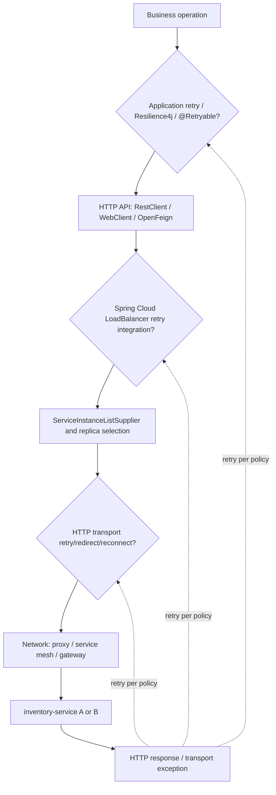
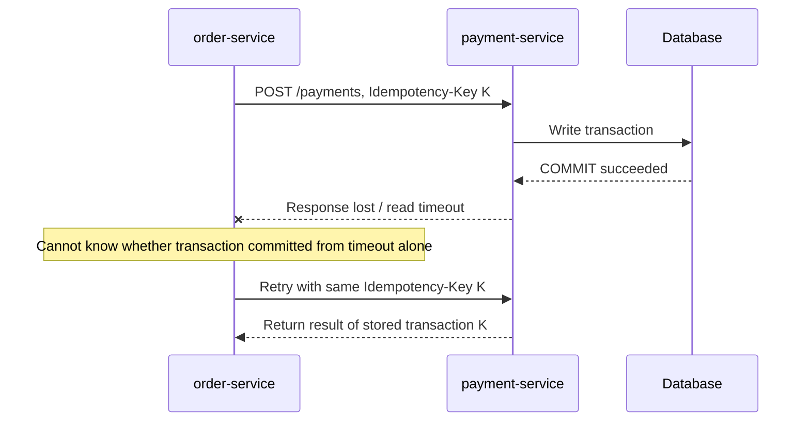

# Comparing Default Retries When Changing Libraries or Release Trains

Suppose `order-service` uses Spring Cloud LoadBalancer to call `inventory-service` by service ID. Before an upgrade, a GET request hitting a connection error was sent **once**; after swapping a dependency or upgrading the Spring Cloud Release Train, logs on `inventory-service` suddenly record **two** deliveries of the same request. Another team may encounter the opposite: before upgrading, the call automatically retried and recovered from a transient failure; after upgrading, the request fails immediately. Both can happen even when **no business code changed**.

The reason is that **retry does not belong solely to the Round Robin algorithm**. It can live in Spring Cloud LoadBalancer, the HTTP client, OpenFeign, Spring Retry, Reactor, Resilience4j, a proxy/service mesh, or the business layer itself. These components have **different activation conditions, defaults, retry criteria, and scopes**; changing the classpath or release train can enable/disable a layer or alter how errors are classified.

This lesson belongs to the **Compatibility and Upgrades** chapter of the `SPRING_CLOUD_SERVICE_COMMUNICATION_LOAD_BALANCING` module. Its goal is to establish a **retry baseline provable by HTTP attempt counts**, compare the behavior of `RestTemplate`, `RestClient`, `WebClient`, and OpenFeign, understand the `retry-on-all-exceptions` change, manage the Spring Boot–Spring Cloud BOM, and build safe regression tests before and after upgrading.

> **Core principle:** never conclude "retries once by default" from a single property line, and never conclude "no retries" just because `@Retryable` is absent. **Effective retry = version + dependencies/classpath + HTTP client type + integration + configuration + exception/status + HTTP method + other layers on the path.**

## 1. Diagram of Layers That Can Resend the Same Request



This diagram is only a model of **possibilities**; it does not mean every layer retries or all libraries share the same execution order. One system may enable only one layer; another may accidentally enable three layers and sharply multiply real requests.

### 1.1. Distinguishing Logical Operation from HTTP Attempt

```text
Logical operation: GET /api/v1/items/42 from order-service

Attempt #1: LoadBalancer selects inventory-A; HTTP connect timeout
Attempt #2: LoadBalancer selects inventory-B; HTTP 200

Logical outcome = SUCCESS
HTTP attempts   = 2
```

**A successful logical call does not prove only one HTTP request occurred.** Measuring only the 2xx rate at the controller can mask many failed underlying retries. Conversely, when a POST times out, the provider **may already have persisted data** even though the caller saw no response; resending the request does not mean the first operation was never processed.

### 1.2. Same Status, Different Retry Paths

- `HTTP 503` returned by the **provider** after receiving the request: belongs to response statuses.
- `Synthetic HTTP 503` generated by LoadBalancer when no `ServiceInstance` exists: does not prove the provider received any request.
- `ConnectException`, `SocketTimeoutException`, or `WebClientRequestException`: belong to the network/transport path and may be wrapped by client adapters.
- `WebClientResponseException`, `FeignException`: exceptions mapped from HTTP responses; **not** every error kind is retried by default.
- `DecodeException`/`DecodingException`: response arrived, but body violates the contract; retrying rarely fixes a schema mismatch.

A "retry all exceptions" policy can accidentally retry business errors, decoding failures, or non-idempotent writes. During an upgrade, **the set of retryable exceptions** matters just as much as the retry count.

## 2. Default Comparison Table: Specify Which Layer Is Evaluated

| Component | What to know about default retry | What must be verified after changing versions |
|---|---|---|
| **Spring Cloud LoadBalancer – blocking `RestTemplate`** | Commons docs note load-balanced retry **does not activate automatically just from using RestTemplate**; the blocking path can activate when Spring Retry is present and auto-configuration conditions match | Whether `spring-retry` is present at runtime; whether the retry interceptor is actually attached; which exception/status policy applies |
| **Spring Cloud LoadBalancer – blocking `RestClient`** | `RestClient` uses the blocking `BlockingLoadBalancerClient` integration, but retry details must be verified against the **specific adapter/Release Train** rather than inferred verbatim from RestTemplate | Actual `@LoadBalanced RestClient.Builder` bean, HTTP request factory, retry adapter, and attempt count |
| **Spring Cloud LoadBalancer – reactive `WebClient`** | Has a retry mechanism in reactive integration when enabled/configured accordingly; does not mean every HTTP 5xx auto-retries | `spring.cloud.loadbalancer.retry.enabled`, attached filter, retryable statuses/exceptions, application `retryWhen` |
| **Spring Cloud OpenFeign** | Spring Cloud OpenFeign registers `Retryer.NEVER_RETRY` by default, **unlike Feign core** | Actual Feign client config, `Retryer` bean/properties, `ErrorDecoder`, underlying LB and transport |
| **Standalone Feign core** | Feign core defaults can retry certain I/O errors and `RetryableException` produced by `ErrorDecoder` | Do not apply Feign core defaults to Spring Cloud `@FeignClient` beans |
| **Spring Retry / `@Retryable`** | Does not automatically retry every service method just because the dependency is present | Proxy/annotations/config, `RetryTemplate`, exception policy, and attempt count |
| **Reactor `retry`/`retryWhen`** | Repeats the publisher only when the application **adds the operator** or an integration adds retry | Operator placement, subscription count, actual exception/status types |
| **Resilience4j Retry** | Operates only when integrated and configured/applied to the operation | Retry instance name, aspect/decorator order, retry predicates, max attempts |
| **HTTP transport / gateway / mesh** | Depends on library, method, idempotency/redirect policy, and infrastructure config | Request replay in transport/proxy, attempt counts at provider |

**Do not read this table as a permanent table of fixed values.** Defaults in a Release Train, a Feign core version, and an HTTP transport can vary. The reliable source of truth is **dependency tree + effective configuration + tests on exact pinned versions**.

### 2.1. Apparent Contradiction: `retry.enabled=true` Yet Requests Do Not Retry

In Spring Cloud Commons configuration properties appendices in recent release lines, `spring.cloud.loadbalancer.retry.enabled` has a documented default of `true`. Meanwhile, the Commons guide explains that load-balanced blocking retry may **not be active** if Spring Retry is absent, and each client/integration has its own wiring conditions.

These two facts are not necessarily contradictory: **a property permitting a feature does not guarantee the corresponding retry implementation is present at runtime**. Likewise, having a retry implementation does not prove `HTTP 503` is among the retryable statuses or the current HTTP method is eligible.

Therefore, when verifying an upgrade:

1. Check the **bound property** and the value actually applied.
2. Check whether the retry dependency/bean/filter/interceptor is actually wired.
3. Inject **a deterministic fault** and count attempts arriving at a real HTTP server.
4. Repeat with **GET, POST, transport errors, 503, and 404** to distinguish policies.

Never rely solely on `/actuator/env` or an appendix entry as definitive proof that requests are retried.

## 3. Spring Boot and Spring Cloud Release Trains Must Be Cross-Checked Together

A safe upgrade starts by pairing a **Spring Boot generation** with a **Spring Cloud Release Train** supported by the Spring project. Spring Cloud manages related dependencies via a BOM; swapping only `spring-cloud-commons` or `spring-cloud-openfeign` versions piecemeal can create untested combinations.

According to the Spring Cloud compatibility table published at the time of writing (2026), you can reference:

| Spring Cloud Release Train | Listed Spring Boot generation | Notes |
|---|---|---|
| `2023.0.x` (Leyton) | Boot `3.2.x` and `3.3.x` subject to service release conditions | Older branch; check support/EOL before choosing |
| `2024.0.x` (Moorgate) | Boot `3.4.x` | Do not use as a "default" upgrade target for Boot 3.5 |
| `2025.0.x` (Northfields) | Boot `3.5.x` | Check support status and service release |
| `2025.1.x` (Oakwood) | Boot `4.0.x`; Boot `4.1.x` from `2025.1.2` per published table | Major Spring Boot/Spring Framework step requiring thorough testing |

**This table is point-in-time.** Before an actual upgrade, open the [Spring Cloud project — compatibility matrix](https://spring.io/projects/spring-cloud) and the release notes for the **specific service release**. Do not assume every patch in a train supports every Boot patch in a generation immediately; support may start from a specific version.

### 3.1. Managing Versions via BOM

Illustrative Maven example using a Spring Cloud train compatible with parent-POM-managed Boot:

```xml
<properties>
    <java.version>21</java.version>
    <spring-cloud.version>2025.0.0</spring-cloud.version>
</properties>

<dependencyManagement>
    <dependencies>
        <dependency>
            <groupId>org.springframework.cloud</groupId>
            <artifactId>spring-cloud-dependencies</artifactId>
            <version>${spring-cloud.version}</version>
            <type>pom</type>
            <scope>import</scope>
        </dependency>
    </dependencies>
</dependencyManagement>
```

`2025.0.0` here **is only an illustrative version declaration**, not a guarantee that it is the latest service release or compatible with every Boot 3.5 patch. To avoid mismatches, select the Spring Boot parent/plugin, Spring Cloud BOM, and starters from the official matrix, then lock exact versions in baseline tests.

### 3.2. Dependency Groups to Record Before and After

| Group | What to compare |
|---|---|
| Spring Boot/Framework | Boot version, Spring Framework version, `RestClient`/`WebClient` |
| Spring Cloud Commons | `spring-cloud-commons`, `spring-cloud-loadbalancer`, and starter |
| Spring Retry | Presence/absence of `org.springframework.retry:spring-retry`, exact version |
| Reactor | `reactor-core`, `reactor-netty` when using WebClient |
| OpenFeign | `spring-cloud-starter-openfeign` and runtime `feign-core` |
| HTTP transport | JDK HttpClient, Apache HttpClient 5, OkHttp, Reactor Netty |
| Resilience | Resilience4j retry/circuit breaker, `spring-cloud-starter-circuitbreaker-*` |
| Proxy/runtime | Gateway/mesh policy, service discovery, health/cache, proxy retries |

A dependency added **transitively** can still alter auto-configuration. Do not inspect only direct declarations in `pom.xml`/`build.gradle`; inspect the **resolved runtime classpath**.

## 4. Spring Cloud LoadBalancer Properties That Commonly Cause Differences on Upgrade

Recent official Spring Cloud Commons configuration property tables list the following values. These are **reference baselines**, not a substitute for checking effective config in your running version:

| Property | Value listed in reference branch | Effect |
|---|---|---|
| `spring.cloud.loadbalancer.retry.enabled` | `true` | Permits LoadBalancer retry if the implementation applies |
| `max-retries-on-same-service-instance` | `0` | No extra retries on the **same** instance per reference default |
| `max-retries-on-next-service-instance` | `1` | Bounds retries picking a new instance; does not guarantee a second send always happens |
| `retry-on-all-exceptions` | `false` | Does not treat all exceptions as retryable |
| `retry-on-all-operations` | `false` | Does not enable retry for all HTTP methods |
| `retryable-status-codes` | empty list | Do **not** assume all HTTP 503/500 responses are retried |
| `retryable-exceptions` | not separately declared | Uses the effective default exception policy |
| `avoid-previous-instance` | `true` | With a retry-aware supplier, prefers avoiding the just-tried replica if alternatives exist |
| `retry.backoff.enabled` | `false` | Reactive backoff is off per reference table |

Key point: `max-retries-on-next-service-instance=1` **is not a guarantee that two HTTP requests will always be sent**. The failure must be considered retryable, the method must be allowed, retry budget must remain, and the retry path must be active. A normal business `404`, a `200` success, or an out-of-policy error will not trigger a retry.

### 4.1. "Same Instance" vs. "Next Instance"

```text
GET /items/42
  attempt 1 -> instance A -> connection error
  attempt 2 -> instance A -> if same-instance retry is allowed
  attempt 3 -> instance B -> if next-instance retry is allowed
```

`max-retries-on-same-service-instance` and `max-retries-on-next-service-instance` control retries **at two different scopes**. Final attempt counts also depend on exception/status policy, instance count, how the supplier handles retry context, and any outer retries.

`avoid-previous-instance=true` can only avoid A if **a valid alternative instance exists**. When discovery has only A, flipping a property cannot "pick another instance."

### 4.2. Retrying HTTP Statuses Follows Separate Rules

The reference default for `retryable-status-codes` is empty. To intentionally retry 503, configure it per service policy and verify the handler actually routes 503 into the retry path; do **not** assume every 503 automatically retries simply because `retry.enabled=true`.

For 429, account for `Retry-After`, rate limits, and backoff; avoid creating a retry storm. For 404/409/422, most operations should not be retried verbatim. For transient 5xx, retry only if the operation is safe and deadline remains. Decode errors from contract-mismatched JSON are rarely solved by retrying.

## 5. An Easy-to-Miss Change: Retrying All Exceptions on the Blocking Path

Spring Cloud Commons documentation notes that **in earlier releases, the blocking path using Spring Retry defaulted to retrying on all exceptions**. In newer versions, behavior can shift to **retrying only exceptions in the allowed set**, with `retry-on-all-exceptions=false` listed in the property reference.

This change can alter behavior **without changing retry counts**:

```text
Before upgrade (broad policy):
  GET /items/42 -> downstream 409/decoder error
  policy retries wrapped exception -> may issue additional attempts

After upgrade (narrow policy):
  GET /items/42 -> same exception not in retryable set
  request fails immediately, no additional attempt
```

This example only illustrates **the consequence of a policy change**; not every 409/decoder error across every adapter is thrown as the same exception or guaranteed to have retried in an older train. Exact conclusions must rely on actual exceptions and before/after configuration.

### 5.1. How to Test This Change

1. Before upgrading, create GET tests for a **transient transport error**, GET receiving **HTTP 503**, and GET returning **404 or malformed JSON**.
2. Count HTTP attempts or handler invocations on the provider.
3. Upgrade the exact BOM/release train on a test branch without changing business code.
4. Re-run the same tests and record **exception class, root cause, retry events, and attempts**.
5. Cross-check the retryable exception set in the Commons version in use rather than matching message strings.

### 5.2. Should You Re-Enable `retry-on-all-exceptions`?

Depending on configuration, the following property can be used to **restore old behavior** while buying migration time:

```yaml
spring:
  cloud:
    loadbalancer:
      retry:
        retry-on-all-exceptions: true
```

**This is not recommended as a default for new production setups.** It can cause pointless retries of business errors or data-contract errors. If temporary compatibility is needed, add tests ensuring operations are safe, cap attempts/deadlines, and plan a transition to an explicit exception allowlist.

A successful upgrade is not "all tests retry like before by turning everything back on"; the goal is **matching the intended retry contract**, which may include deliberately fixing unsafe historical behavior.

### 5.3. Do Not Confuse `retry-on-all-exceptions` with `retry-on-all-operations`

These two properties address **two independent dimensions**:

- `retry-on-all-exceptions=true` widens the set of **errors** deemed retryable.
- `retry-on-all-operations=true` widens the set of **HTTP methods/operations** eligible for retry.

A POST request may still not be retried even if the exception is considered retryable. Conversely, enabling retries for all methods while keeping a narrow exception set does not mean a business 409 error will necessarily retry.

Especially for `POST /payments`, never enable both just to "improve stability" without an idempotency key and provider-side duplicate protection.

## 6. RestTemplate, RestClient, and WebClient: Same Logical URL, Different Retry Paths

All three APIs can call `http://inventory-service`, yet their Spring Cloud integrations and execution steps differ.

### 6.1. RestTemplate and RestClient (Blocking)

`RestTemplate` and `RestClient` can use `BlockingLoadBalancerClient` to resolve a service ID to a `ServiceInstance` address. On the blocking path, **having Spring Retry on the classpath** is a condition to check for load-balanced retry as described in Commons docs.

Example registering both builder/client beans:

```java
import org.springframework.cloud.client.loadbalancer.LoadBalanced;
import org.springframework.context.annotation.Bean;
import org.springframework.context.annotation.Configuration;
import org.springframework.web.client.RestClient;
import org.springframework.web.client.RestTemplate;

@Configuration(proxyBeanMethods = false)
class BlockingClientConfiguration {

    @Bean
    @LoadBalanced
    RestTemplate loadBalancedRestTemplate() {
        return new RestTemplate();
    }

    @Bean
    @LoadBalanced
    RestClient.Builder loadBalancedRestClientBuilder() {
        return RestClient.builder();
    }
}
```

Using `RestClient` with the `@LoadBalanced` builder:

```java
import org.springframework.beans.factory.annotation.Qualifier;
import org.springframework.stereotype.Service;
import org.springframework.web.client.RestClient;

record StockDto(String sku, int available) {
}

@Service
class InventoryRestGateway {

    private final RestClient client;

    InventoryRestGateway(
            @Qualifier("loadBalancedRestClientBuilder")
            RestClient.Builder builder) {
        this.client = builder
                .baseUrl("http://inventory-service")
                .build();
    }

    StockDto stock(String sku) {
        return client.get()
                .uri("/api/v1/stock/{sku}", sku)
                .retrieve()
                .body(StockDto.class);
    }
}
```

**When migrating `RestTemplate → RestClient`, do not merely swap the call method** and assume retries remain unchanged. Measure how many times the provider receives requests because adapters/interceptors, error handlers, and request factories in the corresponding Spring Cloud version can follow different execution paths.

For example, an HTTP 503 from the provider is typically turned into `RestClientResponseException` by RestClient's `retrieve()` handling; yet LoadBalancer-layer retries may have run **before** the final exception reaches application code. Thus, catching `RestClientResponseException` and counting catch invocations does not reveal how many HTTP attempts actually occurred.

### 6.2. Reactive WebClient

`WebClient` uses the reactive LoadBalancer mechanism when registered with the appropriate builder:

```java
import org.springframework.cloud.client.loadbalancer.LoadBalanced;
import org.springframework.context.annotation.Bean;
import org.springframework.context.annotation.Configuration;
import org.springframework.web.reactive.function.client.WebClient;

@Configuration(proxyBeanMethods = false)
class ReactiveClientConfiguration {

    @Bean
    @LoadBalanced
    WebClient.Builder loadBalancedWebClientBuilder() {
        return WebClient.builder();
    }
}
```

```java
import org.springframework.beans.factory.annotation.Qualifier;
import org.springframework.stereotype.Service;
import org.springframework.web.reactive.function.client.WebClient;
import reactor.core.publisher.Mono;

@Service
class ReactiveInventoryGateway {

    private final WebClient client;

    ReactiveInventoryGateway(
            @Qualifier("loadBalancedWebClientBuilder")
            WebClient.Builder builder) {
        this.client = builder
                .baseUrl("http://inventory-service")
                .build();
    }

    Mono<StockDto> stock(String sku) {
        return client.get()
                .uri("/api/v1/stock/{sku}", sku)
                .retrieve()
                .bodyToMono(StockDto.class);
    }
}
```

With WebClient, some teams also add `.retryWhen(...)` to the `Mono`. When a retry operator resubscribes to the publisher, **the entire HTTP exchange can execute again**. If the LoadBalancer filter also retries, the two layers can multiply attempts. Do not enable both simply because reactive code has two different-looking APIs.

### 6.3. Application-Added Reactor Retry: Deliberate Example

This is **an alternative** to LoadBalancer-level retry, not a snippet to tack onto every gateway:

```java
import java.time.Duration;

import org.springframework.web.reactive.function.client.WebClient;
import org.springframework.web.reactive.function.client.WebClientRequestException;
import org.springframework.web.reactive.function.client.WebClientResponseException;

import reactor.core.publisher.Mono;
import reactor.util.retry.Retry;

Mono<StockDto> loadWithOneApplicationRetry(
        WebClient client, String sku) {
    return client.get()
            .uri("/api/v1/stock/{sku}", sku)
            .retrieve()
            .bodyToMono(StockDto.class)
            .retryWhen(Retry.backoff(1, Duration.ofMillis(100))
                    .filter(error ->
                            error instanceof WebClientRequestException
                            || (error instanceof WebClientResponseException ex
                                    && ex.getStatusCode().value() == 503)));
}
```

`Retry.backoff(1, ...)` means at most **one retry** after the initial attempt for errors accepted by the filter, once the pipeline is subscribed. **Not two retries.** This snippet omits an overall deadline, `Retry-After` handling, and a POST policy; it only illustrates application-level retry scope.

If using this approach, in a test profile you should **disable LoadBalancer retry** so the source of attempts is unambiguous:

```yaml
spring:
  cloud:
    loadbalancer:
      retry:
        enabled: false
```

This does not stop the application-level Reactor operator because they are two separate layers. Nor does it prove the HTTP transport/proxy does not retry; to know for sure, measure at the provider.

### 6.4. Changing Request Factory / HTTP Transport

When replacing JDK HTTP client with Apache HttpClient 5, OkHttp, or Reactor Netty, behavior around connection pools, connect timeouts, read timeouts, redirects, non-repeatable bodies, and I/O retry/recovery can differ. **Do not lump 301/302/307/308 redirects into failure retries**: redirects are a separate HTTP flow, though they still increase total HTTP exchanges.

For requests with non-repeatable streaming bodies, some retry adapters cannot replay the body; some errors only surface after the request has already been sent. Tests must use **the exact production request factory** rather than a mock client with different replay capabilities.

## 7. OpenFeign: Distinguish Spring Cloud Defaults from Feign Core

This is the single most critical distinction when moving from manual Feign to `@FeignClient`, or replacing a Feign client with `RestClient`:

| Layer | Documented behavior |
|---|---|
| **Feign core** | Retries certain I/O errors and `RetryableException` created by `ErrorDecoder` by default |
| **Spring Cloud OpenFeign** | Registers a `Retryer.NEVER_RETRY` bean by default, **disabling Feign's own retries** |
| **Spring Cloud LoadBalancer beneath Feign** | Depends on integration path/version; cannot be inferred from the `Retryer` bean alone |
| **Outer CircuitBreaker/Resilience4j/Proxy** | Can issue additional attempts if configured |

**Never write:** "OpenFeign always retries IOException because Feign core has a default Retryer." In a default Spring Cloud OpenFeign project, Feign-level retry policy may already be set to NEVER.

### 7.1. Client and Explicit Retryer Configuration

```java
import org.springframework.cloud.openfeign.FeignClient;
import org.springframework.web.bind.annotation.GetMapping;
import org.springframework.web.bind.annotation.PathVariable;

@FeignClient(
        name = "inventory-service",
        configuration = InventoryFeignConfiguration.class)
public interface InventoryFeignClient {

    @GetMapping("/api/v1/stock/{sku}")
    StockDto stock(@PathVariable("sku") String sku);
}
```

```java
import feign.Retryer;
import org.springframework.context.annotation.Bean;
import org.springframework.context.annotation.Configuration;

@Configuration(proxyBeanMethods = false)
public class InventoryFeignConfiguration {

    @Bean
    Retryer inventoryFeignRetryer() {
        // Fixed policy: Feign does not retry automatically.
        return Retryer.NEVER_RETRY;
    }
}
```

Keep `InventoryFeignConfiguration` **outside the parent application's component-scan scope** if you want it applied only to the inventory client. If scanned as global config, the `Retryer` bean can affect other Feign clients.

`@FeignClient(name="inventory-service")` uses the service ID when LoadBalancer integration is present; the project needs `spring-cloud-starter-openfeign`, `spring-cloud-starter-loadbalancer`, and `@EnableFeignClients`/matching scan. If a fixed `url=...` is specified, the client can bypass service-ID `ServiceInstance` selection.

### 7.2. Retryer Overrides Can Come from Properties, Not Just Beans

Spring Cloud OpenFeign allows per-client configuration via:

```yaml
spring:
  cloud:
    openfeign:
      client:
        config:
          inventory-service:
            connectTimeout: 2000
            readTimeout: 3000
            # retryer: com.example.InventoryRetryer
```

If both a bean in a configuration class and a property exist, properties normally take higher precedence under the default `spring.cloud.openfeign.client.default-to-properties=true`. Therefore, when auditing an upgrade, check **effective Feign configuration** rather than looking only at `Retryer.NEVER_RETRY` in code.

If the project uses a custom retryer, verify its constructor, bean scope, per-client instantiation, and `feign-core` version. Do not assume `Retryer.Default` has identical attempt counts or backoff across all versions.

### 7.3. ErrorDecoder Does Not Imply Retry

`ErrorDecoder` maps HTTP 4xx/5xx responses to exceptions. In Feign core, a decoder returning `RetryableException` can trigger an eligible `Retryer`. When Spring Cloud OpenFeign uses `Retryer.NEVER_RETRY`, however, that **does not automatically resend the HTTP request**.

Conversely, when upstream returned a 503 from a LoadBalancer or gateway layer, Feign may only see a `FeignException.ServiceUnavailable`. Check the response origin and underlying attempts before claiming "Feign retried."

### 7.4. Migrating Feign → RestClient or WebClient

Do not assume that removing Feign keeps the "NEVER_RETRY" policy intact. `RestClient`/`WebClient` **do not use the `Feign Retryer` bean**, so actual retries may be governed differently by LoadBalancer, Reactor, and the HTTP transport. You must:

1. Document the old Feign client's policy, including `Retryer`, `ErrorDecoder`, and specially handled statuses.
2. Write a test matrix for GET 503 / connection reset / 404 and POST timeout.
3. Attach a `@LoadBalanced` builder for the exact service ID in the new client.
4. Configure retries **explicitly** on the new client rather than waiting for defaults to "match Feign."
5. Measure provider attempt counts before/after and check side effects.

## 8. Multi-Layer Retries Can Multiply Request Counts

Suppose application Resilience4j Retry allows up to two attempts, Spring Cloud LoadBalancer also allows up to two attempts, and a proxy has a policy allowing one retry. In the worst case where every layer retries **the same error type** and replays the request, one logical operation can generate **many more HTTP sends than expected**.

```text
Application attempts: 2
    |
    +-- Each attempt may be retried by LoadBalancer into 2
            |
            +-- Each request may be retried 1 more time by the proxy

Theoretical bound across the above layers = 2 × 2 × 2 = 8
```

This is an **illustrative upper bound**, not Spring Cloud's default attempt count. In practice it depends on which policy catches the error, whether the request body is replayable, whether the proxy retries that operation type, and whether timeouts leave enough budget.

**Design rule:** ideally **designate one primary retry-owning layer** for a failure class. Remaining layers can handle instance selection, timeouts, circuit breaking, or fast failure without silently adding attempts.

### 8.1. Per-Attempt Timeout Does Not Replace an Overall Deadline

For example, a request with `connectTimeout=2s` and `readTimeout=3s`: three retries can exceed the business deadline even if every attempt honors its individual timeout. The budget must include backoff:

\[
T_{\text{total}}
\approx
\sum_{i=1}^{N} T_{\text{attempt},i}
+\sum_{j=1}^{N-1} T_{\text{backoff},j}
+T_{\text{overhead}}
\]

The policy must ensure total duration stays within the operation's deadline. Some timeouts do not add linearly (pool acquisition, DNS, TLS, schedulers, and proxies have independent clocks), so run **wall-clock integration tests** rather than computing solely from YAML.

### 8.2. A Timeout May Already Have Caused Side Effects



This is a safe pattern **when the provider actually implements deduplication/idempotency keyed by key, tenant, and payload**. Simply sending an `Idempotency-Key` header ignored by the server does not prevent duplicates. If a proxy or retry layer alters the key between attempts, idempotency breaks.

## 9. Lock Down an Explicit Retry Policy Instead of Relying on Defaults

For a risky upgrade, you can define two profiles: a **no-retry baseline** to measure a single real send, then a **specific retry profile** to verify the intended behavior.

### 9.1. Baseline Profile: Disable LoadBalancer Retry

```yaml
# application-retry-baseline.yml
spring:
  cloud:
    loadbalancer:
      retry:
        enabled: false
```

This profile disables only **Spring Cloud LoadBalancer retry**. It **does not automatically disable** Reactor `retryWhen`, `@Retryable`, Resilience4j Retry, custom Feign `Retryer`, HTTP transport retries, or proxy/mesh retries. To confirm a single-attempt baseline, disable/control those other layers and count real requests.

A clear baseline can be recorded in the test report:

```text
operation: GET /api/v1/stock/{sku}
serviceId: inventory-service
client: RestClient + Spring Cloud LoadBalancer
LB retry enabled: false
application retry: disabled
Feign retry: not applicable
proxy retry: disabled
expected HTTP attempts: 1
```

### 9.2. Lab Profile: Retry GET 503 Exactly Once

Example **idempotent GET lab** using a single instance, retrying at most once **on the same instance**:

```yaml
# application-retry-lab.yml
spring:
  cloud:
    loadbalancer:
      retry:
        enabled: true
        max-retries-on-same-service-instance: 1
        max-retries-on-next-service-instance: 0
        retry-on-all-exceptions: false
        retry-on-all-operations: false
        retryable-status-codes:
          - 503
      cache:
        enabled: false
    discovery:
      client:
        simple:
          instances:
            inventory-service:
              - uri: http://127.0.0.1:8091
```

Here:

- A single instance avoids depending on where Round Robin starts.
- `max-retries-on-same-service-instance: 1` permits one additional attempt on the chosen replica **if the current stack's retry adapter supports it and the error matches policy**.
- `retryable-status-codes: [503]` is an **intentional choice**, not relying on the empty default list.
- `retry-on-all-operations: false` avoids broadening retries to all HTTP methods.
- `cache.enabled=false` simply removes noise in the lab, not necessarily production config.

**Important:** the YAML above does not by itself prove retry is wired to the right `RestClient`/`WebClient`. For blocking, verify Spring Retry/classpath and adapters on your running version; for reactive, verify the retry filter. If the provider still receives only one HTTP request, treat that as a signal to inspect wiring—never "fix the test" to expect one request and declare the policy working.

### 9.3. Per-Client Config and Global Flag Limits

Spring Cloud LoadBalancer supports per-service-ID configuration via `spring.cloud.loadbalancer.clients.<clientId>.*` for many properties:

```yaml
spring:
  cloud:
    loadbalancer:
      retry:
        enabled: true
      clients:
        inventory-service:
          retry:
            max-retries-on-same-service-instance: 0
            max-retries-on-next-service-instance: 1
            retryable-status-codes:
              - 503
        payment-service:
          retry:
            enabled: false
```

**Version note:** per recent Spring Cloud LoadBalancer documentation, `spring.cloud.loadbalancer.retry.enabled` is a **special global feature switch**: when enabled globally, it can be turned off for an individual client; you cannot assume setting global `false` and client `true` will enable it. Some per-client keys/mappings vary across releases; always verify effective properties and actual attempts before deploying.

The policy above is only an example. For `payment-service`, to retry POST safely, implement it in a dedicated monitored layer with idempotency rather than blindly enabling `retry-on-all-operations` globally.

### 9.4. Reactive Backoff Policy

When using reactive LoadBalancer retry, properties like the following can control backoff in supported versions:

```yaml
spring:
  cloud:
    loadbalancer:
      retry:
        backoff:
          enabled: true
          min-backoff: 100ms
          max-backoff: 1s
          jitter: 0.5
```

These are **reactive retry parameters**; they do not automatically turn into a blocking Spring Retry `BackOffPolicy`. For blocking, Commons docs reference `LoadBalancedRetryFactory`/`BackOffPolicy`. When switching blocking → reactive or vice versa, compare **both timeout and backoff strategies**, not just `max-retries-*`.

## 10. Post-Upgrade Error and Retry Decision Matrix

| Attempt outcome | Should retry? | Why? |
|---|---|---|
| `200 OK` + valid DTO | No | Already succeeded |
| HTTP `204 No Content` per contract | No | Bodyless success, not a retryable error |
| HTTP `400/422` validation failed | Usually no | Invalid input; repeating verbatim is pointless |
| HTTP `404` item missing | Usually no | May be the expected business result |
| HTTP `409` optimistic lock/conflict | Only per dedicated workflow | Requires re-reading state or issuing a new command |
| HTTP `401/403` | Usually no | Token/permissions must be fixed; do not treat backend as dead |
| HTTP `429` | Conditionally | Honor `Retry-After` and rate-limit budget; avoid retry storms |
| HTTP `502/503/504` | Possibly for GET/idempotent | Verify status origin, backoff, and deadline |
| Connect timeout/refused | Possibly for GET | Another instance may be reachable; check discovery/health |
| Read timeout after POST | **Do not retry blindly** | Provider may already have committed side effects |
| `200` response but JSON decode fails | Usually no | Schema/version mismatch; retrying won't fix contract |
| No `ServiceInstance` | Bounded retry if discovery is recovering | No server to call; tight retries on an empty cached snapshot rarely help |
| Circuit breaker OPEN | Do not loop-retry immediately | Caller is intentionally isolating the dependency |

**"May retry" does not mean "will retry by default."** This matrix is a **semantic policy recommendation**, not a verbatim listing of Spring Cloud defaults. Each error needs a test proving the policy behaves as designed.

### 10.1. Retryable Exceptions and Exception Wrapping

When changing adapters, an I/O error may be wrapped:

```text
java.net.ConnectException
  -> ResourceAccessException             (blocking Spring client)
  -> WebClientRequestException           (reactive client)
  -> RetryableException                  (Feign transport, case-dependent)
```

These are **examples of different exception-wrapping paths**, not a single inheritance/conversion chain. A retry filter checking only `instanceof ConnectException` on the outermost exception can **stop working** when a new client wraps the error in `ResourceAccessException`.

Do not enable `retry-on-all-exceptions=true` just to dodge wrapping issues. Identify **the root cause and the actual exception classes seen by the retry policy**, then write a sufficiently narrow policy and test it on the active adapter.

### 10.2. 503 Can Be Synthesized by LoadBalancer

If `inventory-service` has zero instances:

```text
serviceId = inventory-service
supplier candidates = []
selectedInstance = none
providerRequestCount = 0
client sees 503 or exception, depending on adapter
```

A retry policy on HTTP 503 **must not assume the provider returned 503**. If you want to retry empty discovery, require a refetch condition that actually refreshes instances, a deadline, and backoff; tight retry loops over an empty cached list do not improve availability.

## 11. Lab: Measuring HTTP Attempts Before and After Enabling Retry

Rather than guessing from configuration, stand up a provider that **deliberately returns 503 on the first call and 200 on the next**, along with a client calling by service ID. This directly tests default changes when upgrading Spring Cloud or switching between RestClient/WebClient/Feign.

### 11.1. Provider Returning Measurable Results

In `inventory-service` with Spring Boot Web, enable this controller only under the `lab` profile:

```java
import java.util.Map;
import java.util.concurrent.atomic.AtomicInteger;

import org.springframework.context.annotation.Profile;
import org.springframework.http.ResponseEntity;
import org.springframework.web.bind.annotation.GetMapping;
import org.springframework.web.bind.annotation.PostMapping;
import org.springframework.web.bind.annotation.RestController;

@Profile("lab")
@RestController
class RetryLabProvider {

    private final AtomicInteger transientGetAttempts =
            new AtomicInteger();
    private final AtomicInteger notFoundAttempts =
            new AtomicInteger();
    private final AtomicInteger commandEffects =
            new AtomicInteger();

    @GetMapping("/lab/stock/transient")
    ResponseEntity<StockDto> transientGet() {
        int attempt = transientGetAttempts.incrementAndGet();

        if (attempt == 1) {
            return ResponseEntity.status(503)
                    .body(new StockDto("sku-42", 0));
        }

        return ResponseEntity.ok(new StockDto("sku-42", 12));
    }

    @GetMapping("/lab/stock/not-found")
    ResponseEntity<Map<String, String>> notFound() {
        notFoundAttempts.incrementAndGet();
        return ResponseEntity.status(404)
                .body(Map.of("code", "ITEM_NOT_FOUND"));
    }

    @PostMapping("/lab/commands")
    ResponseEntity<Map<String, Object>> command() {
        int effects = commandEffects.incrementAndGet();
        // Intentionally simulate "committed but caller sees 503" state.
        return ResponseEntity.status(503)
                .body(Map.of("effects", effects));
    }

    @GetMapping("/lab/counters")
    Map<String, Integer> counters() {
        return Map.of(
                "transientGetAttempts", transientGetAttempts.get(),
                "notFoundAttempts", notFoundAttempts.get(),
                "commandEffects", commandEffects.get());
    }

    @PostMapping("/lab/reset")
    ResponseEntity<Void> reset() {
        transientGetAttempts.set(0);
        notFoundAttempts.set(0);
        commandEffects.set(0);
        return ResponseEntity.noContent().build();
    }
}
```

This snippet uses `StockDto` defined in section 6. Counters are shared per process, so **invoke sequentially only in an isolated lab environment** or create fresh fixtures per test. Never deploy `/lab/reset` or `/lab/commands` to production; they are unauthenticated and intentionally return error responses after side effects.

Run the provider:

```bash
java -jar inventory-service.jar \
  --spring.profiles.active=lab \
  --server.port=8091
```

### 11.2. Client Calling `inventory-service` via LoadBalancer

In `order-service`, use `@LoadBalanced RestClient.Builder` from section 6 and a lab-only proxy:

```java
import java.util.Map;

import org.springframework.beans.factory.annotation.Qualifier;
import org.springframework.context.annotation.Profile;
import org.springframework.web.bind.annotation.GetMapping;
import org.springframework.web.bind.annotation.PostMapping;
import org.springframework.web.bind.annotation.RestController;
import org.springframework.web.client.RestClient;

@Profile("lab")
@RestController
class RetryLabProxy {

    private final RestClient inventory;

    RetryLabProxy(
            @Qualifier("loadBalancedRestClientBuilder")
            RestClient.Builder builder) {
        inventory = builder
                .baseUrl("http://inventory-service")
                .build();
    }

    @GetMapping("/lab/proxy/transient")
    StockDto getWithTemporaryFailure() {
        return inventory.get()
                .uri("/lab/stock/transient")
                .retrieve()
                .body(StockDto.class);
    }

    @GetMapping("/lab/proxy/not-found")
    String getNotFound() {
        return inventory.get()
                .uri("/lab/stock/not-found")
                .retrieve()
                .body(String.class);
    }

    @PostMapping("/lab/proxy/command")
    Map<?, ?> sendCommand() {
        return inventory.post()
                .uri("/lab/commands")
                .retrieve()
                .body(Map.class);
    }
}
```

`getNotFound()` and `sendCommand()` can throw `RestClientResponseException` on 404/503; without a proxy exception handler, `order-service`'s public response **does not necessarily preserve the exact upstream status**. What matters is the HTTP request count **reaching the provider**, not just the status `curl` gets from the proxy.

Client `application-lab.yml`:

```yaml
server:
  port: 8080

spring:
  cloud:
    discovery:
      client:
        simple:
          instances:
            inventory-service:
              - uri: http://127.0.0.1:8091
```

Assumes both processes run on **the same host**. If `order-service` runs in Docker/Kubernetes, `127.0.0.1` is the client's loopback, not inventory; replace the URI with an address reachable in that environment.

### 11.3. Running the Baseline Measurement

Start the client with profiles `lab,retry-baseline` and the config from section 9.1. First reset the **provider** counters:

```bash
curl -i -X POST 'http://127.0.0.1:8091/lab/reset'
curl -i 'http://127.0.0.1:8080/lab/proxy/transient'
curl -sS 'http://127.0.0.1:8091/lab/counters'
```

With **all retry layers disabled**, the first GET to the provider gets 503 and `transientGetAttempts` equals **1**. If the count differs from 1, do not jump to "RestClient retries by default": inspect the `@LoadBalanced` client, application retries, HTTP transport, and proxies.

### 11.4. Running the Configured Retry Measurement

Restart the client with profiles `lab,retry-lab` from section 9.2; ensure the Spring Retry/adapter conditions for your release are met:

```bash
curl -i -X POST 'http://127.0.0.1:8091/lab/reset'
curl -i 'http://127.0.0.1:8080/lab/proxy/transient'
curl -sS 'http://127.0.0.1:8091/lab/counters'
```

In a config **verified to have one 503 retry**, the expected outcome is `200` from the provider on the second attempt and `transientGetAttempts=2`. If only one attempt still occurs, mark the test **FAIL against that policy expectation**, then inspect the runtime path; never pad the status list or alter code just to force a pass.

Next reset and test 404:

```bash
curl -i -X POST 'http://127.0.0.1:8091/lab/reset'
curl -i 'http://127.0.0.1:8080/lab/proxy/not-found'
curl -sS 'http://127.0.0.1:8091/lab/counters'
```

With a status policy including only 503, `notFoundAttempts` should be **1**. If it increases, check whether another retry layer is catching `RestClientResponseException` too broadly.

### 11.5. Observing POST Retry Risk

```bash
curl -i -X POST 'http://127.0.0.1:8091/lab/reset'
curl -i -X POST 'http://127.0.0.1:8080/lab/proxy/command'
curl -sS 'http://127.0.0.1:8091/lab/counters'
```

With a GET-only policy, `commandEffects` should equal 1 on a controlled path. If an outer layer is configured to retry POST, effects can increase even while responses remain 503. **Do not use this lab for real payments/reservations**; it intentionally lacks idempotency to demonstrate duplicate side-effect risk when upgrading versions or swapping retry libraries.

## 12. Integration Tests Must Measure Real Requests, Not Just Mock Exceptions

For CI, spin up an HTTP stub on a **dynamic port** with a 503 → 200 response queue and count received requests. A test can use MockWebServer, WireMock, or JDK `HttpServer`.

### 12.1. MockWebServer Counting Attempts

Example using MockWebServer as a **separate test dependency**:

```java
import okhttp3.mockwebserver.MockResponse;
import okhttp3.mockwebserver.MockWebServer;

void prepareResponses(MockWebServer server) {
    server.enqueue(new MockResponse()
            .setResponseCode(503)
            .addHeader("Content-Type", "application/json")
            .setBody("{\"code\":\"TEMPORARILY_UNAVAILABLE\"}"));

    server.enqueue(new MockResponse()
            .setResponseCode(200)
            .addHeader("Content-Type", "application/json")
            .setBody("{\"sku\":\"sku-42\",\"available\":12}"));
}
```

This snippet only sets up **a response script**, not a full unit/integration test. A real test must:

1. Start `MockWebServer` on a dynamic port and register that port for `inventory-service` via `SimpleDiscoveryClient`/test supplier.
2. Use the **exact HTTP client + LoadBalancer adapter** of the upgraded application.
3. Make one call by service ID.
4. Assert the final response per policy (200 or 503 exception), then read `server.getRequestCount()`.
5. Verify request path/method/headers on retries and **no requests beyond budget**.
6. Shut down the server and test context; avoid fixed ports or shared queues across concurrent tests.

**It is insufficient** to mock `RestClientResponseException` on a service method and assert retry count; that only tests a wrapper near the service without proving LoadBalancer/HTTP transport actually re-sent the request.

### 12.2. A Minimum Assertion Matrix

```text
PROFILE baseline (all other retry layers disabled):
  GET -> provider returns 503
  providerRequests = 1
  logicalOutcome = FAILURE

PROFILE GET-retry-503 (effective policy enabled):
  GET -> 503, then 200
  providerRequests = 2
  logicalOutcome = SUCCESS

PROFILE GET-retry-503:
  GET -> 404
  providerRequests = 1
  logicalOutcome = NOT_FOUND

PROFILE GET-retry-503:
  POST -> 503
  providerRequests = 1
  logicalOutcome = FAILURE
```

This is a **test specification**, not a claim that every release train behaves identically when dependencies/adapters are missing. If a test fails on the new runtime, analyze the discrepancy rather than loosening expectations to match unexpected behavior without an engineering decision.

### 12.3. Transport Failures Require Separate Tests

Mocking an HTTP 503 response **differs** from connect refused or a lost response:

| Fault injection | Did provider receive request? | Classification |
|---|---|---|
| Return 503 immediately | Yes | HTTP status |
| Port with no listener | No | Connect failure |
| Hold connection without body until timeout | Possibly yes | Read timeout; outcome may be unknown |
| Return 200 with bad JSON | Yes | Decoder/contract error |
| Discovery returns `[]` | No target selected | LoadBalancer selection failure |

Each case must be tested separately, because `retryable-status-codes` and `retryable-exceptions` govern different error classes. A passing 503 test does not prove connect timeout is retried; a passing connect-refused test does not prove server 503 is retried.

### 12.4. Testing Failover A → B

With two instances, the first request does not necessarily pick A; Round Robin may have a different seed. To test "retry on another replica" reliably:

- In **chooser unit tests**, use fixed state/seed and `[A,B]`.
- In **HTTP integration tests**, track `selectedInstanceId` per attempt instead of inferring from the final response.
- Assert "retry picked a different instance" only when policy supports it and **another valid candidate exists**.
- If a new instance has not been refreshed by discovery/cache, retry cannot invent a replica to pick.

Do not assert "first call always hits A, second call always hits B" in a test sharing a context and multiple threads unless selection order is the contract under test.

## 13. Auditing Classpath and Effective Configuration Before/After Upgrade

An audit template saves time spent debating "which library retried automatically." Across **two separate builds**, record resolved versions, effective config, and results of the same test suite.

### 13.1. Actual Dependency Tree

For Maven, run from the **actual application project**:

```bash
# List actual versions resolved by Maven.
mvn dependency:tree \
  -Dincludes=org.springframework.cloud,org.springframework.retry,io.github.openfeign,io.github.resilience4j,io.projectreactor

# View broader runtime dependency tree when suspecting transitive dependencies.
mvn dependency:tree -Dscope=runtime
```

With Gradle:

```bash
./gradlew dependencies --configuration runtimeClasspath

./gradlew dependencyInsight \
  --configuration runtimeClasspath \
  --dependency spring-retry

./gradlew dependencyInsight \
  --configuration runtimeClasspath \
  --dependency feign-core
```

These commands are **project workflow instructions**, not something required merely to read this lesson. Equivalent scripts may be `mvnw`/`gradlew.bat` in other environments. In multi-module projects, target the exact module building `order-service` rather than only the root aggregator.

### 13.2. Notable Classpath Diffs

| Before/after diff | Verification question |
|---|---|
| Added `spring-retry` transitively | Did new blocking retry auto-configuration activate? |
| Removed `spring-retry` during cleanup | Is LoadBalancer-level blocking retry still present? |
| Changed `feign-core` or Spring Cloud OpenFeign | Is `Retryer.NEVER_RETRY` still the active bean? |
| Switched Apache HC4 → HC5/OkHttp | Did transport, timeouts, redirects, or replayability change? |
| Added Resilience4j retry starter | Is any aspect/decorator automatically wrapping active methods? |
| Switched WebClient connector | Did connect/read timeouts, exception wrapping, or pooling change? |
| Changed Spring Cloud Commons | Did default exception filters, status mapping, or retry-aware suppliers change? |
| Changed Spring Boot major | Did auto-config/client builders/HTTP Service Client integration change? |

Do not assume **dependency present = feature active**. With Spring Retry, for example, `@Retryable` on application methods requires matching proxy/enablement, whereas LoadBalancer can use Spring Retry via separate auto-configuration. Inspect both **runtime beans** and attempt counts.

### 13.3. Dumping Key Properties Without Exposing Secrets

In a staging environment with secured Actuator, inspect effective configuration via admin tooling:

```text
spring.cloud.loadbalancer.retry.enabled
spring.cloud.loadbalancer.retry.max-retries-on-same-service-instance
spring.cloud.loadbalancer.retry.max-retries-on-next-service-instance
spring.cloud.loadbalancer.retry.retry-on-all-exceptions
spring.cloud.loadbalancer.retry.retry-on-all-operations
spring.cloud.loadbalancer.retry.retryable-status-codes
spring.cloud.loadbalancer.retry.retryable-exceptions
spring.cloud.loadbalancer.retry.backoff.enabled

spring.cloud.loadbalancer.clients.inventory-service.retry.*
spring.cloud.openfeign.client.config.inventory-service.*
spring.cloud.openfeign.client.default-to-properties
```

This is a **checklist**, not valid YAML to copy verbatim. For properties present in the new branch but absent in the old branch, record `N/A` rather than guessing values. Never expose `/actuator/env` or `/actuator/configprops` to the public Internet; they can leak secrets and internal config paths.

### 13.4. Auditing Concrete Beans and Integrations

When inspecting the running app, record:

1. Active HTTP client: `RestTemplate`, `RestClient`, `WebClient`, or `@FeignClient`.
2. Whether a `@LoadBalanced` bean/builder matches the service ID, or if the client uses a fixed URL/bare DNS.
3. Whether the blocking adapter has an associated retry interceptor/`RetryTemplate`.
4. Whether the reactive builder has `ReactorLoadBalancerExchangeFilterFunction`/matching retry integration.
5. Which Feign `Retryer`/`ErrorDecoder` wins precedence.
6. Whether service methods carry `@Retryable`, Resilience4j decorators, or `retryWhen`.
7. Whether the gateway/service mesh/HTTP transport has independent retries.

Only by knowing **the real call path** can you evaluate whether a config property affects the service ID under test.

## 14. Observability for a Retry Upgrade

The goal is not merely avoiding exceptions, but also preventing **retry amplification** and unexpected latency.

| Signal | How to use it |
|---|---|
| `logicalRequestCount` | Operations initiated by caller |
| `httpAttemptCount` | Actual HTTP exchanges reaching provider |
| `attemptsPerLogicalRequest` | Traffic amplification ratio |
| `retryReason` | HTTP status, transport, timeout, or exception category |
| `retryLayer` | Application, LoadBalancer, Feign, Reactor, proxy, etc., where instrumented |
| `selectedServiceInstance` | Shows whether retry re-tried A or switched to B |
| `retryExhaustedCount` | Operations still failing after exhausting budget |
| `timeToFinalOutcome` | Total duration including backoff/retries |
| `provider5xxRate` | Whether upstream is truly failing or client/gateway synthesized 503 |
| `businessConflictRate` | Ensures 404/409 are not miscounted as retries |
| `idempotencyHitCount` | When retrying writes, whether provider deduplicates properly |

These are **suggested instrumentation field names**, not metrics built into Spring Cloud out of the box. Computing attempts per logical request requires a correlation ID **unchanged across attempts**, plus an attempt index or separate spans. Do not put high-cardinality correlation IDs into metric labels; keep them in controlled logs/traces.

### 14.1. Observe Both Client and Provider

A proxy can retry a client's request to a provider while **the client sees only one 200 response**. Therefore:

- **Client metrics:** end-to-end latency, final failures, retries instrumented in the client stack.
- **LoadBalancer logs/metrics:** service ID, selected instance, and each selection outcome.
- **Provider access logs:** requests hitting each instance, actual returned statuses, and request correlation.
- **Gateway/mesh metrics:** attempts and retry policy if traffic traverses this layer.

If the client reports "1 attempt" while the provider receives 2 requests, there may be proxy/transport retries or the client counter may measure **logical calls** rather than wire exchanges. Do not automatically conclude Spring Cloud LoadBalancer retried.

### 14.2. Do Not Ignore Performance and Cost

A system with 99% logical request success that calls downstream two to three times for most traffic may be close to overload. Evaluate:

- p95/p99 latency and overall deadlines.
- Attempts by method/service ID and error category.
- Error/timeout rates caused by long-held connection pools.
- Whether backoff/jitter prevents synchronized retry spikes.
- Whether rate-limit responses are being retried too aggressively.
- Whether provider/gateway resource usage rose relative to baseline.

After an upgrade, **counting attempts** is as critical as tracking 2xx rates, especially during traffic bursts.

## 15. Regression Test Matrix Between Old and New Versions

Before changing the BOM, build a table from **actual old-version behavior**, then record targets for the new version. Never set "expected = whatever the new version returns," or tests cannot catch regressions.

| Test case | Injected fault | Desired policy | Assertion |
|---|---|---|---|
| Successful GET | HTTP 200 | No retry | Provider receives exactly 1 request |
| Transient GET error | 503 → 200 | Retry at most once **if configured** | Count = 2, final 200 |
| Persistent GET error | Always 503 | Stay within retry budget | Count bounded, final failure |
| GET 404 | `ITEM_NOT_FOUND` | No retry | Count = 1, proper domain mapping |
| GET 409 | Conflict | No blind retry | Count = 1 or custom workflow |
| GET 429 | Rate limit | Retry with backoff when allowed | `Retry-After`/deadline per contract |
| GET connect refused | Closed port | Proper transport error policy | Do not confuse empty selection with connect error |
| GET read timeout | Provider withholds response | May retry within deadline | All attempts within total budget |
| GET bad JSON | HTTP 200, wrong schema | Usually no retry | Decoder error, no pointless request repeats |
| No instance | Supplier returns `[]` | Fail fast or bounded refetch retry | Provider receives zero requests |
| POST 503 | Side effect then error | No default retry if non-idempotent | Effect count = 1 |
| POST timeout | Committed, lost response | No duplicate transactions | Deduplication per idempotency contract |
| Retry switches instance | A fails, B healthy | If policy requires, pick B when eligible | Selected ID per attempt |
| Circuit breaker OPEN | Call rejected | No retry loop | Zero new HTTP attempts |
| Proxy retry | Gateway retries 503 | Do not multiply with client retry | Provider attempts within overall budget |

### 15.1. Run Two Independent Test Suites

**Suite A – version default behavior:** uses minimal realistic configuration without adding new retry policies just to pass tests. The goal is discovering how defaults changed. This is a **discovery and recording** suite whose results should be archived per version.

**Suite B – standardized policy:** configures explicit retry settings to verify behaviors that **must stay stable** across Release Trains and libraries. This is a **regression gate** blocking upgrades that alter attempt counts or business safety.

With only Suite A, every upgrade sparks a debate over "is the new default right?". With only Suite B, you may miss default changes affecting clients **not yet explicitly configured**.

### 15.2. Do Not Mix Version Changes with Fault-Injection Changes

For comparison cases:

- Keep the exact same `503 → 200` HTTP response script.
- Keep the exact same instance count, metadata, health/cache setup, and wait times.
- Keep the exact same method, request body, idempotency key, and timeout budget.
- Change only the version/BOM or one configuration variable at a time.
- Record exact versions and dependency trees for every run.

If you simultaneously upgrade Boot, switch Feign to WebClient, change Docker networking, and alter retry status lists, a single test cannot isolate the source of differences. Break migration into independent steps with matching baselines.

### 15.3. Running in Parallel Without Flakiness

A `503-once` test using a global `AtomicInteger` and `/lab/reset` is **unsafe** when multiple tests hit a shared provider concurrently. In CI, use **dedicated HTTP stubs and isolated state per test**, or unique correlation keys with per-scenario counters.

To test cross-instance retries, do not assert the first request always hits A when Round Robin has an unpinned seed and a shared context. Use fixed-seed chooser unit tests or capture `selectedInstanceId` per attempt.

For backoff, avoid `Thread.sleep(101)` expecting timers to finish reliably on slow CI. Use Awaitility/StepVerifier with appropriate deadlines or virtual schedulers for controllable timing logic, and **bounded real-timeout HTTP integration tests** for the network layer.

## 16. Step-by-Step Upgrade Workflow to Prevent Unintended Retry Changes

### Step 1 — Capture Baseline of the Running Version

Record **exact versions** of Boot/Cloud/Feign/Reactor/HTTP transport, the release train, effective config, and measured attempt counts. For each critical operation, classify `GET`, `POST`, criticality, and idempotency.

You cannot prove "behavior is unchanged" without pre-upgrade real request counts and retried error categories.

### Step 2 — Check Compatibility Matrix and Release Notes

Select a supported Boot–Cloud pair. Read release notes/changelogs for:

- Spring Cloud Commons/LoadBalancer for retry policies/auto-configuration.
- Spring Cloud OpenFeign and `feign-core` if still used.
- Actual HTTP transport when Apache HC5, Reactor Netty, OkHttp, or JDK client changes.
- Spring Retry/Resilience4j when present.

If release notes mention a **retry breaking change**, add that exact case to the regression matrix. API compatibility across a release train **does not mean** all operational defaults stay identical.

### Step 3 — Bump BOM on an Isolated Branch

Update the Boot–Cloud version pair in the build; avoid arbitrarily overriding individual Spring Cloud modules. Resolve the new dependency tree and diff against baseline. Watch specifically for `spring-retry` appearing or disappearing.

Keep retry configuration unchanged initially to **see version impact clearly**. Once measured, decide explicit policies per service/client.

### Step 4 — Run Default Comparison and Policy Regression

Run the matrix from section 15 on both old and new versions with identical fault injection. Save:

```text
BUILD=old/new
springBootVersion=...
springCloudReleaseTrain=...
springCloudCommonsVersion=...
feignCoreVersion=...
springRetryPresent=true/false
client=RestClient/WebClient/OpenFeign/RestTemplate
serviceId=inventory-service
method=GET/POST
failure=HTTP_503/CONNECT_REFUSED/READ_TIMEOUT/...
policy=baseline/explicit-get-retry
providerAttempts=...
finalStatus=...
durationMs=...
```

This is a **suggested report format**, not default Maven/Actuator output. If a case fails, specify which **retry layer** diverged rather than merely noting a red test.

### Step 5 — Standardize Configuration, Avoid Layered Retries

Decide:

1. Does retry live primarily in LoadBalancer, application, Feign, or proxy?
2. Which statuses/exceptions are retried?
3. Which HTTP methods are allowed?
4. How many maximum attempts **per logical operation**?
5. What are the backoff/jitter and overall deadline?
6. When no other instance exists, stop or retry the same instance?
7. For writes, where is the idempotency contract enforced?

Apply policies per service ID/operation. Do not toggle a broad global property just to fix one endpoint.

### Step 6 — Canary and Monitor Attempt Amplification

In staging/canary:

- Compare old vs. new attempts per logical request.
- Check p95/p99 latency, timeouts, and circuit breakers.
- Measure real provider HTTP 503s, synthetic LoadBalancer 503s, and connect errors separately.
- Verify traffic distribution across instances is not skewed during retries by health/zone suppliers.
- For POSTs, track idempotency hits and actual side effects.

Expand rollout only when **attempts, latency, success rate, and idempotency** all sit within acceptable thresholds. A canary with a prettier 2xx rate that sends several times more downstream traffic is not necessarily a successful upgrade.

### Step 7 — Maintain Rollback Plans for Both Version and Policy

Retain release artifacts and old retry configs for controlled rollback. If a new rollout accidentally enables POST retries, prioritize **disabling the misconfigured retry layer** via safe config while auditing logical operations that produced duplicate side effects.

Rolling back the binary while leaving new properties unsupported by the old train can trigger surprising behavior; therefore keep **versioned configuration** or a config compatibility matrix for rollback.

## 17. Runbook When Request Counts Suddenly Rise or Drop After Upgrade

### 17.1. Symptom: Provider Receives Double GETs While Caller Still Sees 200

1. Check **attempt counts**, not only success rates.
2. Check the new dependency tree for `spring-retry` or transport changes.
3. Inspect `retry.enabled`, `max-retries-on-same/next`, and `retryable-status-codes`.
4. If using `WebClient`, look for `retryWhen` in application/resilience layers.
5. If using Feign, verify the active `Retryer` is still `NEVER_RETRY`.
6. If the provider sees duplicate requests while the client logs one attempt, inspect gateway/mesh/transport.
7. Re-run the test against **a single instance** to separate target selection from retry policy.

### 17.2. Symptom: Connect Timeouts Previously Retried, Now Fail Immediately

1. Record exception class/root cause before and after upgrade; the new client may wrap errors differently.
2. Verify Spring Retry/runtime integration or the stack-appropriate Reactor retry filter is present.
3. Check whether `retry-on-all-exceptions` previously broadened the policy implicitly.
4. Verify whether the call is GET or POST; `retry-on-all-operations=false` can block non-GET retries.
5. Check circuit breakers, deadlines, and valid instance counts.
6. Restore policy only for **a specific error set**; do not enable retry-on-all-exceptions to paper over transport wrapping.

### 17.3. Symptom: GET 503 Does Not Retry Despite `max-retries-on-next=1`

1. Check whether `retryable-status-codes` includes `503`.
2. Check whether the 503 came from the provider, gateway, or was synthesized due to zero instances.
3. Verify the retry implementation is wired, including conditional dependencies.
4. Check whether the deadline expired and policy blocked further attempts.
5. Check whether another valid instance exists to switch to; `avoid-previous-instance` cannot create new servers.
6. Run a single-instance test with `max-retries-on-same-service-instance=1` to measure same-instance retry in isolation.

### 17.4. Symptom: POST Creates Duplicate Transactions After Upgrade

1. Halt or restrict unsafe retries at the newly activated layer.
2. Identify logical operation IDs and every HTTP attempt sent.
3. Reconcile transaction state using **business ID/idempotency key**, not just HTTP responses.
4. Verify the provider performs atomic deduplication by key, tenant, and payload.
5. Check proxy retries, client retries, and transport request replay.
6. Add a regression test for "first attempt commits but response is lost."

A duplicate side-effect incident **cannot be cured merely by raising timeouts**. Too-short timeouts increase retry probability, but the root fix is idempotency policies and bounded attempts.

### 17.5. Symptom: No Traffic Reaching Instance B

Do not assume retry is broken:

- Does the supplier return A/B, or do health/zone filters keep only A?
- When A fails, is that exception in the retryable set?
- Does policy have `max-retries-on-next-service-instance` > 0 and remaining deadline?
- Does `avoid-previous-instance` work properly on the supplier chain?
- If requests do not fail, **there is no reason to retry** onto B; Round Robin across separate logical requests is a distinct mechanism.

Picking instance B on retry does not guarantee network/HTTP to B succeeds. Distinguish **selection outcome** from **transport outcome**.

## 18. Common Pitfalls

| Mistake | Consequence | Fix |
|---|---|---|
| "`retry.enabled=true` means every client retries" | Wrong conclusions when implementation is missing or policy mismatches | Inspect classpath/adapters and HTTP attempts |
| "`max-retries-on-next=1` guarantees two sends" | Broken tests for 200/404/non-retryable errors | Count attempts per specific fault |
| "Spring Cloud OpenFeign uses Feign core's default retry" | Misconfigured retries when migrating clients | Verify `Retryer.NEVER_RETRY` and overrides |
| "RestClient and RestTemplate share identical defaults" | Misses adapter/transport differences | Test each client on the active BOM |
| "WebClient auto-retries because it is reactive" | Missing behavior or wrong expectations | Inspect LoadBalancer filter/`retryWhen` |
| "Adding `spring-retry` is just a harmless dependency" | Can activate blocking retry auto-config | Diff runtime classpath; test statuses/attempts |
| "`retry-on-all-exceptions` only recovers connect timeouts" | Retries errors that should not retry | Use an exception/status allowlist |
| "`retry-on-all-operations` won't affect POST" | Causes duplicate side effects | Keep GET-only or prove idempotency |
| "Every HTTP 503 comes from the provider" | Misdiagnoses empty selection or gateway errors | Log selected instance and response origin |
| "A final HTTP 200 is good enough" | Masks many failed attempts | Measure attempts per logical request |
| "Switching Feign → WebClient keeps retry policy unchanged" | Attempts unexpectedly rise or drop | Reconfigure retry on the new layer |
| "Just raise read timeout to fix retry errors" | Doesn't fix retry amplification or hard failures | Overall deadline, backoff, and root cause |
| "`Retryer.NEVER_RETRY` means the whole path never retries" | Misses LoadBalancer/Resilience4j/proxies | Audit all layers |
| "A GET returning 404 should retry on another host" | Repeats business errors and adds load | Keep 404 out of policy unless contract dictates |
| "A mocked-exception test proves HTTP retry" | Does not verify wire attempts | HTTP stub/real transport integration test |
| "Failover test must hit A first, then B" | Flaky due to Round Robin seed/concurrency | Record selected instance per attempt |
| "Latest BOM always pairs with any Boot version" | Dependency/API incompatibility | Follow Spring Cloud–Boot table and service release notes |
| "Rolling back the JAR is enough" | New config may be incompatible with old release | Versioned config and rollback drills |

## 19. Pre-Approval Upgrade Checklist

- [ ] Recorded **exact Spring Boot version + Spring Cloud Release Train + service release** before and after.
- [ ] Verified against the official compatibility table without uncontrolled manual module mixing.
- [ ] Diffed runtime classpath, especially `spring-retry`, `feign-core`, Reactor, HTTP transport, and Resilience4j.
- [ ] Identified which clients use `RestTemplate`, `RestClient`, `WebClient`, or `@FeignClient` with `@LoadBalanced` for the right service ID.
- [ ] Distinguished **Feign core** defaults from **Spring Cloud OpenFeign `Retryer.NEVER_RETRY`**.
- [ ] Verified effective Feign `Retryer`, `ErrorDecoder`, config properties, and precedence.
- [ ] Recorded effective `spring.cloud.loadbalancer.retry.*` and per-client overrides.
- [ ] Did not infer active retries from `retry.enabled=true` alone; measured HTTP attempts.
- [ ] Checked `retry-on-all-exceptions` and blocking-path exception policy changes.
- [ ] Checked `retry-on-all-operations` does not accidentally allow non-idempotent POST/PATCH.
- [ ] Defined explicit policies for retryable statuses/exceptions and tested 404/409/503/transport/decode separately.
- [ ] Bounded same/next instance counts, backoff/jitter, and overall deadlines.
- [ ] Verified Application Retry/Reactor/Feign/LoadBalancer/proxy/mesh do not stack attempts past budget.
- [ ] For write operations, verified provider idempotency/deduplication and tested timeout-after-commit.
- [ ] Added integration tests on a real HTTP server / dynamic port counting provider requests.
- [ ] Ran default-comparison and policy-regression tests on **both versions**.
- [ ] Avoided relying on first-request Round Robin order or fixed sleeps in parallel CI runs.
- [ ] Verified discovery/health/zone filters do not distort instance selection during retries.
- [ ] Instrumented attempts/logical operation, retry reason, selected instance, p95/p99 latency, and status origin.
- [ ] Canary measured error rates, retry amplification, and side effects prior to broad rollout.
- [ ] Prepared rollback plans for **both build and config** if retry behavior diverges from design.

## 20. Summary

**Changing an HTTP library or Spring Cloud Release Train can alter retries even without touching business code.** With Spring Cloud LoadBalancer, check per-adapter activation conditions, `spring-retry` on the classpath, status/exception policies, same/next-instance attempt counts, and application-level retry operators. With OpenFeign, take special care to distinguish **Feign core retrying certain I/O errors by default** from **Spring Cloud OpenFeign using `Retryer.NEVER_RETRY`**. On the blocking path, `retry-on-all-exceptions` is a critical item to verify when maintaining compatibility with older releases.

A reliable upgrade strategy is **lock versions and dependencies → capture baseline → pick explicit retry policies → measure provider attempts → test fault matrix → canary rollout → monitor side effects and deadlines**. Only when HTTP attempt counts, retry conditions, and idempotency are verified can replacing `RestTemplate`, `RestClient`, `WebClient`, OpenFeign, or a Spring Cloud Release Train be considered **preserving service communication contracts**, rather than merely compiling cleanly.

### References

- [Spring Cloud — Boot/Release Train compatibility](https://spring.io/projects/spring-cloud): table pairing Boot generations with Spring Cloud release trains and support notes.
- [Spring Cloud Commons — Retrying Failed Requests](https://docs.spring.io/spring-cloud-commons/reference/spring-cloud-commons/common-abstractions.html#retrying-failed-requests): Spring Retry for blocking, reactive retry, exception/status policies, and legacy behavior notes.
- [Spring Cloud Commons — LoadBalancer](https://docs.spring.io/spring-cloud-commons/reference/spring-cloud-commons/loadbalancer.html): service ID config, retry-aware suppliers, and per-client properties.
- [Spring Cloud Commons — Configuration Properties](https://docs.spring.io/spring-cloud-commons/reference/configprops.html): published defaults for `retry.enabled`, `max-retries-*`, `retry-on-all-exceptions`, `retry-on-all-operations`, and `retryable-status-codes`.
- [Spring Cloud OpenFeign — Features](https://docs.spring.io/spring-cloud-openfeign/reference/spring-cloud-openfeign.html): default `Retryer.NEVER_RETRY`, difference from Feign core, precedence, and HTTP transports.
- [Spring Framework — REST Clients](https://docs.spring.io/spring-framework/reference/integration/rest-clients.html): `RestClient`, `RestTemplate`, `WebClient`, and error handling.
- [Project Reactor — Retry API](https://projectreactor.io/docs/core/release/reference/coreFeatures/error-handling.html#_retrying): `retry`/`retryWhen` and backoff on reactive publishers.
- [Resilience4j — Retry](https://resilience4j.readme.io/docs/retry): retry decorators, exception predicates, and attempts at the application layer.
