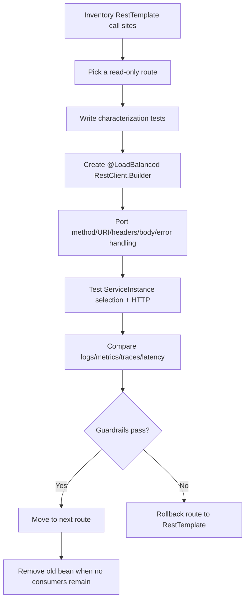

# Replacing RestTemplate with RestClient One Call Path at a Time

`RestTemplate` has been widely used in Spring applications for synchronous HTTP calls. When upgrading an application to Spring Framework 6.1 or newer, `RestClient` provides a modern synchronous API with a fluent style, clean builder configuration, and integration with Spring's observability mechanisms. Migration should not be done by globally renaming the class across the repository: each call path may have different URIs, headers, timeouts, error handlers, converters, interceptors, retries, and load-balancing policies.

In the `SPRING_CLOUD_SERVICE_COMMUNICATION_LOAD_BALANCING` module, what must remain intact is that **the caller still calls downstreams by service ID and Spring Cloud LoadBalancer still selects the `ServiceInstance`**. For example, `order-service` calls `http://inventory-service` through `@LoadBalanced RestTemplate`. When migrating a call path to `RestClient`, the caller must use `@LoadBalanced RestClient.Builder` so logical URIs continue resolving through LoadBalancer. If someone accidentally uses `RestClient.create()` or a builder without the LoadBalancer qualifier and calls the same URI, the client may look up `inventory-service` via DNS and fail, or follow a different network path than intended.

This lesson belongs to the **Compatibility and Upgrades** chapter. We will inventory existing call paths, check version requirements, migrate method/endpoint by method/endpoint, preserve HTTP semantics, configure request factories and observability, and verify selection/transport/error handling before removing the old path. Examples focus on synchronous `RestClient`; if a caller truly requires end-to-end streaming/reactive behavior, `WebClient` remains the better choice.

## 1. Migration Goals and Principles

After this lesson, you should be able to:

1. Identify the active Spring Boot, Spring Framework, and Spring Cloud release train versions, and choose a compatible combination.
2. Distinguish a plain `RestTemplate` from a `@LoadBalanced RestTemplate`, and preserve that behavior when switching to `RestClient`.
3. Map common calls such as `getForObject`, `getForEntity`, `postForEntity`, and `exchange` to the fluent API.
4. Preserve URI encoding, headers, bodies, status handling, error mapping, timeouts, TLS/proxies, connection pools, and interceptors.
5. Migrate **one call path at a time** via a small facade/service with tests and comparative telemetry.
6. Prove the new request still routes through the right service ID, selects replicas per policy, and returns compatible results.
7. Roll back a single route to the old implementation without reverting the entire upgrade.

**Principle:** a single change should keep a clear, narrow scope. Do not simultaneously alter the HTTP client, URI contract, retry policy, timeouts, and replica-selection algorithm in one step without isolated tests. Changing everything at once makes pinpointing the cause of an error-rate spike difficult.

## 2. Check Compatibility Requirements Before Writing Code

`RestClient` was introduced in **Spring Framework 6.1**. Therefore, applications using it require a Spring stack with Framework 6.1 or newer; Spring Boot 3.2+ releases are a common example meeting this condition. The Spring Cloud release train must also be compatible with the chosen Spring Boot version.

| Component | What to check |
|---|---|
| JDK | JDK version supported by the active Spring Boot release. |
| Spring Boot | Version managing Spring Framework and auto-configuration. |
| Spring Framework | Must include the `RestClient` API (6.1+). |
| Spring Cloud release train | Must be compatible with Spring Boot; check the active release train's compatibility matrix. |
| Spring Cloud Commons / LoadBalancer | Must include `@LoadBalanced RestClient.Builder` integration in the chosen version. |
| HTTP request factory | Check JDK client, Apache HttpComponents, Jetty, or existing factory and its timeout/pooling/TLS options. |
| Observability | Confirm `ObservationRegistry`/Micrometer instrumentation is attached to the builder. |
| Third-party libraries | Check whether libraries still require `RestTemplate` or extensions supporting only the old API. |

Do not bump Spring Framework alone inside a Spring Boot BOM. **Use compatible Spring Boot dependency management and Spring Cloud BOM**, then inspect the dependency tree to avoid mixing multiple Spring Framework/Spring Cloud Commons versions.

### Quick Dependency Tree Check

In Maven:

```bash
mvn -q dependency:tree \
  -Dincludes=org.springframework:spring-web,org.springframework.cloud:spring-cloud-commons,org.springframework.cloud:spring-cloud-loadbalancer
```

In Gradle:

```bash
./gradlew dependencyInsight \
  --dependency spring-web \
  --configuration runtimeClasspath
```

These commands only identify resolved artifacts/versions. Cross-check against the compatibility matrix and release notes of the **exact Spring Cloud train** in the project. Do not treat successful Maven/Gradle resolution as proof that every integration is compatible at runtime.

### Must RestTemplate Be Removed Immediately?

Do not assume `RestTemplate` disappears the moment `RestClient` arrives. Applications can retain some legacy call sites during migration. Replacement should be driven by value, compatibility, and test results; **do not delete a working implementation solely because the newer class has a fluent API**.

## 3. Distinguish Three Client Types Before Replacing

A codebase may contain three client styles at the same time:

| Client | Initialization | Host resolution | Role |
|---|---|---|---|
| Plain `RestTemplate` | `new RestTemplate()` or a bean without `@LoadBalanced`. | DNS/host URL handled by HTTP stack. | Calling fixed hosts, external APIs, or regular URLs. |
| `@LoadBalanced RestTemplate` | `RestTemplate` bean annotated with `@LoadBalanced`. | Spring Cloud LoadBalancer resolves service ID to a `ServiceInstance`. | Calling internal microservices by service ID. |
| `@LoadBalanced RestClient` | `@LoadBalanced RestClient.Builder` used to build the client. | Spring Cloud LoadBalancer integrated into builder/HTTP request pipeline. | Calling internal microservices by service ID with the new API. |

Example:

```java
// Plain HTTP client: does not understand Spring Cloud service IDs automatically.
RestTemplate externalTemplate = new RestTemplate();

// Load-balanced client: requires a bean configured by Spring Cloud.
@Bean
@LoadBalanced
RestTemplate inventoryTemplate() {
    return new RestTemplate();
}
```

Similarly, not every `RestClient` is load-balanced:

```java
// Plain client.
RestClient plainClient = RestClient.create();

// Builder marked and customized by Spring Cloud for LoadBalancer.
@Bean
@LoadBalanced
RestClient.Builder loadBalancedRestClientBuilder() {
    return RestClient.builder();
}
```

If an application calls both external APIs and internal service IDs, assign **clear bean names/qualifiers** so the wrong client is never injected. Do not put `@LoadBalanced` on a builder and arbitrarily use it for all external URLs; that blurs network boundaries and telemetry.

## 4. Inventory Existing RestTemplate Call Paths

Before editing, document each outbound route:

| Field to record | Example |
|---|---|
| Caller / bean | `order-service / inventoryRestTemplate` |
| Downstream service ID | `inventory-service` |
| Method + route template | `GET /api/items/{id}` |
| Legacy API | `getForObject` or `exchange` |
| Request/response contract | DTO, headers, content type, status. |
| Timeouts | Connect/read or HTTP engine timeouts. |
| Retries | None, LB retry, wrapper, or transport. |
| Interceptors/error handler | Auth, tracing, logging, custom status mapping. |
| Connection factory | JDK/Apache/Jetty/other, pooling and TLS. |
| Metrics/SLO | Calls, error rate, p95/p99, attempts. |
| Test coverage | Unit, HTTP integration, LoadBalancer selection. |

Search the repository with `rg` or an IDE:

```bash
rg -n "RestTemplate|@LoadBalanced|getForObject|getForEntity|postForEntity|exchange\\(" .
```

Group results by **bean and call site** instead of replacing every `RestTemplate` occurrence at once. An app might use a plain `RestTemplate` to call a payment provider and a `@LoadBalanced RestTemplate` to call inventory; those two paths need different migration plans.

### Example Inventory

| Route | Old client | LoadBalanced? | Risk level | Recommended order |
|---|---|---:|---|---:|
| `GET inventory item` | `getForObject` | Yes | Low, simple JSON body | 1 |
| `POST reserve stock` | `postForEntity` | Yes | Higher, side effects/retry | 3 |
| `GET payment provider` | `exchange` | No | Dedicated TLS/auth, outside LB scope | Separate plan |
| `GET catalog page` | `exchange` | Yes | Pagination/large body | 2 |

Pick a read-only route with a simple contract as the pilot. Once semantics are proven, apply the same pattern to remaining routes.

## 5. API Mapping: From RestTemplate to RestClient

`RestClient` uses a fluent builder and separates choosing method, URI, headers/body, status handling, and decoding:

| RestTemplate | RestClient |
|---|---|
| `getForObject(url, Type.class)` | `get().uri(url).retrieve().body(Type.class)` |
| `getForEntity(url, Type.class)` | `get().uri(url).retrieve().toEntity(Type.class)` |
| `postForObject(url, body, Type.class)` | `post().uri(url).body(body).retrieve().body(Type.class)` |
| `postForEntity(url, body, Type.class)` | `post().uri(url).body(body).retrieve().toEntity(Type.class)` |
| `exchange(url, method, HttpEntity, Type.class)` | `method(method).uri(url).headers(...).body(...).retrieve()/exchange(...)` |
| `delete(url)` | `delete().uri(url).retrieve()` or `exchange(...)` if inspecting response. |
| `execute(...)` | `exchange(...)` or custom request factory/client for low-level needs. |

This is an **API intent mapping**, not a mechanical transformation guaranteed 100% identical. Pay special attention to null bodies, URI variables/encoding, headers, status handling, and response resource lifecycle.

### 5.1. GET Returning a DTO

Before:

```java
InventoryReply reply = restTemplate.getForObject(
    "http://inventory-service/api/items/{id}",
    InventoryReply.class,
    itemId);
```

After:

```java
InventoryReply reply = inventoryRestClient.get()
    .uri("/api/items/{id}", itemId)
    .retrieve()
    .body(InventoryReply.class);
```

`inventoryRestClient` must be built from a `@LoadBalanced RestClient.Builder` with base URL `http://inventory-service`. This keeps the service ID in client configuration while methods supply only the path and URI variables.

### 5.2. GET Needing Status and Headers

Before:

```java
ResponseEntity<InventoryReply> response =
    restTemplate.getForEntity(
        "http://inventory-service/api/items/{id}",
        InventoryReply.class,
        itemId);
```

After:

```java
ResponseEntity<InventoryReply> response =
    inventoryRestClient.get()
        .uri("/api/items/{id}", itemId)
        .retrieve()
        .toEntity(InventoryReply.class);

HttpStatusCode status = response.getStatusCode();
HttpHeaders headers = response.getHeaders();
InventoryReply body = response.getBody();
```

`toEntity` is useful when business logic needs the status, response headers, or body. When only the DTO is needed, `body(...)` expresses intent more clearly and avoids carrying extra metadata.

### 5.3. POST with JSON Body

Before:

```java
HttpEntity<ReserveRequest> entity =
    new HttpEntity<>(request, headers);

ResponseEntity<ReserveReply> response =
    restTemplate.postForEntity(
        "http://inventory-service/api/reservations",
        entity,
        ReserveReply.class);
```

After:

```java
ResponseEntity<ReserveReply> response =
    inventoryRestClient.post()
        .uri("/api/reservations")
        .contentType(MediaType.APPLICATION_JSON)
        .headers(outbound -> outbound.addAll(headers))
        .body(request)
        .retrieve()
        .toEntity(ReserveReply.class);
```

Ensure required headers continue to propagate: correlation ID, idempotency key, safe authorization tokens, and validated tenant context. **Do not blindly copy all inbound headers** downstream; forward only headers permitted by the contract.

For write operations, do not enable retries merely because you switched clients. If the caller times out after the server already committed a reservation, retrying can create duplicate reservations. Preserve idempotency keys and review retry policies separately.

### 5.4. PUT/PATCH/DELETE

PUT example:

```java
ResponseEntity<Void> response =
    inventoryRestClient.put()
        .uri("/api/items/{id}", itemId)
        .contentType(MediaType.APPLICATION_JSON)
        .body(updateRequest)
        .retrieve()
        .toBodilessEntity();
```

DELETE example:

```java
inventoryRestClient.delete()
    .uri("/api/reservations/{id}", reservationId)
    .retrieve()
    .toBodilessEntity();
```

When the API returns `204` or significant headers, `toBodilessEntity()` preserves response metadata without attempting to decode a body. If a DELETE endpoint carries a response body (rare and contract-dependent), use the appropriate method/body API and test against the real server.

## 6. Mapping exchange: Preserving Request Method, Headers, and Body

`RestTemplate.exchange` is often used when callers need a dynamic method, custom headers, and a generic response type:

Before:

```java
HttpEntity<SearchRequest> entity =
    new HttpEntity<>(searchRequest, headers);

ResponseEntity<List<ItemDto>> response =
    restTemplate.exchange(
        "http://inventory-service/api/search",
        HttpMethod.POST,
        entity,
        new ParameterizedTypeReference<List<ItemDto>>() {});
```

After:

```java
ResponseEntity<List<ItemDto>> response =
    inventoryRestClient.method(HttpMethod.POST)
        .uri("/api/search")
        .headers(outbound -> outbound.addAll(headers))
        .contentType(MediaType.APPLICATION_JSON)
        .body(searchRequest)
        .retrieve()
        .toEntity(new ParameterizedTypeReference<List<ItemDto>>() {});
```

For generic responses, use `ParameterizedTypeReference` to preserve type information during decoding. Do not downgrade to `List.class`, as type erasure can yield `LinkedHashMap` elements instead of `ItemDto`.

When a dynamic method may lack a body:

```java
RestClient.RequestBodySpec request =
    inventoryRestClient.method(method)
        .uri("/api/items");

ResponseEntity<String> response = request
    .headers(h -> h.addAll(headers))
    .retrieve()
    .toEntity(String.class);
```

For requests with optional bodies, separate the branches cleanly or use a proper abstraction to avoid accidentally sending an empty/null body. Compare raw HTTP requests between old and new implementations in integration tests whenever the contract has special behavior.

## 7. Error Handling: ResponseErrorHandler and onStatus/exchange

This is a critical migration difference.

`RestTemplate` typically uses a `ResponseErrorHandler` to classify error statuses. `RestClient.retrieve()` converts 4xx/5xx statuses into corresponding exceptions by default; you can register per-request handlers with `onStatus`:

```java
InventoryReply reply = inventoryRestClient.get()
    .uri("/api/items/{id}", itemId)
    .retrieve()
    .onStatus(
        status -> status.value() == 404,
        (request, response) -> {
            throw new ItemNotFoundException(itemId);
        })
    .onStatus(
        HttpStatusCode::is5xxServerError,
        (request, response) -> {
            throw new InventoryUnavailableException(
                response.getStatusCode().value());
        })
    .body(InventoryReply.class);
```

`ItemNotFoundException` and `InventoryUnavailableException` are application-defined exceptions. Do not include raw bodies/headers containing sensitive data in exception messages.

To rely on default status handling, understand `retrieve()`'s built-in behavior. To handle every status/body yourself, use `exchange(...)`:

```java
InventoryResult result = inventoryRestClient.get()
    .uri("/api/items/{id}", itemId)
    .exchange((request, response) -> {
        HttpStatusCode status = response.getStatusCode();

        if (status.is2xxSuccessful()) {
            InventoryReply body = objectMapper.readValue(
                response.getBody(), InventoryReply.class);
            return new InventoryResult.Success(body);
        }

        if (status.value() == 404) {
            return new InventoryResult.NotFound();
        }

        return new InventoryResult.Failure(status.value());
    });
```

`InventoryResult` is an application-defined sealed interface/result type; the snippet requires importing `ObjectMapper` and the relevant DTOs. **`exchange` does not apply default status handlers like `retrieve` does**; the caller is responsible for inspecting the status and handling the response. Never ignore the status and try to decode an error body into a success DTO.

### Do Not Map Every Error to "LoadBalancer Found No Instance"

Distinguish:

| Error | Upstream HTTP response? | Meaning |
|---|---:|---|
| No eligible `ServiceInstance` | No | Discovery/filter/selection found no target. |
| Connection refused/reset | Usually no | An address was selected, but transport could not connect/stay connected. |
| HTTP 503 from inventory | Yes | Upstream genuinely returned status 503. |
| HTTP 404 | Yes | May be a normal business outcome per contract. |
| Decode/codec error after HTTP 200 | Headers/status present | Response arrived, but caller failed to read/parse it. |
| Timeout | Possibly incomplete response | Does not prove the server never processed the request. |

During migration, preserve the upper facade's error contract. If callers previously distinguished 404 from 503, do not collapse them into one generic exception just because the new `RestClient` code is shorter.

## 8. Configuring `@LoadBalanced RestClient.Builder`

Configuration by service ID:

```java
import org.springframework.cloud.client.loadbalancer.LoadBalanced;
import org.springframework.context.annotation.Bean;
import org.springframework.context.annotation.Configuration;
import org.springframework.web.client.RestClient;

@Configuration
class InventoryRestClientConfiguration {

    @Bean
    @LoadBalanced
    RestClient.Builder loadBalancedRestClientBuilder() {
        return RestClient.builder();
    }

    @Bean("inventoryRestClient")
    RestClient inventoryRestClient(
            @LoadBalanced RestClient.Builder builder) {
        return builder.clone()
            .baseUrl("http://inventory-service")
            .build();
    }
}
```

Caller:

```java
@Service
class InventoryGateway {

    private final RestClient inventoryRestClient;

    InventoryGateway(
            @Qualifier("inventoryRestClient")
            RestClient inventoryRestClient) {
        this.inventoryRestClient = inventoryRestClient;
    }

    InventoryReply find(String itemId) {
        return inventoryRestClient.get()
            .uri("/api/items/{id}", itemId)
            .retrieve()
            .body(InventoryReply.class);
    }
}
```

Checks to run:

- Correct version of `spring-cloud-starter-loadbalancer` dependency is present.
- Builder is annotated with `@LoadBalanced` and injected with the right qualifier.
- `baseUrl` uses the logical service ID; no hard-coded replica IP/port.
- No plain `RestClient` bean is injected by mistake.
- Custom LoadBalancer configuration (if any) still applies to the right service ID.
- Discovery returns valid `ServiceInstance` entries with appropriate metadata/health.

### Multiple Builders/Clients in the Same Application

When both plain external clients and load-balanced internal clients exist, name the beans:

```java
@Bean("plainRestClientBuilder")
RestClient.Builder plainRestClientBuilder() {
    return RestClient.builder();
}

@Bean("loadBalancedRestClientBuilder")
@LoadBalanced
RestClient.Builder loadBalancedRestClientBuilder() {
    return RestClient.builder();
}
```

Inject via `@Qualifier` to avoid ambiguity. Each built client can have its own base URL and policies. Never call `builder.baseUrl(...)` repeatedly on a shared singleton builder used across different services; clone the builder before building specialized clients.

## 9. Request Factory: Preserving Timeouts, Pooling, TLS, and Proxy

A migration can pass unit tests yet fail in production because the old `RestTemplate` used an Apache HttpClient connection pool while the new `RestClient` fell back to a JDK/default request factory with different timeouts/pooling.

Settings to inventory:

| Old setting | Migration question |
|---|---|
| Connect timeout | Does the new builder/request factory use the same threshold? |
| Read/response timeout | Does it measure the same boundary with the same semantics? |
| Connection pool | Max total, max per route, idle eviction, and connection TTL? |
| TLS | Trust store, hostname verification, mTLS client certificate? |
| Proxy | Proxy host, bypass list, authentication? |
| Redirects | Follow redirects; preserve method/body/headers? |
| Compression | Did Content-Encoding/decompression change? |
| Connection reuse | HTTP/1.1 keep-alive vs. HTTP/2; per-route pool keys? |
| Buffering/streaming | Is the body buffered entirely in memory or streamed? |

Example of a simple request factory for labs:

```java
import java.time.Duration;
import org.springframework.context.annotation.Bean;
import org.springframework.http.client.JdkClientHttpRequestFactory;
import org.springframework.web.client.RestClient;

@Bean
@LoadBalanced
RestClient.Builder loadBalancedRestClientBuilder() {
    JdkClientHttpRequestFactory factory =
        new JdkClientHttpRequestFactory();
    factory.setReadTimeout(Duration.ofSeconds(2));

    return RestClient.builder()
        .requestFactory(factory);
}
```

This example illustrates a timeout setting on the JDK request factory for Spring versions supporting that API; connect timeout is typically configured on the underlying `java.net.http.HttpClient` passed to the factory. For advanced pooling/TLS configuration, use an appropriate HTTP engine and create the matching `ClientHttpRequestFactory`. **Do not copy a 2-second timeout into production without measuring business deadlines and latency distributions.**

If the legacy app used Apache HttpComponents, you can continue using an Apache-based request factory compatible with the newer Spring Framework. Migrating to `RestClient` does not force changing the HTTP engine. In fact, keeping the same engine in the initial step reduces variables and keeps pool/TLS behavior close to baseline.

### Connect Timeout, Response Timeout, and Deadline Are Not the Same

- **Connect timeout:** time allowed to establish a connection to the selected instance address.
- **Response/read timeout:** time waiting for data/response per the request factory's semantics.
- **Logical deadline:** total time allowed for the business call, which can include instance selection, pool wait, connect, request/response, decoding, retries, and backoff.

If three retry attempts occur, a 2-second per-attempt connect/read timeout **does not mean** the logical call takes only 2 seconds. Set an overall deadline and retry budget separately.

## 10. Interceptors and Headers

`ClientHttpRequestInterceptor` works with both `RestTemplate` and `RestClient.Builder`. This lets you preserve auth/tracing/correlation behavior, while checking ordering and scope.

Example:

```java
import org.springframework.http.client.ClientHttpRequestInterceptor;
import org.springframework.web.client.RestClient;

ClientHttpRequestInterceptor correlationInterceptor =
    (request, body, execution) -> {
        // Add only verified/propagated correlation ID.
        request.getHeaders().set(
            "X-Correlation-ID", correlationIdProvider.current());
        return execution.execute(request, body);
    };

RestClient client = builder.clone()
    .requestInterceptor(correlationInterceptor)
    .baseUrl("http://inventory-service")
    .build();
```

`correlationIdProvider` is an application-provided abstraction. In reactive contexts, do not read MDC/ThreadLocal arbitrarily; since `RestClient` is blocking, ensure context is still initialized and cleared properly across the request/thread lifecycle.

Before migrating, document:

- Interceptor order: auth, tracing, logging, signing, idempotency.
- Which headers may be forwarded from inbound requests.
- Whether any interceptor reads URI/host before vs. after LoadBalancer rewrites it.
- Whether any interceptor consumes/reads the request body for logging and leaves the stream unreadable.
- Whether any interceptor retries or alters statuses/errors unexpectedly.

Never log `Authorization`, cookies, API keys, sensitive bodies, or signed URLs. If an interceptor needs the actually selected instance, do not assume the request URI is always rewritten to host/port at every interception point; instrument Spring Cloud LoadBalancer lifecycle/observation hooks.

## 11. Message Converters, JSON, and Generic Types

Both `RestTemplate` and `RestClient` rely on Spring message converters, yet applications may customize converter lists or ordering. When migrating:

- Check `MappingJackson2HttpMessageConverter`/Jackson modules, naming strategies, date/time modules, and custom serializers.
- Check `StringHttpMessageConverter`, byte array, form, multipart, and resource converters.
- Check converter ordering when multiple converters support the same media type.
- Check charset, content type, `Accept` header, and error bodies.
- Check generic responses with `ParameterizedTypeReference`.
- Check null bodies, empty bodies, `204 No Content`, and large/streaming bodies.

Custom converter example:

```java
RestClient client = builder.clone()
    .messageConverters(converters -> {
        // Add or configure required converters.
        // Preserve proper order and existing converters per contract.
    })
    .build();
```

Do not register custom converters on a builder without checking the remaining auto-configured converters. You can accidentally drop the Jackson converter or alter ordering so a media type decodes differently than before.

### Check URI Templates and Encoding

Both `RestTemplate` and `RestClient` support URI templates, yet when splitting a full URL into `baseUrl` + relative path, verify:

```java
// Old: full URL template.
restTemplate.getForObject(
    "http://inventory-service/api/items/{id}?lang={lang}",
    ItemDto.class, itemId, language);

// New: baseUrl holds service ID, path/query built separately.
inventoryRestClient.get()
    .uri(uriBuilder -> uriBuilder
        .path("/api/items/{id}")
        .queryParam("lang", "{lang}")
        .build(itemId, language))
    .retrieve()
    .body(ItemDto.class);
```

This illustrates URI construction; verify encoding behavior for `/`, `?`, `%`, spaces, Unicode, and null variables. Never concatenate URI strings manually when values may need encoding. For signed URLs or canonicalized queries, preserve the exact ordering/encoding required by the signature.

## 12. Observability: Preserving Metrics and Tracing via the New Builder

Spring Boot/Micrometer instruments the HTTP client when the builder uses an appropriate `ObservationRegistry`. When instantiating `RestClient.builder()` manually, verify that the observation registry and customizers are applied.

Example:

```java
@Bean
@LoadBalanced
RestClient.Builder loadBalancedRestClientBuilder(
        ObservationRegistry observationRegistry) {
    return RestClient.builder()
        .observationRegistry(observationRegistry);
}
```

In real applications, the builder provided by auto-configuration/customizers may already have an observation registry attached. If constructing a builder manually, do not drop observation, tracing, or load-balancing integration customizers. Exact configuration varies by Boot/Cloud version.

### Comparing Before and After Migration

Measure for the same operation/service ID:

| Signal | What to preserve/compare |
|---|---|
| Logical calls | Business operation count; must not drop or double due to wrappers. |
| HTTP attempts | Actual sends; separate retries across layers. |
| Service ID | Remains `inventory-service`. |
| Selected instance | Replica distribution per policy before/after. |
| HTTP statuses | 2xx/4xx/5xx matching the same contract. |
| Exception class/category | No-instance, connect, timeout, decode, status error. |
| Latency | p50/p95/p99 under equivalent workload and window. |
| Connection pool | Active/idle/pending, acquire timeouts, reuse. |
| Traces | Client/server spans and propagation remain linked. |

Do not compare raw error counts alone if traffic volumes differ between periods. Use rates/ratios, the same route template, cohort, and time window. Instance ID is helpful in logs/traces, but avoid high-cardinality metric labels.

If the new builder lacks `ObservationRegistry`/customizers, metrics/tracing can vanish even though HTTP calls succeed. Tests must validate **both behavior and telemetry**, not just response JSON.

## 13. Migrating One Call Path Step by Step

A low-risk workflow:



### Step 1 — Capture Baseline

Before editing:

- Record the bean and service ID.
- Record request method/path, headers, body, expected response, and error mapping.
- Record timeouts, request factory, and retries.
- Run tests and save current logs/metrics/traces.
- Record logical calls and attempts under controlled test traffic.

### Step 2 — Write Characterization Tests

Tests should lock down current behavior:

- Actual URI and headers sent.
- Proper JSON/body serialization.
- 404/429/503 mapped accurately.
- Empty body/204 handled properly.
- No-instance distinguished from connection refused and upstream 503.
- Requests go through the right service ID and can reach multiple replicas.

Do not only mock `RestTemplate` or `RestClient`; to prove LoadBalancer works, run multiple HTTP stub servers/MockWebServer/WireMock instances with a supplier returning multiple `ServiceInstance` entries.

### Step 3 — Stand Up RestClient in Parallel

Keep the old bean and create the new bean with its own qualifier:

```java
@Bean("inventoryRestTemplate")
@LoadBalanced
RestTemplate inventoryRestTemplate() {
    return new RestTemplate();
}

@Bean
@LoadBalanced
RestClient.Builder loadBalancedRestClientBuilder() {
    return RestClient.builder();
}

@Bean("inventoryRestClient")
RestClient inventoryRestClient(
        @LoadBalanced RestClient.Builder builder) {
    return builder.clone()
        .baseUrl("http://inventory-service")
        .build();
}
```

Use this only when dependencies/versions support both integrations. Otherwise, upgrade dependencies to a compatible BOM first; do not write custom reflection/adapters to paper over missing APIs.

### Step 4 — Introduce a Business Facade

Keep business code decoupled from the concrete client implementation:

```java
public interface InventoryReader {
    InventoryReply findById(String itemId);
}

@Service
class RestClientInventoryReader implements InventoryReader {

    private final RestClient client;

    RestClientInventoryReader(
            @Qualifier("inventoryRestClient") RestClient client) {
        this.client = client;
    }

    @Override
    public InventoryReply findById(String itemId) {
        return client.get()
            .uri("/api/items/{id}", itemId)
            .retrieve()
            .body(InventoryReply.class);
    }
}
```

A facade lets you swap implementations, add telemetry, and roll back without touching many business callers. During rollout, an old adapter can implement the same interface for switching back if needed; avoid keeping two active beans without clear qualifiers/selection.

### Step 5 — Run Layered Tests

1. Unit tests for method/DTO/error mapping.
2. Single-server HTTP integration tests verifying converters/headers.
3. Multi-replica integration tests verifying service ID/LoadBalancer selection.
4. Failure tests: 404, 503, connection reset, timeouts, empty responses.
5. Contract/consumer tests against real upstream or schema-controlled stubs.
6. Compare metrics/traces/latency under equivalent workloads.

### Step 6 — Shift Internal Traffic or Switch via Feature Flag

Migrate one route or a small caller group. Keep service ID, request contract, and policies unchanged initially. If using a flag to toggle between `RestTemplate` and `RestClient`, place the flag at the facade layer and emit metrics per implementation so you know which path requests take.

### Step 7 — Remove the Old Implementation After Verification

Remove `RestTemplate` beans/interceptors/configs only when:

- Zero consumers remain.
- Error/latency/selection metrics stay stable over an observation window.
- Metrics/traces are compared and no instrumentation was lost.
- The test suite verifies the new route.
- A rollback plan exists for the next release if late issues surface.

## 14. Testing LoadBalancer After Switching

A meaningful integration test verifies **the exact new client** and **the service-ID path**:

```text
order-service
  RestClient baseUrl = http://inventory-service
       |
       v
  @LoadBalanced RestClient.Builder
       |
       v
  ServiceInstanceListSupplier
       |
       +--> inventory-a localhost:18081
       +--> inventory-b localhost:18082
       +--> inventory-c localhost:18083
```

Scenarios:

| Test | Setup | Assertion |
|---|---|---|
| Multi-instance | Three stub servers with distinct IDs. | All three can receive requests per algorithm/config. |
| No instance | Supplier returns empty list. | Zero HTTP requests sent to stubs; classified as selection error. |
| Upstream 503 | One stub returns 503. | Caller receives contract-compliant status/exception. |
| Connection refused | Instance remains in list while server is stopped. | Transport error, not labeled upstream 503. |
| URI/headers | Capture request on stub. | Path, query, content type, correlation/idempotency headers match. |
| Timeout | Stub delay exceeds client timeout. | Exception and duration match expected bounds. |
| Custom routing | Zone/release metadata. | New client still applies expected supplier/policy. |

**Do not rely on `MockRestServiceServer` alone to claim multi-replica selection works** if the test bypasses the real LoadBalancer path. Use multi-port MockWebServer/WireMock or an environment with a discovery provider to test selection and HTTP transport together.

### Verifying Which Replica Received the Request

Stub servers return a distinct marker, for example:

```json
{"instanceId":"inventory-b","stock":17}
```

Cross-check:

- Response marker from the server (lab indicator only).
- Request journal/`RecordedRequest` on the stub.
- Logs/Observations at the LoadBalancer selection step to know the selected instance before HTTP runs.

Do not assume an arbitrary HTTP interceptor always sees the URI rewritten to host/port. To record `selectedInstanceId` accurately, use Spring Cloud LoadBalancer lifecycle/Observation hooks for your running version.

## 15. How to Preserve Retries, Timeouts, and Connection Pools

Client migration is not the time to silently alter resilience policies. Record where retries currently live:

| Retry owner | What to check |
|---|---|
| Business wrapper | Does it call the facade multiple times? Where does the logical call counter live? |
| Spring Cloud LoadBalancer | Does it retry per service instance/request? Does it re-select or stick to an instance? |
| Spring Retry/Resilience4j | Retry predicate, backoff, max attempts, circuit state. |
| HTTP transport/proxy | Any low-level retries; can the request body be replayed? |
| OpenFeign (if another route) | `Retryer` and version/config-specific behavior. |

**Do not enable extra default retries when switching to RestClient.** A GET operation may retry if the contract permits; write POST operations require idempotency keys/deduplication. Per-attempt timeouts must fit within the overall deadline; otherwise, three 2-second attempts plus backoff can push a logical call past its SLA.

### Connection Pooling

`RestClient` uses the configured request factory/HTTP engine. If the old `RestTemplate` used an Apache pool and the new client uses a different factory, compare:

- Max total connections and max per route.
- Connection request/pool acquire timeout.
- Keep-alive, idle eviction, TTL.
- TLS handshake/reuse, mTLS, and trust store.
- HTTP/1.1 vs. HTTP/2 and multiplexing.
- Pending acquires, active/idle sockets, connection resets.

Keeping the same HTTP engine on the initial migration reduces risk. Change engines only for a dedicated requirement with benchmarks/tests verifying behavior.

## 16. Observability: Losing No Evidence When Changing Clients

A minimal migration dashboard:

| Signal | Breakdown |
|---|---|
| Logical call count | `targetService`, `operation`, `implementation` (legacy/new), `outcome`. |
| HTTP client attempts | Status class, route template, client name where instrumentation supports it. |
| LoadBalancer selection | Service ID, release/zone policy, selected instance in logs/traces. |
| Latency | p50/p95/p99 for logical call and HTTP client. |
| Errors | No-instance, connect, timeout, upstream 4xx/5xx, decode. |
| Pool | Active/idle/pending, acquire timeouts. |
| Traces | Caller server span → outbound client span → upstream server span. |

Actual metric names and tags depend on Spring Boot/Micrometer/Spring Cloud versions. Do not hard-code assumptions that every version emits identical names. Avoid `traceId`, user ID, raw URL, or ephemeral instance IP labels; use logs/traces for per-request details.

If the new builder drops `ObservationRegistry`/customizers, metrics/tracing can disappear even when HTTP calls succeed. Tests must confirm **both behavior and telemetry**, not just response JSON.

## 17. Common Migration Pitfalls

| Mistake | Consequence | Fix |
|---|---|---|
| Creating `RestClient.create()` and calling `http://inventory-service`. | No LB integration, likely DNS failure. | Use `@LoadBalanced RestClient.Builder`. |
| Using `localhost:8081` in the new client. | Bypasses service-ID instance selection. | Set base URL to `http://inventory-service`. |
| Injecting plain builder due to multiple beans. | Requests bypass LoadBalancer. | Use bean names/`@Qualifier` and integration tests. |
| Switching `exchange` to `retrieve` without mapping statuses. | Error contract changes. | Compare old/new statuses; use `onStatus` or `exchange`. |
| Using `List.class` instead of generic type. | DTO elements turn into maps/fail decoding. | Use `ParameterizedTypeReference`. |
| Losing Apache pool/TLS/proxy configuration. | Latency spikes, TLS failures, socket pressure. | Keep a compatible factory and test config. |
| Manually creating builder without observation. | Metrics/tracing vanish. | Attach registry/customizers properly. |
| Interceptor reads body to log it. | Body stream exhausted or high memory usage. | Log safe metadata; do not arbitrarily buffer bodies. |
| Forwarding all inbound headers. | Leaks tokens/cookies or untrusted headers. | Allowlist headers; construct routing context at trust boundaries. |
| Enabling retry alongside client swap. | Attempts rise, duplicate side effects. | Keep retry policy unchanged; modify separately with idempotency checks. |
| Deleting old bean right after code compiles. | Other routes still inject old bean and startup fails. | Find all consumers, migrate route by route, then delete. |
| Mocking only the HTTP client. | Fails to catch missing LoadBalancer integration. | Test multiple servers and real service IDs. |

## 18. Per-Route Rollout and Rollback Plan

A migration tracking table:

| State | Meaning | Criteria |
|---|---|---|
| `DISCOVERED` | Call site located. | Known bean, service ID, contract. |
| `CHARACTERIZED` | Tests lock down old behavior. | Headers, URI, status, timeouts, retries. |
| `IMPLEMENTED` | RestClient adapter built. | New code compiles and reviewed. |
| `INTEGRATION_VERIFIED` | Multi-replica/fault tests pass. | Service ID, selection, transport/errors match. |
| `OBSERVABILITY_VERIFIED` | Metrics/traces/logs intact. | Compared against baseline. |
| `ROLLED_OUT` | Route running new implementation. | Guardrails pass over time. |
| `LEGACY_REMOVED` | Unused RestTemplate bean deleted. | Zero consumers left; rollback path documented. |

### When Rollback Is Required

1. Switch the facade/feature flag of the **affected route** back to the old `RestTemplate` adapter.
2. Keep the service ID and request contract unchanged to avoid extra topology shifts.
3. Confirm callers reverted to the old implementation and implementation-tagged metrics reflect it.
4. Check that retry/connection pool/trace state is no longer affected by the new builder's config.
5. Collect logs/traces/error samples and only re-attempt migration after fixing the root cause.

Do not delete legacy artifacts/configs before completing the observation period and rollback window. Once beans or dependencies are removed, rolling back may require a new release rather than a quick feature-flag toggle.

## 19. Pre-Merge Migration Checklist

- [ ] Verified compatible Spring Boot, Framework, Cloud release train, and JDK versions.
- [ ] Distinguished existing plain `RestTemplate` from `@LoadBalanced RestTemplate`.
- [ ] Cataloged route, service ID, method, URI, headers, body, status, retry, timeouts, and request factory.
- [ ] New clients for internal downstreams are created from `@LoadBalanced RestClient.Builder`.
- [ ] Base URLs keep logical service IDs with no hard-coded replica IP/port.
- [ ] Builder/client beans have clear qualifiers when multiple HTTP client styles exist.
- [ ] API mapping preserves generic types, URI encoding, converters, and empty-body semantics.
- [ ] Status/error mapping preserves the old contract; `retrieve`/`exchange` used deliberately.
- [ ] Request factory preserves required timeouts, pooling, TLS, proxies, and connection reuse.
- [ ] Interceptors/header propagation preserve tracing/auth/idempotency without blindly forwarding sensitive data.
- [ ] Multi-replica tests confirm new requests truly pass through LoadBalancer.
- [ ] No-instance, connection reset, upstream 503, timeouts, and decode errors are clearly separated.
- [ ] Retry policies are not unintentionally enabled or altered; write operations enforce idempotency.
- [ ] Metrics/logs/traces still capture service ID, operation, outcome, and duration; selection observed at the right lifecycle phase.
- [ ] Latency/errors/attempts/connection pools compared under equivalent workloads.
- [ ] Per-route rollback path exists, and old beans are deleted only once zero consumers remain.

## 20. Report Template for a Migrated Call Path

```text
Route: order-service -> inventory-service
Operation: GET /api/items/{id}
Legacy client: @LoadBalanced RestTemplate
New client: @LoadBalanced RestClient
Spring Boot / Framework / Cloud: record actual versions

Compatibility:
  BOM compatible: PASS / FAIL
  RequestFactory / timeout / pool: ...
  Message converters / URI encoding: ...

Contract:
  Method / URI / headers / body: PASS / FAIL
  Status mapping / generic response: PASS / FAIL

LoadBalancer:
  Service ID preserved: PASS / FAIL
  Multiple ServiceInstances reached: PASS / FAIL
  No-instance / transport / upstream status separated: PASS / FAIL

Observability:
  Logs: ...
  Metrics: ...
  Traces: ...

Performance:
  Legacy p95/p99: ...
  RestClient p95/p99: ...
  HTTP attempts / logical call: ...
  Pool metrics: ...

Decision: PROMOTE / HOLD / ROLLBACK
Evidence: test run, redacted logs, metrics window, trace IDs
```

Do not fill in fake numbers and present them as test results. This template is for the migration team to record real evidence per route.

**Remember:** replacing `RestTemplate` with `RestClient` is a migration of **HTTP client API and configuration**, while Spring Cloud LoadBalancer still must be explicitly integrated to choose a `ServiceInstance` by service ID. Preserve contracts, request factories, status handling, retries, timeouts, and observability; migrate one call path at a time behind a tested facade; and remove the old implementation only after verifying selection, HTTP behavior, and telemetry. Going route by route keeps the upgrade observable, scopes rollbacks tightly, and prevents an API change from turning into a system-wide routing outage.
