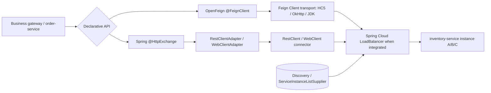
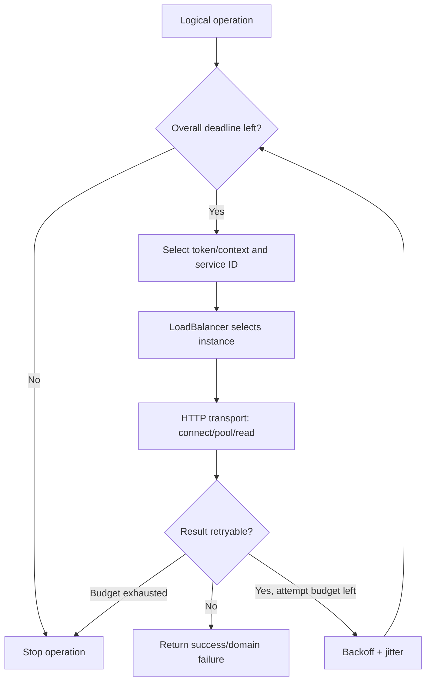
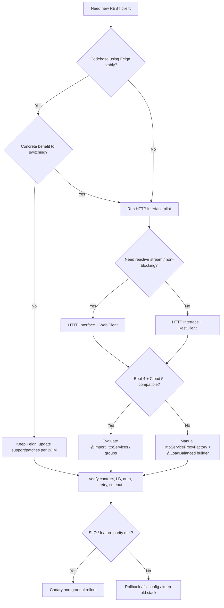

# Evaluating OpenFeign and HTTP Service Interface for New Requirements

When building microservices with Spring Cloud LoadBalancer, `order-service` typically calls `inventory-service` via the `inventory-service` service ID rather than hard-coding an IP address. A development team may have used `@FeignClient` for years, yet when building new features or upgrading Spring Boot, a question arises: **continue using Spring Cloud OpenFeign or switch to Spring HTTP Service Interface with `@HttpExchange`?**

This is not merely a syntax choice for declaring HTTP endpoints. Each option affects **Spring Framework/Spring Boot/Spring Cloud compatibility**, client-side LoadBalancer, synchronous vs. reactive execution, timeout/retry configuration, OAuth2, circuit breakers, connection pools, observability, testing, and long-term API client maintainability.

This lesson belongs to the **Compatibility and Upgrades** chapter of the Spring Cloud LoadBalancer module. We will compare both approaches, build an interface runnable on `@LoadBalanced RestClient` or `@LoadBalanced WebClient`, evaluate HTTP Service Client groups in newer Spring Boot/Spring Cloud generations, and design a phased migration plan **without breaking communication contracts with target services**.

> **Guiding conclusion:** For stable existing OpenFeign code, do not migrate merely to swap annotations. For new clients—especially when reactive/`WebClient` is needed or you want to align with Spring Framework direction—**HTTP Service Interface is worth evaluating first**. The final decision depends on contract coverage, framework versions, resilience libraries, existing customizations, and testing/migration costs.

## 1. Why Re-Evaluate OpenFeign?

According to official Spring Cloud OpenFeign documentation, the project has been considered **feature-complete** since the Spring Cloud 2022.0.0 era. This **does not mean OpenFeign has been deleted or every Feign app must stop immediately**: the project continues receiving appropriate bug fixes/updates, though it is no longer the primary place expected to receive major new features. Spring Cloud recommends considering **Spring HTTP Service Clients** for new development.

A key technical reason is that Spring Cloud OpenFeign does not provide a **reactive client** model equivalent to WebClient. By contrast, HTTP Service Interface is Spring Framework's contract-declaration layer, which can sit atop **RestClient (blocking)** or **WebClient (reactive)** via the appropriate adapter and proxy factory.

### Two Separate Questions

- **"Does an existing app need to upgrade Feign to HTTP Interface right away?"** Not necessarily; evaluate the support policy and degree of reliance on fallbacks/decoders/interceptors first.
- **"Should a new feature add yet another `@FeignClient`?"** Compare HTTP Service Interface before deciding, especially when streaming, reactive composition, or centrally configured client groups are required.

Do not equate "feature-complete" with "no more security patches." Confirm the support status of the **actual release train deployed**, rather than inferring from a single blog sentence.

## 2. Separating Three Layers: Contract, HTTP Engine, and LoadBalancer



The diagram illustrates relationships among layers; in practice, some LoadBalancer interceptors/adapters live **inside** the HTTP client stack rather than being a single separate step after every engine.

| Layer | OpenFeign | HTTP Service Interface |
|---|---|---|
| **Contract declaration** | Interface with `@FeignClient`, `@GetMapping`/`@PostMapping`, DTOs. | Interface with `@HttpExchange`, `@GetExchange`/`@PostExchange`, DTOs. |
| **Client implementation creation** | Auto-configuration/Feign proxy and Feign builder/capabilities. | `HttpServiceProxyFactory` + `RestClientAdapter` or `WebClientAdapter`; in Boot 4, service client group auto-configuration may be used. |
| **HTTP transport** | Delegate such as Apache HC5, OkHttp, or default Feign client. | `RestClient` request factory or `WebClient` connector; can pick JDK/Apache HC5/Reactor Netty per stack. |
| **Load balancing** | Spring Cloud OpenFeign integration/wrapper when present and not bypassed by a static URL. | `@LoadBalanced` HTTP builder or Spring Cloud 5+ group auto-configuration subject to conditions. |
| **Discovery/health/caching** | Spring Cloud LoadBalancer if enabled. | Same Spring Cloud LoadBalancer when integrated. |
| **Authentication and resilience** | Feign-specific properties/interceptors/circuit-breaker integration when configured. | Attached to RestClient/WebClient/filters/service wrappers; does not inherit Feign config automatically. |

**Core point:** `@HttpExchange` only describes the HTTP contract. It **does not automatically provide service discovery, round robin, retries, OAuth2, or circuit breakers**. Similarly, `@FeignClient` does not guarantee every call uses LoadBalancer if configured with a fixed URL or a custom transport replacing the wrapper.

## 3. Quick Comparison Table for Decision Making

| Criterion | Spring Cloud OpenFeign | HTTP Service Interface + RestClient | HTTP Service Interface + WebClient |
|---|---|---|---|
| Business usage | Synchronous Java method calls. | Synchronous Java method calls. | Calls returning `Mono`/`Flux`; may support synchronous returns depending on adapter, though blocking the event loop must be avoided. |
| Declarative interface | `@FeignClient`. | `@HttpExchange`, `@GetExchange`. | Same HTTP Interface annotations. |
| Best suited for | Maintaining existing Feign codebases; leveraging existing Feign-specific ecosystem investments. | New blocking/MVC services wanting Spring Framework HTTP APIs. | Reactive services, asynchronous fan-out, streaming/SSE, or high controlled concurrency. |
| Spring Cloud LoadBalancer | Integrated in Spring Cloud OpenFeign with appropriate dependencies/config. | `@LoadBalanced RestClient.Builder` or Boot 4 + Cloud 5 client groups. | `@LoadBalanced WebClient.Builder` or Boot 4 + Cloud 5 client groups. |
| HTTP pool | Depends on HC5/OkHttp/actual transport. | Depends on `ClientHttpRequestFactory`/actual transport. | Depends on connector, typically Reactor Netty. |
| Retry | Feign `Retryer` + LoadBalancer/business retry per config. | LoadBalancer/business retry and HTTP engine; no automatic Feign `Retryer` equivalent. | Reactor retry/operators + LoadBalancer/business retry; needs an overall deadline. |
| Error handling | `FeignException`, `ErrorDecoder`. | `RestClientResponseException`, status handlers, domain translator. | `WebClientResponseException`, `onStatus`/`exchangeToMono`, reactive error mapping. |
| Circuit breaker/fallback | Spring Cloud OpenFeign integration with CircuitBreaker if enabled. | Wrap method/client call with resilience layer per architecture. | Wrap Publisher with reactive resilience operator; preserve cancellation/context. |
| OAuth2 | Integrated Feign OAuth2 interceptor in supported release trains or custom `RequestInterceptor`. | Spring Security OAuth2 Client interceptor/authorized-client manager per stack. | Spring Security OAuth2 exchange filter/reactive manager or matching servlet integration. |
| Migration effort | Zero change if kept as is. | Requires migrating annotations, bean wiring, error mapping, and tests. | May also require changing return types, threading, and consumer code. |

Do not conclude "WebClient is always faster than Feign" from this table alone. Benchmarks depend on HTTP protocol, connector, TLS, connection reuse, request cost, event-loop blocking, and backend capacity.

## 4. Compatibility: Choose Compatible Boot, Framework, and Cloud Pairs

Do not arbitrarily combine `spring-cloud-starter-openfeign` from a newer release train with an older Spring Boot, or copy HTTP Service Clients APIs from newer docs into a project lacking those classes.

| Technology group | Key capability milestone | Significance when evaluating |
|---|---|---|
| Spring Framework **6.0+** | Introduces HTTP Interface/`@HttpExchange` in Spring Framework 6.x. | Can declare HTTP contracts using Spring Framework instead of Feign annotations. |
| Spring Framework **6.1+** | Introduces `RestClient` and `RestClientAdapter` for blocking HTTP interface clients. | Convenient foundation for Spring Boot 3.2+ apps. |
| Spring Boot **3.2+** | Typically pairs with Spring Framework 6.1+ in the 3.2 line. | Can configure `@LoadBalanced RestClient.Builder` manually via compatible Spring Cloud. |
| Spring Cloud **2023.0+** | Cloud lines compatible with Boot 3.2/3.3 support LoadBalancer + RestClient per specific release. | Wire routes manually; do not assume Cloud 5 auto groups exist. |
| Spring Boot **4.x** | HTTP Service Clients can be organized into **named groups** via `@ImportHttpServices` and `spring.http.serviceclient.*`. | Adds centralized management of client groups, base URLs, timeouts, and SSL settings. |
| Spring Cloud Commons/LoadBalancer **5.0+** | Adds HTTP Service Client group auto-configuration integration with LoadBalancer conditioned on base URL/scheme. | Can rely on group service ID or `lb://` scheme; must know when it **does not** activate. |

**These are capability milestones, not a license to mix arbitrary versions.** Before upgrading, use the published **Spring Cloud ↔ Spring Boot compatibility matrix** and release-train BOM, and verify Java version, Spring Security, Reactor, Feign, and HTTP transport compatibility.

### Practical Rule of Thumb

- **On Boot 3.x/Cloud 4.x:** prefer `@LoadBalanced RestClient.Builder` / `@LoadBalanced WebClient.Builder` examples and construct `HttpServiceProxyFactory` manually.
- **On compatible Boot 4.x/Cloud 5.x:** evaluate HTTP Service Client groups and LoadBalancer auto integration; **do not assume next-generation group auto-configuration works in Boot 3.x**.
- **On working Feign code:** keep compatible BOM and Spring Cloud OpenFeign versions; do not bump Feign/OpenFeign independently of the release train.

Illustrative Maven dependencies for a **compatible Boot 3.2+/Cloud project**, showing artifact names only (versions come from the BOM, not hard-coded numbers):

```xml
<dependencies>
    <dependency>
        <groupId>org.springframework.boot</groupId>
        <artifactId>spring-boot-starter-web</artifactId>
    </dependency>
    <dependency>
        <groupId>org.springframework.cloud</groupId>
        <artifactId>spring-cloud-starter-loadbalancer</artifactId>
    </dependency>
    <dependency>
        <groupId>org.springframework.boot</groupId>
        <artifactId>spring-boot-starter-test</artifactId>
        <scope>test</scope>
    </dependency>
</dependencies>
```

Replace `spring-boot-starter-web` with `spring-boot-starter-webflux` or match your application stack if using reactive WebClient. For Feign projects, add `org.springframework.cloud:spring-cloud-starter-openfeign`. Do not use this snippet as a standalone POM without appropriate parent/BOM/plugin declarations.

## 5. Defining One API Contract for a Fair Comparison

Suppose `inventory-service` provides:

```http
GET /api/products/P-1001 HTTP/1.1
Accept: application/json
X-Correlation-Id: req-42
```

Response:

```json
{
  "id": "P-1001",
  "availableQuantity": 7
}
```

Java DTO:

```java
public record ProductView(String id, int availableQuantity) {}
```

A contract may also specify query parameters, pagination, `404`/`409`/`503`, Bearer tokens, timeouts/deadlines, and idempotency. A successful migration must preserve **both HTTP requests and business semantics**, not merely make the code compile.

### Active OpenFeign Client

```java
import org.springframework.cloud.openfeign.FeignClient;
import org.springframework.web.bind.annotation.GetMapping;
import org.springframework.web.bind.annotation.PathVariable;
import org.springframework.web.bind.annotation.RequestHeader;

@FeignClient(name = "inventory-service")
public interface InventoryFeignClient {

    @GetMapping("/api/products/{id}")
    ProductView find(
            @PathVariable("id") String id,
            @RequestHeader("X-Correlation-Id") String correlationId);
}
```

The application needs `@EnableFeignClients` or corresponding Feign client registration. With `name="inventory-service"` and no fixed `url`, Spring Cloud OpenFeign can pick a `ServiceInstance` by service ID when LoadBalancer is properly configured.

If `url="https://inventory.example.internal"` or a property URL override is added, Feign may bypass discovery/selection contrary to the lab's expectations. Always verify the **effective target URL**, delegate `Client`, and LoadBalancer wrapper.

### Spring HTTP Service Interface Declaring the Same Contract

```java
import org.springframework.web.bind.annotation.PathVariable;
import org.springframework.web.bind.annotation.RequestHeader;
import org.springframework.web.service.annotation.GetExchange;
import org.springframework.web.service.annotation.HttpExchange;

@HttpExchange("/api/products")
public interface InventoryHttpApi {

    @GetExchange("/{id}")
    ProductView find(
            @PathVariable("id") String id,
            @RequestHeader("X-Correlation-Id") String correlationId);
}
```

This interface is **not automatically a Spring bean** in every version. We must create an actual HTTP client and proxy (or use HTTP Service Client group auto-configuration when supported by the framework).

The `@HttpExchange`/`@GetExchange` annotations describe method/path/headers; they do not select an HTTP engine, configure connection pools, or obtain OAuth2 access tokens.

## 6. Option A: HTTP Service Interface Running on RestClient and LoadBalancer

For synchronous codebases (Spring MVC, scheduled jobs, workers using blocking I/O), `RestClient` closely matches OpenFeign's usage model: Java methods return DTOs directly and calls block the caller thread until the HTTP operation completes.

Example for **Spring Framework 6.1+ with Spring Cloud supporting `@LoadBalanced RestClient.Builder`**:

```java
import org.springframework.cloud.client.loadbalancer.LoadBalanced;
import org.springframework.context.annotation.Bean;
import org.springframework.context.annotation.Configuration;
import org.springframework.web.client.RestClient;
import org.springframework.web.client.support.RestClientAdapter;
import org.springframework.web.service.invoker.HttpServiceProxyFactory;

@Configuration(proxyBeanMethods = false)
class InventoryRestHttpClientConfig {

    @Bean
    @LoadBalanced
    RestClient.Builder loadBalancedRestClientBuilder() {
        return RestClient.builder();
    }

    @Bean
    InventoryHttpApi inventoryHttpApi(
            @LoadBalanced RestClient.Builder builder) {

        RestClient client = builder.clone()
                .baseUrl("http://inventory-service")
                .build();

        RestClientAdapter adapter = RestClientAdapter.create(client);
        HttpServiceProxyFactory proxyFactory =
                HttpServiceProxyFactory.builderFor(adapter).build();

        return proxyFactory.createClient(InventoryHttpApi.class);
    }
}
```

The example uses `RestClient.builder()` to keep the mechanism clear. In real applications, inspect `RestClientBuilderConfigurer`/Spring Boot customizers, request factories, SSL bundles, observation, converters, and timeouts so the builder does not lose shared config. If multiple `RestClient.Builder` beans exist, mark/inject `@LoadBalanced` or explicit qualifiers; do not assume every builder has LoadBalancer.

### Why Is the URL Still `http://inventory-service`?

`inventory-service` is a **logical service ID**, not a required real DNS hostname. LoadBalancer interception picks a `ServiceInstance` from discovery (e.g., `inventory-1:8081` or `inventory-2:8082`), and the HTTP request factory opens the connection to that remote.

```text
InventoryHttpApi.find(...)
    -> HttpServiceProxyFactory / RestClientAdapter
    -> RestClient with @LoadBalanced infrastructure
    -> service ID inventory-service
    -> ServiceInstanceListSupplier + selector
    -> inventory-1 or inventory-2
    -> HTTP request / response
```

If someone calls `RestClient.create("http://inventory-service")` ad hoc elsewhere **without** going through a `@LoadBalanced` builder, do not assume the URL gets rewritten. The consequence can be DNS lookup failure or traffic hitting an unintended routing layer.

### Quick Wiring Test

With two instances registered in `SimpleDiscoveryClient`, invoke `InventoryHttpApi.find(...)` multiple times and verify both real backends receive HTTP requests. Mocking only the interface tests the Java abstraction but **does not prove** LoadBalancer selected instances.

### Synchronous Contract for Blocking Adapters

Declaring `ProductView find(...)` or `ResponseEntity<ProductView> find(...)` fits `RestClient`. Do not copy `Mono<ProductView>` verbatim into an interface backed by `RestClientAdapter` expecting it to become non-blocking automatically. Return types must match the adapter and framework version.

## 7. Option B: Reactive HTTP Service Interface on WebClient

When you want multi-backend fan-out, streaming, SSE, or reactive composition in Spring WebFlux, declare the interface with reactive return types:

```java
import org.springframework.web.bind.annotation.PathVariable;
import org.springframework.web.bind.annotation.RequestHeader;
import org.springframework.web.service.annotation.GetExchange;
import org.springframework.web.service.annotation.HttpExchange;
import reactor.core.publisher.Mono;

@HttpExchange("/api/products")
public interface InventoryReactiveHttpApi {

    @GetExchange("/{id}")
    Mono<ProductView> find(
            @PathVariable("id") String id,
            @RequestHeader("X-Correlation-Id") String correlationId);
}
```

The proxy is built on `WebClientAdapter`:

```java
import org.springframework.cloud.client.loadbalancer.LoadBalanced;
import org.springframework.context.annotation.Bean;
import org.springframework.context.annotation.Configuration;
import org.springframework.web.reactive.function.client.WebClient;
import org.springframework.web.reactive.function.client.support.WebClientAdapter;
import org.springframework.web.service.invoker.HttpServiceProxyFactory;

@Configuration(proxyBeanMethods = false)
class InventoryReactiveHttpClientConfig {

    @Bean
    @LoadBalanced
    WebClient.Builder loadBalancedWebClientBuilder() {
        return WebClient.builder();
    }

    @Bean
    InventoryReactiveHttpApi inventoryReactiveHttpApi(
            @LoadBalanced WebClient.Builder builder) {

        WebClient client = builder.clone()
                .baseUrl("http://inventory-service")
                .build();

        return HttpServiceProxyFactory
                .builderFor(WebClientAdapter.create(client))
                .build()
                .createClient(InventoryReactiveHttpApi.class);
    }
}
```

With `WebClient`, `Mono<ProductView>` is a publisher: calling the Java method does not immediately send the request; the HTTP work happens when the publisher is subscribed. The Spring Cloud LoadBalancer reactive filter picks the instance on subscription, while the HTTP connector such as Reactor Netty manages the connection pool and sockets.

### Do Not Turn Reactive into Blocking Out of Habit

Wrong inside a WebFlux handler:

```java
// Never call block() on the Reactor Netty event loop.
ProductView product = inventoryReactiveHttpApi
        .find(id, correlationId)
        .block();
```

Right reactive style:

```java
Mono<ProductView> result = inventoryReactiveHttpApi
        .find(id, correlationId)
        .timeout(java.time.Duration.ofSeconds(2));
```

`timeout` here bounds the publisher at that operator point; it **does not replace** TCP connect timeout, pool acquisition timeout, or transport response timeout. When retrying, place the overall deadline outside the attempt chain if bounding total time is the goal.

### When Should You Not Switch to WebClient?

If the entire application is blocking MVC/JPA with no clear reactive need, converting a Feign client to `Mono` can carry heavy cost: changing return types across service layers, changing exception handling, managing Reactor Context/security context, and risking accidental `block()` calls in the wrong places.

HTTP Service Interface + `RestClient` may be the more sensible migration step; **there is no need to force the whole application architecture onto reactive** just because the new interface supports `WebClient`.

### Watch Out for Customizers

Manual `WebClient.builder()` in the example can omit Boot's `WebClientCustomizer` beans (observation, codecs, proxy/TLS, timeouts). In production, use the Boot-configured builder or re-apply matching customizers; before comparing Feign and HTTP Interface performance, verify **the actual HTTP connector**.

## 8. New Option: HTTP Service Client Groups in Spring Boot 4.x

In Spring Boot 4.x, HTTP Service Clients introduce **named groups** to manage multiple interfaces sharing endpoints, headers, timeouts, and SSL settings. Interfaces can be imported via `@ImportHttpServices` instead of manually wiring `HttpServiceProxyFactory` per bean.

Example **only for Boot versions containing `org.springframework.web.service.registry.ImportHttpServices`**:

```java
import org.springframework.boot.SpringApplication;
import org.springframework.boot.autoconfigure.SpringBootApplication;
import org.springframework.web.service.registry.ImportHttpServices;

@SpringBootApplication
@ImportHttpServices(
        group = "inventory-service",
        types = InventoryHttpApi.class)
public class OrderApplication {
    public static void main(String[] args) {
        SpringApplication.run(OrderApplication.class, args);
    }
}
```

A group named `inventory-service` can manage its API clients without a fixed URL in `@HttpExchange`. In **Spring Cloud Commons/LoadBalancer 5.0+** (when group auto-configuration integration applies), a group **without `base-url` set** may be configured by LoadBalancer by default to `http://inventory-service` from the group name and receive the matching interceptor/filter.

### Common Pitfall: `http://` Does Not Always Mean `lb://` in Group Auto-Configuration

Per Spring Cloud LoadBalancer HTTP Service Client groups integration starting in **Commons 5.0.0**, distinguish:

| Group configuration on compatible Boot 4/Cloud 5 | Documented LoadBalancer auto group behavior |
|---|---|
| **`spring.http.serviceclient.inventory-service.base-url` unset** | Can infer service ID from group name and enable LoadBalancer. |
| `base-url: lb://inventory-service` | Can enable group LoadBalancer auto integration via the `lb` scheme. |
| `base-url: http://inventory-service` | **Does not auto-enable group LoadBalancer integration under this rule**, since URL has a non-`lb` scheme and is non-null. |
| `base-url: https://api.example.internal` | Calls the fixed URL directly unless customized independently. |

**Crucial distinction:** The group auto-configuration rule above **differs** from manual `@LoadBalanced RestClient.Builder`/`WebClient.Builder` configuration. On a builder already carrying LoadBalancer interceptors/filters, `http://inventory-service` remains a valid logical URL. For Cloud 5 **group auto-configuration**, however, setting a literal `http://inventory-service` as `base-url` can **prevent LoadBalancer from auto-attaching**.

An explicit group configuration example:

```yaml
spring:
  http:
    serviceclient:
      inventory-service:
        base-url: lb://inventory-service
        connect-timeout: 1s
        read-timeout: 2s
```

This example assumes **compatible Boot 4.x/Cloud 5.x** with auto group integration active. Do not copy `spring.http.serviceclient.*` into a Boot 3.x project expecting the same mechanism.

### Do Not Confuse Group Name with Service ID

If a group is named `inventory-api` while the real service ID is `inventory-service`, auto-configuration inferring from the group name can pick the wrong service. Set `base-url: lb://inventory-service` or use the equivalent mapping supported by your version.

When multiple HTTP interfaces call the same downstream, they can share a group for endpoint/policy config, yet **do not** merge APIs with very different OAuth2 audiences, TLS policies, or timeouts merely because they target the same service name.

### What to Verify Before Enabling Group Auto-Configuration?

1. Does Boot include `@ImportHttpServices`, HTTP Service Client registry, and `spring.http.serviceclient.*` properties?
2. Is Spring Cloud Commons/LoadBalancer on **5.0+** with the matching auto group configurer?
3. Are `spring-cloud-starter-loadbalancer`, discovery, and a valid service ID configured?
4. Does the group ultimately use RestClient or WebClient, blocking or reactive, and are return types compatible?
5. Is `base-url` intentionally omitted or using the `lb` scheme?
6. Does an integration test prove real requests reach multiple `ServiceInstance`s?

Do not assume from the annotation name that groups automatically carry Feign's circuit breaker, OAuth2, retries, or native image hints. Those mechanisms must be verified and integrated independently.

## 9. Comparing Both LoadBalancer Wiring Approaches for HTTP Service Interface

| Factor | Manual `@LoadBalanced` Builder | Boot 4 + Cloud 5 HTTP Service Groups |
|---|---|---|
| Where client is created | Application-declared bean with `RestClientAdapter`/`WebClientAdapter`. | `@ImportHttpServices` and registry/group auto-configuration. |
| Where LB attaches | `@LoadBalanced RestClient.Builder` or `@LoadBalanced WebClient.Builder`. | Cloud HTTP Service group configurer based on base URL/group/scheme. |
| Writing service URLs | `http://inventory-service` with LB builder. | Omit group `base-url` if group = service ID, or use `lb://inventory-service`. |
| Customizability | Explicit, easy to control per bean. | Centralized per group; extension points depend on Boot/Cloud. |
| Boot 3.x support | Yes, with compatible Framework/Cloud pair. | Do not assume support; new group mechanism belongs to Boot 4/Cloud 5. |
| Primary risk | Injecting wrong builder, dropping Boot customizers, missing LB starter. | Setting `http://serviceId` in group base-url and accidentally bypassing auto LB. |

**Never mix both approaches on the same client just to "be sure LoadBalancer is there."** Attaching two layers of LB filters/interceptors can rewrite URIs multiple times or cause hard-to-diagnose failures. Pick one deliberate wiring path and verify the actual HTTP destination and bean chain.

## 10. Feature Parity: Feign Conveniences Do Not Carry Over Automatically

When migrating a heavily customized Feign client, the main risk is not missing `@GetExchange`, but **losing accumulated operational policies**.

| Feature in legacy Feign | Typical config point | What to do when moving to HTTP Service Interface? |
|---|---|---|
| `@FeignClient(name=...)` | Service ID, context ID, URL/target. | Map group/base URL and LB integration explicitly; test multiple instances. |
| Connect/read timeouts | `spring.cloud.openfeign.client.config.<name>.connectTimeout` / `readTimeout` or Feign options. | Pick request factory/connector and matching properties; verify each timeout's semantics. |
| Connection pool | Apache HC5/OkHttp delegate and pool settings. | Pick `RestClient` request factory or `WebClient` connector; port max total/per-route/idle policies. |
| `RequestInterceptor` | Headers, correlation ID, OAuth2 bearer token, tenant context. | Use RestClient request interceptor/WebClient filter/group customization on the right stack and target. |
| `ErrorDecoder` | Classifies 4xx/5xx into domain exceptions. | Use status handler or gateway mapping; compare business errors, not default exception names. |
| Feign `Retryer` | Retries IOExceptions/RetryableException per policy. | Decide business retry/LoadBalancer retry/Reactor retry with overall deadline and idempotency. |
| Circuit breaker/fallback | Spring Cloud OpenFeign circuit breaker integration and fallback/`fallbackFactory`. | Wrap gateway/service operation in resilience layer, map fallback, and record accurate outcomes. |
| Micrometer capability | Feign metric/observation capability and HTTP client metrics. | Wire RestClient/WebClient/LoadBalancer observations and corresponding pool metrics. |
| `QueryMapEncoder`/custom encoders | Query/body/multipart encoding rules. | Test `@RequestParam`, `@RequestPart`, message converters/codecs, and media types. |
| Request compression/logging | Feign/transport props. | Configure the actual HTTP engine; do not assume Feign props still apply. |
| OAuth2 client-credentials | `OAuth2AccessTokenInterceptor` if integrated. | Spring Security OAuth2 Client manager/filter; `@HttpExchange` does not carry tokens by itself. |
| Service-specific policies | Feign child context/configuration by `contextId`. | Use per-client builders/beans or HTTP Service Client groups with dedicated permissions/TLS/timeouts. |
| Native/AOT hints | Version-specific Feign/Spring Cloud auto-config. | Test HTTP proxy generation, service IDs, adapter bean registration, and real native builds. |

**Migration rule:** Every row above belongs in a **feature inventory** with status `Present / Unused / Needs Replacement / Tested`. Migrating annotations without an inventory invites subtle bugs in rare failure paths: expired tokens, client timeouts, traffic pinned to one instance, or broken fallbacks.

### Example Feign Config That Must Not Be Copied Verbatim to RestClient

```yaml
spring:
  cloud:
    openfeign:
      client:
        config:
          inventory-service:
            connectTimeout: 1500
            readTimeout: 3000
```

This is **Feign configuration**, not shared configuration for all Spring HTTP clients. After switching to `RestClientAdapter`, those two properties **do not configure RestClient**, even while still sitting in `application.yml`. You might accidentally leave the Feign starter on the classpath and assume timeouts still apply when no Feign client uses them anymore.

## 11. Comparing HTTP Request Behavior: Similar Annotations, Potentially Different Results

A migration must not be judged solely by "returns the same DTO on the happy path."

### Path Variables, Query Parameters, and Encoding

Feign example:

```java
@GetMapping("/api/products/{id}")
ProductView find(@PathVariable("id") String id);
```

HTTP Interface example:

```java
@GetExchange("/api/products/{id}")
ProductView find(@PathVariable("id") String id);
```

When `id` contains spaces, `/`, Unicode characters, or `?`, clients/URI builders can differ in URL encoding depending on configuration. Tests must assert the **actual request path/query bytes or encoded URI** at a mock HTTP server. Never assume Feign and HTTP Interface encode identically in every edge case.

### Headers and Body

Migration must also verify:

- `Accept` and `Content-Type` for JSON, multipart, or form-urlencoded payloads.
- `Authorization`, `X-Correlation-Id`, and tenant/tracing context headers.
- Rules for omitting null/optional values, query lists, and enum serialization.
- Redirect behavior, cookie handling, compression, and max in-memory body limits.
- How decoders handle unknown JSON fields, missing fields, and error bodies.

Never place auth tokens or sensitive cookies into query strings just for interface convenience.

### HTTP Responses and Exceptions

| Scenario | Typical Feign default | Typical RestClient HTTP Interface | Typical WebClient HTTP Interface |
|---|---|---|---|
| `200` with JSON | Returns DTO via Feign decoder. | Returns DTO via Spring message converters. | Returns `Mono<DTO>` emitting DTO via codecs. |
| `404` or `400` | `FeignException` or custom error decoder. | `RestClientResponseException` / subtype under default status handling. | `WebClientResponseException` when publisher errors under default status handling. |
| `503` | `FeignException` or retry/error policy. | Exception/status handler per client config. | Publisher error/status mapping per WebClient config. |
| TCP connect fail | Feign transport exception, possibly wrapped/retried. | `ResourceAccessException` or I/O wrapper depending on factory. | `WebClientRequestException` with I/O/Netty cause depending on connector. |
| No ServiceInstance | Error/response from LB wrapper per implementation. | Error from LB request factory/interceptor. | Reactive LB filter may produce matching response/error. |

These cells describe **typical behavior**, not a promise of exact exception classes across every version. Custom decoders, status handlers, retries, and gateway exception translation can change them. Contract tests should verify **HTTP status and domain outcome** first, checking native exceptions separately in transport/resilience tests.

### Recommended Domain Adapter Pattern

```java
public sealed interface ProductLookupResult {
    record Found(ProductView product) implements ProductLookupResult {}
    record NotFound(String productId) implements ProductLookupResult {}
    record TemporarilyUnavailable(String reason)
            implements ProductLookupResult {}
}
```

A gateway layer outside the HTTP client can translate `200` → `Found`, `404` → `NotFound`, `503`/network errors → `TemporarilyUnavailable` according to the business contract. **This is an application-built layer**, not default behavior of Feign or HTTP Interface.

When swapping clients, preserve the public gateway interface and domain result so the rest of the application does not depend on Java exception names from a specific HTTP library.

## 12. Retries and Timeouts Are Where Semantics Shift Most Easily

**Feign retry is not HTTP Interface retry.** Spring Cloud OpenFeign documentation notes that modern release trains provide a default `Retryer.NEVER_RETRY` bean, differing from Feign core's default retryer. Spring Cloud LoadBalancer or the transport layer may still apply separate retry policies if configured.

With HTTP Service Interface:

- `@HttpExchange` does not define retries on its own.
- `RestClient` uses the HTTP request factory/transport and application-configured retry wrappers; it does not inherit Feign's `Retryer`.
- `WebClient` may use Reactor `retryWhen` or resilience operators; it does not treat every `503` as retryable automatically.
- Spring Cloud LoadBalancer has instance-selection-layer retry mechanisms depending on classpath, properties, and release train.
- Gateway or service-level retries may sit outside all layers above.



### Bounded Retry Example with WebClient HTTP Interface

```java
import java.time.Duration;
import org.springframework.web.reactive.function.client.WebClientResponseException;
import reactor.core.publisher.Mono;
import reactor.util.retry.Retry;

Mono<ProductView> readProduct(String id, String correlationId) {
    return inventoryReactiveHttpApi.find(id, correlationId)
            .retryWhen(Retry.backoff(1, Duration.ofMillis(100))
                    .filter(error ->
                            error instanceof WebClientResponseException response
                            && response.getStatusCode().value() == 503))
            .timeout(Duration.ofSeconds(2));
}
```

This snippet retries **at most one additional attempt** conditionally on `503` from WebClient, with an overall deadline **outside** retry/backoff. It deliberately does not retry `400`/`401`/`403`, TLS failures, or arbitrary timeouts. To run, the method belongs inside a service with `inventoryReactiveHttpApi` injected; this is an illustrative fragment, not a standalone class.

For backend writes, a timeout does not prove the server failed to commit. Never blindly retry `POST`/`PATCH` without an idempotency key/deduplication and business-contract approval.

### Timeout Categories to Reconcile

| Bound | Feign (typical) | HTTP Service on RestClient/WebClient |
|---|---|---|
| Pool connection wait | Per transport (HC5/OkHttp). | Per request factory/connector (HC5/Reactor Netty/...); not an `@HttpExchange` property. |
| TCP connect | Feign client config or transport. | RestClient request factory / WebClient connector. |
| Response/read | Feign `readTimeout` or transport. | RestClient request factory / WebClient response timeout. |
| Overall operation | Business wrapper/deadline if present. | Service wrapper/`Mono.timeout`/resilience policy if present. |
| Retries/backoff | Feign/LoadBalancer/business policy. | LoadBalancer/Reactor/business policy; must be explicitly redefined. |

When swapping clients, **do not simply keep the same 1500 ms number** and declare timings equivalent: every HTTP engine defines pool acquisition, connect, first-byte/read inactivity, and total deadlines differently.

## 13. Circuit Breakers, Fallbacks, and Bulkheads When Leaving OpenFeign

If the application previously used `spring.cloud.openfeign.circuitbreaker.enabled=true` with circuit breaker integration and Feign `fallback`/`fallbackFactory`, replacing the Feign interface with `@HttpExchange` **does not cause the HTTP Service Proxy to apply the same circuit breaker automatically**.

Architectural example:

```text
OrderService
  -> InventoryGateway (manages business contract)
      -> CircuitBreaker / OverallTimeout / Bulkhead / Retry
          -> InventoryHttpApi (@HttpExchange)
              -> RestClient + LoadBalancer + HTTP transport
```

Advantages of placing resilience at the gateway:

1. Can swap from Feign to HTTP Interface without changing business method signatures.
2. Circuit breaker can count **logical operations** after retries instead of accidentally counting every attempt.
3. Bulkheads partition concurrency by downstream/operation rather than lumping every HTTP client into one quota.
4. Fallbacks are treated as **business policy**, not merely a Feign fallback bean.

### Fallbacks Should Not Always Return Fake DTOs

If inventory is temporarily unavailable, a fallback might serve cached data with a TTL marked `stale`. However, if an API requires exact stock to confirm an order, returning a fabricated "99 items available" causes business corruption. During migration, test **the true semantics of the fallback**, not just that the method returns a response.

### Do Not Automatically Retry Local Rejections

`CallNotPermittedException` (breaker OPEN) or `BulkheadFullException` (caller saturated) should generally not be retried immediately like transient HTTP errors, as that increases load on a recovering system. Breaker/retry/bulkhead ordering must be redesigned and re-verified when the client stack changes.

## 14. OAuth2 and Security: Tokens Attach to the HTTP Client, Not Annotations

A legacy Feign client may use a `RequestInterceptor` or Spring Cloud OpenFeign OAuth2 support to attach bearer tokens. Moving to HTTP Interface shifts this responsibility to the `RestClient` interceptor, `WebClient` exchange filter, or matching HTTP Service Client group customizer.

| Requirement | Feign | HTTP Interface |
|---|---|---|
| Service-to-service `client_credentials` | Feign OAuth2 integration or custom `RequestInterceptor`. | `OAuth2AuthorizedClientManager` with RestClient; reactive manager/filter with WebClient. |
| Per-user token relay | Custom interceptor reading verified security context. | Request interceptor/filter pulling token for the right request context and audience. |
| Token exchange/delegation | Dedicated design with Authorization Server. | Still requires dedicated design; `@HttpExchange` does not do it automatically. |
| TLS/mTLS | Feign transport/HC5/OkHttp/SSL config. | RestClient request factory or WebClient connector/SSL bundles/group config. |
| Endpoint-specific scopes | Client registration and resource-server authorization. | Remains governed by issuer, audience, and scope; unaffected by changing annotations. |

**Never attach a bearer token to a singleton client allowed to call arbitrary URLs**, and never forward a user token by default to an API with a different audience. Every Resource Server must validate its own signature/issuer/audience/scope/permissions.

### Special Care for Reactive Code

In WebFlux, user security context normally resides in **Reactor Context**, not servlet-style thread-local `SecurityContextHolder`. Porting a Feign `RequestInterceptor` to a WebClient filter by copying thread-local lookups verbatim can drop tokens or leak one user's token into another request. Test two concurrent users and scheduled tasks separately.

### How to Catch Migration Auth Errors

If Feign sent `Authorization: Bearer ...` before migration and HTTP Interface returns `401` after migration, check:

1. Does the actual `RestClient`/`WebClient` have the OAuth2 interceptor/filter attached?
2. Do client registration/token manager settings match the service audience/scope?
3. Did a redirect/proxy or HTTP client group alter the base URL?
4. Was the bearer token overwritten by another filter?
5. Did the Resource Server report a missing token, invalid token, or forbidden permissions?

Never "fix" this by disabling security on `inventory-service`.

## 15. Observability: Compare Business Operations vs. HTTP Attempts, Not Just Meter Names

Switching HTTP clients can change metric names, trace span boundaries, status/exception recording, HTTP pool metrics, and tag cardinality. If dashboards previously relied on Feign's Micrometer capability, the migrated client may send HTTP normally while **dashboards go blank**, leading operations to think no traffic exists.

### Layers to Measure in Parallel

| Layer | Signals to keep during migration | Why needed? |
|---|---|---|
| Business operation | Logical requests, success/failure, p50/p95/p99. | Compares SLO before/after independently of client library. |
| Spring Cloud LoadBalancer | Service ID, selected instance, no-instance/dispatch count, retry-on-next-instance. | Confirms load balancing continues meeting contract. |
| HTTP transport | Actual HTTP attempts, HTTP statuses/exceptions, connect/read/response timeouts. | Separates failures in client/transport/proxy/backend. |
| Connection pool | Active/idle/pending, pool acquire latency, connection churn. | Confirms no queueing bottlenecks before HTTP sends. |
| Resilience layer | Circuit breaker state, bulkhead rejections, retry attempts, fallback count. | Verifies policies did not shift unintentionally. |
| Downstream | Request count per instance, p95/p99, errors, DB pool/CPU/GC. | Confirms bottleneck did not simply move when changing engines. |

An **illustrative** correlation log:

```text
traceId=ord-7182
operation=inventory-read
clientImplementation=http-service-restclient
serviceId=inventory-service
selectedInstance=inventory-2
attempt=1
httpStatus=200
logicalDurationMs=143
```

These fields do not all appear automatically just from `@HttpExchange`. Proper observation/metrics integration is required, while avoiding high-cardinality labels like user IDs, raw product IDs, full URLs with query strings, or bearer tokens.

### Pay Close Attention to Where Spans Live

In a Feign → RestClient → WebClient migration, an `http.client.requests` metric may time from when the HTTP engine sends the request, while the business operation also includes:

- Waiting for threads/schedulers or bulkheads.
- OAuth2 token acquisition.
- Discovery/supplier/cache lookup.
- Connection pool acquisition.
- Retry backoff and multiple attempts.
- Body decoding and result transformation.

Never cite an isolated transport p99 to claim business p99 improved if retries/queues sit outside that span. With distributed tracing, compare critical paths under the same correlation ID.

## 16. Connection Pools and HTTP Engines: Do Not Benchmark Annotations

`@FeignClient` and `@HttpExchange` are both API layers above the transport. From a performance standpoint, the real difference is typically **Feign running HC5/OkHttp** vs. HTTP Interface running **RestClient JDK/HC5** or **WebClient Reactor Netty**.

| Engine | Parameters to inspect | Common mistakes |
|---|---|---|
| Feign + Apache HC5 | Connection manager max total, max per route, TTL/idle, pending-acquire timeout. | Checking only Feign read timeout while ignoring pool wait. |
| Feign + OkHttp | ConnectionPool idle/reuse, connect/read/call timeouts, dispatcher behavior. | Assuming HC5 per-route properties apply to OkHttp. |
| RestClient + HC5/JDK | Final `ClientHttpRequestFactory`, pool/max route if applicable, connect/read timeouts, TLS. | Assuming `RestClient` keeps old Feign's engine by default. |
| WebClient + Reactor Netty | `ConnectionProvider.maxConnections`, pending acquire, response/connect timeouts, event-loop lag. | Treating async as infinite concurrency or thinking the pool sets one limit per service ID. |

### Per-Remote Routes Need Not Equal Service IDs

If `inventory-service` has two instances at `localhost:8081` and `localhost:8082`, the HTTP engine may maintain **two remote pools**, each with its own limits. Behind a proxy/mesh, HTTP transport may see only one remote (the proxy), while LoadBalancer selects logical instances at another layer.

Therefore, benchmarks must record:

1. Logical service ID and **selected `ServiceInstance`**.
2. Actual remote HTTP destination/proxy.
3. HTTP/1.1 vs. HTTP/2 protocol, connection reuse, and multiplexing.
4. Active/pending pool counts per route.
5. Logical requests vs. HTTP attempts from retries.

When HTTP/2 multiplexing is active, one TCP connection can carry multiple streams; comparing raw connection counts without stream concurrency yields misleading conclusions.

### Fair Benchmarking Principles

Do not benchmark "Feign with pool 100, 5s timeout, 2 retries" against "WebClient with pool 8, 800ms timeout, 0 retries" and declare the new annotation faster. Hold constant the HTTP contract, backend instances, TLS/proxies, request bodies, timeouts/deadlines, retry budgets, workloads, and measurement windows. Where transports cannot be identical, explicitly document the differences.

## 17. Discovery, Health, Zones, and Load-Balancing Strategy Must Be Preserved

When moving from Feign to HTTP Interface, still verify:

- Does the service ID used to query the `ServiceInstance` source match before?
- Does `ServiceInstanceListSupplier` retain cache/health/zone/hint/custom filtering as before?
- Is the active algorithm `RoundRobinLoadBalancer`, `RandomLoadBalancer`, or a custom selector?
- Are there sticky sessions, tenant routing, or instance metadata requirements?
- When an instance loses readiness, are requests drained/retried per policy?
- When discovery is empty, what domain error does the gateway produce and what fallback applies?

### Three Failure Modes Common in Migration

**Failure A — Bypassing LoadBalancer:** HTTP Interface built from `RestClient.create("http://inventory-service")` without interception; requests try to DNS-resolve `inventory-service` or follow different networking.

**Failure B — Changing Service ID:** Feign `name="inventory-service"` replaced by group `inventory-api` without `lb://inventory-service` mapping. The system queries the wrong discovery key.

**Failure C — Auto Group Failing to Attach LB:** Spring Boot 4 + Cloud 5 HTTP Service group configured with `base-url: http://inventory-service`, failing Cloud 5's auto LB group integration rule. Developers assume a logical URI suffices, yet LoadBalancer is bypassed.

### Minimum Required Verification Test

Run two real backends or stub HTTP servers on two ports, configure `SimpleDiscoveryClient` with both URIs, and call the interface multiple times by service ID. Verify **both backends receive actual HTTP requests** (when appropriate for the algorithm/test state) rather than only asserting the Java proxy exists.

On Kubernetes, distinguish discovery returning **pod IPs** from discovery returning **a Kubernetes Service ClusterIP**: in the latter case, Java may see only one logical instance while kube-proxy/mesh load-balances underneath. Never use `curl http://inventory-service` succeeding as proof that Java Spring Cloud LoadBalancer participated.

## 18. HTTP Interface Details to Review Before Locking the API

Spring HTTP Interface supports `@HttpExchange` at type/method level, alongside `@GetExchange`, `@PostExchange`, `@PutExchange`, `@PatchExchange`, and `@DeleteExchange` depending on Spring Framework version.

### GET Example with Query and Header

```java
import org.springframework.web.bind.annotation.PathVariable;
import org.springframework.web.bind.annotation.RequestHeader;
import org.springframework.web.bind.annotation.RequestParam;
import org.springframework.web.service.annotation.GetExchange;
import org.springframework.web.service.annotation.HttpExchange;

@HttpExchange("/api/products")
public interface InventorySearchApi {

    @GetExchange("/{id}")
    ProductView getProduct(
            @PathVariable("id") String id,
            @RequestParam("includeAvailability") boolean includeAvailability,
            @RequestHeader("X-Correlation-Id") String correlationId);
}
```

### POST Example with Body and Idempotency Requirement

```java
import org.springframework.web.bind.annotation.RequestBody;
import org.springframework.web.bind.annotation.RequestHeader;
import org.springframework.web.service.annotation.PostExchange;
import org.springframework.web.service.annotation.HttpExchange;

@HttpExchange("/api/reservations")
public interface ReservationHttpApi {

    @PostExchange
    ReservationView reserve(
            @RequestBody ReservationRequest request,
            @RequestHeader("Idempotency-Key") String idempotencyKey);
}
```

`ReservationRequest` and `ReservationView` are application-defined DTOs. The snippet illustrates only the **method contract** and does not enforce idempotency itself: the backend must store/deduplicate by key and business rules. Do not enable retries on `POST` merely because you moved from Feign to the new interface.

### Return Types and Streaming

- With `RestClientAdapter`: fits `ProductView`, `ResponseEntity<ProductView>`, `void`, and synchronous types supported by the adapter.
- With `WebClientAdapter`: supports `Mono<T>`, `Flux<T>`, appropriate reactive variants, and streaming responses if part of the HTTP API contract.
- Do not write an interface returning `Flux<T>` and attempt to proxy it with a blocking request factory without verifying support.
- For large streams, verify backpressure, max in-memory buffer size, cancellation, and inactivity timeouts; annotations do not manage resources automatically.

### Client Interfaces Are Not Complete API Documentation

`@HttpExchange` specifies how to emit HTTP, not **OpenAPI schema versioning**, backward compatibility, error codes, authorization policies, or provider contract verification. When multiple teams evolve independently, maintain contract artifacts/versioned specs and provider/consumer tests rather than copying Java interfaces into every service as the sole source of truth.

## 19. AOT/Native Image and Early Bean Initialization

Migrating to HTTP Service Interface can align with Spring AOT/native image goals, yet **never declare Native working merely because Feign was removed**. Verify:

- Are proxy interfaces created via `HttpServiceProxyFactory` or the HTTP Service Client registry processed cleanly by AOT?
- Do DTO serialization/deserialization, reflection hints, and SSL/HTTP transports work in the native binary?
- Are service IDs used by Spring Cloud LoadBalancer declared/preloaded as required by your version?
- Do custom converters, encoders, OAuth2/security providers, dynamic bean registrations, and factory reflection have complete hints?
- Do health/zone/cache suppliers behave the same in native binaries as on the JVM?

Per Spring Cloud Commons docs, LoadBalancer has specific requirements for declaring service IDs in AOT/native images on supported lines; consult docs for your exact release train. Never treat a green JVM test as proof the native build is green.

### Initializing Clients Too Early

Spring Cloud OpenFeign warns against invoking Feign clients during early bean initialization. When migrating, do not recreate the same issue by issuing HTTP calls from constructors or static initializers of HTTP Interface proxies. Use proper lifecycle hooks and avoid network calls during bean definitions when the application context, discovery, or credentials are not yet ready.

## 20. Decision Matrix by Practical Scenario

| Scenario | Usually sensible choice | Why |
|---|---|---|
| Boot 3.x system with 30 stable Feign clients meeting SLOs | **Keep Feign first**, focus on tests and compatible patch updates. | Wholesale rewrites create risk without clear payoff. |
| New Spring MVC service with a small set of API clients | **HTTP Interface + RestClient**. | Spring Framework declarative API with clear blocking semantics. |
| WebFlux service needing reactive fan-out, SSE, or streaming | **HTTP Interface + WebClient**. | Supports reactive return types and composition. |
| Upgrading to compatible Boot 4.x/Cloud 5.x and managing many HTTP clients in groups | **Evaluate `@ImportHttpServices` + client groups**. | Centralized endpoint/timeout/SSL management with conditional LB auto integration. |
| Feign with complex custom `ErrorDecoder`/fallback/Auth interceptors | **Pilot one client at a time**, never swap the entire system at once. | Semantics and feature parity must be reproduced accurately. |
| HTTP Interface incompatible with specific AOT/transport/custom codec needs | **Keep the proven stack**, evaluate alternatives via tests. | Correctness and support matter more than annotation syntax. |
| Large codebase needing synchronous APIs without changing business layers | **HTTP Interface + RestClient** if migrating. | Avoids forcing domain layers onto `Mono`. |
| Only want to change the load-balancing algorithm with no HTTP client need | **Keep Feign, tune LB supplier/algorithm at the LB layer**. | Not every LB requirement calls for changing client declarations. |

**Key deciding question:** "What **concrete pain point** does the new library solve?" If the only answer is "because newer docs recommend it," start with a measurable pilot and maintenance plan rather than a bulk refactor.

## 21. Zero-Disruption Migration Plan: Feign → HTTP Service Interface

Treat this as an **infrastructure change backed by contract tests**, not a syntax-only bulk edit across all interfaces.

### Phase 0 — Inventory and Compatibility Check

1. List all `@FeignClient` beans by service ID, environment/URL overrides, Feign context ID, and dependency train.
2. Document existing `ErrorDecoder`, encoders/decoders, `RequestInterceptor`, circuit breaker/fallback, retry, OAuth2, and metrics.
3. Identify which clients use HC5, OkHttp, custom proxies, SSL/mTLS, or request compression.
4. Classify synchronous calls, streams, idempotent GETs, and side-effecting write operations.
5. Verify Boot/Framework/Cloud versions support `RestClientAdapter` or HTTP Service Client groups.

Sample inventory:

| Client | HTTP routes | Auth | Retry/fallback | Transport | Migration priority |
|---|---|---|---|---|---|
| `inventory-service` | GET product lookup | client credentials | GET 1 retry, cached fallback | HC5 | Pilot first since read-only. |
| `payment-service` | POST charge | service + user context | No blind retry | HC5 mTLS | Defer until idempotency/contract tests exist. |
| `shipping-service` | GET status | user delegation | Retry certain 503s | OkHttp | Try after inventory. |

This data is **illustrative**. Never copy these permissions or retry settings into production policy without verifying actual service contracts.

### Phase 1 — Decouple Business Gateway from Client Library

Instead of business services calling Feign directly in many places:

```text
OrderService -> InventoryFeignClient -> HTTP
```

introduce a stable gateway interface:

```java
public interface InventoryGateway {
    ProductLookupResult lookup(String id, String correlationId);
}
```

Initial implementation:

```java
import org.springframework.stereotype.Service;

@Service("feignInventoryGateway")
class FeignInventoryGateway implements InventoryGateway {
    private final InventoryFeignClient feign;

    FeignInventoryGateway(InventoryFeignClient feign) {
        this.feign = feign;
    }

    @Override
    public ProductLookupResult lookup(String id, String correlationId) {
        ProductView product = feign.find(id, correlationId);
        return new ProductLookupResult.Found(product);
        // In production, map 404, 5xx, and network errors
        // per agreed domain policy.
    }
}
```

Replacement implementation:

```java
import org.springframework.stereotype.Service;

@Service("httpInventoryGateway")
class HttpInventoryGateway implements InventoryGateway {
    private final InventoryHttpApi http;

    HttpInventoryGateway(InventoryHttpApi http) {
        this.http = http;
    }

    @Override
    public ProductLookupResult lookup(String id, String correlationId) {
        ProductView product = http.find(id, correlationId);
        return new ProductLookupResult.Found(product);
        // Apply the same domain error mapping as the Feign implementation.
    }
}
```

These snippets are architectural **skeletons**. Error/fallback handling must be added before production; covering only the happy path does not achieve feature parity.

### Phase 2 — Contract Tests Using Shared Fixtures

Use the same HTTP method/path/query/header/body/status fixtures for both gateway implementations. Test not only `200`, but also:

- `400`/`404` and error bodies.
- `401`/`403` with invalid credentials or missing scopes.
- `429`/`503`, `Retry-After`, and retry classifiers.
- Timeouts before backend responds; TCP disconnects.
- No-instance, one-instance-down, two healthy instances, and stale discovery/health filtering.
- Serialized DTO fields, enums, pagination, and multiline/streaming where applicable.

Once DTOs/exceptions map to `ProductLookupResult`, gateway tests should assert **identical domain outcomes** regardless of Feign vs. HTTP Interface.

### Phase 3 — Pilot One Low-Risk Endpoint

Pick a frequently called, well-observed, easy-to-roll-back read-only `GET`. Route a small slice of requests through the new gateway and compare:

| Metric / signal | Legacy Feign | New HTTP Interface | Acceptance criterion |
|---|---|---|---|
| Contract success/failure semantics | Baseline | Measured | No unintended changes. |
| p50/p95/p99 logical latency | Baseline | Measured | Meets SLO. |
| HTTP attempts per operation | Baseline | Measured | Retry budget matches design. |
| Error/timeout rate | Baseline | Measured | No degradation past threshold. |
| Selected instance distribution | Baseline | Measured | Honors discovery/routing policy. |
| OAuth2, TLS/mTLS, header propagation | Baseline | Tested | No loss of security protections. |
| CPU, GC, connection pools | Baseline | Measured | No resource regression. |
| Trace/metrics coverage | Baseline | Measured | Dashboards and alerts still function. |

Never fill in unmeasured numbers. Use real measurements under matching workloads and record client/connector versions, instance counts, and TLS/proxies.

### Phase 4 — Canary and Rollback

- Keep a switch selecting new vs. old gateway at a clear scope (deployment/configuration/traffic segment).
- If doing **shadow requests**, shadow only GET/idempotent calls while respecting access/data permissions; never duplicate payment/order POSTs.
- Compare business outcomes and status/latency on the same request cohort by correlation ID while protecting PII/tokens.
- Monitor SLOs and error budgets; if breached, roll back the new gateway quickly without schema changes.
- Do not delete Feign dependencies/config before the observation window ends and zero consumers remain on the old client.

### Phase 5 — Verified Cleanup

After migration:

1. Remove unused Feign interfaces/client-specific beans once no consumers remain.
2. Delete Feign-only properties/interceptors/retry/fallback configs **verified unused**, avoiding deleting config still serving other clients.
3. Remove `spring-cloud-starter-openfeign` **only when** no Feign clients remain in the module.
4. Keep shared contract and resilience tests, and update runbooks, dashboards, and alerts.
5. Write a short ADR: why HTTP Interface was chosen, why RestClient/WebClient, how LB operates, and the rollback plan.

## 22. Lab Exercise Verifying Migration Against Two Real ServiceInstances

**Objective:** Prove an HTTP Interface calls two backends through Spring Cloud LoadBalancer, not merely that a Java proxy was created.

### Structure

```text
ProductContractTest
  -> InventoryHttpApi (RestClient proxy)
    -> @LoadBalanced RestClient.Builder
      -> inventory-service (SimpleDiscoveryClient)
         -> MockWebServer A (dynamic port)
         -> MockWebServer B (dynamic port)
```

Test dependencies: `spring-boot-starter-test`, `spring-cloud-starter-loadbalancer`, and an HTTP mock server like `com.squareup.okhttp3:mockwebserver` at a project-compatible version. This test does not need to boot the real `inventory-service`, yet **it must send real HTTP over loopback** to exercise LoadBalancer/connector wiring.

### Registering Two Instances on Dynamic Ports

Excerpt from a JUnit/Spring Boot integration test class:

```java
import java.io.IOException;
import okhttp3.mockwebserver.MockWebServer;
import org.junit.jupiter.api.AfterAll;
import org.springframework.test.context.DynamicPropertyRegistry;
import org.springframework.test.context.DynamicPropertySource;

static final MockWebServer inventoryA = start();
static final MockWebServer inventoryB = start();

private static MockWebServer start() {
    MockWebServer server = new MockWebServer();
    try {
        server.start();
    } catch (IOException ex) {
        throw new ExceptionInInitializerError(ex);
    }
    return server;
}

@DynamicPropertySource
static void serviceInstances(DynamicPropertyRegistry registry) {
    registry.add(
            "spring.cloud.discovery.client.simple.instances.inventory-service[0].uri",
            () -> inventoryA.url("/").toString());
    registry.add(
            "spring.cloud.discovery.client.simple.instances.inventory-service[1].uri",
            () -> inventoryB.url("/").toString());
}

@AfterAll
static void shutdownServers() throws IOException {
    inventoryA.shutdown();
    inventoryB.shutdown();
}
```

**This is a snippet inside a test class**, not top-level Java code. Static initialization ensures servers start before Spring binds dynamic properties. Do not run test classes sharing FIFO response queues in parallel without isolation.

### Asserting Both Responses and Real Requests

```java
import java.util.concurrent.TimeUnit;
import okhttp3.mockwebserver.MockResponse;
import okhttp3.mockwebserver.RecordedRequest;
import org.junit.jupiter.api.Test;
import org.springframework.beans.factory.annotation.Autowired;

import static org.junit.jupiter.api.Assertions.*;

@Autowired
InventoryHttpApi client;

@Test
void httpInterfaceUsesRealLoadBalancer() throws Exception {
    String json = "{\"id\":\"P-1001\",\"availableQuantity\":7}";
    for (int i = 0; i < 12; i++) {
        inventoryA.enqueue(new MockResponse().setResponseCode(200)
                .addHeader("Content-Type", "application/json")
                .setBody(json));
        inventoryB.enqueue(new MockResponse().setResponseCode(200)
                .addHeader("Content-Type", "application/json")
                .setBody(json));
    }

    for (int i = 0; i < 12; i++) {
        ProductView result = client.find("P-1001", "migration-test-" + i);
        assertEquals("P-1001", result.id());
    }

    assertTrue(inventoryA.getRequestCount() > 0);
    assertTrue(inventoryB.getRequestCount() > 0);

    RecordedRequest a = inventoryA.takeRequest(3, TimeUnit.SECONDS);
    RecordedRequest b = inventoryB.takeRequest(3, TimeUnit.SECONDS);
    assertNotNull(a);
    assertNotNull(b);
    assertEquals("/api/products/P-1001", a.getPath());
    assertEquals("/api/products/P-1001", b.getPath());
}
```

The snippet assumes `InventoryHttpApi` is built from `InventoryRestHttpClientConfig`, `@SpringBootTest` loads the proper config class, and no retry/sticky/zone filters alter distribution. Do not assert strict A-B-A-B completion order; the necessary assertion is that **both real backends are used when candidates/algorithm allow**.

### Testing the New HTTP Service Client Group

When using Boot 4/Cloud 5, replace the manual proxy bean with `@ImportHttpServices(group="inventory-service", types=...)` and run the test above. Run three variants **in isolated test contexts**:

1. **No group base URL set** → verify group auto LB resolves both instances.
2. **`base-url: lb://inventory-service`** → verify auto LB still selects instances.
3. **`base-url: http://inventory-service`** → verify behavior **without Cloud 5 auto group LB**; this test may fail DNS or hit a different DNS depending on environment, so do not force one universal exception class.

Case (3) in particular is an **intentional negative test** that catches confusion between logical URIs and group auto-configuration. Never let the environment succeed via DNS routing and conclude Java LoadBalancer participated.

### Reactive Variant

With `InventoryReactiveHttpApi`, use `StepVerifier`:

```java
StepVerifier.create(client.find("P-1001", "reactive-test"))
        .assertNext(product ->
                assertEquals("P-1001", product.id()))
        .expectComplete()
        .verify(java.time.Duration.ofSeconds(3));
```

Here `client` is the proxy of the **reactive interface** in a reactive test context, not the synchronous `InventoryHttpApi` bean from the previous snippet. Do not use `Thread.sleep` to await publishers or call `block()` on the event loop. Tests should bound duration and mock backend responses accordingly.

## 23. Test Suite Must Cover Dangerous Differences

When migrating a client, testing `200 OK` is necessary but insufficient.

| Test category | Test cases | What to ensure |
|---|---|---|
| HTTP contract | GET/POST, path variables with special chars, query lists, headers, JSON/body/media types. | Request semantics stay unchanged. |
| Error translation | `400`, `404`, `409`, `429`, `503`, error bodies. | Same domain outcomes, or explicitly approved changes. |
| LoadBalancer | 1 instance, 2 instances, no-instance, one unreachable instance. | Right service ID, no LB bypass, selected instance matches actual destination. |
| Retry | Retryable `503` vs. non-retryable `400/401/403`, attempt counts, backoff, deadline. | No load multiplication or unsafe POST retries. |
| Timeout | Connection pool acquisition, TCP connect, response read, overall deadline. | Exceptions classified at the right layer; timeout semantics stay intact. |
| Circuit breaker | Closed/Open/Half-open, minimum calls, fallback. | Breaker counts logical operations/attempts per policy. |
| OAuth2/TLS | Valid token, wrong issuer/audience/scope, expired; TLS/mTLS failure. | Never skip security checks or send tokens to the wrong destination. |
| Observability | Trace propagation, HTTP client metrics, LB selection metrics, pool gauges. | Dashboards/alerts and correlation continue working. |
| Reactive-specific | Lazy subscribe, cancel, backpressure, scheduler/context propagation. | Never block event loop or leak user security context. |
| Provider compatibility | Consumer contract and real inventory implementation. | Mock fixtures do not stay "green" after the real API drifted. |

### Testing No-Instance Errors

If `ServiceInstanceListSupplier` returns an empty list, the client-side LoadBalancer **has no remote endpoint** to send HTTP to. The resulting error/response depends on blocking/reactive integration and configured error handling; do not force every client type to throw the exact same exception class.

Tests must assert **zero inbound requests on the mock backend** and that the gateway translates the error per domain contract—completely distinct from picking a backend that refuses TCP connections.

### Testing Disconnected Instances

An instance with a valid discovery URI whose process has stopped can produce `Connection refused` or an I/O failure. Do not assume this is a connect timeout: a port with no listener can return refused immediately. To test true connect timeouts, use a fault proxy/network simulation in a controlled lab environment rather than arbitrary public IPs.

### Testing TLS/Auth Separately

When moving from Feign + HC5 to WebClient + Reactor Netty, truststores, TLS session reuse, proxies, and mTLS config can differ. Test hostname verification and real certificate chains; **never disable TLS verification** just to pass tests. For OAuth2, never log access tokens or client secrets, and never place tokens in metric labels.

## 24. Common Upgrade Pitfalls

| Post-migration symptom | Possible cause | How to verify or fix |
|---|---|---|
| `UnknownHostException: inventory-service` | HTTP Interface built from a builder **without LoadBalancer**, or Boot 4 client group set `http://inventory-service` as explicit base URL preventing auto integration. | Check beans/filters/interceptors/group scheme, test `lb://` per Cloud 5 rules, measure requests at mock instances. |
| RestClient works yet does not distribute load | Fixed URL used, wrong builder injected, or supplier has one instance. | Verify `@LoadBalanced`, service ID, final `ServiceInstance` list, and selected instance. |
| Old Feign retried, new HTTP Interface does not | Feign retry/LoadBalancer/business policy was not ported. | Compare actual HTTP attempts, pick intended retry layer, set attempt/deadline budgets. |
| HTTP Interface retries too much | Reactor `retryWhen` + LoadBalancer retry + HTTP engine all active. | Count attempts at backend, remove duplicate retries, add overall deadline. |
| p99 rises despite shorter code | Different transport/pool/timeouts/TLS or thread scheduling. | Compare HC5/OkHttp/JDK/Reactor Netty, pending pool waits, cold/warm connections, server p99. |
| `401` after removing Feign | OAuth2 `RequestInterceptor` was not ported to HTTP client filter. | Inspect authorized-client manager, redacted request headers, audience/issuer/scope. |
| `403` despite having a bearer token | Wrong token permissions/audience, service token sent instead of user token or vice versa. | Check authorization policy; never auto-fallback to a higher-privilege token. |
| HTTP client metrics vanish | Feign Micrometer capability removed, new builder lacks Boot observation customizers. | Check active meters, `ObservationRegistry`, HTTP connector/`ClientHttpRequestFactory`. |
| Circuit breaker never OPENs or OPENs too fast | CB vs. retry ordering changed; breaker counts operations vs. attempts differently. | Compare recorded calls vs. actual HTTP requests; reset test state. |
| `@ImportHttpServices` does not exist | Project still on Boot/Framework version predating groups. | Check BOM/managed Framework; use manual `HttpServiceProxyFactory` if appropriate. |
| Duplicate beans for the same interface | Declared manual proxy bean while also enabling group auto-registration. | Pick one interface-registration mechanism; use qualifiers if multiple distinct clients exist. |
| Reactive method errors on `block()` | Blocking on Netty event loop or missing publisher context. | Use `Mono` composition, `StepVerifier`, and Reactor Context. |
| New DTO deserializes differently | Message converter/Jackson/codec config differs from old Feign decoder. | Test JSON enums/unknown fields/nulls/dates/times; inspect active `ObjectMapper`. |
| Feign removed yet `spring.cloud.openfeign.*` remains | Old properties do not configure RestClient/WebClient. | Check effective HTTP client; remove Feign-only config once unused. |
| Boot 4 group client calls wrong service | Group name differs from actual service ID, or auto-inferred URL is wrong. | Set `lb://actual-service-id` mapping and test discovery. |
| Health/zone preference disappears | New call path skips the same LB context or custom filters. | Check service ID, supplier chain, child context, and route policies. |
| Native image fails despite green JVM tests | Insufficient proxy/DTO/AOT/LoadBalancer ID/HTTP transport hints. | Run native smoke tests and check release train support. |

**Never fix a routing bug by hard-coding `localhost:8081` in production** when the original goal is load balancing across `inventory-service`; that only masks the bug and destroys multi-replica distribution.

## 25. Decision Workflow for New Clients



The condition "Boot 4 + Cloud 5 compatible" is not just major versions: you must verify **the exact release train/BOM** and presence of HTTP Service group auto integration.

### Architectural Questions to Answer in Writing

1. Why does this choice fit a blocking or reactive application?
2. What **actually** creates the proxy: manual `HttpServiceProxyFactory` or HTTP Service Client groups?
3. Which logical URL is used, and how is it verified not to bypass LoadBalancer?
4. At which layer are client credentials, user token relay, and mTLS implemented?
5. Do retry/backoff/deadline/circuit breaker/bulkhead apply per logical operation or per attempt?
6. Which pool/HTTP engine is chosen, and what request cost/concurrency does it match?
7. How are domain errors and fallbacks preserved?
8. Which tests verify SLOs, alerts, native support, and rollback?

If these cannot be answered yet, do not delete an active Feign client.

## 26. Hands-On Exercises

### Exercise A — Same GET Across Two HTTP Clients

Create two Spring Boot test contexts: one with `InventoryFeignClient` and one with `RestClient`-backed `InventoryHttpApi`. Use the same `MockWebServer` fixture for `GET /api/products/P-1001` → `200` and `404`. Assert identical method, path, headers, DTOs, and domain error mapping.

### Exercise B — Intentional Group URL Mistake

If using supported Boot 4/Cloud 5, test the `inventory-service` group in three states: unset `base-url`, `lb://inventory-service`, and `http://inventory-service`. Inspect the bean/filter chain and observe backend HTTP requests to explain in which cases LoadBalancer auto group participates.

### Exercise C — Two Instances with One Slow Instance

Register two `ServiceInstance`s on dynamic ports and make instance B slow by 1 second. Compare **selected instance count**, **actual inbound requests**, **successful responses**, and p99. Then test an allowed GET retry policy and count real HTTP attempts. Never infer the wrong selection algorithm solely from successful response counts.

### Exercise D — Feign Fallback to Gateway Fallback

Take an old Feign fallback and move its policy into `InventoryGateway` usable by both Feign and HTTP Interface. Test `503`/timeout/`404` separately: which uses cache, which returns `NotFound`, and which must fail closed. Never turn an authorization failure into a privileged cached success.

### Exercise E — OAuth2 Context

In a lab with a test Resource Server, compare the client-credentials flow with authenticated user token relay. Send concurrent requests for users A and B through a WebClient HTTP Interface; verify tokens never mix across the singleton client. Never log real access tokens in test logs.

### Exercise F — Comparing SLOs by Connector

Hold the HTTP contract, backends, and traffic constant; test `RestClient+HC5` or JDK vs. `WebClient+Reactor Netty` with deliberate concurrency/timeouts. Measure p50/p95/p99, successful throughput, active/pending pools, CPU, retries, and error rate. Write environment-scoped conclusions without claiming one library is faster in all cases.

## 27. Pre-Approval Checklist for the Upgrade Option

- [ ] Identified compatible Spring Boot/Framework/Spring Cloud, Java, and BOM versions.
- [ ] Understood Spring Cloud OpenFeign is **feature-complete** while still receiving fixes/support per release train.
- [ ] Documented which new requirement makes HTTP Service Interface more useful than Feign.
- [ ] Selected blocking RestClient or reactive WebClient based on architecture, not forcing `Mono` into a blocking app for trends.
- [ ] All interface methods use `@HttpExchange`/`@GetExchange` matching method/path/query/body/header contracts.
- [ ] Did not assume `@HttpExchange` auto-creates beans in every version; verified manual proxy or group auto-registration.
- [ ] For Boot 3.x, verified `HttpServiceProxyFactory`, `RestClientAdapter`/`WebClientAdapter`, and `@LoadBalanced` builders are configured.
- [ ] For Boot 4/Cloud 5, verified `@ImportHttpServices` and how **null or `lb://`** group base URLs trigger auto LB.
- [ ] Did not set explicit `http://serviceId` in group auto-configuration assuming LB was enabled.
- [ ] Checked final service ID, discovery/supplier/health/cache/zone/metadata routing, and selected instances.
- [ ] Tested real HTTP against at least two backend instances, not merely mocked Java interfaces.
- [ ] Reconciled Feign interceptors, encoders, `ErrorDecoder`, `Retryer`, fallback/circuit breakers, and per-client properties.
- [ ] Applied auth headers/OAuth2/token relay with proper context/audience; tested TLS/mTLS without disabling certificate validation.
- [ ] Configured acquisition/connect/read/overall timeouts on the new transport instead of assuming Feign properties still apply.
- [ ] Verified retry policy: idempotency, attempt counts, backoff, overall deadline, and protection against retry storms.
- [ ] Domain error mapping preserves semantics for `404`/`409`/`429`/`503`, TCP errors, and no-instance.
- [ ] Did not equate connection pools, `ServiceInstance` caches, and selection algorithms.
- [ ] Observations/metrics/traces/correlation IDs remain intact, cardinality is controlled, and tokens are never logged.
- [ ] Tested JVM and AOT/native if in deployment scope; service IDs are clear to LoadBalancer.
- [ ] Defined pilot, canary, rollback, SLO/feature parity checklist, and timeline for removing Feign dependencies.
- [ ] Conclude migration only when provider/consumer contract tests, resilience, security, and telemetry all pass.

## 28. Official References

To verify APIs and support status for your **current release train**, consult official Spring ecosystem documentation:

1. [Spring Cloud OpenFeign — Reference](https://docs.spring.io/spring-cloud-openfeign/reference/index.html): feature-complete status, Feign configuration, timeouts, fallbacks, and OAuth2 integration.
2. [Spring Cloud OpenFeign — Features](https://docs.spring.io/spring-cloud-openfeign/reference/spring-cloud-openfeign.html): features, default `Retryer.NEVER_RETRY` in Spring Cloud, and reactive support limits.
3. [Spring Framework — REST Clients / HTTP Service Clients](https://docs.spring.io/spring-framework/reference/integration/rest-clients.html): `@HttpExchange`, `@GetExchange`, `HttpServiceProxyFactory`, `RestClientAdapter`, `WebClientAdapter`, parameters, and return types.
4. [Spring Cloud Commons — Common Abstractions](https://docs.spring.io/spring-cloud-commons/reference/spring-cloud-commons/common-abstractions.html): `@LoadBalanced RestClient.Builder`/`WebClient.Builder`, discovery, and retries.
5. [Spring Cloud Commons — LoadBalancer](https://docs.spring.io/spring-cloud-commons/reference/spring-cloud-commons/loadbalancer.html): suppliers, caching, health checks, instance selection, and HTTP Service Client group auto integration from 5.0.0.
6. [Spring Boot — Calling REST Services](https://docs.spring.io/spring-boot/reference/io/rest-client.html): HTTP Service Client groups, `@ImportHttpServices`, and `spring.http.serviceclient.*` for matching Boot versions.

**Note when reading docs:** `/reference/` URLs usually point to current versions and can shift. In real projects, pick **version-specific documentation matching your BOM** to verify APIs, package names, and property keys, especially before major upgrades.

## 29. Summary

**OpenFeign** remains valuable in systems with heavy investments in `@FeignClient`, `ErrorDecoder`, interceptors, Feign-specific config, and LoadBalancer/CircuitBreaker integration. However, its feature-complete status and lack of a reactive model matching WebClient mean it is no longer automatically the best fit for **every new client**.

**Spring HTTP Service Interface** decouples the HTTP contract from transport: `@HttpExchange` can run on `RestClient` to preserve a synchronous model or on `WebClient` for reactive use cases. With Spring Cloud LoadBalancer, it can still call `http://inventory-service` as a service ID, **but only when LoadBalancer is properly wired into the builder or HTTP Service Client group**. Notably, Boot 4 + Cloud 5 adds group integration using the **null/`lb://`** base URL rule, differing from manual `@LoadBalanced` builders in earlier generations.

**Responsible evaluation process:** inventory Feign features → determine blocking/reactive needs and compatibility → configure equivalent LB/auth/timeouts/retries/resilience → run contract tests against multiple `ServiceInstance`s → compare SLOs and metrics → pilot/canary/rollback. The goal of upgrading is not prettier annotations, but **preserving contracts, improving maintainability, and making inter-service communication more reliable**.
