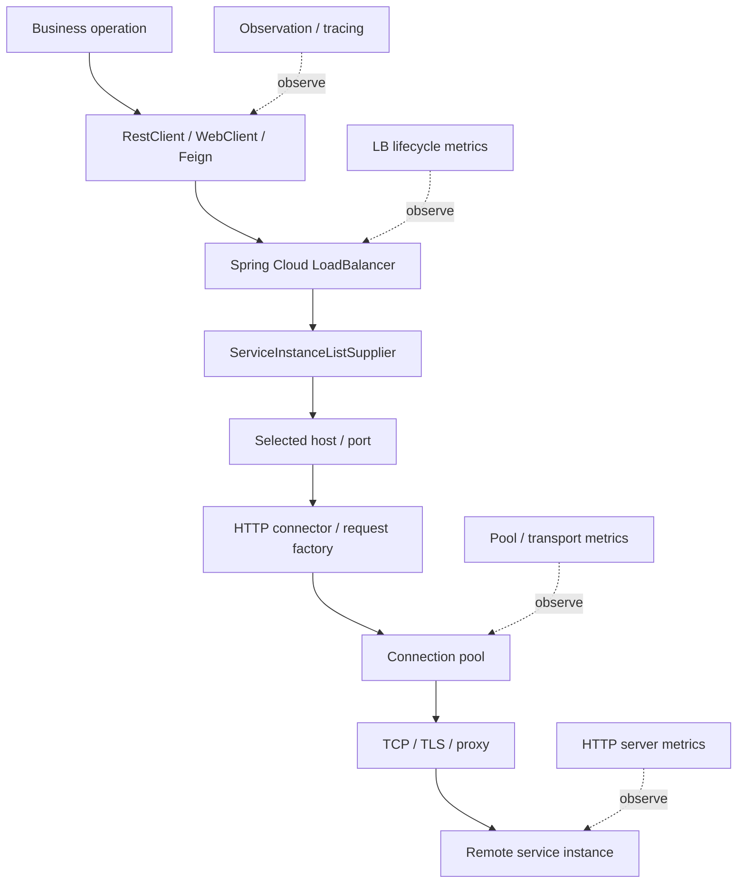
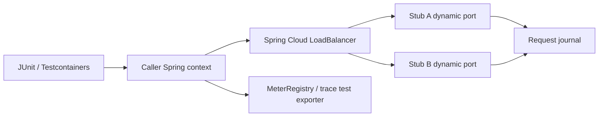

# Verifying HTTP Transport and Connection Pool Changes After Upgrading

Upgrading Spring Boot, Spring Framework, Spring Cloud, or an HTTP client library can alter how an application opens sockets, reuses connections, chooses proxies, negotiates TLS, enforces timeouts, and closes response bodies. The app may still start up cleanly and endpoints may still return HTTP 200, yet under load **pool pending counts rise, connection resets appear, p99 spikes, idle sockets get reused at the wrong moment, or retries generate more requests than before**.

With Spring Cloud LoadBalancer, verification must separate two layers: **which `ServiceInstance` LoadBalancer picks** and **which connection the HTTP transport uses to reach that instance**. Upgrading the transport does not mean the instance-selection algorithm changed; conversely, changing dependencies or auto-configuration can break or alter the integration between those two layers.

This lesson belongs to the **Compatibility and Upgrades** chapter of the **Spring Cloud Service Communication Load Balancing** module. The goal is to build a repeatable verification procedure comparing HTTP transport and connection pools **before and after an upgrade**, applicable to `RestClient`, `WebClient`, `RestTemplate`, and Spring Cloud OpenFeign. It focuses on identifying the active transport, dependencies/BOM, pool lifecycle, timeouts, TLS/proxies, HTTP/2, retries, observability, integration tests, and canary rollout.

## 1. Objectives and Verification Principles

After this lesson, you should be able to answer:

1. Which transport is the client running: Reactor Netty, Apache HttpClient 5, JDK HttpClient, Jetty, OkHttp, or another request factory?
2. Was the transport selected by a dependency, auto-configuration, or explicit application code?
3. How does the pool bound connection counts, pending acquires, idle time, and lifetimes?
4. Do connect timeouts, pool-acquire timeouts, response/read timeouts, and total deadlines keep the same semantics after upgrading?
5. Have HTTP keep-alive, stale connection validation, eviction, and graceful close behavior changed?
6. Do TLS, truststores, hostname verification, proxies, redirects, compression, and HTTP/2 work as before?
7. Is Spring Cloud LoadBalancer still properly integrated with `RestClient`, `WebClient`, and OpenFeign?
8. Do retries increase HTTP attempt counts or change request-body replay semantics?
9. Do metrics/tracing accurately capture pools, HTTP exchanges, selected instances, and errors?
10. Which test suite must pass before canary rollout or general release?

**Principle:** compare under identical workloads, topologies, server behavior, and resource limits. Never declare one transport better simply because a single isolated request ran a few milliseconds faster.

## 2. Separating the Layers to Inspect

An HTTP request going through Spring Cloud LoadBalancer involves multiple layers:



| Layer | Responsibility | Example post-upgrade change |
|---|---|---|
| Business client | Building requests, decoding responses, error mapping | Converters/codecs or default error handling changed |
| Spring Cloud LoadBalancer | Selecting `ServiceInstance`, retries, hints, lifecycle | Supplier chain, retry integration, or context/config changed |
| HTTP transport | Sending HTTP, handling protocol and sockets | Reactor Netty/Apache/JDK/Jetty selected differently |
| Connection pool | Reuse, limits, acquisition, idle/lifetime, eviction | Pool defaults, max connections, or pending queues changed |
| TLS/proxy | Handshakes, certificates, proxy routing | TLS provider/protocol, truststore, or proxy authentication |
| Remote service | Processing requests, statuses, keep-alive, and shutdown | Server version or idle timeouts differ |
| Observability | Metrics, traces, logs | Meter names/tags, instrumentation, or exporters changed |

A single incident can span multiple layers. An HTTP client timeout may happen because the pool ran out of connections, TCP connect to a new Pod took too long, TLS handshake stalled, the server withheld response headers, the body broke mid-stream, or the business operation's total deadline expired.

Never tune a single timeout blindly without knowing which stage requests are waiting in.

## 3. Mapping Versions and Dependencies Before Upgrading

Spring Boot, Spring Framework, and Spring Cloud ship in compatible release trains. Never hand-pick individual `spring-cloud-commons`, `spring-webflux`, `reactor-netty`, or `httpclient5` versions and splice them into an app without checking the BOM.

### 3.1. Dependency Management Should Be Pinned by Release Train

In Maven, the Spring Boot parent/BOM and Spring Cloud BOM should manage compatible versions:

```xml
<dependencyManagement>
    <dependencies>
        <dependency>
            <groupId>org.springframework.cloud</groupId>
            <artifactId>spring-cloud-dependencies</artifactId>
            <version>SPRING_CLOUD_VERSION_FROM_COMPATIBILITY_MATRIX</version>
            <type>pom</type>
            <scope>import</scope>
        </dependency>
    </dependencies>
</dependencyManagement>
```

This is an illustrative snippet; replace the version placeholder with the **official compatible release train** for your active Spring Boot version. When the Boot parent already manages Spring Framework/Reactor dependencies, avoid overriding child versions unless there is a verified compatibility reason.

### 3.2. Dependencies to Record Before and After

| Group | Artifacts/packages to inspect | Why it matters |
|---|---|---|
| Spring Boot | `spring-boot`, `actuator`, `web`, `webflux`, `autoconfigure` | Governs builders/configuration and observation |
| Spring Cloud | `spring-cloud-commons`, `spring-cloud-loadbalancer`, OpenFeign | Instance selection, retry, and supplier integration |
| Spring Framework | `spring-web`, `spring-webflux`, `spring-core` | `RestClient`, `WebClient`, codecs, and request factories |
| Reactor | `reactor-core`, `reactor-netty-http`, `reactor-netty-core` | Reactive transport, event loops, and pools |
| Netty | `netty-*` | TCP, TLS, native transport, and memory allocators |
| Apache | `httpclient5`, `httpcore5` | Blocking client and pooling connection manager |
| Feign | `feign-core`, `feign-micrometer`, Spring Cloud OpenFeign | Feign transport/capabilities/retries |
| TLS/crypto | JSSE providers, Netty tcnative/BoringSSL if used | TLS handshakes, ciphers, ALPN |
| Metrics | Micrometer core/registries/tracing bridges | Pool/HTTP metrics and trace propagation |

Do not inspect only direct declarations in `pom.xml`/`build.gradle`; inspect the **resolved dependency graph**, since transports can be pulled in via other starters.

### 3.3. Save the Dependency Tree

Maven:

```bash
mvn dependency:tree -Dverbose > dependency-tree-before.txt
mvn help:effective-pom > effective-pom-before.xml
```

Gradle:

```bash
./gradlew dependencies --configuration runtimeClasspath
./gradlew dependencyInsight --dependency reactor-netty-http --configuration runtimeClasspath
./gradlew dependencyInsight --dependency httpclient5 --configuration runtimeClasspath
```

After upgrading, re-run with an `after` suffix and diff:
- Changed versions.
- Newly added or missing artifacts.
- Two versions coexisting due to dependency conflicts.
- Client transport swapped to another implementation.
- `spring-cloud-loadbalancer` or client integration missing from the runtime classpath.

Do not rely solely on the dependency tree to conclude which transport runs at runtime if the app uses conditional auto-configuration or manual beans. Inspect the **actual bean/connector** and startup logs.

## 4. Identifying the Active HTTP Transport

The API name does not determine the transport. `RestClient` is a synchronous abstraction; `WebClient` is a reactive abstraction; OpenFeign is a declarative client. The underlying transport can differ across versions even when calling code stays identical.

### 4.1. Common Options

| Client abstraction | Typical transports available | Pool/connection owner |
|---|---|---|
| `WebClient` | Reactor Netty, Jetty reactive client, JDK connector, or other connectors | Depends on `ClientHttpConnector` |
| `RestClient` | JDK-based request factory, Apache HttpClient 5, Jetty, or other request factories | Depends on `ClientHttpRequestFactory` |
| `RestTemplate` | JDK, Apache HttpClient, or configured request factory | Depends on `ClientHttpRequestFactory` |
| OpenFeign | Apache HttpClient 5, OkHttp, or default Feign client implementation | Depends on Feign `Client` |
| HTTP Interface | `RestClientAdapter` or `WebClientAdapter` | Inherits the underlying client's transport |

**Never assume** a Spring Boot version always selects a specific transport merely because its dependency is on the classpath. Auto-configuration and precedence can shift across releases, and applications can override beans.

### 4.2. API Milestones Prone to Upgrade Surprises

| Change | Impact | How to verify |
|---|---|---|
| Spring Framework 6.1 introduces `RestClient` | Apps on older Frameworks lack this API; migration must align with Boot/Framework support | Check resolved Framework version and compile target |
| Apache HttpClient 4 moves to 5 | Packages/APIs change, e.g., `org.apache.http.*` to `org.apache.hc.*`; pool, timeout, and TLS settings cannot be copied verbatim | Check imports, dependency tree, request factories, and pool managers |
| Reactor Netty managed by a new BOM | Pool defaults, timeouts, or metrics APIs can change across versions | Compare resolved Reactor/Netty versions and effective pool config |
| JDK baseline changes | TLS defaults, cipher availability, DNS, and socket behavior can differ | Run tests on the exact production JDK |
| Spring Cloud release train changes | LoadBalancer filters, retry integration, property metadata, and OpenFeign wiring can change | Check compatibility matrix and service-ID integration tests |

Do not treat this table as an exhaustive list of breaking changes. Read migration guides for your exact source/target versions and verify actual runtime dependencies.

### 4.3. Inspecting Runtime Beans

In test or diagnostics environments, inspect created beans:

```java
@Component
class HttpClientRuntimeInventory implements ApplicationRunner {

    private static final Logger log =
            LoggerFactory.getLogger(HttpClientRuntimeInventory.class);

    private final ApplicationContext context;

    HttpClientRuntimeInventory(ApplicationContext context) {
        this.context = context;
    }

    @Override
    public void run(ApplicationArguments args) {
        context.getBeansOfType(WebClient.class)
                .forEach((name, client) ->
                        log.info("WebClient bean: {}", name));

        context.getBeansOfType(RestClient.class)
                .forEach((name, client) ->
                        log.info("RestClient bean: {}", name));

        context.getBeansOfType(ClientHttpConnector.class)
                .forEach((name, connector) ->
                        log.info("WebClient connector {}: {}",
                                name, connector.getClass().getName()));

        context.getBeansOfType(ClientHttpRequestFactory.class)
                .forEach((name, factory) ->
                        log.info("Request factory {}: {}",
                                name, factory.getClass().getName()));
    }
}
```

Required imports include `org.slf4j.Logger`, `org.slf4j.LoggerFactory`, and the Spring types used in the example. This pattern inspects root-context Spring beans; Feign clients may be created inside named child contexts and not appear as singleton beans in the root context. Never log full object `toString()` output if it might contain URL credentials or sensitive configuration.

### 4.4. Enabling Bounded Diagnostics

You can use Actuator `conditions`, `beans`, and `configprops` in dev/test environments to inspect auto-configuration and property binding. These endpoints can expose topology or configuration; **never expose them uncontrolled in production**.

When inspecting:
1. Confirm which transports exist on the classpath.
2. Review condition reports / auto-configuration outcomes.
3. Inspect the connector/request factory beans injected into clients.
4. Confirm the `@LoadBalanced` filter/interceptor is present on clients calling service IDs.
5. Issue test requests and verify which instances receive them.

## 5. LoadBalancer Integration Can Shift During Upgrades

An application may still instantiate `WebClient` or `RestClient` successfully yet stop resolving service IDs if the builder no longer passes through LoadBalancer.

### 5.1. RestClient

```java
@Configuration(proxyBeanMethods = false)
class InventoryClientConfiguration {

    @Bean
    @LoadBalanced
    RestClient.Builder loadBalancedRestClientBuilder() {
        return RestClient.builder();
    }

    @Bean
    RestClient inventoryClient(
            @LoadBalanced RestClient.Builder builder) {
        return builder
                .baseUrl("http://inventory-service")
                .build();
    }
}
```

This is conceptual wiring configuration; production should preserve Spring Boot customizers/converters/observation, such as using the release-appropriate builder configurer. After upgrading, tests must prove `inventory-service` resolves to stub endpoints rather than being treated as a direct DNS hostname.

### 5.2. WebClient

```java
@Configuration(proxyBeanMethods = false)
class ReactiveInventoryClientConfiguration {

    @Bean
    @LoadBalanced
    WebClient.Builder loadBalancedWebClientBuilder() {
        return WebClient.builder();
    }

    @Bean
    WebClient inventoryWebClient(
            @LoadBalanced WebClient.Builder builder) {
        return builder
                .baseUrl("http://inventory-service")
                .build();
    }
}
```

If adding a custom `ClientHttpConnector`, verify it remains attached to the `@LoadBalanced` builder. A builder pointing directly at a real URL can succeed in DNS-enabled environments while **bypassing Spring Cloud LoadBalancer**.

### 5.3. OpenFeign

```java
@FeignClient(name = "inventory-service")
interface InventoryFeignClient {

    @GetMapping("/api/items/{id}")
    ItemReply getItem(@PathVariable("id") long id);
}
```

Verify:
- Spring Cloud OpenFeign and the LoadBalancer starter remain on the runtime classpath.
- The active Feign client uses `FeignBlockingLoadBalancerClient` when service-ID routing is needed.
- Which HTTP transport implementation sits beneath Feign.
- `connectTimeout`, `readTimeout`, `retryer`, and Micrometer capabilities bind properly.
- Named client contexts do not unintentionally pick up another client's configuration.

Do not conclude `@FeignClient(name=...)` guarantees LoadBalancer is active if auto-configuration/dependencies changed.

## 6. Connection Pools: Comparing Configuration and Semantics

The pool is part of the transport. Upgrades can change defaults for connection counts, pending queues, idle/lifetime bounds, eviction, and validation.

| Concept | Meaning | Consequence if changed |
|---|---|---|
| Max connections | Maximum TCP connections in the pool or per route | Too low causes waiting; too high increases sockets and backend load |
| Pending acquire | Requests waiting for an idle connection | Large queues raise latency and memory usage |
| Pending acquire timeout | Max wait time to borrow a connection | Can fail before the request is ever sent |
| Max idle time | Max age of an idle connection | Too long risks reusing sockets closed by peer/proxy |
| Max lifetime | Max age of a connection even when reused | Rotates sockets, though too short increases handshakes |
| Background eviction | Interval for reaping expired/idle connections | Cleans up without waiting for the next request |
| Validate after inactivity | Checks connection after an idle interval | Can reduce stale reuse depending on transport |
| Per-route limit | Caps connections per route/destination | One service can bottleneck even with global pool headroom |

**Do not compare `maxConnections` alone.** Each transport defines pool keys differently: by host/port, route, proxy, or connection provider. HTTP/2 multiplexes multiple streams over one connection, so connection count does not equal request concurrency.

### 6.1. Reactor Netty ConnectionProvider

Example `WebClient` configuration using Reactor Netty:

```java
ConnectionProvider provider = ConnectionProvider.builder("inventory-pool")
        .maxConnections(100)
        .pendingAcquireMaxCount(200)
        .pendingAcquireTimeout(Duration.ofSeconds(2))
        .maxIdleTime(Duration.ofSeconds(20))
        .maxLifeTime(Duration.ofMinutes(5))
        .evictInBackground(Duration.ofSeconds(30))
        .metrics(true)
        .build();

HttpClient httpClient = HttpClient.create(provider)
        .option(ChannelOption.CONNECT_TIMEOUT_MILLIS, 1000)
        .responseTimeout(Duration.ofSeconds(3));

WebClient.Builder builder = WebClient.builder()
        .clientConnector(new ReactorClientHttpConnector(httpClient));
```

Values are **test examples**, not production recommendations. When used with Spring Cloud LoadBalancer, attach the connector to the actual `@LoadBalanced WebClient.Builder` bean and verify the LB filter remains active.

Notes:
- `metrics(true)` on `ConnectionProvider` enables pool metrics when Micrometer support is present; it does not automatically enable every HTTP client metric.
- `responseTimeout` follows Reactor Netty's timeout semantics; it is not an overall deadline across an entire retry chain.
- `pendingAcquireTimeout` differs from `responseTimeout`.
- Application-owned providers should be disposed when the context closes; avoid creating a fresh pool per request.

### 6.2. Apache HttpClient 5

Apache HttpClient 5 typically uses `PoolingHttpClientConnectionManager`, configuring total/per-route limits, connection request timeout, connect timeout, response timeout, and idle/expired eviction. Exact APIs depend on the 5.x version; consult the migration guide and Javadoc matching your BOM-resolved version.

Concepts to compare:

| Apache pool statistic | Meaning |
|---|---|
| `leased` | Connections currently checked out by callers |
| `available` | Idle connections available to lease |
| `pending` | Requests waiting for a connection lease |
| `max` | Pool limit |
| Per-route stats | Same metrics scoped per route/destination |

Do not assume all of these stats are automatically exported as Micrometer meters; extra instrumentation/binders may be needed.

### 6.3. OpenFeign Pools

Feign can use Apache HttpClient 5 or OkHttp when corresponding dependencies/config are present. Their pools have separate lifecycles and configurations from WebClient's pool. If the same service ID is called via both Feign and WebClient, they may maintain **two separate connection pools**.

After upgrading, check:
- Feign `Client` implementation.
- Apache/OkHttp pool limits.
- Feign timeout options.
- Whether `Retryer` and LoadBalancer retries stack.
- Pool lifecycle when a named client context closes or refreshes.

## 7. Timeouts: Must Be Compared Stage by Stage

| Timeout | Stage | Verification question |
|---|---|---|
| Pool acquire | Waiting for an idle connection | Are there pending queues and pool saturation errors? |
| DNS resolution | Resolving hostname | Did resolver/caching behavior change? |
| TCP connect | Establishing a new socket | Do new connections finish within budget? |
| TLS handshake | Negotiating TLS | Do certs/ciphers/ALPN slow down or break handshakes? |
| Response/read | Waiting for headers/body per transport semantics | Is the server slow or did the body stream stall? |
| Idle timeout | Period without data on connection/stream | Does a proxy/server close the socket? |
| Total deadline | Logical operation and retries | Does total duration breach the SLO? |

### 7.1. Before/After Matrix

| Component | Before | After | Test |
|---|---:|---:|---|
| Pool acquire timeout | Record actual value | Record actual value | Pool saturation test |
| Connect timeout | Record actual value | Record actual value | New connection to delayed/blackholed target |
| TLS handshake | Record actual value | Record actual value | Certificate/protocol handshake |
| Response timeout | Record actual value | Record actual value | Delayed headers and delayed body |
| Total deadline | Record actual value | Record actual value | Retry + backoff end-to-end |
| Max idle | Record actual value | Record actual value | Idle stale connection test |
| Max lifetime | Record actual value | Record actual value | Connection rotation |
| Max pending | Record actual value | Record actual value | Burst concurrency/pool exhaustion |

Never leave Before/After cells blank and declare compatibility. Values no longer explicitly configured after an upgrade must be **measured or read from effective runtime configuration**.

### 7.2. Distinguishing Response Timeout from Total Deadline

A server can send one chunk every 100 ms for 10 seconds. If response timeout only bounds the gap between chunks, the stream can stay alive for 10 seconds. A 2-second total deadline still must stop the logical operation after 2 seconds.

When comparing, test:
- Headers slower than response timeout.
- Body pausing between chunks longer than idle/read timeout.
- Steady body chunks whose total duration exceeds total deadline.
- Retries/backoff pushing total time past deadline.
- Cancellation freeing pools/buffers after timeout.

## 8. Keep-Alive, Stale Sockets, and Eviction

Upgrading a transport can change how clients handle idle connections, connections closed by servers/proxies, and reuse after inactivity.

A stale connection can arise when:
1. The client returns a socket to the pool after a response.
2. A proxy/NAT/server closes the socket while idle.
3. The client has not noticed the socket closed yet.
4. The next request borrows the old socket.
5. The transport hits EOF/reset when writing or reading.

### 8.1. Testing Idle Connection Reuse

An integration test should:
1. Send a first request through a specific HTTP client/pool.
2. Confirm the request finishes and the connection is eligible for reuse.
3. Let the socket sit idle past the server/proxy idle timeout, or actively close the socket on the stub/proxy.
4. Send a second request through **the same client/pool**.
5. Measure whether the client opens a new connection, errors, or retries.
6. Send a third request to confirm the pool recovered.

Do not assert a `Connection reset` must occur on every OS. Servers may send a clean FIN; timing races determine when the client detects the closed socket. Tests should verify **the next request recovers and the pool does not hold bad connections permanently**.

### 8.2. HTTP Keep-Alive and Pool Lifetime Are Different Concepts

- HTTP keep-alive allows connections to remain open for reuse.
- Pool idle eviction decides when the client discards an idle connection.
- Max lifetime caps connection age per client policy.
- Server/proxy idle timeouts can be shorter than client max idle.
- OS-level TCP keepalive probes do not replace HTTP pool eviction.

Setting client max idle **smaller** than the shortest hop's idle timeout is a common strategy, requiring knowledge of real proxies/servers. Setting it too low increases TCP/TLS handshakes and latency.

## 9. TLS, Proxies, and Protocol Negotiation

A transport upgrade can alter TLS providers, cipher suites, hostname verification, truststores, SNI, ALPN, and proxy routing.

| Item | Regression to test |
|---|---|
| Truststore/CA | Certificate chain trusted as before |
| Hostname verification | Hostname checking not accidentally disabled |
| SNI | Virtual-hosted server returns the right certificate |
| TLS protocol/ciphers | Protocol/ciphers supported on both client and server |
| Mutual TLS | Client certificate/key alias correct |
| Proxy | HTTP CONNECT, proxy auth, no-proxy exclusions |
| Redirects | 301/302/307/308 and method/body preservation |
| Compression | `Accept-Encoding`, gzip/br, and accurate decoding |
| HTTP/2 | ALPN, multiplexing, GOAWAY, and stream resets |
| DNS | Resolver, caching, and refresh semantics |

**Never disable certificate validation to make tests pass.** Use valid test CAs/certificates for the test environment. If the new transport switches TLS providers, test both native libraries and JDK fallback behavior.

### 9.1. HTTP/2 Changes How Pools Are Interpreted

HTTP/1.1 typically maps close to one in-flight request per connection without pipelining; HTTP/2 multiplexes many streams over one TCP connection. Therefore:
- `active connections=10` does not mean only 10 requests.
- One TCP reset can affect many streams.
- GOAWAY may let already-accepted streams complete, while unaccepted streams need handling per semantics.
- Retrying bodies/operations still must obey idempotency.

After upgrading, verify which protocol was actually negotiated (HTTP/1.1 vs. HTTP/2) rather than relying solely on client config.

## 10. Retries and Request-Body Replay After Upgrading

Changing transports can alter exception types and whether request bodies can be replayed. This is one of the easiest risks to miss.

| Request/body | Retry risk |
|---|---|
| GET without body | Usually replayable, though response/data consistency still depends on backend |
| Buffered JSON POST | Replayable at the byte level; business operation may still be non-idempotent |
| Multipart from file | May need to reopen file stream; file may have changed or closed |
| One-shot `InputStream` | Cannot be replayed by default |
| WebClient `Flux<DataBuffer>` | Publisher may be hot/one-shot or buffers already released |
| Streaming upload | Retrying after the server received partial data can create partial/duplicate records |

### 10.1. Retry Policies Must Be Re-Verified

Spring Cloud LoadBalancer configures same-instance/next-instance retries; Feign, Reactor `retryWhen`, gateways, and service meshes can retry at other layers. After upgrading:
- Verify which status codes are retried.
- Verify exception mapping.
- Count logical operations, attempts, and requests received by servers.
- Verify retry context / previous instance is propagated.
- Set a total deadline and retry budget.
- Retry POST only when server-side idempotency is verified.

Do not assume identical YAML drives every client identically; blocking `RestTemplate`, `RestClient`, reactive `WebClient`, and Feign have different integrations depending on the release train.

## 11. Dependency/BOM Upgrade Checklist

Before changing configuration:
- Record Boot, Cloud release train, Framework, Reactor, Netty, and transport versions.
- Save the resolved dependency tree.
- Check dependency convergence and duplicate classes.
- Record active connector/request factory/client beans.
- Record effective properties and override sources (YAML, env vars, config server, command line).
- Identify which transports are auto-selected vs. explicitly configured.
- Identify whether Feign/WebClient/RestClient maintain separate pools.
- Record TLS/proxy/HTTP protocols.
- Capture baseline metrics and latency before upgrading.

### 11.1. Do Not Change Too Many Variables at Once

If you simultaneously change the Spring Boot major version, Spring Cloud release train, Reactor Netty, Apache HttpClient, TLS provider, and service mesh sidecar, pinpointing what caused a latency spike or broken retry becomes hard. Where possible, split migration into verifiable steps and save the dependency lock/BOM at each step.

### 11.2. Check Config Properties That Changed or Stopped Binding

An old property may have changed namespaces, types/units, been deprecated/removed, stopped being consumed by auto-configuration, apply only to one transport, or been overridden by env/config server.

Use the target version's metadata/configuration properties and startup diagnostics. Never assume a property bound correctly just because startup logged no error. Inspect **effective runtime config** and observe actual behavior.

## 12. Regression Test Architecture: Two Instances and One Caller

Stand up two HTTP stub instances under service ID `inventory-service`, with the caller using `@LoadBalanced WebClient.Builder` or `RestClient.Builder`.



Goals to prove:
- Client routes through LoadBalancer.
- Requests can reach A or B.
- Pool reuses/evicts per configuration.
- When one instance is removed, caller picks another per policy.
- Attempt count matches retry budget.
- Timeouts/exceptions are properly classified.
- Metrics/traces still appear properly.

### 12.1. WireMock Fixture with Dynamic Ports

```java
class InventoryTransportTestSupport {

    static final WireMockServer A =
            new WireMockServer(wireMockConfig().dynamicPort());
    static final WireMockServer B =
            new WireMockServer(wireMockConfig().dynamicPort());

    static {
        A.start();
        B.start();
    }

    @DynamicPropertySource
    static void registerInstances(DynamicPropertyRegistry registry) {
        registry.add(
            "spring.cloud.discovery.client.simple.instances.inventory-service[0].uri",
            A::baseUrl);
        registry.add(
            "spring.cloud.discovery.client.simple.instances.inventory-service[1].uri",
            B::baseUrl);
    }

    static void reset() {
        A.resetAll();
        B.resetAll();
    }
}
```

This is an illustrative fixture; in real suites, static server lifecycles must be managed by a JUnit extension or owning test class and always shut down after the suite completes. Do not run multiple test classes concurrently against the same static fixture and shared journal reset.

If the project includes Eureka/Consul or another discovery client, confirm `SimpleDiscoveryClient` is actually selected in tests. Both stub endpoints must have distinct instance identities under the same service ID.

### 12.2. Test Routing Before Testing the Pool

Initially, stubs A and B return bodies containing their instance names:

```java
A.stubFor(get(urlEqualTo("/api/items/42"))
        .willReturn(okJson("{\"instance\":\"A\"}")));

B.stubFor(get(urlEqualTo("/api/items/42"))
        .willReturn(okJson("{\"instance\":\"B\"}")));
```

Send multiple requests through the same client and verify:
- Body `instance` is either A or B.
- Both A and B request journals grow.
- Called URL uses the service ID, not a direct host/port.
- Retries are disabled in the baseline.
- Health probes or other test setup do not hit the same path and pollute journals.

Do not assert round-robin must start on A; routing tests only need to prove the candidate endpoints and client integration.

## 13. HTTP Transport Test Matrix

| Test | Setup | Outcome to verify |
|---|---|---|
| Happy path | A/B return 200 | Correct body, proper routing |
| Connection reuse | Send consecutive requests | Pool reuses without opening unnecessary new connections |
| Pool saturation | Low max connections, burst concurrency | Pending acquire/timeout behaves properly; no unbounded queue |
| Connect timeout | New connection to endpoint unresponsive in TCP phase | Connect timeout distinguished from read timeout |
| Slow headers | Stub delays before headers | Response timeout/total deadline honored |
| Slow body | Fast headers, slow chunks | Idle/read timeout distinguished from total deadline |
| Stale idle socket | Server/proxy closes socket after idle | Client recovers/evicts per policy |
| Connection reset | Reset/EOF before or mid-response | Transport error; pool does not jam |
| HTTP 503 | Valid error status response | Status mapping and retry policy |
| No instance | Supplier returns empty list | Zero backend requests |
| TLS invalid cert | Invalid test CA/certificate | Handshake fails cleanly without bypassing verification |
| TLS valid cert | Valid test CA | Handshake succeeds; hostname verified |
| Proxy | HTTP CONNECT or proxy route | Proxy routing/auth works |
| HTTP/2 | Server supports ALPN | Protocol negotiated properly; streams recover |
| Cancellation | Cancel reactive body mid-stream | `DataBuffer`/connection cleanup |
| Graceful server close | Server closes listener/pool | In-flight requests behave deterministically |
| Retry | One failing instance, one healthy | Attempts/instances match policy |
| Metrics | Pool/HTTP instrumentation enabled | Meters exist with bounded cardinality |

## 14. Verifying Connection Reuse

For HTTP/1.1, WireMock or a stub server can record connection identity (if the test harness exposes remote port/connection metadata) or count TCP accepts. Without socket details, relying solely on the request journal **does not prove connections were reused**: journals count HTTP requests, not TCP connections.

A proper transport test should:
1. Use the exact same client instance and pool.
2. Send multiple requests to the same backend/route.
3. Observe pool active/idle gauges and server accepted connections.
4. Confirm multiple requests share a connection when keep-alive is enabled.
5. Let a connection go idle, then close it on the server/proxy.
6. Send the next request and verify how pool/transport handles the stale connection.

### 14.1. Do Not Create a New Client per Request

If each test request builds a fresh `WebClient`/`RestClient`, you are testing separate pools. Results tell nothing about whether the app's pool reuses or cleans up properly. Inject **the same singleton client bean** the application uses.

### 14.2. Server Keep-Alive Is Also a Variable

If the test server closes connections after every response, the client cannot reuse them. If the test server has a longer idle timeout than the client, the test may never observe stale connections. Record:
- Server HTTP version.
- `Connection` headers if HTTP/1.1.
- Server keep-alive timeout.
- Proxy/NAT idle timeout if present.
- Client `maxIdleTime`/`maxLifeTime`.
- Connection counts and request counts.

## 15. Testing Pool Saturation and Pending Acquire

Set pool max connections low (e.g., 2) with a 1-second server delay, and send concurrency 10. The goal is observing excess requests either waiting or being rejected per limits rather than spawning 10 unbounded sockets.

With Reactor Netty, illustrative test configuration:

```java
ConnectionProvider provider = ConnectionProvider.builder("small-test-pool")
        .maxConnections(2)
        .pendingAcquireMaxCount(4)
        .pendingAcquireTimeout(Duration.ofMillis(300))
        .metrics(true)
        .build();
```

Measurements to capture:
- Peak active connections.
- Peak pending acquires.
- Requests timing out from a full queue or excessive wait.
- Whether the pool returns to baseline after requests finish.
- Whether subsequent requests work normally.

**Do not assert only that an exception was thrown.** Pool saturation tests must prove limits are enforced and resources are released. If the transport uses HTTP/2 multiplexing, concurrent streams can exceed connection count; tests must account for the protocol.

## 16. Testing Timeouts at the Right Layer

### 16.1. Connect Timeout

WireMock `fixedDelay` only delays the HTTP response after TCP connection is established. It **does not** simulate a TCP connect timeout. To test connect timeout:
- Use a proxy/network fault injector to DROP SYN or delay the TCP handshake.
- Ensure the transport needs a new connection rather than reusing a pooled one.
- Separate DNS and pool acquisition from the connect phase.
- Use a controlled OS/container environment; unroutable IPs may return Network unreachable immediately without waiting for timeout.

### 16.2. Pool Acquire Timeout

Hold two connections busy with slow responses, then send a third request when `maxConnections=2`. Verify the failure occurs while waiting for the pool rather than as a server read timeout. Bound the pending queue to avoid unbounded memory growth.

### 16.3. Response Timeout and Total Deadline

Have a stub delay headers past `responseTimeout`, then test a body sending steady chunks whose total duration exceeds the deadline. In reactive pipelines, a `timeout` operator after retry bounds the whole chain; transport `responseTimeout` has its own semantics. Measure and classify both failures.

## 17. Testing Retries and LoadBalancer After Upgrading

Retry configuration must be verified inside the target release train's context:

```yaml
spring:
  cloud:
    loadbalancer:
      retry:
        enabled: true
        max-retries-on-same-service-instance: 0
        max-retries-on-next-service-instance: 1
        retry-on-all-operations: false
        retry-on-all-exceptions: false
        retryable-status-codes:
          - 503
```

Tests:
1. A returns 503, B returns 200; pin or observe initial selection.
2. Count requests on both A and B.
3. Verify next-instance retry actually has a retry-aware supplier/context.
4. Change B to 503 and verify the attempt budget.
5. Change status to 404 and verify no retry when policy covers only 503.
6. Disable retry and verify a logical GET issues only one attempt.
7. Re-run the same tests with transports before and after upgrade.

If retry integration shifts, determine whether the discrepancy sits in the Spring Cloud LoadBalancer retry filter/interceptor, HTTP transport exception mapping, application-level Reactor retry, Feign `Retryer`, or gateway/service mesh.

Never use a final 200 response alone as proof retry worked; require attempt counts and selected-instance evidence.

## 18. Testing Response Bodies, Cancellation, and Resource Cleanup

Some transport/framework versions alter how response bodies are consumed/released. Tests should cover:
- `WebClient` `bodyToMono` with small bodies.
- `Flux<DataBuffer>` streaming to a file with large bodies.
- Cancellation before body completion.
- Error HTTP statuses with large bodies.
- Decode errors/malformed JSON.
- Retries after a body was partially consumed.
- Connection pool returning to baseline after completion/error/cancel.

With pooled `DataBuffer`s, follow the ownership/release contract of the `DataBufferUtils` overload used. Never release a buffer still being read downstream, and never accumulate buffers in unbounded collections. If the transport changed allocators or pooling behavior, monitor direct memory and leak detection in test/staging.

## 19. Before/After Metrics and Tracing

Compare at least four groups:

| Group | Example metrics | Meaning |
|---|---|---|
| HTTP client | `http.client.requests` count, duration, status/outcome | Exchange duration and errors |
| LoadBalancer | `loadbalancer.requests.active/success/failed/discard` | Instance selection and lifecycle |
| Reactor Netty pool | active/idle/pending/total connections, pending acquire time | Pool pressure |
| Backend | server requests, p95/p99, 5xx, active requests | Impact on target service |

**`loadbalancer.requests.success` does not equal HTTP 2xx.** It can indicate a response was delivered back to the client; an HTTP 503 can still be recorded in the response lifecycle branch. Use statuses/outcomes from HTTP clients and servers to compute error rates.

### 19.1. Comparing Cardinality and Naming

After upgrading, meter names or tag keys may change due to Micrometer/Spring versions. Record:
- Meter names.
- Tag keys and low-cardinality values.
- Histogram/SLO buckets.
- Timer counts and total/max.
- Exported Prometheus names.
- Trace propagation and sampling.

Never attach raw URLs with IDs, trace IDs, Pod UIDs, or tokens as metric tags. Naming changes can make legacy dashboards/alerts go blank even while the app emits metrics under new names.

### 19.2. Pool Metrics Do Not Appear Automatically Just from Enabling HTTP Observation

With Reactor Netty, `ConnectionProvider.metrics(true)` controls pool metrics; HTTP client response metrics may require separate instrumentation per transport/version. With Apache HttpClient 5, pool stats may need a dedicated binder/custom instrumentation. Never assume `http.client.requests` includes all pending/idle/leased pool data.

## 20. Before/After Benchmark Protocol

Do not compare two versions with a single manual request. Build a repeatable protocol:

1. Use identical machine/container limits, JDK, CPU quotas, memory, TLS, and network paths.
2. Same two backend instances and identical response mix.
3. Warm up the application, connection pool, and JIT before measuring.
4. Run fixed concurrency and request rates.
5. Measure long enough to observe pool/GC/connection churn.
6. Repeat multiple runs and capture distributions, not averages alone.
7. Record error rates, timeout types, retry attempts, and pool pending counts.
8. Measure p50/p95/p99, throughput, CPU, heap/direct memory, and socket counts.
9. Test both HTTP/1.1 and HTTP/2 if production uses them.
10. Compare the same transport before/after; if the transport changed, mark it explicitly as a dual migration.

### 20.1. Results Table

| Metric | Before | After | Delta | Acceptance threshold |
|---|---:|---:|---:|---|
| Throughput req/s | Measured | Measured | Computed | SLO/load target |
| p50 latency | Measured | Measured | Computed | Per workload |
| p95 latency | Measured | Measured | Computed | Per SLO |
| p99 latency | Measured | Measured | Computed | Per SLO |
| HTTP 5xx rate | Measured | Measured | Computed | Error budget |
| Transport timeout rate | Measured | Measured | Computed | No breach past threshold |
| Retry attempts/logical request | Measured | Measured | Computed | Retry budget |
| Pool pending max | Measured | Measured | Computed | No unbounded growth |
| Active/idle connections | Measured | Measured | Computed | Within pool limits |
| Direct memory | Measured | Measured | Computed | No leaks/abnormal growth |
| CPU per request | Measured | Measured | Computed | Capacity budget |
| TLS handshake rate | Measured | Measured | Computed | No unexpected churn |

Never fill illustrative numbers in as real measurements. Define acceptance thresholds **before running**; setting thresholds after seeing results makes it easy to rationalize regressions.

## 21. Canary and Rollback

Once integration/regression tests pass:
1. Deploy the new transport/version to a small traffic slice or subset of instances.
2. Monitor client pools, timeouts, resets, TLS errors, HTTP statuses, and p99.
3. Compare against the old version using the same service ID and backend capacity.
4. Increase traffic share once metrics stay stable over a sufficient observation window.
5. Roll back if error budgets, latency, or pool pressure exceed predefined thresholds.

Canarying must ensure old/new clients interoperate with the same backend API. If an upgrade alters wire protocols, TLS ciphers, or HTTP/2 negotiation, verify two-way compatibility before increasing traffic.

Rolling back code does not automatically roll back database schemas, certificates/truststores, proxy configs, service discovery metadata, API versions/cursor formats, or idempotency record formats. Those changes require separate compatibility and rollback plans.

## 22. Post-Upgrade Regression Diagnostic Table

| Symptom | Causes to inspect | Remediation |
|---|---|---|
| App runs, yet service ID fails to resolve | Missing `@LoadBalanced` builder/filter or LoadBalancer dependency | Inspect beans and requests hitting stub instances |
| WebClient slow, pending rising | Low max pool, changed pending acquire timeout/queue | Inspect pool metrics and concurrency |
| More new connections than before | Keep-alive/idle eviction/max lifetime changed, or clients created repeatedly | Inspect pool lifecycle and singleton clients |
| Connection resets after idle | Peer/proxy idle timeout shorter than client max idle | Align idle eviction and test stale sockets |
| TLS handshake errors post-upgrade | Truststore, SNI, TLS provider/cipher/ALPN changed | Test handshake with test certificates |
| HTTP/2 downgraded | ALPN/proxy/server/client negotiation | Verify actual protocol on both hops |
| HTTP 503 rises while LB success stays high | LB success reflects response lifecycle, not HTTP 2xx | Use HTTP client/server statuses |
| Retry count doubles | Retries at multiple layers or exception classification changed | Disable layers one by one; count backend attempts |
| Upload retry creates duplicate files | Body replay/idempotency changed | Upload ID, checksum, server-side dedup |
| Metrics vanish | Observation/registry/customizer detached from builder | Inspect builder configurer and meter registry |
| Pool active fails to return to 0 after cancel | Unconsumed/unreleased response body or transport bug/config | Test cancellation; inspect `DataBuffer`/connection lifecycle |
| Direct memory rises | Pooled buffer leaks or higher concurrency | Heap/direct memory profiling and leak detection |
| Feign behaves differently from WebClient | Separate named context/transport/retryer | Inspect Feign `Client` bean and options |
| p99 rises despite steady average | Tail latency from pool pending, TLS churn, or retries | Inspect histograms/p99 and attempts, not averages alone |

## 23. Recommended Upgrade Workflow

### Phase A — Baseline

- Capture dependency tree, effective config, and runtime transport.
- Record pool limits/timeouts, TLS/proxies/protocols.
- Run current regression tests and benchmarks.
- Save metrics/traces, request journals, and error classifications.

### Phase B — Upgrade Dependencies

- Select Spring Boot/Spring Cloud versions from the compatibility matrix.
- Use BOMs; avoid arbitrary child dependency overrides.
- Verify dependency convergence.
- Build and verify actual beans/transports.
- Audit property namespaces, units, and defaults.

### Phase C — Functional Regression

- LoadBalancer routing to the right service ID.
- Connection reuse, pool saturation, and stale idle connections.
- Connect/response/total timeouts.
- TLS/proxies/redirects/compression/HTTP/2.
- Same/next-instance retries, request body replay, and idempotency.
- Cancellation, error bodies, and cleanup.
- Observation/metrics/tracing.

### Phase D — Performance and Deployment

- Benchmark under identical topology/workload.
- Compare p95/p99, pool pressure, retry amplification, and memory.
- Canary with predefined rollback thresholds.
- Roll out broadly only after regressions are explained and SLO thresholds pass.

## 24. Sign-Off Checklist

- [ ] Spring Boot/Spring Cloud release train compatibility matrix verified.
- [ ] Before/after dependency trees captured with no unintended version conflicts.
- [ ] Active runtime transport/request factory/connector identified.
- [ ] Spring Cloud LoadBalancer integration confirmed working for client service IDs.
- [ ] Pool owner, max connections, per-route limits, pending acquire, and eviction documented.
- [ ] Connect, pool acquire, response/read, and total deadlines compared separately.
- [ ] Keep-alive reuse and stale idle socket tests pass.
- [ ] Pool saturation and post-error/post-cancel cleanup tests pass.
- [ ] TLS trust, hostname verification, SNI, proxies, and ALPN verified.
- [ ] Actual HTTP/1.1 vs. HTTP/2 protocol verified.
- [ ] Retry attempts and retryable exceptions/status codes measured.
- [ ] Streaming request bodies retried only when replay/idempotency is proven safe.
- [ ] HTTP, LB, transport pool, and backend metrics kept distinct without confusion.
- [ ] Dashboards/alerts updated if meter names/tags/histograms changed.
- [ ] Before/after benchmarks completed under identical workloads and acceptance thresholds.
- [ ] Canary/rollback covers dependencies, configs, certificates, and related schemas.
- [ ] No illustrative numbers presented as real measurements.

**Conclusion:** upgrading an HTTP stack changes **transport and connection lifecycle**, which can affect latency, resource usage, socket errors, and retries even when Java APIs stay unchanged. Start by identifying the active transport, pin dependencies with a compatible BOM, measure pools/timeouts before and after, and run the same regression suite covering LoadBalancer, keep-alive, stale connections, TLS, retries, body streaming, and cancellation. Proceed to broad release only when **`ServiceInstance` selection, HTTP exchanges, pool lifecycles, and business outcomes** are all proven compatible.

## References

- [Spring Boot — HTTP Clients](https://docs.spring.io/spring-boot/reference/io/rest-client.html): auto-configuration and builders for REST clients.
- [Spring Framework — REST Clients](https://docs.spring.io/spring-framework/reference/integration/rest-clients.html): `RestClient`, `RestTemplate`, request factories, and HTTP interfaces.
- [Spring Framework — WebClient](https://docs.spring.io/spring-framework/reference/web/webflux-webclient.html): connectors, exchanges, and reactive client lifecycle.
- [Spring Cloud Commons — Spring Cloud LoadBalancer](https://docs.spring.io/spring-cloud-commons/reference/spring-cloud-commons/loadbalancer.html): selecting `ServiceInstance`, caching, retries, health suppliers, and metrics.
- [Spring Cloud Commons — Configuration Properties](https://docs.spring.io/spring-cloud-commons/reference/configprops.html): LoadBalancer configuration properties.
- [Spring Cloud OpenFeign — Reference](https://docs.spring.io/spring-cloud-openfeign/reference/): Feign client configuration, transports, and retries.
- [Reactor Netty — HTTP Client](https://projectreactor.io/docs/netty/release/reference/http-client.html): connection pools, timeouts, HTTP metrics, and TLS.
- [Apache HttpClient 5 — Migration Guide](https://hc.apache.org/httpcomponents-client-5.5.x/migration-guide/index.html): API/behavior changes across HttpClient generations.
- [Micrometer — Observation](https://docs.micrometer.io/micrometer/reference/observation.html): Observation registries, handlers, metrics, and tracing.
