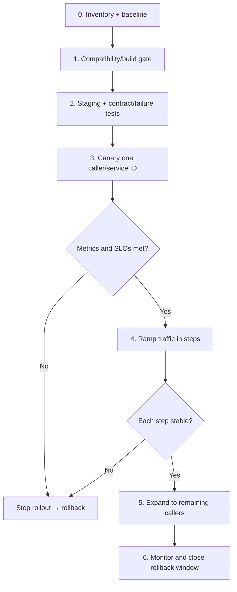
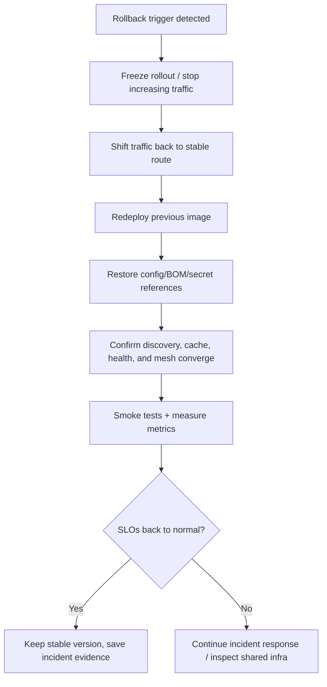

# Incremental Rollout Plan and Criteria for Rolling Back to Previous Configuration

## 1. Objectives

Upgrading Spring Boot, Spring Cloud, or modifying Spring Cloud LoadBalancer policies can affect discovery, `ServiceInstance` lists, target selection algorithms, caches, health checks, retries, timeouts, HTTP clients, and metrics. Changing everything at once makes pinpointing which change caused an incident very difficult when failures occur.

This lesson belongs to the **Compatibility and Upgrades** chapter of the `SPRING_CLOUD_SERVICE_COMMUNICATION_LOAD_BALANCING` module. The module focuses on client-side load balancing by service ID, discovery, health checks, routing, `RestClient`/`WebClient`/OpenFeign integration, timeouts/retries, and error observability. The goal is to build an upgrade plan **per service ID**, complete with baseline, canary, stop thresholds, rollback steps, and evidence confirming the system has stabilized.

After this lesson, you will be able to:

1. Build a compatibility matrix across Java, Spring Boot, the Spring Cloud release train, and related starters.
2. Record current configuration and behavior prior to upgrading.
3. Roll out a change to one caller group or one service ID first, then ramp traffic gradually.
4. Set stop thresholds based on error rate, latency, no-instance, retries, saturation, and SLOs.
5. Roll back to the previous image, dependencies, routes, and configuration without corrupting data or breaking remaining consumers.
6. Confirm rollback actually takes effect once discovery, caches, gateways, and meshes converge.

**Principle:** Upgrade in observable and reversible steps. Each phase should change only one related group of factors; do not simultaneously swap the BOM, discovery provider, target selection algorithm, retries, and timeouts without independent rationale and test evidence.

## 2. Upgrade Scope: Dependencies and Behavior

An upgrade may span multiple categories of change:

| Change category | Examples | Primary risk |
| --- | --- | --- |
| Runtime/framework | Java, Spring Boot, Spring Framework | Bytecode, APIs, auto-configuration, Actuator |
| Spring Cloud release train | Spring Cloud BOM, Spring Cloud Commons | APIs, properties, default behaviors, and compatibility |
| Client integration | OpenFeign, WebClient, RestClient | Interceptors, transports, observation, timeouts |
| Discovery | Eureka, Consul, Kubernetes discovery | Instance metadata, refresh, health status |
| LoadBalancer policy | Round Robin, Random, custom supplier/algorithm | Traffic distribution, failover, sticky/zone behavior |
| Resilience | Retries, timeouts, circuit breakers | Attempt counts, deadlines, load multiplication |
| Observability | Micrometer, tracing, Prometheus | Meter names, tags, cardinality, dashboards |
| Deployment/platform | Container image, Kubernetes, gateway, mesh | Readiness, endpoint propagation, routing |

Do not treat a clean build as complete proof of compatibility. An application can compile cleanly yet use a different default supplier at runtime, fail to find instances, or retry in ways that amplify downstream requests.

### 2.1. Compatibility Matrix

Record the **actual** versions of each component before upgrading:

| Component | Current | Target | Required evidence |
| --- | --- | --- | --- |
| JDK | Current version | Version supported by the release train | Build toolchain, container runtime |
| Spring Boot | Current version | Version supported by the Spring Cloud train | Official compatibility matrix |
| Spring Cloud release train | Current BOM | BOM compatible with target Boot | Release notes and compatibility table |
| Spring Cloud Commons/LoadBalancer | BOM-managed version | Version bundled with the release train | Dependency tree |
| Spring Cloud OpenFeign/Gateway | Current version | Version from the same train | Compatible starters and APIs |
| Discovery provider | Eureka/Consul/Kubernetes/... | Keep unchanged or plan separately | Client/server protocol, metadata |
| HTTP transport | JDK/Apache HC5/Reactor Netty/... | Compatible version | TLS, connection pool, timeout behavior |
| Micrometer/tracing | Current version | Boot BOM version | Meter names, observation, exporters |
| Kubernetes/mesh | Running version | Target control/data plane version | API support, CRDs, policies |

**Do not pair Spring Boot and Spring Cloud versions simply by picking the highest numbers.** Spring Cloud ships release trains with a dedicated compatibility matrix. Choose a train explicitly supporting your target Spring Boot line, and let the BOM manage all Spring Cloud modules consistently. If currently on an end-of-life line, the plan may require stepping through one or more intermediate milestones per official guidance.

### 2.2. Use the BOM as the Source of Version Management

Example Maven structure:

```xml
<properties>
    <java.version>17</java.version>
    <spring-boot.version>BOOT_VERSION_COMPATIBLE_WITH_TARGET_TRAIN</spring-boot.version>
    <spring-cloud.version>COMPATIBLE_SPRING_CLOUD_TRAIN</spring-cloud.version>
</properties>

<dependencyManagement>
    <dependencies>
        <dependency>
            <groupId>org.springframework.boot</groupId>
            <artifactId>spring-boot-dependencies</artifactId>
            <version>${spring-boot.version}</version>
            <type>pom</type>
            <scope>import</scope>
        </dependency>
        <dependency>
            <groupId>org.springframework.cloud</groupId>
            <artifactId>spring-cloud-dependencies</artifactId>
            <version>${spring-cloud.version}</version>
            <type>pom</type>
            <scope>import</scope>
        </dependency>
    </dependencies>
</dependencyManagement>
```

The strings `BOOT_VERSION_COMPATIBLE_WITH_TARGET_TRAIN` and `COMPATIBLE_SPRING_CLOUD_TRAIN` are **placeholders** that must be replaced with versions verified in your project's compatibility matrix; they are not valid Maven versions to copy and run verbatim.

Do not declare separate versions per Spring Cloud starter when managed by the BOM:

```xml
<dependency>
    <groupId>org.springframework.cloud</groupId>
    <artifactId>spring-cloud-starter-loadbalancer</artifactId>
</dependency>
<dependency>
    <groupId>org.springframework.cloud</groupId>
    <artifactId>spring-cloud-starter-openfeign</artifactId>
</dependency>
```

Mixing `spring-cloud-starter-loadbalancer` from train A with `spring-cloud-starter-openfeign` from train B can yield a compiling dependency graph that is untested by Spring Cloud. Keep a single consistent release train.

## 3. Record Baseline Before Upgrading

Before making changes, collect data from the **running version** across a window representing normal and peak traffic. Baseline lets you distinguish upgrade regressions from normal variation.

### 3.1. Inventory by Service ID

| Item to record | Example | Why it matters |
| --- | --- | --- |
| Target service ID | `stock-service`, `payment-service` | Defines rollout and rollback unit |
| Caller | `order-service`, `checkout-service` | Identifies which service upgrades first |
| HTTP client | `RestClient`, `WebClient`, OpenFeign | Each integration has distinct lifecycle/timeouts |
| Discovery | Eureka, Consul, Kubernetes, static | Identifies instance source and refresh lag |
| Supplier chain | Discovery → cache → zone → health | Detects ordering or filter changes |
| LoadBalancer policy | Round Robin, Random, custom | Baseline distribution and failover |
| Timeouts | connect/read/response timeouts | Latency bounds and request wait times |
| Retries | Feign, LoadBalancer, gateway, mesh | Total attempts that could multiply |
| Sticky/zone/metadata | Cookies, hints, zones, weights | Context-aware target selection behavior |
| Metrics/tracing | Meter names, tags, trace propagation | Post-upgrade dashboards and alerts |
| Gateway/mesh | Routes, mTLS, retries, canary | Layers that can route targets independently |

Save rendered configs from Helm/Kustomize or actual deployment manifests, not just templates in the repository. Record feature flags, environment variables, and runtime overrides that may supersede YAML.

### 3.2. Baseline Metrics

For each critical service ID, measure:

- Logical calls/sec and HTTP attempts/sec.
- Final success rate and HTTP 4xx/5xx rates.
- p50/p95/p99 latency for logical calls and HTTP attempts where available.
- `No instances available` counts, discovery errors, connection errors, and connect/read timeouts.
- Accepted retries/attempts at each layer; do not merge everything into one opaque number.
- Request distribution across instances/zones and failover time when an instance drops.
- CPU, memory, thread/connection pools, event-loop saturation, and queueing.
- Cache/supplier state, available instance counts, readiness, and health-check probes.

`loadbalancer.requests.success` is not an HTTP 2xx counter: a 503 response can still count as a response handed back to the client. Dedicated HTTP/logical call outcome metrics are therefore required.

### 3.3. Save a Recoverable Snapshot

Before deploying, preserve:

1. Current image tag/digest and deployed manifests.
2. Dependency locks/versions or dependency tree output.
3. ConfigMap/Secret references and current route/discovery/mesh configs.
4. Helm chart version / Kustomize overlay and rollout parameters.
5. Dashboards, alert thresholds, and the baseline report.
6. Commands/paths to roll back to the previous release, rehearsed in staging.

Never write Secret values into documents or logs; store only references/versions and safe recovery procedures.

## 4. Phased Rollout



### Phase 0 — Inventory and Baseline

Pick a service ID with moderate traffic, clear ownership, and good tests, such as `stock-service`. Identify all callers, current policies, instance sources, and retry layers. Set up dashboards/alerts before making changes.

**Exit criteria:** Representative baseline captured, ability to detect no-instance states, visibility into which instances receive requests, and ability to restore the prior image/config.

### Phase 1 — Upgrade Dependencies in an Isolated Branch/Build

Update Java/Boot/Cloud BOMs per the compatibility matrix. Do not change the LoadBalancer algorithm or discovery in the same commit unless required. After compiling:

```bash
# Inspect dependency graph and detect multiple unwanted versions.
./mvnw dependency:tree -Dincludes=org.springframework.boot,org.springframework.cloud

# Build and run the full application test suite.
./mvnw clean verify
```

Verify:

- No unexpected duplicate versions from different trains of Spring Cloud Commons/LoadBalancer/OpenFeign/Gateway.
- Auto-configuration loads as expected; per-service-ID child contexts create the right beans.
- Custom supplier/load balancer APIs compile and pass tests with target dependencies.
- Properties remain bound; renamed/moved properties are handled per release notes.
- Meter names, observation, trace propagation, and HTTP transports still work.

**Exit criteria:** Build, unit/integration tests, and compatibility checks pass; no unassessed warnings/deprecations or unresolved dependency conflicts remain.

### Phase 2 — Staging and Fault Testing

Run with discovery and network configurations as close to production as possible. Test:

1. Normal instance selection and traffic distribution.
2. Empty instance lists, discovery interruptions, stale caches, and instances losing readiness.
3. Timeouts, connection refused, HTTP 503, and retries per layer.
4. Sticky sessions/zones/hints/custom suppliers if used.
5. Rollout/rollback of images, configs, and routes.
6. Metrics, traces, logs, and alerts carrying accurate data.

Run smoke tests using the **real service ID**; testing a fixed URL does not prove discovery/LoadBalancer works.

### Phase 3 — Canary One Caller or Service ID

Upgrade only one caller group first. You can deploy the new image to a subset of `order-service` replicas or use a dedicated route/canary service ID, for example:

```text
order-service-v1 -> stock-service-v1 (old configuration)
order-service-v2 -> stock-service-v2 (new configuration)
```

These names are illustrative; creating separate service IDs requires the registry/services/routes to genuinely advertise those instances. Do not simply change a string in the Java client without instances registered under that ID.

If using a Gateway/mesh to split traffic, canary configuration must have **a single owner responsible for traffic splitting**. Do not simultaneously split 5% at the gateway, another 5% in a custom LoadBalancer, and 10% in the mesh without an overall traffic model.

Start with a small percentage (e.g., 1–5% depending on observability and risk). Keep the observation window long enough to span peaks, discovery refreshes, cache TTLs, and health-check cycles.

### Phase 4 — Ramp Traffic in Steps

A reference progression:

| Step | New version traffic | Prerequisite before ramping |
| --- | ---: | --- |
| Canary | 1–5% | Smoke tests pass, full metrics visible |
| Step 2 | 10–20% | Error rate/latency/no-instance within bounds |
| Step 3 | 25–50% | No retry amplification or abnormal instance skew |
| Step 4 | 75% | Observed across at least one representative load cycle |
| Complete | 100% | SLOs met, rollback window open with assigned owner |

Not every system needs these exact percentages. Payment services or low-traffic systems with high failure impact may need smaller increments and longer observation windows.

### Phase 5 — Expand Callers and Close the Rollback Window

Upgrade the next caller only after the canary stabilizes. Monitor remaining consumers still calling the service with the old configuration; ensure the new service provider stays backward compatible with them.

Once all callers have migrated, keep the old image/config and rollback capability for a release-policy period. Remove legacy config, service aliases, old metrics, and compatibility shims only after:

- Zero traffic hits the old version.
- Old sticky sessions have expired or have a valid migration path.
- Zero un-upgraded consumers remain.
- Database/event/API contracts have cleared the backward-compatibility phase.
- The owner confirms closing the rollback window.

## 5. Designing Rollouts Specifically for Spring Cloud LoadBalancer

Do not flip a new policy globally and wait to see how all services behave. Prefer scoping changes **by service ID** and corresponding child contexts.

### 5.1. Example Timeout per Feign Client

```yaml
spring:
  cloud:
    openfeign:
      client:
        config:
          stock-service:
            connectTimeout: 300
            readTimeout: 1000
```

Values are milliseconds and illustrative only. Measure baseline and budget per SLO. A single attempt's timeout does not equal the logical call's overall deadline.

### 5.2. LoadBalancer Config Must Be Evaluated Carefully

```yaml
spring:
  cloud:
    loadbalancer:
      cache:
        enabled: true
        ttl: 20s
      retry:
        enabled: false
      stats:
        micrometer:
          enabled: true
```

This illustrates common properties; check **your exact version** before applying and verify whether per-client equivalents exist or the property is global. If a property is global, changing it can affect every service ID even if you intended to roll out only one caller.

When changing supplier/algorithm for one service:

```java
@LoadBalancerClient(
    name = "stock-service",
    configuration = StockLoadBalancerConfiguration.class
)
class StockLoadBalancerRegistration {
}
```

Place child configuration classes outside the global component-scan path or follow Spring Cloud guidance so beans intended for `stock-service` do not leak into the parent context. Before rollout, test that `payment-service` and unchanged services retain their old suppliers/algorithms.

### 5.3. One Change at a Time

| Change batch | May change | Should stay steady in the same batch |
| --- | --- | --- |
| A | Boot/Cloud BOM | Discovery provider, retries, policies |
| B | Supplier/cache/health chain | Timeouts, gateway routes |
| C | Round Robin/Random/custom algorithm | Discovery schema and HTTP transport |
| D | Timeout/retry budget | Algorithm and service naming |
| E | Discovery provider | Caller contracts and routing policy if possible |
| F | Metrics/tracing exporter | Business routing for clean comparison |

This is not a rigid rule. If a release train forces changing supplier APIs and custom code together, document that coupling, test independently, and keep the rollout scope smaller.

## 6. Criteria to Halt Rollout and Roll Back

Rollbacks should not be decided by a hunch that "logs look noisier." Define thresholds from baseline and SLOs **before starting the canary**.

### 6.1. Reference Thresholds

The numbers below are **starting examples**, not universal thresholds for every service. Owners must substitute real SLOs/error budgets and baselines:

| Metric | Reference halt condition | Meaning |
| --- | --- | --- |
| Final error rate | At least 0.5 percentage points above baseline **and** > 2x baseline over 5 minutes | Caller error regression |
| HTTP 5xx | Breaches SLO or rises steadily in canary | Downstream/gateway/proxy failing |
| p95 latency | Up > 20% vs. baseline over 10 minutes or breaches SLO | Timeout/cache/connection pool/route changed |
| No-instance/discard | Spike above baseline or any sustained no-instance period | Discovery, supplier, or health filter issue |
| Retry attempts | Up > 2x baseline or breaches configured budget | Retry amplification, downstream overloaded |
| Instance distribution | Sustained traffic skew onto one instance outside expected bounds | Wrong policy/metadata/zone/cache |
| Resource saturation | CPU, memory, connection pool, or event loop exceeds operational bounds | New version may cause bottleneck |
| Readiness/restarts | Canary restarts or readiness drops past threshold | Runtime/config/dependency failure |
| Observability | Critical metrics/traces lost or abnormal label/cardinality growth | Insufficient data to judge safety |

If baseline error rate is 0, "2x baseline" is unhelpful. Use **absolute error counts**, minimum percentage thresholds, time windows, and service SLOs. At low traffic, a few failed requests spike percentages sharply; inspect both counts and rates.

### 6.2. Decision Matrix

| Situation | Action |
| --- | --- |
| One metric briefly crosses threshold without recurring | Pause traffic ramp, investigate, and observe longer |
| Two independent signals breach together (e.g., p95 + 5xx) | Halt canary, evaluate immediate rollback |
| Sustained no-instance or most requests fail to reach backend | Roll back / route to stable version immediately per runbook |
| Canary incident impacts the old version as well | Roll back and restore shared infrastructure/config |
| Metrics/traces disappear making verification impossible | Do not ramp traffic; restore observability first |
| New behavior is correct while old baseline had a known bug | Proceed only with owner approval and SLOs still met |

**Do not wait out a full 10-minute window** during severe incidents such as broken payments, data corruption, data leaks, or total loss of backend reachability. Quantitative thresholds aid decisions; they do not override incident response.

## 7. Rollback Procedure

Rollback must be prepared and rehearsed prior to canarying. A general workflow:



### 7.1. Order of Actions

1. **Freeze rollout:** lock pipelines/automation from raising traffic; stop spawning more replicas of the bad version.
2. **Shift traffic:** set canary weight to 0 or route back to the stable service ID/Deployment. Confirm the gateway/mesh/controller accepted the route.
3. **Restore image:** redeploy the old digest or roll back the release via platform tooling.
4. **Restore config:** revert supplier chain, timeouts/retries, discovery settings, feature flags, and old property snapshots.
5. **Check registry and instance list:** confirm the old service ID has healthy instances; allow cache/refresh convergence; do not assume rolling back a deployment clears caller caches instantaneously.
6. **Smoke test:** call through the exact service ID from a representative caller; verify body/instance, HTTP status, latency, and no-instance counts.
7. **Monitor SLOs:** close rollback only when metrics and traces confirm stability over the observation window.
8. **Save evidence:** image digest, config version, timestamps, metrics, trace IDs, and trigger cause to fix the plan.

### 7.2. Illustrative Kubernetes Commands

```bash
# View rollout history and revisions.
kubectl rollout history deployment/stock-service -n default

# Watch an in-progress rollout.
kubectl rollout status deployment/stock-service -n default

# Roll back Deployment to the previous revision.
kubectl rollout undo deployment/stock-service -n default

# Verify Pods, Service, and EndpointSlices after rollback.
kubectl get pods -n default -l app=stock-service -o wide
kubectl get service stock-service -n default
kubectl get endpointslices -n default \
  -l kubernetes.io/service-name=stock-service
```

The commands above are illustrative. When deploying with Helm, Argo CD, Flux, or internal pipelines, roll back via **the release-owning tool** to prevent drift between declared state and cluster state. Never run `kubectl rollout undo` concurrently against a GitOps controller continuously reconciling the newer version.

### 7.3. Config and Dependency Rollback

An old image must run with configuration it understands. When rolling back:

- Restore the **image digest**, not merely a mutable tag.
- Restore the ConfigMap/property snapshot compatible with that image.
- Restore gateway routes/mesh policies and service-ID aliases if changed.
- Review feature flags and secret references; never print secret values into logs.
- If database schemas or event contracts changed, ensure old code stays compatible before shifting traffic back.

Application rollback does not automatically roll back databases. Prefer **expand–migrate–contract**: expand schema compatibly for old/new, deploy new code, migrate data, and drop old fields only after the rollback window closes. Avoid destructive migrations inside the same batch as a LoadBalancer upgrade.

## 8. Backward Compatibility Between Consumer and Provider

During partial rollouts, these can coexist simultaneously:

```text
order-service v1 ----\
                      -> stock-service v1 + v2
order-service v2 ----/
```

Providers must therefore preserve contracts long enough for both old and new consumers:

- Do not abruptly change URLs/paths, HTTP methods, response schemas, or status code semantics.
- Add response fields in ways old consumers can ignore; avoid deleting or repurposing active fields.
- Do not alter metadata/instance ID formats relied upon by custom suppliers or sticky sessions without a transition step.
- If changing a service ID, keep old aliases/routes during transition and verify no callers still use the old ID.
- Do not require every consumer to upgrade simultaneously just to understand a new response.

### 8.1. Safe Discovery Metadata Migration

Suppose a new algorithm reads `zone` and `traffic-weight` metadata. Roll out as follows:

1. **Compatibility phase:** both old and new providers publish metadata; old consumers ignore unknown metadata.
2. **Consumer canary:** enable the new policy for one service ID; verify missing metadata falls back safely.
3. **Provider expansion:** confirm all instances publish accurate metadata before requiring it.
4. **Enforce:** switch from fallback to mandatory metadata only once zero old instances/consumers remain.
5. **Rollback:** old policy must tolerate or ignore new metadata; otherwise maintain a compatible service alias/registry view.

Never assume registry metadata updates atomically across all instances. Test the mixed state where some new instances carry metadata and others do not.

## 9. Testing Before and After Each Rollout Step

| Test group | Before canary | During canary | After completion |
| --- | --- | --- | --- |
| Build/BOM/dependency tree | Mandatory | Keep dependencies unchanged | Archive artifacts |
| Unit/contract tests | Mandatory | Run smoke subset | Regression |
| Child context/supplier | Mandatory | Check canary service ID | Check unchanged services |
| Discovery/no-instance | Mandatory | Watch instance lists | Failover tests |
| Timeout/retry | Mandatory | Count attempts and deadlines | Load/fault tests |
| Cache/health/zone/sticky | If used | Watch stale instances and failover | Check rollout restarts |
| Gateway/mesh | Mandatory if present | Canary routes/policies | Confirm final routes |
| Metrics/tracing | Mandatory | Compare baseline/canary | Dashboards/alerts stable |
| Rollback | Rehearsed in staging | Runbook ready | Re-rehearse after major changes |

A meaningful smoke test must invoke **from the real caller** over a production-like path. Testing suppliers with static lists does not prove registry/mesh/network behavior in the deployment environment works.

### 9.1. Minimum Fault Scenarios

1. One healthy instance, one unhealthy instance.
2. All instances unhealthy or discovery returns an empty list.
3. Temporary discovery outage while cache still holds data.
4. Cache contains an instance already removed from the registry.
5. Caller times out while backend continues processing the request.
6. HTTP 503 with and without retry policy.
7. Sticky cookie pointing to a lost instance.
8. Zone/hint with no matching instance.
9. Mesh/gateway retries occurring alongside caller retries.
10. Rolling back to the old version while providers/metadata are partially upgraded.

## 10. Example Runbook for One Service ID

Suppose an owner upgrades caller `order-service` to replace `stock-service`'s supplier chain. Use the following runbook:

| Field | Value recorded prior to rollout |
| --- | --- |
| Target service ID | `stock-service` |
| New caller/version | `order-service:v2` |
| Old caller/version | `order-service:v1` |
| Discovery source | Provider name and registry namespace |
| New policy | e.g., zone preference + health supplier |
| Old policy | Round Robin + cache |
| Timeouts/retries | connect/read values, attempts, and enforcing layer |
| Canary routing | Gateway/mesh/traffic split or caller group |
| Dashboard | Logical outcome, latency, retries, no-instance, per-instance traffic |
| Rollback target | Old image digest, config version, and route |
| Owner/approver | Team authorized to proceed or halt |
| Rollback window | Duration for retaining rollback readiness |

### 10.1. Operational Sequence

```text
T-1 day:
  - Confirm compatibility matrix, build, tests, baseline.
  - Rehearse rollback in staging.
  - Confirm on-call owner and SLO thresholds.

T0:
  - Deploy caller v2 canary at a small percentage.
  - Call stock-service via real service ID.
  - Verify selected instances and metrics.

T0 + observation window:
  - If all criteria pass: increment one step.
  - If any trigger is breached: stop traffic ramp and roll back.

After 100%:
  - Monitor peak traffic, failover, discovery refresh.
  - Retain old release during rollback window.
  - Close window only upon owner confirmation.
```

## 11. Common Mistakes

| Mistake | Consequence | How to avoid |
| --- | --- | --- |
| Checking only compilation | Runtime auto-config or properties may differ | Run context tests and smoke tests |
| Upgrading all callers at once | Large blast radius, hard to isolate cause | Canary per service ID/caller group |
| Changing BOM, discovery, retry, and algorithm together | Cannot isolate failures | Split phases, pin dependencies |
| Using image tags instead of digests | Rollback may pull the wrong image | Pin digests/release artifacts |
| Rolling back only the image | New config/routes/metadata linger | Restore config and routing together |
| Assuming cache TTL syncs instantaneously | Callers still see old instances | Measure refresh and failover times |
| Ignoring multi-layer retries | Downstream load multiplies | Designate a retry owner, cap attempts |
| Destructive schema changes before rollback window closes | Old code fails to run again | Expand–migrate–contract |
| Not checking un-upgraded service IDs | Child config can leak to other clients | Test context isolation |
| Deleting old metrics right at deploy | Loses comparison baseline | Keep compatible dashboards/labels during transition |
| Too-short canary | Misses cache refreshes, peaks, health cycles | Size windows around operational cycles |

## 12. Sign-Off Checklist

### Before Upgrading

- [ ] Java, Spring Boot, and Spring Cloud BOM are in the official compatibility matrix.
- [ ] Dependency tree has no unintended mixed Spring Cloud versions.
- [ ] Inventoried callers, service IDs, discovery, suppliers, algorithms, caches, health, retries, and timeouts.
- [ ] Recorded baseline SLOs/metrics and archived current images/configs/routes.
- [ ] Smoke, fault, contract, and rollback tests are ready.
- [ ] Owner, observation window, and authority to halt rollout are assigned.

### During Rollout

- [ ] Canarying only one caller group/service ID per step.
- [ ] Metrics clearly distinguish logical calls, HTTP attempts, and LoadBalancer outcomes.
- [ ] No spikes in no-instance, 5xx, timeouts, or retry amplification past thresholds.
- [ ] Verified instance distribution, health, caching, and discovery refresh.
- [ ] Traffic is never ramped while telemetry is missing.
- [ ] Can shift traffic back to the stable release quickly.

### When Rolling Back

- [ ] Halted rollout and shifted traffic back to the stable version.
- [ ] Restored compatible image digest, configuration, and routes.
- [ ] Discovery, caches, health suppliers, and mesh converged.
- [ ] Smoke tests using real service IDs pass.
- [ ] Error rates, latency, and no-instance counts returned within thresholds.
- [ ] Recorded incident evidence and rollback-window decision.

### When Closing the Upgrade

- [ ] Zero traffic/callers still depend on the old version.
- [ ] Providers, consumers, metadata, and schemas are compatible.
- [ ] Dashboards/alerts updated and verified.
- [ ] Rollback rehearsed or latest runbook evidence available.
- [ ] Owner confirmed closing the rollback window and approved cleaning up legacy configs.

## 13. Self-Assessment Questions

1. Why can a Spring Boot and Spring Cloud combination compile cleanly yet still sit outside the compatibility matrix?
2. If you upgrade LoadBalancer and swap the discovery provider in the same batch, how would you separate dependency bugs from instance-registration bugs?
3. Why should you canary per service ID or caller group instead of enabling a new policy globally?
4. A LoadBalancer meter reports `success` while HTTP status is 503; which metrics should a rollback decision rely on?
5. If retries triple while final error rate stays flat, what might that imply about downstream load and latency?
6. When rolling back to an old image while a new ConfigMap remains active, what compatibility failures can occur?
7. Why must cache TTL and discovery propagation delay be factored into the canary observation window?
8. How do you ensure a new database schema does not prevent an older application version from running again?
9. When canary routing is controlled by a mesh and the caller also has a custom weighted LoadBalancer, who controls traffic distribution?
10. Which conditions mandate an immediate rollback even before a quantitative metric window finishes?

## 14. References

- [Spring Cloud – Supported Versions](https://spring.io/projects/spring-cloud#overview): Spring Boot and Spring Cloud release train compatibility matrix.
- [Spring Cloud Release Notes](https://github.com/spring-cloud/spring-cloud-release/wiki): changes, upgrades, and guidance per release train.
- [Spring Cloud Commons – LoadBalancer](https://docs.spring.io/spring-cloud-commons/reference/spring-cloud-commons/loadbalancer.html): suppliers, caching, health checks, retries, configuration, and metrics.
- [Spring Cloud OpenFeign](https://docs.spring.io/spring-cloud-openfeign/reference/): client configuration, timeouts, `Retryer`, and Micrometer support.
- [Spring Boot – Actuator](https://docs.spring.io/spring-boot/reference/actuator/): health, metrics, and observability.
- [Kubernetes – Deployments](https://kubernetes.io/docs/concepts/workloads/controllers/deployment/): rolling updates, rollout status, revisions, and rollbacks.
- [Kubernetes – Probes](https://kubernetes.io/docs/concepts/configuration/liveness-readiness-startup-probes/): readiness, liveness, and startup probes.

**Key takeaway:** A safe upgrade is more than bumping versions and deploying. It requires **a compatibility matrix, baseline, per-service-ID rollout, measurable halt thresholds, and a rehearsed rollback path**. When rolling back, restore compatible images, configs, routes, and data together, then confirm discovery/caches/mesh have converged before declaring the incident resolved.
