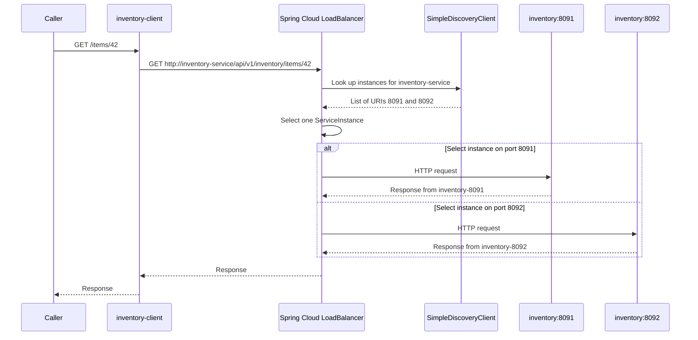

# Declaring a Static Replica List for a Learning Environment

When learning Spring Cloud LoadBalancer, we need multiple instances of the same service to observe how the client selects a destination for each request. In a learning environment, you can declare instance addresses directly in the calling application's configuration. Spring Cloud provides `SimpleDiscoveryClient` to read this list without needing to deploy Eureka, Consul, or a separate service registry.

This approach works well for hands-on exercises running a few processes on a local machine: start two replicas of `inventory-service` on two different ports, declare both addresses in the client application, and call using the service ID `inventory-service`. Spring Cloud LoadBalancer receives the instance list from the discovery client and chooses an instance for the request.

## 1. What Is a Static Instance List Used For?

A logical service can run as multiple replicas. For example:

| Service ID | Instance | Address |
|---|---|---|
| `inventory-service` | `inventory-1` | `http://localhost:8091` |
| `inventory-service` | `inventory-2` | `http://localhost:8092` |

**Service ID** is the logical name used by the client application. **Instance** is a specific process capable of receiving requests. Each instance has its own host and port address, while serving the same logical service.

In this lesson, the client application declares two URIs for the service ID `inventory-service`. When the client sends a request to `http://inventory-service`, Spring Cloud LoadBalancer integration looks up the instance list by service ID, selects an instance, and forwards the request to the corresponding URI.

A static list has three key characteristics to remember:

- Addresses are declared via configuration, usually inside a YAML file for a learning profile.
- The list does not automatically update when a process starts, stops, or changes ports.
- No standalone registry server is needed; the discovery client reads the instances declared inside the client application itself.

`SimpleDiscoveryClient` only supplies the instance list. Spring Cloud LoadBalancer is the component that selects an instance to route the request. Having two URIs in configuration does not automatically produce load balancing if the HTTP client is not integrated with LoadBalancer.

## 2. Preparing Dependencies

The calling application needs the `spring-cloud-starter-loadbalancer` dependency. This starter provides Spring Cloud LoadBalancer and the discovery components needed for the example.

With Maven, declare the Spring Cloud BOM in `dependencyManagement` to keep Spring Cloud library versions synchronized with the project's Spring Boot version:

```xml
<properties>
    <java.version>17</java.version>
    <spring-cloud.version>YOUR_COMPATIBLE_SPRING_CLOUD_VERSION</spring-cloud.version>
</properties>

<dependencyManagement>
    <dependencies>
        <dependency>
            <groupId>org.springframework.cloud</groupId>
            <artifactId>spring-cloud-dependencies</artifactId>
            <version>${spring-cloud.version}</version>
            <type>pom</type>
            <scope>import</scope>
        </dependency>
    </dependencies>
</dependencyManagement>

<dependencies>
    <dependency>
        <groupId>org.springframework.boot</groupId>
        <artifactId>spring-boot-starter-web</artifactId>
    </dependency>

    <dependency>
        <groupId>org.springframework.cloud</groupId>
        <artifactId>spring-cloud-starter-loadbalancer</artifactId>
    </dependency>
</dependencies>
```

Replace `YOUR_COMPATIBLE_SPRING_CLOUD_VERSION` with a release train compatible with the Spring Boot version in use, according to the Spring Cloud compatibility matrix. Do not choose a Spring Cloud version arbitrarily or pin separate versions per dependency when using the BOM.

The `RestClient` example requires Spring Framework 6.1 or later, which typically corresponds to Spring Boot 3.2 or later. If the project is on an older platform, use an HTTP client style supported by that Spring Cloud version, such as `RestTemplate` or `WebClient`, while keeping the same service ID configuration principle.

In this hands-on exercise, you do not need to add the Eureka or Consul starter. The goal is for `SimpleDiscoveryClient` to supply the instance list from static configuration.

## 3. Declaring Replicas in YAML

Place the instance list in the client application's configuration file. You can use a dedicated profile such as `application-lab.yml` so learning configuration does not mix with other environment configurations.

```yaml
server:
  port: 8080

spring:
  application:
    name: inventory-client
  cloud:
    discovery:
      client:
        simple:
          instances:
            inventory-service:
              - uri: http://localhost:8091
              - uri: http://localhost:8092
```

The important configuration prefix is:

```yaml
spring.cloud.discovery.client.simple.instances
```

This is a map where:

- The key `inventory-service` is the service ID.
- The value is the list of instances belonging to that service ID.
- Each `uri` item describes a callable address of an instance, including scheme, host, and port.

The name `inventory-service` must match the service ID in the URL called by the client. If the configured key is `inventory-service` but the client calls `http://stock-service`, LoadBalancer looks up a different service ID and will not find the declared list.

You can declare multiple service IDs in the same file:

```yaml
spring:
  cloud:
    discovery:
      client:
        simple:
          instances:
            inventory-service:
              - uri: http://localhost:8091
              - uri: http://localhost:8092
            pricing-service:
              - uri: http://localhost:8093
              - uri: http://localhost:8094
```

Each service ID has its own instance list. Do not combine replicas of two different services into a single list, because LoadBalancer selects instances based on the requested service ID.

Activate the `lab` profile when running the client application:

```bash
java -jar inventory-client.jar --spring.profiles.active=lab
```

If running from an IDE, set `lab` as the active profile in the run configuration. You could also set `spring.profiles.active: lab` in the default application configuration for a standalone lab, but passing the profile at runtime lets you explicitly choose configurations for each exercise.

## 4. Starting Two Instances of the Target Service

Both URIs in the list must point to two actual listening processes. We can use the same provider application and start it twice with two different `server.port` values.

Example provider returning an instance name based on the port:

```java
import java.util.Map;

import org.springframework.beans.factory.annotation.Value;
import org.springframework.web.bind.annotation.GetMapping;
import org.springframework.web.bind.annotation.PathVariable;
import org.springframework.web.bind.annotation.RequestMapping;
import org.springframework.web.bind.annotation.RestController;

@RestController
@RequestMapping("/api/v1/inventory")
class InventoryController {

    @Value("${server.port}")
    private int port;

    @GetMapping("/items/{id}")
    Map<String, Object> getItem(@PathVariable String id) {
        return Map.of(
                "itemId", id,
                "servedBy", "inventory-" + port,
                "port", port
        );
    }
}
```

Build the provider into a JAR file, then start two processes:

```bash
java -jar inventory-service.jar --server.port=8091
java -jar inventory-service.jar --server.port=8092
```

Both processes run the same code and endpoints, but each listens on a separate port. The provider does not need to register with a registry in this lab, because the client application already has the addresses of both instances in `application-lab.yml`.

Before testing LoadBalancer, confirm each instance is directly reachable:

```bash
curl http://localhost:8091/api/v1/inventory/items/42
curl http://localhost:8092/api/v1/inventory/items/42
```

The results should show different `port` or `servedBy` values. If one command fails to connect, fix starting the provider before testing client-side routing.

## 5. Integrating RestClient with Spring Cloud LoadBalancer

In the client application, register a `RestClient.Builder` with the `@LoadBalanced` annotation:

```java
import org.springframework.cloud.client.loadbalancer.LoadBalanced;
import org.springframework.context.annotation.Bean;
import org.springframework.context.annotation.Configuration;
import org.springframework.web.client.RestClient;

@Configuration
class HttpClientConfiguration {

    @Bean
    @LoadBalanced
    RestClient.Builder loadBalancedRestClientBuilder() {
        return RestClient.builder();
    }
}
```

The `@LoadBalanced` annotation marks the builder so Spring Cloud adds the service ID resolution and instance selection mechanism when sending requests. Then create the client using the service ID in the base URL:

```java
import org.springframework.stereotype.Service;
import org.springframework.web.client.RestClient;

@Service
class InventoryGateway {

    private final RestClient restClient;

    InventoryGateway(RestClient.Builder loadBalancedRestClientBuilder) {
        this.restClient = loadBalancedRestClientBuilder
                .baseUrl("http://inventory-service")
                .build();
    }

    String getItem(String itemId) {
        return restClient.get()
                .uri("/api/v1/inventory/items/{id}", itemId)
                .retrieve()
                .body(String.class);
    }
}
```

Here, `inventory-service` is the service ID. The client application does not need to know whether the next request will go to port `8091` or `8092`; LoadBalancer fetches the corresponding list from the discovery client and selects a `ServiceInstance`.

You can expose the gateway via an endpoint to test from the outside:

```java
import org.springframework.web.bind.annotation.GetMapping;
import org.springframework.web.bind.annotation.PathVariable;
import org.springframework.web.bind.annotation.RestController;

@RestController
class InventoryProxyController {

    private final InventoryGateway inventoryGateway;

    InventoryProxyController(InventoryGateway inventoryGateway) {
        this.inventoryGateway = inventoryGateway;
    }

    @GetMapping("/items/{id}")
    String getItem(@PathVariable String id) {
        return inventoryGateway.getItem(id);
    }
}
```

Run the client on port `8080`, then send multiple requests to the same endpoint:

```bash
curl http://localhost:8080/items/42
curl http://localhost:8080/items/42
curl http://localhost:8080/items/42
curl http://localhost:8080/items/42
```

With Spring Cloud LoadBalancer's default configuration, the instance selection algorithm is typically round robin. When requests are sent sequentially with no other instance-selection configuration, the `servedBy` field in the responses alternates between the two ports. The starting order may vary; do not rely on the ordering of a few requests as a guarantee of load distribution in production environments.

## 6. Verifying Configuration and Understanding the Processing Flow

When calling `GET /items/42` on the client, the processing flow can be summarized as follows:



You can verify layer by layer:

1. **Provider:** both ports `8091` and `8092` respond when called directly.
2. **Configuration:** the `lab` profile is active and the list is under the exact prefix `spring.cloud.discovery.client.simple.instances`.
3. **Service ID:** the key `inventory-service` matches the hostname in `http://inventory-service`.
4. **HTTP client:** the builder injected into the gateway is the `@LoadBalanced` bean.
5. **Routing:** responses from the client show which instance handled the request.

If the client uses a plain `RestClient` builder without `@LoadBalanced`, the hostname `inventory-service` is treated as a standard DNS hostname. Development machines normally have no DNS record for this name, so the request may fail with `UnknownHostException`. Simply declaring a static list does not automatically teach every HTTP client in the application how to use that list.

## 7. Limitations of a Static List and Container Notes

A static list is very convenient for learning and testing, but you need to understand its limitations:

- **No automatic registration or deregistration:** when adding, removing, or changing an instance's port, you must update the configuration and restart or reload the client application depending on your deployment setup.
- **No automatic liveness verification:** a URI remains in the list even after the provider stops. If LoadBalancer selects that instance, the request may encounter `Connection refused` or a timeout. Filtering instances by health requires configuring a separate health-checking supplier; the static list itself does not do this.
- **Not representative of production discovery:** real systems usually retrieve instances from Kubernetes, Eureka, Consul, or another discovery platform to keep state updated dynamically with the environment.
- **No strict load-balancing guarantee:** the default algorithm may alternate, but retries, concurrent requests, supplier configuration, and selection strategies can change the observed distribution.

In particular, `localhost` is resolved from the perspective of the calling process. If both client and provider run directly on the same machine, `localhost:8091` and `localhost:8092` work. If the client runs inside a Docker container, `localhost` points to the client container itself, not the host machine or provider container. In that case, use a hostname reachable from the container network, such as the service name in Docker Compose or `host.docker.internal` on Docker Desktop when the provider runs on the host.

Do not put `localhost` addresses into configuration shared across multiple environments. Separating configuration by profile allows each environment to provide URIs suitable for its network.

## 8. Troubleshooting Common Errors

| Symptom | Common Cause | How to Check |
|---|---|---|
| No instances found for `inventory-service` | Wrong service ID, profile not active, or incorrect YAML indentation | Check the key under `simple.instances`, the URL in the gateway, and active profiles. |
| `UnknownHostException: inventory-service` | Request goes through an HTTP client without LoadBalancer integration | Confirm the gateway uses the `RestClient.Builder` bean annotated with `@LoadBalanced`. |
| `Connection refused` | Provider not running, wrong port, or URI unreachable from client | Call each URI directly from the client's runtime environment. |
| Only one instance handles requests | One URI is down, list has only one element, or another selection configuration is active | Check both providers and the full YAML list. |
| Works on host machine but fails in Docker | `localhost` points to the client container | Replace with a hostname or address reachable within the container network. |
| Some requests fail after stopping a provider | Static list still contains the stopped instance's URI | Restart the provider or update config; to automatically exclude failing instances, configure health checks separately. |

When diagnosing, determine whether the failure occurs during instance lookup, hostname resolution, or opening the connection. `No instances available` usually indicates the discovery list has no matching instances; `UnknownHostException` shows the hostname is being resolved as a DNS name; `Connection refused` typically means the client reached the host, but no process is accepting connections on that port.

## 9. Practice Lab Completion Checklist

- [ ] The client application has the `spring-cloud-starter-loadbalancer` dependency and a compatible Spring Cloud BOM.
- [ ] The `lab` profile declares `inventory-service` with two URIs on different ports.
- [ ] Two provider processes are listening on ports `8091` and `8092`.
- [ ] Each provider's endpoint can be called directly.
- [ ] `RestClient.Builder` is annotated with `@LoadBalanced`.
- [ ] The gateway calls `http://inventory-service` instead of hardcoding a single instance port.
- [ ] Responses from calls through the client show which instance was selected.

Once you complete this lab, you have a simple discovery source to observe Spring Cloud LoadBalancer's `ServiceInstance` selection mechanism. Static configuration provides a convenient foundation for understanding service IDs, instance lists, and client-side routing before moving on to dynamic discovery, health checks, retries, and instance selection policies in real deployment environments.
