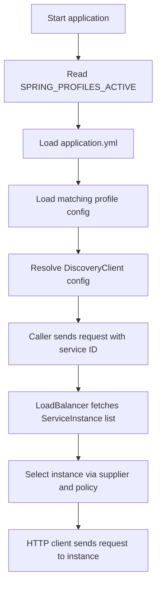

# Organizing Configuration by Profile and Runtime Environment

A Spring Cloud application typically runs across multiple environments: a personal workstation, development, integration testing, staging, and production. Each environment may use different service addresses, registries, ports, credentials, and operational policies. If these values are scattered across source code or manually changed before each run, deployments become error-prone and hard to reproduce.

Spring Boot provides externalized configuration and profiles to separate configuration from source code and select the right configuration set at startup. With Spring Cloud LoadBalancer, this organization allows the same service ID such as `inventory-service` to resolve to instances appropriate for the active environment, while allowing health checks, timeouts, and retries to be tuned to deployment needs.

## 1. Why Separate Configuration by Environment?

Suppose `order-service` calls `inventory-service` using a logical URI:

```java
webClient.get()
    .uri("http://inventory-service/api/items/{id}", itemId)
    .retrieve()
    .bodyToMono(Item.class);
```

The application should not change this code to a different URL every time it moves between environments. `inventory-service` is a stable service ID in the communication contract; discovery and LoadBalancer are responsible for finding the corresponding instances at runtime.

| Environment | Possible Instance Source | Configuration That Typically Differs |
|---|---|---|
| `local` | URIs running on a local machine or Docker Compose | Local ports, verbose logs, test data |
| `dev` | Registry or service addresses in the development network | Dev endpoints, dev credentials, lower resource limits |
| `test` | Stubs, mock servers, Testcontainers, or a test registry | Isolated data, timeouts tailored for tests |
| `staging` | Registry or platform closely mirroring production | Staging endpoints, pre-release observability and testing config |
| `prod` | Service discovery provided by the operations platform | Production secrets, load limits, verified timeouts and resilience policies |

The goal is to keep the source code unchanged and vary configuration via profiles, environment variables, or a configuration management system. A profile is only a mechanism for selecting configuration; it does not create the environment, registry, or service instances on its own.

## 2. How Do Spring Boot Profiles Work?

A profile is the name of a configuration group that can be activated when the application starts. Spring Boot automatically looks for configuration files with a profile suffix, such as:

```text
src/main/resources/
  application.yml
  application-local.yml
  application-dev.yml
  application-test.yml
  application-staging.yml
  application-prod.yml
```

`application.yml` holds shared configuration. When the `dev` profile is active, Spring Boot additionally loads `application-dev.yml`; values in profile-specific configuration have higher precedence than corresponding values in the base file.

Example base configuration:

```yaml
spring:
  application:
    name: order-service
  profiles:
    default: local

server:
  port: ${SERVER_PORT:8080}

management:
  endpoints:
    web:
      exposure:
        include: health,info
```

In this example, `order-service` is the shared application name. If no profile is activated externally, `local` is used as the default profile. The port can come from the `SERVER_PORT` environment variable; if unset, `8080` is used.

The `local` default is convenient for a developer workstation. Production pipelines or deployments must set the profile explicitly, such as `SPRING_PROFILES_ACTIVE=prod`, so they do not accidentally run local configuration when an environment variable is missing.

The `local` profile can configure static instances for local workstation development:

```yaml
# application-local.yml
spring:
  cloud:
    discovery:
      client:
        simple:
          instances:
            inventory-service:
              - uri: http://localhost:8081
              - uri: http://localhost:8082
```

This is an example using `SimpleDiscoveryClient`: the list of URIs is declared in configuration. `SimpleDiscoveryClient` is typically used when the application has no other `DiscoveryClient` implementation supplying the instance list. When an application uses Eureka, Consul, or another discovery client, you must configure that implementation; do not assume the static list above remains the active instance source. Static declaration works well for local setups or small labs; it does not track the state of a production service cluster.

In registry-based environments, `order-service` and `inventory-service` register or are discovered through the `DiscoveryClient` implementation chosen by the system. In that case, profile configuration must supply registry connection details and corresponding credentials. There is no need to modify the service ID in the calling code.

## 3. Activating a Profile When Running the Application

You can activate a profile via command-line arguments:

```bash
java -jar order-service.jar --spring.profiles.active=dev
```

Or via an environment variable:

```bash
SPRING_PROFILES_ACTIVE=staging java -jar order-service.jar
```

On PowerShell:

```powershell
$env:SPRING_PROFILES_ACTIVE = "local"
./mvnw spring-boot:run
```

For containers or deployment platforms, pass the profile via an environment variable or deployment configuration. For example, in a manifest/container environment you can set `SPRING_PROFILES_ACTIVE=prod`. This value is resolved at startup; changing an environment variable on an already running process does not dynamically re-activate a profile.

Key points to remember:

- `spring.profiles.active` specifies the active profile(s). Multiple profiles can be activated, separated by commas, though override ordering must be controlled.
- `spring.profiles.default` specifies the default profile when no profile is activated.
- `spring.profiles.include` adds other profiles; `spring.profiles.group` bundles multiple profiles under a convenient name.
- `spring.profiles.active`, `spring.profiles.default`, `spring.profiles.include`, and `spring.profiles.group` must be declared in profile-independent configuration documents, such as `application.yml`, or passed from the environment/command line. Do not put them inside `application-prod.yml` expecting that file to activate itself.

You can define profile groups to enable a related set of configurations:

```yaml
# application.yml
spring:
  profiles:
    group:
      staging-stack:
        - staging
        - metrics
      production:
        - prod
        - metrics
```

When `staging-stack` is activated, Spring Boot also activates `staging` and `metrics`; when `production` is activated, the application receives both `prod` and `metrics`. This is useful when an environment needs to combine business configuration with observability configuration. Name groups clearly and avoid having multiple profiles override the same property in hard-to-predict ways.

## 4. Organizing Configuration Files and Scopes of Each Value Type

A maintainable structure typically separates into three layers:

1. **Common configuration** in `application.yml`: application name, safe defaults, logging format, management endpoints allowed to be exposed, and values shared across all environments.
2. **Profile-specific configuration** in `application-{profile}.yml`: discovery client selection, registry endpoints, instance lists for local/test, or intentional differences between environments.
3. **Deployment values** from environment variables, secret stores, or a configuration system: passwords, tokens, certificates, registry addresses, and values that vary per deployment.

For example, `application-dev.yml` may contain settings specific to the development environment:

```yaml
spring:
  cloud:
    loadbalancer:
      # Only an example of an operational property that may vary by environment.
      # Choose values according to the deadlines and characteristics of the actual API.
      retry:
        enabled: true

logging:
  level:
    org.springframework.cloud.loadbalancer: DEBUG
```

The snippet above illustrates setting LoadBalancer configuration and log levels per profile. Specific property names, retry behavior, and default values must be checked against the Spring Cloud version in use and the integrated HTTP client type. Enabling retries does not mean every request is safe to retry.

In production, you can keep non-secret configuration in files and pull deployment-varying values from the environment:

```yaml
spring:
  cloud:
    loadbalancer:
      retry:
        enabled: ${LOADBALANCER_RETRY_ENABLED:false}

inventory:
  connect-timeout: ${INVENTORY_CONNECT_TIMEOUT:2s}
  read-timeout: ${INVENTORY_READ_TIMEOUT:3s}
```

`LOADBALANCER_RETRY_ENABLED` is an environment variable mapped to Spring Cloud LoadBalancer's retry property. The `inventory.*` section is an application-defined namespace bound to HTTP client configuration; Spring Cloud LoadBalancer does not interpret these keys itself. Discovery client connection properties must be declared according to the actual implementation such as Eureka, Consul, or Kubernetes. The example intentionally omits concrete registry addresses or production credentials.

Do not commit passwords, access tokens, private keys, or registry credentials to Git. Use the platform's secret manager, Kubernetes Secrets, protected environment variables, or an appropriate secret provisioning mechanism. The `prod` profile is not a security boundary either: `application-prod.yml` can still be read if packaged inside the artifact.

## 5. Override Rules and Configuration Loading Order

When the same property appears in multiple sources, Spring Boot applies property source precedence order. Normally, command-line arguments have higher precedence than system properties, environment variables, and configuration files. External configuration files outside the artifact can override files packaged inside the JAR; profile-specific configuration overrides corresponding base values.

Example:

```yaml
# application.yml
server:
  port: 8080
```

```yaml
# application-prod.yml
server:
  port: 8085
```

```bash
java -jar order-service.jar --server.port=8090
```

When running with the `prod` profile and the command-line argument above, the effective port is `8090`. This is useful for intentional overrides in deployment environments, but it can also make the actual configuration differ from what someone reading the YAML file expects the application to use.

Important notes when overriding:

- Do not define the same key in too many places without a clear reason. Know which source is authoritative for each value.
- With multi-document YAML, you can use `spring.config.activate.on-profile` to apply a configuration section when a profile matches.
- Lists in configuration are normally replaced by higher-precedence lists rather than automatically appended to. Therefore, the `simple.instances` list in a profile must contain all instances desired for that environment.
- `spring.config.location` replaces the default configuration search locations; `spring.config.additional-location` adds locations. When using these, verify that base and profile files are still loaded as expected.
- You can use placeholders like `${SERVER_PORT:8080}` to accept external values while providing a fallback. Do not put sensitive fallback values in files.

One way to write multi-document YAML:

```yaml
spring:
  application:
    name: order-service

---
spring:
  config:
    activate:
      on-profile: local
  cloud:
    discovery:
      client:
        simple:
          instances:
            inventory-service:
              - uri: http://localhost:8081

---
spring:
  config:
    activate:
      on-profile: dev
  cloud:
    discovery:
      client:
        simple:
          instances:
            inventory-service:
              - uri: http://inventory-1.dev.internal:8080
              - uri: http://inventory-2.dev.internal:8080
```

In the configuration above, each document after `---` is applied only when the corresponding profile is active. For large projects, splitting into `application-local.yml` and `application-dev.yml` is usually easier to search, review, and control edit permissions on; multi-document YAML fits well when sections are short and tightly related.

## 6. Applying Profiles to Spring Cloud LoadBalancer

LoadBalancer takes a service ID and selects a `ServiceInstance` from the instance list source provided by the application. Profiles can change the data source or operational parameters, but they do not change the service ID contract in the calling code.

For requests using a service ID to be routed through LoadBalancer, the application must also have the appropriate integration dependency and use an HTTP client configured for load balancing, such as a `WebClient.Builder` or `RestClient.Builder` annotated with `@LoadBalanced`. Simply declaring a profile or `spring.cloud.discovery.client.simple.instances` does not turn a regular HTTP client into one capable of resolving service IDs.

Overall flow:



For example, locally `SimpleDiscoveryClient` can provide two URIs in `application-local.yml`. In production, the instance list usually comes from a registry or container orchestration platform. `order-service` still calls `http://inventory-service`; LoadBalancer operates on the instance list corresponding to the running environment.

Several configuration decisions should be evaluated per environment:

| Component | Local/test | Staging/production |
|---|---|---|
| Discovery | Static list, stubs, or test registry | Actual registry/discovery platform |
| Instance | Local or container URIs | Instances registered and managed by the platform |
| Health check | Simple test endpoint, moderate frequency | Appropriate health endpoint, interval that avoids significant extra load |
| Retry | Useful for testing failures; small count | Enabled only according to API contract, idempotency, and time budget |
| Timeout | Suited to local machine and test speeds | Aligned with target latency, deadlines, and service SLA |
| Logging | Can enable DEBUG when investigating | Keep operational log levels appropriate, avoid logging sensitive data |

Health checks only take effect when the application has configured the corresponding `ServiceInstanceListSupplier`/health-check mechanism. Merely setting an interval property in YAML does not guarantee health checks are enabled. Similarly, LoadBalancer retry behavior depends on the version, integration, and client type; you must test the actual retry flow to avoid duplicate retries across multiple layers.

If you need different configurations per service ID, use the per-client properties supported by your Spring Cloud version or configure a dedicated LoadBalancer client with `@LoadBalancerClient`. Place client-specific configurations in a package not accidentally picked up by the main application's component scan, following the guidelines for your version. Do not assume every global property can be overridden per service ID; verify key names and support scope in the corresponding documentation.

## 7. Using `@Profile` for Beans and Java Configuration

YAML files are suited for changing values. `@Profile` is suited when you need to register different beans per environment, such as using a mock adapter locally or in tests:

```java
@Configuration
@Profile("local")
class LocalClientConfiguration {

    @Bean
    InventoryGateway inventoryGateway() {
        return new LocalInventoryGateway();
    }
}

@Configuration
@Profile("prod")
class ProductionClientConfiguration {

    @Bean
    InventoryGateway inventoryGateway(InventoryHttpClient client) {
        return new HttpInventoryGateway(client);
    }
}
```

`InventoryGateway`, `LocalInventoryGateway`, `InventoryHttpClient`, and `HttpInventoryGateway` are illustrative application-defined types. Ensure only one matching bean is registered per environment; if two configurations create beans with the same name or type without resolution rules, the application may fail at startup.

Do not use `@Profile` for every minor value such as ports or URLs. Those values are usually a better fit for `application-{profile}.yml` and placeholders. Use profiles for intentional differences in components or behavior; use properties for configuration data.

In Spring tests, `@ActiveProfiles("test")` can select test configuration:

```java
@SpringBootTest
@ActiveProfiles("test")
class InventoryClientIntegrationTest {
    // Test with configuration and dependencies dedicated to the test environment.
}
```

Do not let tests accidentally use the `local` or `prod` profile. Tests should have isolated dependencies and data so results are reproducible.

## 8. Verifying Effective Configuration and Troubleshooting Common Errors

When an application runs in the wrong environment or calls the wrong instances, identify the active profile and actual property sources before editing code.

A verification workflow:

1. Check the `SPRING_PROFILES_ACTIVE` environment variable in the running process/container.
2. Inspect startup logs to confirm active profiles.
3. Confirm the right `application-{profile}.yml` file is on the classpath or in the loaded external config location.
4. Check whether environment variables, command-line arguments, or external config outside the artifact override file values.
5. Inspect the instance list provided by `DiscoveryClient` for the target service ID.
6. Check which instance LoadBalancer selects and whether requests actually reach the right host/port.
7. Check health checks, timeouts, and retries at each layer; correlate logs using trace/correlation IDs.

Common errors:

| Symptom | Possible Cause | How to Check |
|---|---|---|
| Local accidentally calls dev services | `SPRING_PROFILES_ACTIVE` is still set to `dev` or a profile group activates extra config | Confirm active profiles and property sources |
| Cannot find `inventory-service` | Discovery client has no instances, wrong service ID, or service not registered in registry | Check discovery client and `ServiceInstance` list |
| Wrong instance list used | Profile file not loaded or list overridden by a higher-precedence source | Check packaged files, external config, and environment variables |
| A local instance is unreachable | Incorrect URI/port or target process is not running | Call the URI directly and check target service logs |
| Retries multiply request count | Retries enabled at multiple layers or request is not idempotent | Check attempt counts at HTTP client, LoadBalancer, and business layer |
| Health check does not exclude failing instances | Health-check supplier not configured or endpoint/port unsuitable | Check the `ServiceInstanceListSupplier` chain and health endpoint |
| Production missing credentials | Secret not mounted/provided to process or variable name mismatch | Check secret references and environment variables without printing secret values to logs |

If the application enables Actuator, you can use allowed health and configuration info endpoints to inspect status. Do not expose endpoints displaying the full environment/configuration to public access; some endpoints may reveal internal URLs or sensitive data.

## 9. Pre-Deployment Checklist

- [ ] `spring.application.name` is stable and consistent with the service ID used by other services.
- [ ] Profile is selected from deployment/environment, with an appropriate default for local.
- [ ] Shared configuration lives in `application.yml`; environment differences live in profile files or appropriate external config sources.
- [ ] Local/test uses simulated instances or isolated endpoints; production uses the platform's discovery/registry.
- [ ] No secrets, tokens, private keys, or credentials are committed to the repository.
- [ ] Timeouts, retries, and health checks suit the API, deadlines, and capabilities of the running Spring Cloud version.
- [ ] Non-idempotent requests are not retried automatically without duplicate-handling safeguards.
- [ ] Property precedence, post-override instance lists, and active profiles have been verified in the target environment.
- [ ] Logs/Actuator assist diagnostics without exposing sensitive information.

Separating configuration by profile allows a single artifact to run across multiple environments with the same service ID and calling code. By properly combining externalized configuration, discovery, and Spring Cloud LoadBalancer, each environment can provide its own instance list and operational policies without modifying source code for every deployment.
