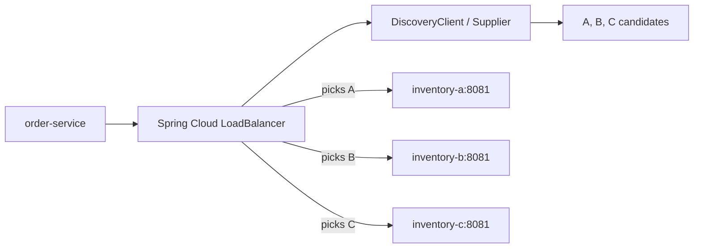
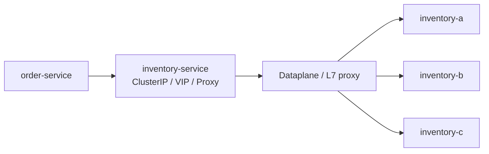
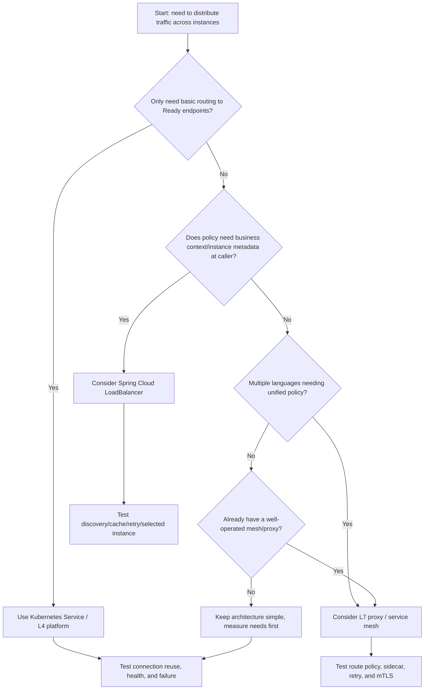

# Choosing Client-Side vs. Infrastructure-Based Load Balancing

When a service has multiple replicas, the system must decide which replica a request will go to. There are two common approaches:

- **Client-side load balancing:** the application calls a service ID, retrieves the `ServiceInstance` list itself, applies a policy, and connects directly to the selected instance. In Spring, `Spring Cloud LoadBalancer` provides this mechanism for RestClient, WebClient, OpenFeign, and corresponding integrations.
- **Infrastructure-side load balancing:** the application calls a stable address such as a Kubernetes Service, virtual IP, load balancer, or proxy/service mesh. The infrastructure selects a backend and forwards the request.

Neither model is universally better. Client-side gives the application control over instance selection and contextual metadata usage; infrastructure-side centralizes routing, health, security, and policies so multiple languages can share them. The right decision depends on where policies need to live, network topology, how discovery is managed, observability requirements, and operational capability.

This article belongs to the **Design Choices** chapter of the `SPRING_CLOUD_SERVICE_COMMUNICATION_LOAD_BALANCING` module. Its goal is to properly distinguish the two models, understand the difference between TCP connection-level and HTTP request-level balancing, evaluate trade-offs around health/retry/timeout/observability/security, and choose an architecture for a Spring Cloud system deployed on Docker or Kubernetes.

> **Key takeaway:** Kubernetes Service, DNS round robin, cloud load balancers, and service meshes do not have identical semantics. In particular, an L4 virtual IP usually distributes by flow/connection; it does not necessarily pick a new backend for every HTTP request on a reused connection.

## 1. Two models solving the same problem in two different places

Suppose `order-service` calls `inventory-service` with three replicas:

| Instance | Zone | Status |
|---|---|---|
| `inventory-a` | `zone-a` | Healthy |
| `inventory-b` | `zone-a` | Healthy |
| `inventory-c` | `zone-b` | Healthy |

Both models need to know which backends are able to serve traffic. The main difference is **who selects the backend**.

### 1.1. Client-side: the application selects the instance



Requests typically use a logical service ID:

```text
GET http://inventory-service/api/v1/items/SKU-001
```

Spring Cloud LoadBalancer fetches candidates from `ServiceInstanceListSupplier`, applies the policy, and produces the physical target for the HTTP client. The application can apply zone preference, hints, metadata, or a custom policy if the supplier/algorithm is configured.

### 1.2. Infrastructure-side: the application calls a stable address



The application calls a stable endpoint, for example:

```text
http://inventory-service.default.svc.cluster.local
```

The Kubernetes Service, cloud load balancer, or service mesh finds a backend and forwards traffic. The application does not need to fetch the list of Pods/instances itself to choose a destination for each request.

### 1.3. Quick comparison

| Question | Client-side | Infrastructure-side |
|---|---|---|
| Who picks the backend? | Library inside the application | Dataplane, VIP, proxy, or mesh |
| Does the client know each instance? | Yes, via supplier/discovery | Usually no; only knows a stable endpoint |
| Policies based on business metadata? | Flexible inside the app | Must be expressed in proxy/mesh policy or gateway |
| Shared across multiple languages? | Each client needs its own integration | Shared infrastructure |
| Endpoint changes? | Registry/cache/supplier updates | Infrastructure updates endpoints/backends |
| Observing instance selection? | Can be instrumented directly in the client | Observed at proxy/dataplane and application |
| Runtime dependency? | Spring Cloud or equivalent client library | Cluster/network/proxy control plane |
| Failure when no backend exists? | LB client cannot select an instance | VIP/proxy has no upstream endpoint |

## 2. "Infrastructure-based" is not a single mechanism

The following layers should be distinguished before comparing.

| Mechanism | Where is the backend chosen? | Typically distributes by |
|---|---|---|
| DNS round robin | DNS returns multiple addresses | DNS answer/cache; effectiveness depends on client/connection reuse |
| Kubernetes ClusterIP | Node dataplane (iptables/IPVS/eBPF depending on cluster) | Typically by network flow/connection |
| Cloud L4 load balancer | Network/cloud infrastructure | TCP/UDP flow or connection |
| L7 reverse proxy / API gateway | HTTP/gRPC-aware proxy | Can be per request, route, header, cookie |
| Service mesh sidecar | Envoy/sidecar or equivalent dataplane | Per connection or request depending on protocol/policy |
| External ingress | Ingress controller/cloud gateway | Request/connection depending on ingress type and protocol |

**Avoid calling all of them "per-request round robin".** With Kubernetes ClusterIP, the dataplane typically selects an endpoint when a new flow/connection is established. If an HTTP client holds a long-lived keep-alive connection, many requests may continue going to the same Pod. With HTTP/2, multiple streams can share one TCP connection; you cannot assume each stream is distributed to a different Pod.

An L7 proxy can choose an upstream for each HTTP request, though actual outcomes still depend on connection pooling, protocol, locality, and retry configuration.

## 3. Kubernetes Service: stable addressing does not equal client-side LB

A Kubernetes Service of type `ClusterIP` creates a stable endpoint inside the cluster:

```yaml
apiVersion: v1
kind: Service
metadata:
  name: inventory-service
spec:
  type: ClusterIP
  selector:
    app: inventory
  ports:
    - name: http
      port: 80
      targetPort: 8081
```

Deployment with multiple Pods:

```yaml
apiVersion: apps/v1
kind: Deployment
metadata:
  name: inventory
spec:
  replicas: 3
  selector:
    matchLabels:
      app: inventory
  template:
    metadata:
      labels:
        app: inventory
    spec:
      containers:
        - name: inventory
          image: example/inventory-service:dev
          ports:
            - name: http
              containerPort: 8081
```

A caller in the same namespace calls:

```text
http://inventory-service:80/api/v1/items/SKU-001
```

Kubernetes Service selects endpoints via the dataplane and cluster configuration. The application does not need `@LoadBalanced` simply to call this Service DNS.

### 3.1. How readiness affects endpoints

Kubernetes commonly uses a readiness probe to decide whether a Pod is ready to receive traffic through a Service. A Pod that is not Ready is normally excluded from the active serving endpoints, depending on EndpointSlice state and related configuration.

Example:

```yaml
apiVersion: apps/v1
kind: Deployment
metadata:
  name: inventory
spec:
  replicas: 3
  selector:
    matchLabels:
      app: inventory
  template:
    metadata:
      labels:
        app: inventory
    spec:
      containers:
        - name: inventory
          image: example/inventory-service:dev
          ports:
            - containerPort: 8081
          readinessProbe:
            httpGet:
              path: /actuator/health/readiness
              port: 8081
            periodSeconds: 5
            timeoutSeconds: 2
```

Kubernetes readiness differs from Spring Cloud LoadBalancer's health supplier:

- Kubernetes readiness affects the endpoints advertised by the Service dataplane.
- `HealthCheckServiceInstanceListSupplier` can probe each instance client-side using its own mechanism and interval.
- Consul/Eureka have registry-specific health/lease semantics.
- An application can use multiple health sources, but it must clearly define which source has authority to remove an instance from routing.

### 3.2. When is Kubernetes Service enough?

Kubernetes Service is usually a sensible choice if:

- Callers reside in the same cluster/network.
- The required policy is basic routing to Ready Pods.
- Applications do not need to know the zone or specific metadata of individual Pods.
- Clients do not need instance selection based on user/request hints.
- Different languages and frameworks need to call the same DNS endpoint.
- The platform team already operates CNI/dataplane, readiness, and appropriate observability.

If advanced L7 policies are required, a gateway or service mesh may be a better layer than a plain ClusterIP.

## 4. Spring Cloud LoadBalancer: application-controlled selection

In the client-side model, a Spring client uses a logical service ID. RestClient example:

```java
@Configuration(proxyBeanMethods = false)
class InventoryClientConfiguration {

    @Bean
    @LoadBalanced
    RestClient.Builder loadBalancedRestClientBuilder() {
        return RestClient.builder();
    }

    @Bean
    RestClient inventoryClient(
            @Qualifier("loadBalancedRestClientBuilder")
            RestClient.Builder builder) {

        return builder.clone()
                .baseUrl("http://inventory-service")
                .build();
    }
}
```

Request:

```java
StockView getStock(RestClient inventoryClient, String sku) {
    return inventoryClient.get()
            .uri("/api/v1/items/{sku}", sku)
            .retrieve()
            .body(StockView.class);
}
```

Spring Cloud LoadBalancer uses the logical hostname `inventory-service` to locate instances. It does not require the application to know Pod IPs or host ports ahead of calling.

### 4.1. Components of the client-side path

| Component | Role |
|---|---|
| `DiscoveryClient` | Fetches registrations from Eureka/Consul/Kubernetes or another source |
| `ServiceInstanceListSupplier` | Supplies candidate lists, optionally caching/filtering |
| `ReactorLoadBalancer` | Selects a `ServiceInstance` |
| `LoadBalancerLifecycle` | Request lifecycle hooks for observation/custom logic |
| HTTP client adapter | Rewrites a service-ID request into a request to the chosen host/port |
| Retry integration | Can retry according to policy and candidate list if configured |

Similarly with WebClient:

```java
@Bean
@LoadBalanced
WebClient.Builder loadBalancedWebClientBuilder() {
    return WebClient.builder();
}
```

With OpenFeign, use the service name and omit a direct URL if you want Feign to use Spring Cloud LoadBalancer:

```java
@FeignClient(name = "inventory-service")
interface InventoryFeignClient {
    @GetMapping("/api/v1/items/{sku}")
    StockView find(@PathVariable String sku);
}
```

Compatible Spring Cloud LoadBalancer integration and an appropriate discovery source are required. `@FeignClient(name=..., url=...)` fixes the target and causes Feign to use a direct URL.

### 4.2. What does the application know?

Client-side selection can expose to the application:

- The service ID and candidate list.
- Instance metadata such as zone, version, weight, or custom tags.
- The instance chosen for an attempt.
- The reason no candidates remained after filtering.
- Information to drive hints/zone preferences or policies based on request context.

In return, each runtime client must maintain proper libraries, configuration, caches, retries, and observability. If a system spans Java, Go, Node.js, and Python, you cannot assume every client automatically shares the same policy just because Java services use Spring Cloud LoadBalancer.

## 5. Comparing where policies live

### 5.1. Client-side policy

Example of inventory preferring same-zone instances:

```text
Caller zone = zone-a
Candidates:
  inventory-a -> zone-a
  inventory-b -> zone-a
  inventory-c -> zone-b

Supplier:
  discovery -> zone preference -> candidate list

LoadBalancer:
  picks A or B
```

The policy resides in the application or client library. This works well when decisions rely on caller context or business metadata that the infrastructure lacks.

### 5.2. Infrastructure-side policy

Example of a service mesh applying locality-aware routing:

```text
order-service
    |
    v
local sidecar
    |
    +-- route policy / locality / outlier detection
    |
    +-- inventory-a (zone-a)
    +-- inventory-b (zone-a)
    +-- inventory-c (zone-b)
```

Policies are declared in control-plane/mesh config and enforced in the proxy. Multiple languages can share them, though the platform team must manage configuration, proxy versions, and debugging capability.

### 5.3. Policy trade-off table

| Criterion | Client-side | Infrastructure-side |
|---|---|---|
| Policy based on business request metadata | Flexible inside the app | Requires passing headers/metadata and proxy config |
| Consistent policy across multiple languages | Hard to keep libraries in sync | Easier to centralize |
| Changing policy without deploying the app | Often requires config/app update depending on mechanism | Can update the control plane |
| Understanding business context | Close to the application | Proxies usually should not hold complex business logic |
| Zone-based routing | Supplier/custom policy | Mesh/locality policy or topology-aware dataplane |
| Weighted routing/canary | Custom supplier/algorithm | L7 proxy/mesh typically provides centralized policy |
| Sticky sessions | Can be implemented via context | Can use cookies/headers/hashing at the proxy |
| Debugging selected endpoint | Can be logged at the caller | Requires proxy access logs/metrics and tracing |

## 6. Performance: balancing by connection or by request?

This is one of the biggest factors influencing the choice.

### 6.1. L4 usually picks backends per flow/connection

An L4 load balancer typically does not parse HTTP requests. It operates on TCP/UDP flows, so backend selection is usually tied to the connection. If an HTTP client uses keep-alive:

```text
Client
  TCP connection #1 -> inventory-a
      HTTP request 1
      HTTP request 2
      HTTP request 3
```

requests on that connection may all go to A.

When another connection is opened:

```text
Client
  TCP connection #1 -> inventory-a
  TCP connection #2 -> inventory-b
```

L4 may choose B for the new connection. However, the request ratio between A and B can skew if connection lifetimes or request volumes per connection differ.

### 6.2. L7 proxies can pick per HTTP request

An HTTP-aware proxy can inspect routes/headers and pick an upstream per request:

```text
One downstream connection:
  request 1 -> upstream A
  request 2 -> upstream B
  request 3 -> upstream A
```

This enables per-request policies, canaries, header routing, retries, and circuit breaking at the proxy. Still, HTTP/2 multiplexing and upstream connection pooling must be understood accurately: the proxy may select an endpoint per stream/request and then use its own connection pool to send upstream.

### 6.3. Client-side is also affected by connection pools

Spring Cloud LoadBalancer selects an instance at the HTTP client request layer, but the HTTP transport maintains its own connection pool. Depending on the connector, a request may pick instance B while pool/connection lifecycles, retries, or URI handling require careful observation. Do not infer distribution from TCP connection counts alone.

Distinguish between:

- Logical business requests.
- LoadBalancer selections.
- HTTP attempts.
- TCP connections.
- HTTP/2 streams.
- Responses/final outcomes.

A dashboard that only counts connections does not prove requests are evenly distributed.

## 7. Discovery and instance list updates

### 7.1. Client-side discovery

An application using a Consul/Eureka/Kubernetes DiscoveryClient fetches the instance list and may keep its own cache:

```text
Registry update
    -> Discovery client fetch/watch/cache
    -> ServiceInstanceListSupplier
    -> LoadBalancer selection
    -> HTTP client connection
```

Multiple delays can exist:

- Registry receives registration/deregistration.
- Discovery client updates its cache.
- LoadBalancer supplier refreshes/cache expires.
- Health filter updates status.
- HTTP client pool detects that an old connection is no longer valid.

The client-side model must manage **freshness and convergence** across these layers.

### 7.2. Infrastructure-side discovery

In Kubernetes, EndpointSlices and the Service dataplane are the source of endpoint updates. With a service mesh, the control plane distributes clusters/endpoints to proxies. The application usually does not need to poll a registry itself, though the platform still has propagation delays and caches.

**Infrastructure-side does not eliminate discovery; it shifts discovery ownership from the application to the infrastructure.**

### 7.3. Who is responsible when an instance disappears?

| Event | Client-side | Infrastructure-side |
|---|---|---|
| Instance deregisters | Registry/client cache must update | EndpointSlice/control plane/proxy updates |
| Pod not Ready | Supplier/registry health must exclude it | Readiness affects Service endpoints |
| TCP reset | Client/transport detects it | Proxy/dataplane detects it per flow/request |
| Outlier instance | Custom health/filter possible | Mesh/proxy typically has outlier detection |
| Stale cache | App/client config | Control plane/proxy/dataplane config |
| Caller uses wrong service ID | Client selection fails | DNS/route name or proxy cluster config fails |

## 8. Health checks: readiness, registry health, and active health are not the same

Do not collapse every "healthy" state into a single boolean.

| Health type | Who checks? | Meaning |
|---|---|---|
| Kubernetes readiness probe | Kubelet | Should the Pod receive traffic via the Service? |
| Kubernetes liveness probe | Kubelet | Does the container need to restart? |
| Consul/Eureka health | Registry/agent/client | Is the instance considered eligible in the registry? |
| Spring Cloud health supplier | Client-side supplier | Did the instance pass the client health check? |
| Proxy active health check | Envoy/LB | Does the upstream respond to probes per policy? |
| Outlier detection | Proxy/dataplane | Does the instance show abnormal error rate/latency warranting temporary ejection? |
| Business readiness | Application | Are dependencies/business state ready to serve? |

Liveness should not check every dependency in a way that triggers cascading fleet restarts when one dependency temporarily drops. Readiness should reflect the ability to serve requests according to the service contract.

### 8.1. Two health layers filtering together can cause surprises

If Kubernetes readiness already removes a Pod from Service endpoints while a Spring Cloud client also calls its own health endpoint, there can be two intervals and two caches. That is not necessarily wrong, but you must clarify:

- Which source is authoritative?
- Do the probes hit the same endpoint?
- Can one layer treat an instance as healthy while the other has already excluded it?
- Does probe frequency generate noticeable load?
- When all instances are unhealthy, what is the fallback behavior?

Do not turn on every health check merely because the framework supports it; configure them around clear recovery goals.

## 9. Retries and timeouts: avoid duplicating policies

Client-side LoadBalancer can coordinate retries with the supplier to choose another instance. An infrastructure-side proxy/mesh can also retry upstreams. If both retry, call counts can multiply rapidly.

Suppose:

- The application tries up to 3 attempts.
- The proxy tries up to 2 upstream attempts for each application attempt.

Worst-case upstream attempts can approach:

```text
3 application attempts × 2 proxy attempts = 6 upstream attempts
```

Actual numbers depend on where retries are placed, retryable errors, connection reuse, retry budgets, and deadlines; the multiplication simply illustrates the amplification risk.

### 9.1. Design rules

1. Pick one primary layer to own retry/failover for each error category.
2. If the proxy owns retries, the client should not retry the same error with a large budget without good reason.
3. Set an overall deadline at the caller and allocate connect/read/response budgets smaller than the overall deadline.
4. Retry only recoverable errors and requests that are idempotent or carry an idempotency key.
5. Do not retry indefinitely when no instance exists; that only adds load and logs.
6. Use a retry budget/backoff/jitter and concurrency limits.
7. Record attempts separately from logical requests so amplification is visible.
8. Verify which 5xx, reset, timeout, or gRPC statuses the proxy retries; do not infer behavior from a setting named "retry enabled".

### 9.2. Timeouts must form a hierarchy

Illustrative example:

```text
Caller deadline:             3.0 s
  Application operation:     2.8 s
    Client pool acquire:      0.2 s
    Connect/TLS:              0.5 s
    Response budget:          1.8 s
  Cleanup/serialization:      0.2 s
```

If a proxy sits in the middle, budgets must be allocated for downstream and upstream timeouts. Never set a proxy timeout longer than the caller deadline and expect the caller to get a response in time.

## 10. Observability: place telemetry where decisions happen

### 10.1. Client-side metrics and traces

Spring Cloud LoadBalancer can record lifecycle meters when Micrometer integration is enabled:

- `loadbalancer.requests.active`.
- `loadbalancer.requests.success`.
- `loadbalancer.requests.failed`.
- `loadbalancer.requests.discard`.

HTTP client observation can provide status/latency. Traces can link caller and downstream if propagation/exporters are configured. The client can log the selected instance, zone, and selection reason with appropriate instrumentation.

Note: LB `success` means the lifecycle completed with a response forwarded—it does not mean HTTP 2xx.

### 10.2. Infrastructure metrics

Infrastructure typically observes:

- Requests/connections entering the proxy.
- Upstream cluster/endpoint.
- Retry attempts and retry overflow.
- Outlier ejections.
- Active/pending connection pool counts.
- Upstream connect/response latency.
- HTTP status/gRPC status.
- Sidecar CPU/memory and control-plane sync.
- Endpoint counts and health states.

Metric names depend on Envoy, ingress, cloud provider, CNI, and dashboards. Do not assume service mesh metrics exist on a plain Kubernetes ClusterIP.

### 10.3. Trace propagation across proxies

A proxy/mesh can create spans or forward context, but matching header propagation must be configured (W3C Trace Context, B3, or the organization's format). If the proxy drops headers or tracing sampling differs, traces can break even when request routing works.

### 10.4. Who answers which question?

| Operational question | Client-side telemetry | Infrastructure telemetry |
|---|---|---|
| Which service ID did the application request? | Clear | May only see route/cluster |
| How many candidates did the supplier have? | Directly measurable | Proxy usually only sees upstream endpoints |
| Which instance did the client pick? | Clear if instrumented | Proxy logs upstream host |
| Was the request dropped due to no-instance? | LB discard | May only show no healthy upstream |
| Was a Pod ejected as an outlier? | Not necessarily known | Proxy holds the metrics |
| Is the pool/sidecar congested? | HTTP client pool metrics | Proxy downstream/upstream pool metrics |
| Did the overall business operation succeed? | Caller knows | Infrastructure does not always know business outcome |

Good observability usually requires both application and infrastructure perspectives, even when only one place owns routing decisions.

## 11. Security and TLS

### 11.1. Client-side TLS

If the client connects directly to a Pod/instance, the HTTP client must verify the certificate for the hostname/SAN provided by the registry. This requires:

- Advertised host matching the certificate identity.
- Truststore containing the required CA chain.
- Proper SNI/hostname verification.
- Managed certificate rotation.
- Consistent TLS configuration across every service client.

If the registry returns an IP while the certificate only lists a DNS SAN, TLS can fail even when TCP connects successfully.

### 11.2. Infrastructure-side TLS and mTLS

A gateway/service mesh can centralize TLS termination or mTLS between sidecars. The advantage is unified identity/certificate policies across multiple languages. However, you must clearly establish:

- Does TLS terminate at ingress, sidecar, or application?
- Is traffic re-encrypted from the proxy to the backend?
- Does the app still need internal HTTPS?
- How is workload-to-workload identity authenticated?
- Do tracing and health probes use the proper trust and authorization?

Do not assume "having a service mesh means all traffic is automatically encrypted end-to-end". Check actual data-plane policies and termination points.

## 12. Performance, resources, and operational complexity

| Factor | Client-side | Infrastructure-side |
|---|---|---|
| Network hops | Can connect directly to instance | VIP/dataplane; L7 sidecar adds processing hop |
| Application CPU | Selection, cache, observation in-process | Less selection logic in app |
| Infrastructure CPU/memory | Registry/control plane and client state | Dataplane/proxy/sidecar consume resources |
| Connection pooling | Each app client manages pools to instances | Proxy holds downstream/upstream pools; app pools to VIP/proxy |
| Policy changes | May require deploying/configuring each client | Can centralize in the control plane |
| Debugging | Distributed across each app | Requires proxy/mesh/networking skills |
| New languages | Must integrate an LB library | Can share the proxy/Service |
| Platform dependency | Discovery/client framework | Kubernetes/network/mesh/cloud platform |
| Failure domain | Registry/client config | Dataplane/control plane/proxy config |

You cannot conclude client-side is always faster for skipping a proxy, or infrastructure-side is always slower for adding a hop. An L4 dataplane has different overhead than an L7 sidecar; client-side carries discovery/cache/selection costs and per-instance pools. Measure latency, CPU, connection counts, and failure recovery under realistic load.

## 13. When to choose client-side?

Client-side Spring Cloud LoadBalancer fits when:

- The application needs to know the service ID and individual instances to decide routing.
- Policies depend on zone, metadata, hints, version, or caller context.
- You want the client to pick instances itself and fail over to other candidates.
- The system spans multiple environments without a shared service mesh.
- The Java team has standardized on Spring Cloud client libraries and can operate them.
- You need selection control at the application boundary, e.g., a dependency with specialized policy.
- You want lifecycle/metrics integrated into Micrometer right at the caller.

Accept that each client must manage its discovery source, cache freshness, health filtering, timeouts/retries, and instrumentation. Services written in other languages must implement equivalent policies if uniform behavior is desired.

## 14. When to choose infrastructure-side?

Infrastructure-side fits when:

- Multiple languages/frameworks call the same dependency.
- The platform team wants centralized routing policies, mTLS, retry budgets, and telemetry.
- Kubernetes Service/Ingress satisfies routing requirements.
- You need canary/header routing, outlier detection, or locality policies at an L7 proxy.
- You want to reduce application coupling to a specific registry.
- You want to change routing without releasing every caller service.
- You have a platform team capable of operating the dataplane, mesh, ingress, and control plane.

Accept that an infrastructure layer can become a new failure domain; misconfigured proxies can affect many services. Sidecars/meshes also consume resources and require dedicated upgrade and observability procedures.

## 15. Requirements-based decision table

| Requirement | Preferred direction | Reason |
|---|---|---|
| Only need to route to Ready Pods in one Kubernetes cluster | Kubernetes Service | Simple, platform-native |
| Java app needs per-request zone/hint | Client-side or L7 mesh with metadata policy | Policy needs specific routing info |
| Java, Go, Node need a unified policy | Infrastructure-side | One shared policy across runtimes |
| Canary by header/cookie | L7 proxy/mesh/gateway | HTTP layer understands request metadata |
| Pick instance by business metadata only the app knows | Client-side | App holds richer context than proxy |
| Centralized mTLS and workload identity | Service mesh | Unified security policy |
| External traffic, TLS termination, WAF | Ingress/API gateway/cloud LB | Fits edge boundary |
| Do not want to operate a mesh | Kubernetes Service or client-side | Avoids adding a control/data plane |
| Multiple registries/environments needing consistent client policy | Client-side abstraction | App owns selection logic |
| Need to observe per-caller selection | Client-side instrumentation | Close to where selection happens |
| Need centralized outlier ejection | L7 proxy/mesh | Proxy observes aggregate upstream traffic |
| Only need TCP distribution | L4 load balancer | Less complex than L7 |

### 15.1. Condensed decision tree



The decision tree is an initial guide, not a substitute for measurement. If the system already has a mesh, adding client-side selection on the same traffic path needs a clear justification and tests proving the benefit.

## 16. Hybrid model: using the right layer for the right job

Both models can coexist, provided responsibilities are clearly split.

### 16.1. Edge gateway + internal Kubernetes Service

```text
External client
    -> Cloud Load Balancer / Ingress
    -> order-service
    -> http://inventory-service (Kubernetes ClusterIP)
    -> inventory Pods
```

This is a common setup: the edge uses infrastructure; service-to-service uses Kubernetes Service. The application does not need Spring Cloud LoadBalancer for inventory traffic if no client-side policy is required.

### 16.2. Service mesh for internal traffic, client-side for a special dependency

You can use a mesh for default routing/mTLS while a specialized dependency uses application-aware selection. However, you must determine whether client-side requests go through the sidecar, whether the sidecar load-balances again, and which policy is authoritative.

### 16.3. Client-side selection in front of a proxy

One pattern:

```text
order-service
  -> Spring Cloud LoadBalancer selects inventory-b
  -> sidecar intercepts connection
  -> mesh proxy routes to upstream endpoint
```

If the sidecar is not configured for proper passthrough, a request choosing B may get forwarded by the proxy to A/C. Both the application and the proxy are making decisions, and one can override the other. The result is app metrics saying "selected B" while proxy access logs say "upstream A".

Only use this pattern when there is an explicit requirement—for instance, the app picks endpoints by metadata unknown to the mesh while the mesh still enforces mTLS/telemetry. Configure the proxy to preserve the target or forward per an agreed contract.

## 17. Anti-patterns: double load balancing and retry amplification

### 17.1. Two layers picking backends with unclear ownership

For example, the app uses `RandomLoadBalancer` to pick a Pod IP, yet the request is still sent to a Kubernetes Service VIP or another proxy cluster. As a result, the app's selection no longer determines the final backend.

Symptoms:

- App logs selected instance B.
- Proxy logs upstream host A.
- Connection pool to the VIP does not reflect per-Pod selection.
- Traffic distribution diverges from the client policy.
- Incidents are hard to investigate because each layer logs a different target.

**Fix:** decide which layer selects the final backend. If the app picks a specific Pod, the target transport must route to that Pod (and the mesh must honor the target per policy). If the proxy picks the backend, the app should call a stable endpoint instead of selecting Pods itself.

### 17.2. Retries multiplying across layers

If the client retries 3 times, the mesh retries 2 times per attempt, and the gateway retries 2 more times, one logical operation can generate many upstream attempts. Under load, a retry storm pushes the dependency further into overload.

Rules:

- One primary layer owns retries for each call path.
- Other layers set retry budgets to 0 or a very small cap unless justified.
- Overall deadline must propagate through the proxy.
- Retry only safe/idempotent operations.
- Track attempts per logical request, not just final success rate.

### 17.3. Two health systems excluding instances out of sync

If a Spring supplier excludes B due to a custom health check while the mesh still considers B healthy, the client-side list and proxy endpoint set diverge. Conversely, Kubernetes readiness removes B while a stale app cache still selects B.

You need a clear source of truth or a measured convergence process. If multiple health layers exist, document which layer has authority to exclude endpoints and how recovery works.

## 18. Configuration examples for both choices in Spring Boot

### 18.1. Option A — Spring Cloud LoadBalancer

Maven needs Spring Web and Spring Cloud LoadBalancer, along with an appropriate discovery implementation (Consul/Eureka/Kubernetes or another supplier). RestClient:

```java
@Configuration(proxyBeanMethods = false)
class ClientSideConfiguration {

    @Bean
    @LoadBalanced
    RestClient.Builder inventoryLoadBalancedBuilder() {
        return RestClient.builder();
    }

    @Bean
    RestClient inventoryClient(
            @Qualifier("inventoryLoadBalancedBuilder")
            RestClient.Builder builder) {

        return builder.clone()
                .baseUrl("http://inventory-service")
                .build();
    }
}
```

In this model, `inventory-service` is the service ID; DiscoveryClient/supplier returns each instance's host/port. If using Feign:

```java
@FeignClient(name = "inventory-service")
interface InventoryClient {
    @GetMapping("/api/v1/items/{sku}")
    StockView find(@PathVariable String sku);
}
```

Do not set a direct `url` if the goal is for Spring Cloud LoadBalancer to select instances.

### 18.2. Option B — Kubernetes Service / infrastructure endpoint

If Kubernetes Service or a proxy already owns backend selection, use a plain client calling the stable DNS name:

```java
@Configuration(proxyBeanMethods = false)
class InfrastructureRoutedConfiguration {

    @Bean
    RestClient inventoryViaPlatform(RestClient.Builder builder) {
        return builder
                .baseUrl(
                    "http://inventory-service.default.svc.cluster.local")
                .build();
    }
}
```

Here, the builder is **not annotated with `@LoadBalanced`**. DNS/Service dataplane/proxy routes traffic per the platform. If the project has multiple RestClient builders, use `@Qualifier` so you do not accidentally inject a builder marked for LB.

This is a conceptual configuration: namespace/domain names must match the cluster; some environments use short service DNS names. If the infrastructure is a service mesh, the application can use the service DNS/virtual host intercepted by the sidecar.

### 18.3. Option C — direct gateway URL

If the team wants an API gateway to handle routing:

```java
RestClient inventoryGateway(RestClient.Builder builder) {
    return builder
            .baseUrl("https://inventory-gateway.internal")
            .build();
}
```

This is a direct gateway endpoint; the gateway/proxy handles upstream selection. Do not configure it as a service ID in a load-balanced builder unless you intentionally want Spring to look up the gateway name in the registry.

## 19. Testing to verify which layer is load balancing

An architectural decision must be proven with tests, not just dependency names.

| Test | Client-side | Infrastructure-side |
|---|---|---|
| Multiple healthy instances | Supplier returns all candidates; LB selects per policy | Registry/proxy/service has all endpoints |
| One unhealthy instance | Client supplier excludes instance per health policy | Readiness/outlier detection removes endpoint |
| Deregister/recreate | Verify client cache/convergence | Verify EndpointSlice/control-plane/proxy update |
| Keep-alive/HTTP2 | Count logical requests and selected instances | Verify backend distribution per connection/stream |
| No instance | LB discard/no-instance behavior | VIP/proxy reports no healthy upstream |
| Retry | Verify retry-aware supplier and attempt count | Verify proxy retry budget/overflow |
| Trace | Client selection + HTTP spans | Proxy spans/access logs and header propagation |
| TLS | Trust/SAN against physical instance | TLS termination/re-encryption/mTLS policy |
| Scale | Discovery refresh and cache | Endpoint propagation, proxy cluster update |

### 19.1. Two marker servers for client-side testing

Use two HTTP stubs A/B, each returning its own marker:

```text
inventory-a -> body "inventory-a"
inventory-b -> body "inventory-b"
```

Configure `SimpleDiscoveryClient` or a test supplier to provide two URIs under the same service ID `inventory-service`. Call using `@LoadBalanced RestClient`:

```java
String response = client.get()
        .uri("http://inventory-service/whoami")
        .retrieve()
        .body(String.class);
```

Assert every response belongs to set A/B and, with a deterministic/round-robin policy in a controlled test environment, verify both are called. Do not require a random policy to produce an exact 50/50 split over a small number of requests.

### 19.2. Infrastructure tests must verify the real dataplane

For Kubernetes Service:

1. Create a test namespace.
2. Deploy two backend Pods with distinct markers.
3. Create a Service selector pointing to both Pods.
4. Wait until both Pods are Ready and the EndpointSlice lists two endpoints.
5. From a caller Pod, send requests through the Service DNS/VIP.
6. Record markers and request counts received by each backend.
7. Transition one Pod to NotReady or delete the Pod.
8. Wait for EndpointSlice/dataplane convergence and test new requests.
9. Send multiple requests on one keep-alive connection and across multiple connections to evaluate real distribution.
10. Delete the namespace/resources after the test.

A test mocking `Service` or mocking DNS does not prove the Kubernetes dataplane routed traffic.

### 19.3. Testing connection reuse

When you want to know whether an LB balances per request or per connection:

- Send multiple HTTP/1.1 requests over a single keep-alive connection.
- Send multiple connections in parallel.
- If using HTTP/2, send multiple streams over one connection.
- Record backend markers/server counters.
- Compare results against the dataplane type (L4, L7 proxy, Spring client LB).
- Do not rely solely on a loop creating a new client each iteration; that induces connection churn and does not reflect production pools.

## 20. Selection workflow for a Spring Cloud system

Follow in order:

1. **Describe traffic:** synchronous HTTP/gRPC, streaming, request volume, connection reuse, HTTP/2.
2. **Identify topology:** single Kubernetes cluster, multi-cluster, VM, hybrid cloud, service mesh, or standalone registry.
3. **List required policies:** round robin, zone, hint, canary, sticky, weighted, outlier.
4. **Assign owner:** app team, platform team, or gateway team owning final selection.
5. **Define health source:** readiness, Consul/Eureka, client health supplier, or proxy health.
6. **Set retry/timeout:** single retry owner, overall deadline, idempotency, and retry budget.
7. **Design observability:** selected instance, upstream host, HTTP attempts, final outcome, traces, and pool metrics.
8. **Evaluate security:** TLS termination, mTLS, identity, certificate SAN/trust.
9. **Test failures:** no instance, Pod NotReady, TCP reset, stale cache, proxy unavailable.
10. **Measure performance:** p50/p95/p99, CPU, memory, sidecar overhead, connection count, and throughput.
11. **Roll out canary:** limit traffic and have a rollback.
12. **Document:** policy owner, config owner, SLO, runbook, and on-call responsibilities.

## 21. Decision examples

### Scenario A — One Kubernetes cluster, multiple Java services, basic routing

**Choose Kubernetes Service** first. If all callers only need to reach Ready Pods and do not need custom metadata/hints, adding Spring Cloud LoadBalancer may introduce a discovery/cache/policy layer the system does not yet need.

### Scenario B — Caller must prefer same-zone inventory based on request metadata

**Consider client-side** if the application knows the zone/hint and needs it to filter candidates. If multiple languages need the same policy, evaluate whether an equivalent can be expressed in an L7 service mesh before implementing separate libraries.

### Scenario C — Java, Go, and Node.js need uniform mTLS, canary, and outlier detection

**Consider a service mesh/L7 infrastructure.** Policies are centralized and independent of caller frameworks. Measure sidecar resource usage, control-plane complexity, and failure domains before cluster-wide rollout.

### Scenario D — Multiple registries/environments without a shared mesh

**Client-side may fit** so Java applications can share the Spring Cloud abstraction, provided discovery integrations, caches, health, and policies are operated consistently.

### Scenario E — Already running a service mesh, yet one client selects Pod IPs itself

Only keep client-side selection if there is a specific reason and the mesh is configured not to override the chosen destination (or both layers have a clear routing contract). Otherwise, let the mesh pick the backend and have the caller use a stable service endpoint.

## 22. Common mistakes when choosing a model

| Mistake | Consequence | How to avoid |
|---|---|---|
| Thinking Kubernetes ClusterIP picks a Pod for every HTTP request | Misunderstanding keep-alive/HTTP2 impact | Clarify L4 flow semantics and test connection reuse |
| Using Spring LB and mesh to both pick backends without splitting roles | Selected instance in app differs from proxy upstream | Designate one owning layer or a clear contract |
| Enabling retries in app, mesh, and gateway | Retry amplification, downstream overload | One retry owner, budget, and deadline |
| Checking only liveness and omitting readiness | Unready Pods can still receive traffic | Design readiness around serving capability |
| Assuming a mesh automatically encrypts end-to-end | TLS might terminate at a single hop | Check termination and re-encryption |
| Using client-side without managing caches | Selecting stale instances after scale/deregister | Measure convergence and TTL |
| Using infra LB without proxy metrics | Cannot tell which upstream failed | Enable access logs, cluster/endpoint metrics |
| Comparing TCP connection counts to conclude request distribution | Wrong when pool/HTTP2 reuse occurs | Count requests/streams and backend markers |
| Putting complex business routing logic into proxies | Policies hard to understand and test | Keep business logic in apps or design simple metadata |
| Using direct Pod IPs without managing TLS/DNS | Cert mismatches and stale endpoints | Use appropriate discovery/mesh/service abstractions |
| Treating no-instance and no-healthy-upstream as identical | Wrong-layer runbook | Separate LB discard from proxy upstream health |
| Adding a mesh solely for round robin | Unnecessary operational complexity | Assess requirements first and measure benefits |

## 23. Architecture decision acceptance checklist

- [ ] Clearly identified the layer making the final backend selection.
- [ ] Distinguished service ID from DNS/VIP/instance host.
- [ ] Confirmed whether the mechanism is L4 connection-based or L7 request-aware.
- [ ] Verified the impact of keep-alive, connection pooling, and HTTP/2.
- [ ] Identified the discovery source and endpoint update owner.
- [ ] Readiness/health semantics align with routing.
- [ ] Cache/convergence measured after scale, restart, and deregistration.
- [ ] Retries have one primary owner, a budget, and clear idempotency.
- [ ] Overall timeout propagates across layers.
- [ ] Observability includes metrics at both caller and infrastructure.
- [ ] Trace context propagates through the proxy/mesh.
- [ ] TLS/mTLS, trust, SAN, and termination points are clear.
- [ ] Languages/frameworks behave consistently if policy is centralized.
- [ ] No unintended double load balancing.
- [ ] Tested with two instances, unhealthy instance, no-instance, and recreate.
- [ ] Tested connection reuse/HTTP2 if traffic uses those protocols.
- [ ] Dashboards and runbooks identify upstream/selected instances.
- [ ] Measured latency, throughput, CPU, memory, and failure recovery.
- [ ] Canary/rollback plan and specific operational owner are defined.

## 24. Summary

**Client-side and infrastructure-side load balancing differ primarily in where backend selection happens and who owns the policy.** Spring Cloud LoadBalancer lets the application pick each `ServiceInstance` from discovery, using metadata and policies close to the business caller. Kubernetes Service, L4/L7 proxies, gateways, and service meshes centralize routing in infrastructure, enabling multiple languages to share endpoints and policies.

If you only need basic routing to Ready Pods inside a Kubernetes cluster, Kubernetes Service is usually the simpler choice. If the application needs metadata/hint-driven selection or must control individual instances itself, Spring Cloud LoadBalancer can be a good fit. If you need unified policies across runtimes, mTLS, canaries, and outlier detection, a service mesh/L7 infrastructure is worth considering.

Do not decide based solely on the term "round robin" or connection counts. Distinguish L4 connection selection from L7 request selection, verify keep-alive/HTTP2, health, and discovery convergence, designate one layer to own retries, observe both caller and proxy, and avoid having two layers pick backends with unclear responsibility. A hybrid architecture can work well, but only when each layer has a clear role and tests prove the actual traffic path.

### References

- [Spring Cloud Commons — Spring Cloud LoadBalancer](https://docs.spring.io/spring-cloud-commons/reference/spring-cloud-commons/loadbalancer.html) — discovery, supplier chain, selection, cache, retry, and statistics.
- [Spring Cloud Commons — Common Abstractions](https://docs.spring.io/spring-cloud-commons/reference/spring-cloud-commons/common-abstractions.html) — `@LoadBalanced` RestClient/WebClient/RestTemplate and service IDs.
- [Kubernetes — Service](https://kubernetes.io/docs/concepts/services-networking/service/) — ClusterIP, Service DNS, virtual IPs, and routing to endpoints.
- [Kubernetes — EndpointSlices](https://kubernetes.io/docs/concepts/services-networking/endpoint-slices/) — endpoint lists and readiness/serving/terminating states.
- [Kubernetes — Probes](https://kubernetes.io/docs/concepts/configuration/liveness-readiness-startup-probes/) — startup, liveness, and readiness probes.
- [Envoy — Load Balancing](https://www.envoyproxy.io/docs/envoy/latest/intro/arch_overview/upstream/load_balancing/load_balancing) — upstream pools, locality, and load balancing policies.
- [Envoy — Retries](https://www.envoyproxy.io/docs/envoy/latest/intro/arch_overview/http/http_routing#retry-semantics) — retry policies in L7 proxies.
- [Istio — Traffic Management](https://istio.io/latest/docs/concepts/traffic-management/) — service mesh routing, gateways, traffic shifting, and policies.
