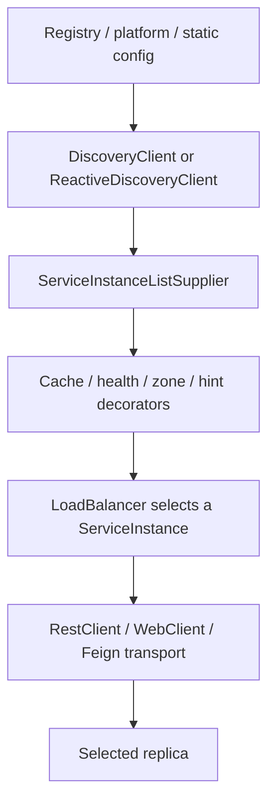

# Choosing Instance Source, Caching, and Health Strategy

A client calling `http://catalog-service/api/products/P42` via Spring Cloud LoadBalancer must answer three independent questions: **where does the instance list come from, how fresh is that list, and when is an instance considered healthy enough to receive requests?** Choosing a round-robin algorithm without designing these three parts can still leave the client calling a stale address, sending traffic to a starting instance, or missing a newly scaled-out replica.

This lesson belongs to the **Design Choices** chapter of the `SPRING_CLOUD_SERVICE_COMMUNICATION_LOAD_BALANCING` module. Its goal is to pick a `ServiceInstance` source suited to the environment, decide whether to cache and for how long, choose how to evaluate health/readiness, and then combine policies per service ID. These decisions directly impact latency, list freshness, fault tolerance, and load placed on the registry as well as the services.

## 1. Separate the three design decisions

Do not lump discovery, caching, and health into a single "healthy instance list" concept. They carry distinct responsibilities:

| Decision | Question | Commonly involved components |
|---|---|---|
| **Instance source** | Who is the source of truth for host, port, service ID, and metadata? | Eureka/Consul, Kubernetes, SimpleDiscoveryClient, custom supplier |
| **Data freshness** | What is the maximum staleness the consumer can tolerate? | Discovery cache, CachingServiceInstanceListSupplier, TTL/refetch |
| **Health strategy** | Based on which signal is an instance added to or removed from the candidate set? | Registry status, readiness, health-check supplier, policy filter |

Spring Cloud LoadBalancer typically fetches the list from `ServiceInstanceListSupplier` and lets `ReactorServiceInstanceLoadBalancer` or `BlockingLoadBalancerClient` select an element depending on the client type. **The supplier provides candidates; the selection algorithm decides which candidate to pick.** Caching and health are layers that can wrap the data source, not the final selection algorithm.

For example, round robin cannot know on its own that a port just closed if the supplier still returns that instance. Conversely, a health filter can exclude certain instances but does not decide whether traffic is distributed via round robin or random.

## 2. Choose an instance source for the environment

The discovery source should match the deployment platform, endpoint update capability, and metadata needs.

| Source | When suitable | Strengths | Risks/checks needed |
|---|---|---|---|
| **Eureka/Consul or similar registry** | Many services, multiple replicas, need registration/deregistration and metadata | Centralized service registry, health/leases, and instance updates | Heartbeat/lease delays; client may cache; must verify advertised addresses |
| **Kubernetes discovery/EndpointSlice** | Workloads running in Kubernetes needing visibility into pod endpoints | Tied to Pod/Service lifecycle and readiness | Must decide between direct Pod endpoints vs. ClusterIP/Service VIP; avoid double load balancing |
| **SimpleDiscoveryClient** | Local development, demos, small integration tests | Static configuration, minimal dependencies | Does not detect dead instances or update IP/port automatically |
| **ReactiveDiscoveryClient** | Reactive apps with a registry providing a truly reactive API | Can fetch the list as a publisher without blocking the event loop if properly implemented | A Flux signature does not guarantee internals are non-blocking |
| **Custom ServiceInstanceListSupplier** | Specialized source, custom metadata/policy, or dedicated snapshot needed | Full control over defining candidates and data | Must own freshness, concurrency, errors, cancellation, and observability |

### Discovery source does not equal health source

A registry may report an instance as registered, yet that status may rely on heartbeats or leases. A health endpoint may verify readiness more deeply, at the cost of extra requests and probe latency. The two signals complement each other and do not necessarily replace one another.

### SimpleDiscoveryClient example for local use

```yaml
spring:
  cloud:
    discovery:
      client:
        simple:
          instances:
            catalog-service:
              - uri: http://localhost:8081
              - uri: http://localhost:8082
```

The consumer can only use these two addresses if it runs in the same network environment as the listening processes. When running in Docker or Kubernetes, `localhost` inside the consumer container/pod points to that container/pod itself; use a hostname/IP and port reachable from the consumer.

Simple discovery is useful for testing instance selection, but **is not a dynamic registry**: stopping the process on 8082 does not remove the entry from configuration. To test health filtering, you must add an appropriate supplier/probe or update the snapshot via a test mechanism.

## 3. What roles do DiscoveryClient and ServiceInstanceListSupplier play?

A typical call path:



- `DiscoveryClient` or `ReactiveDiscoveryClient` is the abstraction that fetches instances from the discovery source.
- `ServiceInstanceListSupplier` supplies the list for a service ID and can emit data via a reactive publisher.
- Supplier decorators can cache, filter by health, prefer zones, enforce sticky sessions, or apply hints.
- `ReactorServiceInstanceLoadBalancer` chooses a `ServiceInstance` from the supplied list.
- The HTTP transport then opens/reuses a connection and sends the request.

This is a key design boundary: **do not call a registry, health endpoint, or database synchronously inside the per-request selection algorithm**. Let the supplier/cache/health mechanism manage candidate data, and keep the selection step lightweight on a snapshot.

## 4. Cache or not?

Caching reduces registry lookups and list-fetching overhead, but allows consumer-side data to become staler. The question is not "is caching good?" but **what maximum update latency is acceptable and what is the cost to achieve that freshness?**

| Scenario | Typically sensible cache design | Reason |
|---|---|---|
| Registry queried too frequently, list changes infrequently | Cache at the supplier with a finite TTL | Reduces registry load and lookup latency |
| Registry pushes/watches updates fast, list stays current at client | Can reduce or omit extra LB caching | Avoids stacking multiple cache layers and stale windows |
| Endpoints change very frequently, fast failover needed | Short TTL or event-driven refresh | Shortens time holding stale addresses |
| Static list in tests | No separate cache needed | Source is already in configuration |
| Many service IDs with varying list sizes | Cache with capacity limits and per-service visibility | Prevents unbounded memory growth |
| Supplier builds an expensive yet stable list | Cache with explicit TTL and invalidation | Avoids recomputing or querying the source on every request |

A sensible cache must have a **TTL, capacity limit, refresh rule, and policy when the source fails**. Unbounded caching can retain deleted endpoints; an overly short TTL can turn the registry into a bottleneck. Do not add a cache if the discovery client or platform already provides caching/event updates without understanding how those layers stack.

## 5. Spring Cloud LoadBalancer caching

Spring Cloud LoadBalancer can use `CachingServiceInstanceListSupplier` to cache the list returned by a delegate supplier. Exact configuration depends on the version/release train and the constructed supplier chain.

Illustrative configuration example:

```yaml
spring:
  cloud:
    loadbalancer:
      cache:
        enabled: true
        ttl: 25s
        capacity: 256
```

The values `25s` and `256` are **illustrative trial values only**, not defaults or general recommendations. Choose based on replica churn rate, deregistration/lease duration, number of service IDs, and failover budget. Check the property metadata for your version before applying.

### TTL is a trade-off

- Longer TTL: fewer queries to the supplier/registry, but the consumer may continue picking stale addresses for longer.
- Shorter TTL: the list refreshes more often, but registry traffic and CPU usage can increase.
- TTL of 0 or caching disabled: suitable when the source already caches/pushes well or freshness is critical, though only after evaluating lookup cost.
- Cache capacity: caps retained entries; review the number of service IDs, key structure, and eviction behavior.

**Caching is not a health check.** A fast cached list can still contain a dead instance. Nor should you assume clearing the cache is the only recovery path: you may need source refresh, readiness/deregistration updates, or handling stale connections in the HTTP pool.

## 6. Choosing a health strategy: registration, readiness, or probe?

The health signal should accurately answer: should this instance receive **the type of traffic the caller is about to send**?

| Signal | What it tells you | Limitations |
|---|---|---|
| Registry registration/heartbeat | Instance is still registered and renewing its lease | Record can linger after a crash; heartbeats do not always verify business readiness |
| Process/liveness | Process is alive or able to self-recover | Process is alive while a dependency is not yet ready |
| Readiness | Instance is ready to receive traffic per defined criteria | May not cover every downstream or endpoint |
| Active health probe from supplier | HTTP probe to each instance succeeds/fails | Consumes network; probe interval adds detection delay; shallow probes can miss failures |
| Passive signal from real requests | Real requests encounter connect/response failures | Only detected after users may be impacted; must avoid ejecting instances on isolated business errors |

Do not use a liveness endpoint in place of readiness if a process can be alive before it is ready to serve. In Kubernetes, the readiness probe can determine whether a Pod is placed in Service endpoints; if the LoadBalancer reads EndpointSlices, readiness may already be reflected at the source. If you add another health probe at the consumer, define **what it adds** to avoid redundant checks.

### Health is not a permanent boolean

An instance may be healthy at probe time and crash immediately afterward; a single probe failure may also stem from brief packet loss. You need a policy for consecutive failures, recovery time, probe interval, and behavior when all instances are marked unhealthy. Do not set an overly sensitive threshold that causes instances to flap in and out of the candidate pool.


## 15. Choosing policies by business characteristics

No single cache/health configuration fits every service. The exact same "all probes fail" state can demand different handling depending on request consequences.

### Catalog: prioritize availability and moderate freshness

- Use a reliable registry or platform discovery.
- Use a finite cache TTL to reduce lookups, bounding the stale window to data requirements.
- Add health probes only when registry/readiness signals are not fast enough.
- If all instances are briefly unavailable, consider a short-lived stale read-only fallback if the business tolerates stale data.
- Measure cache age, instance count, connect failures, and latency.

### Inventory: prioritize correctness and readiness

- Instance source should reflect readiness for write operations.
- Do not rely on liveness or overly shallow probes.
- Be more conservative with caching/stale fallback since routing to an instance unable to write causes harm.
- Retry reserve operations only with idempotency keys and clear processing state.
- When no healthy instance exists, fail fast or trip a circuit breaker per the business contract.

### Notification: prioritize ingestion capacity and queuing

- Health may check listeners and ability to enqueue messages.
- A replica can return HTTP 200 while a downstream queue is full; readiness should reflect required capacity.
- Cache TTL can be longer if replicas change infrequently, provided deregistration/draining is in place.
- Cap retries to avoid multiplying messages or duplicate sends.

These are design examples, not mandatory configurations. Every service should define readiness and stale tolerance according to its business impact.

## 16. Lab exercise: comparing cache and health across two replicas

**Goal:** observe how the instance source, TTL, and probes alter the selected list when a replica stops, restarts, or reports readiness failure.

### Preparing two replicas

Run two replicas of `catalog-service` at `localhost:8081` and `localhost:8082`. Each replica exposes:

- `GET /whoami`: returns the instance ID.
- `GET /actuator/health/readiness`: returns readiness status.
- A test config toggle so B can return readiness DOWN while the process stays running.

In the consumer, use static discovery:

```yaml
spring:
  cloud:
    discovery:
      client:
        simple:
          instances:
            catalog-service:
              - uri: http://localhost:8081
              - uri: http://localhost:8082
```

Enable caching with a short TTL in the lab environment; configure health checks using your release train's API and make sure the readiness endpoint actually exists. Do not expose health endpoints publicly if they reveal sensitive infrastructure details.

### Test cases

| Case | Change | What to observe |
|---|---|---|
| A — Baseline | A/B healthy | List has two instances; both can be selected |
| B — Stop B | Keep static discovery, stop process B | Entry B remains; connect failure if selected without health filtering |
| C — Readiness DOWN | B still listening but returns readiness DOWN | Probe detects after interval; candidate list changes per policy |
| D — Long cache | Increase TTL significantly | Stale snapshot may be retained longer |
| E — Short cache | Reduce TTL | Registry/supplier refreshes more often; measure lookup load |
| F — All unhealthy | Both A/B DOWN | Verify fail-open/fail-closed behavior per implementation |
| G — B recovers | B readiness returns to UP | Measure time until instance rejoins candidate set |
| H — Registry/source error | Supplier emits error or times out | Distinguish error/timeout from an empty list |

### Recording results

| Point in time | Source instance count | Candidate count | Chosen instance | Cache age | Probe outcome | Request result |
|---|---:|---:|---|---:|---|---|
| Baseline | 2 | 2 | A/B | Measure actual | UP/UP | 200 |
| B stopped | 2 | Per policy | A or B | Measure actual | UP/fail | 200 or connect error |
| B readiness DOWN | 2 | Per health filter | A if B excluded | Measure actual | UP/DOWN | 200 if A healthy |
| All unhealthy | 2 | Per fallback policy | None or delegate | Measure actual | DOWN/DOWN | No-instance or fallback |
| B recovered | 2 | Per refresh cycle | A/B | Measure actual | UP/UP | 200 |

Cells marked "Per policy" must be filled with runtime observations; **do not pre-fill** assumed outcomes. Decorator order, probe interval, cache TTL, and fail-open behavior determine the real result.

## 17. Testing needed before production

Beyond the happy path, test data and timing states:

1. Supplier returns two valid instances; selection algorithm works.
2. Empty list: LoadBalancer returns an appropriate no-instance result.
3. Supplier emits an error: error is not silently turned into an empty list.
4. Supplier is slow or fails to emit: selection deadline triggers.
5. An instance deregisters: cache/supplier removes it within acceptable time.
6. An instance has the wrong port: health/connectivity catches it at the right layer.
7. Health endpoint DOWN: instance is handled according to chosen fail-open/fail-closed behavior.
8. All instances DOWN: no infinite retry loops or probe amplification.
9. Instance recovers: reintroduced to the list within expected refresh time.
10. Zone/weight metadata missing or malformed: clear fallback.
11. Concurrent requests: immutable snapshots and thread-safe supplier.
12. Registry errors while cache holds data: stale fallback respects max-staleness.
13. Rolling deployment: new instances added and old instances drained/deregistered.
14. Multiple consumers probing simultaneously: total health traffic stays within estimated capacity.

You can use `StepVerifier` to test reactive suppliers, test fixtures/mocked discovery clients for lists, and two real processes/containers for TCP/health integration tests. A supplier unit test **does not** prove production DNS, TLS, network policies, or listeners work properly.

## 18. Metrics and logs to evaluate choices

Metrics should be designed around the three questions of source–freshness–health:

| Signal | Used to evaluate |
|---|---|
| Instance count from discovery | Is the registry providing enough replicas? |
| Candidate count after supplier chain | How many instances are health/zone/hint filters excluding? |
| Snapshot/cache age | How stale is the data the consumer is selecting from? |
| Refresh duration/error | Is the registry source slow or failing? |
| Health probe success/failure/latency | Which instances are being excluded and why? |
| No-instance outcome | Are there no candidates or did the supplier error? |
| Selected instance in traces/logs | Which replica/zone is receiving traffic? |
| Connect/TLS failure rate | Are selected instances actually reachable? |
| Request p95/p99 and error rate | Does the policy improve SLOs or increase tail latency? |
| Health traffic rate | Do probes generate significant overhead? |

Do not attach raw IPs, high-churn instance IDs, request IDs, or trace IDs to every metric label if cardinality is unbounded. Use traces/logs to investigate specific instances; metrics should stick to service ID, bounded zone, outcome, and stage.

## 19. Common anti-patterns

| Anti-pattern | Consequence | Alternative |
|---|---|---|
| Treating registry presence as healthy | Picks dead endpoints or wrong ports | Combine readiness/health and connectivity checks |
| Cache without TTL | Uses stale snapshots indefinitely | TTL, refresh, and max-staleness |
| Ultra-short TTL for every service | Registry traffic spikes, lookup bottleneck | Tune TTL to churn rate and SLO |
| Probing health on every selection | Multiplies overhead requests with traffic | Periodic probes or platform readiness |
| Probing liveness instead of readiness | Unready instances still receive traffic | Proper readiness endpoint |
| Silently falling back to original list when all health checks fail | Routes to unhealthy instances unknowingly | Explicit fail-open/fail-closed rules and metrics |
| Caching request-context-filtered results globally | Leaks zone/hint/tenant policy across requests | Order decorators properly; cache raw data when appropriate |
| Stacking cache layers without understanding TTLs | Compounded stale windows | Map cache layers and total freshness budget |
| Using static discovery only in dynamic production | Dead instances remain in the list | Registry/platform discovery |
| Swallowing supplier errors into an empty list | Hides registry timeouts and code bugs | Separate empty/error/timeout outcomes |
| Adding health checks without calculating fan-out | Overloads every replica | Calculate consumers × instances × probe rate |
| Feeding arbitrary URLs/hosts into supplier from user input | SSRF and credential-leak risks | Only use controlled service-identity sources |
| Using zone preference without fallback | Local zone outage breaks service availability | Test cross-zone fallback policy |

## 20. Pre-release decision checklist

1. Is the source of truth for instances a registry, Kubernetes endpoints, static list, or custom supplier?
2. Is the client selecting individual Pods/replicas or calling a platform-load-balanced virtual IP/Service?
3. Is the discovery implementation truly reactive, or is there blocking I/O requiring isolation?
4. What is the latency of registry heartbeat/lease/deregistration and readiness?
5. Is LoadBalancer-level caching needed if the discovery client already caches or pushes updates?
6. Do TTL, capacity, and refresh policy fit within the service's freshness budget?
7. How long can the cache retain stale entries after a restart or scale-down?
8. Does the health signal use readiness or liveness? Does the endpoint accurately reflect traffic readiness?
9. Are active health probes necessary, and what are the interval/timeout/failure threshold and total fan-out?
10. When all instances are unhealthy or the health source fails, does the system fail-open, fail-closed, or use stale fallback?
11. Is the order of supplier/cache/health/zone decorators verified for your release train and request context?
12. Do zone/sticky/weight policies have tests for missing metadata, zone outages, and fallbacks?
13. Are no-instance, supplier error, timeout, connect failure, and HTTP 503 observed separately?
14. Are metrics available for candidate count, cache age, probe outcomes, selected instance, and health traffic?
15. Have replica stop/restart, stale cache, registry errors, all-unhealthy, and rolling deployment been tested in staging?
16. Is the rationale for TTL/health intervals documented based on SLOs and registry load?

**Conclusion:** Good design for Spring Cloud LoadBalancer starts by picking a **reliable instance source**, deciding **snapshot freshness**, and defining **traffic-appropriate health signals**. Discovery supplies information, caching balances freshness against lookup cost, health/readiness governs the candidate set, and the LoadBalancer picks the final instance. By separating these responsibilities, testing fail-open/fail-closed behavior thoroughly, and monitoring cache age/probes/selection, the system can scale and recover without accidentally sending requests to stale replicas or overloading the registry.


## 7. Active health checks in ServiceInstanceListSupplier

Spring Cloud LoadBalancer includes a health-check supplier, commonly known as `HealthCheckServiceInstanceListSupplier`. This supplier can periodically check instances and emit a list reflecting probe outcomes; exact APIs and configuration should be checked against your Spring Cloud version.

Illustrative properties example:

```yaml
spring:
  cloud:
    loadbalancer:
      health-check:
        initial-delay: 2s
        interval: 20s
        path:
          default: /actuator/health/readiness
          catalog-service: /actuator/health/readiness
```

The path and interval values here are examples. The `/actuator/health/readiness` endpoint must actually be enabled, reachable from the consumer/health checker, and return the right status when ready. If readiness groups are not configured, this endpoint may not exist or may carry different semantics than expected.

**Never probe endpoints with side effects** such as reserving stock, creating orders, or processing payments. Probes must be lightweight, safe, bounded by a timeout, and verify only the prerequisites for serving traffic. Also protect health endpoints from public exposure if they leak infrastructure details.

### Choosing an interval based on detection budget

If a probe runs every 20 seconds, a newly occurring failure can persist until the next probe and result update. Actual detection time also depends on timeout, required failure count, and how the supplier publishes snapshots.

Shorter intervals speed up detection at the cost of more health requests. With N instances and an interval of I seconds, average probes are roughly `N/I` requests per second per service ID if each instance is probed once per cycle. This is only an estimate; retries, concurrency, multiple consumers, and multiple service IDs can drive the total much higher.

## 8. Cache and health suppliers must be composed intentionally

The supplier chain is usually a stack of decorators. An illustrative example in versions providing the corresponding builder API:

```java
package com.example.cataloglbconfig;

import org.springframework.cloud.loadbalancer.core.ServiceInstanceListSupplier;
import org.springframework.context.ConfigurableApplicationContext;
import org.springframework.context.annotation.Bean;
import org.springframework.context.annotation.Configuration;

@Configuration(proxyBeanMethods = false)
public class CatalogSupplierConfiguration {

    @Bean
    ServiceInstanceListSupplier catalogServiceInstanceListSupplier(
            ConfigurableApplicationContext context) {

        return ServiceInstanceListSupplier.builder()
                .withDiscoveryClient()
                .withCaching()
                .withHealthChecks()
                .build(context);
    }
}
```

This illustrates the **concept of composing suppliers**, not copy-paste code for every Spring Cloud release train. Some versions offer separate builder methods for blocking/reactive discovery; others need a dedicated health-check WebClient or health path setup. Use the builder/API matching your actual dependencies and verify the decorator order recommended in your version's documentation.

Questions to answer when ordering decorators:

- Is the cache holding the raw list from discovery or a list already filtered by zone/hint/health?
- Do health probes run against the cached snapshot, or does each refresh fetch a fresh list?
- Does filtering depend on request context, zone, hint, or tenant? If so, caching filtered results globally can leak policies across requests.
- When the cache holds a deregistered instance, will the health supplier detect and exclude it within the detection budget?
- When all instances are unhealthy, does the supplier return an empty list or fall back to the delegate list?

**Do not assume cache/health ordering behaves identically across versions and chains.** The wrong order can prevent probes from ever seeing new instances or cache a list filtered for the wrong context.

## 9. Configuring a supplier specifically for one service ID

If only `catalog-service` needs a custom cache and health policy, configure a named client rather than applying it globally.

```java
package com.example.cataloglbconfig;

import org.springframework.cloud.loadbalancer.core.ServiceInstanceListSupplier;
import org.springframework.context.ConfigurableApplicationContext;
import org.springframework.context.annotation.Bean;
import org.springframework.context.annotation.Configuration;

@Configuration(proxyBeanMethods = false)
public class CatalogLoadBalancerConfiguration {

    @Bean
    ServiceInstanceListSupplier catalogSupplier(
            ConfigurableApplicationContext context) {

        return ServiceInstanceListSupplier.builder()
                .withDiscoveryClient()
                .withCaching()
                .withHealthChecks()
                .build(context);
    }
}
```

Registering the configuration on the consumer:

```java
package com.example.orders;

import com.example.cataloglbconfig.CatalogLoadBalancerConfiguration;
import org.springframework.boot.SpringApplication;
import org.springframework.boot.autoconfigure.SpringBootApplication;
import org.springframework.cloud.loadbalancer.annotation.LoadBalancerClient;

@SpringBootApplication
@LoadBalancerClient(
        name = "catalog-service",
        configuration = CatalogLoadBalancerConfiguration.class)
public class OrderApplication {

    public static void main(String[] args) {
        SpringApplication.run(OrderApplication.class, args);
    }
}
```

Place `CatalogLoadBalancerConfiguration` **outside the main component-scan package** if it is meant solely for the `catalog-service` child context. If scanned into the parent context, the supplier bean may unintentionally affect other services. Builder classes and methods can vary by release train; verify the API in use, especially if the registry only offers a blocking `DiscoveryClient`.

If every service needs the same policy, consider a default LoadBalancer configuration, while checking its impact on services with differing requirements: cache TTL, health endpoint, zones, and scale. Do not force one readiness path onto all services if their readiness contracts differ.

## 10. Selecting zones and metadata after obtaining the list

Zone preference is a policy about instance **location**. It is not a health check and does not guarantee a local-zone instance is healthier than a remote one.

Metadata example:

```text
catalog-a:
  zone = ap-southeast-1a
  weight = 100

catalog-b:
  zone = ap-southeast-1b
  weight = 100

catalog-c:
  zone = ap-southeast-1c
  weight = 100
```

A design may prefer the zone closest to the caller to reduce latency and cross-zone costs, falling back to other zones if no valid local instances remain. Specify:

- Where does the caller determine its own zone?
- Is zone metadata supplied by the registry or platform, and is it validated?
- If the local zone has no instances, do we fall back remotely or fail closed?
- Could the cache accidentally retain a list filtered by another caller's zone?
- If one zone loses connectivity while health probes from another consumer still succeed, how does the policy react?

`ZonePreferenceServiceInstanceListSupplier` or equivalent mechanisms can support zone preference in matching release trains. Check the exact class name/API and fallback behavior before using. Do not swap an old policy for a similarly named class without tests.

## 11. Sticky sessions, hints, and weighted instances: add only when needed

Some systems have distribution requirements beyond round robin:

| Policy | Required data source | Benefit | Cost/risk |
|---|---|---|---|
| Sticky session | Cookie, request hint, or affinity key | A client can keep hitting the same instance | Dead instances require fallback; stateful sessions hinder even distribution |
| Hint-based selection | Controlled header/hint | Caller picks an instance group for valid needs | Never let user input choose arbitrary hosts |
| Weighted selection | Weight metadata/capacity | Larger replicas take a higher traffic share | Stale or wrong weights can cause overload |
| Zone preference | Caller zone and instance zone | Cuts latency/cross-zone traffic | Can concentrate load in the local zone |
| Same-instance preference | Previous instance and request context | Reduces cache misses or boosts locality | Requires fallback and avoiding unhealthy instances |

These features should not be bolted on simply because "they are possible". Start with an accurate instance source, suitable caching, and reliable health/readiness. Only add sticky/weight/zone logic when backed by quantitative requirements and metrics proving effectiveness.

## 12. When should you not enable active health checks in LoadBalancer?

Active health checks add extra traffic to every replica. If the platform already runs readiness checks and the registry only advertises Ready endpoints, consumer-side probes may duplicate work and multiply load.

| Environment condition | Typically sensible decision |
|---|---|
| Kubernetes Service already filters Pods by readiness; client calls ClusterIP | Usually no extra per-Pod LoadBalancer probes needed |
| Consumer receives Pod endpoints directly and registry status lags | Client-side health filtering may help if benefits are measured |
| Service has thousands of replicas and many consumers | Beware probe amplification; prefer control-plane/push health |
| Readiness endpoint is expensive or hits many dependencies | Avoid frequent probing; use appropriate platform signals |
| Only a static list exists in a lab | Health probes can usefully simulate dead-instance detection |
| Health API is unreachable from caller due to security boundaries | Use registry/readiness or internal health mechanisms |

Suppose 100 consumers each probe 500 replicas every 10 seconds—health traffic can reach 5,000 probes/second if every consumer checks every replica. This number illustrates **fan-out**, not that every implementation probes this way by default. Before enabling probes, calculate total consumers × instances × frequency and concurrency.

## 13. Handling the case where all instances are unhealthy

When a health filter excludes every candidate, an explicit decision is needed:

- **Fail closed:** return an empty/no-instance list so the caller fails fast or falls back.
- **Fail open:** fall back to the original delegate list to still attempt a call, accepting the risk of hitting an unhealthy endpoint.
- **Stale fallback:** use a prior snapshot within a max-staleness window when the registry/health source temporarily fails.
- **Circuit breaker/business fallback:** reject cleanly or return pre-designed fallback data.

No single option fits all services. For instance, a catalog read API might accept a brief stale fallback if data is non-critical; an inventory reserve or payment API may need to fail closed to prevent invalid side effects.

| Situation | Read-only catalog | Reserve inventory/payment |
|---|---|---|
| All probes fail | May use a short stale snapshot per policy | Usually fail closed or trip circuit breaker |
| Registry temporarily errors while cache is fresh | Can continue using cache within limits | Weigh more strictly against consistency needs |
| One replica probe fails | Exclude replica; try another if budget allows | Retry only if idempotency and state are clear |
| Health endpoint times out | Do not automatically treat as business failure | Do not automatically execute writes |
| No instances | Return clear dependency error | Return clear error; avoid partial transactions |

If the supplier falls back to the raw list, record the fallback state and data age. Never silently treat instances marked unhealthy as healthy.

## 14. Do not confuse supplier errors with an empty list

Three outcomes must be kept distinct:

| Supplier result | Meaning | Observable behavior |
|---|---|---|
| Emits `List.of()` | Snapshot exists but has zero candidates | LoadBalancer may return EmptyResponse |
| `Flux.empty()` | Supplier completes without emitting a snapshot | Depending on adapter/LoadBalancer, usually no instance to select |
| `Flux.error(cause)` | Registry/supplier encountered an error | Error must preserve original cause and classification |
| Publisher does not emit before deadline | Source is slow/hung | Timeout/cancellation |
| Instance exists but transport fails | Target was selected | Connect/TLS/response error after selection |

Do not write `onErrorResume(error -> Mono.just(List.of()))` for all errors without deliberate intent. Doing so turns registry timeouts, metadata parsing failures, and coding bugs into "no instance", skewing dashboards and preventing retry policies from distinguishing causes.

At a public API boundary, multiple errors may map to `503 DEPENDENCY_UNAVAILABLE`, but internal logs/traces must preserve `failureStage=discovery|supplier|selection|connect|tls|response`.

