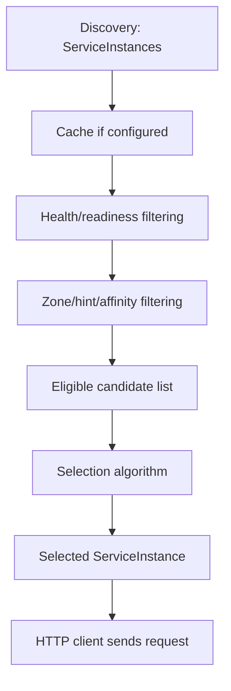

# Choosing an Algorithm by Evenness and Request Characteristics

When a service has multiple replicas, the load balancing algorithm decides **which instance receives the next request** from the eligible candidate set. Round Robin is often the starting point because it is easy to understand and distributes selections fairly evenly when instances have comparable capacity. Yet "equal request count" does not always mean "even load", "low latency", or "good capacity utilization".

For example, `order-service` calls `inventory-service` with three replicas. If every request simply reads a single small SKU, Round Robin may fit well. But if some requests run heavy aggregate queries, replicas have different CPU specs, or one zone has higher network latency, splitting selection counts evenly can create uneven load. In those cases, consider weights, locality, concurrency, latency, or affinity.

This article belongs to the **Design Choices** chapter of the `SPRING_CLOUD_SERVICE_COMMUNICATION_LOAD_BALANCING` module. The goal is to choose an algorithm based on **desired evenness and actual request characteristics**, while understanding the roles of `ServiceInstanceListSupplier`, discovery, health checks, zones, retries, and HTTP clients such as RestClient, WebClient, and OpenFeign.

> **Selection principle:** first filter out eligible instances; only then choose an algorithm suited to the workload. An algorithm cannot compensate for faulty discovery, unhealthy replicas, insufficient capacity, or uncontrolled retries.

## 1. "Even" means different things

When saying an algorithm distributes evenly, ask **even with respect to which quantity**:

| Aspect | Question | Example metric |
| --- | --- | --- |
| Selection count | How many times was each instance chosen? | Selection count per instance |
| HTTP attempts to server | How many attempts did each replica actually receive? | Server request count |
| In-flight requests | How many active requests is each instance handling? | Active requests/concurrency |
| Processing cost | Are CPU time, DB queries, or processed bytes distributed evenly? | CPU, execution time, bytes |
| Caller latency | Do users get fast, consistent responses? | p50/p95/p99 |
| Capacity utilization | Is one replica overloaded while others sit idle? | Utilization, queue, saturation |
| Locality | Do requests prefer regions close to the caller? | Same-zone ratio, network latency |
| Affinity | Does a group of requests need to return to the same instance? | Session/hash distribution |

An algorithm can achieve nearly a 1/3 selection share per replica while CPU still skews 80%/10%/10%, because requests hitting the first replica are heavier. Conversely, weighted routing might intentionally send 50% of requests to a stronger replica and 25% to each weaker one; selection counts are unequal, yet capacity may be utilized far better.

Therefore, do not set a goal of "every instance must get the same number of requests" if request processing cost or replica capacity differs.

## 2. Start with the eligible candidate set

Spring Cloud LoadBalancer does not pick from every address the application knows about. The list passed to the algorithm is typically built through `ServiceInstanceListSupplier`, which can combine discovery, caching, health checks, zone preference, hints, or retry context.



For example, discovery returns `[A, B, C, D]`, but the health supplier excludes B and the zone policy prefers only A/C. The selection algorithm only sees `[A, C]`. You cannot conclude Round Robin distributes unevenly when its actual input only has two instances.

Separate two questions:

1. **Which instances are allowed to receive requests?** This is a matter of discovery, readiness, health, zone, hint, and policy.
2. **Among the allowed instances, which one should be picked?** This is where the algorithm comes in.

If the input list is wrong or stale, replacing Round Robin with Random or Weighted will not fix the root cause.

## 3. Factors that determine the algorithm

Before selecting an algorithm, characterize the workload along these dimensions:

- **Replica capacity:** same CPU/RAM specs, connection limits, and hardware tier or not?
- **Request cost:** are processing time and resource usage per request similar?
- **Concurrency:** are short and long requests mixed in the same pool?
- **Arrival pattern:** steady load, short bursts, or hourly peaks?
- **Locality:** are caller and replicas in the same zone/region, or do network costs differ?
- **Affinity:** do sessions, local caches, or partitioned data need to return to the same instance?
- **Observability:** do you know active requests, latency, and saturation per instance?
- **Convergence time:** do metrics/weights/health update fast and reliably enough?
- **Failure mode:** when an instance slows down or dies, does the algorithm avoid piling more requests onto it?

Without sufficiently reliable per-instance data, load-dependent algorithms like least-connections or latency-aware can make decisions based on missing or delayed signals. A simple, stable policy is often better than a complex algorithm lacking proper telemetry.

## 4. Round Robin: a predictable default

Round Robin cycles sequentially through the instance list:

```text
Candidates: [A, B, C]

Selection sequence:
A -> B -> C -> A -> B -> C -> ...
```

With a single selector, a stable list, and no requests dropped before reaching the server, selection counts across instances typically differ by at most about one over a sufficiently long sequence.

**Strengths:** easy to understand and operate, requires no CPU/latency/concurrency signals, and fits well when replicas are equivalent and requests have similar costs.

**Limitations:** does not know whether the next request is heavy or light; does not know instance A holds more long-running requests than B; does not prefer same-zone automatically; does not detect a slow replica if the supplier keeps it; multiple callers maintain independent counters; list changes shift ordering and distribution.

In Spring Cloud LoadBalancer, `RoundRobinLoadBalancer` is the common default algorithm. It takes the list from the supplier and picks an instance in circular order. Check your exact version and configuration, especially if beans were replaced or configured per client.

**Choose Round Robin when** instances have comparable capacity, requests have similar cost, and the goal is simple, predictable selection distribution.

## 5. Random: random selection and statistical variance

Random picks an instance at random from the list:

```text
Candidates: [A, B, C]

Possible sequence:
B -> A -> C -> C -> A -> B -> ...
```

Over a short window, selection counts can skew noticeably. As request volume grows with independent picks, the average ratio tends toward the probability distribution.

With `n` requests and `m` equal instances, each instance has probability `1/m`. Expected selection count:

\[
E[X] = \frac{n}{m}
\]

Standard deviation:

\[
\sigma = \sqrt{n\frac{1}{m}\left(1-\frac{1}{m}\right)}
\]

For example, with 900 requests and 3 instances: each instance expects 300 selections, with no guarantee that each gets exactly 300. Relative error shrinks as n grows.

Random fits when you want simple selection and accept short-term skew. It does not fit when you need exact distribution over short windows, requests vary widely in cost, or affinity is needed. Do not assume every Spring Cloud LoadBalancer version exposes Random configuration the same way; verify the implementation and bean registration for your running version.

## 6. Weighted Round Robin: distributing by capacity

When replicas have different capacities, weights can be assigned:

| Instance | Relative capacity | Weight |
| --- | ---: | ---: |
| A | 2 units | 2 |
| B | 1 unit | 1 |
| C | 1 unit | 1 |

Target selection distribution approximates a `2:1:1` ratio:

```text
A: 50%
B: 25%
C: 25%
```

Over 1,000 requests of similar cost, expected selections are roughly 500 for A, 250 for B, and 250 for C. This distribution is **uneven in selection count**, yet aligns better with capacity.

Weights can be derived from allocated CPU/RAM, capacity benchmarks, verified concurrency limits, hardware tiers, or canary policies. Avoid using instantaneous CPU directly as a weight without smoothing, as fluctuating weights can cause traffic to oscillate back and forth. Enforce min/max bounds, smoothing, hysteresis, and cooldowns.

Weight is not a capacity guarantee. If request A consumes ten times the CPU of request B, weighting by core count can still misdistribute load. Weights should reflect **capacity for the workload being balanced**, not just hardware specs on paper.

Weighted routing can be implemented via a custom load balancer, supplier metadata, or a supporting proxy/mesh. Do not assume default `RoundRobinLoadBalancer` automatically reads a metadata field named `weight` unless an implementation explicitly does so.

## 7. Least Connections: preferring instances with fewer concurrent requests

Least Connections picks the instance with the fewest active connections or in-flight requests.

| Instance | Active requests | Next selection |
| --- | ---: | --- |
| A | 18 | |
| B | 5 | **B** |
| C | 11 | |

This helps when requests vary in duration: an instance holding several long-running requests receives fewer new ones.

However, you must define precisely whether "connections" or "requests" are counted:

- HTTP/1.1 can reuse one connection across sequential requests.
- HTTP/2 can multiplex many streams over one connection.
- A connection to a proxy does not necessarily correspond one-to-one with a request to a Pod.
- A request may wait in a queue before occupying a connection.
- A client-side counter only sees requests initiated by that caller, blind to load from other callers.

**Least Connections on a single caller does not see in-flight load from other callers.** If 20 order-service replicas each maintain local counters, local algorithms may all pile onto the same instance unaware of traffic from peer callers.

If used, concurrency signals must match the decision scope and guard against stale data. In Spring Cloud LoadBalancer, least-connections is typically a custom selection strategy or handled in a proxy/mesh with matching telemetry; do not treat it as built-in by default.

## 8. Least Response Time and latency-aware routing

A latency-aware algorithm can favor instances with lower recent response times:

| Instance | Hypothetical EWMA latency | Status |
| --- | ---: | --- |
| A | 35 ms | Fast |
| B | 42 ms | Fast |
| C | 260 ms | Slow |

Traffic probability to C can be reduced, or C temporarily excluded if it crosses a threshold. Yet observed latency is influenced by request type, network/zone, connection pools, TLS handshakes, queues, CPU, GC, dependencies, retries, and sample size.

If heavy requests happen to hit C while light requests hit A, the algorithm may falsely conclude C is slower due to capacity. Measure per endpoint/request class or use appropriate server-side signals.

When one instance's latency rises, the algorithm shifts traffic away; remaining instances absorb extra load and their latency rises too. Selection can then bounce back and forth, causing oscillation. Use smoothing, rate limits on weight updates, and cooldowns.

Latency-aware routing helps when telemetry is reliable and workloads are steady enough. It does not replace health checks, circuit breakers, or capacity planning.

## 9. Power of Two Choices: reducing skew with minimal information

A middle-ground technique samples two instances at random, compares a metric such as active requests, and sends traffic to the less loaded one.

```text
Candidates: [A, B, C, D, E]

Randomly sample: B and D
Active requests: B=12, D=4
Choose: D
```

This reduces the odds of picking an overloaded instance without sorting or scanning the entire list. Still, results depend on counter quality and observation scope.

If only the current caller knows its own active requests, two instances may both show low local counts while already busy from other callers. The algorithm only makes sense when the load signal reflects the scope being balanced.

This is usually a custom choice or provided by a proxy/external load balancer; it is not included by default in basic Spring Cloud LoadBalancer setups.

## 10. Consistent Hashing: key-based affinity

Some workloads benefit when the same key consistently routes to the same replica, such as local caches or partitioned data. Consistent hashing maps a key onto a position on a hash ring and picks the corresponding instance.

```text
hash(customer-101) -> replica A
hash(customer-202) -> replica C
hash(customer-303) -> replica A
```

When a replica is added or removed, consistent hashing limits how many keys must move compared to plain modulo hashing. Virtual nodes help distribute keys more evenly.

**Strengths:** preserves relatively stable key affinity; adding/removing instances does not force every key to remap.

**Risks:** skewed key distributions or large tenants can create hot spots; an instance crash forces key remapping and spikes cache misses; hashing does not guarantee capacity balance if per-key workloads differ; retries for the same key may land back on the same instance.

Do not adopt consistent hashing merely to feel "more stable than Round Robin". First identify which state or cache is truly instance-bound and whether externalizing state can remove the need for stickiness.

## 11. Sticky Sessions: when affinity outweighs even distribution

Sticky sessions try to keep requests from the same session/client on the same instance. They can be implemented via cookies, session IDs, headers, or proxy policies.

| Benefit | Risk |
| --- | --- |
| Leverages local caches/sessions | One instance may accumulate hot sessions |
| Cuts cost of loading sessions from shared stores | Replica crash forces session recovery |
| Reduces data needing continuous sync | Hard to balance load when session lifetimes vary |
| Can improve locality | Retries/failover can break affinity |

Sticky sessions and Round Robin need not conflict: the first request can pick via an algorithm, and subsequent requests prefer the bound instance. Still, when that instance fails, the system must have an explicit fallback.

Never use client IP as an affinity key when users sit behind shared NATs/proxies or have changing addresses. In Spring applications, clarify which layer owns session affinity: client supplier/hints, gateway, Kubernetes session affinity, or mesh. Running multiple sticky mechanisms at once produces unpredictable behavior.

## 12. Zone-aware routing: balancing within locality

When replicas span multiple zones, preferring same-zone instances reduces network latency and cross-zone costs.

| Instance | Zone | Hypothetical network distance |
| --- | --- | --- |
| A | zone-a | Near |
| B | zone-a | Near |
| C | zone-b | Farther |
| D | zone-b | Farther |

A zone preference supplier can prioritize `[A, B]`. When A/B are unavailable, the policy can fall back to C/D if configured.

**Zone filtering builds the candidate set**, while Round Robin/Random/Weighted selects within that set. An even selection algorithm will not infer locality on its own if the supplier mixes all zones together without matching metadata/policy.

If same-zone preference is too strict, zone-a can run out of capacity while zone-b remains idle. Explicitly choose between soft preference and hard boundaries:

- **Soft preference:** favor local, but fail over to other zones when needed.
- **Hard boundary:** allow only the designated zone; accept rejections if that zone has no instances.
- **Weighted locality:** send most traffic locally and a controlled fraction to other zones.

Evaluate same-zone ratio, cross-zone latency, and per-zone utilization—not just service-wide selection counts.

## 13. Heterogeneous requests: splitting workloads into classes

A single algorithm may not suit every endpoint:

| Request class | Characteristics | Potentially suitable policy |
| --- | --- | --- |
| Small SKU GET read | Short, uniform cost | Round Robin |
| Heavy report query | Long-running, holds resources | Concurrency-aware/bulkhead or separate pool |
| Requests targeting locally cached replicas | Key locality | Consistent hashing/affinity if benefit is measured |
| Requests to heterogeneous-capacity replicas | Uneven capacity | Weighted routing |
| Cross-zone requests | Varying network latency | Zone preference with fallback |
| Reservation writes | Side effects; retries must be safe | Idempotency + retry policy; selection is only one part |

If light and heavy endpoints share the same list, Round Robin may distribute request counts evenly while still leaving certain replicas handling more heavy work. Consider separating pools/service IDs or classifying workloads if business and operational boundaries permit.

Never inject routing hints derived from unvalidated or spoofable user input. Hints should only come from verified routing signals with clear fallbacks.

## 14. Quick comparison of algorithms

| Algorithm | Goal | Needs load telemetry? | Main weakness |
| --- | --- | --- | --- |
| Round Robin | Near-even selection counts | No | Blind to request cost |
| Random | Random pick, average distribution | No | Short-term skew |
| Weighted Round Robin/Weighted Random | Distribute by capacity/weight | Needs reliable weights | Stale weights or oscillation |
| Least Connections | Favor instances with fewer active connections/requests | Yes | Incomplete counting scope |
| Least Response Time | Favor lower latency | Yes | Feedback loops, sample bias |
| Power of Two Choices | Reduce odds of picking busy instances | Needs one load signal | Local/stale signals |
| Consistent Hashing | Key-based affinity | Optional | Hot keys, remap on instance churn |
| Sticky Session | Pin session to instance | Needs identity/affinity | Hot spots and failover |
| Zone Preference | Favor locality | Needs zone metadata | Can overload local zone |

No algorithm wins on every metric. Choose based on prioritized goals and accept documented trade-offs.

## 15. Quantitative example: even requests, uneven cost

Suppose three instances A/B/C handle 300 requests:

- 240 light requests, each taking 10 ms CPU.
- 60 heavy requests, each taking 200 ms CPU.

Total CPU time:

```text
Light work = 240 × 10 ms = 2,400 ms
Heavy work =  60 × 200 ms = 12,000 ms
Total      = 14,400 ms
```

If Round Robin assigns 100 requests per replica, yet heavy requests happen to cluster on A:

| Instance | Requests | Heavy requests | CPU time |
| --- | ---: | ---: | ---: |
| A | 100 | 35 | 7,000 ms |
| B | 100 | 15 | 3,500 ms |
| C | 100 | 10 | 2,500 ms |

Request counts are equal while CPU cost varies nearly 3×. This is an illustrative workload distribution example, not a claim that Round Robin guarantees this exact skew.

If request classes can be reliably identified, a policy can distribute or cap concurrency per class. However, if heavy requests are only recognized after processing starts, you need active work/CPU/queue signals or architectural workload isolation. Simply adding weights to replicas does not fix differences across requests.

## 16. Weighted routing by capacity example

Suppose benchmarks show three replicas have relative capacities:

```text
A: 600 request/s
B: 300 request/s
C: 300 request/s

Total: 1,200 request/s
Capacity ratio: A=50%, B=25%, C=25%
```

At an offered load of 900 request/s, the theoretical weighted target is:

| Instance | Share | Expected selections |
| --- | ---: | ---: |
| A | 50% | 450 RPS |
| B | 25% | 225 RPS |
| C | 25% | 225 RPS |

This is only a starting point. If B/C receive heavier workloads or sit in a farther zone, benchmarked capacity may not translate directly. Check p95/p99, error rate, CPU, queues, and database pools after applying weights.

Weights can be implemented at a proxy/mesh or in a custom load balancer. If a custom implementation relies on metadata, define who produces/updates weights, how missing/invalid values are handled, min/max bounds, whether weight changes are cached, whether callers receive the same weight version, and what initial weight a new instance gets.

Do not assume a metadata key named `weight` works automatically in default suppliers.

## 17. Choosing an algorithm in Spring Cloud LoadBalancer

Spring Cloud LoadBalancer separates two main parts:

1. `ServiceInstanceListSupplier` supplies the candidate list and can apply caching/health/zone/hints.
2. `ReactorServiceInstanceLoadBalancer` selects one instance from that list for a request.

`RoundRobinLoadBalancer` is the common default. When another algorithm is needed, you can supply a custom implementation per service ID via `@LoadBalancerClient` configuration or your version's equivalent mechanism.

```text
HTTP client
  -> LoadBalancerClientFactory per service ID
  -> ReactorServiceInstanceLoadBalancer
  -> ServiceInstanceListSupplier
  -> candidate list
  -> choose(...) algorithm
  -> ServiceInstance
```

**Do not replace the supplier just to change the selection algorithm** if the current supplier already provides the right list. Conversely, do not swap algorithms when the real problem is faulty supplier filtering, stale caching, or discovery failing to return replicas.

### 17.1. Per-service-ID configuration

Per-client configuration can be declared using `@LoadBalancerClient`:

```java
import org.springframework.cloud.loadbalancer.annotation.LoadBalancerClient;
import org.springframework.context.annotation.Configuration;

@Configuration
@LoadBalancerClient(
        name = "inventory-service",
        configuration = InventoryLoadBalancerConfiguration.class)
class InventoryClientLoadBalancerRegistration {
}
```

`InventoryLoadBalancerConfiguration` is where you declare the custom selection strategy bean using the extension points of your Spring Cloud version. Keep per-client configuration out of unintended global component scanning, or it may accidentally apply to other service IDs.

### 17.2. When do you need a custom ReactorServiceInstanceLoadBalancer?

Only build a custom load balancer when:

- There is a clear routing requirement existing algorithms cannot meet.
- Reliable input data is available to drive decisions.
- Fallbacks exist for missing metadata, stale telemetry, or empty lists.
- Tests cover concurrency, list changes, and failures.
- Metrics exist to prove improvement.

Avoid writing a custom algorithm just to have "a smarter algorithm". Custom code increases maintenance cost, version-specific API coupling, and the risk of inconsistent behavior across clients.

## 18. Algorithms do not replace health checks and retry policies

| Question | Appropriate component |
| --- | --- |
| Is the replica eligible to receive traffic? | Discovery/readiness/health supplier |
| Which replica should get the next request? | Selection algorithm |
| If the previous attempt failed, should we retry? | Retry policy |
| Which instance should a retry pick? | LoadBalancer + retry-aware context/supplier |
| How long may a request wait? | Timeout/deadline |
| What if capacity is exhausted? | Admission control/bulkhead/load shedding |
| Could a write request execute twice? | Server/domain idempotency |

Round Robin does not remove dead instances on its own. Weighted routing does not make retries safe. Least Connections does not replace a circuit breaker. A retry-aware supplier does not store idempotency records.

Good design places each decision at the right layer and makes the interactions between them observable.

## 19. How do retries change distribution?

Suppose Round Robin distributes initial attempts evenly across A/B/C. If A has a high error rate, retried requests may shift to B/C. Counting business requests may still look roughly even, while counting HTTP attempts shows B/C absorbing extra load.

```text
Initial attempts:
  A=300, B=300, C=300

Retry after failures on A:
  A=300, B=360, C=340

Business requests: 900
HTTP attempts:     1,000
```

These numbers are hypothetical. To understand an algorithm, separate initial selection counts, retry selection counts, actual HTTP attempts sent, server receive counts, and completed business requests.

If a retry-aware supplier avoids the previously chosen instance, retries can shift to another replica when candidates remain. Yet it does not know whether that other replica has spare capacity; measure saturation and retry amplification.

When a downstream is globally overloaded, ramping up retries onto surviving instances can make things worse. Selection algorithms do not create extra capacity.

## 20. Evaluating algorithms with the right metrics

A benchmark should never report only request percentages per instance. Combine:

| Group | Metrics |
| --- | --- |
| Distribution | Selection counts and server receives per instance/zone |
| Fairness | Deviation from target weight, max/min ratio, or coefficient of variation |
| Performance | Useful throughput, p50/p95/p99 |
| Reliability | Error rate, timeouts, connection resets |
| Resources | CPU, memory/GC, in-flight, queues, pool saturation |
| Retries | Attempts/business request, retry success rate, backoff |
| Locality | Same-zone ratio and cross-zone latency |
| Stability | Convergence time on add/remove instance, weight oscillation |

Example coefficient of variation for selection counts:

\[
CV = \frac{\text{standard deviation of selections}}{\text{mean selections}}
\]

A low CV shows selection counts are close together, yet **does not prove processing cost or latency are even**. For weighted policies, compare against target weights rather than expecting equal counts across all instances.

Gini can describe concentration in request counts or costs. However, results depend on the input data: the Gini of selection counts is not equivalent to the Gini of CPU time. To evaluate capacity fairness, measure appropriate units of work or resources.

## 21. Designing comparable load tests

To compare Round Robin against weighted or latency-aware algorithms:

1. Keep replica counts, versions, resource limits, and topology identical.
2. Use the same request set or mix of request classes.
3. Warm up JVM/caches/connection pools before the measurement window.
4. Control offered load and arrival-rate models.
5. Run long enough to collect meaningful p95/p99 samples.
6. Collect selection counts and server receive counts separately.
7. Measure CPU, queues, DB pools, and latency per instance.
8. Test one slow replica, one dead replica, and one newly starting replica.
9. Test changing capacity/weights while load is running.
10. Repeat measurements and compare multiple windows rather than cherry-picking the best run.

### 21.1. Suggested test matrix

| Scenario | Question |
| --- | --- |
| Three equal replicas, light GETs | Does Round Robin split selections nearly evenly? |
| Capacity of A is double B/C | Does Weighted boost useful throughput without hurting p99? |
| Mixed heavy/light requests | Do even selections yield even CPU/queues? |
| A responds slowly | Does latency-aware cut tail latency or trigger oscillation? |
| A stops | Does the supplier converge fast; do retries pile load? |
| B newly added | Does traffic ramp sensibly after readiness/warm-up? |
| Callers across multiple zones | Does locality lower latency without overloading local zone? |
| One very hot key | Does hash/sticky create a hot spot? |
| Multiple concurrent callers | Do local counters/telemetry skew cluster-wide selection? |
| Multi-layer retries | Do attempt amplification and server receives stay within bounds? |

If the load generator uses a closed-loop model, it may naturally slow down request submission when the server lags, hiding the saturation point. Report both offered RPS and completed RPS to avoid misinterpretation.

## 22. Quick decision matrix

| Workload characteristic | Starting point to consider | Prerequisites |
| --- | --- | --- |
| Homogeneous replicas, light and uniform requests | Round Robin | Supplier returns accurate, stable list |
| Need simple selection, average distribution | Random | Short-term skew acceptable |
| Replicas with clearly different capacities | Weighted | Weights benchmarked and updated cleanly |
| Varying long/short requests, concurrency telemetry available | Least Connections/Power of Two Choices | Reliable-scope active request counts |
| Some replicas clearly slower and latency metrics available | Latency-aware | Smoothing, hysteresis, fallback |
| Cache/session bound to key | Consistent Hashing/Sticky | Hot-key strategy and failover |
| Multiple zones with differing network costs | Zone preference + intra-zone selection | Accurate zone metadata and fallback |
| Write workloads with side effects | Capacity-appropriate algorithm + idempotency | Safe retries, stable keys, atomic dedup |

This is a **starting point for experimentation**, not a mandatory configuration table. A system can combine locality filtering with weighted selection, or affinity with health failover; define policy ordering clearly and test conflict cases.

## 23. Algorithm selection anti-patterns

1. **Picking a complex algorithm because it sounds optimal.** Without telemetry, load-aware algorithms lack valid inputs.
2. **Judging fairness solely by selection counts.** Requests have different costs.
3. **Weighting by instantaneous CPU without smoothing.** Traffic can oscillate and destabilize the system.
4. **Counting connections instead of requests in HTTP/2.** One connection can carry many streams.
5. **Using sticky sessions to mask poorly designed state.** Instance crashes can lose sessions.
6. **Using consistent hashing on skewed keys.** Hot keys can overload one replica.
7. **Making zone preference a hard filter with no fallback.** A zone outage leaves the service with zero candidates.
8. **Mixing latencies across incomparable request classes.** The algorithm learns the wrong lessons from sample bias.
9. **Ignoring multiple caller processes.** Local metrics do not represent cluster-wide load.
10. **Treating Round Robin as load-aware.** It knows nothing about CPU or queues.
11. **Using a selection algorithm to fix stale discovery.** A bad input list still yields bad selections.
12. **Increasing retries to compensate for an algorithm.** Retries can amplify load.
13. **Failing to measure server receives and useful throughput.** Selection counts do not prove outcomes.
14. **Changing algorithm and retry settings together in benchmarks.** You cannot isolate which change drove the difference.
15. **Lacking fallbacks when telemetry or metadata is missing.** Custom algorithms can fail requests even when valid instances exist.

## 24. Controlled selection and rollout process

1. **Define the goal:** fairness by count, capacity, latency, locality, or affinity?
2. **Classify requests:** endpoint, cost, read/write, duration, and session requirements.
3. **Verify the candidate set:** discovery, health, zone, cache, and retry context.
4. **Establish a baseline:** measure Round Robin/default under a representative workload.
5. **Form a hypothesis:** e.g., weighted routing will reduce saturation on weaker replicas.
6. **Make a small change:** change only selection strategy or weights for one client/service ID.
7. **Test failures:** slow/dead instances, missing metadata, bad weights, zone with zero candidates.
8. **Canary:** apply to a fraction of traffic and compare SLOs.
9. **Observe:** selections, attempts, server receives, p95/p99, CPU, pools, and retries.
10. **Rollback:** revert to the known-good policy if error rate, tail latency, or saturation worsens.
11. **Document the decision:** rationale, trade-offs, benchmark data, and scope limits.

Do not roll out a new algorithm across an entire module just because one endpoint has a special workload. Per-service configuration or workload isolation keeps the blast radius small.

## 25. Self-check questions

1. Why can Round Robin split selection counts evenly while CPU across replicas still skews?
2. What is the difference between selection count and server receive count?
3. Does Random guarantee equal selection counts over a short window?
4. When does weighted routing make more sense than Round Robin?
5. Why can weighting by instantaneous CPU cause oscillation?
6. What telemetry does Least Connections require, and why might a single caller's counter be insufficient?
7. How does Power of Two Choices select an instance?
8. What benefit does consistent hashing offer for key-bound caches, and what is the hot-key risk?
9. How do sticky sessions conflict with failover?
10. Is zone preference a candidate-filtering step or the final selection algorithm?
11. Why does latency-aware routing need smoothing and request classification?
12. When discovery returns an empty list, can swapping the selection algorithm fix it?
13. How does `RetryAwareServiceInstanceListSupplier` influence retry selection, and what does it not protect against?
14. Which metrics should evaluate an algorithm beyond selection counts?
15. When changing algorithms, why must workload and topology stay constant in benchmarks?

**Conclusion:** Round Robin is a solid starting point when replicas are equivalent and requests have similar costs. When capacity, processing duration, locality, or affinity differ, consider weighted, concurrency-aware, latency-aware, hashing, or zone preference strategies tailored to your goal. In Spring Cloud LoadBalancer, the algorithm only chooses from the list supplied by the supplier; discovery, health, caching, and retry context determine that list. Evaluate with useful throughput, p95/p99, resource metrics, and actual server receives, and roll out per service ID with clear tests and rollback paths.
