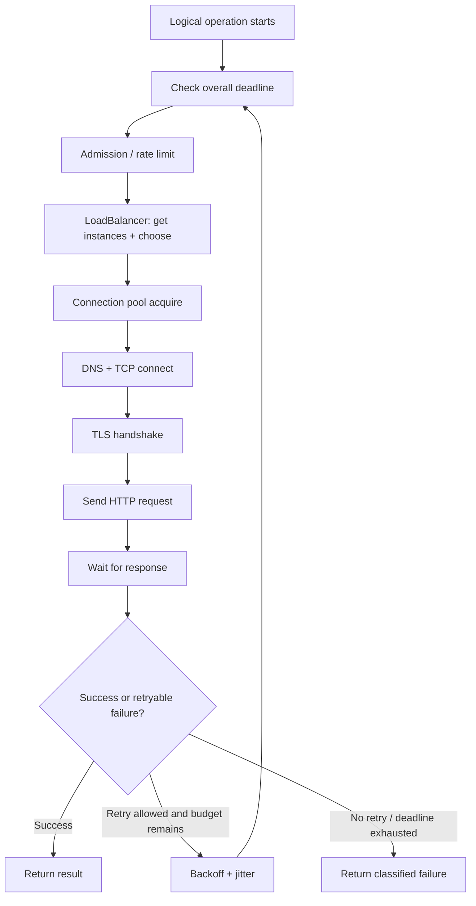

# Designing Consistent Timeout, Retry, and Isolation Policies

## Objectives

A request from `order-service` calling `inventory-service` may pass through discovery, Spring Cloud LoadBalancer, a connection pool, TCP/TLS, a proxy, and the backend. When the backend is slow or an instance fails, the system must decide **how long to wait, how many times to retry, which instance to try, and how to cap held resources**.

If every layer sets independent timeouts and retries, total duration can exceed the SLA and actual requests hitting the backend can multiply several times over. One retry in Feign, one retry in LoadBalancer, one retry in the Gateway, and one retry in the service mesh can multiply into many physical attempts. Meanwhile, threads, connections, and queues remain occupied, spreading the incident to other dependencies.

This lesson guides you through designing **a consistent policy driven by deadlines and dependencies**. After this lesson, you will be able to:

- Distinguish timeouts for pool acquire, DNS/connect, TLS, response, and the overall operation deadline.
- Allocate a timeout budget across multiple attempts and backoff.
- Choose retryable errors, safe operations, and attempt caps.
- Decide whether to retry on the same instance or the next instance from LoadBalancer.
- Coordinate timeouts, retries, circuit breakers, bulkheads, rate limiters, and bounded queues.
- Tailor separate policies for `inventory-service`, `payment-service`, and other dependencies.
- Configure examples for RestClient, WebClient, and OpenFeign matching their transports.
- Verify retry amplification, idempotency, metrics, and policy rollback.

> Scope: Spring Cloud LoadBalancer handles `ServiceInstance` selection; the HTTP client governs most transport timeouts; resilience libraries drive retries/circuit breakers/bulkheads; the application owns deadlines and business semantics. No single property controls all of these layers.

## 1. Start from the operation deadline

A **deadline** is the latest point in time by which the caller still accepts an operation's result. It is the total budget spanning every phase: admission wait, instance selection, connection wait, TCP connect, TLS, sending the request, receiving the response, retries, and result handling.

For example, an order API with an internal 1,000 ms deadline for calling inventory:

```text
Overall deadline: 1,000 ms

Admission / instance selection   50 ms
Attempt 1                       300 ms
Backoff                         100 ms
Attempt 2                       300 ms
Response handling / reserve     100 ms
--------------------------------------
Total                           850 ms
Remaining                       150 ms
```

This is an illustrative budget breakdown, not a default configuration. When the first attempt consumes 800 ms, insufficient budget remains for another attempt; the caller should stop and return an appropriate outcome rather than starting a request guaranteed to expire.

### 1.1. A timeout is not a deadline

| Limit | What does it control? | What can it cover? |
|---|---|---|
| Pool acquire timeout | Waiting for an available connection/stream | Only time acquiring a resource from the pool |
| DNS timeout | Waiting for hostname resolution | Only the DNS step if separated by transport |
| Connect timeout | Establishing a TCP connection | Excludes the rest of the response |
| TLS handshake timeout | Negotiating TLS/certificates | Excludes business processing |
| Response/read timeout | Waiting for response or subsequent data | Depends on transport semantics |
| LoadBalancer selection | Waiting for supplier list/instance selection | May need its own cap if supplier is async/slow |
| Per-attempt timeout | Bounding one HTTP attempt | Excludes all retries if the retry wrapper sits outside |
| Overall deadline | When the operation terminates | Covers all attempts, backoff, and waits if propagated properly |

**Do not add timeouts together as if they always run sequentially.** For example, connect timeout and response timeout may be managed by different transport stages; one client may start its timer upon subscription while another starts only after acquiring a connection.

### 1.2. Derive deadlines from SLOs and real latency

Do not pick 30 seconds just because it is a library default. Start from:

- Upstream API SLO/timeout.
- p50, p95, p99 latency of the dependency per endpoint.
- Remaining time after the API handles auth, DB, and other dependencies.
- Request criticality and fallback options.
- Cost of holding threads, connections, heap, and queues when downstream slows down.

Examples:

| Operation | Illustrative deadline | Reason |
|---|---:|---|
| Reading stock for product page | 700 ms | Can serve cached or bounded stale data |
| Price check before checkout | 500 ms | Needs fast response to protect UX |
| Recording payment | Per transaction contract, e.g., 2 s | Needs idempotency and clear processing state |
| Sending async email | Outside request deadline | Uses separate queue/job deadline |

These numbers only illustrate classification. Production deadlines must be measured from real SLOs and workloads.

## 2. Decompose the timeout budget across layers

A load-balanced HTTP call may traverse:



Each layer needs a bound, yet **the overall deadline is the final source of truth**. If only 100 ms remain in the deadline while connect timeout is set to 2 seconds, the caller should not wait the full 2 seconds.

### 2.1. Pool acquire

When a pool runs out of connections or streams, a request may wait before connecting. This is not a connect timeout. If the pending queue is long, a request can exhaust its deadline before sending a single byte.

Design:

- Cap the number of connections/streams.
- Cap the number of pending requests.
- Set acquire timeout smaller than the remaining budget.
- Reject early when the pool is saturated rather than queuing unboundedly.
- Monitor active, idle, pending counts, and acquire duration.

### 2.2. Connect and TLS

Connect timeout must accommodate internal networking and connection setup without exceeding the operation deadline. TLS handshake also depends on certificate chains, SNI, mTLS, and ALPN; a certificate error generally cannot be fixed by repeated retries.

Retries on connect failures should only be enabled when there is reason to expect transient errors, such as an instance recently evicted from discovery or a brief network reset. Never repeatedly retry TLS/hostname configuration failures.

### 2.3. Response timeout

Response timeout limits how long to wait for a response/data per the HTTP client's semantics. Distinguish:

- **Response timeout** for a response.
- **Read timeout** at the socket/transport layer.
- **Inter-read timeout** (idle/read inactivity timeout) if supported by the transport.
- **Full-request deadline** including pre-send waits and backoff.

A streaming response may deliver data for longer than a typical request's response time. For streaming, apply appropriate deadline/idle policies rather than forcing a short number across every use case.

## 3. Retry rules: retry only when recovery is safe

Retries do not make errors disappear. They create **a new execution attempt** hoping the prior failure was transient. Each retry consumes resources and can duplicate side effects.

### 3.1. Error classification

| Error | Typically appropriate policy | Reason |
|---|---|---|
| Connection reset before request is processed | Bounded retry allowed | May be a transient network/instance glitch |
| Connect timeout | Can try another instance if budget remains | Connection to backend not yet established |
| HTTP 502/503/504 | Can retry for safe operations | Gateway/backend temporarily unavailable |
| HTTP 429 | Honor `Retry-After`/quota; usually wait or reject | Immediate retry can worsen overload |
| HTTP 400/422 | Do not retry | Invalid request |
| HTTP 401/403 | Do not retry blindly | Authentication/authorization must be fixed |
| HTTP 404 | Usually do not retry | Resource missing or wrong path/contract |
| HTTP 409 | Per business semantics | May be a conflict requiring handling, not transient |
| TLS certificate/hostname failure | Do not retry repeatedly | Trust/configuration error |
| JSON decode/schema mismatch | Do not retry blindly | Incompatible backend contract |
| Unclassified application exception | Do not retry by default | Safety unknown |

HTTP 500 does not automatically mean transient. Some 500s stem from internal bugs or validation; only retry when explicitly classified by the API contract.

### 3.2. Idempotency is a critical prerequisite

An operation is idempotent when repeating the same request produces no additional outcome beyond the first execution. GET is normally designed to be safe; PUT/DELETE carry idempotent semantics in HTTP, though business implementations must still uphold the contract. POST is usually non-idempotent when creating side effects.

Example:

```http
POST /api/payments
Idempotency-Key: pay-order-42
Content-Type: application/json

{"orderId":"order-42","amount":125000}
```

If the caller times out after the backend already recorded the payment, retrying POST can create a second charge. With an idempotency key, the backend stores the outcome by key and returns the same result for valid repeats.

**A Correlation ID is not automatically an idempotency key.** A correlation ID may span multiple operations; an idempotency key requires dedicated semantics, storage scope, and retention lifetime.

### 3.3. Never infer a request was unprocessed from a timeout alone

If a connection resets after the backend receives the body, the caller may not know whether the backend committed or not. This is an **unknown outcome** state. For write operations:

- Use idempotency/deduplication.
- Query status by business operation ID if the API supports it.
- Do not auto-retry POST if the backend does not guarantee idempotency.
- Design responses/statuses so callers distinguish rejected, accepted, completed, and unknown outcomes.

## 4. Attempt limits and retry amplification

If one logical request allows up to 3 attempts per layer and there are 3 independent retry layers, physical requests in the worst case can multiply:

```text
Gateway:        3 attempts
Service caller: 3 attempts
HTTP wrapper:   3 attempts

Worst-case attempts = 3 × 3 × 3 = 27
```

This illustrates nested retries across layers. Real systems may see fewer, yet the principle holds: **retrying at multiple layers makes attempt counts hard to predict**.

### 4.1. One layer owns primary retries

Recommended design:

- Designate one layer to own primary retries per dependency call.
- Other layers perform no automatic retries or only narrow, contract-bound retries.
- Enforce a total attempts cap per logical operation.
- Every attempt must stay within the overall deadline.
- Log/meter logical calls and physical attempts separately.

Not all retries must live in the same library, but there must be **one total budget** and clear visibility into which layers can generate extra HTTP requests.

### 4.2. Spring Cloud LoadBalancer retry configuration

Illustrative configuration example:

```yaml
spring:
  cloud:
    loadbalancer:
      retry:
        enabled: true
        max-retries-on-same-service-instance: 0
        max-retries-on-next-service-instance: 1
        retry-on-all-operations: false
        retryable-status-codes:
          - 502
          - 503
          - 504
```

Meaning:

- `enabled` turns on LoadBalancer retry integration when using a compatible HTTP client integration.
- `max-retries-on-same-service-instance: 0` avoids retrying the same instance at this layer.
- `max-retries-on-next-service-instance: 1` allows at most one selection of the next instance per policy.
- `retry-on-all-operations: false` avoids retrying every HTTP method by default; exact behavior also depends on client integration and version.
- `retryable-status-codes` lists HTTP statuses eligible for retry.

**This is not the system-wide total attempt count.** The HTTP client, Feign, Gateway, or resilience wrappers can still add attempts. Verify exact properties and defaults in the Configuration Properties Reference for your Spring Cloud Release Train.

### 4.3. Same instance or next instance?

| Choice | Helpful when | Risk |
|---|---|---|
| Retry same instance | Brief glitch such as a single reset request while instance is healthy | If instance is truly unhealthy, keeps piling load onto it |
| Retry next instance | Current instance failed/is rolling out while healthy replicas exist | Increases load on remaining replicas; may repeat if discovery is stale |
| No retry | Non-transient error, non-idempotent operation, tight deadline | Users see errors even on transient network blips |

Retrying the next instance only helps when another instance exists in the list. If only one instance exists, or filters excluded the rest, LoadBalancer cannot conjure a new replica.

### 4.4. Retryable exceptions and response bodies

For exceptions, classify by root cause:

- Connection refused/reset: potentially transient, depending on discovery state.
- Connect timeout: can try another instance if deadline permits.
- SSL handshake/certificate exception: usually do not retry.
- Serialization/decoder exception: do not retry.
- Caller cancellation/deadline exceeded: do not retry further.

Do not inspect only the outermost exception class; HTTP clients may wrap exceptions across layers. Never configure retries on every `IOException` if that catches permanent errors like TLS/certificate failures or non-replayable body read errors.

## 5. Backoff, jitter, and Retry-After

Immediate retries can cause all callers to resend at the exact moment a backend is recovering, creating a **retry storm**.

An illustrative exponential backoff strategy:

```text
base delay = 100 ms
attempt 2: 100 ms + jitter
attempt 3: 200 ms + jitter
attempt 4: 400 ms + jitter
maximum delay: 500 ms
```

Jitter prevents clients from synchronizing retries at the same instant. Cap maximum delay and total attempts against the deadline; never let backoff push past the time the caller still accepts a result.

### 5.1. Honoring Retry-After

When a server returns 429 or 503 with `Retry-After`, the client should treat it as a retry-timing hint. The value may be seconds or an HTTP-date per HTTP semantics. If that time exceeds the caller's deadline, fail immediately rather than waiting pointlessly.

Never automatically retry 429 right away; doing so can violate quotas and overload the backend further.

### 5.2. WebClient retry with Reactor

Narrow retry example for a GET, triggered only on specific transient statuses:

```java
import java.time.Duration;
import org.springframework.web.reactive.function.client.WebClientResponseException;
import reactor.core.publisher.Mono;
import reactor.util.retry.Retry;

Mono<ItemResponse> findItem(String sku) {
    return webClient.get()
            .uri("http://inventory-service/api/items/{sku}", sku)
            .retrieve()
            .bodyToMono(ItemResponse.class)
            .retryWhen(Retry.backoff(1, Duration.ofMillis(100))
                    .maxBackoff(Duration.ofMillis(200))
                    .jitter(0.5)
                    .filter(error ->
                            error instanceof WebClientResponseException response
                                    && (response.getStatusCode().value() == 502
                                    || response.getStatusCode().value() == 503
                                    || response.getStatusCode().value() == 504)));
}
```

This example illustrates **a single retry** for statuses 502/503/504. It does not yet handle `Retry-After`, connect exceptions, overall deadlines, or idempotency for writes. To retry connection failures, extend the predicate for specific exceptions while excluding TLS/certificates, cancellation, and decode errors.

`Retry.backoff(1, ...)` means one retry after the initial attempt (up to two subscriptions), not one total attempt. Account for this accurately when combining with LoadBalancer retries.

### 5.3. Deadline for a reactive pipeline

```java
Mono<ItemResponse> findWithinDeadline(String sku) {
    return findItem(sku)
            .timeout(Duration.ofMillis(700));
}
```

`timeout` in this example caps the overall publisher at 700 ms, including retries/backoff inside `findItem`. It does not replace HTTP transport connect/acquire/response timeouts; configure both so resources are released properly.

If upstream cancels, the pipeline should stop remaining attempts. Never turn cancellation into a retry.

## 6. Isolation: bulkheads, rate limits, and bounded queues

Timeouts and retries are insufficient if one slow dependency exhausts caller resources. **Isolation** is needed so failures in inventory do not take down payment or catalog.

| Mechanism | Limits | Unit |
|---|---|---|
| Rate limiter | Rate at which operations start | Requests/second or tokens/period |
| Semaphore bulkhead | Concurrent operations | In-flight calls |
| Thread-pool bulkhead | Dedicated workers and queue | Threads + queued tasks |
| Connection pool | Connections/streams | Sockets/HTTP streams |
| Bounded queue | Work allowed to wait | Queue entries |
| Circuit breaker | Permits/blocks calls by error state | Closed/Open/Half-open |

### 6.1. Per-dependency bulkheads

Example:

```text
order-service
  inventory bulkhead: max 20 concurrent calls
  payment bulkhead:   max  5 concurrent calls
  catalog bulkhead:   max 30 concurrent calls
```

These are illustrative limits. If payment slows down, it holds at most the slots allocated to payment; inventory requests retain their own pool/slots.

With Resilience4j:

```yaml
resilience4j:
  bulkhead:
    instances:
      inventory:
        maxConcurrentCalls: 20
        maxWaitDuration: 0
      payment:
        maxConcurrentCalls: 5
        maxWaitDuration: 0
  ratelimiter:
    instances:
      inventory:
        limitForPeriod: 40
        limitRefreshPeriod: 1s
        timeoutDuration: 0
```

This configures Resilience4j by instance name, **not automatically by service ID**. Code must wrap the right dependency call with the matching `inventory` or `payment` bean.

### 6.2. Decorator order changes semantics

Suppose a logical operation has both retry and bulkhead:

- **Bulkhead outside Retry:** holds one permit across the entire retry chain and backoff. Logical operations are capped; permits may sit idle while waiting through backoff.
- **Bulkhead inside Retry:** each attempt acquires its own permit and releases it before backoff; more logical operations can coexist while waiting between retries.

Similarly, a circuit breaker outside retry typically observes the final outcome of the logical call; inside retry it can observe each attempt. There is no universal right order—decide based on metric semantics and protection goals.

A conceptual example:

```text
Overall deadline
  └── Rate limit
      └── Circuit breaker (logical operation)
          └── Retry
              └── Bulkhead (per attempt)
                  └── HTTP call + per-attempt timeout
```

Or if you want the bulkhead to cap the entire logical operation:

```text
Overall deadline
  └── Bulkhead (logical operation)
      └── Retry
          └── HTTP call + per-attempt timeout
```

Both diagrams represent design choices, not Spring defaults. Document decorator order in code and test exhausted permits and OPEN breakers.

### 6.3. Queues must be bounded

A large queue does not raise throughput; it only delays rejection. If a service processes 20 requests/second while receiving 60 requests/second, the backlog grows by roughly 40 requests/second in a simple model.

Policies:

- Small queue for brief bursts if requests still have deadline margin.
- Do not queue when requests have expired in value or require fail-fast.
- Set explicit queue capacity and max wait.
- Cancel work if upstream cancelled and the backend has not started side effects.
- For work that can be processed later, use a durable message queue with idempotency rather than holding HTTP requests open.

## 7. Circuit breaker: stop calling a failing dependency

Circuit breakers complement retries:

- **CLOSED:** permits calls and records outcomes.
- **OPEN:** fails fast during a wait window, avoiding continued load.
- **HALF_OPEN:** lets a limited number of probe calls through to check whether the dependency recovered.

Retries help ride out transient errors; breakers stop trying during sustained failures. If you retry too aggressively before the breaker trips, the caller still amplifies load.

### 7.1. Do not use a breaker in place of timeouts

A circuit breaker can only evaluate a call once the operation finishes or hits a timeout/slow-call policy. If an HTTP call hangs indefinitely, the breaker may never receive an outcome to transition state as intended.

Always pair per-attempt timeouts with an overall deadline. Also define which exceptions count as failures: business 4xx errors normally should not count the same way as 503s or connection timeouts.

### 7.2. Half-open probes must keep concurrency low

When a breaker enters HALF_OPEN, never let hundreds of requests retry at once. Cap probe counts and combine with rate limits/bulkheads to avoid a recovery storm.

With multiple caller instances, local per-JVM breakers may transition to HALF_OPEN nearly simultaneously. For load-sensitive backends, leave headroom or enforce centralized admission control at the ingress/backend.

## 8. Designing policies per service ID

Not every dependency shares the same SLA or semantics. A policy can share overarching principles, yet **timeout/retry/isolation values must match each operation**.

| Dependency | Illustrative timeout | Retry | Isolation | Fallback |
|---|---:|---|---|---|
| inventory read | 700 ms | 1×, 502/503/504/transient connect | Bulkhead 20 | Cache if stale acceptable |
| payment write | 2 s | None without idempotency | Bulkhead 5 | Return clear pending/unknown status |
| catalog read | 400 ms | 1× on instance failure | Bulkhead 30 | Cached data |
| recommendation | 250 ms | Usually no retry in sync request | Dedicated bulkhead | Skip recommendation module |

These values illustrate the thought process. Never copy them to production without measuring real latency and capacity.

### 8.1. LoadBalancer per-client properties

Spring Cloud LoadBalancer supports many per-service-ID properties under the `spring.cloud.loadbalancer.clients.<serviceId>` prefix; some configurations also map directly by service ID for compatibility. Retry example:

```yaml
spring:
  cloud:
    loadbalancer:
      retry:
        enabled: true
        max-retries-on-same-service-instance: 0
        max-retries-on-next-service-instance: 1
        retry-on-all-operations: false
      clients:
        inventory-service:
          retry:
            max-retries-on-next-service-instance: 1
        payment-service:
          retry:
            max-retries-on-next-service-instance: 0
```

This illustrates per-service-client retry properties in supporting releases. **Do not assume every global flag can be re-enabled per client**; some flags act as global gates or follow specific override rules. Check the Configuration Properties Reference for your exact Release Train.

HTTP transport timeouts generally do not live under the LoadBalancer namespace:

- RestClient/RestTemplate: request factory/HTTP transport.
- WebClient: Reactor Netty or the selected connector.
- OpenFeign: `spring.cloud.openfeign.client.config.<client>.connectTimeout` and `readTimeout`.

Thus a per-service LoadBalancer YAML block does not automatically configure all RestClient/WebClient/Feign timeouts.

### 8.2. Feign timeouts by named client

Example:

```yaml
spring:
  cloud:
    openfeign:
      client:
        config:
          inventoryReadClient:
            connectTimeout: 300
            readTimeout: 700
            loggerLevel: basic
          paymentClient:
            connectTimeout: 500
            readTimeout: 1800
            loggerLevel: basic
```

Configuration keys must match the Feign client's identity in the application. `connectTimeout`/`readTimeout` are in milliseconds in OpenFeign configuration; they still do not form an overall deadline covering retries/backoff and business logic.

Spring Cloud OpenFeign defaults to its own retry policy distinct from plain core Feign; per documentation, `Retryer.NEVER_RETRY` is used by default in the integration. If you replace the retryer, account for LoadBalancer and transport retries together. Never enable retries in two places without counting total attempts.

## 9. Timeout configuration per HTTP client

### 9.1. WebClient with Reactor Netty

Example configuring connect and response timeouts:

```java
import java.time.Duration;
import io.netty.channel.ChannelOption;
import org.springframework.cloud.client.loadbalancer.LoadBalanced;
import org.springframework.context.annotation.Bean;
import org.springframework.http.client.reactive.ReactorClientHttpConnector;
import org.springframework.web.reactive.function.client.WebClient;
import reactor.netty.http.client.HttpClient;

@Bean
@LoadBalanced
WebClient.Builder inventoryWebClientBuilder() {
    HttpClient httpClient = HttpClient.create()
            .option(ChannelOption.CONNECT_TIMEOUT_MILLIS, 200)
            .responseTimeout(Duration.ofMillis(500));

    return WebClient.builder()
            .clientConnector(new ReactorClientHttpConnector(httpClient));
}
```

`CONNECT_TIMEOUT_MILLIS` bounds TCP connect time on this transport; `responseTimeout` bounds responses per Reactor Netty semantics. When TLS, proxies, or pool acquisition are involved, still account for their individual limits and the overall deadline. Preserve required Boot WebClient customizers when constructing builders manually.

### 9.2. Connection pool and pending acquire

When using Reactor Netty `ConnectionProvider`:

```java
import java.time.Duration;
import reactor.netty.resources.ConnectionProvider;

ConnectionProvider provider = ConnectionProvider.builder("inventory-pool")
        .maxConnections(20)
        .pendingAcquireMaxCount(40)
        .pendingAcquireTimeout(Duration.ofMillis(100))
        .maxIdleTime(Duration.ofSeconds(30))
        .build();
```

These values are illustrative. Size pools based on service instance counts, request concurrency, HTTP version, stream limits, and backend resources. Do not treat `maxConnections=20` as a universal concurrency cap if HTTP/2 multiplexes multiple streams over one connection.

### 9.3. RestClient/RestTemplate

RestClient and RestTemplate are blocking APIs; timeouts are governed by the request factory/transport. Across JDK/Apache HttpComponents/Jetty, property names and configuration differ. Verify:

- Connect timeout.
- Response/read timeout.
- Pool lease/acquire timeout if using a pool.
- TLS handshake timeout if supported separately by the transport.
- Transport redirect and retry policies.

Never assume a single `spring.cloud.loadbalancer.*.timeout` property controls every HTTP client.

## 10. OpenFeign configuration and intentional retries

Feign client:

```java
@FeignClient(
        name = "inventory-service",
        contextId = "inventoryReadClient")
interface InventoryClient {

    @GetMapping("/api/items/{sku}")
    ItemResponse find(@PathVariable("sku") String sku);
}
```

Timeouts by named client:

```yaml
spring:
  cloud:
    openfeign:
      client:
        config:
          inventoryReadClient:
            connectTimeout: 300
            readTimeout: 700
```

When retries are desired, implement a dedicated `Retryer` matching the contract and verify interaction with LoadBalancer. Never write a generic Retryer that retries all exceptions/statuses. A safe policy must inspect HTTP method, idempotency, deadline, and status/exception.

For write APIs, if a retryer is used, require an idempotency key and backend deduplication. Otherwise, configure no retries and return errors/unknown outcomes for the caller to handle.

## 11. Choosing how to order and coordinate mechanisms

No single decorator order suits every system. Identify **the unit each mechanism protects**:

| Mechanism | Wraps logical operation or each attempt? | Design question |
|---|---|---|
| Overall deadline | Logical operation | When must the caller stop completely? |
| Rate limiter | Usually logical call or each attempt per quota | Does quota count business calls or actual HTTP requests? |
| Circuit breaker | Logical call or per attempt | Should failure rate reflect final outcome or each backend attempt? |
| Retry | Logical operation | Does budget remain and is the operation safe? |
| Bulkhead | Logical call or per attempt | Hold permit across backoff or release between attempts? |
| Per-attempt timeout | Each HTTP attempt | How long may a single try take? |
| Connection pool | Each transport/route | Is a connection/stream available to send? |

### 11.1. A manageable policy pattern

For GET inventory:

1. Verify deadline still allows at least one attempt.
2. Rate limiter grants permission for the logical call.
3. Circuit breaker checks dependency state.
4. Retry wrapper allows at most one retry.
5. Each attempt acquires a bulkhead permit, invokes LoadBalancer and the HTTP client with a timeout smaller than the remaining deadline.
6. On a transient error with remaining budget, apply backoff+jitter and try the next instance.
7. If budget is exhausted or the error is non-retryable, return a classified error.

For POST payment:

1. Overall deadline per payment contract.
2. Small bulkhead to protect payment.
3. Per-attempt timeout.
4. Retry only when an idempotency key is supported by the backend and allowed by policy.
5. If outcome is unknown, return status so the caller can query; never create a new payment via a separate request.

### 11.2. Do not let backoff hold resources unnecessarily

If a bulkhead wraps the entire logical operation, slots stay held throughout backoff. This bounds logical operations but reduces throughput while many requests wait to retry. If a bulkhead wraps each attempt, slots are released during backoff, allowing more logical operations to accumulate concurrently.

Choose based on the resource being protected:

- Active threads/connections: bound per attempt.
- Concurrent business workflows: bound per logical operation.
- Total request rate hitting backend: rate-limit per attempt or at the gateway/backend.

Document your choice and test under prolonged backend slowness.

## 12. Hands-on exercise: one deadline, two attempts, one dependency

Goal: caller reads inventory with a 700 ms overall deadline and at most one retry to the next instance on 503. The lab uses GET so there are no write side effects.

### Step 1. Create two backend instances

Two `inventory-service` instances sharing the same contract:

```java
import java.util.Map;
import java.util.concurrent.atomic.AtomicInteger;
import org.springframework.beans.factory.annotation.Value;
import org.springframework.web.bind.annotation.GetMapping;
import org.springframework.web.bind.annotation.RestController;

@RestController
class InventoryDemoController {

    private final String instanceId;
    private final AtomicInteger calls = new AtomicInteger();

    InventoryDemoController(
            @Value("${demo.instance-id:inventory-unknown}")
            String instanceId) {
        this.instanceId = instanceId;
    }

    @GetMapping("/api/items/SKU-42")
    Map<String, Object> getItem() {
        int call = calls.incrementAndGet();
        if ("inventory-a".equals(instanceId) && call == 1) {
            throw new InventoryTemporarilyUnavailableException();
        }
        return Map.of(
                "sku", "SKU-42",
                "available", 12,
                "instanceId", instanceId
        );
    }
}
```

`InventoryTemporarilyUnavailableException` is mapped to HTTP 503 by the demo's controller advice. Backend A intentionally returns 503 on its first call; backend B returns 200. In production, only apply this retry scenario when the contract confirms 503 is potentially transient.

Run:

```text
Backend A: --server.port=8081 --demo.instance-id=inventory-a
Backend B: --server.port=8082 --demo.instance-id=inventory-b
```

### Step 2. Register a deterministic instance list

```yaml
spring:
  cloud:
    discovery:
      client:
        simple:
          instances:
            inventory-service:
              - uri: http://localhost:8081
              - uri: http://localhost:8082
```

Use consistent fixture ordering in tests; in the lab, ensure the LoadBalancer policy and seed state pick A then B. If using a default supplier with a random seed, do not assume this exact order will always hold.

### Step 3. Configure LoadBalancer retry

```yaml
spring:
  cloud:
    loadbalancer:
      retry:
        enabled: true
        max-retries-on-same-service-instance: 0
        max-retries-on-next-service-instance: 1
        retry-on-all-operations: false
        retryable-status-codes: [503]
```

Ensure the HTTP client in use integrates LoadBalancer retry. Property configuration alone does not add retries to a client lacking the matching integration.

### Step 4. Set an overall deadline on WebClient

```java
Mono<ItemResponse> readInventory(String sku) {
    return inventoryWebClient.get()
            .uri("http://inventory-service/api/items/{sku}", sku)
            .retrieve()
            .bodyToMono(ItemResponse.class)
            .timeout(Duration.ofMillis(700));
}
```

The 700 ms deadline spans this publisher pipeline. Pair it with lower connect/response/pool timeouts and the configured retry policy. Do not add a second `retryWhen` to this method if LoadBalancer already owns retries for the same error.

### Step 5. Send a request and observe

Expected behavior when ordering conditions are fixed:

```text
Logical request #1
  Attempt 1 -> inventory-a -> HTTP 503
  Attempt 2 -> inventory-b -> HTTP 200
  Overall result -> HTTP 200
```

Counts:

- One logical request at the caller.
- Two physical attempts to the backend.
- One 503 from A, one 200 from B.
- Total duration under the 700 ms deadline.

If A or B appear out of order, inspect the supplier/seed and selection policy; never inflate retries to mask a test setup issue.

### Step 6. Test failure scenarios

| Experiment | Outcome to verify |
|---|---|
| Both A and B return 503 | At most two attempts per policy; caller receives final error |
| B stopped while still in discovery | Attempt to B may fail to connect; total attempts stay within budget |
| Discovery has zero instances | No HTTP server response; caller receives instance selection error |
| A returns 404 | No retry since policy only permits 503 |
| Backend delayed 900 ms | 700 ms deadline terminates the operation |
| Add another retry wrapper on WebClient | Metrics show increased attempts; test must catch amplification |
| Use POST without idempotency | Retries must be disabled per policy |
| With idempotency key and backend dedup | Retrying the same key creates no second side effect |

### Step 7. Verify isolation

Add a `payment-service` with separate bulkhead and timeout settings. While artificially slowing down payment, observe that inventory requests still complete within their own limits. If both share an unbounded executor/queue or a single global bulkhead, isolation will fall short of the design.

## 13. Essential metrics and logs

To confirm the policy works in practice, monitor:

| Metric/log | Question |
|---|---|
| Logical request count | How many business calls occurred? |
| Physical attempt count | How many HTTP attempts did each logical call trigger? |
| Retry count by reason | Which errors triggered retries? |
| Attempted service instance | Which instance did each attempt target? |
| Deadline exceeded | At which step did the caller run out of budget? |
| Pool pending/acquire time | Were requests waiting for connections/streams? |
| Bulkhead rejected/active | Are permits exhausted? |
| Rate limiter rejected | Were quotas exceeded? |
| Circuit breaker state | OPEN/HALF_OPEN/CLOSED? |
| HTTP status and exception class | Did failure occur at HTTP or transport layer? |
| p95/p99 latency by dependency | Are timeout budgets realistic? |

Metric labels should use normalized service ID, operation template, status class, retry reason, and variant. Never put trace IDs, order IDs, tokens, or dynamic raw URLs in metric labels due to cardinality and data exposure risks.

Logs/traces can record instance ID and attempt index if policy allows; always redact tokens/cookies and sensitive data.

## 14. Runbook for sudden latency or retry spikes

1. Inspect p95/p99 and error rates by service ID, endpoint, and instance.
2. Compare logical request counts against physical attempts.
3. Identify whether retries originate from LoadBalancer, Feign, WebClient, Gateway, or service mesh.
4. Check overall deadlines and per-phase timeouts.
5. Inspect pending connections/streams, bulkhead occupancy, and queue depth.
6. Verify whether the circuit breaker opens properly during sustained downstream errors.
7. Check if errors are truly retryable; exclude 4xx/TLS/config errors from retries.
8. Check same-instance vs. next-instance retries and whether discovery cache is stale.
9. Under overload, reduce retries/admission rate, trip breakers, or shed load per policy.
10. Once the backend recovers, allow bounded HALF_OPEN probes and ramp traffic gradually.

### 14.1. Signs of a retry storm

- Physical attempts climb faster than logical requests.
- Backend receives far higher traffic even though caller traffic is flat.
- Latency rises alongside retry counts.
- Multiple instances return 502/503/504 simultaneously.
- Connection pool pending counts and CPU climb.
- Circuit breaker opens only after a heavy burst of retries.

Immediate mitigation: disable duplicate retry layers, cut attempt counts, add backoff/jitter, cap concurrency/rate, and verify backend recovery capacity. Never raise timeouts indefinitely just to make errors vanish from dashboards.

## 15. Common design mistakes

| Mistake | Consequence | How to fix |
|---|---|---|
| Setting independent 5s timeouts at every layer | Total request duration can exceed SLA | Use an overall deadline and split budgets |
| Retrying 3 times at multiple layers | Retry amplification | One layer owns primary retries; count total attempts |
| Retrying every IOException | Repeats unrecoverable TLS/config failures | Classify root causes and use an allowlist |
| Retrying POST without idempotency | Creates duplicate side effects | Use idempotency keys/backend dedup or do not retry |
| Retrying 429 immediately | Worsens quota exhaustion/overload | Honor Retry-After, deadlines, and rate policies |
| Retrying the same unhealthy instance | Keeps hammering a failing replica | Move to next instance when healthy replicas exist |
| Retrying next instance without bounds | Overloads surviving replicas | Cap attempts and overall deadline |
| No pool acquire timeout | Requests queue indefinitely | Set pending limits and acquire timeouts |
| Unbounded queues | Heap/latency bloat, cascading timeouts | Use bounded queues or fail fast |
| Shared bulkhead across all dependencies | One slow service starves everything | Separate bulkheads per dependency/operation |
| Circuit breaker without timeouts | Calls hang long before breaker sees failure | Pair per-attempt timeouts + slow-call policy |
| Wrong breaker/retry order | Unexpected failure metrics/permit semantics | Document logical vs. per-attempt behavior |
| Treating transport timeout as overall deadline | Backoff/retries breach SLA | Deadline must span the entire operation |
| Measuring only final HTTP status | Hides prior failed attempts | Measure both logical outcomes and physical attempts |

## 16. Production design checklist

- [ ] Overall deadline defined per operation and dependency.
- [ ] Deadline propagated/checked across all relevant layers.
- [ ] Connect, pool-acquire, TLS, and response timeouts matched to transport.
- [ ] Per-attempt timeout is smaller than remaining deadline.
- [ ] Retries restricted to classified transient errors.
- [ ] Retries restricted to safe operations or paired with idempotency/deduplication.
- [ ] Total max attempts capped globally, not only per library.
- [ ] Backoff includes jitter, max delay, and `Retry-After` handling.
- [ ] Same-instance vs. next-instance retry decided per error class.
- [ ] 401/403/404/TLS/config errors excluded from retries by default.
- [ ] One layer owns primary retries; other layers do not unexpectedly multiply attempts.
- [ ] Separate bulkheads per dependency with bounded concurrency.
- [ ] Rate limits count the right quota unit (logical call vs. physical attempt).
- [ ] Bounded queues, bounded acquire waits, and load shedding in place.
- [ ] Circuit breaker configured with failure/slow-call thresholds and HALF_OPEN probe limits.
- [ ] Decorator order chosen explicitly for logical-operation vs. per-attempt semantics.
- [ ] RestClient/WebClient/OpenFeign timeouts configured at the actual HTTP transport.
- [ ] LoadBalancer per-service config not confused with HTTP client timeouts.
- [ ] Metrics track logical requests, physical attempts, retries, timeouts, and rejections.
- [ ] Tests cover no-instance, 503, 429, TLS errors, timeouts, unknown POST outcomes, and retry storms.
- [ ] Runbook exists for cutting retries/load when downstreams overload.

## Conclusion

**Timeouts, retries, and isolation must all obey one overall deadline and one attempt budget.** Phase-level timeouts protect transport resources; the overall deadline protects the caller's SLA. Retries only help when failures are transient, operations are safe, and budget remains. LoadBalancer can pick the next instance, yet it cannot fix broken contracts, missing idempotency, or multi-layer retry amplification on its own.

Bulkheads, rate limiters, bounded queues, and circuit breakers limit how much one dependency can disrupt the rest of an application. Design per service ID/operation, define decorator order explicitly, track both logical calls and physical attempts, and test sustained downstream slowness. When all layers adhere to one consistent policy, the system can recover from transient glitches without turning a small blip into a retry storm or cascading outage.

## References

- [Spring Cloud Commons — Spring Cloud LoadBalancer retry and configuration](https://docs.spring.io/spring-cloud-commons/reference/spring-cloud-commons/loadbalancer.html)
- [Spring Cloud Commons — Configuration Properties Reference](https://docs.spring.io/spring-cloud-commons/reference/configprops.html)
- [Spring Cloud OpenFeign — Timeout, Retryer and client configuration](https://docs.spring.io/spring-cloud-openfeign/reference/spring-cloud-openfeign.html)
- [Resilience4j — Retry](https://resilience4j.readme.io/docs/retry)
- [Resilience4j — CircuitBreaker](https://resilience4j.readme.io/docs/circuitbreaker)
- [Resilience4j — Bulkhead](https://resilience4j.readme.io/docs/bulkhead)
- [Resilience4j — RateLimiter](https://resilience4j.readme.io/docs/ratelimiter)
- [Reactor Netty — HTTP Client timeouts and connection pool](https://projectreactor.io/docs/netty/release/reference/http-client.html)
- [Spring Framework — WebClient and reactive HTTP clients](https://docs.spring.io/spring-framework/reference/web/webflux-webclient.html)
- [RFC 9110 — HTTP Semantics, idempotency and Retry-After](https://www.rfc-editor.org/rfc/rfc9110.html)
