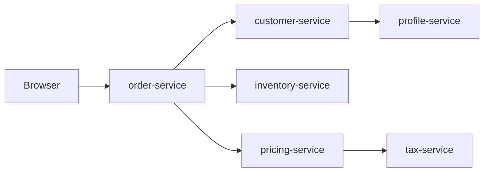
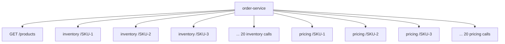
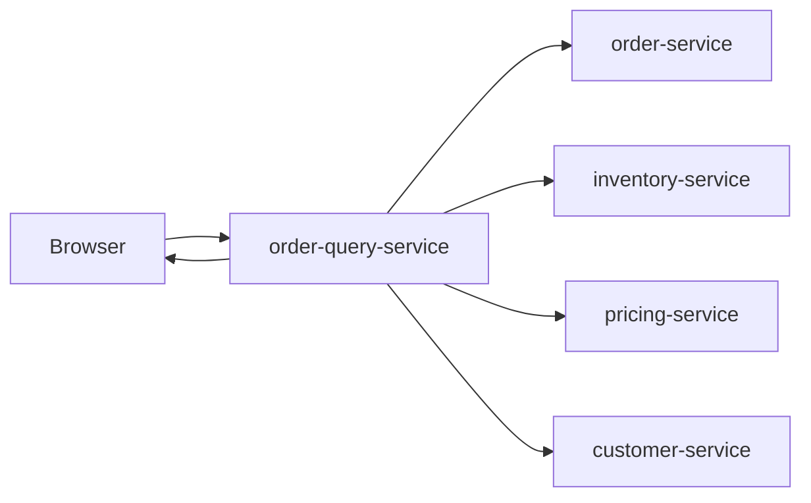
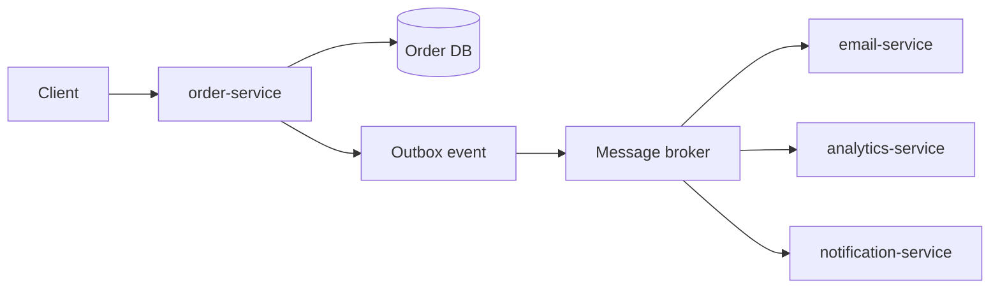
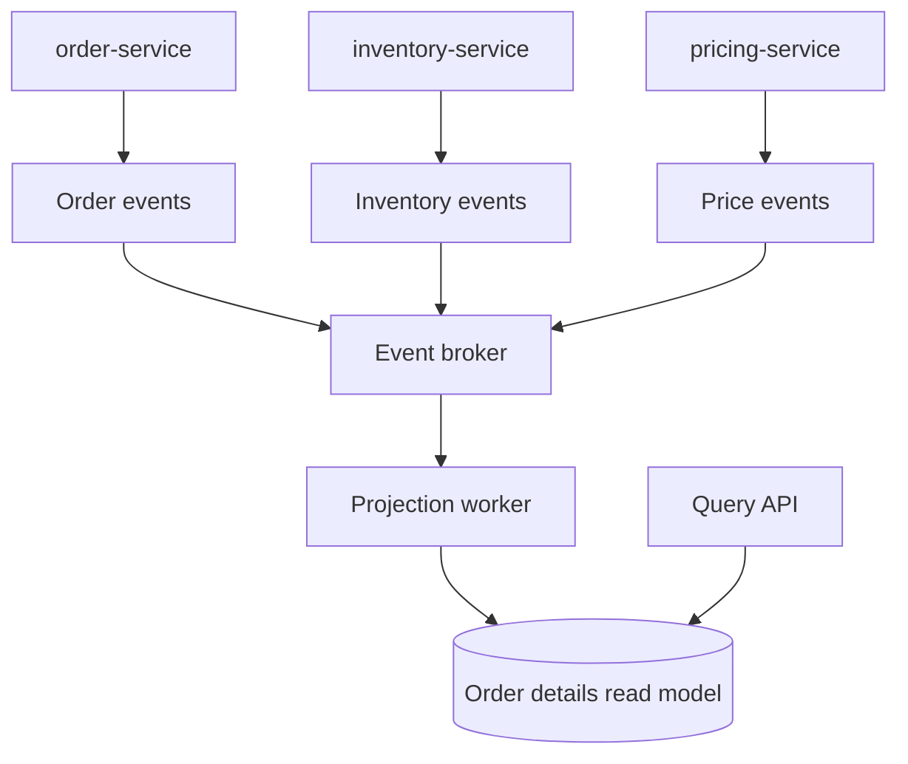

# Identifying Overly Long Call Chains and Chatty Communication

## 1. When a single request traverses too many services

In the **Design Choices** chapter of the **SPRING_CLOUD_SERVICE_COMMUNICATION_LOAD_BALANCING** module, we need to recognize when a business operation traverses too many services or generates too many HTTP calls. Spring Cloud LoadBalancer helps the caller pick a **ServiceInstance** for each service ID, yet it does not reduce call counts, dependency depth, or data volume exchanged.

For example, a user opens an order details page. **order-service** calls **customer-service** for profile info, **catalog-service** for product names, **pricing-service** for prices, and **inventory-service** for stock. If these calls run sequentially, the user waits for the entire chain. If one service in turn calls three other services per item, a single request can trigger dozens of HTTP exchanges.

Two distinct symptoms often get lumped together:

- **Overly long call chain:** a request passes through many services along a sequential dependency path or long critical path. Every hop adds latency, a failure boundary, timeout budget complexity, and tracing overhead.
- **Chatty communication:** one business operation triggers many small, repetitive calls or fragmented data exchanges. Examples include N+1 calls, calling the same service repeatedly per item, overly frequent polling, or fetching individual fields via separate APIs.

Both problems can happen together, yet they must be measured separately. A request may touch only three services while emitting 200 calls (high fan-out). Another request may emit only three HTTP calls while traversing six sequential layers. The fix depends on the root cause.

### Learning objectives

After this lesson, you will be able to:

1. Draw a business operation's call graph and identify the critical path.
2. Distinguish call-chain depth, fan-out, outbound calls, and call amplification.
3. Spot N+1 patterns, repeated calls, fragmented payloads, and excessive polling.
4. Use distributed tracing to see which service calls which, for how long, and how many times.
5. Separate latency caused by network, queues, business processing, discovery, LoadBalancer, and retries.
6. Choose suitable aggregation, batch APIs, parallelism, caching, asynchronous messaging, or read models.
7. Evaluate trade-offs across consistency, partial failures, payload size, coupling, and operations.
8. Understand the role and limits of Spring Cloud LoadBalancer when optimizing communication.
9. Design before/after experiments verifying that call counts drop without breaking business results.

## 2. Two kinds of problems in a call graph

Suppose a `GET /orders/123/details` request has this call path:



This is a **call graph**, not merely a list of dependencies in a build file.

### 2.1. Deep call chains

A deep call path often looks like:

```text
API Gateway
  -> order-service
      -> customer-service
          -> profile-service
              -> identity-service
```

If hops lie sequentially on the critical path, end-to-end latency approximates the sum of each hop plus overhead:

```text
T_total ≈ T_gateway + T_order + T_customer
          + T_profile + T_identity + T_network/queue
```

This is an estimation model to understand the dependency path. In practice, trace spans can nest, involve queues, connection pools, retries, and parallel segments; never double-count overlapping spans.

Deep chains also create failure coupling: if a mandatory dependency fails, the caller may fail to complete the operation. Per-hop timeouts do not automatically create an overall deadline; if every layer waits long and then retries, total duration can breach the outermost API's SLO.

### 2.2. Chatty communication and fan-out

For example, `order-service` fetches a list of 20 products, then calls inventory and pricing for each product:



One list fetch plus 20 inventory calls and 20 pricing calls yields **41 outbound HTTP calls** for a single logical request (excluding retries, auth/introspection, or other hidden calls). This is high fan-out and typically indicates an N+1/chatty pattern.

Fan-out does not necessarily make latency equal the sum of all calls if they run in parallel. However, it increases:

- Connection/stream counts and downstream request volume.
- The chance that one slow or failed branch delays or fails the response.
- Queueing, contention, CPU, memory, and network cost.
- Span/log/metric volume and investigation complexity.
- Retry amplification when multiple branches retry together.

### 2.3. Distinguishing the metrics

| Metric | Meaning | Question |
|---|---|---|
| Call-chain depth | Service hops along the longest dependency path | How many layers must the request traverse? |
| Fan-out | Branches/calls emitted from one step | How many sub-calls does one request fan out into? |
| Outbound calls per operation | Logical downstream calls per business operation | How many calls does one dashboard trigger? |
| HTTP attempts | Exchanges actually sent, including retries | How many requests hit downstream? |
| Call amplification factor | HTTP attempts divided by inbound business requests | How much downstream load does one user request create? |
| Payload bytes | Total request/response bytes | Are we transferring excessive data? |
| Critical-path latency | Duration of the branch determining final response | Which branch keeps the user waiting? |
| Dependency error contribution | Failures by dependency/hop | Which service drags down success rate? |

Do not rely solely on service counts in an architecture diagram to declare a system chatty. Measure calls per **logical business operation**.

## 3. Why do more hops raise latency and errors?

### 3.1. Sequential vs. parallel latency

With independent calls running sequentially:

```text
A -> B -> C -> D
T_total ≈ T_A + T_B + T_C + T_D + overhead
```

If B/C/D are independent and called in parallel:

```text
       -> B -
A -----> C  -----> aggregate
       -> D -
```

Waiting time across branches typically tracks the slowest branch plus coordination overhead:

```text
T_total ≈ T_A + max(T_B, T_C, T_D) + T_aggregate
```

Parallelism can reduce latency yet **does not reduce call counts**. It also raises peak concurrency and instantaneous load. If one mandatory branch is slow, that branch still dictates the response.

Never add individual service p95s together and call that the end-to-end p95. Percentiles do not sum linearly; measure end-to-end traces across the same requests.

### 3.2. Tail latency and fan-out

Suppose each independent branch has a 99% chance of finishing within its deadline. If the response requires **all 10 branches** to succeed, the probability all 10 meet the deadline is:

```text
P(all 10 succeed) = 0.99^10 ≈ 90.4%
```

This is a mathematical example assuming independence, identical probabilities, and all branches being mandatory. In reality errors can be correlated, and retries or fallbacks alter probabilities. It illustrates why fanning out across many mandatory branches raises the odds of one branch spoiling the response.

### 3.3. Multiplying failure boundaries

Each hop adds a boundary susceptible to:

- Connect failures, TLS/authentication failures, or DNS/discovery issues.
- Read/response timeouts, pool exhaustion, or queue saturation.
- HTTP 4xx/5xx, schema/deserialization errors, or version incompatibilities.
- Retries, duplicate side effects, open circuit breakers, or fallbacks.
- Broken trace context propagation or uncorrelated logs.

A deep chain makes root-cause tracing painful if services merely log "downstream failed" without recording dependency, status, attempt, and trace ID.

## 4. N+1 and common chatty patterns

### 4.1. Service-layer N+1

For example, an API returns 20 order items, then calls customer-service once per item:

```java
List<OrderItem> items = orderClient.getItems(orderId);

List<Customer> customers = items.stream()
        .map(item -> customerClient.getCustomer(item.customerId()))
        .toList();
```

If all 20 items belong to the same customer, the code still fires 20 HTTP calls. If there are 20 distinct customers, it also fires 20 calls even though it at least needs 20 results. This is a classic N+1 situation.

### 4.2. Repeated calls for the same data

A service may call `GET /customers/42` across multiple methods within one request because each method fetches data on its own. If data does not change during the operation, consider:

- Passing already-fetched context/data across layers within the same process.
- Using a request-scoped orchestration object to avoid redundant downstream calls.
- Consolidating APIs into one fitting query.
- Caching when consistency and freshness permit.

Never add a cache just to mask a flawed design. Caches need TTL/invalidation, memory bounds, stampede protection, and stale semantics.

### 4.3. Granular APIs and polling

A dashboard calling 12 endpoints to fetch 12 fields creates far more round trips than one aggregated view API. Polling every 100ms for data that does not need real-time freshness also generates constant load.

Ask: how frequently does the client truly need updates? Consider batch queries, conditional GET/ETag, server-sent events, WebSockets, or event-driven updates if product requirements fit.

### 4.4. Not all multi-call patterns are bad

Multiple calls can be an intentional, sound design when:

- Domains own independent data and should not be merged into one giant service.
- Each call enforces distinct access control/security boundaries.
- Calls happen rarely and sit off the latency-critical path.
- A batch endpoint would bloat payloads, complicate retries, or create hotspots.
- Some branches are optional and can run asynchronously.

The goal is reducing **unnecessary communication cost**, not forcing every service into one monolithic endpoint.

## 5. Measure with distributed tracing instead of guessing

### 5.1. Reading traces as a span tree

A trace for an order details request might look like:

```text
traceId=abc123
  SERVER  order-service GET /orders/{id}              420 ms
    CLIENT inventory-service GET /stock/SKU-1          85 ms
      SERVER inventory-service GET /stock/{sku}        78 ms
    CLIENT pricing-service GET /price/SKU-1           110 ms
      SERVER pricing-service GET /price/{sku}         103 ms
    CLIENT customer-service GET /customers/42         190 ms
      SERVER customer-service GET /customers/{id}     184 ms
```

This is illustrative data. Inspect:

- Which span is the inbound request's server span?
- How many client spans exist for each downstream?
- Are spans repeating the same URL/route or resource pattern?
- Are calls nested (serial) or starting nearly together (parallel)?
- Which span sits on the critical path and accounts for most latency?
- Are there retry spans, exception events, HTTP statuses, or timeouts?
- Is the trace broken due to missing instrumentation/context propagation?

In OpenTelemetry/Micrometer Tracing, exact span names and attributes depend on instrumentation and version. Use your stack's active semantic conventions; do not build dashboards around tags your exporter does not emit.

### 5.2. Tracing requires context propagation

A distributed trace is only useful when trace context crosses HTTP boundaries. Verify the W3C Trace Context `traceparent` header or configured propagation mechanism; each service must create spans with the right role and propagate context downstream.

If you only log a self-generated `traceId` inside `order-service` without propagating it over HTTP, you do not have a complete distributed trace. Use Spring Boot/Micrometer/OTel instrumentation and customized HTTP client builders. With WebClient, preserve Reactor context; across async/thread boundaries, verify matching context propagation.

### 5.3. Do not turn trace attributes into metric labels

Traces/logs can hold sanitized request IDs and route parameters for investigation. Metric labels must keep bounded cardinality: service name, route template, method, status class, or outcome. Avoid attaching raw order IDs, customer IDs, SKUs, or trace IDs as labels.

### 5.4. Measuring the call graph per logical operation

Useful application-instrumented metrics:

```text
outbound_logical_calls_total
outbound_http_attempts_total
inbound_business_operations_total

call_amplification =
    outbound_http_attempts_total
    / inbound_business_operations_total
```

Compute ratios over the same time window and service/operation scope. When async events are involved, clarify whether "outbound call" includes message publish/consume. Separate HTTP attempts from logical calls to expose retry amplification.

## 6. Measuring fan-out, depth, and latency meaningfully

| Question | How to measure | Warning |
|---|---|---|
| How many services does a request touch? | Count unique service names in trace | Unique count does not show ordering |
| Longest sequential path? | Find critical path in span tree/DAG | Overlapping spans easily cause double counting |
| How many calls does a service emit? | Count outbound client spans per parent operation | Retries can create extra spans |
| Is there N+1? | Group by route + parent trace + repeated key pattern | Do not log sensitive IDs to group |
| Which downstream is slow? | Latency distribution per dependency/route | Compare within the same traffic class |
| Network vs. app error? | Exceptions, HTTP status, server logs, transport metrics | 503 and connect failure differ |
| Queue/pool saturation? | Pending acquire, connection pool, executor/queue metrics | Do not look only at server CPU |
| Payload too large? | Request/response bytes, serialization time | Measure both compressed and wire bytes |

### 6.1. Setting latency budgets from SLOs

Suppose the order details endpoint has a 500ms p95 SLO. The team can allocate internal budgets for gateway, order processing, and downstream calls, grounded in real traces rather than arbitrary equal splits.

**Illustrative** budget example:

| Phase | Target budget |
|---|---:|
| Gateway/auth | 40ms |
| order-service local work | 80ms |
| Inventory branch | 100ms |
| Pricing branch | 120ms |
| Customer branch | 100ms |
| Aggregate/serialization/margin | 60ms |
| Illustrative total budget | 500ms |

For parallel branches, do not simply add all branch budgets together for wall-clock duration. Set per-dependency timeouts and an appropriate end-to-end deadline with headroom for queues, GC, and network. A p95 SLO also does not mean every request should time out right at p95.

### 6.2. Separating LoadBalancer latency from downstream latency

Spring Cloud LoadBalancer adds steps to fetch a supplier snapshot and pick an instance. With proper caching/discovery, selection time is usually tiny compared to HTTP response time, yet measure rather than assume. If traces show long client spans, separate:

- Waiting on supplier/discovery or cache refresh.
- Connection pool acquire.
- DNS/TCP/TLS setup.
- Server queuing and processing.
- Response body transfer/deserialization.
- Retries/backoff.

Fast Pod selection cannot rescue a design making 100 calls; conversely, a clean call graph can still lag if one specific instance is overloaded.

## 7. What Spring Cloud LoadBalancer helps with—and what it does not

Spring Cloud LoadBalancer selects a `ServiceInstance` by service ID from a supplier. It helps by:

- Distributing **existing** calls across instances.
- Selecting instances via Round Robin/Random/custom policies.
- Combining discovery, caching, zone/hint, and health suppliers.
- Supporting retry integration in matching clients/versions.
- Providing lifecycle observations/metrics when instrumentation is enabled.

It **does not automatically**:

- Merge 20 GETs into a single batch request.
- Collapse an `order → pricing → tax → currency` chain.
- Notice two HTTP calls fetching the same resource and deduplicate them.
- Create an aggregation endpoint or materialized view.
- Guarantee all instances are healthy merely because discovery returned them.
- Set connect/read/end-to-end timeouts for every HTTP client.
- Act as a circuit breaker or replace API contracts.

If a chatty caller emits 100 requests, LoadBalancer can spread those 100 requests across multiple Pods; downstream still has to process 100 requests. Sometimes it even hides the issue by spreading load, yet total calls and cost do not disappear.

### 7.1. Do not fix architecture by adding replicas before measuring

Scaling replicas may cut per-instance queues/CPU short-term, yet it never solves N+1. If call counts grow with item counts, downstream load still scales with batch size. Before adding replicas, measure calls per business operation, attempts, CPU/queues, cache hits, per-route/instance latency, and payload bytes.

Scaling remains valid when load reflects genuine work; just do not use it to mask unnecessary round trips.

## 8. Option 1 — Aggregation at the right boundary

Aggregation combines data needed for a use case into one response at an appropriate boundary, such as an `order-query-service` or API composition/BFF.



Instead of the UI calling four services directly, the query service exposes one view endpoint. However, aggregation only cuts round trips **for the outer caller**; if internally it still queries item by item, total downstream calls have not dropped.

### 8.1. Choosing where to aggregate

- **API composition/BFF:** fits when a response serves a screen/use case spanning multiple domains.
- **Domain service/orchestrator:** fits when the business genuinely has one owner coordinating a workflow.
- **Read model/materialized view:** fits when queries are complex, read-heavy, and tolerate asynchronous updates.
- **Database join within the same bounded context:** often better than calling multiple services just to join data owned by one domain; never turn this into cross-service DB access.

Avoid creating a "god aggregation service" holding all business rules and knowing internal schemas of every domain. It becomes a coupling hub that breaks whenever domains evolve.

### 8.2. Aggregation rules

1. Fetch only fields needed by the use case.
2. Call independent branches in parallel with bounds.
3. Set timeouts/deadlines based on each branch's criticality.
4. Define which branches are mandatory and which can degrade gracefully.
5. Preserve provenance/version if data timestamps may diverge.
6. Never turn dependency errors into fake valid values.
7. Cache views if freshness/consistency allow.
8. Measure downstream call counts before and after aggregation.

## 9. Option 2 — Batch APIs instead of N+1

When a caller needs data for many IDs, an endpoint accepting a list of IDs typically reduces round trips.

### 9.1. Before: one request per SKU

```java
List<InventoryItem> result = skus.stream()
        .map(sku -> inventoryClient.get()
                .uri("/api/inventory/{sku}", sku)
                .retrieve()
                .body(InventoryItem.class))
        .toList();
```

With 20 SKUs, the caller makes 20 HTTP calls. This is also sequential blocking code; latency can approach the sum of all 20 calls.

### 9.2. After: one batch request

API contract:

```http
POST /api/inventory/batch
Content-Type: application/json

{
  "skus": ["SKU-1", "SKU-2", "SKU-3"]
}
```

Client:

```java
record InventoryBatchRequest(List<String> skus) {}

record InventoryBatchResponse(List<InventoryItem> items) {}

InventoryBatchResponse result = inventoryClient.post()
        .uri("/api/inventory/batch")
        .body(new InventoryBatchRequest(skus))
        .retrieve()
        .body(InventoryBatchResponse.class);
```

With 20 SKUs, **one HTTP call** may suffice. The inventory service can still query its DB in batches or chunks; a batch API does not automatically guarantee the backend runs a single SQL statement.

### 9.3. Designing a safe batch contract

| Issue | Decision to specify clearly |
|---|---|
| Max batch size | Cap IDs/payload, e.g., 100 or per benchmark |
| Duplicate IDs | Return one item or preserve duplicates? |
| Missing IDs | Return a missing list, null, or per-item status? |
| Partial failure | Does one failed item fail the entire batch? |
| Ordering | Does the response preserve request order? |
| Authorization | Check permissions per resource or for the whole batch |
| Rate limiting | Metered per batch or per item count? |
| Timeout | Are batch processing time and total payload bounded? |
| Retry | Retrying a whole batch repeats lots of work; requires idempotency if side effects exist |

Never create an unbounded batch endpoint. A request with 10,000 IDs can exert far worse memory/DB pressure than controlled smaller calls.

## 10. Option 3 — Parallelizing independent branches

If three calls are genuinely independent and the caller needs all three results, running them in parallel cuts critical-path latency. WebClient example:

```java
Mono<OrderDetails> loadDetails(String orderId) {
    Mono<Order> order = orderClient.get()
            .uri("/orders/{id}", orderId)
            .retrieve()
            .bodyToMono(Order.class)
            .timeout(Duration.ofMillis(250));

    Mono<Customer> customer = customerClient.get()
            .uri("/customers/{id}", "customer-42")
            .retrieve()
            .bodyToMono(Customer.class)
            .timeout(Duration.ofMillis(150));

    Mono<Pricing> pricing = pricingClient.get()
            .uri("/prices/{orderId}", orderId)
            .retrieve()
            .bodyToMono(Pricing.class)
            .timeout(Duration.ofMillis(180));

    return Mono.zip(order, customer, pricing)
            .map(tuple -> new OrderDetails(
                    tuple.getT1(), tuple.getT2(), tuple.getT3()))
            .timeout(Duration.ofMillis(400));
}
```

This is illustrative; real code must extract the customer ID from the order if dependent rather than hardcoding an ID. `Mono.zip` waits for all publishers to emit; one failed branch fails the whole zip. If a branch is optional, define a clear fallback on that branch rather than swallowing all errors.

### 10.1. Cap concurrency

Do not turn sequential N+1 into unbounded concurrent N+1 calls. That might drop single-request latency while causing load spikes and downstream queuing.

For lists processed concurrently, apply a concurrency bound:

```java
Flux<InventoryItem> fetchItems(List<String> skus) {
    return Flux.fromIterable(skus)
            .flatMap(this::fetchOne, 8);
}
```

The value `8` is an example; pick based on capacity, pools, rate limits, and latency budgets. If a batch API exists and fits the contract, benchmark batching against bounded concurrency rather than defaulting to per-ID calls.

### 10.2. When should you not parallelize?

- Calls depend on data from an earlier call.
- Downstream is already near saturation.
- The API requires transactions or strict ordering.
- An optional branch can be loaded later.
- Combined payload/connection concurrency exceeds limits.
- Parallel failure fails the entire response when the business could gracefully degrade.

Parallelism is a latency-reduction technique, **not** a call-count reduction technique.

## 11. Option 4 — Controlled read caching

Caching reduces repeated calls when the same data is read often and freshness allows.

| Cache type | Scope | Suitable for |
|---|---|---|
| Request-local memoization | One logical request | Multiple steps within one request needing the same resource |
| In-process cache | One service instance | Read-heavy data tolerating a TTL |
| Distributed cache | Multiple replicas | Shared data reducing cross-instance calls |
| Materialized read model | One query/use case | Aggregated views updated via events |

### 11.1. Caches need explicit semantics

- TTL and invalidation policy.
- Concurrent cache-miss handling (request coalescing/single-flight).
- Size bounds and eviction.
- Stale-while-revalidate if the use case allows.
- Distinguishing cache misses from downstream failures.
- Never caching 401/403 or sensitive data under the wrong key.
- Never using a cache to bypass authorization.
- Monitoring hit/miss/stale/error rates and freshness impact.

Request-local memoization is usually safer than distributed caching for avoiding duplicate calls within one operation, as it avoids cross-replica invalidation. Still, only memoize when calls match on tenant, auth, locale, version, and parameters.

## 12. Option 5 — Moving non-synchronous work to events/messages

Not every step must finish before returning a response. For example, once an order is created, sending emails, updating analytics, or generating reports can run asynchronously.



Synchronous requests wait only for steps required to commit and respond. Side effects can be published via a transactional outbox to avoid DB commits where events are lost.

### 12.1. Trade-offs of async

- Users may receive `202 Accepted` or partial results.
- Requires explicit event schemas/versioning and ownership.
- Consumers must be idempotent because messages can be redelivered.
- Introduces eventual consistency and requires displaying pending states.
- Requires retries/DLQ/observability for message flows.
- Never push a mandatory synchronous decision to async just to make a latency dashboard look better.

Event-driven architectures do not erase calls; they shift **when** and **how** communication occurs, fitting well when the business accepts eventual consistency.

## 13. Option 6 — Read models/CQRS for aggregated queries

If a screen frequently needs data from multiple domains and query-time composition is too expensive, build a dedicated read model:



The Read API queries the projection instead of synchronously calling many services every time. The upside is fast reads and reduced read-time fan-out. The costs are:

- Projections update asynchronously and can be stale.
- Must handle event ordering, duplicates, and replays.
- Read-model schemas carry their own lifecycle/versioning.
- Requires reconciliation/rebuilds when projections fail.
- Never rely on a read model for critical write decisions without an explicit consistency contract.

CQRS fits when read/write patterns differ sharply and benefits outweigh operational cost.

## 14. Designing timeouts, retries, and bulkheads across the call graph

When chains are deep or fan-out is high, timeouts and retries must be designed around the **logical request**, not just one HTTP call.

### 14.1. Tiered timeout budgets

Suppose the external API has a 500ms deadline. If `order-service` uses up to 450ms for downstream calls, what remains may not cover serialization, queuing, auth, and return network transit. Budget allocation must reserve overhead and remaining time.

When starting each downstream call, pass the **remaining deadline** if the system propagates deadlines by contract. Never grant a fresh 500ms at every hop, or a four-hop chain could stall for seconds.

### 14.2. Retry amplification

Suppose each logical request makes 10 downstream calls and each call can retry once. Worst-case HTTP attempts can jump from 10 to 20. If the gateway also retries the entire logical request once, total downstream attempts can multiply further depending on nested retry semantics.

Definition:

```text
call_amplification_factor =
    total_downstream_http_attempts
    / total_inbound_business_requests
```

If the ratio climbs from 8 to 18 after enabling retries, the system may succeed more often while downstreams absorb over double the load. Track success rate alongside attempts/request, p95/p99, and saturation.

### 14.3. Bulkheads and concurrency limits

- Limit concurrent calls to each downstream.
- Separate connection pools or concurrency budgets for critical dependencies.
- Bound queues; unbounded queues only delay failure and inflate memory.
- Under overload, fail fast/degrade cleanly instead of holding requests indefinitely.
- Retries must not bypass bulkheads and push load beyond capacity.

Circuit breakers and bulkheads protect dependencies; they do not fix a chatty call graph. If 50 calls are required, a closed circuit breaker still passes 50 calls.

## 15. Designing with Spring Cloud LoadBalancer

### 15.1. Keep service IDs and clients clear

Once you have a sound call graph, Spring Cloud LoadBalancer resolves each service ID:

```java
@Bean
@LoadBalanced
RestClient.Builder loadBalancedRestClientBuilder(
        RestClientBuilderConfigurer configurer) {
    return configurer.configure(RestClient.builder());
}
```

The caller can use a batch endpoint:

```java
InventoryBatchResponse response = inventoryRestClient.post()
        .uri("http://inventory-service/api/inventory/batch")
        .body(new InventoryBatchRequest(skus))
        .retrieve()
        .body(InventoryBatchResponse.class);
```

This illustrates the concept; in real code build the `RestClient` bean once rather than building from the builder on every request. LoadBalancer picks one instance for the **batch HTTP request**; it does not pick a different instance per SKU inside the body.

### 15.2. Does batching change distribution?

Before: 20 requests to inventory, each potentially routed to a different instance. After: one batch request routed to one selected instance. This cuts HTTP calls, yet can create hotspots if giant batches land on one Pod. Cap batch sizes, measure CPU/DB queries, and consider controlled chunking if capacity requires.

Never assume one big request is always faster than 20 small ones; benchmark real payloads, DB queries, serialization, and concurrency.

### 15.3. Per-service policies do not replace API design

Zone preferences, hints, or weighted suppliers decide **which instance** receives a call. They do not eliminate calls. If a caller makes 100 calls, LoadBalancer can spread those 100 calls across instances; downstream still processes 100 calls.

Use supplier policies for locality/health/canary needs, and reduce communication using batching/aggregation/caching/read models.

## 16. Choosing a solution by symptom

| Observed symptom | Direction to try first | Trade-offs to verify |
|---|---|---|
| Deep chain, sequential hops | Consolidate orchestration in the right domain; parallelize independent branches | Coupling, critical path, partial failure |
| N+1 over ID lists | Batch API or domain bulk query | Payload size, max batch, partial results |
| Same resource called repeatedly per request | Request-local memoization | Auth/context must match |
| Many clients fetching same read data | Cache with TTL/invalidation | Staleness, stampedes, memory |
| Dashboard joins many domains every load | BFF/aggregation or read model | Ownership, eventual consistency |
| Side effects not needed before response | Async events + outbox | Eventual consistency, idempotency |
| Independent calls running sequentially | Bounded parallelism | Concurrency spikes, deadlines |
| One dependency frequently overloaded | Bulkhead, rate limit, circuit breaker | Degraded responses and capacity |
| Retries generating many attempts | Single retry owner, bounded attempts/deadlines | Reduced immediate recovery |
| One slow Pod in instance pool | Appropriate health/metrics/policy, timeouts | Detection delay and false positives |

No single solution fits every service. Choose based on the latency-critical path, data ownership, consistency, load, and operability.

## 17. Hands-on exercise: measuring and reducing N+1

### 17.1. Initial scenario

A `GET /dashboard` API returns 20 product cards. `catalog-service` fetches the product list; for each SKU, `dashboard-service` calls inventory and pricing separately.

Logical calls before optimization:

```text
1 catalog list request
20 inventory item requests
20 pricing item requests
--------------------------------
41 downstream HTTP calls / dashboard request
```

If each call retries, actual HTTP attempts can exceed 41.

### 17.2. Collect a baseline

1. Prepare test data with 20 SKUs.
2. Send 100 requests to `/dashboard` at controlled concurrency.
3. Collect distributed traces with sufficient sampling to analyze; do not rely on a single trace.
4. Count client spans per downstream route.
5. Record calls/request, attempts/request, payload bytes, p50/p95/p99, error rate, and server CPU.
6. Confirm repeated per-SKU calls and identify which branch lies on the critical path.

Baseline table to fill in:

| Metric | Baseline |
|---|---:|
| Inbound dashboard operations | ... |
| Catalog calls | ... |
| Inventory calls | ... |
| Pricing calls | ... |
| Total logical outbound calls | ... |
| Total HTTP attempts | ... |
| Calls/operation | ... |
| p95 end-to-end | ... ms |
| p95 inventory | ... ms |
| p95 pricing | ... ms |
| Error rate | ... % |

### 17.3. Add batch endpoints

Create two endpoints:

```http
POST /api/inventory/batch
{"skus":["SKU-1","SKU-2","SKU-3"]}

POST /api/pricing/batch
{"skus":["SKU-1","SKU-2","SKU-3"]}
```

After adding batch APIs, an ideal dashboard request in this example makes:

```text
1 catalog list request
1 inventory batch request
1 pricing batch request
--------------------------------
3 downstream HTTP calls / dashboard request
```

This is the **expected call count by design** assuming zero retries and no extra calls; it does not yet prove the batch endpoints perform well. Benchmark, verify responses cover all 20 IDs, and handle partial/missing records per contract.

### 17.4. Re-run and compare

| Metric | Before | After | Change |
|---|---:|---:|---:|
| Logical outbound calls/operation | 41 | 3 | -92.7% |
| HTTP attempts/operation | ... | ... | ... |
| p95 end-to-end | ... | ... | ... |
| p95 inventory | ... | ... | ... |
| p95 pricing | ... | ... | ... |
| Error rate | ... | ... | ... |
| Payload bytes | ... | ... | ... |
| Downstream CPU | ... | ... | ... |

The 41 → 3 figure is a **design topology count**, not an observed benchmark. p95, CPU, and bytes must be measured. Batch payloads may be larger than individual requests, while usually cutting header/connection/scheduling overhead.

### 17.5. Test correctness and resilience

- Every valid SKU request must receive its matching result.
- Duplicate SKUs handled per contract.
- Missing SKUs represented clearly.
- Oversized batches rejected cleanly.
- One failed item does not wipe out other items if the API promises partial results.
- Batch timeouts do not trigger unbounded caller retries.
- Bounded retries do not multiply attempts across layers.
- When an inventory Pod fails, LoadBalancer can pick another instance per policy/supplier, yet the batch remains a single HTTP exchange to one instance.
- Traces confirm calls dropped—do not check only that the final dashboard response is still 200.

## 18. Hands-on exercise: detecting a long chain

Use a `GET /orders/{id}/summary` operation with call path:

```text
order-service
  -> customer-service
      -> profile-service
  -> pricing-service
      -> tax-service
  -> inventory-service
```

### Step 1 — Draw the trace graph

Capture an end-to-end trace. Record each client/server span, parent-child link, start/end times, status, and instance ID if instrumented.

### Step 2 — Find the critical path

Determine which branch starts after another. If pricing calls tax sequentially, that forms a dependency path. If customer/profile and inventory run in parallel, do not sum their durations like a sequential chain.

### Step 3 — Separate mandatory and optional data

For example, order summary may require order + price + inventory to determine order status, whereas the customer's avatar may be optional. Define a clear degraded response instead of letting an optional branch fail the entire API.

### Step 4 — Propose changes

Pick one or more approaches:

- Bounded parallelism for independent branches.
- Batch APIs for item lists.
- Query aggregation/read models for display data.
- Caching customer profiles if freshness permits.
- Event-driven updates for analytics/notifications.
- Removing artificial service boundaries if services actually belong to the same bounded context.

### Step 5 — Re-measure

Compare critical-path latency, calls/operation, attempts/operation, error rate, and trace shape. Never just report "switched to async" or "added replicas".

## 19. Decision criteria and review checklist

Before merging communication changes:

- [ ] Pre-optimization trace captured for one logical business operation.
- [ ] Call-chain depth distinguished from fan-out.
- [ ] Logical downstream calls and HTTP attempts per operation are known.
- [ ] N+1, repeated calls, and polling identified if present.
- [ ] Critical path determined from span timing without double-counting parallel spans.
- [ ] Independent calls parallelized only with concurrency limits.
- [ ] Batch APIs define max size and missing/duplicate/partial-result contracts.
- [ ] Aggregation placed at a boundary with clear ownership.
- [ ] Caches define TTL, invalidation, and stale-data semantics.
- [ ] Async workflows include outbox/idempotency/retry/DLQ where needed.
- [ ] Read models define consistency and rebuild strategies.
- [ ] Timeouts and overall deadlines budgeted from SLOs.
- [ ] Clear single retry owner; attempts bounded.
- [ ] LoadBalancer policies used for instance selection, not expected to cut call counts.
- [ ] Metrics avoid raw IDs/trace IDs as labels.
- [ ] Benchmarks/load tests use realistic payloads and concurrency.
- [ ] Correctness, latency, calls, attempts, bytes, and resource costs measured before/after.
- [ ] Fallback/partial response contract exists when optional dependencies fail.

## 20. Practice exercises

### Exercise 1 — Chain depth or fan-out?

One request passes sequentially through 6 services, each making a single call. Another request touches 3 services, yet the second service calls 50 item endpoints. Analyze both problems and the metrics to measure.

### Exercise 2 — Calculate call counts

A page lists 15 products; each product calls inventory and pricing. There is also one catalog list call. Compute logical outbound calls. Then add one retry per HTTP call and compute worst-case attempts assuming each call retries at most once.

### Exercise 3 — Does parallelism reduce calls?

Convert 20 sequential calls into `flatMap` with concurrency 8. Evaluate latency, peak concurrency, and call counts. Explain why this is not yet a complete N+1 fix.

### Exercise 4 — Batch contract

Design `POST /inventory/batch` capped at 100 SKUs. Specify missing IDs, duplicate IDs, ordering, authorization, and partial errors. Explain when a batch should be chunked.

### Exercise 5 — Retry amplification

An API gateway retries the entire request once; `order-service` retries downstream twice; LoadBalancer retries the next instance once. Diagram the retry layers and find how to cut worst-case attempts via retry ownership and deadline propagation.

### Exercise 6 — Partial response

Customer avatar is optional while pricing is mandatory. Design the response when avatar-service times out, preserving pricing failure semantics and degraded-response metrics.

### Exercise 7 — Read model or aggregation?

Compare synchronous API composition against a CQRS read model for a dashboard serving 100,000 reads/day while price/inventory data changes continuously. Evaluate freshness, throughput, operational cost, and consistency.

### Exercise 8 — LoadBalancer is not an aggregator

A caller uses Round Robin for 100 HTTP requests. Prove from server logs that request count remains 100 even when spread across multiple instances. Propose batching to cut call counts.

### Exercise 9 — Is the cache safe?

Customer profiles are cached for 60 seconds. Analyze which fields may go stale, which tenant/locale/authorization dimensions the cache key must include, and when caching must be avoided.

### Exercise 10 — Before/after report

Write a measurement report covering the call graph, critical path, calls/operation, attempts/operation, p95/p99, payload bytes, downstream CPU, error rate, and trade-offs of the change.

## References

- [Spring Cloud Commons — Spring Cloud LoadBalancer](https://docs.spring.io/spring-cloud-commons/reference/spring-cloud-commons/loadbalancer.html): service instance selection, suppliers, retries, health, and observation.
- [Spring Boot — Tracing](https://docs.spring.io/spring-boot/reference/actuator/tracing.html): Micrometer Tracing, propagation, and distributed traces.
- [OpenTelemetry — Context Propagation](https://opentelemetry.io/docs/concepts/context-propagation/): trace context across processes/services.
- [OpenTelemetry — Semantic Conventions](https://opentelemetry.io/docs/specs/semconv/): span attributes and HTTP conventions.
- [OpenTelemetry — Metrics](https://opentelemetry.io/docs/concepts/signals/metrics/): metrics, aggregation, and cardinality.
- [Project Reactor — Reactor Core Reference](https://projectreactor.io/docs/core/release/reference/): `Mono.zip`, `flatMap`, concurrency, and timeout operators.
- [Spring Framework — WebClient](https://docs.spring.io/spring-framework/reference/web/webflux-webclient.html): reactive HTTP client and error handling.
- [Spring Framework — REST Clients](https://docs.spring.io/spring-framework/reference/integration/rest-clients.html): RestClient and HTTP integration.
- [Transactional Outbox pattern](https://microservices.io/patterns/data/transactional-outbox.html): guaranteeing event publication after database commit.
- [CQRS pattern](https://microservices.io/patterns/data/cqrs.html): separating read models and write models.

**Conclusion:** overly long call chains are a problem of **dependency depth and critical paths**; chatty communication is a problem of **call counts, fan-out, and data volume**. Use traces to locate slow paths and repeated calls, then choose batching, aggregation, bounded parallelism, caching, async messaging, or read models based on consistency and ownership. Spring Cloud LoadBalancer helps pick instances for necessary calls; it does not replace redesigning the call graph.
