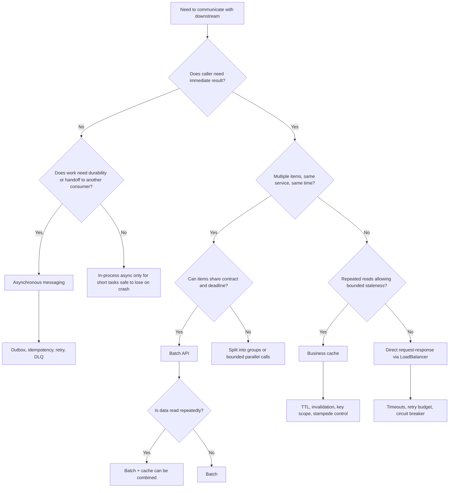
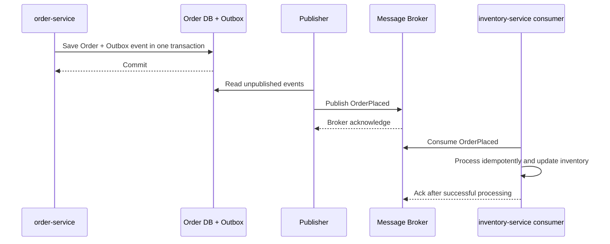
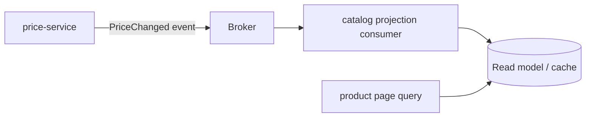

# When to Use Batching, Business Caching, or Asynchronous Messaging

A service often needs to fetch data from multiple replicas or different services. For example, when rendering a shopping cart, `order-service` needs product prices, inventory, and shipping details. The simplest approach is calling each API synchronously through Spring Cloud LoadBalancer. Yet as item counts grow, each request triggers many network round trips; latency, downstream load, and the risk of one slow dependency breaking the whole page all increase.

Three design directions are commonly considered:

- **Batching:** grouping multiple items to process into one request or unit of work.
- **Business caching:** storing previously read business results to reduce queries to the data source.
- **Asynchronous messaging:** sending a command/event for the receiver to process independently without blocking the caller until all work finishes.

These three directions solve different problems. Batching cuts call counts for a group of operations; caching avoids repeating similar reads; asynchronous messaging decouples send time from processing time. They can be combined, yet each introduces distinct trade-offs around consistency, latency, error handling, and operations.

Within the `SPRING_CLOUD_SERVICE_COMMUNICATION_LOAD_BALANCING` module, these options sit alongside client-side load balancing: **Spring Cloud LoadBalancer still selects a `ServiceInstance` for each synchronous HTTP call**, while batching/caching/asynchronous messaging decide whether the system needs to make that call, how many calls to make, or whether it must wait for a response.

## 1. Start from the problem to solve

Suppose `order-service` displays an order with 20 products. With a sequential-call design:

```text
order-service
  ├── GET product-service/products/1
  ├── GET product-service/products/2
  ├── ...
  └── GET product-service/products/20
```

Every HTTP request carries fixed overhead: DNS/connection pool, TLS when required, headers, serialization, scheduling, tracing, and server handling. Even with connection reuse, 20 requests still create 20 dispatches and 20 passes through middleware.

With LoadBalancer, each service-ID call may require an instance selection. With 20 independent calls, the client can perform 20 selections and 20 HTTP exchanges. With a batch API, one request carrying 20 IDs typically needs only one instance selection and one HTTP exchange; the provider processes the 20 items internally.

Caching changes a different dimension: if product data is already in cache and still valid, the client/service may skip calling `product-service` on that read. Messaging changes completion timing: the caller sends a command/event and receives acknowledgment of acceptance, while the consumer processes later.

### 1.1. Three questions to choose the right direction

| Question | If the answer is "yes" | Direction worth considering |
|---|---|---|
| Many small operations target one service and need immediate results? | Group them into one request | Batch |
| Same data read repeatedly, changes relatively rarely, and bounded staleness is acceptable? | Reuse previous results | Business cache |
| Caller does not need immediate results, work may take long, or needs independent/durable processing? | Decouple send time from completion time | Asynchronous messaging |

If every transaction must read the latest state, caching may not fit. If items being processed have independent access permissions, deadlines, or failures, an oversized batch can cause trouble. If the caller needs an immediate outcome to decide the next step, a fire-and-forget event cannot replace request-response.

## 2. Comparing batching, caching, and asynchronous messaging

| Criterion | Batch | Business cache | Asynchronous messaging |
|---|---|---|---|
| Primary goal | Reduce requests for multiple items | Reduce repeated reads | Decouple producer and consumer |
| Result | Usually returned in the same request | Returns stored data or queries source | Usually processed after message acceptance |
| Caller latency | Waits for entire batch | Usually low on cache hit | Low on send/ack; does not wait for business completion |
| Consistency | As of when provider processes batch | Can be stale per TTL/invalidation | Usually eventual consistency |
| Fault tolerance | A batch can yield partial results | Can serve stale data on source error if policy allows | Broker retains messages and consumer can reprocess |
| Operational cost | API contract, batch size, partial failures | Memory/distributed cache, eviction, invalidation | Broker, schemas, consumers, retries, DLQ, outbox |
| Suitable for | Many small items needing immediate results | Read-heavy, slowly changing data | Long jobs, events, fan-out, workflows |
| Main risks | Large payloads, one failure affecting many items | Stale data, cache stampede, cache pollution | Duplicate delivery, ordering, eventual consistency |

No option is universally superior. Decisions should rest on **data and business characteristics**, not merely request counts or a wish to lower latency.

## 3. Design decision tree



The decision tree is a starting point. A single use case may need all three: a batch API to read 100 product prices, caching for slowly changing price tables, and asynchronous events emitted once an order is confirmed.

## 4. When to use batching?

Batching fits when a caller needs multiple results of the same kind, from the same service, or within the same business boundary in a short time window.

Examples:

- Fetching prices for 30 SKUs to compute a cart total.
- Checking statuses of multiple shipments at once.
- Sending multiple independent update commands in one sync pass with a provider.
- Reading multiple profiles by ID when rendering a summary screen.
- Writing multiple records sharing validation rules and a transaction boundary.

### 4.1. Signs batching helps

- Many small requests call the same service ID.
- Per-item payloads are small, while HTTP overhead takes a noticeable share.
- Items share authentication/tenant scope and can share one contract.
- The provider can process groups more efficiently, e.g., a single SQL `IN (...)` query or one underlying system call.
- The caller can accept a shared deadline and handle per-item outcomes.

Batching does not automatically make the provider faster. If the provider still executes one query or one remote call per item internally, only HTTP exchange counts drop; the bottleneck may remain downstream.

### 4.2. Designing a batch API with per-item results

A price-lookup contract might accept a list of SKUs and return results per SKU:

```json
{
  "items": [
    {"sku": "SKU-001"},
    {"sku": "SKU-002"},
    {"sku": "SKU-003"}
  ]
}
```

Response:

```json
{
  "results": [
    {
      "sku": "SKU-001",
      "status": "FOUND",
      "price": 125000
    },
    {
      "sku": "SKU-002",
      "status": "NOT_FOUND"
    },
    {
      "sku": "SKU-003",
      "status": "FOUND",
      "price": 99000
    }
  ]
}
```

This contract expresses that `SKU-002` does not exist without losing results for the other two items. HTTP 200 can represent a batch processed successfully at the request level, while item-level errors live inside `results`. If the whole request is malformed or the caller lacks authorization, fail at the request level.

Clearly specify:

- Do results preserve input order, or must the caller match by key?
- Are duplicate IDs preserved, deduplicated, or rejected?
- Is a missing item `NOT_FOUND`, `SKIPPED`, or an error?
- If one item times out, do the others continue?
- Is a batch an atomic transaction or partial results?
- Does the batch cap item count and total payload size?

### 4.3. Example controller handling a batch

```java
import java.math.BigDecimal;
import java.util.List;
import java.util.Map;

import org.springframework.web.bind.annotation.PostMapping;
import org.springframework.web.bind.annotation.RequestBody;
import org.springframework.web.bind.annotation.RequestMapping;
import org.springframework.web.bind.annotation.RestController;

record PriceBatchRequest(List<String> skus) {
}

record PriceResult(
        String sku,
        String status,
        BigDecimal price) {
}

record PriceBatchResponse(List<PriceResult> results) {
}

@RestController
@RequestMapping("/api/v1/prices")
class PriceBatchController {

    private final PriceService priceService;

    PriceBatchController(PriceService priceService) {
        this.priceService = priceService;
    }

    @PostMapping("/batch")
    PriceBatchResponse findBatch(@RequestBody PriceBatchRequest request) {
        List<String> skus = request.skus();

        if (skus == null || skus.isEmpty() || skus.size() > 100) {
            throw new IllegalArgumentException(
                    "Batch must contain between 1 and 100 SKUs");
        }

        Map<String, BigDecimal> prices =
                priceService.findPrices(skus);

        List<PriceResult> results = skus.stream()
                .map(sku -> {
                    BigDecimal price = prices.get(sku);
                    return price == null
                            ? new PriceResult(sku, "NOT_FOUND", null)
                            : new PriceResult(sku, "FOUND", price);
                })
                .toList();

        return new PriceBatchResponse(results);
    }
}
```

This example assumes `PriceService.findPrices` can read multiple SKUs efficiently and return a map by SKU. In production, validate `null` entries, payload size, tenant authorization, and duplicate SKUs per contract. Never allow an arbitrary batch of tens of thousands of elements to exhaust heap or hold connections/transactions too long.

### 4.4. Client calling the batch endpoint via service ID

A batch request still uses Spring Cloud LoadBalancer normally:

```java
import java.util.List;

import org.springframework.beans.factory.annotation.Qualifier;
import org.springframework.stereotype.Service;
import org.springframework.web.client.RestClient;

@Service
class PriceGateway {

    private final RestClient client;

    PriceGateway(
            @Qualifier("loadBalancedRestClientBuilder")
            RestClient.Builder builder) {
        this.client = builder
                .baseUrl("http://price-service")
                .build();
    }

    PriceBatchResponse findPrices(List<String> skus) {
        return client.post()
                .uri("/api/v1/prices/batch")
                .body(new PriceBatchRequest(skus))
                .retrieve()
                .body(PriceBatchResponse.class);
    }
}
```

`loadBalancedRestClientBuilder` must be a bean annotated with `@LoadBalanced`, and the project needs the matching starter/integration. LoadBalancer selects **one `ServiceInstance` for that batch request**. It does not split 100 SKUs across 10 instances; if internal distribution is needed, the provider or a batch coordinator layer must explicitly design it.

### 4.5. Chunking and batch limits

Do not group unboundedly. Split into chunks matching provider limits:

| Limit | Why it matters |
|---|---|
| Max item count | Bounds CPU, SQL parameters, processing time |
| Request/response size | Avoids huge payloads, GC pressure, and proxy body limits |
| Overall deadline | Prevents a batch from holding the request too long |
| Concurrent batches | Avoids turning batches into an overloading fan-out burst |
| Transaction size | Avoids long locks and overly wide rollbacks |
| Rate limits | A batch must not bypass per-tenant traffic limits |

For example, if a caller has 450 SKUs and the provider caps requests at 100 items, at least 5 batches are needed. Send sequentially or with bounded concurrency; never use default `parallelStream()` to fire hundreds of requests simultaneously.

### 4.6. Partial failures and batch retries

A batch can hold items with different outcomes. If the whole HTTP request times out, the caller does not know how many items the provider already processed. When retrying:

- For read-only operations, retrying is generally safer, though values may change between reads.
- For write operations, require an idempotency key for the **batch** or per **individual item**.
- If the provider returns partial results, retry only items classified as retryable; never blindly resend the entire batch.
- If the batch is atomic, determine whether the transaction rolled back or the response was lost after commit.


## 5. When to use business caching?

Business caching fits when the same data is read repeatedly, the data source carries noticeable cost, and the business accepts a **clearly defined level of staleness**. Examples:

- Product catalogs, display names, thumbnails.
- Regional shipping configurations.
- Exchange rates or price tables with effective timestamps.
- Permissions/feature configuration with short TTLs and clear invalidation rules.
- CPU-heavy computation results reusable for identical inputs and data versions.

Caching does not fit when every read must observe the latest transactional state—for instance, available balance used to authorize a funds transfer. A cache may serve reference display data, yet should not act as the final source of truth for a financial invariant.

### 5.1. Choosing cache scope

| Cache type | Scope | When suitable | Trade-off |
|---|---|---|---|
| Request-scoped | Within one request | Avoids fetching the same data twice in one flow | Not shared across requests |
| Local in-memory | One JVM | Read-heavy data where per-instance snapshots are fine | Cache across replicas can diverge |
| Distributed cache | Multiple services/replicas reading together | Need shared results and lower source load | Adds network hop, operations, and failure modes |
| CDN/edge cache | Cacheable HTTP content | Public, slowly changing content | Unsuitable for private or permission-gated data |
| Database/materialized view | Close to data source | Heavy aggregate queries needing controlled updates | Raises write/update complexity |

Place the cache closest to where data is consumed if you need control over keys and freshness. Client/service caching should not become a workaround for a downstream API with a poor contract or bad performance.

### 5.2. Business caching differs from ServiceInstance list caching

These are two caches with distinct purposes:

| Characteristic | Business cache | Spring Cloud LoadBalancer cache |
|---|---|---|
| What is stored? | Prices, products, config, business results | List of `ServiceInstance` |
| Key | Tenant, SKU, locale, version, query | Service ID and matching supplier context |
| Value | Business data returned | Replica host/port/metadata |
| Goal | Avoid repeated data reads/computations | Reduce discovery queries and reuse instance lists |
| Invalidation | Domain events, TTL, write-through/evict | Discovery refresh, supplier chain, TTL |

Disabling `spring.cloud.loadbalancer.cache.enabled` does not clear business caches. Conversely, adding Caffeine for `ProductService` does not help LoadBalancer discover new replicas faster. **Never use the word "cache" vaguely during incident analysis**; specify which cache, which key, which TTL, and who refreshes it.

### 5.3. Cache-aside with Spring Cache

Example caching product summary reads with Caffeine:

```java
import java.time.Duration;

import com.github.benmanes.caffeine.cache.Caffeine;
import org.springframework.cache.CacheManager;
import org.springframework.cache.annotation.EnableCaching;
import org.springframework.cache.caffeine.CaffeineCacheManager;
import org.springframework.context.annotation.Bean;
import org.springframework.context.annotation.Configuration;

@Configuration
@EnableCaching
class BusinessCacheConfiguration {

    @Bean
    CacheManager cacheManager() {
        CaffeineCacheManager manager =
                new CaffeineCacheManager("product-summary");
        manager.setCaffeine(Caffeine.newBuilder()
                .maximumSize(20_000)
                .expireAfterWrite(Duration.ofMinutes(2))
                .recordStats());
        return manager;
    }
}
```

Service reading data:

```java
import org.springframework.cache.annotation.Cacheable;
import org.springframework.stereotype.Service;

@Service
class ProductQueryService {

    private final ProductRepository repository;

    ProductQueryService(ProductRepository repository) {
        this.repository = repository;
    }

    @Cacheable(
            cacheNames = "product-summary",
            key = "#tenantId + ':' + #productId")
    ProductSummary getSummary(String tenantId, String productId) {
        return repository.findSummary(tenantId, productId)
                .orElseThrow(ProductNotFoundException::new);
    }
}
```

This example assumes the method is invoked through a Spring proxy and `ProductRepository` reads data scoped by tenant. Self-invocation inside the same bean bypasses default proxy-based caching annotations. Also verify parameter names or use `#p0`, `#p1` if the build does not retain parameter metadata.

### 5.4. Keys must reflect business context

A lone `productId` key may be insufficient. If the same SKU has different prices by tenant, country, customer tier, or currency, the cache key must include every dimension affecting the result:

```text
product-summary:{tenantId}:{productId}:{locale}:{catalogVersion}
price:{tenantId}:{customerTier}:{currency}:{sku}
shipping-option:{originZone}:{destinationZone}:{serviceLevel}
```

Never put raw tokens or credentials into keys. If results depend on access rights, design keys and authorization so data from one user/tenant can never be served to another user/tenant. A cache hit **must never bypass authorization**.

### 5.5. Invalidation when data changes

TTLs bound how long stale data lives, yet do not guarantee immediate updates. Several strategies exist:

| Strategy | How it works | When suitable |
|---|---|---|
| TTL/expire-after-write | Automatically expires after an interval | Slowly changing data accepting a stale window |
| Explicit eviction | Deletes related keys on successful update | Single controlled write path |
| Write-through | Updates source and cache in one workflow | Cache needs immediate refresh; extra coupling acceptable |
| Event-driven invalidation | Domain events notify caches to evict/refresh | Multiple consumers/cache instances |
| Versioned keys | Builds new keys by catalog/config version | Clean version cutover without bulk deletes |

Example evicting on product update:

```java
import org.springframework.cache.annotation.CacheEvict;
import org.springframework.stereotype.Service;
import org.springframework.transaction.annotation.Transactional;

@Service
class ProductCommandService {

    private final ProductRepository repository;

    ProductCommandService(ProductRepository repository) {
        this.repository = repository;
    }

    @Transactional
    @CacheEvict(
            cacheNames = "product-summary",
            key = "#tenantId + ':' + #productId")
    void rename(String tenantId, String productId, String newName) {
        repository.rename(tenantId, productId, newName);
    }
}
```

This is a simple example for an in-app cache. With a distributed cache or multiple services holding caches, emit a durable invalidation signal after transaction commit. If you evict before a transaction rolls back, or publish an event before data commits, consumers can read stale state and repopulate a bad cache entry.

### 5.6. Cache stampedes, cold starts, and stale fallback

When a popular key expires, thousands of requests can miss simultaneously and hit the source together (**cache stampede**). Common mitigations:

- Single-flight/request coalescing: only one loader fetches data while other callers wait for the result.
- TTL jitter: staggers expiration times so keys do not expire all at once.
- Refresh-ahead: refreshes hot keys before expiration.
- Stale-while-revalidate: returns bounded stale data while refreshing in the background.
- Concurrency limits to the source; never let cache misses trigger a fan-out storm.

Stale fallback must be a **business decision**, not a default behavior for all data. Catalog display views may tolerate data a few minutes old; access rights, balances, inventory for order confirmation, or payment status may not.

### 5.7. Caching and LoadBalancer appearing in the same request

On a cache hit, the service may skip calling downstream, so LoadBalancer does not need to pick an instance for that read. On a cache miss, the service calls the logical service-ID URL, and LoadBalancer picks a `ServiceInstance`. This cuts downstream traffic, yet can also shift request counts unevenly across instances or leave cached data inconsistent across replicas.

If caches are local to each replica, A may hold fresh data while B remains stale. With a distributed cache, evaluate latency/cache outages and key namespaces. Never conclude load balancing is skewed solely from HTTP request counts reaching the provider when some requests are served from cache.

## 6. When to use asynchronous messaging?

Asynchronous messaging fits when the caller **does not need the business result completed within the same request-response**, or work must be durably accepted and processed independently. Examples:

- Publishing `OrderPlaced` so inventory, notification, and analytics react independently.
- Sending commands to generate large reports, process videos, or import data.
- Syncing data across systems with variable processing durations.
- Fanning out one event to multiple bounded contexts.
- Handling retries when downstream/receivers are temporarily unavailable.

### 6.1. Distinguish in-process async from messaging

| Approach | What happens? | Durable across process crash? |
|---|---|---|
| `@Async`/executor | Runs method on another thread/executor inside the same app | Not automatically; in-memory tasks can be lost |
| `CompletableFuture` | Represents later completion inside the same process or from another API | Not automatically |
| Reactive `WebClient` | Does not block threads waiting on HTTP; still request-response with downstream | No; caller still depends on downstream for the result |
| Message broker | Producer sends message, broker persists per durability/ack policy, consumer processes later | Yes, if durability/ack/replication are configured properly |

**Reactive does not equal asynchronous messaging.** `WebClient` can use event loops efficiently while the request still depends on the target service's response. `@Async` merely hands work to an executor; if tasks must survive process restarts, use a durable queue/outbox or persistent job store.

### 6.2. Commands and events have different meanings

- **Command:** asks a party to perform an action, e.g., `ReserveInventory`. Typically one consumer group owns processing it.
- **Event:** announces a fact that already occurred, e.g., `OrderPlaced`. Multiple independent consumers may react.

Never emit an `OrderPaid` event before payment is genuinely confirmed. Never name a message as a completed event when it is merely a request awaiting processing. Message names must reflect accurate business state.

### 6.3. Basic asynchronous flow



The caller can return `202 Accepted` or a response containing `orderId`/`operationId` after saving the request and outbox. That means **accepted for processing**, not that inventory has already been reserved.

### 6.4. Transactional Outbox avoids dual writes

A common bug:

1. Writing the order to the database succeeds.
2. Sending the event to the broker fails.
3. The order exists while consumers never receive the event.

Or the reverse: publishing the event succeeds while the database transaction rolls back. Outbox solves this by writing **business state and outbox record in the same database transaction**. A separate publisher reads the outbox, sends the message, and marks it published.

Outbox alone does not guarantee once-only consumer processing. The publisher may resend if the broker accepted the message before the publisher recorded the sent flag. Hence consumers must still be idempotent.

### 6.5. Producer example with Spring Kafka

```java
import java.time.Instant;
import java.util.UUID;
import java.util.concurrent.CompletableFuture;

import org.springframework.kafka.core.KafkaTemplate;
import org.springframework.stereotype.Component;

record OrderPlacedEvent(
        UUID eventId,
        String orderId,
        Instant occurredAt) {
}

@Component
class OrderEventPublisher {

    private final KafkaTemplate<String, OrderPlacedEvent> kafkaTemplate;

    OrderEventPublisher(
            KafkaTemplate<String, OrderPlacedEvent> kafkaTemplate) {
        this.kafkaTemplate = kafkaTemplate;
    }

    CompletableFuture<?> publish(OrderPlacedEvent event) {
        return kafkaTemplate.send(
                "order-placed",
                event.orderId(),
                event);
    }
}
```

This example shows the async send API; it is **not an Outbox implementation**. In production, even calling `KafkaTemplate.send()` after commit leaves a failure window between commit and publish. To guarantee no lost events on crash, write to an outbox inside the transaction with a separate publisher/recovery loop.

### 6.6. Consumers require idempotency

```java
import org.springframework.kafka.annotation.KafkaListener;
import org.springframework.stereotype.Component;
import org.springframework.transaction.annotation.Transactional;

@Component
class InventoryEventConsumer {

    private final ProcessedEventRepository processedEvents;
    private final InventoryService inventoryService;

    InventoryEventConsumer(
            ProcessedEventRepository processedEvents,
            InventoryService inventoryService) {
        this.processedEvents = processedEvents;
        this.inventoryService = inventoryService;
    }

    @KafkaListener(topics = "order-placed", groupId = "inventory")
    @Transactional
    void onOrderPlaced(OrderPlacedEvent event) {
        if (processedEvents.existsById(event.eventId())) {
            return;
        }

        inventoryService.reserveForOrder(event.orderId());
        processedEvents.save(event.eventId());
    }
}
```

This snippet illustrates the idea; add a unique constraint on `eventId`, matching transaction semantics, and ack/offset commit after processing. If `reserveForOrder` calls an external service outside the local database transaction, saving the processed ID locally does not guarantee atomicity; require a downstream idempotency key or a stateful workflow/saga.

### 6.7. Delivery semantics: at-most-once, at-least-once, and "exactly once"

- **At-most-once:** messages may be lost, yet are never reprocessed per policy.
- **At-least-once:** messages are not lost under designed durability conditions, though consumers may receive duplicates.
- **Exactly-once:** typically meaningful only within a specific technology/transaction boundary; does not automatically guarantee a cross-database, cross-service business side effect runs only once.

Practical designs usually combine at-least-once + idempotent consumers + unique event/operation IDs. Never rely on broker "exactly-once" to skip deduplication at business boundaries.

### 6.8. Ordering, partition keys, and consumer concurrency

If events for one order must stay in sequence, pick the partition/message key by `orderId` so events sharing that key process sequentially within the partition. However, raising consumer concurrency or migrating brokers/topics can alter cross-partition order. When ordering matters, include versioning, sequence numbers, or state transition guards in the event/aggregate contract.

Do not force a single partition just for global ordering if throughput cannot keep up; ordering by aggregate/business key is usually enough.

### 6.9. Retries and dead-letter queues

Consumers must classify errors:

| Error | Appropriate behavior |
|---|---|
| Transient network/database error | Bounded retries with backoff/jitter |
| Downstream rate limit | Honor retry-after or backoff |
| Invalid schema/message | Do not retry indefinitely; route to DLQ/quarantine |
| Valid business rejection | Record business outcome; do not treat as transient |
| Prolonged dependency outage | Throttle concurrency, pause/backoff, alert |

A DLQ is not a place to abandon messages. Maintain procedures to inspect, fix root causes, replay safely, and preserve event IDs so consumers deduplicate.

### 6.10. Brokers do not replace Spring Cloud LoadBalancer

When a producer sends messages to Kafka/RabbitMQ, the client uses the broker's protocol and discovery/partitioning mechanisms; Spring Cloud LoadBalancer does not select a `ServiceInstance` for individual consumers. When a consumer later makes HTTP calls to another service by service ID, LoadBalancer still plays its role on **that HTTP hop**.


## 7. Role of Spring Cloud LoadBalancer in each option

Spring Cloud LoadBalancer answers **which instance of a service ID to call for this HTTP request**. It does not decide what data to cache, merge HTTP calls into batches, or replace a broker.

| Option | Does LoadBalancer participate? | How to understand it |
|---|---|---|
| Multiple individual GETs via `http://product-service` | Yes, typically one selection per HTTP exchange | Independent requests can spread across instances |
| One batch POST to `http://product-service` | Yes, selects instance for the batch request | One instance receives the whole batch; does not split items |
| Business cache hit | No selection needed if downstream is skipped | Data served from cache |
| Business cache miss | Yes if loader calls service ID via integrated HTTP client | Cache cuts some calls; does not replace discovery |
| Publish Kafka/RabbitMQ message | Does not use Spring Cloud LoadBalancer to pick consumers | Broker manages partitions, routing, and consumer groups |
| Consumer calls HTTP service ID | Yes on that HTTP hop | Consumer acts as a normal client service |
| Reactive `WebClient` request-response | Yes if builder/filter is integrated | Reactive I/O does not turn requests into durable messages |

### 7.1. Batching can reduce instance selection counts

With 50 separate GET calls, LoadBalancer can pick instances 50 times. With one batch API call, there is one HTTP exchange and one instance selection for the batch. This cuts trips through the HTTP stack, while sending **the entire batch load to one instance**.

If batch load needs to be spread:

- Split into bounded chunks, each chunk issued as a request with independent LoadBalancer selection.
- Use a batch coordinator or a provider capable of internal distribution.
- Use asynchronous jobs/partitioning when batches are large and immediate responses are unnecessary.

Chunking brings back multiple HTTP requests. Never chop into hundreds of tiny chunks that erase batching benefits.

### 7.2. Caching alters traffic distribution

Local caches on each caller instance can yield differing hit rates; a caller with a warm cache might barely call downstream. A distributed cache cuts requests hitting all provider replicas. Therefore, request counts per provider instance do not reflect Round Robin alone; account for cache hit/miss rates and caller distribution.

### 7.3. Async consumers may still need client-side load balancing

A consumer receiving broker messages does not need LoadBalancer for message delivery. Yet if processing a message calls `customer-service` or `inventory-service` over HTTP, the consumer still uses logical URLs and `@LoadBalanced RestClient.Builder`/`WebClient.Builder`/Feign integration like any other caller.

When a consumer retries a message, each reprocessing pass can trigger new HTTP attempts. Idempotency must be designed at **message processing and business operations**, not only in LoadBalancer.

## 8. Common combined patterns

Batching, caching, and async are not mutually exclusive. Common combinations:

| Pattern | Flow | When suitable |
|---|---|---|
| Batch + cache | Batch query keys; cache individual items or group results | Read-heavy data where caller needs many items at once |
| Cache + event invalidation | Read from cache; domain events refresh/evict keys | Multiple replicas needing a smaller stale window |
| Batch + async job | Caller submits large list as job; worker processes chunks | Importing/exporting thousands or millions of rows |
| Async + cache refresh | Consumer receives events and updates cache/materialized view | Projections serving fast queries |
| Async + synchronous validation | Validate immediate prerequisites synchronously; process secondary work later | Orders need quick confirmation while email/analytics do not |

### 8.1. Batch + cache

When a caller needs 100 SKUs:

1. Check cache for each SKU.
2. Gather missed SKUs.
3. Split misses into batches respecting provider limits.
4. Call `price-service` via LoadBalancer per batch.
5. Store valid results in cache with proper keys and version.
6. Reassemble results matching original SKUs.

Never treat a missing cache key as `NOT_FOUND` when the cache merely lacks the entry. Distinguish **cache miss** from **non-existent business data**. Otherwise, callers can falsely return 404 even when the source holds data.

### 8.2. Async + cache projection

A service can consume `ProductPriceChanged`, update a fast-read projection/cache, and serve queries from there. This is the read-model/event-driven projection pattern:



Queries run faster by avoiding synchronous multi-service calls. In exchange, the read model can lag behind the source. UI/APIs should expose update timestamps when freshness matters.

### 8.3. Synchronous command + asynchronous side effects

Order placement example:

1. API authenticates caller, validates request, and records order.
2. Mandatory immediate checks (such as payment authorization or stock reservation if required by business rules) run synchronously or via a stateful workflow.
3. Once the right state commits, emit `OrderConfirmed`.
4. Email, analytics, search indexing, and notifications run asynchronously.

Never move a step **mandatory for enforcing invariants** to async and return `200 OK` as if finished. If incomplete, the contract must express `PENDING`/`ACCEPTED` status and provide status querying.

## 9. Choosing by business characteristics

The criteria below usually outweigh which framework offers a nicer API:

### 9.1. Freshness and consistency

| Data requirement | Appropriate direction |
|---|---|
| Must read latest state within a transaction | Read source synchronously/transactionally; avoid stale cache decisions |
| Tolerates data up to 30 seconds old | Cache TTL/invalidation may fit |
| Data updates via events, queries must be fast | Async projection + read model, document consistency window |
| Multiple items need a consistent point-in-time snapshot | Batch API with snapshot/version or clear transaction boundary |
| Multiple items can be read at slightly different times | Batch needs no atomic snapshot; contract must state this clearly |

### 9.2. Latency and throughput

- Batching cuts round trips, yet response time can track the slowest item or group work.
- Cache hits drop latency sharply, while cache misses/cold starts still hit the source.
- Async cuts caller wait time, though business **time-to-completion** may be longer.

Never measure only the message-producer API's latency and declare the workflow fast. Measure end-to-end time from receiving the command until business state completes.

### 9.3. Failure isolation

- Batching creates a shared blast radius within one request; provide per-item status/partial failure for independent items.
- Caching introduces new failure modes when cache clusters fail or go stale; define source fallback policies and load caps.
- Async isolates callers from consumer processing time, yet queue backlogs/DLQs can build up and delay business completion.

### 9.4. Data volume and fan-out

If a caller needs 5,000 items:

- One giant batch may exceed body limits or create long transactions.
- 5,000 separate GETs create massive fan-out.
- Chunked batches with bounded concurrency are often a solid synchronous middle ground.
- If immediate response is unnecessary, an async job can partition/chunk work and report progress.

### 9.5. Per-item independence

If each item has its own deadline, authorization, retry, and failure behavior, batches must represent per-item outcomes. If one item failure must roll back the whole group, an atomic batch transaction may fit better. If items process independently and take long, queues/workers simplify per-item retries.

## 10. Retries, timeouts, and circuit breakers in each model

Retries must match the **unit of work**:

| Model | Unit of retry | Points to watch |
|---|---|---|
| Per-item GET | One HTTP request | Idempotent retries, deadlines, valid instance selection |
| Batch GET | One batch or individual items | Do not retry whole batch if only a few items failed and partial results returned |
| Batch write | Batch or items with idempotency keys | Avoid repeating side effects when responses are lost |
| Cache loader | One load of a key/key group | Limit concurrent misses; prevent stampedes |
| Producer publish | One event/command with event ID | May publish duplicates; outbox and idempotency |
| Consumer process | One message/business operation | At-least-once, deduplication, retry/DLQ |

### 10.1. Batch retries

If a batch API returns:

```json
{
  "results": [
    {"sku": "A", "status": "FOUND"},
    {"sku": "B", "status": "TEMPORARY_FAILURE"},
    {"sku": "C", "status": "NOT_FOUND"}
  ]
}
```

The caller should not retry the entire batch by default. Only `B` may be retried if the contract allows and the error is classified as transient. `C` is a valid business result, not a retryable error. When retrying subsets, preserve correlation and idempotency semantics.

### 10.2. Batch timeouts

A batch request shares one deadline. If the provider processes 100 items sequentially, later items suffer from slow earlier items. If processed in parallel, bound concurrency to avoid exhausting connections/CPU. Callers should set:

- Timeouts aligned with batch size and service SLOs.
- Item/payload limits.
- Concurrent batch limits.
- Overall deadline covering chunking and retries.

Never raise timeouts to mask oversized batches. Shrink chunk sizes, optimize the provider, or move long work to async jobs.

### 10.3. Cache fallback on downstream errors

Some systems serve stale cached data if downstream fails. Policies must specify:

- Maximum tolerable staleness?
- Which endpoints allow stale fallback?
- Should metadata like `dataAsOf`/`stale=true` be returned?
- Are cache entries evicted when bad data is spotted or permissions are revoked?
- When the cache cluster fails, is source fallback rate-limited to prevent overload?

Never serve stale sensitive data or stale transaction-decision data just to keep 2xx rates high.

### 10.4. Async retries and poison messages

A consumer endlessly retrying an invalid message blocks partitions or builds backlogs. Classify transient vs. permanent errors, cap attempts, apply backoff, use a DLQ, and establish a replay procedure. Replayed messages should retain original event IDs (or carry a separate replay ID for observability) so business deduplication still works.

## 11. Anti-patterns to avoid

| Anti-pattern | Why it is problematic | Fix |
|---|---|---|
| Calling N endpoints for N items despite batch support | Causes excessive HTTP round trips and overhead | Design a bounded batch contract |
| Unbounded items in one batch | Oversized payloads/transactions/latency | Chunking and concurrency caps |
| Retrying whole batch when one item fails | Repeats already-succeeded items | Per-item results and subset retries |
| Caching every 200 response | Can cache private data or unstable results | Pick cacheable domains, full keys, TTLs |
| Caching by ID while omitting tenant/locale | Data leaks or wrong variants served | Include all business dimensions in keys |
| Using cache as source of truth for confirmed balances/stock | Decisions made on stale data | Read/write through consistent authoritative sources |
| Simultaneous cache misses hitting source | Cache stampede | Single-flight, TTL jitter, concurrency limits |
| Using `@Async` to guarantee jobs are never lost | In-memory tasks disappear on restart | Durable broker/outbox/job store |
| Calling `WebClient` and calling it messaging | Still waits on service response | Use a broker for decoupling/durable delivery |
| Publishing events before transaction commit | Consumers see events for nonexistent data | Transactional outbox/guaranteed after-commit pattern |
| Treating broker exactly-once as business exactly-once | Cross-service side effects can still duplicate | Idempotency keys and deduplication |
| Endless consumer retries | Poison messages stall processing and grow backlogs | Bounded retries, DLQ, replay runbook |
| Using async for mandatory steps while returning immediate success | Caller misreads business status | `202 Accepted`/`PENDING` and status resource |
| Using batching to evade rate limits | One large batch hides real operation counts | Rate limit by item/tenant/cost |
| Mistaking a message broker for an HTTP LoadBalancer | Confuses partitions/consumer groups with instance selection | Use the right protocol and routing model |

## 12. Measure before picking a solution

Do not jump to batching/caching/async simply because it "sounds faster". Measure a baseline:

| Metric | What to learn |
|---|---|
| Logical operations/request | How many downstream items does one business request need? |
| HTTP requests per operation | Actual exchanges before batching/caching |
| Cache hit/miss ratio | Is reuse high enough for caching to pay off? |
| Downstream p50/p95/p99 | Is the bottleneck network or provider processing? |
| Payload bytes | Do batches inflate requests/responses excessively? |
| Provider DB/query count | Does batching genuinely reduce backend work? |
| Queue lag/oldest message age | Are async consumers keeping up with producers? |
| Processing time per message | How long does one message occupy a worker? |
| Retry/DLQ rate | Transient glitches or poison messages? |
| Staleness age | How far behind the source is the cache/read model? |

### 12.1. Estimating the impact of batching

Suppose a page needs 40 SKUs:

- Current design: 40 GET requests.
- Batch size 10: 4 POST batch requests.
- Batch size 40: 1 POST request.

HTTP request counts drop proportionally, yet latency cannot be assumed to drop by the same ratio. The provider may process batches sequentially, run heavy queries, or emit huge payloads. Benchmark multiple batch sizes and observe p95/p99, CPU, DB time, memory, and errors.

### 12.2. Estimating the impact of caching

At 10,000 reads/second with a 90% cache hit rate, source calls can fall by nearly 90% under steady hit rates. Yet if a coordinated deploy leaves caches cold, the source can get hit with 10,000 misses/second. Test cold starts and eviction, not just warm-cache benchmarks.

### 12.3. Estimating the impact of async


## 13. Practical scenarios and recommended decisions

### 13.1. Cart screen needing prices and descriptions for 30 SKUs

**Requirement:** caller must display results immediately; prices can change, yet fast response is needed.

Recommended design:

1. Cache product descriptions if the business tolerates a stale window.
2. For prices, define freshness by customer tier/catalog version; cache only if the contract permits.
3. Group cache-missed SKUs into batches sent to `price-service`.
4. Cap batch size and concurrency.
5. Call batches via LoadBalancer-integrated RestClient/WebClient.
6. Return per-item status if one SKU lacks a price or fails transiently.

Never share a generic SKU-only cache if prices vary by tenant, currency, or customer tier. Never use an async event to return immediate prices to a screen when the caller needs a synchronous response.

### 13.2. Sending email, updating analytics, and indexing search after order confirmation

**Requirement:** order is already confirmed; side effects can finish later.

Recommended design:

1. Save order state and outbox event in the same transaction.
2. Publish `OrderConfirmed` to the broker.
3. Notification, analytics, and search index run independent consumers.
4. Each consumer implements idempotency, bounded retries, and a DLQ.
5. Monitor oldest message age to catch delayed side effects.

Do not call three HTTP services sequentially before responding if business rules do not need their outcomes upfront. Equally, do not emit `OrderConfirmed` while order state is still `PENDING`.

### 13.3. A 2-million-row report

**Requirement:** long-running work; cannot hold an HTTP request open for minutes.

Recommended design:

1. API accepts request and creates a `reportJobId`.
2. Saves job metadata and outbox message in a transaction.
3. Worker picks up job and reads data in bounded pages/chunks.
4. Persists progress, checkpoints, and per-chunk errors.
5. Lets caller poll status or download the file once complete.

Batching still helps inside the worker for grouped reads/writes; the async job manages the report's overall lifecycle. Never build a giant HTTP batch request carrying 2 million IDs.

### 13.4. Checking inventory to confirm payment

**Requirement:** payment decision must rest on reserving stock at the exact moment.

Recommended design:

- Use an atomic command/transaction in inventory to reserve stock.
- Include an idempotency key per order/operation.
- Confirm the next step only upon receiving a successful reserve result per contract.
- If reserving is a long workflow, use a saga/state machine and return `PENDING` rather than pretending completion.
- Caching can serve approximate stock displays, yet never serve as the final reserve authority.

Never treat a cache hit as a guarantee that stock remains available when the real write transaction executes.

## 14. Roadmap to take a choice into production

### Step 1 — Measure the baseline

Record downstream calls per logical request, p50/p95/p99, payload sizes, cache reuse, provider CPU/DB time, timeouts, and retries. Never rush to add a cache or broker before locating the bottleneck.

### Step 2 — Identify business invariants

Answer:

- How fresh must data be for the caller?
- Can partial results be returned?
- Which operations must be atomic?
- Which side effects must never repeat?
- When downstream is unavailable, what is the caller allowed to do?
- Who is the authoritative system of record?

### Step 3 — Pick the smallest change solving the exact problem

- Many concurrent small requests: try a batch endpoint.
- Read-heavy with a freshness window: try a business cache.
- Long work or no immediate response needed: try durable messaging.
- All three: split responsibilities cleanly and roll out incrementally.

Never introduce a broker just to skip one simple REST call. Never cache constantly changing data if invalidation is harder than querying the source. Never create a batch endpoint if items have completely different contracts or deadlines.

### Step 4 — Define failure semantics before writing code

Specify:

- Batch: atomic vs. partial; item failures; max size; idempotency.
- Cache: TTL; key scope; invalidation; stale fallback; cold starts.
- Async: outbox; delivery semantics; idempotency; ordering; retries; DLQ; replay.

This governs error behavior; never leave it to accidental framework defaults.

### Step 5 — Integrate LoadBalancer on the right HTTP hops

If a batch/cache loader/consumer calls internal services over HTTP, use service IDs and Spring Cloud LoadBalancer-integrated HTTP clients. Clarify whether cache hits skip downstream; whether a batch is one request or multiple chunks; whether consumer retries re-invoke HTTP services.

Never use LoadBalancer for Kafka partition selection or consumer assignment. Brokers have their own routing mechanisms.

### Step 6 — Test and roll out proportional to risk

1. Unit test batch contracts, cache keys/invalidation, or consumer idempotency.
2. Integration test with real providers/brokers/caches or suitable testcontainers.
3. Fault injection: timeouts, duplicate messages, cache unavailable, partial batch failures.
4. Load test with expected payload/batch sizes and concurrency.
5. Canary/feature flag when changes impact heavy traffic.
6. Monitor SLOs, freshness, queue lag, attempts, and side effects.

### Step 7 — Maintain an operational runbook

The runbook must cover how to:

- Shrink batch sizes or concurrency when providers overload.
- Disable stale fallback when stale data becomes unsafe to display.
- Refresh/evict caches by key or namespace.
- Pause consumers when downstream is overloaded.
- Inspect and safely replay DLQs.
- Reconcile side effects before replaying write commands.

## 15. Security, tenant isolation, and access control

Traffic optimizations must never weaken security boundaries:

### 15.1. Batch

- Authenticate caller for the **entire batch** and check per-resource permissions if access differs.
- Never assume the caller has rights to every SKU simply because they can call the endpoint.
- Cap batch size per user/tenant and cost to stop one huge request from exhausting resources.
- Never leak existence of another tenant's items via differing per-item NOT_FOUND/error responses.

### 15.2. Cache

- Cache keys must include tenant/scope/locale/version when they affect data.
- Enforce authorization on every request; a cache hit never replaces authorization.
- Never cache access tokens, secrets, or responses with personal data under overly broad keys.
- Ensure invalidation and retention policies apply when access is revoked or data is deleted.
- Distributed caches need network access control, encryption, and credential rotation per environment.

### 15.3. Messaging

- Authenticate producers/consumers by service identity and topic/queue permissions.
- Publish only needed fields; avoid broadcasting whole entities containing PII/secrets.
- Version schemas and restrict event read permissions per bounded context.
- DLQs and replay tools also require authorization and auditing.
- Never let message payloads become a backdoor bypassing service API authorization.

## 16. Observability and testing for each option

| Option | Metrics to track | Failure tests needed |
|---|---|---|
| Batch | Items/batch, bytes, latency, per-item status, partial failures | Single item error, full request timeout, payload over limit |
| Business cache | Hit/miss, eviction, load duration, stale age, stampede/concurrent loads | Cold cache, cache unavailable, invalidation race, key isolation |
| Async messaging | Publish rate, consumer lag, processing time, retries, DLQ, oldest message age | Duplicate delivery, consumer crash, broker unavailable, poison message |
| HTTP LoadBalancer hop | Service ID, selected instance, attempts, connect/read errors | Instance unavailable, no instance, retry/failover |

### 16.1. Verifying batching

- Valid batches return all items per contract.
- A nonexistent SKU does not drop other valid results if the API promises partial results.
- Exceeding max items/payload is rejected cleanly.
- A request timeout after partial provider processing does not cause duplicate writes on retry.
- Chunking preserves accurate result mapping back to input IDs.

### 16.2. Verifying caching

- Two concurrent requests for the same key hit the source only per coalescing/cache policy.
- Different tenants never share entries across scope boundaries.
- After updates/evictions, fresh data appears within the promised freshness window.
- Cache unavailability does not overload the source via unrestricted fallback.
- Stale fallback applies only to permitted domains/data.

### 16.3. Verifying async

- Producer returns accepted status only after designed durable handoff.
- Crashes between database commit and publish do not lose events when using an outbox.
- Duplicate events cause no duplicate business effects.
- Consumers retry transient errors with bounds and route permanent errors to DLQ.
- Replays do not duplicate side effects and maintain an audit trail.
- Queue backlogs alert before completion time breaches SLOs.

### 16.4. Verifying LoadBalancer in combined patterns

- Batch clients use the proper `@LoadBalanced` builder and service ID.
- Only cache misses trigger HTTP calls; cache hits create no unexpected downstream calls.
- Consumers use LoadBalancer when calling HTTP services while broker routing stays managed by the broker.
- Application/LoadBalancer/consumer retries do not multiply attempts beyond budget.
- When an instance fails, batch callers or consumers retry/fail over per contract.

## 17. Selection checklist

- [ ] Measured downstream call counts, latency, payloads, and current bottlenecks.
- [ ] Clarified whether caller needs immediate results or merely acceptance acknowledgment.
- [ ] Clarified whether staleness is acceptable and maximum tolerable age.
- [ ] Verified whether items share contract, authorization, and deadline for batching.
- [ ] Batch enforces max items/payload, chunking, and concurrency limits.
- [ ] Batch contract specifies ordering, duplicate IDs, partial results, and atomicity.
- [ ] Batch retries apply only to classified errors; writes enforce idempotency.
- [ ] Business cache keys include tenant/locale/version/currency where needed.
- [ ] Cache enforces TTL, invalidation, eviction, and stampede protection.
- [ ] Cache hits still enforce authorization; stale fallback restricted to allowed domains.
- [ ] Business cache clearly distinguished from LoadBalancer discovery cache.
- [ ] Async uses broker/outbox for durable processing; `@Async` is not treated as a durable queue.
- [ ] Messages include event/operation ID, schema version, and suitable partition key.
- [ ] Consumers are idempotent; retries bounded; DLQ and replay runbook exist.
- [ ] Callers receive `202 Accepted`/`PENDING` when business work is not yet done.
- [ ] HTTP calls from batch loaders/consumers use LoadBalancer with accurate service IDs.
- [ ] Broker partitions/consumer groups not confused with Spring Cloud LoadBalancer.
- [ ] Measured end-to-end completion, cache staleness, and queue lag.
- [ ] Integration/fault tests cover timeouts, duplicates, cache misses, and partial failures.
- [ ] Canary/rollback plan and clear operational owners exist for cache/broker/batch APIs.

## 18. Summary

**Batching, business caching, and asynchronous messaging solve three different problems.** Batching cuts call counts when many items need processing at once; caching cuts repeated reads when data can be reused within a freshness window; messaging decouples send time from consumer completion and fits long workflows or fan-out.

Choose batching when callers need many immediate results sharing a contract; choose caching for read-heavy data with reliable key scoping and invalidation; choose async when callers do not need instant results and the system needs durable handoffs, independent retries, or separate consumers. All three can be combined, provided freshness, partial failures, idempotency, ordering, deadlines, and observability are explicitly defined.

Spring Cloud LoadBalancer remains useful for **synchronous HTTP hops** originating from batch loaders, cache misses, or consumers. It does not split a batch across multiple instances, store business data, or manage message brokers. When each layer owns the right responsibility, the system cuts unnecessary traffic while preserving business correctness and resilience when a service fails.

### References

- [Spring Cloud Commons — Spring Cloud LoadBalancer](https://docs.spring.io/spring-cloud-commons/reference/spring-cloud-commons/loadbalancer.html): service IDs, `ServiceInstanceListSupplier`, caching, and HTTP client integrations.
- [Spring Framework — Cache Abstraction](https://docs.spring.io/spring-framework/reference/integration/cache.html): `Cacheable`, `CacheEvict`, cache abstraction, and configuration.
- [Spring Boot — Caching](https://docs.spring.io/spring-boot/reference/io/caching.html): cache provider auto-configuration and Caffeine.
- [Spring for Apache Kafka — Reference](https://docs.spring.io/spring-kafka/reference/): `KafkaTemplate`, listener containers, acknowledgement, retries, and error handling.
- [Apache Kafka — Design](https://kafka.apache.org/documentation/#design): partitions, delivery semantics, and consumer models.
- [Transactional Outbox pattern](https://microservices.io/patterns/data/transactional-outbox.html): recording business state and message intent in the same transaction.
- [Idempotent Consumer pattern](https://microservices.io/patterns/communication-style/idempotent-consumer.html): safely handling duplicate messages.
- [Caffeine Cache](https://github.com/ben-manes/caffeine/wiki): eviction, expiration, refresh, and cache statistics.
