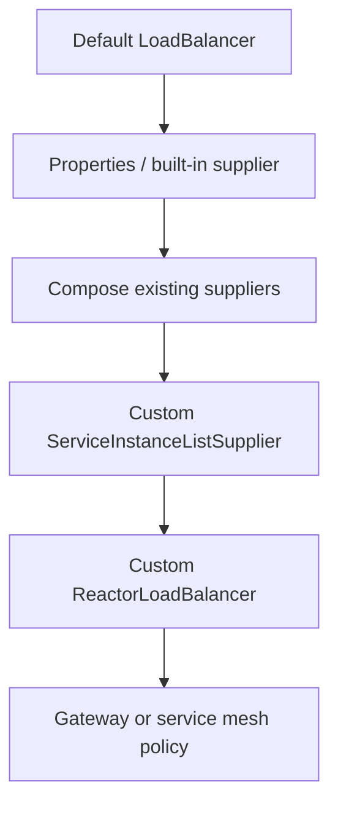
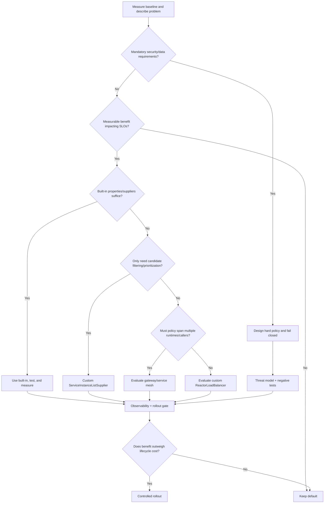

# Evaluating Operational Complexity vs. Customization Benefits

Spring Cloud LoadBalancer lets an application call a service ID and pick a `ServiceInstance` client-side. When the default algorithm falls short, a team can add zone preference, hints, sticky routing, weights, metadata filtering, or write a custom supplier/algorithm. Every customization can improve latency, availability, tenant isolation, or rollout control, yet also adds configuration, state, tests, alerts, and operational responsibility.

**A routing policy is only worth keeping when its measured benefit outweighs its lifetime ownership cost.** This article presents a data-driven evaluation approach, compares customization levels, and helps pick the right place to enforce policy. Scope belongs to the `SPRING_CLOUD_SERVICE_COMMUNICATION_LOAD_BALANCING` module: service IDs, discovery, health checks, `ServiceInstance` selection, RestClient, WebClient, OpenFeign, retry/timeout, and observability.

## 1. Design questions to answer

Suppose `order-service` calls `inventory-service` with a `@LoadBalanced RestClient`. By default, LoadBalancer picks an instance from the candidate list supplied by discovery/supplier. The team wants zone-based routing because calls to same-zone replicas have lower latency. Another proposal asks for tenant-based sticky routing; another asks for weighted canaries. Each proposal carries different benefits and costs.

Before writing custom code, answer:

1. **What is the current problem?** Are there numbers on latency, errors, network costs, skewed load, or isolation requirements?
2. **How is expected benefit measured?** How much p95 reduction, error drop, region compliance, or resource savings?
3. **Who owns the decision?** Caller, Spring Cloud LoadBalancer, gateway, service mesh, or discovery platform?
4. **Can the policy be expressed via existing configuration or built-in suppliers?** Or is a custom algorithm genuinely required?
5. **When metadata is missing, discovery is stale, health checks misfire, or zero candidates remain, what must the system do?**
6. **Who maintains the policy when upgrading Spring Boot/Spring Cloud, changing registries, or swapping HTTP clients?**

Without answers to these questions, custom routing usually adds more scenarios to debug without solving a proven problem.

## 2. Build a baseline before customizing

A baseline is the simple running behavior used as a benchmark. For a service ID, record:

| Item | Baseline data |
|---|---|
| Caller and downstream | `order-service` → `inventory-service` |
| HTTP client | `RestClient`, `WebClient`, or OpenFeign; which bean is annotated `@LoadBalanced`. |
| Discovery | `ServiceInstance` list source, refresh interval, and cache. |
| Selection | Current algorithm, candidate order, behavior on empty list. |
| Health | Is there a health supplier/probe; does it probe liveness or readiness. |
| Retry/timeout | Where retries live (client, LoadBalancer, wrapper, or proxy); overall deadline. |
| Metadata | Actual keys present on instances, their source, and reliability. |
| Observability | Logical calls, HTTP attempts, selected instance, status, p95/p99. |
| Operations | Related incident count, root-cause investigation time, and rollback path. |

Do not measure only successful request counts. A system with 99.9% success yet high p99, frequent connection pool exhaustion, or heavy retry amplification may still need changes. Conversely, if latency/errors already meet SLOs and there are no new locality/isolation requirements, custom routing may just add needless complexity.

### Measure the right units

Separate three concepts:

| Unit | Example | Can increase due to |
|---|---|---|
| **Logical request** | One operation fetching order stock. | User traffic. |
| **LoadBalancer selection** | One selection of `inventory-a`. | Retry reselection, or multiple client invocations. |
| **HTTP attempt** | One actual HTTP request sent to a replica. | Retries in client/LB/proxy, redirects, or transport behavior. |

Request ratio hitting a replica does not necessarily equal attempt ratio, and attempt counts do not reflect success rates. When comparing baseline against a new policy, measure all three at the right layer.

## 3. Customization benefits must tie to concrete outcomes

A custom policy creates value when it solves one of these needs:

| Benefit | Example in LoadBalancer | How to prove |
|---|---|---|
| **Lower latency** | Preferring same-zone instances when caller and upstream are co-located. | Compare p50/p95/p99 for the same operation, zone, and load. |
| **Higher availability** | Excluding unhealthy instances or avoiding degraded zones. | Error rate, detection time, recovery time, false positives. |
| **Data isolation** | Routing a tenant/region only to instances authorized for that data. | Negative-case tests, audits, and proof no cross-region leaks occur. |
| **Rollout control** | Assigning a small cohort to a canary. | Assignment ratio, selections, attempts, and outcomes per release. |
| **Capacity balancing** | Applying weights when replicas have unequal capacity. | CPU, queue depth, latency, and throughput per instance. |
| **Lower network cost** | Preferring same-region replicas to cut egress/cross-zone traffic. | Network/egress cost, latency, and cross-zone ratio. |
| **Lower auxiliary load** | Affinity to replicas holding warm caches when contracts permit. | Cache hit rate, backend load, tail latency, and consistency. |

Benefits must be substantial enough and repeatable under representative workloads. One small benchmark or a nice few-minute chart does not prove a policy works better across all zones, peak hours, and failure modes.

## 4. Customization levels from simple to complex

Not every requirement warrants writing a new `ReactorLoadBalancer`. View options as an ascending cost ladder:



The diagram shows **option paths**, not a mandatory sequence to climb through. Gateway/mesh is a different policy enforcement location, not a "higher tier" within the same API.

| Option | When suitable | Relative cost | Main risk |
|---|---|---:|---|
| **Default** | Current round robin/random meets SLOs. | Low | Does not express unconfigured specialized policies. |
| **Properties/built-in** | Caching, hints, zone preference, retry/health supported in your release. | Low–medium | Misreading semantics or config ordering. |
| **Compose built-in suppliers** | Need an extra filter/cache/health step while staying on standard SPI. | Medium | Wrong ordering, stale cache, or lost request context. |
| **Custom ServiceInstanceListSupplier** | Need to filter/prioritize candidates using request/metadata. | Medium–high | Unreliable metadata, empty candidates, missing context propagation. |
| **Custom ReactorLoadBalancer** | Need a custom selection algorithm suppliers/filters cannot express. | High | Owning algorithm, state, concurrency, retries, and compatibility. |
| **Gateway/service mesh** | Policy must apply centrally across many callers or languages. | Medium–high in infra | Adds proxy/control plane; may overlap with client-side routing. |

API names, properties, and supplier builders change across Spring Cloud releases. Always verify your active BOM version and runtime behavior; never copy config from another release without tests.

## 5. When to keep the default?

Keeping default configuration is usually the right choice if:

- Discovery provides accurate and sufficiently fresh instance lists.
- Replicas have comparable capacity with no mandatory locality constraints.
- Latency/error distributions already meet SLOs.
- No tenant/session affinity or release-based rollout is required.
- Current retries/timeouts already have clear budgets and behavior.
- On-call can diagnose issues from service ID, selected instance, and HTTP outcome without extra routing policies.

**Do not customize simply because you can.** Every added routing condition multiplies branching cases: missing metadata, all candidates filtered out, out-of-sync health probes, stale caches, retry reselection, or unintended fallbacks.

For example, with three equal-capacity replicas and even traffic, round robin is usually enough. Writing a complex weighted algorithm without measured capacity differences adds code to test and maintain with zero measurable payoff.

## 6. When is built-in configuration enough?

Prefer built-in properties or suppliers when requirements match semantics already supported by Spring Cloud LoadBalancer in your release:

- Enabling/disabling or tuning instance list caching.
- Health checks via appropriate endpoints/settings.
- Zone preference/hints when discovery and callers already supply properly formatted metadata.
- Supported retry behavior with clear reselection understanding.
- Sticky-session or hint-based routing if supported by your version and integration.

The advantage is the framework owns most implementation while the team operates configuration. Still, built-in does not mean "zero understanding needed". You must know:

1. Whether properties apply globally or per service.
2. Which suppliers get created and in what order they compose.
3. Where candidate lists are cached, plus TTL/capacity.
4. On what schedule health probes run and whether they impact startup.
5. What fallback runs when request context is absent.
6. Whether property/API semantics change on Spring Cloud upgrades.

If built-ins solve the requirement cleanly, custom code does not automatically add value.

## 7. When does composing existing suppliers make sense?

A common need is taking a shared discovery list and layering health checks and zone preference. You can compose built-in suppliers rather than rewriting discovery/caching/health from scratch.

Conceptual model:

```text
Discovery source
    -> shared candidate cache
        -> health filtering
            -> zone/hint preference
                -> LoadBalancer selection algorithm
```

Exact ordering depends on your Spring Cloud version's API and builder. Verify:

- Shared discovery lists are cached before per-request filtering.
- Personalized candidate lists by tenant/zone are never cached under a key containing only the service ID.
- Health filtering cannot accidentally drop all replicas due to a wrong path or overly tight timeout.
- Whether zone preference is a soft preference or a hard constraint.
- Downstream suppliers still receive the right `Request` if policies rely on request context.

This is a solid option when reusing framework behavior while adding one small, well-tested policy step.

## 8. When do you need a Custom ServiceInstanceListSupplier?

A custom supplier fits when you must **alter the candidate set** based on request data, e.g.:

- Including only replicas matching the release assigned to the request.
- Preferring the same zone while permitting fallback.
- Excluding batch-dedicated instances from interactive requests.
- Filtering by capability/version demanded by a service contract.
- Enforcing hard region constraints per verified policy.

One supplier should do one clearly named job. For instance, `ReleaseAwareServiceInstanceListSupplier` filters by `release` metadata; it should not simultaneously parse tenants, compute canary percentages, query databases, emit metrics, retry, and mutate headers.

Pseudo-flow:

```text
candidatesFlux = delegate.get(request)
decision = verifiedPolicy.from(request)

return candidatesFlux.map(candidates -> {
    eligible = candidates filtered by decision.allows(metadata)
    if eligible is empty:
        return the policy's explicit no-candidate result
    return eligible
})
```

This is **pseudocode**, not a complete class. `verifiedPolicy` must be constructed at a trust boundary; never accept self-asserted external user headers as proof of tenant/region. Empty-list handling must be explicit: fail closed for hard constraints; soft preferences may fall back to the original valid candidates if the contract allows.

### Incurred costs

- Understanding `RequestDataContext` and how RestClient/WebClient/OpenFeign pass request data in your release.
- Testing present context, missing context, malformed context, and calls from other clients.
- Verifying supplier ordering, cache keys, health checks, and discovery refreshes.
- Defining behavior when metadata is missing or inconsistent.
- Instrumenting candidate counts before/after filtering and no-instance reasons.
- Assigning code ownership across framework SPI changes or new HTTP clients.

If one small condition can be met by an existing supplier, a custom supplier is unnecessary overhead.

## 9. When do you need a Custom ReactorLoadBalancer?

A custom `ReactorLoadBalancer` directly alters the step that picks one `ServiceInstance`. It fits when selection logic cannot be expressed as filtering/prioritizing lists, e.g.:

- Weighted algorithms with specific semantics backed by reliable capacity data.
- Distribution algorithms requiring custom, properly managed state/sequences.
- Selection combining multiple normalized signals unsupported by existing suppliers.
- Mathematically/empirically verifiable selection policies owned by a platform team.

Costs are higher because the team must own:

1. Initialization and state/thread-safety of the algorithm.
2. Behavior on empty candidate lists or single-instance lists.
3. Missing or invalid request contexts.
4. Retry/reselection semantics and avoiding unintended repeat picks.
5. Consistency when multiple caller processes run the algorithm independently.
6. Metrics/logging/tracing for selections, candidate counts, and failure reasons.
7. Distribution, concurrency, failure, cache, and upgrade tests.

**A complex algorithm does not produce consistent cluster-wide distribution if every caller process holds independent local state.** If cluster-accurate quotas/weights are needed, local JVM counters may fall short; consider a centralized traffic controller or an appropriate stateless deterministic mechanism.

Never write a custom algorithm just to swap round robin for random without proof round robin causes issues.

## 10. When should policies move to a gateway or service mesh?

Spring Cloud LoadBalancer runs inside each caller application. That brings benefits: selection happens right in the client, can read application request context, and needs no extra proxy hop. The trade-off is that multiple callers may run **different policy/config versions** simultaneously.

A gateway or service mesh is worth considering when:

- Policies must apply uniformly across multiple languages/runtimes.
- Centralized traffic splitting is needed across many services/clients.
- Canary/weighted routes must be managed at one point with clear auditing/rollout.
- A platform team owns the control plane and operates the mesh/gateway.
- Consistent observability/network policy is required beyond a single Spring app.

Keep policies in Spring Cloud LoadBalancer when:

- Only certain Spring callers need custom selection logic.
- Decisions depend on verified business data at the caller.
- You want to avoid an extra proxy hop and new mesh infrastructure.
- The service team can own, test, and operate the custom policy.

Never enforce the same traffic split across gateway, mesh, and LoadBalancer without defining ordering. If the gateway already sends 10% to a canary subset and the caller splits another 10% inside that subset, the net share can drop to 1%; if policies diverge, results become even harder to predict.

## 11. Comparing options by lifecycle cost

Evaluation does not stop at lines of code. Factor in build, deploy, runtime, and incident response:

| Cost | Default/built-in | Compose suppliers | Custom supplier | Custom algorithm |
|---|---|---|---|---|
| **Initial code** | Low | Low–medium | Medium | High |
| **Configuration** | Minimal | Medium | Medium–high | High |
| **Testing** | Framework + contract tests | Supplier order/cache tests | Request/metadata/fallback matrix | Additional distribution/concurrency tests |
| **Observability** | Standard metrics and existing logs | Add candidate/filter signals | Add decision reasons | Add selection internals/state |
| **On-call** | Few custom branches | Debug supplier chain | Debug context/metadata/cache | Debug algorithm/state/concurrency |
| **Framework upgrades** | Usually low | Medium | Medium–high | High |
| **Team onboarding** | Low | Medium | Higher | High |
| **Rollback** | Revert config | Disable supplier wrapper | Swap config/bean per service | Needs path back to old algorithm |

These tiers are relative assessments, not benchmarks. A tiny custom supplier enforcing data residency may be well worth high cost; a several-hundred-line weighted algorithm lacking capacity metrics may not be.

## 12. Quantifying benefits with metrics

State a hypothesis before writing code. Example:

```text
Hypothesis:
Preferring same-zone replicas will reduce GET inventory p95 latency.

Baseline:
Cross-zone calls: 40%
p95: 180 ms
Error rate: 0.15%

Canary policy:
Same-zone preference, soft fallback

Acceptance criteria:
Meaningful p95 reduction at the same traffic mix;
error rate stays within guardrails;
does not skew load or raise saturation in remaining zones.
```

These numbers are illustrative only. In practice:

- Measure identical operations, payload sizes, zones, tenant categories, and load windows.
- Compare p50/p95/p99, error rate, throughput, and CPU/connection pools.
- Record both selection counts and HTTP attempts, not just final success.
- Gather sufficient samples; avoid comparing a tiny sample's p99 against millions of requests.
- Track fallbacks, no-eligible-instance events, and stale discovery.
- Test when the target zone is slow or unreachable.

If latency drops while errors rise, or one zone overloads because all callers pile onto the same cluster, net benefit can turn negative.

## 13. A scorecard to decide whether to customize

The scorecard below is a discussion tool, not an official Spring formula. Score each criterion from 1 to 5:

| Criterion | 1 point | 3 points | 5 points |
|---|---|---|---|
| **User impact** | Barely noticeable | Affects an important flow | Major impact on SLOs/business |
| **Baseline evidence** | Gut feeling only | Partial data | Repeated measurements, clear root cause |
| **Issue frequency** | Rare | Hourly/load spikes | Continuous or scales with load |
| **Compliance/isolation value** | None | Partial constraints | Mandatory hard constraint |
| **Solution simplicity** | Needs state/heavy dependencies | One supplier/policy | Built-in configuration |
| **Rollback capability** | Hard, wide blast radius | Route flag exists | Independently toggleable, tested |
| **Operability** | No owner | Owner exists, lacks dashboard | Clear owner, runbook, alerts |

Do not sum everything into one number and auto-decide. Separate:

- **Benefit:** user impact, evidence, frequency, and policy value.
- **Cost/risk:** complexity, rollback, operability, and compatibility.
- **Hard requirements:** security, data residency, or compliance cannot be "traded off" against lower latency.

A high-benefit policy lacking an owner, on-call coverage, or rollback is not ready to ship. If the gain is only a couple of milliseconds without moving SLOs, keeping the default may be wiser.

## 14. Decision example: zone preference for inventory

Scenario:

- Caller `order-service` runs in `zone-a` and `zone-b`.
- Inventory has replicas in both zones.
- Cross-zone traffic carries higher latency/cost.
- All replicas serve the same contract; zone is purely a preference.

### Option A — Keep default

Pros: minimal config, easy to understand, no reliance on zone metadata. Cons: requests may frequently cross zones without locality optimization.

Choose A if cross-zone latency/egress does not hurt SLOs or cost.

### Option B — Use built-in zone preference

Pros: leverages framework, minimal custom code. Cost: requires accurate zone metadata, understanding fallback, and testing supplier/health/cache order.

Choose B if your release's built-in supplier matches needed semantics and request context is supplied.

### Option C — Custom supplier

Pros: expresses custom rules, e.g., zone preference combined with release. Cost: must own context propagation, metadata, caching, tests, and observability.

Choose C only when B cannot express a measured requirement and long-term ownership exists.

### Sample decision

If the goal is strictly reducing cross-zone traffic, try B first. If policy demands hard data residency, do not treat zone preference as enough: you need a hard filter backed by verified identity/policy that fails closed when no candidates exist. These are two distinct requirements even though both inspect a `zone` field.

## 15. Decision example: weighted/canary routing

Suppose there are eight stable replicas and two canary replicas. Round robin across ten instances routes roughly 20% of selections to canary when the list is stable, not 5%. You may want custom weights so canary gets only 5%.

Before writing a custom weighted algorithm, consider:

1. Can traffic splitting live at the gateway/mesh?
2. Do you need ratios by logical request or by instance capacity?
3. Must ratios be exact cluster-wide or merely statistically expected?
4. Do all caller processes share identical configuration and algorithms?
5. On retries, should release assignment stay sticky?
6. When canary has no healthy instances, is fallback allowed and metered separately?
7. Do metrics distinguish assigned, selected, HTTP attempts, and outcomes?

If sticky cohorts are needed, a stateless decision hashing verified identity is often stabler than per-attempt random picks. If exact cluster-wide quotas are required, local per-JVM counters are insufficient without coordination.

**Never use weighted selection to replace health checks or capacity management.** A high-weight instance that is failing still must not receive requests.

## 16. Hidden operational risks in custom routing

### 16.1. Unreliable or inconsistent metadata

If a supplier reads `metadata.get("zone")` or `metadata.get("release")`:

- Registry/deployments must inject labels from a trusted source.
- Missing keys must have deterministic behavior.
- Never let user-supplied headers turn into hard authorization.
- Check metadata across rollouts, restarts, and scaling.
- Never dump sensitive or full metadata into metric labels.

Wrong metadata can filter out every instance. That is not just a distribution bug; for tenant/region rules, it can become a data isolation breach.

### 16.2. Request context never reaches the supplier

RestClient, WebClient, and OpenFeign use different integration/filter chains. Headers or attributes added after LoadBalancer picks an instance will not influence the decision already made. Reactor Context also does not automatically equal `RequestDataContext`.

If a policy depends on request data:

- Test each HTTP client separately.
- Verify request context actually arrives in `ServiceInstanceListSupplier.get(Request)`.
- Check filter/interceptor ordering.
- Define clear defaults when context is missing.
- Never use global `ThreadLocal` to pass per-request state in reactive flows.

### 16.3. Caching and stale data

Caching trims discovery queries, yet custom filtering creates a wrong-caching hazard:

```text
Unsafe:
cache key = serviceId
value = candidates already filtered by tenant/zone/release

Safer:
cache key = serviceId
value = shared discovery list
request context -> filter candidates after cache
```

If caching depends on request parameters, keys must capture every relevant dimension with cardinality limits and TTLs. In most cases, filtering after a shared cache is simpler and safer to operate.

### 16.4. Health checks and false positives

Probing too often adds load; probing too slowly leaves bad instances active; a health endpoint returning `UP` does not guarantee business APIs work. Ensure you:

- Distinguish liveness, readiness, and dependency health.
- Pick matching path/timeout/interval values.
- Track detection time and recovery time.
- Test what happens when all instances are marked unhealthy.
- Prevent brief probe blips from accidentally dropping an entire zone.

### 16.5. Retries and fallbacks hiding failures

Retries can raise final success rates while amplifying traffic. If a canary-assigned request retries onto stable, log/meter the fallback; otherwise canary looks healthier than it is. Hard tenant/region constraints must never relax during retries.

### 16.6. Distributed configuration across multiple callers

Each caller may cache instance lists and reload config at different times. During rolling deployments, some callers run the old policy while others run the new one. Maintain config versions, track rollout propagation, and emit metrics by caller/policy version to observe convergence time.

## 17. Test matrix matching complexity

Higher customization demands a wider test matrix:

| Level | Minimum tests |
|---|---|
| Default/built-in | Service ID resolution, multiple instances, empty list, HTTP status/transport. |
| Composed suppliers | Supplier ordering, caching, health, zone/hints, and fallback. |
| Custom supplier | Present/missing/malformed request context, missing metadata, hard/soft filters, concurrency, cache isolation. |
| Custom algorithm | Algorithm correctness, distribution, thread safety, empty/single-element candidates, deterministic behavior, retry/reselection. |
| Gateway/mesh | Route weights, config propagation, proxy health, interaction with client-side LB, and rollback. |

Common scenarios to include:

- Healthy instance returning 200.
- Real upstream returning 503.
- Instance present in discovery whose process stopped.
- Zero eligible instances.
- Health probe timeout or false negative.
- Missing/malformed metadata.
- Request context not propagated.
- Retries honoring policy without excessive amplification.
- Concurrent requests never leaking tenant/release/zone context.
- Scale up/down and cache refresh.

To prove which replica actually received HTTP traffic, use multiple MockWebServer/WireMock instances on dynamic ports or a test discovery setup. Unit tests calling the algorithm directly do not replace integration tests through a `@LoadBalanced` client.

## 18. Observability and runbooks must accompany custom code

Every policy must answer:

1. Which service ID did the caller intend to call?
2. What routing decision did the request carry, and which source verified it?
3. How many candidates existed before/after filtering?
4. Which instance was selected, or why was none selected?
5. How did the HTTP attempt finish?
6. Did retries/fallbacks happen, who triggered them, and how many times?

Illustrative event schema:

```json
{
  "event": "loadbalancer_decision",
  "targetService": "inventory-service",
  "policy": "same-zone-preference",
  "policyVersion": "v3",
  "candidateCount": 6,
  "eligibleCount": 2,
  "selectedInstance": "inventory-a2",
  "outcome": "selected",
  "traceId": "4bf92f3577b34da6a3ce929d0e0e4736"
}
```

Values are illustrative. Never log tokens, raw tenant claims, full metadata, or PII. Metric labels should stay small-cardinality sets like `targetService`, `policy`, `outcome`, `release`; keep trace IDs/detailed instance IDs in logs/traces with appropriate access controls and retention.

### Runbook when a policy finds zero instances

1. Confirm service ID and discovery list.
2. Check whether required metadata exists on instances.
3. Inspect health filters and last cache refresh timestamp.
4. Check whether request context reached the supplier.
5. Verify whether the policy is soft or hard; never silently open fallbacks just to make requests pass.
6. For hard constraints, keep failing closed and report a classified error.
7. For soft preferences, fall back only within candidates meeting mandatory constraints and emit dedicated metrics.
8. If a new policy causes an incident, toggle off the custom policy or revert to the default supplier per the tested runbook.

Custom code lacking decision-reason logs and a rollback switch forces on-call engineers to guess from final HTTP symptoms, making root-cause analysis painful.

## 19. Step-by-step decision workflow



### Decision checklist

- [ ] Baseline problem documented with data and SLOs.
- [ ] Expected benefit specifies metric, workload, and acceptance threshold.
- [ ] Soft preferences separated from mandatory constraints.
- [ ] Proper traffic/routing owner chosen.
- [ ] Built-ins checked before writing custom code.
- [ ] Costs evaluated for cache, metadata, health, retries, and config propagation.
- [ ] Owner, on-call rotation, dashboards, and runbook assigned.
- [ ] Test matrix covers normal/failure/concurrency/upgrade cases.
- [ ] Kill switch/rollback exists and has been rehearsed.
- [ ] Plan exists to re-evaluate policy after Spring Cloud upgrades or discovery provider changes.

## 20. ADR template: should we customize LoadBalancer?

Use this template to record team decisions:

```text
Title:
Context:
  Service ID:
  Caller(s):
  Discovery provider:
  Current LoadBalancer behavior:
  Baseline SLO and measurements:

Problem:
  User/business impact:
  Frequency:
  Evidence:

Options:
  A. Keep default
  B. Built-in properties/supplier
  C. Compose existing suppliers
  D. Custom ServiceInstanceListSupplier
  E. Custom ReactorLoadBalancer
  F. Gateway/service mesh

Decision:
  Chosen option:
  Traffic/policy owner:
  Soft preference or hard constraint:
  Behavior when context/metadata is missing:
  Behavior when no instance is eligible:

Expected benefit:
  Metric:
  Baseline:
  Target:
  Minimum sample/window:

Operational cost:
  Code/config owner:
  Tests:
  Dashboard/alerts:
  Upgrade compatibility:
  On-call runbook:
  Rollback switch:

Risks and mitigations:
  Cache/metadata/security/retry/health:

Review date:
```

Do not pick a custom policy just to make an ADR look thorough. A `Keep default` decision backed by clear evidence is also a strong engineering outcome.

## 21. Example conclusions for three problems

| Problem | Sensible initial decision | When to raise customization |
|---|---|---|
| Three equal replicas, same zone, SLO met | Keep default algorithm. | When skewed load or meaningful latency gaps are measured. |
| High cross-zone latency/egress | Try built-in zone preference and measure. | When multi-condition policies exceed built-in suppliers. |
| Tenant restricted to dedicated region | Hard filter from verified identity/policy; fail closed. | If enforced across runtimes, consider central enforcement at platform/mesh/gateway. |
| 5% canary across many callers | Pick one traffic assignment owner and keep release decisions sticky. | Use custom supplier if client-side routing fits and needs request-level filtering. |
| Replicas with widely varying capacity | Measure saturation first; try built-in config/weighted suppliers. | Custom algorithm only when weight semantics require it with full telemetry/tests. |

## 22. Conclusion

The complexity of a custom LoadBalancer does not live solely in the instance selection algorithm. It lives across **the entire operational contract**: metadata sources, request context, discovery/caching, health, retries, telemetry, tests, framework upgrades, and rollback capability. Benefits likewise cannot be described merely as "more flexible routing"; they must tie to measured latency, availability, isolation, rollout control, or cost.

Keep defaults when they satisfy SLOs; prefer built-in properties and suppliers when they match requirements; write custom suppliers/algorithms only when evidence proves simpler choices are inadequate. If policies must apply uniformly across runtimes or callers, evaluate a gateway/service mesh and assign one traffic owner. For every choice, clearly define behavior when context/metadata is missing, candidates are empty, health misfires, and retries occur.

**A good policy delivers measurable benefit, acceptable ownership cost, predictable failure behavior, and clear operability.** If you cannot explain why a request landed on a given replica, when fallbacks trigger, and how to turn the policy off during an incident, custom routing is not ready for production.
